# Web3 革命：区块链、加密货币、NFT 与元宇宙


# 关于作者
我叫 [Nicola Accialini](https://www.linkedin.com/in/nicolaaccini/)，是一名自由职业顾问。在帕多亚大学毕业后，我曾在一些主要公司工作过。从 2019 年 6 月开始，我一直致力于数字化转型，帮助公司在各个领域寻找并实施创新策略。在这种背景下，`Web3` 无疑是公司、专业人士不能错过的机会，以跟上现在和未来。

# 引言
2010 年，Laszlo Hanyecz 用 30 美元购买了两个披萨`10,000 比特币`。现在几乎 12 年后，那两个披萨为那幸运的披萨店（希望他们在此期间保存了那些比特币）带来了约 4 亿美元的等值价值。与此同时，美元贬值了 27%。这一简单的事实足以让我们意识到我们正面临着颠覆性的变革：新的技术解决方案所承诺的变革，甚至可以基于一种新的去中心化协议：`区块链` 来重构新的社会架构。

更多信息请访问：`www.accialiconsulting.com`


同样，目前由各国政府管理的法币正经历着一个缓慢但稳定的通胀过程（在某些情况下速度并不缓慢，例如津巴布韦和委内瑞拉的恶性通胀案例），其价值正在逐渐流失：1970 年代的 1 美元其购买力等同于 2019 年的 6.59 美元，通胀率变化率为 558.63%#2。

# 如何避免国家货币贬值？

## 信息与数据的中心化

回顾与第二次工业革命的对比，在如今的数字时代，我们正在看到一种与工厂生产活动中心化相似的现象，但这次是在信息和数据的基础上。世界经济论坛创始人兼执行主席克劳斯·施韦伯在《第四次工业革命》#3 书中，讨论新数字技术对人类生活的影响时，呈现了一个有趣的画面：如果最大的三个社交媒体网站是国家，它们将进入人口最多国家的前 10 名。此外，第一位发现的是一个社交媒体类国家，且不考虑这三个社交网络都是 `Meta Platforms Inc`的一部分。此外，如果我们考虑到全球最大的搜索引擎 `Google`、最大的操作系统提供商 `Microsoft`、占据手机市场份额主导地位的 `Samsung`，最后如果我们将全球服务器市场也加入这一分析（由美国巨头 `Dell`、`Hpe`、`Inspur`以及中国大厂`Huawei`和`Lenovo`划分），就很容易理解作为新千千年“真金”的信息是如何集中在少数公司手中的了。

## 老大哥

在小说《1984》中，英国作家乔治·奥威尔描述了一个个人都不断受到当局监控的社会。“老大哥”（Big Brother）是这个虚构角色的名称，由于他是一个真实存在的人，还是政党创造的符号。然而，在 2013 年，“老大哥”不仅是一个科幻小说中的角色，而且通过世界主要大国——美国的行为，变成了绝对真实的东西。感谢于告哨者爱德华·斯诺登，一个中心化的大规模监控系统被公开了，该系统利用 `NSA`#4`、`Amazon`、`Apple`、`Meta (Facebook)` 和 `Microsoft`。

图 1：互联网历史，从 web 1.0 到 web 3.0。来源：Cointelegraph

然而，由于是一个相对新的术语，`Web3` 的含义仍然并不完全清楚，尽管它与 `Blockchain` 技术（如 `Cryptocurrencies` 或非同质化代币 `NFT`）存在某些收敛性。去中心化金融（`DeFi`）代表另一个关键概念，用户可以在没有银行或政府参与的情况下交换货币。

## 即将出现的新场景

因此，`Blockchain`、`Cryptocurrencies` 和 `NFT` 是高度关联且具有话题性的技术和应用。然而，对于大多数人来说，它们仍然代表着未知的概念，或者至少是不清楚的，因此在实施时产生了强烈的怀疑和犹豫。

根据 EY 区块链峰会#6 期间进行的一项近期调查，关键高管被问及对该技术的了解程度如何。在 100 家大公司的样本中，知识水平在 1 到 100 分的分值上为 48 分。然而，对于了解它的人来说，`Blockchain` 被认为是对业务影响最大的三项技术之一：57%的人希望在公司内部实施它。


硬币也有积极的一面：每种风险都代表着一个机会。为了抓住这些机会，我们必须首先付出个人努力，即接受风险，然后对其进行适当的降低和管理。要降低风险，首要任务是充分获取信息，了解 `Blockchain`、`Cryptocurrencies` 和 `NFTs` 的含义，最重要的是它们的实际用途。正如我们将看到的，这些新的数字资产将带来一系列用途和收益，在某些情况下，这些收益可能会导致重大的社会和文化变革。

想象这样一个社会：银行失去了其作为金融担保人的核心角色。今天，数字格式的货币交换和支付交易恰恰由于银行所扮演的这种制度角色而发生，因此，当我们交换钞票时，我们信任它的内在价值。然而，如果我们能够通过一种去中心化且安全的机制来交换货币，允许我们在不需要中心担保人的情况下交换价值，这会产生什么样的影响（无论好坏）呢？

同样，想象一下，每一项并非财务性的交易（例如文档或合同的交换、文件的交换、视频、音频或 3D 模型交换，例如增材制造），在没有中间机构的情况下都被追踪并自动验证。现有的合同（`Smart Contract`）将立即生效，没有任何伪造风险，具有完全的可追溯性且没有中间成本。

这些只是 `Blockchain` 技术产生的一些实际收益。正如我们稍后解释的，我们可以说 `Blockchain` 是实现配置场景的引擎，而 `Cryptocurrencies` 是使其运行起来的汽油。

## 为什么写这本书？

作为一名员工，以及随后作为一名自由职业者，我有机会在创新的国际技术背景下工作。管理创新和新技术对我来说既是挑战也是机会，而面对挑战并抓住提供的机会的最佳方式就是学习、研究并接受某种程度的风险。因此，当我开始对 `Blockchain` 世界感兴趣时，我更感兴趣它在现实世界中的实际影响，而不是 `Cryptocurrencies` 典型的投机性影响。

通过这本书，我设定了一个宏大的目标：让每个人都能清晰理解 `Web3` 技术和应用的核心概念，如 `Blockchain`、`Cryptocurrencies`、`NFTs` 和 `Metaverse`，并以简单有效的方式传达给尽可能广泛受众，以确保越来越多的人能够抓住机会并减少相关的风险。

具体而言，本书针对：

1. 所有好奇于了解网络正在承担哪些新前沿，以及从中可以产生哪些风险和机会的人；
2. 在在交易所投入时间和金钱之前，想要了解 `cryptocurrencies` 和 `NFTs` 是什么、它们基于什么技术以及它们可能产生什么实际影响的自由投资者；
3. 想要更多了解 `Blockchain` 潜在应用以为公司赢得竞争优势的奇奇专业人士；
4. 接触新技术并旨在创建与之相关的自己业务的专业人士。

在书的结束处提供了一些 `Web3` 世界特定术语的定义，这些术语对非专家来说并不常见。因此，为读者提供这份词汇表（Glossary）是有用的，可以让他们更轻松地接触该主题。

最后，一点必要的说明：在书中将提到一些基于所描述技术的金融工具。虽然无疑为未来的投资者提供了非常有用的信息，但其绝非为了引导读者选择某项投资而非另一项。相反，目标是列出一系列概念，帮助潜在投资者决定是否投资这些新的技术资产，如果是的话，则帮助他定义最符合其财务策略的资产。

# 1 什么是区块链？

## 章节总结
在本章中，我们将尝试尽可能简单地回答以下问题：什么是 `Blockchain`？我们将借助关于该技术起源的一些历史注释来实现，参考由于密码技术的使用而针对信息中心化和价值资产交换安全性问题提出的解决方案。

**关键词**：`Blockchain`、`cryptocurrency`、`Bitcoin`、`Blockchain trilemma`、`David Chaum`、`Satoshi Nakamoto`

## 1.1 引言
`Blockchain` 顾名意思是“区块链”，每个区块包含一系列信息。这是一个大型数据库，它是去中心化的（更准确地说是分布式的）。创建包含数据的区块目的是什么？

每项新技术的目标都是解决一个问题，或者以比现有解决方案更好的方式解决它。`blockchain` 解决的问题是什么？为了回答这个问题，让我们回溯一下。

第一个提出基于此类系统的协议的是 `David Chaum`，一位美国计算机科学家和密码学家。`Chaum`工作的实际意义是创建一个数字 `Cryptocurrency`，独立于银行并能以不可追踪的方式使用。因此，开发这类系统需要避免传统银行系统中典型的信息中心化，创建一个去中心化的系统，其中信息对所有人可见且同时又是不可修改的。

### 1.2 实际示例
**如何设计一个信息交换可追踪、不可更改且独立的系统，而不需要第三方担保人？**

在一个像已经演变为当前 `Bitcoin` 技术的系统中（例如），每个区块都通过代码唯一地与上一个区块和下一个区块链接。这意味着要更改区块内的信息，所有后续区块也必须被更改。然而，这种操作绝非简单，因为：

1. 修改区块的代码需要一些努力
2. 代码更改必须经过网络中用户的批准

这两点为我们提供了机会深入探讨 `Blockchain` 的某些特定概念。

### 1.3 区块链的历史
我们说修改代码需要一些努力。正如我们在下一章中看到的，这种投入在大多数情况下表现为消耗在“寻找”区块代码上的。

## 1.4 区块链三困境
## 1.5 区块链的类型


一旦网络找到并验证了与区块关联的代码，该区块就可以添加到链中。作为奖励，在其他人之前成功破解该区块的用户或节点将获得相应的代币作为交换。因此，在比特币的情况下，该用户将获得 `1 BTC` 作为奖励。

我们在下文中总结了 `Blockchain`（区块链）中区块生成过程的各个步骤：

- 这种的目标是创建一个可靠且安全的系统，以便在不需要中介的情况下进行交易；
- `Blockchain` 使用复杂的编码系统来创建能够唯一标识区块并将它们连接到链上的代码；
- 这些代码由特殊节点，即所谓的“矿工”（我们将在下一章中讨论他们）进行解密，并发送到使用该 `Blockchain` 的网络中；
- 矿工因其努力而获得了受密码学保护的代币作为回报；
- 每个 `Blockchain` 用户都保留一份这些代码的副本；
- 修改区块代码在计算资源方面是一项极其昂贵的操作，且难以实现，因为例如它需要至少 `51%` 用户的验证。

### 1.2 实际示例

为了更清楚地解释 `Blockchain` 的底层概念及其主要优点，让我们参考 Mark Gates 在书中记录的示例[[7]](#part0000_split_077.html#_ftn7)。让我们想象一个共享书籍的在线图书馆（为了具体起见，我们称之为 `eBooks` 库），其中每个用户都贡献自己的 `eBooks` 并允许人们借阅。任何人都可以参与，当他们借阅书籍时，他们也可以将书借给其他人，而无需还给图书馆或原始所有者。该如何记录谁借了书、他们拥有哪些书，以及谁是原始所有者？应该记录目前图书馆中所有的书籍、它们的原始所有者以及已借出的书籍。为了做到这一点，可以为小组分配一个人，使用中心化数据库模型来跟踪交换情况。在现实中，这种做法会有许多缺点：

- 首先必须信任处理交易和维护账本的人员的能力。网络越大，管理的复杂性和难度就越高，因此出错的风险也越大
- 然后必须信任此人不会通过欺诈性地修改记录来偷取流通的书籍
- 我应该向此人支付费用
- 我必须等待此人完成所有交易。更大的复杂性也意味着更长的执行时间。否则，我将不得不雇佣另，从而增加了固定的管理成本

相反，`Blockchain` 可以提供一个所有图书馆书籍记录的分布式数据库，而不需要人员接管管理。有了这样一个数据库，图书馆的每个人都可以访问交易登记，每个人都能看到图书馆的书籍、原始所有者以及已借出的书籍。为了做到这一点，可以为小组分配一个人，使用中心化数据库模型来跟踪交换情况。在现实中，这种做法会有许多缺点：

- 首先必须信任处理交易和维护账本的人员的能力。网络越大，管理的复杂性和难度就越高，因此出错的风险也越大
- 然后必须信任此人不会通过欺诈性地修改记录来偷取流通的书籍
- 我应该向此人支付费用
- 我必须等待此人完成所有交易。更大的复杂性也意味着更长的执行时间。否则，我将不得不雇佣别人，从而增加了固定的管理成本

相反，`Blockchain` 可以提供一个所有图书馆书籍记录的分布式数据库，而不需要人员接管管理。有了这样一个数据库，图书馆的每个人都可以访问交易登记，每个人都能看到图书馆的书籍、原始所有者以及已借出的书籍。为了做到这一点，可以为小组分配一个人，使用中心化数据库模型来跟踪交换情况。在现实中，这种做法会有许多缺点：

- 首先必须信任处理交易和维护账本的人员的能力。网络越大，管理的复杂性和难度就越高，因此出错的风险也越大
- 然后必须信任此人不会通过欺诈性地修改记录来偷取流通的书籍
- 我应该向此人支付费用
- 我必须等待此人完成所有交易。更大的复杂性也意味着更长的执行时间。否则，我将不得不雇佣别人，从而增加了固定的管理成本

相反，`Blockchain` 可以提供一个所有图书馆书籍记录的分布式数据库，而不需要人员接管管理。有了这样一个数据库，图书馆的每个人都可以访问交易登记，每个人都能看到图书馆的书籍、原始所有者以及已借出的书籍。为了做到这一点，可以为小组分配一个人，使用中心化数据库模型来跟踪交换情况。在现实中，这种做法会有许多缺点：

- 首先必须信任处理交易和维护账本的人员的能力。网络越大，管理的复杂性和难度就越高，因此出错的风险也越大
- 然后必须信任此人不会通过欺诈性地修改记录来偷取流通的书籍
- 我应该向此人支付费用
- 我必须等待此人完成所有交易。更大的复杂性也意味着更长的执行时间。否则，我将不得不雇佣别人，从而增加了固定的管理成本

相反，`Blockchain` 可以提供一个所有图书馆书籍记录的分布式数据库，而不需要人员接管管理。有了这样一个数据库，图书馆的每个人都可以访问交易登记，每个人都能看到图书馆的书籍、原始所有者以及已借出的书籍。为了做到这一点，可以为小组分配一个人，使用中心化数据库模型来跟踪交换情况。在现实中，这种做法会有许多缺点：

- 首先必须信任处理交易和维护账本的人员的能力。网络越大，管理的复杂性和难度就越高，因此出错的风险也越大
- 然后必须信任此人不会通过欺诈性地修改记录来偷取流通的书籍
- 我应该向此人支付费用
- 我必须等待此人完成所有交易。更大的复杂性也意味着更长的执行时间。否则，我将不得不雇佣别人，从而增加了固定的管理成本

相反，`Blockchain` 可以提供一个所有图书馆书籍记录的分布式数据库，而不需要人员接管管理。有了这样一个数据库，图书馆的每个人都可以访问交易登记，每个人都能看到图书馆的书籍、原始所有者以及已借出的书籍。为了做到这一点，可以为小组分配一个人，使用中心化数据库模型来跟踪交换情况。在现实中，这种做法会有许多缺点：

- 首先必须信任处理交易和维护账本的人员的能力。网络越大，管理的复杂性和难度就越高，因此出错的风险也越大
- 然后必须信任此人不会通过欺诈性地修改记录来偷取流通的书籍
- 我应该向此人支付费用
- 我必须等待此人完成所有交易。更大的复杂性也意味着更长的执行时间。否则，我将不得不雇佣别人，从而增加了固定的管理成本

相反，`Blockchain` 可以提供一个所有图书馆书籍记录的分布式数据库，而不需要人员接管管理。有了这样一个数据库，图书馆的每个人都可以访问交易登记，每个人都能看到图书馆的书籍、原始所有者以及已借出的书籍。为了做到这一点，可以为小组分配一个人，使用中心化数据库模型来跟踪交换情况。在现实中，这种做法会有许多缺点：

- 首先必须信任处理交易和维护账本的人员的能力。网络越大，管理的复杂性和难度就越高，因此出错的风险也越大
- 然后必须信任此人不会通过欺诈性地修改记录来偷取流通的书籍
- 我应该向此人支付费用
- 我必须等待此人完成所有交易。更大的复杂性也意味着更长的执行时间。否则，我将不得不雇佣别人，从而增加了固定的管理成本

相反，`Blockchain` 可以提供一个所有图书馆书籍记录的分布式数据库，而不需要人员接管管理。有了这样一个数据库，图书馆的每个人都可以访问交易登记，每个人都能看到图书馆的书籍、原始所有者以及已借出的书籍。为了做到这一点，可以为小组分配一个人，使用中心化数据库模型来跟踪交换情况。在现实中，这种做法会有许多缺点：

- 首先必须信任处理交易和维护账本的人员的能力。网络越大，管理的复杂性和难度就越高，因此出错的风险也增大
- 然后必须信任此人不会通过欺诈性地修改记录来偷取流通的书籍
- 我应该向此人支付费用
- 我必须等待此人完成所有交易。更大的复杂性也意味着更长的执行时间。否则，我将不得不雇佣别人，从而增加了固定的管理成本

相反，`Blockchain` 可以提供一个所有图书馆书籍记录的分布式数据库，而不需要人员接管管理。有了这样一个数据库，图书馆的每个人都可以访问交易登记，每个人都能看到图书馆的书籍、原始所有者以及已借出的书籍。为了做到这一点，可以为小组分配一个人，使用中心化数据库模型来跟踪交换情况。在现实中，这种做法会有许多缺点：

- 首先必须信任处理交易和维护账本的人员的能力。网络越大，管理的复杂性和难度就越高，因此出错的风险也增大
- 然后必须信任此人不会通过欺诈性地修改记录来偷取流通的书籍
- 我应该向此人支付费用
- 我必须等待此人完成所有交易。更大的复杂性也意味着更长的执行时间。否则，我将不得不雇佣别人，从而增加了固定的管理成本

相反，`Blockchain` 可以提供一个所有图书馆书籍记录的分布式数据库，而不需要人员接管管理。有了这样一个数据库，图书馆的每个人都可以访问交易登记，每个人都能看到图书馆的书籍、原始所有者以及已借出的书籍。为了做到这一点，可以为小组分配一个人，使用中心化数据库模型来跟踪交换情况。在现实中，这种做法会有许多缺点：

- 首先必须信任处理交易和维护账本的人员的能力。网络越大，管理的复杂性和难度就越高，因此出错的风险也增大
- 然后必须信任此人不会通过欺诈性地修改记录来偷取流通的书籍
- 我应该向此人支付费用
- 我必须等待此人完成所有交易。更大的复杂性也意味着更长的执行时间。否则，我将不得不雇佣别人，从而增加了固定的管理成本

相反，`Blockchain` 可以提供一个所有图书馆书籍记录的分布式数据库，而不需要人员接管管理。有了这样一个数据库，图书馆的每个人都可以访问交易登记，每个人都能看到图书馆的书籍、原始所有者以及已借出的书籍。为了做到这一点，可以为小组分配一个人，使用中心化数据库模型来跟踪交换情况。在现实中，这种做法会有许多缺点：

- 首先必须信任处理交易和维护账本的人员的能力。网络越大，管理的复杂性和难度就越高，因此出错的风险也增大
- 然后必须信任此人不会通过欺诈性地修改记录来偷取流通的书籍
- 我应该向此人支付费用
- 我必须等待此人完成所有交易。更大的复杂性也意味着更长的执行时间。否则，我将不得不雇佣别人，从而增加了固定的管理成本

相反，`Blockchain` 可以提供一个所有图书馆书籍记录的分布式数据库，而不需要人员接管管理。有了这样一个数据库，图书馆的每个人都可以访问交易登记，每个人都能看到图书馆的书籍、原始所有者以及已借出的书籍。为了做到这一点，可以为小组分配一个人，使用中心化数据库模型来跟踪交换情况。在现实中，这种做法会有许多缺点：

- 首先必须信任处理交易和维护账本的人员的能力。网络越大，管理的复杂性和难度就越高，因此出错的风险也增大
- 然后必须信任此人不会通过欺诈性地修改记录来偷取流通的书籍
- 我应该向此人支付费用
- 我必须等待此人完成所有交易。更大的复杂性也意味着更长的执行时间。否则，我将不得不雇佣别人，从而增加了固定的管理成本

（注：原文中存在大量重复段落，译文已根据要求进行去重处理，保留核心逻辑。）


## 1998 - Szabo 设计了一种去中心化数字货币的机制，他称之为“比特黄金”（Bit Gold）。尽管比特黄金从未被实现，但它被称为“比特币架构的直接先驱”。

同年，中国计算机工程师大卫炎（Wei Dai）发表了名为《b-money：一种匿名、分布的电子现金系统》的论文。在文中，大卫炎概述了所有现代加密货币系统的基本属性：“……一种让大量无法追踪的数字别名方案能够使用货币进行相互支付，并在没有外部帮助的情况下强制执行之间的合同”。

## 2009 - 比特币由中本聪（Satoshi Nakamoto）正式诞生，这是开发比特币的个人或群体所使用的笔名。2009 年 1 月 12 日，美国工程师、加密活动家哈尔·芬尼（Hal Finney）收到了由中本聪发送的第一笔 10 BTC 交易（在本书编写时，其价值约 400,000 美元）。从这一刻起，区块链的概念与加密货币的概念共同演进，我们将在第四章中对其进行更详细的讨论。

## 1.4 区块链三困境

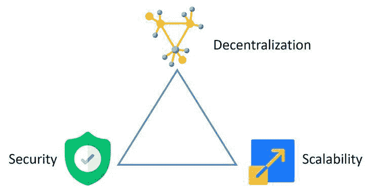

图 2：区块链三困境

根据 CoinMarketCap 的定义：“区块链三困境是由维太·布特林（Vitalik Buterin）提出的一个概念，它提出了开发者在构建区块链时面临的三个主要问题——去中心化、安全性和扩展性，这最终迫使他们通过牺牲其中一个‘方面’来平衡另外两个”。

这个问题实际上出现在比特币上，以及在尝试扩展其区块链时出现的问题。事实上，其区块链低的可扩展性源于它的设计方式：加密货币共识算法（`Proof-of-Work`）无法允许它像其他算法那样指数级扩展（例如，`Proof-of-Stake`）。另一方面，它确实具有安全性和持久性，使其在面对任何类型的攻击时都是安全的。我们将在下一章中讨论这些概念。为了解决这一三困境，并在事实上成为理想的区块链，中本聪创建的协议必须能够扩展。因此，后来诞生的大多数区块链以及随之生的加密货币（所谓的代币 Altcoins），目标都是以最好的方式解决以太坊联合创始人布特林（现今第二大区块链项目）所提出的三困境。

## 1.5 区块链的类型

基本上，我们可以根据区块链是公有的、私有的还是混合的来进行分类。

### 1.5.1 公有区块链

公共区块链指的是可以通过互联网网络公开访问的区块链。这种类型的例子是上述的比特币和以太坊。公共区块链将其数据、软件和开发向公众开放，任何人都可以审查、验证、开发或改进它。然而，公共区块链具有一些安全措施，确保没有攻击者可以轻易更改链的功能。

这种网络的特征如下：

- `完全参与`：任何人都可以作为用户或矿工参与其中，没有任何限制。
- `完全透明`：数据从创建之日起对所有人可见。
- `去中心化`：没有中央机构。
- `经济维护`：系统依赖网络。

### 1.5.2 私有区块链

随后，随着区块链的发展，许多公司对私有解决方案产生了兴趣。这种类型与公共区块链具有相同的元素，但访问受限于中央单元。

这种网络的特征是：

- `访问网络`：仅限于授权用户。
- `访问账本`：生成的信息是私有的。

### 1.5.3 混合区块链

这种类型的区块链是公共和私有的融合。在这些区块链中，参与性由一个或多个实体控制。

例如，一个案例是制药行业，数据由主管机构安全地存储。这种网络的特征是：

- `访问网络`：仅限于授权机构。
- `访问账本`：生成的信息是公开的。
- `没有加密货币`。
- `安全性`：达到了更高水平。

在下一章，我们将更详细地查看区块链的工作原理，并澄清之前遇到但未完全明确的一些概念。

# 2 区块链是如何工作的？

## 2.1 点对点 (P2P) 网络

## 2.2 分布式账本系统

## 2.3 区块

## 2.4 哈希算法与密码学

## 2.5 共识算法

## 2.6 分叉

## 章节总结

在上一章中，我们定性地描述了区块链及其的一些主要优势。在本章中，我们将更详细地观察区块链的关键元素，而不深入探讨只会导致困惑而无法让读者理解技术本质的细节和复杂性。

关键词：`去中心化网络`、`区块`、`哈希`、`密码学`、`账本`、`共识`、`工作量证明 (PoW)`、`权益证明 (PoS)`。

一个公有且开放区块链的元素基本上如下：

1. `点对点 (P2P) 网络`，即一种连接参与区块链的用户并传播经验证的交易区块的分布式网络；
2. 由加密代码验证的交易`区块`；


## 2.1 点对点 (P2P) 网络

在计算机网络领域，可以识别出三种类型的网络架构：

1. 中心化网络
2. 去中心化网络
3. 分布式网络

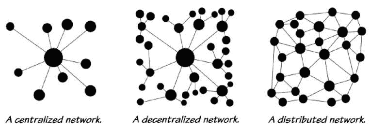

图 3：中心化、去中心化和分布式网络拓扑结构的对比（来源：Baran, 1964）

### 2.1.1 中心化网络

中心化网络架构围绕单一服务器构建，由其管理所有的主要的处理。性能较低的工作站连接到中央服务器并发送请求，而不是直接执行。拥有一个控制整个网络的中央服务器意味着管理时间更短，更新整个网络的管理员更少。此外，中心化网络上的所有数据必须经过单一位置，因此非常容易跟踪和收集跨网络的数据。

然而，中心化网络也有其缺点：根据定义，服务器代表了单点故障，也就是说，它的故障会使整个网络面临风险。结果，如果服务器宕机，连接的各个“客户端”机器将无法处理用户请求。中心化网络的另一个缺点是其扩展性有限：由于所有应用程序都托管在单个服务器上，扩展网络的唯一方法就是向服务器添加更多存储、带宽或处理能力。这可能证明不是一种成本效益高的长期解决方案。

### 2.1.2 去中心化网络

与中心化网络不同，去中心化网络架构将负载分布在多个机器上，而不是依赖单一中央服务器。与传统的中心化网络相比，去中心化网络提供了广泛的优势，包括更高的系统可靠性、扩展性和隐私性。

去中心化网络管理的最重要的之一之一是没有中心化网络那样的真正的单点故障，因为单个用户的机器不依赖单一中央服务器来管理所有进程。去中心化网络也更容易扩展，因为你只需向网络中添加更多机器来获得更多的计算能力。此外，去中心化网络架构允许更高的隐私，因为信息不是通过单点传输，而是通过几个不同的点。然而，缺点是去中心化网络需要更多的机器，这意味着更多的维护和潜在问题，反过来给 IT 资源带来了额外负担。

### 2.1.3 分布式网络

分布式网络代表了去中心化网络系统架构的演进，区块链正是基于点对点（P2P）。P2P 网络是一种架构模型，其中节点不仅以固定客户端或服务器的形式分层，还以等效或“对等”节点的形式存在，能够同时向网络的其他终端（主机）充当客户端和服务器。这意味着通过这种配置，任何节点都能够发起或完成交易。等效节点在本地配置、处理速度、带宽和存储数据量方面可能存在差异。在中心化网络的主要特征中，我们列出了以下几：

- `Napster`：由 Shawn Fanning 和 Sean Parker（后来成为 Facebook 的创始人）于 1999 年推出。由于版权相关的法律问题，它于 2000 年关闭。
- `Bit Torrent`：2001 年由布法罗大学的计算机科学专业学生 Bram Cohen 创建。
- `eMule`：由 Hendrikkreuz 于 2002 年启动的项目。
- `eDonkey2000`

这些协议虽然是合法的（数据交换并不违法），但大多数仍用于传输电影、音乐和视频游戏等作品。在美国，针对 `Bit Torrent` 的版权诉讼已超过了 200,000 起。

## 2.2 分布式账本

在前面的章节描述的在线图书馆示例中，我们看到了区块链如何基于一种会计系统，即每个参与者都接收交易日志副本的系统。将这种会计系统想象成一棵家族树，它不仅包含拥有和借用书籍的人名，还包含支付价值、时间和地址的信息。在金额方面，发生的情况与任何现有银行系统都非常相似。然而，存在实质性的差异：

1. 由于上述的分布式架构，账本没有银行。
2. 地址不代表人的名字，也不代表谁拥有什么。因此，我们可以将其定义为匿名会计系统（在第 3 章中我们实际上会看到这并不完全正确）。当涉及到大账本中的加密货币账户时，只有拥有密码的人才能访问它。这可能是危险的：事实上，如果你不小心丢失了账本所持钱包的密码，任何价值都将永远丢失。正如我们稍将看到的，如果使用虚拟钱包，这种风险将会降低。
3. 注册表对所有人可见，因为它是完全去中心化的。因此，每个人都可以看到用户的账户以及该钱包价值多少价值。

## 2.3 区块

区块是区块链的砖块。链中的每个区块基本上包含 3 个元素：

- `data`：存储在区块中的数据类型取决于区块链的类型。例如，比特币区块链存储了一个或多个交易的细节，例如用户、接收者和交易的比特币金额。
- `hash`：一个由数字和字母组成的字符串，用于识别该区块及其内容，并且它是唯一的，类似于指纹。每当创建一个新区块时，都会为该区块计算出一个新的、唯一的且特定的 hash。如果区块内部任何数据发生变化，hash 也会随之改变。
- `hash of the previous block`：得益于此，生成了与上一个区块的连接，使得区块链特别安全。


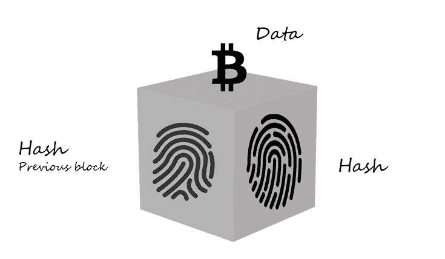

图 4：比特币区块链区块组成元素的图化表示

平均而言，每十分钟会创建一个比特币区块，而在以太坊上，每 17 秒产生一个区块。

总结来说：每个区块包含自己的哈希值（hash）以及上一个区块的哈希值。主链的所有区块都经过了编号，从 0 开始，然后是 1, 2, 3, 4, 5 等。以一个由 3 个区块组成的区块链为例， 2 号区块将指向 1 号区块，而 1 号区块将指向 0 号区块。0 号区块与之前的区块不同：它不能指向任何之前的区块，事实上，它在术语中被称为“创世区块”（genesis block）。如果由于某种原因，1 号区块被黑客篡改，该区块的哈希值将自动改变。结果是，2 号区块不再有效，因为它不再包含上一个区块的哈希值，从而实际上损害了所有后续区块的有效性。

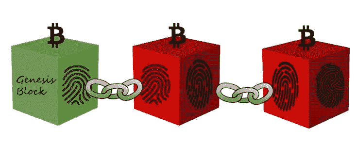

图 5：连接到比特币区块链的 3 个区块的图化表示

然而，仅有哈希系统是不够的。事实上，现代计算机拥有强大的计算能力，即使是很长的链也可以在短时间内重新计算。因此，引入了“共识算法”的概念，我们稍后会解释。所以，让我们一步步来，更详细地看看哈希和加密的概念。

## 2.4 哈希与密码学

Keizer Söze 在他的《理解区块链技术、比特币创造和货币未来的终极指南》（Ultimate Step by Step Guide to Understanding Blockchain Technology, Bitcoin Creation, and the future of Money）书中清晰地描述了什么是哈希函数以及它是工作的。

哈希基本上是基于系列算法生成的固定长度数字字符串。哈希函数允许将任何文本字符串（无论长度如何）还原为具有精确特征的新字符串，其中包含预定义的字符数量。

其中一种算法是所谓的消息摘要算法 5，或 MD5（其中 `5` 是版本号）。例如，尝试输入单词 "blockchain"。生成的 `md5` 哈希值将是：

```
5510a843bc1b7acb9507a5f71de51b98
```

如果我们尝试对单词 "blockchain1" 执行相同的 `md5` 哈希，结果将完全不同：

```
1150228f14788047028d774b7c83c5a6
```

现在让我们尝试一个数字，为了简单起见，我们使用极少数数字。尝试对数字字符串 `123` 进行 `md5` 哈希处理，然后是 `124`，看看是否有任何差异。对于字符串 `123`，哈希值 `md5` 如下：

```
202cb962ac59075b964b07152d234b70
```

而字符串 `124` 则是：

```
C8ffe9a587b126f152ed3d89a146b445
```

正如我们所看到的，这是一个完全不同的结果。`md5` 算法诞生于 1992 年，但由于其漏洞，它已被多次破解。

有多种哈希算法：2001 年，由国家安全局（NSA）设计的 `SHA-2` 算法（安全哈希算法 2）发布。`SHA-2` 系列由六个哈希函数组成，其哈希（或摘要）值分别为 224、256、384 或 512 位，即 `SHA-224`、`SHA-256`、`SHA-384`、`SHA-512`。特别是 `SHA-256` 是比特币使用的哈希算法。2012 年，发布了 `scrypt` 算法，专门用于执行需要大量内存的大规模自定义硬件攻击。该算法后来被 Litecoin 和 Dogecoin 等加密货币用于工作量证明机制。

我们可以通过以下基本点总结哈希算法的通用特征：

-   **一致性 (constancy)**：相同的输出始终且不可避免地对应于每个输入；
-   **不可逆性 (irreversibility)**：虽然通过已知生成输出的原始输入总是可以复制输出，但无法反向操作，因此无法从字母数字字符串回溯到生成它的输入初始内容；
-   **确定性 (determinism)**：无论输入多长，哈希函数始终会返回给定字符数量的字母数字字符串；例如，如果我拿出《神曲》并对其进行哈希处理，结果将始终是一个 32、64（等）字符的字符串（输出长度取决于所使用的哈希函数）；
-   **雪崩效应 (avalanche effect)**：无论输入多长，输入的微小变化都足以生成一个完全不同的输出。

最后，必须强调，哈希被用作识别机制，而不是机密性机制（后者使用更复杂的过程）。然而，哈希函数在密码学本身也起着至关重要的作用：它们对于验证消息的完整性非常有效，因为执行过程会修改文本。

### 2.4.1 密码学

密码学是区块链技术的基础之一。在解释密码学如何在区块链中使用之前，我们需要进行简要插插并提供一些理论概念。加密是将数据转换为不可读形式的过程，通常称为加密。为了确保未经授权的人无法访问，使用了公钥和私钥：

-   **私钥 (private key)**：只有生成者知道的随机生成的秘密数字。密钥类似于我们登录不同网页时使用的 PIN 码或密码，但在这种情况下它是加密的，这增加了许多安全性。在比特币中，私钥是访问区块链资金的 256 位（32 字节）无符号整数。在实践中，私钥如下：

images/00006.jpeg)

图 6：私钥示例

-   **公钥 (public key)**：相反，是一个对应私钥的数字，但不需要秘密。公钥可以从私钥计算出来，反之则不然。也就是说，无法从公钥获取私钥。公钥经过后续更改后是可以共享给社区所有成员的地址，以便他们向我们发送资金，或者我们在需要时向社区其他用户进行支付。这里没有被盗的风险，因为资金只能通过私钥访问。

现在让我们增加另一条信息。加密和解密数据有两种类型的密钥：

-   **对称密钥 (symmetric key)**：加密和解密过程使用相同的密钥。我们可以将对称密钥想象成打开家门的钥匙：当我们出门或进入时，实际上我们使用的是同一把钥匙。对称密钥算法比非对称密钥快数倍，但这里的问题是发送者和接收方必须使用相同的密钥进行加密和解密。当然，在安全性方面这不是优势，而且区块链绝不使用对称密钥算法。


-   非对称密钥：区块链使用非对称密钥算法。为了实现这类算法，你需要两个不同的密钥。其中一个密钥负责加密信息将其转换为密文，而另一个密钥则用于解密信息将其还原为明文。非对称密钥算法比对称密钥算法慢得多；然而它的安全性更复杂，也更难被破解。区块链使用了一种名为 `Elliptic Curve Digital Signature Algorithm (ECDSA)` 的非对称密钥算法。

`ECDSA` 算法被认为是数字签名系统实现的安全标准，如今它的应用非常广泛，几乎涵盖了几乎所有的信息技术领域。例如，互联网的 `SSL` 和 `TLS` 安全证书基础设施大量使用了 `ECDSA` 算法。

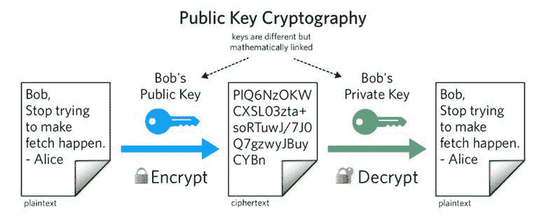

图 7：加密过程中使用公钥和私钥的示例

中本聪纳丰在处理比特币时面临的主要问题之一是公钥的分配，这对于保证相关钱包中令牌的安全性是必要的（我们将在第 6 章介绍它们）。中本的愿景是实现短、安全、低成本且易于使用的公钥，这些特性得益于椭圆曲线密码学。为此，中本决定在其系统中使用 `ECDSA` 算法。此外，它还能保证：

-   系统极其安全。中本决定为比特币使用椭圆曲线标准 `secp256k1`；
-   密钥生成和签名验证的计算成本非常低；
-   允许生成无限公钥。

然而，256 位的 `ECDSA` 密钥非常长。为此，决定使用如 `SHA-256` 和 `RIPEMD-160` 等哈希函数来减小公钥的大小并创建比特币地址文件。

## 2.5 共识算法

在第 2.3 节中，我们提到哈希值的生成并不能保证区块链的完全安全性，而是必须实现其他机制。共识算法是允许交易最终化和系统运行的规则集，其目的是保持网络的可用、安全和去中心化。我们将关注这一方面，因为新兴不同加密货币之间的主要区别之一也基于它们所使用的共识机制。

我们可以将共识机制分为两个主要的宏类：

-   无授权（开放技术）
-   有授权（封闭技术）

在无授权机制中，技术对任何人开放，没有中央机构可以决定协议规则和要执行的交易。然而在在种情况下，验证节点是必须信任的已知实体。

下面将描述两种主要的共识算法类型，即 `Proof-of-Work (PoW)` 和 `Proof-of-Stake (PoS)`。

### 2.5.1 工作量证明 (PoW)

在第 1.3 节中我们已经讨论了 `Proof-of-Work (PoW)`，在不涉及过多技术细节的情况下，创建了一个使用 `Smart Contract`（我们将在下一章讨论）模拟支付通道的网络，以确保网络能够以去中心化的方式运行。这种方法为提高比特币的可扩展性提供了最强大的选项之一：事实上，它可以让比特币达到每秒 100 万次交易的水平。

矿工是利用计算机计算能力来挖掘比特币的节点。他们被称为矿工，因为就像矿工通过体力劳动寻找黄金一样，比特币矿工通过利用计算机的计算能力尝试寻找区块的哈希值，最终通过消耗电力来换取比特币作为奖励。矿工负责验证、认证、证明并完成交易。


图 10：矿工功能示意图。在 `PoW` 机制中，矿工将转换为算力的电力作为输入，以此换取加密货币。

你是如何挖掘比特币的？矿工可以使用市面上各种不同的软件，也可以创建自己的自定义软件来加速验证过程。以下是用于挖掘比特币的流行软件列表：

* [Shamming](https://shamining.com](https://shamining.com))
* [Ecos](https://ecos.am](https://ecos.am))
* [Kryptex Miner](https://www.kryptex.org/](https://www.kryptex.org/))
* [Cudo Miner](https://www.cudominer.com/](https://www.cudominer.com/))
* [BeMine](https://bemine.club/](https://bemine.club/))
* [Awesome Miner](https://www.awesomeminer.com/](https://www.awesomeminer.com/))
* [BFGMiner](http://bfgminer.org](http://bfgminer.org))
* [MultiMiner](https://www.multiminerapp.com/](https://www.multiminerapp.com/))
* [EasyMiner](https://www.easyminer.net/](https://www.easyminer.net/))
* [CGMiner](https://cgminer.info/](https://cgminer.info/))
* [BTCMiner](https://www.btcminer.website/](https://www.btcminer.website/))
* [DiabloMiner](https://github.com/Diablo-D3/DiabloMiner](https://github.com/Diablo-D3/DiabloMiner))
* [NiceHash Miner](https://www.nicehash.com/cpu-gpu-mining](https://www.nicehash.com/cpu-gpu-mining))

如果你想亲手接触 `PoW` 区块链背后的原理，有一个非常清晰的演示可用[15]。

### 2.5.2 权益证明 (PoS)

`Proof-of-Stake` 设计于 2011 年，是 `PoW` 的一种低成本替代方案。`PoS` 在加密货币中的首次应用是 2012 年的 `Peercoin`。这两种共识机制的区别在于，在 `PoW` 中矿工使用能量来验证交易，而在 `PoS` 中，区块由“验证者”根据持有的代币份额（`stake`）进行验证。验证者是那些绑定一定数量代币作为担保以获得交易验证权利的人。验证者通过网络节点中的自动选择过程产生，该过程考虑了多个不同的因素。这些因素可能因项目而异；但通常会考虑以下因素：

1. 质押的金额
2. 质押的持续时间（也称为币龄，即存款持续了多久）
3. 随机因子

当然，质押金额越高、持续时间越长，被选为验证者的概率就越大，因为较高且历史悠实的质押具有更高的可靠性和完整性。此外，当节点被算法选中并产生新区块时，其币龄会被重置，必须经过一段时间后才能被重新选中。该系统防止了拥有大量质押的节点主导 `Blockchain`。

一旦节点被选为下一个区块的验证者，它必须检查其中的交易是否有效，对区块签名并将其添加到 `Blockchain` 中。这种验证被称为证明（attestation）。验证者因提议新区块和验证它们所看到的区块而获得奖励。如果验证者验证了恶意区块，将失去其 `stake`。

与 `PoW` 系统不同，矿工的工作通过创建新区块获得奖励，而在 `PoS` 系统中……（注：此处原文包含一些不完整的句子，我已保持其原始逻辑）。

……`PoS` 的一种变体是所谓的纯权益证明 (`PPoS`)。

### 2.5.3 PoW 和 PoS 的区别

`Proof-of-Work` 和 `Proof-of-Stake` 之间的区别是什么？下面列出了主要的：

* `Proof-of-Stake` 消耗的电力比 `Proof-of-Work` 少。因此更具扩展性。
* 在相同时间内，`Proof-of-Stake` 能够处理比 `Proof-of.Work` 更多的交易。
* 两者都可能存在中心化问题……`stake` 的数量严重影响验证区块的概率

### 2.5.4 其他共识机制

虽然 `PoW` 和 `PoS` 是 `Blockchain` 环境中最常见的共识机制，但还有其他共识算法，如：

* `Proof-of-Capacity` (`PoC`)，用于 `Burstcoin`，它允许共享 `Blockchain` 网络贡献节点的内存空间。
* `Proof-of-Activity` (`PoA`)，用于 `Decred` `Blockchain`，是一种结合了 `PoW` 和 `PoS` 特性的混合机制。
* `Proof-of-Burn` (`PoB`) 是另一种，要求交易者向不可访问的钱包地址发送少量代币，并将其“销毁”。
* `Proof-of-History` (`PoH`) 由 `Solana` 开发，通过通过加密方式对时间流本身来获取共识。

## 2.6 分叉 (fork)


在区块链的背景下，当一个区块被链接到两个连续的区块时，就会发生分叉（fork）。分叉的产生是因为各方必须使用共同规则来维护区块链的历史。事实上，当各方产生分歧时，就会出现替代链。虽然大多数分叉是短暂的，但仍有一些分叉是永久的：短暂分叉是因为分布式系统中难以快速达成共识，而永久性分叉（即由于协议更改）则用于为区块链添加新功能，也可以用于撤销黑攻击的影响（如以太坊和以太坊经典为例），或者避免区块链上的灾难性漏洞（如 2010 年 8 月 6 日的比特币分叉）。

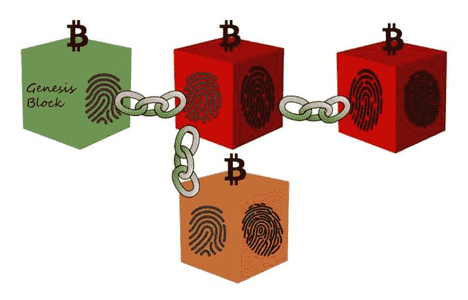

图 11：分叉的示例

分叉可以分类为：

1. **偶然性**
2. **人为性**

偶然分叉发生在两个或多个矿工几乎同时发现一个区块时。当后续区块添加且其中一条链比另一条链长时，分叉就会得到解决。因此，网络会放弃较短链的区块，因为矿工的目标始终在最长链上工作。被遗弃的区块被称为“孤儿区块”（orphan blocks）。

改变区块链规则的人为分叉可以分类如下：

- **硬分叉 (Hard fork)**：硬分叉是一种规则更改，使得根据旧规则验证的软件会将根据新规则产生的区块视为无效。在发生硬分叉的情况下，所有旨在在新规则下运行的节点必须更新其软件。如果一组节点继续使用旧软件，而其他节点使用新软件，就可能会发生永久性的分裂。
- **软分叉 (Soft Fork)**：软分叉是对管理区块链文件的程序代码进行更新，以添加更改，通常是新功能或修复漏洞。但要成为软分叉，它必须保持与旧区块链兼容。例如，在比特币中，更新首先在一个名为 `BIP`（比特币改进提案）的文档中公布。一旦获得批准，进一步的实现取决于比特币客户端开发者的决定。软分叉有两种类型，发生在以下情况：
    - 大多数矿工升级以应用新规则。这被称为矿工激活的软分叉（`MASF`）；
    - 协调节点以执行新规则，而没有矿工的支持。这被称为用户激活的软分叉（`UASF`）。

### 2.6.1 硬分叉：以太坊和比特币的案例

以太坊经典维护了以太坊网络原始且未更改的历史。以太坊主项目网络最初一直发布到 2015 年 7 月 30 日。然而，由于一个第三方项目遭到黑客，2016 年 7 月 20 日，以太坊基金创建了以太坊主网的新版本，并实施了对不规则状态的更改，从以太坊区块链的历史中删除了数百万以太坊的被盗记录，并在新的修改后的以太坊区块链版本上应用了自身的品牌（代码：`ETH`），即将被盗资金归还给所有者的版本；而之前的且未更改的以太坊版本被重命名为以太坊经典（代码：`ETC`），即资金未归还的版本。

2010 年 8 月 6 日，比特币协议中发现了一个严重的漏洞，该漏洞实际上允许用户绕过区块链的经济限制并创建无限数量的比特币。结果在 8 月 15 日，超过 184 亿个比特币在一个笔交易中生成并发送到网络上的两个地址。几小时后，该交易被检测到并在漏洞修复、网络切换到更新后的比特币协议版本后从交易日志中清除。这是比特币历史上被发现并利用的唯一重大安全漏洞。

然而，比特币也由于不同的原因经历过其他分叉。划分比特币的硬分叉是通过更改区块链规则并共享截至特定日期和时间的比特币交易历史而创建的。第一次划分比特币的第一次硬分叉发生在 2017 年 8 月 1 日，伴随着比特币现金（Bitcoin Cash）的产生。

以下是按日期和/或区块划分的比特币重要硬分叉列表：

- **比特币现金 (Bitcoin Cash)**：分叉发生在区块 `478558`，2017 年 8 月 1 日，对于每枚比特币（`BTC`），每个所有者获得 1 个比特币现金（`BCH`）；
- **比特币 SV (Bitcoin SV)**：分叉发生在区块 `556766`，2018 年 11 月 15 日，对于每枚比特币现金（`BCH`），每个所有者获得 1 个比特币 SV（`BSV`）；
- **比特币黄金 (Bitcoin Gold)**：分叉发生在区块 `491407`，2017 年 10 月 24 日，对于每枚比特币（`BTC`），每个所有者获得了 1 个比特币黄金（`BTG`）。

# 3. 区块链技术的优势与挑战

## 3.1 主要优势

## 3.2 主要挑战

## 本章总结

区块链架构的优势是什么？我们已经提到，例如安全性、可追溯性以及缺乏作为担保人的中心机构。

在本章中，我们将更详细地描述主要优势，即区块链为何在金融领域之外变得日益流行的原因。此外，我们还将描述为了让区块链成为全球性系统所面临的主要挑战。

**关键词**：透明度、安全性、可扩展性、隐私、51%攻击、能源消耗、去监管、加密密钥

## 3.1 主要优势

下面我们描述了与区块链技术相关的主要优势：透明度、成本、安全性、速度和可扩展性。

### 3.1.1 透明度

为了提高信息交换的透明度，各机构尝试实施越来越多的规则；然而，有一件事不能让任何系统变得 100%透明，那就是信息的中心化。在中心化网络中，所有的决策权都在一个控制网络的中心机构手中。例如，在中央银行系统的案例中，每个决策都通过最符合其战略的银行进行。因此，透明度变成了任意的而非结构性的：这意味着我们必须以某种方式“信任”银行针对储户采取的保护机制。区块链的主要应用之一是所谓的去中心化金融，也称为 `DeFi`，将在第 6 章中详细介绍。

另一个应用示例涉及民主政府的投票过程。为了让这一过程尽可能透明地进行，每个国家在计票期间实施了一系列措施以避免选举欺诈。相反，如果过程是通过电子投票完全计算机化的完成，那么只需要操纵或篡改处理信息的中央服务器就可以按意愿控制投票结果。

通过区块链，这类问题将找到稳健的解决方案：正如我们所看到的，区块链由负责执行和验证交易的节点组成。每笔交易还会发送给网络成员，他们在他们的注册表中保留一份完全相同的副本，而任何篡改投票结果的潜在尝试都将根据采用的共识机制进行验证。这一切将在显著降低成本和时间的情况下完成。

### 3.1.2 无中间介成本


在涉及官方文件签署、资金交易或商品销售的交易中，中介这一角色往往仅作为交易本身的担保人。这会产生一种成本，在专业术语中有时被称为“金融摩擦力”。我们刚刚看到，在分布式网络语境下，这一角色失去了意义，因为交易的有效性是由 `Blockchain` 网络架构本身来保证的。因此，交易不需要任何中介，也就没有了佣金成本。最常见的例子是电子支付：当我们使用借记卡或信用卡支付或进行银行转账时，交易由银行接手，银行在某些情况下会收取佣金费。此外，信用卡通常还需要支付年费。在通过 `Blockchain` 进行电子支付的情况下，这些费用是不可必需的。

### 3.1.3 安全性

与其他平台或注册系统相比，区块链技术使用了更高级别的安全性。在上一章中，我们提到了哈希和加密的使用，这是 `Blockchain`set 的基础算法。此外，共识机制和分布式系统的去中心化使得 `Blockchain` 可能成为世界上最安全的信息技术之一。

### 3.1.4 交易速度

中心化交易需要一些时间来处理。例如，两个不同银行之间的国家或国际银行转账：这个过程可能需要几个工作日才能解决。然而，在像 `Blockchain` 这样的去中心化过程中，这种机制不再必要，因为交易不需要中介即可发生，如果我们以平均 `Bitcoin` 交易时间为例，大约是 10 分钟即可。

### 3.1.5 可扩展性

系统的可扩展性通常是指根据需求和可用性进行扩大或缩小的能力。对于 `Blockchain` 而言，可扩展性是指其在不影响性能的情况下管理日益增加的交易的能力。`Blockchain` 具有极可扩展性的优势；然而，正如“区块链三难题”所示，这可能是以牺牲安全性为代价的。事实上，具有 `PoW` 机制的 `Bitcoin` 存在可扩展性问题，这在很大程度上与节点数量增加所需的高能耗有关，但它保证了高度的去中心化和安全性。因此，在 `Bitcoin` 之后产生的代币旨在解决其内在的可扩展性问题。

## 3.2 主要挑战

在阐述主要优势之后，现在让我们来看看 `Blockchain` 技术要在全球范围内被采用将面临的主要挑战：知识匮乏、隐私问题、51% 攻击风险、能耗、去监管、金融风险以及与加密密钥丢失相关的风险。

### 3.2.1 技术知识匮乏

这种局限性实际上指的是人性，更广泛地说，指的是任何创新过程。正如本书引言提到的，每个创新过程都伴随着一系列机会，但也伴随着一系列风险。根据人的本性，人们倾向于不过度冒险，除非他们已经实施了一系列应对措施来减少和管理这些风险。然而，这些应对措施需要付出努力。第一步是减少与不了解技术（在本例中为 `Blockchain`）相关的不确定性。创建一种方法来缩小与技术之间的知识差距至关重要，这种差距由于新技术的演进速度以及人们适应未来新情景的惯性而正在逐渐扩大。

### 3.2.2 隐私

一方面，分布式架构是保证我们在上一段中提到的安全性和透明性的主要元素之一；另一方面，这可能会产生与隐私相关的问题。具体而言，在 `Blockchain` 技术中，每个节点都必须访问 `Blockchain` 交易本身的数据。这意味着在公共 `Blockchain` 的情况下，每一笔公开交易都可以追溯到第一个创世区块。

在实践中，这种透明度和可追溯性抵消了匿名性的优势，即个人与其所属的 `Wallet` 之间似乎没有联系。公共 `Blockchain` 实际上提供了识别机会。例如，《法医研究杂志》上一篇关于 `Bitcoin` 调查的文章说明了几个此类案例：一种方法是监控 `Blockchain` 节点之间的通信，这可以将互联网协议地址和交易关联起来。此外，加密货币钱包软件不是公开的，但即使没有使用所需的密钥，也可以对其进行法医分析。

这些技术的高调使用导致了 Ross Ulbricht 因运营“丝绸之路”（Silk Road，一个非法毒品黑市）而被捕。更有趣的是，美国税务局（IRS）的一名特探还能够追踪 `Bitcoin` 交易，确定参与调查的美国毒品管理局探 Carl Force 正在洗钱与丝绸之路相关的比特币。正如容易猜的那样，像 `Bitcoin` 这样的 `Blockchain` 提供的隐私保护有限。依赖 `Coinbase` 等交易所的个人必须意识到，此类平台必须遵守国际隐私法，因此受到监管。例如，IRS 还要求 `Coinbase` 交出某些涉及加密货币交易的记录。

因此，有必要意识到公共 `Blockchains` 的隐私方面，虽然它们一方面保证了用户交易的某种匿名性，但另一方面仍然通过特定技术提供了识别机会。

### 3.2.3 51% 攻击风险

在 `PoW` 机制中，51% 攻击指的是一组控制了网络 50% 以上算力或计算能力的矿工对 `Blockchain` 实施的假设性攻击（算力是衡量处理交易和挖掘新币的总计算能力参数）。事实上，确保区块不可篡改的特征之一是交易分布在网上，网络必须根据共识机制批准这些交易。这意味着如果大多数用户同意修改，这种修改就可以实施。在事实上，如果已经执行的交易预计交换 `1 BTC`，网络可以对其进行修改，例如花费两次相同的币。这种风险被称为“双花”，是数字货币特有的潜在问题，因为数字信息可以由经验丰富的人士相对容易复制。这种攻击是假设性的，但如果真的发生，它将不可挽回地破坏 `Blockchain` 和加密货币的基础。

### 3.2.4 成本

虽然一方面 `Blockchain` 具有降低金融交易成本的优势，但另一方面，它在能耗以及基于 `PoW` 的 `Blockchains` 的矿机硬件方面产生了成本。由于这个原因，主要的矿场位于能源成本较低的国家。

### 3.2.5 能耗


比特币对环境的影响是什么？根据剑桥比特币电力消耗指数（Cambridge Bitcoin Electricity Consumption Index）截至本文时发布的最新数据，比特币的年用电量约为 123 TWh，这与挪威或阿根廷等国家的年度能源消耗相当。此外，如图 12 所示所示，比特币的能源消耗正呈指数级增长。或者说，一次 BTC 交易消耗的能量相当于 120 万次 VISA 线路交易。

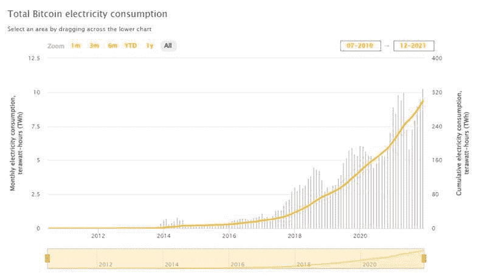

|  ||  |
| --- | --- |
|  ||  |

图 12：比特币总能源消耗²²

图 13：1 笔比特币交易与 100,000 次 VISA 交易的能源消耗对比²⁴

正因为这个原因，我们看到专业人士的主要努力之一是寻找新机制来降低能源消耗。例如，Algorand 平台声称甚至实现了碳负极。事实上，通过与 ClimateTrade 合作，Algorand 正在抵消其二氧化碳排放，现在是一个具有负碳足迹的区块链。此外，Solana、Polkadot 和 Cardano 项目的诞生具有明确目的，使区块链更具扩展性、更便宜且更可持续。例如，Solana 区块链每秒能够处理 50,000 笔交易，而以太坊为 15-30 次，每笔交易成本仅为 0.00025 美元。Solana 使用名为“历史证明”（Proof-of-History）的共识机制，它不仅比工作量证明（Proof-of-Work），而且比权益证明（Proof-of-Stake）便宜得多。

### 3.2.6 去监管化

作为一项对大众仍然相当新且未知的技术，区块链在主要国家也处于法律真空状态。然而，监管倡议在全球范围内涌现，旨在为加密市场的发展创造有序的环境。根据 Sole24Ore 的报道，根据公司 ChainAnalysis 在 2019 年底至 2021 年中期间开发的复合指数，数字货币的使用增加了 25 倍（+ 2500%），从 2021 年 1 月开始出现决定性的爆发。在这种背景下，监管倡议旨在为加密市场的发展创造有序的环境。风险在于，我们在没有特定顺序且缺乏全局视角的情况下在一个领域进行，而在这个领域中，禁止的监管套利和分歧的解释极其简单。欧盟已选择开发《加密资产市场法》（MiCA）条例。

在国际上，金融犯罪执法网络（FinCEN）建议数字货币服务提供商（包括交易所，也包括银行）收集有关私有钱包持有者身份的信息。这意味着，如果用户想将个人持有的比特币转换为法币，他们将不得不向中间机构提供凭据，这本质上是将加密交易等同于银行转账。

### 3.2.7 金融风险

去中心化金融（DeFi）使投资者在经典金融服务的背景面临极高且未知的风险。首先，普遍缺乏存款者保护：用户可能会因为加密货币价值的突然下跌、欺诈和私钥丢失而导致投资损失。此外，数字货币交易的不可逆性以及由于去中心化管理而难以建立对用户的责任归属构成了额外风险。最后，需要注意的是，加密交易中代表持有者公钥地址的数据字符串可以通过巨大的努力与标识符相关联，从而危及用户的身份和隐私。

### 3.2.8 加密密钥丢失

在加密交易中持有私有加密密钥允许你仅拥有与之相关的值。当用户在 Coinbase 等大型交易所的钱包中持有其数字货币时，他们实际上是将密钥的托管权委托给了一家私营公司。因此，在交易所存款的数字货币并非比特币，而是对底层比特币的合同权利。相反，用户可以决定通过特定的软件或硬件自行持有密钥。在任何情况下，加密密钥的丢失都是无法找回的。

# 4 什么是加密货币？

## 4.1 Coin 和 Token 的微妙区别

## 4.2 加密货币的历史

### 4.3 比特币，一种数字货币

### 4.4 以太坊，代币

### 4.5 代币发行（ICO）

### 4.6 交易所发行（IEO）与去中心化交易所发行（IDO）

## 4.7 市场上的主要加密货币

## 章节总结

加密货币可以被认为是区块链引擎的燃料。但它们是如何工作的？什么机制在管理它们？我们如何购买、持有和交易它们？我们将尝试通过详细描述加密货币的概念来回答这些简单的问题。

**关键词**：加密货币、Coin、Token、比特币、以太坊、代币、代币发行（ICO）、交易所发行（IEO）、去中心化交易所发行（IDO）


每种加密货币都必须有自己的交易日志。一旦创建了这个注册表，就必须发行 `Tokens`，其交换将成为存储在分布式注册表上的交易。例如，已经发行了约 1700 万个代币（即 `Bitcoin`），而超过 2100 万个的永远不会被发行。此外，电子代币是可分的，因此也可以交易代币的碎片。例如，一个 `Bitcoin`（或 `1 BTC` 代币）可以被拆分成亿分之一，被称为“Satoshi”，这样如果根据需要，即使是极小金额也可以交易。

从这个意义上说，我们可以说 `Coin` 是拥有自己注册表的 `Token`，而没有自己注册表（因此利用了现有 `Blockchain` 的注册表）的 `Tokens` 简单称为 `Token`。

事实上，由于所谓的首次币发行（`ICO`），任何人都可以创建和发行 `Tokens`，我们将在 4.4 节中讨论这一点。因此，`Bitcoin` 实际上是一个使用 `BTC` 代币作为交易货币的 `Coin`，就像 `Ethereum` 使用 `ETH` 代币一样。大多数代币是在 `Ethereum` 区块网上发行的，采用 `ERC-20` 格式（见词表），尽管它们存储在 `Ethereum` 区块网上，但它们与该网络的原生 `Coin`，即 `Ether` (`ETH`) 无关。事实上，有必要区分 `Coin`、`Ether` 和 `Ethereum` 网络，它们并不是同一件事。如今发行一个新的 `Token` 并不十分复杂，因为从理论上讲，编写一个特殊的 `Smart Contract`（我们将在 7.1 节中讨论）即可，例如在 `Ethereum` 网络上。相比之下，创建一个新的 `Coin` 要复杂得多。

因此，`Tokens` 是数字资产的表示，我们可以将其想象成赌场里的筹码或游戏房的代币：它们只有在所使用的语境下才具有货币价值。

在像 `Bitcoin` 这样的 `PoW Blockchain` 中，`Coin` 或 `BTC` 代币的诞生是作为矿工的奖励，奖励他们通过硬件消耗的能量来编写区块，将其添加到链中并使其变得越来越可靠和安全。然而，随着其他应用和共识机制的出现，`Tokens` 代表了功能更丰富的资产。事实上，我们可以根据其经济用途识别不同类型的代币：

1. **实用型代币 (Utility Token)**：用于帮助初创公司、公司或项目开发小组筹资或融资。许多加密货币项目通过 `ICOs` 向对项目感兴趣的人提供实用型代币，宣布发行特定数量的代币。这些代币代表了一种手段（如优惠券），用于访问公司的产品或商品/服务：它们用于发行公司的产品或服务；
2. **证券型代币 (Security Token)**：`Security Tokens` 被视为真实的财务投资，持有者拥有底层资产的部分价值，但不意味着拥有“发行”公司的所有权；
3. **股权代币 (Equity Token)**：它是 `Security Token` 的一种，但对所有者意味着意味着所有权。它的运作方式更像传统的股权资产。换句话说，持有股票代币的人对其投资拥有某种形式的所有权。

我们意识到 `Coin` 和 `Token` 之间有时微妙的区别可能给读者带来一些疑问和困惑。然而，出于纯实目的考虑，对于那些打算从财务角度尝试投资这些资产的人来说，它们都可以被简单地视为加密货币，对于除 `Bitcoin` 以外的所有其他货币则称为 `Altcoins`。出于这个原因，在本书后续的讨论中，我们不会做这种区分，而是将专门讨论加密货币。

## 4.2 加密货币的历史

在第一章中，我们简要提到 `Blockchain` 概念是如何演变的，并停在了 2009 年，那是第一种加密货币（即 `Bitcoin`）正式发布的一年。现在让我们来看看这个市场是如何演变的。

- **2009 - `Bitcoin` 出生**，化名为 `Satoshi Nakamoto`。
- **2011** - `Namecoin` 于 4 月出生，是首个从 `Bitcoin` 分叉中产生的加密货币，并使用相同的 `Proof-of-Work` 共识算法。与 `Bitcoin` 一样，它被限制 2100 万个币。
- `Litecoin` 于 10 月出生，正式成为世界上第三种加密货币。主要区别在于它使用 `scrypt` 作为哈希函数，而不是 `Bitcoin` 的 `SHA-256`。

从那一刻起，`Blockchains` 和加密货币的数量显著倍数增长。在写作时（2022 年 1 月），已有超过 10,000 种不同的加密货币。

- **2014** - 8 月 6 日，英国宣布其财政部已委托进行了一项关于加密货币的研究，以确定它们在经济中可能扮演的角色。其最终报告于 2018 年发布。
- **2019 / 2020** – 即便在全球疫情危机之后，加密货币被视为货币储备，其中某些价值开始爆发，引起了许多机构投资者的关注，同时也引起银行和中央政府对市场监管的担忧。
- **2021** - 6 月，萨尔瓦多成为第一个接受 `Bitcoin` 作为法定货币的国家。效仿萨尔瓦多，古巴也决定在 8 月接受 `Bitcoin` 作为法定货币。然而，在 9 月，全球最大的加密货币市场中国政府宣布所有加密货币非法。

## 4.3. Bitcoin，一种新的数字货币

Giacomo Zucco 是比特币专家和顾问，也是 `Bcademy` 的创始人，被认为是术语中所定义的“比特币主义者 (Bitcoin maximalist)”。比特币主义者认为，作为世界上最流行的加密货币，`Bitcoin` 是未来唯一的数字资产，且所有数字货币都劣于比特币。不仅如此：许多人认为 `Altcoins` 是真正的骗局。Zucco 将比特币描述为“人类使用了数千年货币进入信息时代的尝试，这种货币本质上是黄金”。事实上，由于一系列优势，黄金是市场上最易售卖的商品：

- 它不会腐烂，具有延展性和可分性，因此可以以不同的形式运输（例如，硬币、金块和金条）
- 它不受国家的中央控制，即无论你身何处，它的价值都得到认可；
- 它不会被政府通过改变数量来操纵；
- 不可测量，这意味着一旦双方达成协议，第三方无法阻止黄金交易。

然而，黄金也有一些缺点：

- 大批量运输很困难
- 在非专家眼中，它是可以伪造的
- 它不像法货币那样可以虚拟化

相反，从中央政府的角度来看，法货币货币具有若干优势：

- 它们可以被中央政府的货币政策控制和操纵；
- 是虚拟化的。值得注意的是，97% 的货币供应仅以计算机数据库中的记录形式存在，其余的是流通货币。


法币本质上是虚拟货币，且自 1971 年以来，它们不再受黄金/货币可兑换性的限制。事实上，美国总统在 1971 年 8 月 15 日晚上在电视上宣布的突然决定，标志着在布雷顿森林会议上建立的战后国际货币体系的终结。

比特币旨在通过吸收黄金和法币的主要优点来成为一种数字货币，即：

- 中心化实体对货币供应的`**不可操纵性**`。比特币基于`Blockchain`（区块链），这是一种本质上是去中心化的数据库。政府无法对其进行控制，例如通过制造恶性通膨胀。让我们以津巴布韦或委内瑞拉的情况为例，其储蓄的购买力每周下降高达 30%。然而，西方也免受通货膨胀的影响：1970 年的 1 美元购买力等同于 2019 年的 6.59 美元，在此期间的通胀率变化率为 558.63%。

- 使用货币的`隐私性`（考虑自由度有限的国家，例如阿富汗，那里女性甚至无法开设银行账户）

- `它可以虚拟化`，因为可以以电子形式交换，因此易于运输和使用

- `它是安全的`，因为它遵循`Blockchain`（区块链）的不可篡改性和安全规则

比特币为数字时代的问题提供了另一个解决方案：监控货币交换的实体对数据的中心化。事实上，支付是人类以来最敏感的信息之一，然而，近年来出现的新型数字支付形式，如`Apple Pay`、`PayPal`、`Google Pay`和`Stripe`（仅列举著名的），收集了随后可以转售的敏感数据。如果管理不当，这些信息可能会变成控制的形式。举个例子？2011 年 6 月 14 日，WikiLeaks 在遭到`Amazon`、`PayPal`、`Visa`、`MasterCard`、`Bank of America`和`Western Union`的抵制后，决定接受比特币捐赠。正如 Stefania Maurizi 在她的书《Il potere segreto》（意为“秘密权力”）中所报告的那样，这些机构在美国政府的压力下，突然切断了向 WikiLeaks 捐赠的所有可能。

### 4.3.1 比特币如何价值数千美元？

在引言章节中，我们提到了 Laszlo Hanyecz 的事迹，他在 2010 年 5 月 22 日在佛罗里达州的一个小镇用 10,000 个比特币购买了两块价值 30 美元的披萨。`这是历史上比特币的第一个价格，汇率为 1 BTC = 0.003 美元。`今天，在几乎 12 年后，那两个披萨为那家幸运的披萨店赚了价值约 4 亿美元的等值。但一个最初没有任何价值的虚拟资产突然变成价值载载的机制是什么？

**换句话说，谁决定了比特币的价格？**

价格由所有想要参与买卖过程的人决定，本质上就是它的用户。这听起来很显而易见，但事实确实如此，尽管有多个因素在起作用。事实上，矿工在将比特币卖给感兴趣的相关同时可以提议价格：当两个人在进行谈判时，一方提出一个价格而另一方愿意接受，那么交易就成了。我们刚刚描述的过程与所有现有商品的交换过程相同。这种情况每天发生几十、数百或数千次，且通常伴随着巨大的波动。

比特币的价值随时间而变化，本质上基于用户的信任、其实用性和流行程度。比特币没有官方或单一的价格，因为没有单一的交易平台，即所谓的`Exchanges`（交易所），我们将在第 6 章讨论。

当然，比特币价格中的一个基本组成部分是其内在的稀缺性。事实上，它的`Blockchain`（区块链）被设计为有限数量的代币。因此，需求越大，价值越高。

## 4.4 以太坊，排名第一的山寨币

在描述了比特币的意义以及它多年来积累价值的原因之后，我们现在介绍以太坊，市值排名第二的加密货币。为什么需要以太坊，以及更广泛意义的山寨币？

以太坊由程序员 Vitalik Buterin 于 2013 年构思，共同创始人还包括 Gavin Wood（后来`Polkadot`的创始人）、Charles Hoskinson（后来`Cardano`的创始人）、Anthony Diorio 和 Joseph Lubin。该网络于 2015 年 7 月 30 日上线，目标是允许任何人部署永久的、去中心化的应用程序。这是与比特币的主要区别，正如 Vincenzo Cacioppoli 在 Cryptonomist 的一篇文章中所报道：

> “许多人认为以太坊比比特币更好，从其在现实世界的应用来看。比特币作为一种支付工具，仍然难以找到空间。以太坊为区块链世界带来了一场真正的革命，它的例子被其他项目跟随，例如`Solana`、`Cardano`和`Polkadot`。”作者认为，“悉尼大学的研究显示，以太坊作为价值载体比比特币更好，尽管比特币的流通量是有限的，而太不是。据澳大利亚研究人员认为，以太坊是比比特币更有效的抗通胀工具。”

然而，也有许多怀疑者，包括上述的比特币主义者，他们对以太坊项目提出了各种批评，特别是在技术方面。

目前市场上许多山寨币都基于以太坊，例如`Layer 2`。其中我们提到：

- `Chainlink`(LINK)：一个去中心化的网络，能够以安全的方式连接`Blockchain`与现实世界之间的差距。大多数情况下，dApps（去中心化应用）需要现实数据来运行，因此它们依赖于预言机（oracles），后者提供可靠的信息源。考虑到某些 dApps 管理着数亿美元，这些外部通信桥的安全性至关重要。`Chainlink`通过使用高度去中心化的基础设施、创新的硬件和受保护不受操纵的数据源，降低了与预言机相关的潜在风险。

- `Compound`(COMP)：传统市场的去中心化等品。该协议基本上是一个流动性池，允许用户获取和贷款，并对其加密货币赚利。

- `MakerDAO`(MKR)：一种通过`Smart Contracts`在不需要中间人的情况下获取和贷款的服务。它是 DeFi 生态最早的项目之一，也是最常用的项目之一。

- `0x`(ZRX)：一种促进平台间交互的标准，并引入了“互联流动性”的概念：使用`0x`的操作者共享各个平台上的交易订单，以获得更好的流动性。


- `Kyber Network``37` (`KNC`): 一允许用户以完全去中心化的方式交换 `ETH` 和 `Token` 的协议，无需使用交易所。
- `Aave``38` (`LEND`): 该协议允许借贷和贷款广泛的加密货币。产生的利息以该原生代币的形式进行分配。
- `Synthetix (SNX)`[[`39`]](#part0000_split_077.html#_ftn39): `Synthetix` 是一种发行合成资产（称为 `Synth`）的协议，这些资产使用原生 `SNX` 代币作为抵押品。用户可以通过 `Smart Contract` 直接转换 `Synth`，而无需使用交易所。这些合成资产代表加密货币、股票和法币。

我们已经看到以太坊如何基本上通过创建 `Smart Contracts` 催生了一系列加密货币的诞生。这些加密货币有什么价值呢？其初始价值是通过首次代币发行（或 `ICO`）赋予的。

## 4.5 首次代币发行 (ICO)

在比特币之后，多年年来了一系列不同的区块链，随之也了一系列不同的加密货币。因此，建立了一个与法币市场并行且类似的数字货币市场，即由政府发行的货币，它们不由实物商品（如黄金或白银）支持，而是由发行它们的政府（例如美元、欧元和其他全球其他主要货币）以及股票市场支持。事实上，得益于外汇市场（通常称为 `forex` 或货币市场），交换不同货币是可能的，就像在股票市场交易股票一样。以完全相同的方式，通过交易所交换加密货币也成为可能。

我们现在问自己的问题是：**给新出生的加密货币分配什么价值？**

答案仍然在于与金融市场的类比。当一家公司决定上市时，它必须经过所谓的首次公开募股。首次公开募股或 `IPO` 是向公众提供一家拟在监管市场首次上市的公司证券的要约。这是一个复杂的阶段，需要超出我们研究范围的知识。然而，值得强调的是，对拟上市的公司进行评估是必要的。

**地，在加密货币市场中，我们通过首次代币发行或 `ICO` 进行。然而，这一过程与 `IPO` 完全不同：它通常以众筹的形式进行，尽管不寻求公共投资的私人 `ICO` 也是可能的。在 `ICO` 中，数量的加密货币以 `tokens` 的形式出售给投机者或投资者，以换法币或其他加密货币（如 `Bitcoin` 或 `Ether`）。`ICOs` 可以让初创公司规避限制直接向公众以及风险投资人、银行和股票交易所等中介寻求投资的监管，这些机构可能要求更大的控制权以及未来利润的一定比例或共同所有权。

此外，根据项目的性质，`ICOs` 可能落在现有监管之外，或者在某些司法管辖区（如中国和韩国）被完全禁止。事实上，由于缺乏监管，`ICOs` 在过去一直是诈骗的工具。

不到一半的 `ICOs` 生存了下来，而到 2018 年近一半的 `ICOs` 失败了。然而，`ICOs` 并不是筹的唯一方式。

## 4.6 交易所发行 (IEO) 和首次去中心化交易所发行 (IDO)

如果说 2017 年是 `ICOs` 的年，那么 2019 年就是 `IEOs` 的年。`IEO` 由 `Exchange` 管理以筹集资金。作为回报，创业公司必须支付上市费和出售代币的比例。

首次去中心化交易所发行 (`IDO`)  `IEO`，但 `IDOs` 在去中心化交易所 (`DEX`) 上进行，而 `IEOs` 在中心化平台上进行。然而，去中心化交易所目前的进展有限，许多成员对其实用性表示怀疑。

## 4.7 市场上的主要加密货币

在了解 `Cryptocurrency` 是什么（`Coin` 和 `Token`）、`Bitcoin` 引入了哪些优点以及 `Ethereum` 提供了什么之后，在本节中，我们将提供截至写作时排名之前的加密货币的基本信息。这将为我们提供一个部分但有效的观点，了解每个项目带来的方案的多样性。许多人认为所谓的“拉高崩盘”（pump and dump）机制不值得考虑，这种机制由一群人对新 `Token` 制造虚假炒作以引起兴趣。一旦投资者开始购买，其价值就会增加。炒作背后的骗子会卖掉他们所有的 `Tokens`。

### Bitcoin`42`

`Bitcoin` 最初在 2008 年的一份白皮书中由一个人或一群人提出，他们使用化名 `Satoshi Nakamoto`，并于不久后的 2009 年 1 月推出。根据 Nakamoto 本人的话，`Bitcoin` 的创建是为了允许*"从一方直接向另一方发送在线付款，而无需经过金融机构*”。


由于其开创性，BTC 在存在十多年后仍然处于该市场的顶端。即使在比特币失去了其无可争议的主导地位后，它仍然是最大的加密货币，市值在 2021 年突破了 1 万亿美元大关。

#### 4.6.2 以太坊 `[43]`](#_part0000_split_077.html#_ftn43)

在市值方面，比特币的第一个替代品是以太坊，这是一个去中心化的平台，允许您创建和运行智能合约以及去中心化应用（dApps），而无需停机、欺诈或第三方控制。以太坊背后的目标是创建一个任何人都可以自由访问的去中心化金融产品。其 Ether Token 被用作在平台上移动的媒介，深受希望在以太坊上开发和运行应用的开发者，以及希望使用 Ether 购买其他数字货币投资者的追求。以太坊在 2014 年推出了 Ether 的预售，获得了巨大的反响，并开启了代币发行（ICO）时代。

根据以太坊的说法，该平台可以用于 `"代码、去中心化、安全并交易任何内容"`。

以太坊计划在 2022 年年中将其共识算法从工作量证明（PoW）迁移到权益证明（PoS），这一更新被称为以太坊 2.0。此举旨在让以太坊网络以更低的功耗和更快的交易速度自主运行。

#### 4.6.3 币安币 `[44]`](#_part0000_split_077.html#_ftn44)

币安币作为币安交易所交易费用的支付方式，目前按市值计算是第三大加密货币。使用该代币作为交易所支付手段的人还可以获得折扣。

币安交易所由中国人赵长鹏创立，根据交易量，它是全球使用最频繁的交易所之一。币安最大的竞争优势之一是其开发服务的动力。事实上，尽管该公司仅从 2017 年作为加密货币交易所起家，但今天币安已经在许多不同领域推出了其服务。根据公司网站，其使命是成为整个区块链生态系统的基础设施服务提供商。自从币安币发行以来，交易所一直受益于投资者对该代币兴趣的增加。BNB 在 2021 年初经历了大幅上涨，这使其进入了企业投资者的版图。

#### 4.6.4 Tether `[45]`](#_part0000_split_077.html#_ftn45)

Tether 是所谓的“稳定币”群体中最早且最受欢迎的之一，这些加密货币旨在将其市场价值锚定在货币或其他外部基准上以减少波动。大多数数字货币即使是像比特币这样的主流货币，也经常经历极端波动时期，Tether 和其他稳定币试图平滑价格波动，以吸引可能谨慎的用户。正因如此，Tether 的价格与美元直接挂钩。该系统允许用户以更及时的方式将其他加密货币转换为美元，而不是实际上转换为法币。Tether 于 2014 年推出，它自描述为 `"一个基于区块链的平台，旨在"`。

#### 4.6.5 Solana `[46]`](#_part0000_split_077.html#_ftn46)

Solana 设计用于托管去中心化应用（dApps）并旨在提高可扩展性。Solana 于 2017 年成立，获得了来自币安和 Polychain Capital 等机构的 3200 万美元支持。该协议引入了历史证明（PoH），并且比以太坊等竞争对手区块链快得多。事实上，Solana 的混合协议允许由位于旧金山的 Solana 开发的历史证明（PoH）。

#### 4.6.6 Cardano `[47]`](#_part0000_split_077.html#_ftn47)

Cardano 是基于权益证明（PoS）的科学方法创建的。该项目由 Charles Hoskinson 共同创立，他是以太坊的创始人之一。事实上，该项目的研究人员在验证之前已撰写了 90 多篇关于区块链的文章。Cardano 使用同行评审的研究方法来确保区块链的持久性和稳定。

#### 4.6.7 USD Coin `[48]`](#_part0000_split_077.html#_ftn48)

美元币 (USDC) 是一种锚定美元的数字稳定币，运行在以太坊、Stellar、Algorand、Solana、Tron 和 Hedera Hashgraph 系统上。USDC 由一个名为 Center 的财团管理，包括加密货币交易所 Coinbase 和比特币公司 Bitmain 的成员。USDC 由私人实体发行，不应与中央银行数字货币（CBDC）混淆。USDC 由 Circle 于 2018 年 5 月 15 日首次宣布并于 2018 年 9 月推出。

#### 4.6.8 Ripple `[49]`](#_part0000_split_077.html#_ftn49)

Ripple 是一种既作为加密货币又是金融交易数字支付网络的技术。它于 2012 年发布，由 Chris Larsen 和 Jed McCaleb 共同创立。Ripple 的核心流程是一个支付结算资产交换和汇系统，类似于国际资金和证券传输的 SWIFT 系统，被银行和金融中间介使用。用于加密货币的代币使用 XRP 符号。

#### 4.6.9 Terra `[50]`](#_part0000_split_077.html#_ftn50)

Terra 是一个稳定币的开源支付平台。Terra 区块链允许用户立即花费、储蓄或交易稳定币 Terra。Terra 于 2018 年成立，获得了来自币安和 Polychain Capital 等机构的 3200 万美元支持。每个稳定币 Terra（如 TerraUSD）依赖于系统的 LUNA 代币来维持其锚定。2021 年 1 月，Terra 从 Galaxy Digital、Coinbase Ventures 和 Pantera Capital 等处筹集了 2500 万美元。之前的投资者 Hashed、Arrington 和 Kenetic Capital 也参与了这一轮融资。

#### 4.6.10 Polkadot `[51]`](#_part0000_split_077.html#_ftn51)


Polkadot 是一种促进任何类型数据或资产（而不只是代币）在不同区块链之间传输的协议，从而使得广泛的区块链具有互操作性。这种互操作性旨在建立一个完全去中心化且由用户控制的私有网络，并简化新应用程序和服务的创建。Polkadot 的原生代币 `DOT` 旨在提供治理和网络操作，并创建平行链（即所谓的并行链）。

### 4.6.11 狗狗币[52]
狗狗币（Dogecoin）由两位美国计算机工程师比利·马库斯（Billy Markus）和杰克·帕尔默（Jackson Palmer）于 2013 年创建。据报道，马库斯和帕尔默创建这种货币是为了开玩笑，以此评论加密货币市场的疯狂投机。狗狗币主要作为 Reddit 和 Twitter 上的小费系统，用于奖励高质量内容的创建或分享。你可以通过加入使用数字货币的社区获得狗狗币打赏。狗狗币在 2021 年因价格飙升而引起了轰动。这种以柴犬图像作为头像的代币，已被包括达拉斯独行者队（Dallas Mavericks）、Kronos 和埃隆·马斯克拥有的美国航天制造商 SpaceX 在内的一些大型公司接受作为支付形式。

### 4.6.12 莱币[53]
莱币（Litecoin）于 2011 年推出，是首批跟随比特币的加密货币之一，由理工学院（MIT）毕业生、前谷歌工程师李强（Charlie Lee）创建。莱币基于开源全球支付网络，该网络不受任何中央机构控制，并使用 `scrypt` 作为工作证明。尽管莱币与比特币非常相似，但它的区块生成速度更快，因此提供了更短的交易确认时间。

它的主要优势正源于速度和经济性。莱币交易通常在几分钟内确认，且交易手续费几乎忽略不计。这使其成为发展中国家比特币的极佳替代方案，在这些国家，交易手续费可能是支持哪种加密货币的决定性因素。

截至 2021 年 1 月，莱币是受广泛接受的加密货币之一，全球已有超过 2,000 多商户和商店接受 `LTC`。

截至 2021 年 11 月，莱币的市场规模为 140 亿美元，每个代币价值约为 200 美元，成为全球第 17 大的加密货币。

### 4.6.13 算法链[54]
算法链（Algorand）是一个基于区块链的平台，与大多数平台一样，旨在实现安全、可扩展和去中心化。Algorand 平台的开发由总部位于波士顿的私有公司 Algorand, Inc. 监督，由理工学院教授西尔维奥·米卡利（Silvio Micali）于 2017 年创立。这种区块链与其他区块链的不同之处在于它的共识机制，即所谓的纯权益证明（`PPoS`），在该机制中，区块创建者不是根据财富选择的，而是随机选择的。通过 `PPoS`，被选中的概率与“质押”的 `ALGO` 总量成比例，但不受限制。这种共识机制旨在增加去中心化，因为低“质押”要求有利于来自世界任何地方的参与。此外，安全性很高，因为随机选择为黑客或恶意用户制造了巨大的障碍。

另一个值得关注的特征是，Algorand 声称自己是“碳负的”：它不仅产生 `CO[2]` 排放，还能从系统中永久移除 `CO[2]`。

Algorand 的原生代币被称为 `ALGO`。

### 4.6.14 IOTA[55]
IOTA 目前在加密货币领域代表了某种独特性，这也就是为什么，尽管它在市值方面目前不处于主流地位，但我们认为提一下它是很有用的。

IOTA 是一种为物联网（`IoT`）设计的开源分布式账本，即工业系统（如机器人、机床、加工厂等）之间的数据交换。IOTA 不基于区块链机制，而是基于一种名为 `Tangle` 的机制，其动力是实现比基于区块链的分布式账本具有更高的可扩展性。IOTA 不使用矿工来验证交易，而是网络上发布新交易的节点必须批准两笔之前的交易。交易可以无佣金的形式发布，便于微交易。

这种机制因其不寻常的设计而受到批评，目前尚不清楚它在实践中是否有效。由于这个原因，IOTA 从头重写，以进行 2021 年 4 月 28 日发布的名为 `Chrysalis` 或 `IOTA 1.5` 的网络更新。然而，尽管存在这些怀疑，该项目仍拥有顶级投资者，特别是在工业领域。例如，捷虎路虎汽车（Jaguar Land Rover）和博世（Bosch）等公司已经在汽车和物联网领域开发了基于 IOTA 技术的概念。IOTA 还参与了开发智能城市、建立数字身份、废物管理和本地能源交易的项目。

IOTA 以 `megaIOTA` 单位（1,000,000 `IOTA`）交易，并以 `MIOTA` 符号列出。

# 5. 加密货币的购买、交易、持有和投资

## 5.1 主要加密货币交易所

## 5.2 券

## 5.3 钱包

## 5.4 投资策略

### 章总结
在本章中，将介绍购买和存储加密货币的主要交易平台。此外，还将提到可以通过 `Broker` 使用其他金融工具，如 `CFD`、`ETF` 和 `ETN`。

**关键词**：`Exchange`、`Broker`、`CFD`、`ETF`、`ETN`、`Wallet`

加密货币根据用途和所采取的策略可能产生不同的价值：

1. 它们本质上是实用代币，得益于社交和商业背景下的潜在收益（例如通过 `Smart Contracts` 或 `NFTs`，我们将在下一章讨论）
2. 它们是像法币一样的交换货币
3. 它们是价值存储手段，与传统黄金相当
4. 由于其高波动性，它们是市场上的高投机性资产

加密货币可以通过所谓的 `Exchange` 进行购买和交换，这与外汇和股票市场完全相似（尽管会有一些差异）。选择 `Exchange` 时需要考虑的主要因素是可用加密货币的数量以及适用于交易的手续费。对于交易者来说，这一点非常重要。

银行也进入了这个市场，为客户提供了通过自己的机构购买这种资产的机会。原因很简单。正如《Cryptonomist》报道的，“无法忽视一种价值 1 万亿美元的资产，它被认为是对抗通胀的避风港，并吸引了世界上最富有的人和机构投资者的关注。正如我们无法忽视过去几个月来市值已达到 3 万亿的整个加密领域一样”。


1. **币安（Binance）**[\[57\]](#part0000_split_077.html#_ftn57)：成立于 2017 年，得益于提供的 500 多种加密货币，它是目前全球最著名的平台。由于中国政府近期对加密货币市场实施的限制，这家中国交易所目前总部位于开曼群岛，并提供以较低的手续费使用传统货币（法币）购买加密货币。

2. **Coinbase**[\[58\]](#part0000_split_077.html#_ftn58)：顶级的美国交易所，其成功很大程度上归功于适用于 iOS 和 Android 的卓越移动应用程序。该平台设定了严格的身份识别规则，并要求大量的个人数据。它还有一个 Pro 版本，为投资者提供不同的分析工具和更低的佣金，但代价是界面的复杂性更高。

3. **FTX**[\[59\]](#part0000_split_077.html#_ftn59)：总部位于巴哈马的交易所，由麻省理工学院（MIT）校友萨姆·班克曼·弗德（Sam Bankman-Fied）和加里·王（Gary Wang）于 2019 年 5 月创立。F1 粉丝可能对这个交易所的名字很熟悉，因为它从 2021 年 9 月开始赞助梅赛德斯-AMG 彼特纳（Mercedes-AMG Petronas）F1 车队，公司标志出现在官方赛手刘易斯·汉密尔顿（Luis Hamilton）和瓦尔里·博塔斯（Valeri Bottas）的赛车和队服上。

4. **Kraken**[\[60\]](#part0000_split_077.html#_ftn60)：提供许多货币对和所有主流加密货币的交易。最高费用达到 0.26%，接受身份验证和银行转账。然而，每日提取有限制。

5. **KuCoin**[\[61\]](#part0000_split_077.html#_ftn61)：成立于 2013 年，但于 2017 年 9 月正式推出，总部位于新加坡。

其他受欢迎且值得关注的交易所还有：

* **Bitstamp**[\[62\]](#part0000_split_077.html#_ftn62)：在 CMP 中排名第 12。得益于其速度和接受的大量支付方式，该交易所每天在欧洲产生令人震惊的交易量。

* **Poloniex**[\[63\]](#part0000_split_077.html#_ftn63)：在 CMP 中排名第 21。在这种情况下，不需要账户验证，但提现有不能超过的阈值。佣金高于接受水平。

* **Bittrex**[\[64\]](#part0000_split_077.html#_ftn64)：在 CMP 中排名第 25。在当今市场上，很少有交易所能提供如此大量的加密货币和货币对。此外，佣金最高达 0.23 美元。

* **Bitpanda**[\[65\]](#part0000_split_077.html#_ftn65)：在 CMP 中排名第 93。在这里，我们也可以依靠免费的电子钱包和许多接受的支付方式（包括电子支付）。同样，在这种情况下，身份识别操作是非常严谨的。

### 交易所和股票市场有什么区别？

基本上有两点：

* 股市有开盘和收盘时间，并遵循其运营不同国家的日历，而加密货币交易所永不关闭。这意味着可以在任何时间进行交易。这为加密货币投资者提供了更大的灵活性。

* 股票市场受监管，而交易所没有。金融市场是经济中受监管最严格的部门之一，目的是确保个人保护（债权人、投资者和保单持有人）、稳定性以及金融市场本身的功能。这为加密货币投资者带来了更大的风险来源。

## 5.2 经纪商

加密货币经纪商是充当买方与不同加密货币市场之间中间人的公司或个人，通过金融工具促进加密货币的买卖。

加密货币经纪商与交易所有几个特点，主要的特点是不可能购买加密货币，因为他们处理的是对其价值投资。通过经纪商进行加密货币投资本质上可以通过三种金融工具进行：

1. **CFD**：代表差价合约（contract for difference），是一种价格基于标的资产买入价格和卖出价格差值的金融工具。简单来说，CFD 反映了资产在一天开始和结束时的价值状态。得益于这些特征，交易者能够交易不同类型的资产，如指数、股票、期货甚至加密货币，而无需拥有它们。例如，当你买入某股票的 CFD 时，你并不是股票的所有者，只是与经纪商有一份合同。

2. **ETF**：交易型基金（Exchange Traded Funds）是特殊的被动管理投资基金。与所有基金一样，购买 ETF 就像购买一篮股票。投资基金等于将你的储蓄与其他投资者的储蓄放在一起，基金经理将用这些钱购买你将投资的工具。投资表现将由基金投资的所有单个工具的结果给出。在 ETF 中，我们可以找到对公司的投资，例如，在硬件生产或采矿领域运营的公司，到持有用于交换加密货币的真实交易所金融公司，以及支持比特币采用的银行和支付服务公司。截至目前，已有多个指数直接或间接地投资于在区块链和加密货币领域运营的公司。其中一些包括：

    * **Elwood Blockchain Global Equity**，复制全球（包括发达国家和不发达国家）从事或将从事区块链板块的公司的表现；

    * **Indxx Blockchain**，复制全球范围内已使用或正在与区块链相关的产品服务的公司表现；

    * **MVIS Global Assets Equity**，复制从事数字资产或类似服务、采矿作业、技术或基础设施领域的全球趋势。

3. **ETN**：这些是交易型债券（Exchange-Traded Notes），它们与 ETF 的区别在于它们不是基金，而是由发行公司针对直接投资发行的，用于复制相关趋势。提供这些 ETN 的是 VanEck 公司，该公司决定将以下 ETN 加入到它的 ETF（我们之前分析过的那种）中：

    * VanEck Ethereum ETN
    * VanEck Solana ETN
    * VanEck Polkadot ETN
    * VanEck Tron ETN

投资这些 ETN 的优势在于可以让自己接触这些加密货币，而无需通过交易所直接购买它们，从而避免与交易对手相关的所有风险。此外，你不需要担心私钥的托管，并且可以通过使用在线经纪商轻松地访问这些工具。至于经纪商，我们想提到以下两个：

* **eToro**[\[66\]](#part0000_split_077.html#_ftn66)：可能是最出色的经纪商。eToro 于 2007 年出生于特拉维。2010 年，它推出了 eToro Open Book 投资平台，包含跟单交易（Copy Trading）功能，允许投资者自动搜索、跟踪和复制成功的交易者。此外，平台提供了一个可以使用虚拟资金进行金融模拟的账户，降低了新手投资者的相关风险。

* **DEGIRO**[\[67\]](#part0000_split_077.html#_ftn67)：DEGIRO 是一家成立于 2008 年的荷兰公司，提供大量的加密货币跟踪基金，大部分是 ETN。它还提供加密货币 ETF。


如果你决定投资上述金融工具，我们建议你通过专业人士、课程或书籍来深入研究，这些资源详细解释了金融市场的投资机制。

## 5.3 钱包

存储和保护加密货币有许多方法，在本节中，我们将查看每种可能性及其优缺点。事实上，必须立即澄清一点：加密货币实际上存储在 `Blockchain`（区块链）上，或者存储在每个公共地址上，每个地址都有一个使用它们时所需的私钥。任何知道公共地址私钥的人都可以自由使用存储在该地址上的所有代币，因此，妥善保管个人地址的私钥至关重要。

钱包或数字钱包是存储公钥和私钥的地方，类似于存储硬币、钞票和信用卡的实体钱包。

`Wallet` 是一种专门用于存储和管理我们加密货币公钥和私钥的软件或硬件，它利用先进的 `Blockchain` 加密技术为用户提供并保证全方的安全。通过这种方式，`Wallet` 可以在风险增加的情况下保存、发送和接收加密货币。在操作 `Wallet` 之前，有必要了解市场上提供的钱包类型，并研究每种钱包的优缺点，以确定哪种最符合个人的需求。正如我们将看到的，用户有多种手段来保护其私钥。

### 5.3.1 冷钱包

所谓的“冷钱包”是指私钥存储在离线状态、未连接的任何类型的钱包。`Paper Wallets`（纸钱包）属于此类：它由将私钥写在纸上组成，可能是保存密钥最安全的方法，但同时也是最不方便。

### 5.3.2 热钱包

这些是存储在连接互联网的设备上的钱包。热钱包从定义上来说是不安全的，但理解风险至关重要，因为现在必须预计每个设备都可能被破解。基本上，它是一个作为私钥保险箱的软件，并使用密码来保护它。然而，重要的是指出，理论上安装软件的 PC 可能会被篡改，因此 `Wallet` 密码不应保存在计算机的任何地方。此外，强烈建议进行定期备份，以防 PC 损坏导致密码（从而导致硬币）丢失。

### 5.3.3 硬钱包

硬钱包是冷钱包和热钱包的结合。这种类型的钱包由 `Ledger` 或 `Trezor` 等公司创建，由一个 USB 闪存器组成，你需要输入 PIN 码才能访问存储在上面的所有私钥。例如，`Ledger` 保留存储在 `Wallet` 中所有数据的备份；因此，即使它被毁也可以恢复。而 `Trezor` 则需要你使用指纹并输入 PIN 来访问资源。

### 5.3.4 交易所

交易所可能是存储硬币最流行的方式。大多数交易所还提供 `Wallet`，以便在交易前后存储硬币。这里的主要优势在于使用的便利性；然而，你需要依赖于一个你可以信任的安全的 `Exchange`（交易所）。

### 5.3.5 HD 钱包

HD 钱包（分层确定性钱包）使用单个 12、18 或 24 个关键词的种子（即按特定顺序排列的单词列表，存储了检索钱包所需的所有信息），通过它们可以生成无限数量的地址。HD 钱包有硬钱包和软（热）钱包的形式提供；其中一些是免费的，另一些需要付费。最流行的由 `Trezor`、`KeepKey`、`Ledger Nano S`、`Mycelium`、`Jaxx`、`Eidoo` 和 `Electrum` 提供。这些钱包只需要一次备份，以便你可以在任何时候完全恢复数据。这是由于使用了 `BIP32` 传输协议，该协议允许父密钥在层级结构中创建子密钥。`BIP32` 规定了如何从主种子在所谓的树结构中派生出密钥对，以及如何构建使用这种结构的钱包。HD 钱包的第二个优势是在无法访问相应私钥的情况下创建公钥序列。这使得 `Wallet HD` 可以在不安全的服务器上或仅具有接收能力的设备上，为每笔交易发放不同的公钥。

## 5.4 投资策略

如果几年前投资加密货币看起来像是一场真正的赌博，今天它代表了一种更被接受的活动。然而，关于这一点有几种思想哲学。例如，根据经济学家 David Rosenberg 的观点，`Bitcoin` 在过去期的指数级增长是不正常的，这导致他宣布 `Bitcoin` 现在是“最大的市场泡沫”。然而，Rosenberg 本人承认 `PayPal`、`Fidelity` 和 `Microstrategy` 等机构投资者的加入不容忽视。

根据 Morgan Creek Digital 创始人 Anthony Pompliano 的观点，购买 `Bitcoin` 是保护自己免受通货膨胀的良好选择，虚拟货币可以与黄金相比，并被视为购买力的保护者。

因此，对于那些想要迈出这一步的人，除了考虑第 5.1 节提到的 `Exchange` 金融市场差异外，还应强调，虽然在传统市场中无法购买股票份额，但在加密货币市场可以购买代币的碎片。例如，在本文写作时，`1 BTC` 的价值约为 `$40,000`，这使得普通投资者难以购买整个比特币。但是，正如前面提到的，可以购买它的部分。

在本节中，我们将提供关于在决定投资一种或多种加密货币时可以使用哪些主要策略的概述。随后，我们将根据风险水平描述以下内容：

1. 长期策略
a. 关注 `Ethereum` 和 `Bitcoin` 作为价值的存储手段
b. 通过关注前 10-15 种货币创建一个不平衡的投资组合
c. 通过基本面分析押注低知名但高潜力的代币

2. 短期策略
a. 使用技术分析进行交易

### 5.4.1 关注比特币或以太坊作为价值的存储手段

风险最低的投资方案是购买目前市场上按市值排名的两种主要的货币。市值是决定加密货币重要性的两个决定性因素之一，另一个是每日交易量。第一个因素决定了资产在市场上的整体重要性：市值越大，加密货币的相对稳定性越高。


*   高百分比表明市场绝非稳定：该资产上的资产主要具有投机性质，这不仅不利于价格稳定，也会削弱机构投资者的意愿。
*   百分比过低则表明市场具有过度的静态特性，因此会损害资产的未来前景。

要理解这些高百分比反映了加密货币多大的潜力，只需想想所有所谓的“山寨币”（Shitcoins）的比例至少是 `Bitcoin` 或 `Ethereum` 的 4 到 5 倍，在某些情况下，日交易量甚至占总市值的 70%。在这些情况下，投机成分如此强烈，以至于投资带有赌博的特征。

此外，如果我们观察这两种资产多年来的趋势，它们确实显示出有趣的长期潜力：

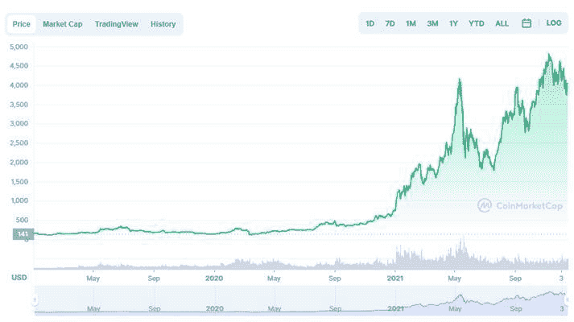

图 14：`ETH` 令牌价格从 2019 年 1 月到 2021 年 12 月的趋势。来源：CoinMarketCap。

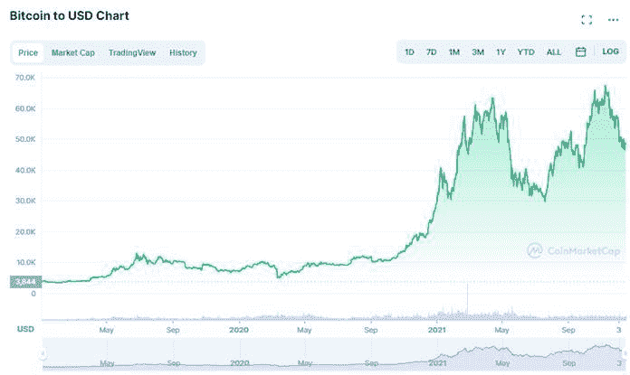

图 15：`BTC` 令牌价格从 2019 年 1 月到 2021 年 12 月的趋势。来源：CoinMarketCap。

根据这些图表以及许多分析师的观点，可以预期上升趋势将在长期内持续。

### 5.4.2 通过关注前 10-15 个加密货币创建一个“不平衡”的投资组合

通常，投资者之间最常见的建议是“多元化”。其理由是“不要把所有的钱都放在一个资产上”。由于成千上万种资产，分散投资可以帮助缓解与将一切押注在单一资产上相关的固有风险。这一概念在传统市场中是有意义的，但 `Crypto` 市场中的一些投资者认为多元化虚虚一个神话。部分原因是由于许多主流加密货币与 `Bitcoin` 紧密相关，而且用于区分不同货币的营销手段使得很难妥善评估资产。与上市公司及其相应的股票不同，评估一个 `Crypto` 项目的潜力是一个复杂得的过程，需要更多的技术技能。

因此，我们推荐的第二种策略是创建一个 `Crypto Wallet`，除了 `Bitcoin` 和 `Ether` 之外，还包含其他 `Altcoins`，但倾向于后者。为什么要“不平衡”？专家建议在你的 `Wallet` 中选择一些加密货币（1-3 个），并列一份中高风险 `Tokens` 列表。该列表还应包含几种 `Stablecoins`，即由“稳定”资产支撑的加密货币。这种策略考虑了 `Coins` 往往如何与 `Bitcoin` 的波动相关。然而，不受流行的 `Coins` 无论 `Bitcoin` 的表现如何，都可能增长得多，尽管它们带有大得投资风险。

### 5.4.3 通过基本面分析押注低知名但高潜力的 Altcoins

我们想要提到的第三也是最后一种策略（但特别建议那些第一次接触加密货币世界的人不要这样做）是：全仓投入那些价值仍然较低但潜力巨大的 `Altcoins`。如何截获它们呢？如果这个问题有简单的答案，那么每个人都会这样做。无论如何，最重要的是研究项目的基本面，并感知其长期的重要性。然而，正如前面提到的（尽管我们不会厌烦地重复这一点），市场的波动性代表了真实的风险，因此不建议这样做。

### 5.4.4 使用技术分析进行交易

如果投资者决定投机加密货币特有的这种波动性，那将特别有趣。在实践中，`technical analysis` 是对随时间价格的研究，以便预测未来的趋势。我们不会深入探讨这类分析的细节，因为它超出了本书的范围。


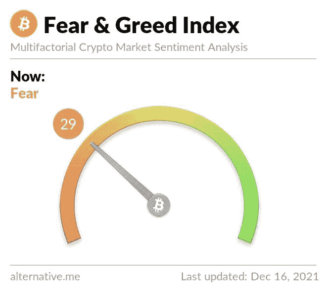

图 16：比特币恐惧与贪婪指数。来源：Twitter

### 5.4.6 基本面分析在加密货币世界中的作用

我们所说的基本面分析是指对公司的资本稳健性和盈利能力进行评估，以确定其内在价值（或公允价值）。它通常应用于已上市或正在上市的公司，以避免低估或高估某项投资的便利性（或其他情况）。基本面分析研究对所考虑的社会产生影响的所有微观和宏观事件。有必要对市场、公司运营的行业、其业务计划及其管理层有一个全面的了解，但最重要的是必须对其财务报表有深入的了解，这是基本面分析中使用的主要估值工具。

然而，在处理加密货币时，往往无法进行此类分析：特别是对于新币，例如，唯一的文档只有白皮书（Whitepaper）或稍多一点。但是，基本概念仍然存在，即对你打算投资的项目尽可能多地收集信息，以理解其稳健性，从而判断任何长期投资的有效性。

虽然对于引用率最高的比特币和以太坊，从机会的角度来看，这种练习可能是多余的，因为它们已经是市场中成熟的代币（尽管可能值得进行分析以了解关注哪一个更值得投入精力），但基本面分析可能是识别下一个比特币或以太坊的主要工具。

在这个意义上，互联网充斥着许多网站，可以在那里收集所需的信息，对底层项目有更详细的了解。在这里我们推荐几个，大部分书中已经提到：

- `CoinMarketCap`[**69]](#part0000_split_077.html#_ftn69)
- `Bitcoin forum`[**70]](#part0000_split_077.html#_ftn70)
- `The Cryptonomist`[**71]](#part0000_split_077.html#_ftn71)
- `Cointelegraph`[**72]](#part0000_split_077.html#_ftn72)

# 6 区块链应用

## 6.1 智能合约

## 6.2 银行与去中心化金融 (DeFi)

## 6.3 汽车行业

## 6.4 供应链

## 6.5 商业航空

## 6.6 医疗保健

## 6.7 能源管理

## 6.8 电子投票

## 6.9 税务

## 6.10 游戏游戏

## 6.11 共享出行

## 6.12 社交媒体

## 章节总结

**区块链技术在不同领域有许多应用，特别得益于智能合约。在本章中，我们将提供概述以及一些示例和应用。**

如今的区块链代表了一种普通大众对其机制仍鲜为人知的技术，除非考虑到与加密货币的联系（人们经常将两者混淆）：2021 年加密货币市场的爆发了投资者对这一高度投机市场的关注。尽管如此，区块链技术从不同角度为实际问题提供了具体的解决方案。

根据安永合伙人兼 EMEIA 区块链负责人 Giuseppe Perrone 的说法：“区块链技术对公司业务和公共服务演进具有巨大价值，但要具体利用这一价值，有必要在技能开发、行业监管以及特定用例的创新能力方面下功夫。”公司领导 Paul Brody 似乎对区块链技术在公司的未来没有怀疑，他宣布：“*区块链对业务网络和业务生态系统所做的作用，就像过去 ERP 对单个企业所做的那样。使用区块链改进供应链管理不仅确保了所有公司的公平竞争场域，还意味着能够提供更高质量的信息，允许他们做出更好的决策[**73]](#part0000_split_077.html#_ftn73)*。”

在本章中，我们将看到区块链如何在不同现实和背景下解决问题的具体示例。

## 6.1 智能合约

智能合约代表人与人之间的协议，在没有中介（如公证处）的情况下，通过计算机系统直接进行验证，以去中心化且安全的形式通过。这意味着如果一方违反合约，区块链将自动执行先前的协议或执行任何其他义务。以太坊创始人 Vitalik Buterin 这样解释这一概念：

“在智能合约方法中，资产或货币被转移到一个程序中，程序运行该代码并在某个点自动验证条件，并自动确定资产应该是给某人还是退还给发送者。同时，去中心化账本还会存储并复制该文档，使其具有某种安全性和不可篡改性。[**74]](#part0000_split_077.html#_ftn74)”

以太坊网络的开发主要是为了允许用户开发这类合约。其优势显而易见：

- 智能合约适用于任何类型的交易，而不只是财务。我们讨论的是商品、服务、协议等的交换。
- 不需要中介来确保合约的性。成本更低，执行更快。
- 确保合约执行，因为其执行被委托给了算法。

### 6.1.1 智能合约与 DAO

得益于区块链和智能合约，去中心化自治组织 (DAO) 开始传播，最初作为一个简单的概念，被构想为通过智能合约和区块链的所有基本原理实现业务功能和流程的组织。核心思想是扁化各种组织陷入的复杂业务流程，并促进资产向未来的数字互动移动，这种互动不需要中介，并承诺提供更快、更廉价的交易处理。

## 6.2 银行与去中心化金融 (DeFi)

去中心化金融意味着什么？根据维基百科：

“*去中心化金融（通常被称为 DeFi）是一种金融系统的实验性形式，它不依赖于中央金融中介（如经纪人、交易所或银行），而是使用区块链上的智能合约。DeFi 平台允许人们向他人借贷资金、利用衍生品对各种资产的价格进行投机、交易加密货币、对冲风险以及在储蓄账户中赚利。[**75]](#part0000_split_077.html#_ftn75) *”


DeFi 经济目前的价值约为 1,000 亿美元。在这方面，纳斯达克决定创建一个指数（`DEFX`）来跟踪主要的 DeFi 产品。目前，有约 200 个 DeFi 项目，其中 90% 利用了 `Ethereum` 网络。正如第 4 章所述，与银行相关的 `Cryptocurrencies` 非常受欢迎，因为其相关收益非常显著。例如，一笔国际交易可能需要 4 个工作日，成本可能高达 2-5% 加上额外费用。`Ripple` 可以大幅降低成本。通过 `Ripple` 网络，事实上银行不仅可以更快地处理交易，而且成本会低得多，更不用说处理交易所需的人员减少。`Ripple` 提供的另一个系统是 `xCurrent`，它已由桑德斯银行、`UBS`、美国运通、UniCredit、`BBVA` 等许多机构进行测试。`xCurrent` 是一种可以在数秒内完成端到端交易的应用，得益于此，`Ripple` 估计节省高达 33% 的成本。显而易见，得益于去中心化金融，旧银行体系可能会发生革命性的变化，即使不是被完全取代：事实上，许多银行对使用这些 IT 工具仍持怀疑态度，主要由于它们的波动性和不稳定性，这使得它们无法被大众使用来取代法定货币。

在编写本文时，已有 509 个为 DeFi 应用创建的代币。下面列出了根据 `CMP` 按市值排的前 5 大 `Cryptocurrencies`：

1. `Terra`**76**
2. `Avalanche`**77**
3. `Wrapped Bitcoin`**78**
4. `Uniswap`**79**
5. `Chainlink`**80**

## 6.3 汽车行业

对使用 `Blockchain` 和 `Smart Contracts` 感兴趣的最大的行业之一是汽车行业。并不意外的是，几乎所有主要的汽车制造商，如 `VW` (`IOTA`)、`BMW` (`VeChain`)、`Daimler` 等已经在使用 `Cryptocurrencies`。

在 2017 年，平均几乎每秒就有一辆车被租出去：所以，让我们想象一下现存合同的数量。如果此类合同发生在如 `Ethereum` 之类的 `Blockchain` 上，就可以实现对支付的更好控制，同时减少人员成本（这些成本将不再是必要的）。但这只是可能发生情况的一小部分。`Volkswagen` 是 `IOTA` 的合作伙伴之一，他们的目标是变革汽车支付系统。让我们想象这样一个场景：一辆自动驾驶汽车在每次停车、通过高速公路收费站、重新充电时，都能执行微交易，而无需采取任何操作。例如，如果你停了车，汽车会根据你在该点停车的秒数精确付费；或者如果你进入收费公路，则仅精确收取行驶里程费用，以此类推。这可能是因为像 `IOTA` 这样的加密货币被设计为在没有费用的情况下执行微交易。

例如，一家名为 `CarVertical` 的初创公司寻求变革二手车市场。其理念是在 `Blockchain` 上保存每辆车辆，并保持 `Blockchain` 关于发动机状况、里程、事故等信息的更新，以防止对二手车的犯罪操纵。这项技术可能会对整个行业产生巨大影响，因为在新款汽车的适应性方面还有进一步的可能。

## 6.4 供应链

在我们运营的全球化系统中，供应链代表了公司最重要的几个方面之一。现代供应链网络非常复杂，因为它们通常需要许多国家的多个独立系统：货物在到达零售分销点之前会进入不同的关税区。由于这种复杂性，跟踪所有的移动和接触点变得困难。解决这种复杂性的解决方案可以是同时同步所有数据的去中心化网络。位置可以轻松访问所有供应链数据，并自动进行支付。探索这些机会的货币有 `Origintrail`**81**、`Vechain`**82** 或 `Wabi`**83**。

`Blockchain` 的另一个优势是改进货物注册，从而提高其可追溯性。如今，对于许多人来说，知道购买的食物或衣服来自哪里是关重要的，由于 `Blockchain`，这可以以极低的成本以高安全性实现（因此也具有防伪功能）。例如，想象一下意大利制造产品的市场：其中哪些实际上是 100% 在意大利生产的？你可以通过检查 `Blockchain` 来回答这个问题。在该领域，`TE-Food`**84** 正在研究食品解决方案，即“从农场到餐桌的可追溯解决方案”。

我们可以得出结论，`Blockchain` 在公司的供应链中有大量的应用，并可能成为一个转折点：它将在多大程度上影响我们尚有待观察。

## 6.5 商业航空

`Blockchain` 在商业航空领域的益处描述于国际航空运输协会 (`IATA`) 于 2018 年发布的《航空领域的区块链》白皮书中[**85**]。简而言之，优势可以总结为以下几点：

- **常旅客积分收集活动**：`Blockchain` 通过将这些资源代币化，能够显著简化常旅客积分，使其数字化并无处不在。
- **行李、货物和零件管理**：`Blockchain` 以一种非常可靠且不可篡改的方式监控行李、货物和飞机零件的状态和位置。这为这些物品沿价值链的移动提供了提高可见性和透明度的机会。
- **分销与支付**：`Blockchain` 使航空公司和旅行社在交付旅游产品和服务时能够更好地协作。
- **乘客和机组身份管理**：`Blockchain` 可以通过改进体验、保护隐私并允许航空公司和更广泛的价值链在数字环境中运营来简化乘客身份管理。
- **价值链中的智能合约**：航空公司和价值链中的其他参与者在合同、合同执行、履行监控、账单和结算方面投入了大量精力。利用智能合约的概念，这些努力可以消除或极大简化。

## 6.6 医疗健康

与健康相关的个人信息是世界上最敏感的信息之一，因此对更安全、更私密的设施的需求一直很高。为此，`Blockchain` 提出的模型将是理想的：信息像交易一样发送到 `Blockchain`，是匿名的，从而维护患者隐私。此外，一旦数据保存在 `Blockchain` 上，信息可以在不违反患者隐私的情况下用于研究和探索。如果患者需要看医生，她可以使用她的私钥提供所有的个人信息。结果将是患者拥有所有的医疗数据，并决定谁可以访问。这避免了个人数据泄露并保护了数据。

在该领域已经有一些活跃的 `Blockchain` 项目，例如 `Medicalchain`**86** 或 `Medibloc`**87**。


## 6.7 能源管理

每个人必须依赖的另一个领域是能源部门。这里最大的益处是消除了中间环节，这意味着消费者不需要能源供应商就可以交换绿色能源。让我们来看以下例子：假设你的家里屋顶安装了太阳能电池板，每天产生 300KWH 的电，但只使用 200KWH。此时，差额要么发送给电力供应商以换取少量费用，要么储存在电池中。然而，无论哪种情况，能量和资金都会浪费。相比之下，通过区块链技术，可以将多余的电力直接供应给邻居并获得足够的补偿，最棒的是这一切可以完全自动地发生：事实上，智能合约执行了交易。得益于智能合约，电力可以以最高价自动出售，这除了其他因素外，还能避免电力供应商之间巨大的价差，并创建一个公平的使用系统。

在朝这一方向发展的各种项目中，我们可以提到 `Power Ledger (POWR)`88，这是一个于 2016 年 5 月发布的澳大利亚平台，旨在通过允许当地地区在没有中间商帮助的情况下向邻居出售和分配太阳能，来彻底改变全球能源行业。Power Ledger 在以太网络上运行，作为一个点对点的能源平台。

## 6.8 电子投票

谁不想直接在家里投票，而必必去投票站有时还要排队好几个小时呢？然而，在线投票和电子民主平台面临着一些损害其安全性的问题：

- 谁在控制在线平台？
- 我如何确保选票计数无误？
- 谁能向我保证系统在整个选举期间都是可用的？
- 投票完成后，我该如何检查选票？

在公共选举的背景下，这些关键问题是以成本来管理的：想想参与选票控制和计票的各种人物（监票员、选举官员、执法机构）以及用设备的特殊性（卡片、印章、特殊铅笔）。

在该领域的区块链通过以下方式促进了民主进程：

- 消除选举期间的欺诈活动和投票结果造假。在基于区块链技术的系统中，每个参与者的投票结果都无法更改；
- 从世界上任何地方投票的能力；
- 加速并提高计票的准确性；
- 减少选举过程的管理成本

## 6.9 税务

使用区块链进行税务验证的时间可以从几个月缩短到几秒。事实上，智能合约能够取代国家税务部门目前的中心化流程。基于区块链的税收系统还可以验证并防止欧盟国家实施的循环欺诈。区块链优化了数据交换过程，并降低了那些不需要人为干预的经济部门的成本。例如，计票可以自动完成。从日常工作中解放出来的专家可以提高或改变他们的资质。

## 6.10 游戏

视频游戏行业是目前利润最丰厚的行业之一，2019 年的收入超过了 180 亿美元 89。随着非同质化代币（NFT）的兴起，许多游戏开始采用这项技术，原因如下：

- 保证玩家的匿名性
- 允许即时交易
- 奖励用户的投入
- 跟踪资金流向
- 确保安全
- 提供透明且准确的价格模型
- 简化经济活动
- 实现资产所有

区块链技术使得这种场景成为可能，它是以太坊生态中的一个去中心化应用（dapp）。一个很好的例子是 `Axie Infinity`，一种边玩边赚的模式。这种游戏革命被称为“GameFi”。GameFi 体现了一个原则：玩家不应该简单地浪费钱，而是投资可以在二级市场增值的资产。遗憾的是，并不是每个人都能负担得起，这导致了类似于“付费获胜”模式的情况。

## 6.11 拼车

使用如 Uber 之类的拼车（或共享汽车）应用程序在全球范围内变得越来越流行。然而，该行业也充满了挑战：

- **中间商导致成本高昂**：在目前的场景下，当乘客约车时，首先会向公司发送电子邮件，公司然后分配一名司机负责行程，服务提供商收取总票价。结果是，客户来说很贵，而司机在扣除佣金后才能获得报。事实上，额外成本源于司机和乘客之间存在中间商。
- **透明度不足**：如果你已经使用过这些服务，你可能遇到过高峰时段的资费问题，发现自己付了了钱，而事先并不知情。通常这些高峰期也会在司机不知情的情况下发生，因为一系列中间商在价值链中干预。
- **缺乏数据隐私和安全机制**：公司面临的主要挑战之一是确保司机信息的安全和隐私

针对这些问题，区块链提供了许多解决方案：

- **快速、安全且高效的交易**：区块链允许用户通过去中心化网络与司机直接通信，最大限度地减少由于存在多个中间商而产生的额外成本。
- **透明且准确的价格模型**：智能合约的集成确保了根据其指定的 Basic 参数准确定价。这建立了系统的信任和透明度。
- **简化的经济活动**：由于没有了中间商，对于那些拥有手机和现代安全汽车的人来说，市场机会扩大了。

## 6.12 社交媒体


最后，即使是社交媒体世界也无法免于区块链带来的革命。社交网络的问题之一是内容和广告的管理。到目前为止，例如，是 Facebook 或 LinkedIn 等社交平台内的算法决定了哪些内容最适合我们，而这通常不考虑内容的质量。如果让用户根据特定标准对内容进行直接评估，并换一套奖励系统呢？`Steemit` 正在朝着这个方向发展，它是由 Ned Scott 和 Daniel Larime 在 2016 年创建的平台，第一个基于 Steem 区块的应用。Steemit 是一个去中心化应用（`DApp`），它使用同名加密货币 `STEEM` 来奖励用户的内容。通过对帖子和评论进行投票，用户可以决定为这些帖子付费。

# 7. 非同质化代币

## 7.1 引言

## 7.2 NFT 简史

## 7.3 NFT 的原理

### 7.4 最常见的用途

## 7.5 如何创建、购买和交易 NFT

## 章节总结

在第 4 章中，我们了解了同质化代币，即用户可以相互交换的代币。然而，还有另一类被称为非同质化代币（广为人知的 NFT），我们将在本章中进行描述。

**关键词**：非同质化代币、`NFT`、版权、数字艺术

## 7.1 引言

在上一章中，我们描述了区块链如何解决缺乏中心化架构带来的安全问题，中心化架构带来了一系列局限性，例如成本和可扩展性。

最近几个月日益流行的另一个应用是所谓的非同质化代币，或 `NFT`。

让我们澄清一下同质化和非同质化的含义。

钞票或加密货币被认为是同质化的，因为可以毫无问题地替换为另一张等值的钞票或加密货币。另一方面，非同质化代币代表的是一个独特的物品：即它不能被复制或替换。

`NFT` 可以是数字格式的任何对象，例如视频、照片、`GIF`、文本、文章、音频。这些数字对象中的任何一个通过 `NFT` 认证，就像上面有作者的签名一样，没有人说它不是原作的，或者在没有用 `NFT` 签名的情况下有其他副本。再举一个例子：书的副本本身具有某些商业价值。每份副本实质上与其他副本是相同的，例如可以被另一个完全相同的副本替换。然而，如果这个副本由作者签名（例如通过添加题词和日期），那么这个副本就会变得独特且不可重复。此外，它将获得更大的价值，因此将其与书的不同副本交换是没有意义的。在这里，这个特殊的副本将变成非同质化的，一个 `NFT`。没有区块链 `NFTs` 就不存在。哪种区块链？`Ethereum` 是第一个通过其 `ERC-721` 标准支持 `NFTs` 的区块链，目前也是最广泛使用的。由于 `Ethereum` 目前具有高交易费用（所谓的 `gas fees`），`Ethereum` 出现了第 2 层解决方案（即后期创建的用于解决某些特定问题的链上协议），这些方案也支持 `NFT`：

* `Immutable X`
* `Polygon`

其他支持 `NFTs` 的区块链还有：

* `Bitcoin Cash`
* `Cardano`
* `FLOW`
* `GoChain`
* `Solana`
* `Tezos`

## 7.2 NFT 简史

2014 年：Kevin McCoy 创建了第一个 `NFT`。

2014 年：Kevin McCoy 创建了第一个 `NFT`。

2015 年：Kevin McCoy 创建了第一个 `NFT`。

2017 年：Kevin McCoy 创建了第一个 `NFT`。

2018 年：Kevin McCoy 创建了第一个 `NFT`。

2018 年：Kevin McCoy 创建了第一个 `NFT`。

2019 年：Kevin McCoy 创建了第一个 `NFT`。

2020 年：`Cryptoitties` 的开发者 Dapper Labs 发布了 `NBA TopShot` 的测试版，这是一个销售代币化的项目。Nike 专利了一种名为 `CryptoKicks` 的系统来验证真实性并提供给。

2021 年：对 `NFTs` 的兴趣增加。知名销售包括。

2021 年：对 `NFTs` 的兴趣增加。知名销售包括由音乐家 `Grimes` 创建的数字艺术、`Nyan Cat` 的 `NFT` 梗图，以及 `3LAU` 为推广其 `Ultraviolet` 专辑而创建的 `NFT`。最广为人知的销售包括 Mike Winkelmann 名为 `Everydays: The First 5000` 的数字作品销售。

2014 年：Kevin McCoy 创建了第一个 `NFT`。

2014 年：Kevin McCoy 创建了第一个 `NFT`。

2015 年：Kevin McCoy 创建了第一个 `NFT`。

2017 年：Kevin McCoy 创建了第一个 `NFT`。

2018 年：Kevin McCoy 创建了第一个 `NFT`。

2018 年：Kevin McCoy 创建了第一个 `NFT`。

2019 年：Kevin McCoy 创建了第一个 `NFT`。

2020 年：`Cryptoitties` 的开发者 Dapper Labs 发布了 `NBA TopShot` 的测试版，这是一个销售代币化的项目。Nike 专利了一种名为 `CryptoKicks` 的系统来验证真实性并提供给。

2021 年：对 `NFTs` 的兴趣增加。知名销售包括。

2021 年：对 `NFTs` 的兴趣增加。知名销售包括由音乐家 `Grimes` 创建的数字艺术、`Nyan Cat` 的 `NFT` 梗图，以及 `3LAU` 为推广其 `Ultraviolet` 专辑而创建的 `NFT`。

## 7.3 NFT 的原理

如今，`NFTs` 被认为是数字格式艺术世界的一种演进。购买与 `NFT` 链接的作品并不意味着严格意义上购买了作品。相反，主张该作品的权利是通过智能合约保证的。

但这些作品是如何产生的呢？基本上，艺术家保存一个数字格式的照片或视频，这将对应一串数字。这个序列被压缩成更短的序列，即 `hash`。这个 `hash` 然后存储在 `区块链` 中，并带有相关的时间戳。`NFT` 在内部跟踪哈希销售情况，直到第一次易手的创建者。通过这条反向路径，你可以获得 `Token` 真实性和所有权的证明，只要区块链活跃，作品的所有者就不需要联系中间人。

此时有必要对知识产权进行澄清：`NFT` 的所有权并不内在保证代表 `Token` 的任何数字资源的版权或知识产权。虽然有人可能会出售代表其作品的 `NFT`，当 `NFT` 所有权变更时，买家并不一定获得版权权限，因此原始所有者允许创建同一作品的多个 `NFT`。从这个意义上说，`NFT` 仅仅是版权之外独立的所有权证明。

## 7.4 最常见的用途

以下是 `NFTs` 主要用途的简要列表：


- **数字艺术**：数字艺术是 NFT 的最早用例之一，这是因为区块链能够确保 NFT 的唯一签名和所有权。例如，艺术家迈克·温克曼（Mike Winkelmann）名为《每一天：前 5000 天》的数字作品在 2021 年以 6930 万美元售出。这是世艺术家作品第三高拍卖价，仅次于杰夫·昆斯（Jeff Koons）和大卫·霍克尼（David Hockney）的作品。
- **游戏**：我们已经提到 NFT 在视频游戏中的用途。这些可以用来代表游戏内资产，例如数字包裹，它们由用户而非游戏开发者控制。
- **音乐**：随着 2021 年热度的上升，巡演艺人和和音乐家利用 NFT 来弥补 2020 年新冠肺炎带来的收入损失。例如，2021 年 2 月 28 日，电子舞音乐家 3LAU 出出了包含 33 个 NFT 的集合，总价 1170 万美元，以纪念他的专辑《Ultraviolet》三周年。
- **电影**：2018 年 5 月，20 世纪影业与 Atom Tickets 合作，发布了《死侍 2》的限量版数字海报以推广电影。2021 年 11 月，导演昆丁·塔伦蒂诺（Quentin Tarantino）发布了基于《低俗小说》未剪辑版的七个 NFT。Miramax 随后提起诉讼，指控其电影版权被侵犯。
- **出版**：《NFT Magazine》是由 Cryptonomist 启动的一项新编辑项目。根据官方网站报道：
    - 它是一本在 `Ethereum` 上阅读和收藏的杂志，旨在发现加密世界最大的玩家、市场趋势、排名和专家建议。
    - 要阅读该杂志，需要收集 NFT 封面。
    - 由主要的国际加密艺术家制作的 NFT 封面是可以收藏的。
    - 印刷量有限，每份成本为 0.05 `ETH`（按书籍编写时计算）。

此外，该项目与针对公司吉祥物 Cryppo 的 NFT 系列同步进行。该系列由 7,777 个由人工智能生成的 NFT 组成，具有 90 多个非常特殊的 3D 特征，使 Cryppo 为元宇宙做好了准备。事实上，得益于与 The Nemesis 的合作，Cryppo 将立即拥有自己的元世界，主人可以在那里见面、聊天、游戏，并在报刊上找到《NFT Magazine》的最新版本。这建立社区忠诚度的智能方式。
- **奢侈品**：事实上，NFT 有三个在奢侈品领域非常有用的特点：
    - 终端可以在 `Blockchain` 中验证物品的正品性。
    - 可以绝对确定地验证谁是 NFT 的创建者或最终生产者。
    - 你可以将一个单一产品与单个 NFT 唯一地关联起来。然而，这需要特定的电子设备。
- **数字房地产市场**：数字房地产可以定义为“虚拟财产”，也可以以许多不同的形式出现。一些实用的例子包括通过电子商务进行广告和销售产品信息的经典网站、智能手机 App 的开发，或者域名的买卖。就像物理财产一样，通过数字房地产市场可以产生被动收入。正如我们在下一章看到的，由于元宇宙（或虚拟世界）的发展，得益于 NFT，在虚拟世界中购买土地变得越来越流行。根据 Axie Infinity 最近的一条推文，游戏世界内一块被称为“创世之地块”（Genesis Land Plot）的土地以 550 `ETH` 售出，在写作时相当于 230 万美元。

## 7.5 如何创建、购买和交易 NFT

如果你想创建一个 NFT，由于 `Ethereum` 拥有最大的 NFT 生态系统，假设你想按照该标准操作。因此，要开始你需要一个支持 `ERC-721` 的 `Ethereum Wallet`，实际上这是基于 `Ethereum` 的 NFT Token 标准。例如，`MetaMask`、`Trust Wallet` 或 `Coinbase Wallet` 提供了所需的标准。随后，如果你想创建一个 NFT，首先需要确定你想要使用的平台，例如 `OpenSea`、`Rarible` 或 `Mintable`，然后连接你的 `Wallet` 并上传你想要转换为 NFT 的选择图像或文件。

如果想在市场上出售你的 NFT，程序通常如下：
- 你需要在你的收藏中找到它们，点击它们并找到“出售”（sell）按钮。
- 你将进入价格页面，可以在那里定义销售条件，包括是进行拍卖还是以固定价格出售。

在市场上列出 NFT 有时需要费用来完成过程，尽管并非所有平台都是如此。

另一方面，如果你想购买 NFT，那么首先你需要知道下载哪个 `Wallet` 来连接平台并购买 NFT，你将用哪种 `Cryptocurrency` 为购买融资，最重要的是知道你想购买的 NFT 是否在特定时间出售。2021 年最流行的 NFT 市场绝对是：
- `OpenSea`
- `Rarible`
- `SuperRare`
- `Nifty Gateway`
- `Foundation`
- `Axie`
- `BakerySwap`
- `ShowRoom`
- `VIV3`

### 7.5.1 拍卖出的最贵的 10 个 NFT

作为示例，以下是拍卖出的最贵的 10 个 NFT：

1. **Everydays, Beeple**：到为止 NFT 的纪录性销售来自上述的《每一天：前 5000 天》，这是由美国艺术家 Beeple 创建的包含 5000 张图片的数字拼贴。
2. **CryptoPunk**：`CryptoPunks` 被认为是 `Ethereum` 上的第一个 NFT。它是由算法唯一生成的 10,000 个 24x24 像素艺术图像系列。每个 `CryptoPunk` 代表一个不同的角色。过去一年的平均报价约为 61,600 美元。
3. **Hashmasks**：约 70 名艺术家创作了世界上最美且最贵的虚拟作品。它们被称为 `Hashmasks`，代表彩色且独特的口罩，灵感来自美国艺术家让·米歇尔·巴斯亚（Jean Michel Basquiat）的涂鸦。所有口罩以 1600 万出售。
4. **CryptoPunk #7804**：回到 `CryptoPunk`，我们在第四位找到了这个 NFT 作品的角色之一。它是青色的小人，也是最贵的，它在 2021 年 3 月以惊人的 750 万美元出售！
5. **War Nymph di Grimes**：Grimes 是以 600 万出售其数字作品的加拿大艺术家。`War Nymph` 由 10 个系列组成，最贵的视频灵感来自艺术家的歌曲。
6. **Crossroads**：Beeple 的一段 10 秒片段也以 660 万美元售出，显示了唐纳德·特朗普在输掉 2020 年总统大选后赤裸地躺在地上，满是涂鸦。


## 7. 史上第一条推文

这条推文由 Twitter 创始人杰·多塞（Jack Dorsey）发布，通过 NFT 认证的独特版本于 2021 年 3 月在 Valuables 上慈善拍卖，以近 300 万美元成交。


图 23：历史上的第一条推文

## 8. Axie Infinity 的 Genesis Estate：数字土地也列入迄今为止最昂贵的 NFT 作品排行榜。它们被称为“Genesis Estate”，总售价为 150 万美元，存在于 `Axie Infinity` 游戏中。

## 9. Hairy：一段蓝色和粉色生物随着音乐节奏跳舞的视频以近 90 万美元售出。该视频由国际知名艺术家史蒂夫·亚木（Steve Aoki）制作。


图 24：Hairy

## 10. 小奶猫（Nyan Cat）：在 NFT 艺术排行榜的底部，我们发现了小奶猫，这是一只拥有三明治身体、身后拖着彩虹尾巴的可爱猫。创建者克里斯·托雷斯（Chris Torres）以 56.1 万美元卖掉了他的 NFT。


图 25：小奶猫

# 8. 元宇宙

## 8.1 引言
## 8.2 第二生（Second Life）：元宇宙的第一个示例
## 8.3 元宇宙的其他示例
### 8.4 全新的用户体验（UX）
### 8.5 元宇宙、区块链、加密货币与 NFT
### 8.6 当前的一些技术局限性
## 8.7 元宇宙的争议方面

### 章总结

元宇宙可能代表了 Web3 概念的最后拼图，因为它将在未来几年内被使用。在本章中，我们将阐述元宇宙的基础概念和技术，如虚拟现实和增强现实，以及它与区块链技术和代币使用（无论同质还是非同质）之间的密切联系。

**关键词**：元宇宙、UX、增强现实、AR、虚拟现实、VR

## 8.1 引言

当媒体最近报道“元宇宙”一词来指代马克·扎克伯格的 `Meta Platforms` 新名称时，我问自己的第一个问题之一是：这意味着什么？

这个术语追溯到 1992 年，根据维基百科[[110]](#part0000_split_077.html#_ftn110)报道：

*“元宇宙是尼尔·斯蒂芬森（Neal Stephenson）在赛博朋克科幻小说《崩塌》（1992）中创造的术语，它被描述为一种通过互联网共享的虚拟现实，人们在那里通过自己的化身以三维形式呈现[......]斯蒂芬森描述的是对现代互联网的未来愿景，中高层人群经常出没，社会阶层之间的差异通过化身的分辨率来表示（从公共终端的黑白形象，到富人极的 3D 渲染形象），以及进入专属场所的可能性”。*

元宇宙一个更简单的定义可以是阿尔伯特·梅日（Albert Meige）报道的：“未来的 Web 版本，视频游戏的沉浸式 3D 虚拟宇宙与社交网络、协作空间、市场和电子商务汇合的地方”111。

在 Gary Vaynerchuk 最近一次 112 的采访中，询问马克·扎克伯格关于 Meta 的未来愿景，扎克伯格表示：

*“对我来说，今天的元宇宙是社交连接的下一个前沿，就像社交网络在我 2004 年开始时一样……大多数人认为我们是社交媒体公司，但在我们的 DNA 里，我们是一家科技公司，构建不同的技术来帮助人们连接，并尝试改进人之间的联系。当然，社交媒体是这一过程的重要部分。然而，我认为它将越来越多地成为构建平台和创造能够传达存在感的体验，就像你和另一个人在那里一样。当然，增强现实和虚拟现实是过程的一部分[……]，我们已经研究了 7 年了[……]。我们开始发布 `Horizon` 和 `Workrooms` 以及其中一些让你感觉到某地有人在的体验（针对 Oculus 的虚拟现实平台，编辑）[……]。在某种意义上，这有点像一直梦想的这种数字社交体验，人们感觉到聚在一起并一起做事情、一起协作。到目前为止，我们拥有的技术没有能做到这一点[……]当我们想要去沉浸式区域时将会有虚拟现实，我们将增强现实来查看全息图，所以你可以想象 3 到 5 年后，不再是有视频，你将是我客厅里的一个全息，我是你客厅里的一个全息。”*

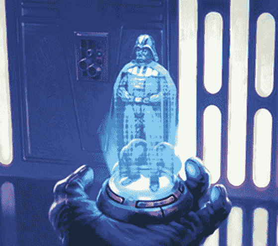
图 26：西答通过手持全息投影仪与下属对话。根据扎克伯格的说法，这种场景在技术上 3-5 年内可行 113

扎克伯格此举提出了一个新的业务视角，旨在克服 `Amazon`、`Google` 和 `Apple` 股价明显的关键性问题。

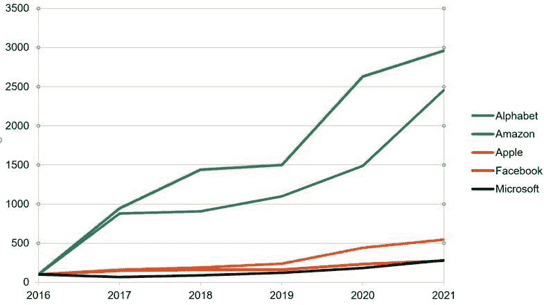
图 27：大型科技公司价值从 2016 年到 2021 年的增长。来源：Digitale114

在这一术语出现三十年后，描述的情景将由于一组技术（即使尚未完全成熟）如 `区块链`、`虚拟现实` 和 `增强现实` 而成为。

### 8.1.1 从数据到隐私

正如 Wired 报道的一篇文章 115 所：

*“元宇宙的体验无疑涉及前所未有的个人数据收集、处理和共享，涉及多个主体。此外，在元宇宙中可以收集有关用户行为和心理反应、物理运动和生物识别数据的信息（想象用于新虚拟体验的眼镜或其他身体设备）。用户（以及他们的物理或心理反应）将受到持续监控。”*

因此，隐私问题和个人数据处理将成为负责任且严肃参与元宇宙日益增加的核心点。

## 8.2 第二生（Second Life）：元宇宙的第一个示例

Second Life[116](#part0000_split_077.html#_ftn116）是由旧金山的 `Linden Lab` 在 2003 年推出的一个在线平台，被认为是元宇宙的第一个具体示例。Second Life 允许人们为自己创建化身并在在线虚拟世界或元宇宙中过第二生活。用户（被称为居民）可以与地点、物体和其他化身交互，他们可以探索世界（称为网格）、与其他居民见面、社交、参与个人和小组活动，并相互构建、创建、购买和交换虚拟财产和服务。

该平台主要以用户生成的 3D 内容为主，并拥有自己的虚拟货币——林登美元（Linden Dollar），该货币可以兑换现实货币。


通过其市场，用户可以购买一系列虚拟物品，从化身配饰（如衣服和珠宝）到虚拟生活中使用的家具。

第二人生（Second Life）一直从多个方面受到批评：

- **技术方面**：第二人生曾遭受和正遭受着各种技术问题。例如：
    - `与系统不稳定性相关的困难，`，包括系统延迟增加和客户端崩溃
    - `用户库存中的物品丢失，包括购买的物品，` 这些物品可能会在没有任何预警的情况下消失，或者永久地进入一种在需要时不会出现在世界中的状态
    - `计算机硬件和网络连接`：能够在其他在线多人游戏平台中流畅运行高质量内容的硬件和连接，在第二人生中可能表现不佳，导致帧率低且即使在最低图形配置下控制也无灵敏
    - `网络拥塞`：单个区域仅用于托管有限数量的居民，导致某些热门地点无法访问。`Resident`（居民）支付的土地区域可能因为同一区域的另一个区域化身额度耗尽而无法访问
- **知识产权方面**：尽管第二人生 服务器整合了一项管理数字对象知识产权的技术，但仍然有系统可以绕过它们
- **安全与隐私**：2006 年 9 月 8 日，Linden Lab 发布了一份新闻公告，揭露其第二人生数据库已被入侵，客户信息（包括加密密码和真实用户名）可能已被访问
- **不当内容**：一些媒体关注了涉及外表儿童化身的性活动。由于由于原因，例如，英国和德国是正在研究新法律以打击模拟儿童色情的国家之一。美国曾试图通过几项禁止此类行为的法律，但每一项都被美国最高法院驳回，理由是违反了宪法第一修正案的言论自由权。

## 8.3 元宇宙的其他示例

特别是在最近几年，项目在元宇宙概念的基础上诞生。以下是一些示例：

- **VRChat**：一种 3D 格式的社交体验。`VRChat` 在游戏界非常流行，并在 Twitch 和 YouTube 直播网站上活跃。相遇、分享、比较：这就是该平台提供的。
- **AltspaceVR**：微软的社交 VR 平台，可以在那里组织虚拟活动、会议和派对，用户可以在那里相遇、协作和聊天。该平台推广了 LGBTQI + 活动、知名艺术家的现场秀，以及 2020 年巴黎时装周虚拟秀。
- **Hoppin’**：这是一种沉浸式体验，允许你访问世界的任何地方，与朋友或家人同时共享同一空间。此外，这也是一个机会让你可以在舒适的家中或办公室向潜在客户展示地点和目的地，分享会议。
- **Spatial**：该平台专注于会议和商务会议。通过 4 种不同的虚拟环境，可以创建真实再现用户脸部的 3D 化身，直接从查看器共享本地文件并操作 2D 对象。它还支持图像、视频、pdf 和 3D 对象。
- **OVR**：这是一个基于 `Ethereum Blockchain` 构建的增强现实和虚拟现实平台。通过为 `OVRLand` 用户，任何人可以在他们的环境中设计任何想象中的 `OVRExperience`。此外，创作者可以通过 `OVR Marketplace` 销售他们的虚拟现实体验。

最后，我们报告，微软正在向其 `Teams` 聊天系统添加化身和 3D 虚拟环境，作为其推向“元宇宙”的一部分。微软表示，这些被称为“沉浸式会议”的新功能将在 2022 年上半年可用。

## 8.4 全新的 UX

在技术领域，缩写 `UX` 代表用户体验（User Experience），即用户交互和体验产品、系统或服务的方式。随着 90 年代初互联网的起源，用户简单地通过键盘和鼠标与系统交互。另一方面，随着所谓的 `Web 2.0`，智能手机和平板等便携式设备开始越来越普及。在这种情况下，触摸屏成为与设备交互的主要界面。另一方面，随着 `Web 3.0`，由于可穿戴设备的使用增加，用户体验将发生进一步变化，特别是使用两种特定技术的智能眼镜：

- 虚拟现实
- 增强现实

下面我们将详细描述这两种技术的工作原理。

### 8.4.1 虚拟现实

在最近发布在 YouTube 上的视频中，我们可以了解到扎克伯格的新公司所说的元宇宙：一个沉浸式世界，它可以包括现有现实部分的虚拟元素，或者完全虚拟的元素、物体和人。

images/0029.jpeg
图 29：根据 Meta 的元宇宙

Meta 视觉背后的技术是虚拟现实，这项技术并不新鲜（如我们所见），但公司通过 2014 年收购 `Oculus`（现更名为 Horizon），在该领域已拥有丰富的专业知识。在本节中，我们将详细描述什么是虚拟现实。

虚拟现实可以描述为在模拟环境中进行的交互式计算机生成体验，主要整合了听觉和视觉反馈，也可以允许其他类型的感官反馈，如触觉反馈。

虚拟现实的概念最早可以追溯到 1838 年，当时查尔斯·惠斯顿发明了立体镜。20 世纪 50 年代中期，电影人莫顿·海利开发了 `Sensorama`（1962 年专利），这是一种街机式的剧场家具，能够刺激所有的感官，而不只是视觉和听觉。它具有立体声器、立体 3D 显示、风扇、气味发生器和震动椅。1961 年，`Philco Corporation` 的两个工程师开发了我们所熟悉的头戴显示器的前身：`Headsight`。它为每个眼睛配备了一个视频和一个和一个运动检测系统，连接到 `CCTV` 摄像头。1968 年，伊万·萨瑟兰发明了“达摩克利斯之剑”，能够通过叠加原始的计算机生成的 3D 合成图形来追踪用户的头部运动。随着互联网时代的到来，虚拟现实尤其进入了视频游戏领域，出现了一些有时并不非常成功的实验和产品（例如任天堂的产品）。到目前为止，最流行的 VR 头显设备设备可能是 Meta 的 Oculus 和 HTC 的 HTC Vive。

#### 8.4.1.1 VR 如何工作，例如硬件和软件

使用虚拟现实基本上有两种类型的技术：

- `洞穴式自动虚拟环境 (CAVE)`
- 头戴设备技术

CAVE 技术由一个位于房间内的视频剧场组成，其 CAVE 墙可以由：


- 后投影投影幕，或
- 平面显示器

由于近距离观察，投影系统的分辨率非常高，这需要极小的像素尺寸来维持现实的幻觉。用户在 CAVE 内部佩戴 3D 眼镜查看生成的 3D 图形。使用 CAVE 的人可以看到悬浮在空中物体，并可以在其周围行走，获得这些物体在现实中真实外视角。这是通过使用红外摄像头实现的。用户在 CAVE 中的移动由通常附在 3D 眼镜上的传感器进行跟踪，视频会不断调整以维持观察者的视角。计算机同时控制 CAVE 的这方面和音频部分。CAVE 中通常在多个角度放置了多个扬声器，提供立体声。

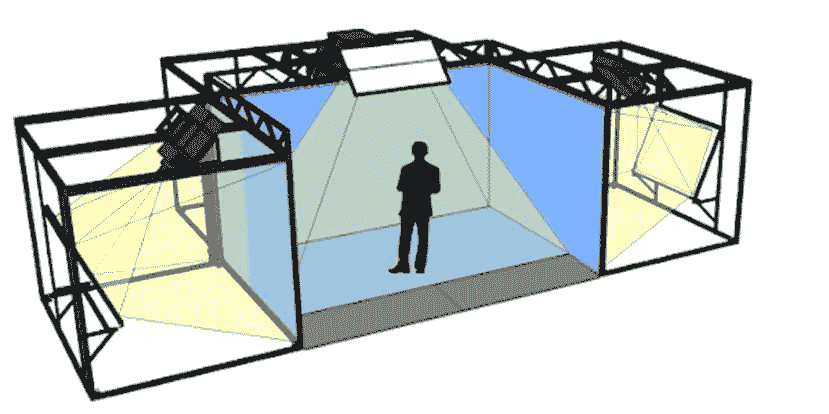

图 30：CAVE 技术的图形表示

头戴技术对普通大众更为熟悉，因为它为体验虚拟现实提供了一种更廉价的解决方案。头显包括目戴式立体显示器（为每只眼睛提供独立的图像）、立体声和头部运动检测传感器（可以包括陀螺仪、加速度计、结构光系统等）。根据其跟踪方法，头显技术可以分为两大类：

- **3 DoF**：监控头显如何旋转，因此它知道我们正在看哪里。大多数移动 VR 平台使用 3 DoF 监控系统。惯性测量单元（`IMUs`）用于跟踪旋转。`IMUs` 使用陀螺仪、加速度计和磁力计检测旋转。所有现代 3 DoF 跟踪都使用 `IMU`。
- **6 DoF**：监控跟踪位置和旋转。系统知道我们正在看哪里以及我们处于什么位置。这就是高端 VR 系统（如 HTC Vive 和 Oculus Rift）让您能够在房间内移动的方式。实现 6 DoF 监控有许多不同的方法。Oculus Rift 使用许多 LED 和外部摄像头建立模型，然后尝试用摄像机看到的 2D 模型与头显的 3D 模型进行拟合。它随后使用来自内部 `IMU` 的信息来计算头部的位置。而 HTC Vive 则使用红外激光来测量视觉传感器垂直和水平扫描所需的时间。它利用获取的数据和内部 `IMU` 来确定头部和手的位置。

基于 VR 头显技术的另一种分类方法是：

- **移动 VR (Mobile VR)**：移动 VR 使用 `IMU` 跟踪，因此它只有 3 DoF 跟踪。它只能监控头部旋转，而不是位置。它还是“自由”的，这意味着没有电线连接头显和计算机。你可以在任何地方使用它。它的图形性能较弱，由电池供电。
- **桌面 VR (Desktop VR)**：桌面 VR 技术使用 6 DoF 监控，通常是有线解决方案。设备连接到计算机，并使用计算机执行图形工作并获取电源。图形效果通常更好。大多数桌面 VR 设备还带有手动控制器，允许更强的交互性和更沉浸的体验。

通常，虚拟现实的开发需要编写代码、使用编辑器或将两者结合。编辑器是一种简化游戏创建的软件开发框架。编辑器通常提供 3D 渲染、物理、声音、脚本、动画、资源管理等功能。

一些流行的编辑器有：

- **虚幻引擎 (Unreal Engine)**
- **Cryengine**
- **亚马逊林场 (Amazon Lumberyard)**
- **Unity**

你还可以使用原生开发工具，如 `OpenGL` 和 `Microsoft DirectX`。这些选项提供了更大的灵活性，但通常需要更长的开发时间和编写更多的代码。WebVR 也是一个有效选项。

### 8.4.2 增强现实

不仅仅是虚拟现实。元宇宙包含了一种全新的体验，它可能不仅完全是虚拟的，而且是“现实”与虚拟现实的混合。这种混合之所以可能，归功于增强现实，该术语归于 1990 年的前波音研究员 Thomas Caudell 所有。1984 年，第一副“终结者”式眼镜问世。2013 年，最流行的设备是 Google 眼镜。2015 年，微软宣布了 HoloLens，它利用各种传感器将高分辨率全息与现实世界融合。

#### 8.4.2.1 增强现实的工作原理

增强现实基本上根据以下原理之一工作：

1. **SLAM**：**同步定位与建图 (`SLAM`)** 是在未知环境中构建或更新地图的同时，同时跟踪代理在 particular 环境内位置的计算问题。已有几种已知算法被应用于自动驾驶汽车、无人机、行星探测器甚至人体。
2. **基于识别的 (Recognition based)**：基于识别（或标记）的增强现实系统使用摄像头识别标记或物体（例如 `QR` 代码或自然特征跟踪 (`NFT`)），只有当设备检测到标记时，才会显示信息或图像的叠加层。这项技术本质上取决于设备的摄像头将标记与现实世界或其他物体区分开。不仅可以识别标记图像，还可以计算其位置和朝向。一旦被识别，屏幕上的标记将被替换为相应对象的虚拟 3D 版本。这样做是为了让用户能够更详细地从各个角度观察该物体。旋转标记也会导致虚拟副本旋转。
3. **基于位置的 (Position based)**：与基于识别的系统不同，基于位置的增强现实依赖于 `GPS` 系统、数字指南针、速度传感器或加速度计来提供位置数据，而增强现实信息叠加根据这些输入被激活。它被称为无标记增强现实。智能手机的位置跟踪功能使得人们很容易利用这种增强现实技术，使其非常流行。基于位置的 AR 的常见用途包括地图导航、搜索附近的服务以及其他以位置为中心的移动应用。

增强现实的主要硬件组件包括：

- 处理器
- 显示器
- 传感器
- 输入设备


显示器通常集成在智能眼镜、智能手机和平板电脑中。如今，平板电脑和智能手机在 AR 领域也非常常见且广泛使用。这些设备具备所有所需功能：便携且强大的 CPU、数字摄像头、GPS、惯性传感器和触摸屏。根据《时间》杂志的，增强现实和虚拟现实预计在未来 15-20 年内成为计算机交互的主流技术。

软件必须从摄像头图像中提取真实世界的坐标。这一过程被称为图像配准，使用了不同的计算机视觉方法。增强现实标记语言（`ARML`）是一种专为 AR 开发的语言。为了实现增强现实应用的快速开发，已经开发了一些软件开发工具包（`SDKs`）。一些 AR SDK 由以下机构提供：

*   `Vuforia`[\[129\]](#part0000_split_077.html#_ftn129)
*   `ARToolKit`[\[130\]](#part0000_split_077.html#_ftn130)
*   `Wikitude`[\[131\]](#part0000_split_077.html#_ftn131)

以下是市场上一些主要增强现实设备的简要概述：

*   **Google Glass：** 尽管它未能进入消费市场，但谷歌在增强现实领域的医疗和制造应用取得了远更大的成功。该设备配备了宏勃的技术，包括用于音频输出的骨传导技术和棱镜投影显示器。Explorer 版的继者 Google Glass 企业版放弃了骨传导技术，但相比之前的版本有了几项改进，包括 Intel Atom 处理器和压力计。
*   **Microsoft HoloLens**：HoloLens 被誉为世界上第一台完全无线的全息计算机，提供开发版和商业套件两种配置。位于北美的公司还可以选择通过微软合作伙伴租用 HoloLens。当前版本的 HoloLens 具有 35° 的 FOV（视场），但微软最近一项关于 MEMS 激光扫描器的专利可以将下一代 HoloLens 的 FOV 增加到 70°。

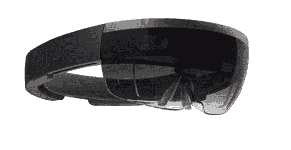

图 31：Microsoft HoloLens 头设备

*   **VUZIX M100 & M300 智能眼镜：** Vuzix 成立于 1997 年，在增强现实行业拥有悠久的历史。其目前适用于工业应用的产品是 M100 和 M300 智能眼镜。M300 标记具有先进的功能，两者之间存在一些重要差异。例如，M100 的对角 FOV 为 15°，而 M300 为 20°。
*   **DAQRI 智能眼镜：** 作为公司增强现实硬件的最新迭代，DAQRI 智能眼镜专为专业用途设计。该设备基于第 6 代 Intel Core m7 处理器，使用两个 LCoS 光学显示，提供了 44° 的对角 FOV。它带有 Worksense Standard，这是 DAQRI 用于 AR 活动的应用程序套件。

### 8.4.3 与使用 VR 和 AR 相关的问题

然而，虚拟现实和增强现实并非没有问题。其中一些包括：

*   **用户界面：** AR 的主要挑战之一是提高视场（FOV）、亮度、显示质量、延迟等。例如，在 FOV 方面，即使是最好的 AR 设备也只能提供 90 度。与人类正常视觉的 190 度水平和 120 度垂直 FOV 相比，该技术现状与目标之间的差距变得显而易见。
*   **健康问题：** 过度使用 AR 和 VR 设备（下一章描述）可能会导致一些健康问题，例如：
    *   **虚拟现实症：** VR 头戴设备包含两个小型 LCD 显示器，每个投影在一只眼睛上，创造出立体效果，让使用户产生周围创建了一个人工环境的错觉。较长的屏幕聚焦时间会增加恶心和扭曲感，这种现象被称为虚拟现实症；
    *   **眼睛疲劳：** 使用 AR/VR 观察器时，我们受环境限制在有限区域内，长时间观察并关注细节，导致眨眼频率倾向于低于正常水平。这会导致眼球前表面干燥和眼睛疲劳。
    *   **眩晕：** 弱视（双眼视力不平衡）或其他抑制聚焦、深度感知或正常 3D 视觉的情况，在使用类设备时可能更容易出现头痛和眼睛疲劳。

### 8.5 元宇宙、区块链、NFT

我们已经看到虚拟现实和增强现实很可能是开发虚拟世界的两个主要技术。然而，如果这种未来愿景日益盛行，我们习惯于每天花几个小时沉浸在虚拟世界中，并使用能够通过显示数字信息来增强现实的设备，这意味着控制的可能性将更大。如果 Meta 已经通过社交媒体拥有了我们大部分的数据，让我们想象一下拥有整个虚拟世界的公司可以拥有多大的中心化权力。

出于这个原因，`Blockchain` 技术将允许保证必要的安全和隐私，而无需一个充当信息控制和集中者的中央机构。元宇宙因此可以充分利用去中心化网络来克服这些问题，带来我们在前面的章节中讨论过的所有收益和风险。在这种情况下，使用数字代币（即 `Bitcoin`、`Ether` 等）将成为商品交换和服务的最实用的解决方案。同样，元宇宙将成为使用由智能合约引入的所有去中心化解决方案的理想环境。

类似地，`NFT` 市场也可能经历指数级增长。正如《第二人生》（Second Life）的情况一样，在元宇宙中，我们可能可以通过去中心化平台购买并交易物品。让我们想象一下视频游戏的情况：以 `NFT` 形式购买的物品可以在一个平台上购买，但在其他多人平台上使用甚至交易。或者，通过增强现实，我可以在特定地点出售独特的虚拟广告空间（例如建筑、特殊地点等），当用户位于地点附近时，这些空间出现在他们的显示器上。

可以确定的是，元宇宙将会持续存在，否则公共和私营部门在该领域的投资将无法解释。例如，作为中国人口最密集的城市，上海正在寻找在未来五年在公共服务中使用元宇宙的方法。上海市经济和信息化产业发展规划列出了四个前沿领域，其中之一就是元宇宙。

我们在下面列了一些利用元宇宙理念的 `Blockchain` 项目（因此也是加密货币和 `NFT`），按市值（从高到低）排序[\[132\]](#part0000_split_077.html#_ftn132)：


-   **Decentraland**[133：这是一个基于以太坊区块链的去中心化平台。由阿根廷人 Ari Meilich 和 Esteban Ordano 于 2015 年创立，最初只是一个通过 PoW 算法向用户分配像素的像素化网格。随后的后，从 2018 年 10 月开始，该平台演变为一个 3D 世界。它是如何运作的？在创建虚拟形象后，用户有机会在虚拟空间中购买和转卖土地块以进行建设。交易使用的货币是 `MANA`，这是原生代币，与其他加密货币不同，它无法被挖掘，并且每当发生土地或其他用户可购买的商品交易时，它就会从区块链中移除。除了买卖土地，`MANA` 还被用于购买数字内容、NFT、广告服务等。在本文写作时，`MANA` 的价值约为 3.14 美元，是市值第 28 大加密货币。几位投资者预计这一增长趋势将在未来几年持续下去，并在 2025 年突破 15 美元[134

-   **The Sandbox**[135：这是一个由 Arthur Madrid 和 Sebastien Borget 创立的平台，使用基于以太坊的去中心化虚拟现实，允许用户构建、拥有并货币化内容和应用程序。在这个虚拟现实中，用户可以购买地块，即每个 96×96 米（虚拟）的土地块。使用的代币是 `SAND`，用于在平台的元宇宙中获取 NFT。该代币还可用于购买装备、自定义角色等。例如，装备意味着视频游戏 X 中英雄的一把魔法剑、视频游戏 Y 中的特殊盔甲，或者仅仅是视频游戏 Z 中的一只宠物。至于角色的个性化，在这里我们讨论的是不同类型的鞋子、手套、夹克、帽子等。`SAND` 目前市值位列第 39 位，价值为 4.94 美元[136

-   **Enjin Coin**[137：经验丰富的区块链程序员 Maxime Blagov 在 2017 年注意到了优化在线游戏平台的需求，他与 Witek Radomski 一起构思并计划了 Enjin 项目的建立。Enjin 代表了一个复杂的生态系统，旨在为游戏玩家创建一个安全、快速且设计良好的环境。该项目旨在改进视频游戏的创作，确保程序员能够真正突出他们的想法和潜力，而不必被迫根据发行者的选择进行设计，同时保持高水平的安全，这在游戏和 NFT 领域已开始代表一个日益重要的方面。目前，`ENJ` 代币市值位列第 65 位，价值为 2.34 美元

-   **Velhalla**[138：最后，我们提到一个最近诞生的项目。事实上，它的`SCAN` 代币直到 2021 年 11 月 16 日才通过 IDO（去中心化平台的初始发售）开始可用。Velhalla 的元宇宙提供了与其他现有基于元宇宙的项目类似的特性：事实上，可以利用不同的边玩赚（play-to-earn）游戏，通过自己的平台增加玩家的盈利潜力。提供的每个游戏都有自己的元宇宙，这使其比其他平台更独特。这些加密货币用于兑换游戏奖励和资产。`SCAN`目前排名第 4332 位，价值为 0.08 美元

很容易理解这种场景如何开启巨大且完全未被开发的机遇。然而，存在一些局限，特别是技术上的限制。让我们来看看有哪些。

## 8.6 目前的一些技术限制

尽管许多技术已经在市场上可用，并且元宇宙的示例已经开发出来，但从技术角度来看，要保证用户必要的可用性还有很长的路要走。我们已经提到过第二人生平台上的技术问题，例如信息的图形处理。

英特尔加速图形和处理团队（计算系统与图形小组）负责人之一 Raja Koduri 建议，需要非常强大的基础设施来建立 Meta 构想的元宇宙，估计其计算能力将是现在的 1000 倍。这本质上是因为需要将一系列“人类”特征数字化，包括语音功能和人员的实时移动，所有数据都必须由用户佩戴的设备收集，该设备必须集成各种传感器。所有海量数据必须以极高的带宽和极低的延迟传输到云服务器，并在几毫秒内为数十万同时连接的用户提供服务。无论如何，英特尔最近表示他们正朝着这一方向努力，特别是开发用于元宇宙的新型图形处理器。然而，开发新硬件是不够的，还需要专门的算法、一种新架构（英特尔已将其称为`Xe`）、新的软件工具和开放开发库。Koduri 最终对实现现实元宇宙的技术可行性表示乐观，尽管这可能需要几年[139

其他技术限制涉及虚拟现实和增强现实。事实上，我们已经看到使用这些设备会给用户带来不适，如虚拟现实症、眼睛疲劳和头晕。如果我们每天都要使用这些设备，这些问题必须找到解决方案。

## 8.7 元宇宙的争议方面

第一个方面是缺乏互操作性和标准。在许多公司可以创建自己的私有元宇宙的情况下，例如访问需要由销售的 NFT，将产生许多互不通的“领域”，一种新的数字中世纪。

第二个方面是可用性，这是一个一直悬而未决的问题：事实上，我们已经看到在使用虚拟现实和增强现实时，这些设备会产生头晕或眼睛疲劳。

第三个方面是监管，这是一个在第三章中讨论过的问题。事实上，立法者的干预已迫在眉睫。哈佛商学院教授 Shoshana Zuboff[140 提出了如何组织和治理数字世纪的信息通信空间的问题。例如，如果物理世界中成瘾物质受到严格监管，为什么元宇宙中的成瘾数字服务不受限制呢？

# 9. Web3 革命

**9.1 前章节总结 **

**9.2 采用新技术 **

**9.3 真正的去中心化**

**9.4 什么样的未来场景？ **

**本章总结**


在之前的章节中，我们描述了 Web 3.0（或 Web3）概念的核心技术，特别关注了 `Blockchain`（区块链）。这是一种去中心化的架构，能够彻底改变我们所知的网络结构，同时也没有忽视它从社会经济角度可能带来的后果。在最后一个章节章中，我们将对等待着我们的未来场景进行一些思考。

**关键词**：Web3、去中心化、新技术、未来场景

## 9.1 之前的章节总结

尝试总结我们在之前章节中看到的内容，我们可以说，Web 3.0 本质上代表了 Web 2.0 的演进。在这种演进中，用户不仅被视为买家或从各种可能形式的重复利用中获取最大信息的实体，而且益于网络的去中心化，用户将能够成为自己数据的所有者，而不需要中央控制机构。

这种场景将在去中心化的 IT 架构——`Blockchain`的基础上得以实现。正如我们所看到的，得益于 `Blockchain`，用户将能够交易，例如交换 `Bitcoin` 等数字货币、签署智能合约并在无需中介的情况下购买服务，从根本上减少了时间和相关成本，同时维持了在其他情况下无法实现的安全性和透明度。因此，加密货币可能成为第一种交易货币，并取代法定货币，因为它们无法被操纵和审查，同时作为优于黄金等其他资产的价值存储载体。通过加密货币，已经可以交易非同质化代币（`NFT`）或独特的数字对象（如艺术品），这些处于一个仍处于胚胎阶段的市场，但根据许多业内人士的说法，其中充满了巨大的机遇。最后，这一切都可能在一个虚拟环境中发生，无论它是去中心化的还是沉浸式的，得益于 `Metaverse`（元宇宙）中 `Virtual and Augmented Reality` 等技术。从这个意义上说，“现实”与虚拟之间的边界将变得日益模糊，在这个领域也带来了新的机会和尚待探索的场景。

## 9.2 采用新技术

我们面临的是乌托邦式还是反乌托邦式的场景呢？近年来，越来越多的作者和电影制人开始关注使用这些技术所允许的未来场景。真正的问题正如开头揭示的那样：技术在进步，但我们作为“习惯性生物”的状况无助于我们适应其扩散带来的后果，导致在可能实现的与社区实际采纳的之间产生了越来越大的鸿沟。

这个问题其实并不新鲜：事实上，早在 1959 年，德国哲学家马丁·海德格尔（Martin Heidegger）就曾写道[`141`](#part0000_split_077.html#_ftn141）：

“真正令人不安的不是世界变成了一个完全的技术领域。

*更令人不安的是，人类对世界的这种根本性变化根本没有做好准备。*

*更令人不安的是，我们还无法通过沉思的思考，与我们时代真正出现的东西进行恰当的比较。”*

一种技术而非另一种技术的大规模采用可以在不同的机制的基础上发生：它可以受到所谓的“网络效应”（参见词表）的刺激，可以在中心化层面得到鼓励（例如通过国家政府的法律，参见萨尔瓦多采用 `Bitcoin` 的案例），或者甚至可以在社区层面受到阻碍，例如安米士人或一些原住民，他们刻意选择不使用某些现代形式的技术。

此外，一项技术的传播无论它是否是市场上最好的，正如一些实际例子证明了这一点。一个例子是 `QWERTY` 键盘的布局在模拟打字机时代成为标准，而不是为了提高数字系统输入速度设计的 `Dvorak` 布局。在这种情况下，我们进入了认知不确定性领域：众知道 `Dvorak` 比 `QWERTY` 好，但决定使用后者。

类似的情况也可能发生在 `Blockchain` 上，其中一种标准（例如 `Bitcoin`）可能被优于另一种标准（例如 `Ethereum`），尽管它在技术上可能稍逊一筹。除此之外，这也是互联网基础 `TCP / IP` 协议发生过的情况：它无疑不是最好的，但现在在各方面都是标准。

## 9.3 真正的去中心化？

当然，并非所有闪光的都是金子，像描述的场景也伴随着巨大的风险。主要的风险之一是缺乏全球性的中央控制机构来确保遵守法律。但如果控制者本身不遵守法律呢？正如我们在引言章节引用 `Snowden affair`（斯诺登事件）时提到的，这实际上已经发生，但只是冰山一角。

事实上，目前无法确定这不会重演或再次发生，无论由哪个政府控制信息。

**我们在这个节点问自己的问题是：一个集权的社会还是去中心化的社会更好？**

一个去中心化的公司结构，意味着它没有像政府这样的中央监管机构（可能是 `DAOs`），这可能帮助犯罪组织逃避审查。到目前一个具体的例子是 `P2P` 文件共享网络，通过该网络可以以极小的风险交换受版权保护的文件。我们还看到，在 `Second Life` 的情况下，这类场景也可能导致不当内容的不受控扩散，例如与儿童色情内容的世界有关。

正如麻理工学院教授、`Algorand` 创始人西尔维奥·米卡利（Silvio Micali）在接受 Marco Montemagno 采访时所指出的，解决 `Blockchains` 中心化问题的真正困难在于共识算法。事实上，我们看到主要的 `PoW` 和 `PoS` 机制实际上将权力集中在拥有更多经济资源的人手中。事实上，在 `PoW` 中，区块验证在矿工手中，很大程度上取决于他们的计算能力或拥有的硬件。同样，在 `PoS` 中，验证区块的权力倾向于持有权益最多的人。

因此，一个真正的去中心化 `Blockchain` 必须保证一种机制，让无论经济实力如何，任何人都有机会向链上添加区块，同时保证必要的安全性。因此，只有当大多数参与用户（或至少是验证区块的用户）是诚实的时候，该系统才能被认为是安全的。

**因此，问题可以重新表述为：假设大多数参与的人都是诚实的，我们是更倾向于由一个去中心化的系统治理，还是由一个群体控制的集权社会治理？**

## 9.4 什么样的未来场景？

由于这些原因，Web 3.0 在不同的社会和商业背景下代表了一场真正的革命。Web3 作为一种技术范式，旨在为价值和资源的创造、代币化和移动提供底层支持。


Web3 旨在通过代币化解决内容所有权并提供数字资产的可移植性，为这种价值与其他同质化资产的交换铺平道路，从而允许创作者将其工作努力变现。这些努力可能包括挖掘和创作内容，如艺术、音乐和其他形式的非同质化代币，这些在一个生态系统中至关重要。同样，`DAOs` 代表了一种新兴趋势，它正驱动着工作场所结合文化、数字和哲学信仰体系的深刻且持久的变革。

在未来，日益动态、无边界和层次化的组织可以承担大部分价值创造，通过互联的价值网络、交易所和桥梁提供这些生态系统之间的连接，服务交付将变得更加可行。这些去中心化交易所或资产桥梁不仅提供了交易各种资产类别的方法，还促进了资产的全球流动，创造出吸引数字原生人和人才池的真正全球化经济。

正如扎伯格所指出的，过去的 15 年里，连接人们的方式已从分享信息演变为大规模共享图片，然后是视频。下一步将是共享共同的沉浸式体验。同样，在商业世界，我们正越来越多地从电子邮件（文本）通信转向日益广泛使用的文件共享和视频会议平台，而自然的下一步将是共享用于进行会议的虚拟空间（正如我们所见，这些空间已经存在）。

 

这类场景在工业世界也将变得日益常见。让我们想象一个生产工厂，例如。这可能是最难“虚拟化”的领域之一，因为操作员的物理存在对于管理生产流程和解决日常问题仍然至关重要。然而，即使在这个领域，大部分数字技术的使用也在扩散，被称为`Industry 4.0`。在某些工厂，人机界面已经通过增强现实进行管理，而新工厂的模拟可以使用虚拟现实等沉浸式技术进行验证。但不仅如此。事实上，`Digital twins` 代表了物理世界与真实世界之间的桥梁，得益于机械和系统的连接技术，虚拟副本中的行为与真实的生产系统完全一样，并且实实。在这种情况下，虽然信息将得益于`Blockchain`以安全的形式在网络上为公司传输，但半成品将在机器人和`AGVs`的作用下在线线和仓库之间移动。因此，工厂可以通过`Metaverse`进行管理，操作员通过`avatar`进行交互。

类似的场景也可能发生在零售领域，例如。让我们想象我们想在一个`Metaverse`中试穿配饰（连衣裙、戒指、鞋子，这些与`NFT`代币相关联），在这个元宇宙中，`avatars`和物体是忠实但虚拟的副本。我们想象，除了`Oculus`风格的显示器外，通过使用配备传感器的特殊衣服来确保感官体验，这些传感器让我们能够准确感知穿上连衣裙的体验，以判断测试的尺寸是否合适。我们可以直接从家里尝试配饰，获得完全可靠的体验，与“真实”现实没有显著差异。

我们让读者去思考基于这些技术可能产生和发展的无数场景。

预测未来会发生什么以及我们将采取什么方向是困难的。确定的是，我们将在未来几年看到剧性的变化。

# 术语表

本节包含`Web3` 世界特定术语的定义。

### 算法
用于解决问题的策略，由一系列指令组成。

### 山寨币
`Bitcoin`之外的任何类型的加密货币。

### 基本面分析
在金融领域，基本面分析评估公司的实力和盈利能力。它通常应用于公司以确定其内在价值（或公平价值）。

### 技术分析 (TA)
在金融领域，技术分析是对金融市场价格趋势的研究，旨在预测未来趋势，主要使用图表和统计方法。它与基本面分析一起用于金融决策。

### 熊
熊是指认为特定股票或大市场将会下跌，并试图从价格下跌中获利的投资者。熊对特定市场或经济状况持有悲观态度。

### 比特币
2009 年由中本聪创建的首个加密货币。

### 比特主义者
比特币主义者认为`Bitcoin`作为世界上最流行的加密货币，是未来唯一的数字资产。

### 区块
`Blockchain`的基本元素。每个区块由三个部分组成：数据、标识区块的哈希以及上一个区块的哈希。

### 区块链
计算机网络节点共享的分布式数据库。作为数据库，`Blockchain`以数字格式存储信息。

### 牛市
牛是指认为市场、特定股票或行业准备好增长的投资者。

### 牛市
这意味着加密货币市场在长时间内呈现上升趋势。

### 差价合约
一种规定买方将向卖方支付资产当前价值与合同时价值之间差值的合同。

**币:** 参见加密货币。


### **共识（机制）**：这是一种用于区块链的机制，用于在分布式进程之间就单个数据值或网络状态达成必要的共识。例如，在比特币上，共识机制被称为工作量证明（`Proof-of-Work`，`PoW`），它需要通过计算能力来解决一个困难但任意的谜题，以保持所有网络节点的诚实。

### **Corda**：这是一个开源项目，允许你在开放的开发环境中设计和开发区块链。通过区块链技术和智能合约，Corda 可以简化业务操作降低注册成本，并帮助公司创建可操作的区块链网络或直接进行交易的应用。

### **加密货币**（Cryptocurrency）：一种受加密算法保护的数字或虚拟货币，使得伪造或双重花费几乎不可能。许多加密货币是基于区块链技术的去中心化网络。加密货币的一个特点是它们通常不由任何中央机构发行，这在理论上使其能够免疫政府的干扰或操纵。

### **密码学**（Cryptography）：它是对安全通信技术的研究，允许消息的发送者和预期接收者查看其内容。在加密过程中，使用密钥对数据进行加密，然后将加密后的消息和密钥一起发送给接收者进行解密。加密算法是区块链的基础。

### **密码朋克**（Cypherpunk）：指任何主张广泛使用高级加密和隐私增强技术作为社会政治变革途径的个人。密码朋克至少从 20 世纪 80 年代后期就开始参与一项活跃运动。

### **DAO**：代表去中心化自治组织（Decentralized Autonomous Organization），是指组织和管理组织的方法，利用智能合约和区块链技术为组织提供透明性、不可篡性、自主性和安全性。在 DAO 中，成千上万的人会自主决定针对该组织设立的特定项目的决策。

### **DApp**：去中心化应用（`DApp`、`dApp`、`Dapp` 或 `dapp`）是一种运行在去中心化计算机系统上的计算机程序。DApps 通过 `Ethereum` 等分布式账本技术（`DLT`）使用智能合约变得流行。

### **去中心化金融**（Decentralized Finance）：见 `DeFi`。

### **DeFi**：去中心化金融，或 `DeFi`，是一种让金融产品在公共去中心化区块链网络上变得可用的系统。这使得任何人都可以使用，而不是通过银行等中介机构。

### **破坏性创新**（Destructive innovation）：这是一种创造新市场和价值网络，并最终杀死现有市场和价值网络的创新。该术语由美国学者 `Clayton M.Christensen` 于 1995 年首次使用。

### **数字钱包**（Digital Wallet）：见 `Wallet`。

### **分布式账本**（Distributed Ledger）：见 `DLT`。

### **DLT**：代表分布式账本技术（Distributed Ledger Technology）。`DLT` 是一种基于分布式账本的系统，即网络的所有节点都拥有数据库的副本，各个节点可以独立地读取和修改。

### **双重花费**（Double-spending）：在 `PoW` 共识机制的背景下，它代表数字货币可能由于 51% 攻击而被花费两次的风险。

### **ECDSA**：代表椭圆曲线数字签名算法（Elliptic Curve Digital Signature Algorithm），是一种加密算法。`ECDSA` 算法被认为是实现数字签名系统的安全标准。它们今天的应用非常广泛，几乎应用于所有信息技术领域。例如，互联网的 `SSL` 和 `TLS` 安全证书基础设施大量使用了 `ECDSA`。

### **EIP-20**：缩写 `EIP` 代表以太坊改进提案（Ethereum Improvement Proposal），这是一份向以太坊社区提供信息的文档，或描述 `Ethereum` 及其进程或环境的新功能的文档，而 `20` 是该文档的递增编号。

### **认知不确定性**（Epistemic uncertainty）：指信息对决策者未知的不确定性，尽管事实已经确立且已知。这与随机不确定性形成对比，后者的事实尚未确立，并受未来将发生的随机随机过程的影响。

### **ERC-20**：`ERC-20` 代币是一种具有预定义数据结构的智能合约（`Smart Contract`）。该设施旨在便于在 `Ethereum` 区块链上实现各种功能，让开发者更容易工作。缩写 `ERC` 代表以太坊意见请求（Ethereum Requests for Comments），而数字 `20` 来自于描述它的 `EIP`（以太坊改进提案）。

### **以太坊**（Ether）：以太坊代币

### **以太坊**（Ethereum）：它是一个拥有自己的加密货币（`Ether`，`ETH`）和自己的编程语言（`Solidity`）的区块链平台。作为一个区块链网络，`Ethereum` 是一个验证和记录交易的去中心化公共账本。网络用户可以在平台上创建、发布、货币化和使用应用程序，并使用其加密货币 `Ether` 进行支付。业内人士将网络上的去中心化应用称为“dApps”。

### **ETF**：代表交易所基金（Exchange Traded Funds），它们是特殊的被动管理投资基金。购买 `ETF` 就像买一篮子股票。投资基金等同于将你的储蓄与其他投资者的资金放在一起，基金经理将用这笔钱购买你将投资的工具。投资表现将取决于基金所投资的所有单个工具的结果。

### **ETN**：代表交易型票据（Exchange-Traded Notes），这些金融工具与 `ETFs` 的不同在于它们不是基金，它们是根据发行公司的直接投资发行的，以复制趋势。

### **交易所**（Exchange）：你可以在其中购买和交易加密货币及 NFT 的平台。

### **恐惧贪婪指数**（Fear & Greed Index）：翻译成意大利语为恐惧与贪婪指数，由 `CNNMoney` 开发，用于衡量影响投资者愿意为股票支付的两种主要情绪。`恐惧贪婪指数` 按每日、每周、每月和每年进行衡量。理论上，该指数可以评估股票市场是否定价合理。这基于一种逻辑：过度的恐惧会导致股价下跌，而过度的贪婪往往产生相反的影响。

### **法币**（Fiat currency）：法币是一种不挂钩黄金或银等大宗商品价格的国家货币。法币的价值在很大程度上取决于对发行机构的信任，该机构通常是国家或中央银行。

### **分叉**（Fork）：当一个区块连接到两个后续区块时发生分叉。分叉与双方必须使用共同规则来维护区块链历史有关。

### **Gas**：指的是在以太坊区块链平台（Ethereum Blockchain platform）上成功执行交易或合约所需的佣金或价格值。Gas 以加密货币 `Ether`（`ETH`）的小额计价（通常被称为 `gwei`，有时也称为 `nanoeth`），`gas` 用于分配以太坊虚拟机（`EVM`）的资源，以便智能合约等去中心化应用程序能够以安全去中心化的方式执行。`gas` 的确切价格由网络矿工之间的供需决定，矿工在 `gas price` 未达到其阈值时拒绝处理交易，而网络用户则寻找计算能力。


### **减半 (Halving)**：这是一种将矿工创建区块获得的比特币奖励减半的自动化过程。它的创建目的是通过工作量（`Proof-of-Work`）激励挖矿。每经过一定数量的区块，发行量就会减半。

### **哈希函数 (Hash function)**：哈希函数产生与输入数据严格相关的位序列，称为 `digest`（或 `string`）。哈希值被用作区块链中每个区块的指纹。在 `Bitcoin` 中，识别每个区块的哈希值是一项由所谓矿工完成的操作。

### **算力 (Hash rate)**：是指解决数学问题的速度。通过每秒哈希数（`H/s`）参数衡量。

### **炒作 (Hype)**：英语词汇 hype 意味着盛大的广告发布或煽动性的广告，因此伴随着巨大的期望，有时甚至是过度的期望。炒作通常伴随着新技术的快速增长，被视为一种新机会。区块链，特别是加密货币，经常受到这种现象的影响。

### **ICO**：全称为首次代币发行（Initial Coin Offering），发生在新型加密货币发布期间，通常以众筹的形式进行，尽管不寻求公共投资的私人 ICO 也是可能的。在 ICO 中，加密货币以“代币”（“硬币”）的形式出售给投机者或投资者，以交换法币（fiat）或其他（通常是已建立且更稳定的）加密货币，如 `Bitcoin` 或 `Ether`。

### **IDO**：去中心化交易所发行（Initial DEX Offerings 或 IDOs）是代表托管在去中心化交易所平台（`DEX`）上的任何类型资产的代币。当项目通过去中心化流动性交易所发布代币时就会发生 IDO。IDO 为公司提供了一种工具，让其社区参与到一种通过能够对资产做出明智商业决策来丰富其产品服务的经济中。

### **IEO**：首次交易所发行（IEO）涉及利用中心化加密货币交易所为新项目筹集资金。

### **IPO**：源自英语首次公募股（Initial Public Offering），是指向公众提供拟首次在监管市场上市的公司的证券。它是公司在证券交易所上市的机制。

### **二层 (Layer 2)**：指构建在现有区块链基础上的协议，旨在解决原始区块链的一些结构性问题。`Bitcoin` 的主要例子是 `Bitcoin Lightning Network`（比特币闪电网络）。

### **市值 (Market Cap)**：全称为市场价值，指公司已发行股份的总美元市场价值。它通过将公司已发行股票总数乘以股票当前市场价格计算得出。

### **迷因币 (Meme Coin)**：一种源自网络梗或具有某些幽默特征的加密货币，没有明显的实际应用。最流行的迷因币可能是“狗狗币”（Doge Coin）和“ Shiba”（Shiba Inu）。

### **矿工 (Miners)**：在 `PoW` 机制中，矿工试图通过其计算机设备的计算力寻找链中区块的哈希值，并最终消耗电力以换取 `Bitcoin` 等奖励。最终，矿工通过特定过程验证、认证、证明并完成交易。一旦矿工创建了被社区接受的新区块，交易记录就无法更改，使其成为永久且不可逆转的信息。

### **网络效应 (Network effect)**：是指用户从商品或服务中获得的价值或效取决于兼容产品的用户数量的现象。当存在网络效应时，产品或服务的价值随着其他用户数量的增加而增加。

### **NFT**：非同质化代币（Non-Fungible Token），意大利语为 non-fungible token。NFT 可以是任何数字格式的对象，如视频、照片、GIF、文本、文章或音频。

### **权益证明 (PoS)**：区块链的一类共识机制，通过根据验证者持有的相关加密货币数量比例来选择验证者来工作。

### **工作量证明 (PoW)**：一种加密证明，其中一方（证明者）向其他方（验证者）证明已花费了大量的计算工作。验证者随后可以以极小的精力确认这一开支。

### **拉高出货 (Pump and Dump)**：是一种通常涉及股票或加密货币的股票骗局。骗子对股票或新加密货币制造虚假的炒作以引起兴趣。一旦投资者开始购买新的加密货币（例如），其价值就会增加。当价值达到某个位点时，虚假炒作背后的骗子会卖掉所有的代币，导致价格暴跌，给新投资者留下毫无价值的加密货币（垃圾币 / Shitcoin）。

### **中聪 (Satoshi)**：它是 `Bitcoin` 的最小单位。它以区块链和比特币加密货币使用的协议的创建者 `Satoshi Nakamoto`（中本聪）命名。`satoshi` 与 `bitcoin` 的比例是 1 亿中聪换一个比特币（`10 ^ -8 Bitcoin`）。

### **中本聪 (Satoshi Nakamoto)**：开发 `Bitcoin` 的个人或人的名字。

### **可扩展性 (Scalability)**：通常指系统根据需求和可用性增加或减少规模的能力。对于区块链，可扩展性是指区块链在不影响性能的情况下管理日益增加交易的能力（参见区块链三难性）。

### **情绪指标 (Sentiment Indicator)**：情绪指标旨在表示小组对市场或经济的感受。这些基于市场心理学的指标试图以数字或图表的形式量化情绪，以预测当前的观点和立场如何影响未来的市场行为。情绪指标观察市场参与者是看涨还是看空，以及他们的想法和感受，这有助于预测未来的投资者行为。例如，当投资者极度看空时，这通常是情绪指标交易者的反向信号，表明市场价格可能开始上涨。

### **SHA-256**：`SHA-2`（安全哈希算法 2）是由美国国家安全局（NSA）设计并于 2001 年首次发布的系列加密哈希函数。`SHA-256` 是一种 256 位哈希函数。

### **垃圾币 (Shitcoin)**：术语，指几乎没有价值或没有明确认可用途的加密货币。

### **智能合约 (Smart contract)**：是一种交易程序或协议，根据合同或协议自动执行、控制或记录相关事件和行动。

### **Solidity**：一种用于编写智能合约的面向对象的编程语言。它由 Christian Reitwiessner、Alex Beregszaszi 以及几位之前的关键贡献者开发，以便在等区块链平台上编写智能合约。由 `Solidity` 编译的程序旨在运行在以太坊虚拟机上。

### **稳定币 (Stablecoin)**：指一种与真实金融产品关联的特定加密货币，旨在补偿数字货币典型的剧波动，从而提供更大的稳定性。相关金融资产的例子是法币（例如美元）或大商品。

### **网格 (Tangle)**：被 `IOTA` 代币使用，`Tangle` 是一种专为物联网（`IoT`）环境设计的分布式账本架构（DLT`），其基于与区块链看似相似的方法。

### **代币 (Token)**：加密代币（简称代币）是一种代表特定资产或用途的加密货币，存在于自己的区块链上。代币可用于投资目的、价值存储或购买。


### **代币化 (Tokenization)**：对区块链文件中资源或对象进行转换的过程。该转换过程包括将该对象数字化并将其所有信息带入区块链区块中，以便后续进行交易或归档。

**交易 (Trading)**：一种针对金融工具的投机活动，旨在获利。交易主要基于技术分析、基本面分析以及特定交易策略的应用。

**交易量 (Trading volumes)**：交易量或交易所交易量是指在特定时间内，对特定金融工具完成的交易次数。

**区块链三困境 (Trilemma)**：区块链三困境是由维塔益·布特林（Vitalik Buterin）提出的概念，它提出了开发者在构建区块链时会遇到的三个主要问题——去中心化、安全性和扩展性，这最终迫使他们通过牺牲其中一个“方面”作为妥协来满足另外两个。

**UX**：代表用户体验（User Experience），定义了用户与产品、系统或交互交互体验的方式。它包含了个人对有用性、易用性和效率的感知。

**波动性 (Volatility)**：衡量金融工具价格随时间变化的百分比。加密货币是一种高波动性的金融产品，因为价格变化可能很大，尤其是在短期内。因此，对于想要交易的人来说，这些产品被认为是具有风险的。

**钱包 (Wallet)**：专门用于存储和管理加密货币公钥和私钥的软件或硬件，使用先进的区块链加密技术为用户提供并保证完全的安全。通过这种方式，钱包可以在不增加风险的情况下保存、发送和接收加密货币。

**比特币巨鲸 (Whale)**：比特币巨鲸是指持有大量比特币的个人或实体。巨鲸持有的加密货币足以使他们具有操纵货币价值的潜力。

# 参考文献列表

以下是编写本书时作为价值资源使用的参考文献列表。因此，建议查阅以获取更多信息。

## 书目目录

* Klaus Schwab, “第四次工业革命”, Currency
* DiNucci, Darcy (1999). ["碎片未来"](http://darcyd.com/fragmented_future.pdf) (PDF).
* Mark Gates, "区块链：理解区块链、比特币、加密货币、智能合约和货币未来的终极指南"
* Keizer Söze “理解区块链技术、比特币创建和货币未来的终极分步指南”
* Stefania Maurizi “秘密的力量：为什么他们想摧毁朱利安 Assange 和 WikiLeaks”,Chiarelettere
* Vitalik Buterin, “下一代智能合约与去中心化应用平台”,以太坊白皮书
* IATA, “航空区块链：探索基础、用例和行业倡议”,2018 年 10 月
* Meige, A. (2021, 10 月). 元宇宙：一个用于真实现实经济的虚拟世界，《哈佛商业评论》

## 保持更新的网站

* [`cryptonomist.ch/`](https://cryptonomist.ch/)
* [`it.cointelegraph.com`](https://it.cointelegraph.com)
* [`coinmarketcap.com/`](https://coinmarketcap.com/)
* [`academy.bit2me.com/it`](https://academy.bit2me.com/it)
* [`www.chainalysis.com/`](https://www.chainalysis.com/)
* [`valutevirtual.com`](https://valutevirtual.com)
* [`www.coindesk.com/`](https://www.coindesk.com/)
* [`cryptodazero.com`](https://cryptodazero.com)
* [`bitcointalk.org/`](https://bitcointalk.org/)

## 专家与权威

* David Chaum: [`www.chaum.com/`](https://www.chaum.com/)
* Wei Dai: [`www.weidai.com/`](http://www.weidai.com/)
* Giacomo Zucco: [`giacomozucco.com/`](https://giacomozucco.com/)
* Marco Cavicoli: [`www.maravicchioli.it/`](https://www.maravicchioli.it/)
* Silvio Micali: [`people.csail.mit.edu/silvio/`](http://people.csail.mit.edu/silvio/)

## 加密项目官方页面

* 比特币 (Bitcoin): [`bitcoin.org/`](https://bitcoin.org/)
* 以太坊 (Ethereum): [`ethereum.org/`](https://ethereum.org/)
* 币安 (Binance): [`www.binance.com/en`](https://www.binance.com/en)
* 泰币 (Tether): [`ether.to/`](https://ether.to/)
* Solana (Solana): [`solana.com/`](https://solana.com/)
* 卡达尔 (Cardano): [`cardano.org/`](https://cardano.org/)
* 美币 (USD Coin): [`www.circle.com/en/usdc`](https://www.circle.com/en/usdc)
* 瑞波 (Ripple): [`ripple.com/`](https://ripple.com/)
* Terra (Terra): [`www.terra.money/`](https://www.terra.money/)
* 波多链 (Polkadot): [`polkadot.network/`](https://polkadot.network/)
* 狗狗币 (Dogecoin): [`dogecoin.com/`](https://dogecoin.com/)
* 莱币 (Litecoin): [`litecoin.org/`](https://litecoin.org/)


-   Hopin: [`hopin.com/`](https://hopin.com/)
-   Spatial: [`spatial.io/`](https://spatial.io/)
-   Velhalla: [`velhalla.io/`](https://velhalla.io/)
-   OVR: [`www.ovr.ai/`](https://www.ovr.ai/)
-   Decentraland: [`decentraland.org/`](https://decentraland.org/)
-   Sandbox: [`www.sandbox.game/en/`](https://www.sandbox.game/en/)
-   EnJin: [`enjin.io/`](https://enjin.io/)

## 提到的官方交易所与经纪商

-   Coinbase: [`www.coinbase.com/`](https://www.coinbase.com/)
-   FTX: [www.ftx.com](http://www.ftx.com)
-   Kraken: [`www.kraken.com/`](https://www.kraken.com/)
-   KuCoin: [www.kucoin.com](http://www.kucoin.com)
-   BitStamp: [`www.bitstamp.net/`](https://www.bitstamp.net/)
-   Poloniex: [`poloniex.com/`](https://poloniex.com/)
-   Bittrex: [`global.bittrex.com/`](https://global.bittrex.com/)
-   Bitpanda: [`www.bitpanda.com/`](https://www.bitpanda.com/)
-   eToro: [`www.etoro.com/`](https://www.etoro.com/)
-   DEGIRO: [`www.degiro.com`](https://www.degiro.com)

## 其他引用链接

-   美国通胀膨率可以在以下链接计算：[https://miniwebtool.com/it/us-inflation-calculator/?amount1=1970&year2=2019]
-   可以通过以下链接免费下载`由相互怀疑的实体建立、维护和信任的计算机系统`文档：[https://nakamoto.org/literature/computer-systems-by-mutually-suspicious/]
-   可以通过以下链接免费下载`用于不可追踪支付的盲签名`文档：[https://sce.uhcl.edu/teaching/csci5234SecurityFall2011/Chaum-blind-signatures.PDF]
-   可以通过以下链接免费参考由`Wei Dai`编写的`Bmoney`论文：[http://www.weidai.com/bmoney.txt]
-   你可以使用以下链接创建`md5`哈希值：[http://www.md5generator.com/]
-   可以在以下链接找到`区块链`的演示：[https://andersbrownworth.com/blockchain]
-   `比特币调查：演进中的方法论与案例研究`，2018 年 5 月 14 日，可在以下链接获取：[https://www.omicsonline.org/open-access/bitcoin-investigations-evolving-methodologies-and-case-studies-2157-7145-100420.pdf]
-   剑桥比特币电力消耗指数网页：[https://ccaf.io/cbeci/index]
-   各国能耗排名显示在以下维基百科页面：[https://en.wikipedia.org/wiki/List_of_countries_by_electricity_consumption]
-   比特币交易消耗与`VISA`电路消耗的对比：[https://www.statista.com/statistics/881541/bitcoin-energy-consumption-transaction-visa/]
-   气候贸易网站：[`climatetrade.com/`](https://climatetrade.com/)
-   欧洲议会关于加密货币的网页：[https://ccaf.io/cbeci/index]
-   了解更多关于津巴韦的恶性膨胀：[https://it.wikipedia.org/wiki/Iperazione_nello_Zimbabwe]
-   了解更多关于委内瑞拉的恶通胀：[https://it.wikipedia.org/wiki/Crisi_economica_in_Venezuela]

## 图表列表

-   图 1：从 Web 1.0 到 Web 3.0 的互联网历史，源：Coinlegraph
-   图 2：区块链不可能三角
-   图 3：中心化与分布式网络的拓扑结构对比（源：Baran）
-   图 4：比特币区块的组成元素
-   图 5：相互连接的区块
-   图 6：私钥示例
-   图 7：使用公钥和私钥的加密过程
-   图 8：比特币减半后的价值趋势，源：Coinlegraph
-   图 9：闪电网络的工作原理，源：维基百科
-   图 10：矿工的功能。在`PoW`机制中，通过电能转换为计算力，获得加密货币
-   图 11：分叉示例
-   图 12：比特币总能耗
-   图 13：1 次比特币交易与 10 万次`VISA`交易的能耗对比
-   图 14：2019 年至 2021 年的 ETH 代价格趋势，源：CoinMarketCap
-   图 15：2019 年至 2021 年的 BTC 代价格趋势，源：CoinMarketCap
-   图 16：比特币恐惧与婪指数，源：Twitter
-   图 17：每日：前 5000 天
-   图 18：CryptoPunk
-   图 19：Hashmasks
-   图 20：CryptoPunk #7804
-   图 21：War Nymph
-   图 22：Crossroads
-   图 23：历史上的条推文


图 31：微软 HoloLens 头戴式设备 184

图 32：根据 Meta Platforms 定义的元宇宙示例 20

***

[1] Joseph E. Stiglitz，“Invertire la rotta: Disuguaglianza e crescita economica”，Editori Laterza（意大利语版）

[2] 美元通胀率可以通过以下链接计算：[`miniwebtool.com/it/us-inflation-calculator`](https://miniwebtool.com/it/us-inflation-calculator (amount=1&year1=1970&year2=2019))

[3] K. Schwab，“第四次工业革命”，Currency；插图版

[4] 美国国家安全局 (NSA)

[5] DiNucci, Darcy (1999). ["碎片化的未来"](http://darcyd.com/fragmented_future.pdf)。

[6] 来源：[`en.cryptonomist.ch/2021/11/13/blockchain-in-business-little-knowledge/`](https://en.cryptonomist.ch/2021/11/13/blockchain-in-business-little-knowledge/)

[7] Mark Gates，“区块链：理解区块链、比特币、加密货币、智能合约和货币未来的终极指南”

[8] 个人网页：[`www.chaum.com/`](https://www.chaum.com/)

[9] 该文档可以通过以下链接免费下载：[`nakamotoinstitute.org/literature/computer-systems-by-mutually-suspicious-groups/`](https://nakamotoinstitute.org/literature/computer-systems-by-mutually-suspicious-groups/)

[10] 该文档可以通过以下链接免费下载：[`sceweb.sce.uhcl.edu/yang/teaching/csci5234WebSecurityFall2011/Chaum-blind-signatures.PDF`](https://sceweb.sce.uhcl.edu/yang/teaching/csci5234WebSecurityFall2011/Chaum-blind-signatures.PDF)

[11] 个人网页：[`www.weidai.com/`](http://www.weidai.com/)

[12] 来源：[`coinmarketcap.com/alexandria/glossary/blockchain-trilemma`](https://coinmarketcap.com/alexandria/glossary/blockchain-trilemma)

[13] 来源：[`academy.bit2me.com/en/cuantos-tipos-de-blockchain-hay/`](https://academy.bit2me.com/en/cuantos-tipos-de-blockchain-hay/)

[14] Keizer Söze “理解区块链技术、比特币创造和货币未来的终极分步指南”

[15] 可以在以下链接找到演示：[`andersbrownworth.com/blockchain`](https://andersbrownworth.com/blockchain)

[16] 比特币调查：演进的方法论与案例研究，2018 年 5 月 14 日，可通过以下链接获取：[`www.omicsonline.org/open-access/bitcoin-investigations-evolving-methodologies-and-case-studies-2157-7145-1000420.pdf`](https://www.omicsonline.org/open-access/bitcoin-investigations-evolving-methodologies-and-case-studies-2157-7145-1000420.pdf)

[17] 美国国税局 (IRS) 通知可通过以下链接获取：[`support.coinbase.com/customer/portal/articles/292446-notification`](https://support.coinbase.com/customer/portal/articles/292446-notification)

[18] 网页：[https://ccaf.io/cbeci/index]

[19] 各国能耗排名见维基百科页面：[`en.wikipedia.org/wiki/List_of_electricity_consumption`](https://en.wikipedia.org/wiki/List_of_electricity_consumption)

[20] 来源：[`www.statista.com/statistics/881541/bitcoin-energy-consumption-transaction-visa/`](https://www.statista.com/statistics/881541/bitcoin-energy-consumption-transaction-visa/)

[21] 来源：cryptonomist.it

[22] 文章可通过以下链接获取：[`www.ilsole24ore.com/art/criptovalute-perche-2022-sara-anno-regulators-A0024`](https://www.ilsole24ore.com/art/criptovalute-perche-2022-sara-anno-regulators-A0024)

[23] 网页：[https://www.euroaf.eu/

[24] 链接：[`www.europarl.europa.eu/fit-the-digital-age/amount-031`](https://www.europarl.europa.eu/fit-the-digital-age/amount-031)

[25] 网页：[https://www.fincen.gov/

[26] 链接：[`assets.publishing.gov.uk/government/uploads/system/uploads/attachment_data/2019/10/blockchain-consultation.pdf`](https://assets.publishing.gov.uk/government/system/uploads/attachment_data/2019/10/blockchain-consultation.pdf)

[27] 个人网页：[https://www.zcom/

[28] 想要了解更多信息，请参考链接：[`en.wikipedia.org/wiki/Hyperinflation_in_Zimbabwe`](https://en.wikipedia.org/wiki/Hyperinflation_in_Zimbabwe)

[29] 想要了解更多信息，请参考链接：[`en.wikipedia.org/wiki/2013-present_economic_crisis_in_Venezuela`](https://en.wikipedia.org/wiki/2013-present_economic_crisis_in_Venezuela)

[30] 通过以下链接计算：[`miniwebtool.com/it/us-inflation-calculator (amount=1&year1=1970&year2=2019)`](https://miniwebtool.com/it/us-inflation-calculator?amount=1&year1=1970&year2=2019)

[31] Stefania Maurizi，“权力的秘密：他们为何想要毁 Julian Assange 和 WikiLeaks”，Chiarelettere

[32] 链接：[`cryptonomist.ch/2021/12/07/ethereum-meglio-di-bitcoin-come-riserva-di-valore/`](https://cryptonomist.ch/2021/12/07/ethereum-meglio-di-bitcoin-come-riserva-di-valore/)

[33] 官方网页：[`chain.link/`](https://chain.link/)

[34] 官方网页：[`compound.finance/`](https://compound.finance/)

[35] 官方网页：[`makerdao.com/en/`](https://makerdao.com/en/)

[36] 官方网页：[`0x.org/`](https://0x.org/)

[37] 官方网页：[`kyber.network/`](https://kyber.network/)

[38] 官方网页：[`aave.com/`](https://aave.com/)

[39] 官方网页：[`synthetix.io/`](https://synthetix.io/)

[40] 来源：[`en.wikipedia.org/wiki/Initial_public_offering`](https://en.wikipedia.org/wiki/Initial_public_offering)

[41] 来源：[`it.cointelegraph.com/news/ieos-icos-stos-and-now-idos-how-to-raise-funds-for-crypto-in-2019`](https://it.cointelegraph.com/news/ieos-icos-stos-and-now-idos-how-to-raise-funds-for-crypto-in-2019)


# 官方网页

- [42] 官方网页：[`bitcoin.org/`](https://bitcoin.org/)
- [43] 官方网页：[`ethereum.org/`](https://ethereum.org/)
- [44] 官方网页：[`www.binance.com/en`](https://www.binance.com/en)
- [45] 官方网页：[`tether.to/`](https://tether.to/)
- [46] 官方网页：[`solana.com/`](https://solana.com/)
- [47] 官方网页：[`cardano.org/`](https://cardano.org/)
- [48] 官方网页：[`www.circle.com/en/usdc`](https://www.circle.com/en/usdc)
- [49] 官方网页：[`ripple.com/`](https://ripple.com/)
- [50] 官方网页：[`www.terra.money/`](https://www.terra.money/)
- [51] 官方网页：[`polkadot.network/`](https://polkadot.network/)
- [52] 官方网页：[`dogecoin.com/`](https://dogecoin.com/)
- [52] 官方网页：[`litecoin.org/`](https://litecoin.org/)
- [54] 官方网页：[`www.algorand.com/`](https://www.algorand.com/)
- [55] 官方网页：[`www.iota.org/`](https://www.iota.org/)
- [56] 官方网页：[`coinmarketcap.com/`](https://coinmarketcap.com/)
- [57] 官方网页：[`www.binance.com`](https://www.binance.com)
- [58] 官方网页：[`www.coinbase.com/`](https://www.coinbase.com/)
- [59] 官方网页：[www.ftx.com](http://www.ftx.com)
- [60] 官方网页：[`www.kraken.com/`](https://www.kraken.com/)
- [61] 官方网页：[www.kucoin.com](http://www.kucoin.com)
- [62] 官方网页：[`www.bitstamp.net/`](https://www.bitstamp.net/)
- [63] 官方网页：[`poloniex.com/`](https://poloniex.com/)
- [64] 官方网页：[`global.bittrex.com/`](https://global.bittrex.com/)
- [65] 官方网页：[`www.bitpanda.com/`](https://www.bitpanda.com/)
- [66] 官方网页：[`www.etoro.com/`](https://www.etoro.com/)
- [67] 官方网页：[`www.degiro.com`](https://www.degiro.com)
- [68] 来源：[`it.cointelegraph.com/explained/how-to-invest-in-cryptocurrency-when-the-market-is-uncertain`](https://it.cointelegraph.com/explained/how-to-invest-in-cryptocurrency-when-the-market-is-uncertain)
- [69] 官方网页：[`coinmarketcap.com/`](https://coinmarketcap.com/)
- [70] 官方网页：[`bitcointalk.org/`](https://bitcointalk.org/)
- [71] 官方网页：[`bit.ointalk.com/`](https://bit.coin..com/)
- [72] 官方网页：[`it.coin...com----....com.com- [-37 3 [https://it.cointelegraph.com/explained/how-to-invest-in-cryptocurrency-when-the-market-is-uncertain-https--.coin..---- -：`](https://it.cointelegraph.com/explained/how-to-invest-in-cryptocurrency-when-the-market-is-uncertain)
- [73] 来源：[`it.cointelegraph.com/explained/how-to-invest-in-cryptocurrency-when-the-market-is-uncertain`](https://it.cointelegraph.com/explained/how-to-invest-in-cryptocurrency-when-the-market-is-uncertain)
- [74] Vitalik，“以太坊白皮书”。链接：[`www.iata.org/contentassets/9/9/992f3c847-ba-blockchain-in-aviation.pdf`](https://www.iata.org/contentassets/9/9/992f3c847ba-blockchain-in-aviation.pdf)
- [75] 来源：[`en.wikipedia.org/wiki/Decentralized`](https://en.wikipedia.org/wiki/Decentralized)
- [76] 官方网页：[`www.terra.money/`](https://www.terra.money/)
- [77] 官方网页：[`www.avax.network/`](https://www.avax.network/)
- [78] 官方网页：[`wbtc.com/`](https://wbtc.com/)
- [79] 官方网页：[`uniswap.org/`](https://uniswap.org/)
- [80] 官方网页：[`chain.link/`](https://chain.link/)
- [81] 官方网页：[`origente.com/`](https://origente.com/)
- [82] 官方网页：[`www.vecoin.com/`](https://www.vecoin.com/)
- [83] 官方网页：[`wabi.io/`](https://wabi.io/)
- [84] 官方网页：[`te-food.com/`](https://te-food.com/)
- [85] IATA，“航空领域的区块链：探索基础、案例和倡议”，2018 年 10 月。链接：[`www.iata.org/contentassets/9/9/992f3c847-ba-blockchain-in-aviation.pdf`](https://www.iata.org/contentassets/9/9/992f3c847ba-blockchain-in-aviation.pdf)
- [86] 官方网页：[`medicalchain.com/`](https://medicalchain.com/)
- [87] 官方网页：[`medibloc.com/en/`](https://medibloc.com/en/)
- [88] 官方网页：[`www.powerledger.org/`](https://www.powerledger.org/)
- [89] 来源：[`www.coindesk.com/policy/2021/11/11/how-blockchain-technology-is-transforming-microtransactions-and-revitalizing-the-gaming-industry/`](https://www.coindesk.com/policy/2021/11/11/how-blockchain-technology-is-transforming-microtransactions-and-revitalizing-the-gaming-industry/)
- [90] 官方网页：www.steemiT.com](http://www.steemiT.com)
- [91] 官方网页：[`www.immutable.com/`](https://www.immutable.com/)
- [92] 官方网页：[`polygon.technology/`](https://polygon.technology/)
- [93] 官方网页：[`bitcoinash.org/`](https://bitcoinash.org/)
- [94] 官方网页：[`cardano.org/`](https://cardano.org/)
- [95] 官方网页：[`www.onflow.org/`](https://www.onflow.org/)
- [96] 官方网页：[`gochain.io/`](https://gochain.io/)
- [97] 官方网页：[`solana.com/`](https://solana.com/)
- [98] 官方网页：[`tezos.com/`](https://tezos.com/)
- [99] 来源：[`www.money.it/Gli-NFT-possono-rivoluzionare-settore-lusso`](https://www.money.it/Gli-NFT-possono-rivoluzionare-settore-lusso)


- [100] 链接：[https://cointelegraph.com/news/axie-infinity-virtual-land-slot-sells-out-for-550-eth?utm_content=buffer3d3d5&utm_medium=social&utm_source=twitter.com&utm_campaign=buffer]
- [101] 官方网页：[https://opensea.io/]
- [102] 官方网页：[https://rarible.com/]
- [103] 官方网页：[https://superrare.com/]
- [104] 官方网页：[https://niftygateway.com/]
- [105] 官方网页：[https://foundation.app/]
- [106] 官方网页：[https://marketplace.axieinfinity.com/]
- [107] 官方网页：[https://www.bakeryswap.org/]
- [108] 官方网页：[https://nftshowroom.com/]
- [109] 官方网页：[https://viv3.com/]
- [110] 来源：[https://it.wikipedia.org/wiki/Metaverso]
- [111] Meige, A. (2021 年 10 月). 元宇宙：用于全新真实经济的虚拟宇宙，《哈佛商业评论》
- [112] 来源：Web3/与马克·扎克伯格对谈元宇宙。链接：[https://www.youtube.com/watch?v=iwyyxEJCIuU]
- [113] 来源：[https://starwars.fandom.com/]
- [114] 链接：[https://www.agendadigitale.eu/cultura-digitale/metaverso-soluzione-ai-problemi-di-facebook-o-nuovo-business-ecco-gli-scenari/]
- [115] 链接：[https://www.wired.it/article/metaverso-ecommerce-regole/]
- [116] 官方网页：[https://secondlife.com/]
- [117] 来源：[https://en.cryptonomist.ch/2021/12/22/metaverse-reality-affirmed/]
- [118] 官方网页：[https://hello.vrchat.com/]
- [119] 官方网页：[https://altvr.com/]
- [120] 官方网页：[https://hopin.com/]
- [121] 官方网页：[https://spatial.io/]
- [122] 官方网页：[https://www.ovr.ai/]
- [123] 来源：[https://www.bbc.com/news/technology-5914964]
- [124] 元宇宙中的社交：[https://www.youtube.com/watch?v=afdnb2g]
- [125] 官方网页：[https://www.unrealengine.com/]
- [126] 官方网页：[https://www.cryengine.com/]
- [127] 官方网页：[https://aws.amazon.com/lumberyard/]
- [128] 官方网页：[https://unity.com/]
- [129] 官方网页：[https://developer.vuforia.com/]
- [130] 官方网页：[http://www.artoolkitx.org/]
- [131] 官方网页：[https://www.wikitude.com/]
- [132] 元宇宙前四大加密货币：[https://www.youtube.com/watch?v=wowhemqdeUQ]
- [133] 官方网页：[https://decentraland.org/]
- [134] 来源：[https://www.money.it/Decentraland-cos-e-come-funziona-e-come-comprare-MANA]
- [135] 官方网页：[https://www.sandbox.game/en/]
- [136] 来源：[https://cryptodazero.com/the-sandbox-sand-guida-completa/]
- [137] 官方网页：[https://enjin.io/]
- [138] 官方网页：[https://velhalla.io/]
- [139] 来源：[https://notiziescientifiche.it/metaverso-serviranno-potenza-computazionale-enorme-e-decenni-di-sviluppo/]
- [140] 个人网页：[https://shoshanazuboff.com/]
- [141] M. 海德格尔，“被弃”（1959 年），引自《心理与技术：技术时代的人》，乌姆伯托·加利姆贝蒂著，费特里内出版社。

