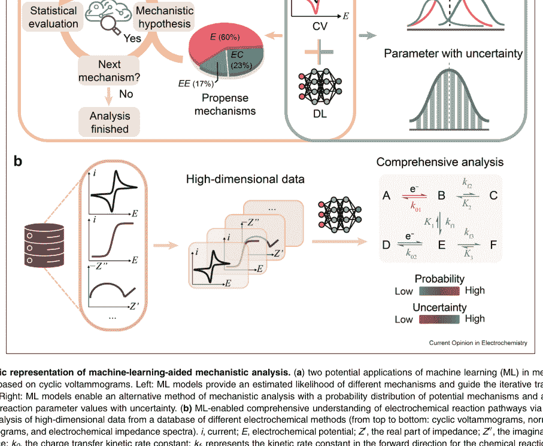

# 机器学习如何帮助破译分子电化学中的机制？

## 摘要
电化学家长期致力于通过细致的目视检查启发式地分析电化学数据，并力求确定性地指认反应机理。我们认为机器学习（ML）提供了一种新的机理分析方法，具有高数据通量和最小的人工干预。在本文中，我们提出将 ML 应用于电化学将能够在不可避免的机理模糊性中实现概率驱动的机理分析。我们将讨论 ML 在电分析中的部署实例，列出实验人员面临的当前挑战，并讨论 ML 在分子电分析中的前景。我们希望这样的讨论能够在长远中促进和推进电化学体系的 ML 辅助机理解析。

## 关键词
分子电化学，机理模糊性，机器学习，信息丰富的数据集，概率驱动方法。

## 引言
电化学机理分析的本质要求从有限的电化学数据集中提取合理的反应机理，同时尽可能最小化持续且不可避免的机理模糊性。正如 Feldberg 等人在 20 世纪 70 年代对循环伏安法的案例所说明的那样 [1]，机理模糊性指的是不同反应机理经常会
收敛到相似的伏安图，在测量误差范围内无法区分，从而在存在竞争反应路径和多种可能解释时使确定性的机理指定变得不可行。这种机制与电化学数据之间这种满射关系不仅限于循环伏安法，而且几乎存在于所有电化学技术中，因为每种电化学表征实际上都是在有限时间分辨率下的电流和电压的扰动与检测。数十年来，多种电化学技术 [2]，包括伏安法 [3,4]、计时安培法 [5] 以及包括电化学阻抗谱在内的交流法 [6,7]，已被用于机理分析。然而，确定性机理指定与电化学数据的机理模糊性之间的内在不相容性仍然未得到解决。这种不相容性会带来偏倚、误指或被忽视的机理发现风险。

在这种背景下，我们认为机器学习（ML）辅助的分析将有利于分子电化学的机理研究，如果不是电化学的一般研究的话 [8]。将 ML 在模式识别和特征提取方面的知名专长视为电化学数据人工检查的补充甚至替代是合理的 [10,11]。ML 算法中概率驱动分析的特性 [9] 为上述电化学中的机理模糊性提供了更令人满意的调和，可能基于有限的电化学数据和表征分辨率，为各种反应路径产生概率分布。最后但同样重要的是，基于 ML 的分析算法的部署不仅预示着具有高数据通量的自动化电化学分析，而且还为多种电化学技术的同时数据分析提供了机会，这是人类由于数据的高维特性而无法实现的壮举。

在这种前景鼓舞下，我们在此尝试回答一个问题：ML 如何以及在何种程度上可以帮助分子电化学中的机理分析？在以下三个相互关联的部分中，我们首先将讨论 ML 在机理检验中的概念验证应用；随后将指出几个可能受益于 ML 辅助分析的电化学研究领域；最后，我们将提出关于如何更好地利用 ML 来理解所指出的领域的机理的看法。我们希望这些讨论，尽管并不旨在全面，仍能激励社区的研究人员更好地利用 ML 并解决电化学中的长期挑战。

已知、预先确定的 CE 机理包括在电子转移（E 步）之前发生的均相溶液反应（C 步）（图 1a）[14,15]。对循环伏安法的先验理解导致将算法输入指定为正向和反向扫描中峰值电流密度不同百分比下的电流密度（i）和电压（E）值。只要反应机理是预先确定且具有明确定义的动力学形式，基于 ML 的算法似乎可以替代用于数值提取反应参数的有限差分方法 [16]。

由于伏安图的目视检查确实包括图像识别和特征提取，深

### 图1

对使用机器学习（ML）进行机理研究的前期工作的示意图。（a）使用多头深度神经网络（Multihead DNN）在预先确定的 CE 伏安图上提取动力学速率常数和平衡常数，其中单电子准可逆电荷转移（E 步）在可逆溶液反应（C 步）之后。每 100 个数据点在正向和反向扫描中在峰值电流的 1、2、3、... 和 100% 处提取，峰值电流定义为基线校正后的最大或最小电流。kf，C 步正向方向的动力学速率常数；Keq，C 步的平衡常数。经 Ref. [14] 许可改编。版权所有 2021 美国化学学会。（b）基于卷积神经网络（CNN）模型的工作流程，用于对 E 机理进行分类，该机理具有单电子准可逆电荷转移步（E 步），EC 机理，其中 E 步后跟可逆溶液反应（C 步），以及具有两个连续 E 步的 EE 机理。模拟的伏安图被数字化为 100 × 100 像素的灰度图像。经 Ref. [11] 许可改编。版权所有 2019 美国化学学会。（c）使用残差神经网络（ResNet）深度学习（DL）模型对五种机理进行分类并通过模型的“注意力”评估重要性的程序：具有单电子准可逆电荷转移步（E 步）的 E 机理，E 步后跟可逆溶液反应（C 步）的 EC 机理，E 步前为 C 步的 CE 机理，由不可逆速率限制 C 步连接的两个 E 步的 ECE 机理，第二 E 步在热力学上比第一步更易进行，以及 E 步后跟不可逆 C 步的 DISP1 机理，C 步产物发生不可逆歧化反应。在多种扫描速率下，伏安图被转换为三维张量 {v, i(E)}n；v，扫描速率；i，电流；E，电化学电位；n，不同扫描速率的数量；m，不同电位的数量。改编自 Ref. [18]（CC BY 4.0）。

神经网络（DNNs）已被 Bond 等人开发用于分析单个循环伏安图以进行机理分类 [11]。在此分析中，单个循环伏安图被作为灰度图像进行分析（图 1b），并且 DNN 基于模拟伏安图进行训练，对分子电化学中的三种机理分类准确率约为 90%：单电子准可逆电荷转移（E 机理）、E 步随后是可逆 C 步的 EC 机理，以及具有两个连续 E 步的 EE 机理 [8]。同一研究组的后续工作将该技术扩展到伏安图的三个连续循环，利用原本为彩色图像分析设计的 DNN 的三个 RGB（红、蓝、绿）输入通道 [17]。这种开创性的基于 ML 的算法的输出是对反应机理的确定性分配。

与其将像素化图像作为 ML 分析的数据输入，Liu 等人定义了一个三维张量 {v, i(E)}n 作为 ML 模型的输入，该输入数值上包含 i、E 和扫描速率（v）（图 1c）[18]。据假设，这种信息丰富的数据格式比像素化图像更适合电化学分析，后者的空白区域包含的信息很少。张量数据格式可以容纳在各种扫描速率（v）下无限数量的伏安图，并且与当前的研究实践相兼容，即在动力学区域图的背景下通过比较不同 v 值下伏安图的变化来提取机理信息 [8]。基于此类张量输入的残差神经网络（ResNet），使用多达六个不同 v 值下的伏安图进行训练并由模拟伏安图建立，对五种不同的分子机理的准确率达到 98.5%（图 1c）。在每次分析中，ResNet 模型不仅研究机理，还会产生一个“注意力”图，说明伏安图轨迹的哪一部分在得出结论时权重更大。此处的另一个特点是，产生的输出不仅仅是二分分类，而是一个定量倾向分布，作为对所考虑的每种机理的统计概率的替代。虽然这种倾向分布尚未通过严格的测试/验证与统计概率分布相关联，但所展示的分析伏安图并提供反应机理相对可能性的能力与分子电化学中遇到的机理模糊性本质相符。

## ML 辅助机理分析的发展潜力领域

上述示例展示了一些令人鼓舞的能力，ML 有可能为机理分析做出贡献。因此，问题在于电分析的哪个领域可能需要此类 ML 赋能能力。下面，我们列出并评论了手动分析在多种电化学方法中遇到的一些经验性挑战 [8,19]，以及我们对概率驱动的基于 ML 的分析可能带来的益处的看法。

循环伏安法几十年来一直是机理分析的必备技术 [8,19]；然而，分析和定量机理研究仍至少有一个可以改进的潜在方向（图 2a）。传统上，在进行进一步的数值模拟和数据拟合之前，必须先确定性地决定单一假设机理，尽管可能存在竞争机理共存，或在测量和统计不确定性范围内存在针对同一数据的多种机理解释。因此，手动的、确定性的伏安图分析方法与上述机理模糊性并不完全兼容 [1]，尤其是在存在多个竞争机理时。在初步目视检查伏安图后，在没有先验知识的情况下，在此类场景中破译机理的典型迭代流程包括启发式地假设特定的 E 和/或 C 步机理，用所提议的机理对实验伏安图进行数值拟合，进行目视比较以检查拟合是否令人满意，以及决策是否需要用修订后的拟议机理再次尝试 [20]。此类协议的性质在很大程度上依赖于研究人员的训练，以便全面考虑所有可能的机理变化，并且隐含地偏向于反对多个竞争途径共存。一个经典的例子体现了此类方法带来的挑战，即分子电化学中净两电子过程中 ECE（两个 E 步由不可逆速率限制 C 步连接，第二 E 步在热力学上比第一步更容易）和 DISP（E 步随后是不可逆 C 步，C 步产物发生歧化反应）机理的共存和竞争 [8]。已有大量文献示例 [21,22] 说明了以确定性方式区分这两条途径的困难。由于最近报道的 ResNet 模型能够分析伏安图并给出包括 ECE 和 DISP 在内的机理倾向分布（图 1c）[18]，似乎 ML 可以通过两种不同的方法改善分子电化学中的机理分析：（1）ML 模型可以为每个考虑的机理提供估计的可能性，并指导上述现有迭代流程中拟议机理的选择；（2）ML 可以建立机理分析的独立替代途径，包括由 ResNet 启用的机理概率分布报告 [18] 以及与上述示例类似的 ML 启用的反应参数值测定（图 1a）[14,15]。值得注意的是，后一种方法不仅产生一种更适合电化学固有机理模糊性的基于概率的分析，而且还表现出足够的统计复杂性，暗示了所生成分析的不确定性，这是当前研究中缺失的特征。

### 图2

机器学习辅助机理分析的示意图。（a）基于循环伏安图的机理分析中机器学习（ML）的两种潜在应用。左：ML 模型提供不同机理的估计可能性并指导迭代传统流程。右：ML 模型实现机理分析的替代方法，具有潜在机理的概率分布以及对反应参数值的不确定性预测。（b）通过对不同电化学方法数据库的高维数据进行同时分析，实现 ML 赋能的电化学反应途径的全面理解（从上到下：循环伏安图、正常脉冲伏安图和电化学阻抗谱）。i，电流；E，电化学电位；Z′，阻抗的实部；Z″，阻抗的虚部；k0，电荷转移动力学速率常数；kf 表示化学反应正向的动力学速率常数；K，化学反应的平衡常数。

改进机理研究的另一个潜在主题是多种电化学表征技术的联合、同时分析（图 2b）。作者持有的一个假设是，为获得机理信息而进行的电化学扰动应受益于具有互补时间分辨率的不同技术。因此，一个推论是，瞬态和高频测量，例如脉冲伏安法 [23] 和电化学阻抗谱 [24]，应伴随循环伏安法进行机理研究，这得益于前者技术在更短时间尺度（10^6 Hz 或 1 µs）上的可达性。目前，脉冲伏安法和阻抗数据与循环伏安法结合的分析需要单独的二维图、额外的专家训练，以及类似于循环伏安法的迭代程序，即对单个电化学技术依次进行分析 [19]。

我们设想基于 ML 的分析将能够对由不同电化学方法的所有结果组成的高维数据格式进行同时分析。这种 ML 赋能的分析不仅可以提供

基于概率的、全面且人为偏差最小的反应路径理解，同时也使这种深入的机理分析对更广泛的研究社区更易于获取。尽管机器学习模型本身并不免疫于偏差，提醒社区注意这一问题是值得的，在机器学习模型开发过程中引入额外偏差的潜在风险应通过仔细准备训练数据集、适当的正则化技术以及监控模型性能来缓解。由于分子电化学中机理分析的专家培训有时可能有些要求较高 [19]，用户友好的机器学习辅助协议将极大地促进我们对电极-溶液界面化学的理解。

## 在分子电化学中部署机器学习的建议

受上述讨论的启发；在此，我们提出一些要点信息和建议，以解决长期存在的机理模糊性问题，并推动分子电化学领域的发展，以便更广泛地利用机理研究。

- (a) 在机理研究中采用概率方法。 如上所述，电化学中机理模糊性的存在需要一种目前仍未充分发展的概率驱动分析。我们最近的工作 [18] 证明了同时考虑多种可能机理并将机理模糊性作为概率分布来处理的可行性。事实上，我们主张在分子电化学中更广泛地利用机器学习的主要原因之一是深度学习模型中概率方法的广泛采用 [25,26]，这将改变我们分析电化学的方式。

- (b) 采用机器学习友好的电化学数据结构。 现有的电化学表征方法产生的数据结构大多适用于生成人类能够分析的二维图。由于机器学习模型能够很好地接收高维数据输入，机器学习辅助分析的广泛采用应鼓励使用信息丰富的高维数据结构，例如在近期示例 [11,17,18] 中用张量输入代替像素化图像，这些结构不仅涵盖单一电化学表征，还涵盖多种表征方法以进行同时分析。然而，这里有一个需要注意的问题是，数据结构应针对所需应用的具体情况量身定制，并避免过度的数据插值，以减轻不必要的误解和分析准确性的损失。

- (c) 注意由模拟数据训练的机器学习模型的限制。 尽管现有的机器学习模型是使用模拟电化学数据进行训练和开发的，但必须认识到这些机器学习模型仅限于训练集；因此，在建立模拟训练数据期间部署的参数边界和范围。关于机器学习分析适用性和有效性的任何讨论都应考虑这种潜在的局限性。此外，期望并关键的是用实验数据训练/完善所开发的机器学习模型，以便适应电化学测试中的实际因素，例如未补偿电阻和电容，并减轻潜在的错误分配。

- (d) 促进机器学习辅助分析的可解释性。 机器学习研究的常见批评是其“黑箱”性质以及机器学习算法缺乏可解释性。为了应对这一缺陷并促进可信度，电化学中机器学习辅助分析的开发应考虑产生输出，例如我们在最近的工作 [18] 中的“注意力”图，以获得更大的模型可解释性。更可解释的机器学习辅助分析不仅有助于检测和减轻偏差，还能证明所开发机器学习模型的有效性，并提示可能逃避人类检查的隐藏数据特征，从而丰富我们对电化学表征的基本理解。

- (e) 更广泛的多学科合作。 随着我们开发由机器学习辅助的概率驱动电化学分析，电化学家、统计学家和计算机科学家之间的合作将不可避免且必不可少。我们设想分子电化学的更大进步源于对电化学积累见解之美、统计解释的严谨性以及机器学习架构中迷人设计之间的协同作用。

- (f) 一个开放且易于获取的社区。 鉴于分子电化学的广泛范围，设想的进步只能在开放的研究社区中实现。机器学习模型的发展、测试和验证依赖于对电化学机理的丰富理解以及研究人员提供的模拟和实验数据。与此同时，针对电化学研究量身定制的开放获取机器学习模型将拓宽机器学习辅助分析的采用，促进电化学中的其他研究主题，并帮助教育精通编程、机器学习和统计分析的下一代研究人员。整个社区的集体努力将决定机器学习在电化学中采用的未来。

## 作者贡献

J.S. 撰写了初始手稿。J.S. 和 C.L. 编辑并最终确定了手稿。C.L. 监督了整个项目。

## 竞争利益声明

作者声明以下财务利益/个人关系可能被视为潜在竞争利益：Chong Liu 报告获得了美国国家科学基金会的财务支持。

## 数据可用性

本文所述研究未使用任何数据。

## 致谢

我们感谢 Cyrille Costentin 的建设性讨论。C.L. 感谢美国国家科学基金会 CHE-2140762 的支持以及 Alfred P. Sloan 基金会 Sloan 研究奖学金。

## 参考文献

在审阅期间发表的特别关注的论文已突出显示为：

+   * 特别感兴趣
+   ** 杰出兴趣

+   1. Ruić I, Feldberg S: 非均相等效：一种具有紧凑反应层的电化学系统数字模拟方法。 J Electroanal Chem 1974, 50: 153–162.
+   2. Bard A, Faulkner LR: 电化学方法：原理与应用。 2nd ed. New York: John Wiley & Sons Inc.; 2001.
+   3. Eklund JC, Bond AM, Alden JA, Compton RG: 现代伏安法的视角：基本概念和机理分析。 In Advances in physical organic chemistry. Edited by Bethell D, Academic Press; 1999:1–120.
+   4. Lee KJ, Elgrishi N, Kandemir B, Dempsey JL: 用于评估分子电催化剂的电化学和光谱方法。 Nat Rev Chem 2017, 1:39.
+   5. Zanello P, Nervi C, De Biani FF: 无机电化学：理论、实践与应用。 Royal Society of Chemistry; 2019.
+   6. Macdonald DD: 电化学阻抗谱历史回顾。 Electrochim Acta 2006, 51: 1376–1388.
+   7. Bond AM, Duffy NW, Guo S-X, Zhang J, Elton D: 改变伏安法的外观。 Anal Chem 2005, 77:186 A–195 A.
+   8. Costentin C, Savéant J-M: 分子与生物分子电化学要素：电子转移化学的电化学方法。 Hoboken, New Jersey: John Wiley & Sons Inc; 2019.
+   9. Bishop CM, Nasrabadi NM: 模式识别与机器学习。 Singapore: Springer; 2006.
+   10. Schachterle SD, Perone SP: 通过计算机模式识别对伏安数据的分类。 Anal Chem 1981, 53:1672–1678.
+   11. Kennedy GF, Zhang J, Bond AM: 使用深度神经网络自动识别电极反应机理。 Anal Chem 2019, 91:12220–12227. *
+   该论文原则上证明了深度学习可以通过类似图像识别的过程，基于单个模拟伏安图区分三种反应机理。
+   12. Gundry L, Guo S-X, Kennedy G, Keith J, Robinson M, Gavaghan D, Bond AM, Zhang J: 伏安法中自动化参数化、贝叶斯推断和机器学习的最新进展与未来展望。 Chem Commun 2021, 57:1855–1870.
+   13. Bond AM, Zhang J, Gundry L, Kennedy GF: 将机器学习应用于伏安机理研究的机会与挑战。 Curr Opin Electrochem 2022, 34, 101009.
+   14. Chen H, Kätelhön E, Le H, Compton RG: 人工智能在电极反应机理研究中的应用：预测伏安图并分析半球电极上的解离性 CE 反应。 Anal Chem 2021, 93:13360–13372. *
+   该论文利用机器学习提取解离性 CE 机理的特征，以根据伏安图预测动力学和热力学参数，以及反向过程。
+   15. Chen H, Li D, Kätelhön E, Miao R, Compton RG: 使用人工智能分析的实验伏安法：水溶液中乙酸解离的热力学和动力学。 Anal Chem 2022, 94:5901–5908.
+   16. Rudolph M, Reddy DP, Feldberg SW: 循环伏安响应模拟器。 Anal Chem 1994, 66:589A–600A.
+   17. Gundry L, Kennedy G, Bond Alan M, Zhang J: 在伏安反应机理的深度神经网络分类中纳入多次电位循环。 Faraday Discuss 2022, 233:44–57.
+   18. Hoar BB, Zhang W, Xu S, Deeba R, Costentin C, Gu Q, Liu C: 基于深度学习的循环伏安图电化学机理分析。 ACS Meas Sci Au 2022, 2: 595–604. **
+   该论文开发了一种深度学习算法，可自动分析循环伏安图并根据不同扫描速率下的一组伏安图，使用二维矩阵而非数字图像，预测五种常见化学计量均相机理中最可能的电化学机理。
+   19. Christensen P, Hamnett A: 电化学技术与机理。 Oxford: Chapman & Hall; 1994.
+   20. Compton RG, Banks CE: 理解伏安法。 New Jersey: World Scientific; 2018.
+   21. Evans DH: 有机和有机金属电化学中的溶液电子转移反应。 Chem Rev 1990, 90:739–751.
+   22. Hammerich O, Speiser B: 有机电化学。 Florida: CRC Press; 2016.
+   23. Molina A, González J: 物理电化学与电分析中的脉冲伏安法。 Switzerland: Springer; 2016.
+   24. Macdonald DD: 电化学阻抗谱机理分析综述。 In Electrochemical and optical techniques for the study and monitoring of metallic corrosion. Springer; 1991:31–68.
+   25. Murphy KP: 机器学习：概率视角。 MIT press; 2012.
+   26. Murphy KP: 概率机器学习：高级主题。 MIT Press; 2023.
