## 机器学习究竟在做什么？极简模型

---

### 机器学习之谜

关于机器学习基础知之甚少，这令人惊讶。是的，从工程角度来看，人们已经摸索出大量关于如何构建神经网络以完成各种令人印象深刻、[有时近乎神奇的任务](https://writings.stephenwolfram.com/2023/02/what-is-chatgpt-doing-and-why-does-it-work/)的知识。但在根本层面上，我们仍然不真正知道神经网络为何“奏效”——我们也没有任何关于其内部运作的“科学大局观”。

神经网络的基本结构可以非常简单。但等到它们经过训练、拥有了所有权重等参数时，就很难分辨内部发生了什么——甚至难以获得任何好的可视化呈现。实际上，甚至连整个设置的哪些方面是真正本质的、哪些只是“细节”都远未明朗，这些细节或许只是从 20 世纪 40 年代计算神经网络刚被发明时就“祖传”下来的。

那么，我将尝试深入“表象之下”——并尽可能“抽丝剥茧”。我将探索一些极简模型——它们（除其他优点外）更易于直接可视化。起初，我完全不确定这些极简模型是否能复现机器学习中看到的各种现象。但令人惊讶的是，它们似乎确实能做到。

其构造的简洁性使得“窥探内部”变得容易得多——也让我们更能体会到底层支撑机器学习的本质现象。人们或许会想，尽管机器学习系统的训练过程可能曲折迂回，但最终系统总会通过某种可识别且“可解释”的机制来完成任务。但我们将看到，事实通常并非如此。

相反，训练过程似乎设法锁定了一些相当疯狂的计算，这些计算“恰好”实现了正确的结果。机器学习似乎并非在构建结构化机制；相反，它基本上只是从计算宇宙中典型的复杂性中进行采样，挑选出那些行为恰好与需求重合的片段。从某种意义上说，因此，机器学习的可能性归根结底是[计算不可约性](https://www.wolframscience.com/nks/chap-12--the-principle-of-computational-equivalence#sect-12-6--computational-irreducibility)现象的又一后果。

为什么这么说？正是因为计算不可约性，计算宇宙中才存在如此丰富的现象。不仅如此，正是因为计算不可约性，事物最终变得足够有效地随机，以至于机器学习系统训练的自适应过程能够在不陷入停滞的情况下取得成功。

但计算不可约性的存在还有另一个重要含义：尽管我们可以期望发现有限的计算可约性“口袋”，却不能指望对机器学习系统的行为有一般性的“叙事解释”。换句话说，不会有传统的（比如数学的）机器学习“通用科学”（或许神经科学也是如此）。相反，故事将更接近我长期探索的根本上属于计算性质的“[新科学](https://www.wolframscience.com/nks/)”，它带给我们了[物理学项目](https://www.wolframphysics.org/)和[鲁利亚德](https://writings.stephenwolfram.com/2021/11/the-concept-of-the-ruliad/)。

在许多方面，机器学习问题是[自适应进化一般问题](https://writings.stephenwolfram.com/2024/05/why-does-biological-evolution-work-a-minimal-model-for-biological-evolution-and-other-adaptive-processes/)的一个版本，例如在[生物学中遇到的](https://writings.stephenwolfram.com/2024/05/why-does-biological-evolution-work-a-minimal-model-for-biological-evolution-and-other-adaptive-processes/)。在生物学中，我们通常设想要自适应地优化系统的整体“适应度”；在机器学习中，我们通常试图自适应地“训练”系统，使其与特定目标或行为对齐，最常见的是由示例定义。（而且，是的，在实践中，这通常通过尝试最小化一个通常称为“损失”的量来完成。）

虽然在生物学中普遍认为“事物通过进化而产生”，但这究竟如何运作一直颇为神秘。但（令我惊讶的是）我最近[发现了一个非常简单的模型](https://writings.stephenwolfram.com/2024/05/why-does-biological-evolution-work-a-minimal-model-for-biological-evolution-and-other-adaptive-processes/)，似乎能很好地捕捉生物进化至少一些最本质的特征。虽然该模型与我们将在此探讨的机器学习模型不同，但它有一些明确的相似之处。最终我们将发现，机器学习和生物进化的核心现象似乎惊人地一致——且两者都从根本上与计算不可约性现象相关。

我在这里所做的大部分工作侧重于基础性的理论问题。但通过更深入地理解机器学习中到底发生了什么——以及什么是本质的、什么不是——我们也将开始看到在实践中机器学习可能会以不同方式进行，从而有望实现更高的效率和更强的泛化能力。

### 传统神经网络

为了开始理解机器学习的本质，让我们从一个非常传统且熟悉的例子入手：一个经过训练以计算特定函数 `f[x]` 的[全连接（“多层感知器”）神经网络](https://writings.stephenwolfram.com/2023/02/what-is-chatgpt-doing-and-why-does-it-work/#machine-learning-and-the-training-of-neural-nets)：

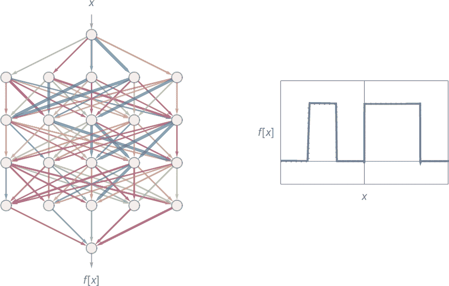

如果在顶部输入值 `x`，经过“穿越网络层层传递”，底部会得到一个值，（几乎精确地）对应于我们的函数 `f[x]`：

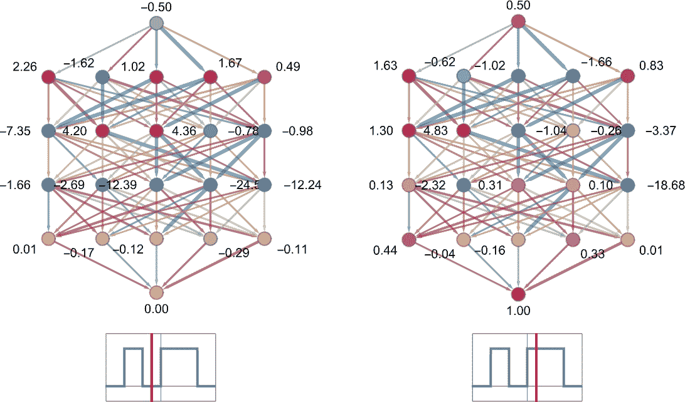

扫描不同的输入 `x`，我们会看到网络内部不同的中间值模式：

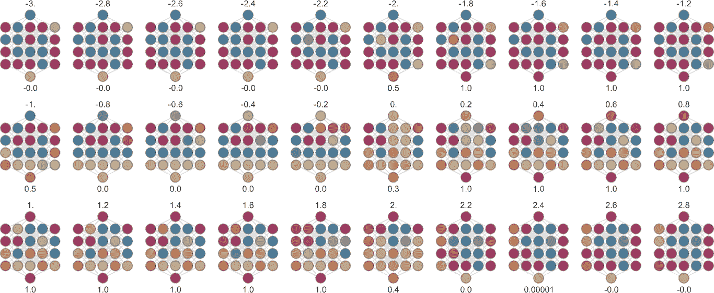

这是（在线性和对数刻度下）这些中间值如何随 `x` 变化。而且，是的，最终值（此处高亮显示）出现的方式看起来非常复杂：

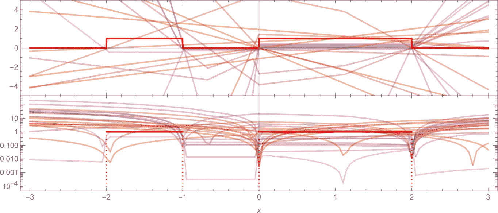

神经网络究竟是如何组装的？我们绘制的这些数值是如何确定的？我们采用的是[标准的全连接多层网络设置](https://writings.stephenwolfram.com/2023/02/what-is-chatgpt-doing-and-why-does-it-work/#neural-nets)。每一层的每个节点（“神经元”）都与上一层的所有节点相连——数值从一层“流向”下一层，在流经连接时乘以该连接关联的（正或负）“权重”（在图中用颜色表示）。给定神经元的值是通过汇总其来自上一层的所有（加权）输入、加上该神经元的“偏置”值，然后对结果应用特定的（非线性）“[激活函数](https://reference.wolfram.com/language/ref/ElementwiseLayer.html)”（此处为 ReLU 或 [Ramp](http://reference.wolfram.com/language/ref/Ramp.html)\[z\]，即 [If](http://reference.wolfram.com/language/ref/If.html)\[z < 0, 0, z\]）来求得的。

给定神经网络将计算的整体函数，取决于网络中出现的权重和偏置的集合（以及其整体连接架构和所用的激活函数）。机器学习的思路是通过从该函数的示例中自适应地“学习”，来寻找能产生特定函数的权重和偏置。通常我们可能从随机的权重集合开始，然后逐步调整权重和偏置以[“训练”神经网络](https://reference.wolfram.com/language/ref/NetTrain.html)复现该函数：

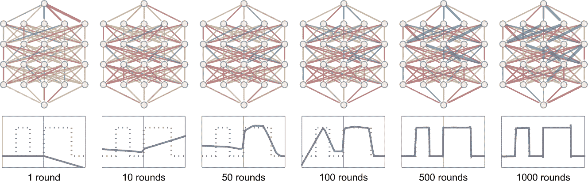

我们可以通过绘制训练过程中单个权重的连续变化来了解这一过程是如何进行的（是的，这很复杂；末尾附近的尖峰来自不影响整体行为的“中性变化”）：

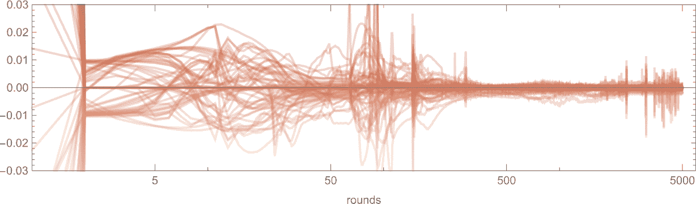

训练的总体目标是逐步降低[“损失”](https://reference.wolfram.com/language/ref/LossFunction.html)——即真实值 `f[x]` 与神经网络生成值之间的平均（平方）差。损失的演变定义了神经网络的“学习曲线”，其中的向下故障对应于神经网络实际上“取得突破”、能够更好地表征函数的时刻：

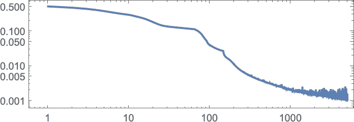

重要的是要注意，通常神经网络训练中会注入随机性。因此，如果多次运行训练，每次都会得到不同的网络——以及不同的学习曲线：

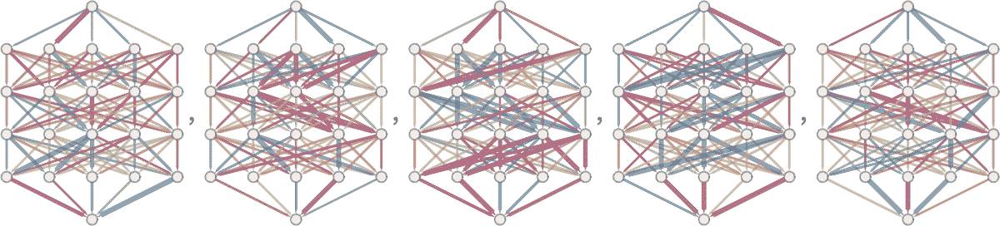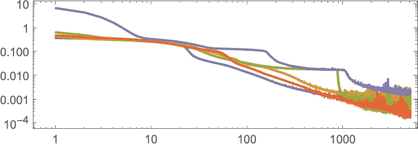

但在神经网络训练中到底发生了什么？实际上，我们是在寻找一种方法，将一个函数（至少近似地）“编译”进一个具有特定数量（实值）参数的神经网络中。在本例中，我们恰好使用了约 100 个参数。

但如果我们使用不同数量的参数，或以不同方式设置神经网络架构，会发生什么？以下是几个示例，表明对于我们试图生成的函数，我们迄今为止使用的网络几乎是能起作用的最小网络：

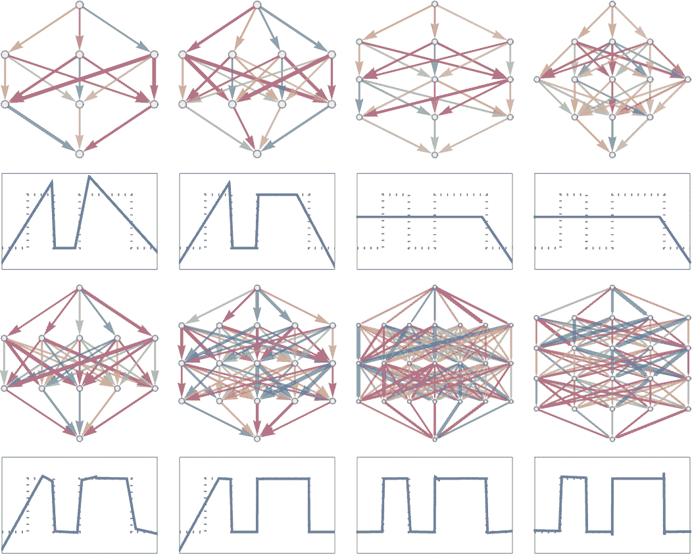

顺便说一下，如果我们将激活函数从 ReLU 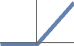 改为更平滑的 ELU ，会发生什么：

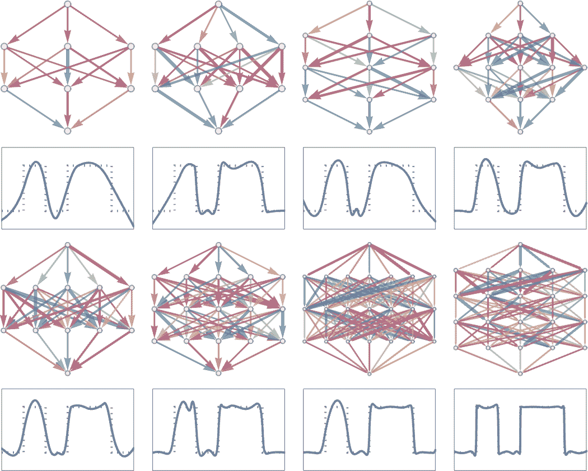

稍后我们将讨论在离散系统中进行机器学习会发生什么。为了预演这一点，很有意思的是看看如果我们获取一个上述类型的神经网络，并将其权重（和偏置）在离散层级上“量化”，会发生什么：

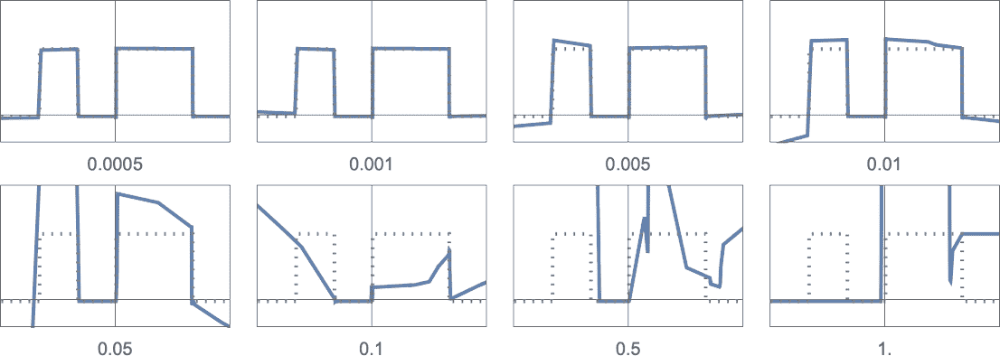

结果表明（正如近期大规模神经网络的经验也显示的那样），神经网络的基本“运作”并不需要精确的实数，即使数字至少在一定程度上是离散的，它依然能生存——这也由作为离散度 δ 函数的 3D 渲染图所示：

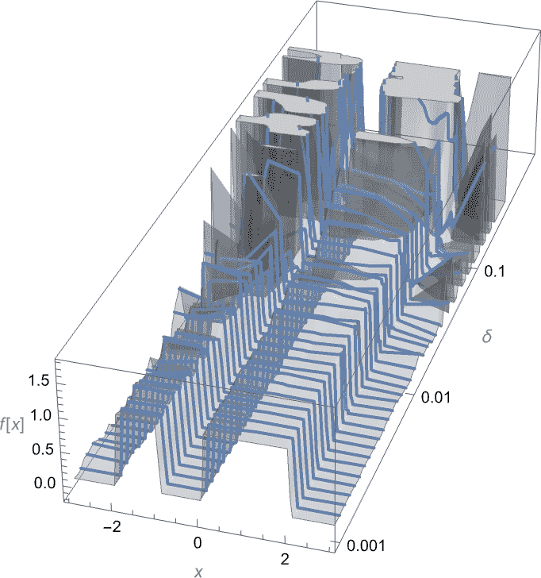

### 简化拓扑：网格神经网络

到目前为止，我们讨论的是非常传统的神经网络。但要进行机器学习，我们真的需要具有所有那些细节的系统吗？例如，我们真的需要每一层的每个神经元都从上一层的每个神经元获取输入吗？如果每个神经元仅从最多两个其他神经元获取输入——比如说神经元实际上铺设在一个简单的网格中——会发生什么？非常令人惊讶的是，事实证明这样的网络仍然完全能够生成我们一直用作示例的那种函数：

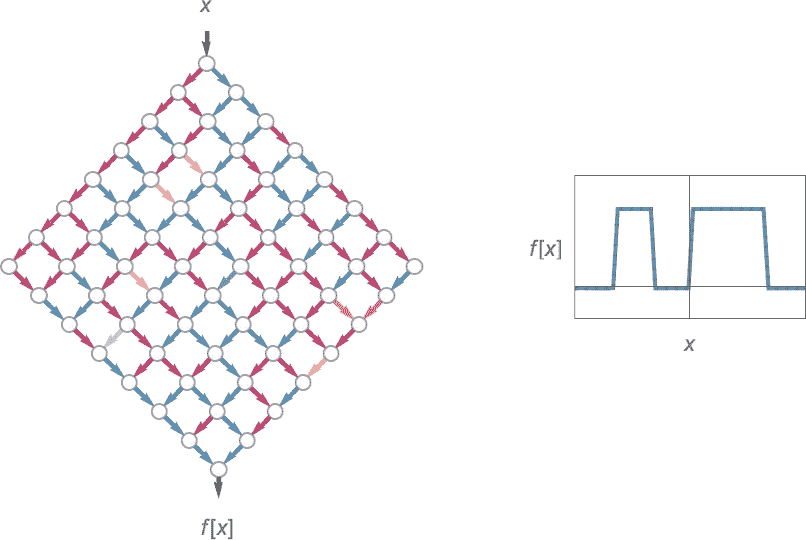

这种“网格神经网络”的一个优势是——像元胞自动机一样——其“内部行为”可以通过一种相当直接的方式轻松可视化。因此，例如，这里展示了“网格网络如何生成其输出”的可视化，通过遍历不同的输入值 `x`：

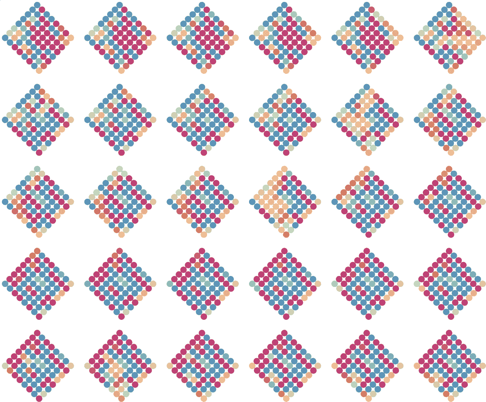

而且，是的，即使我们可以可视化它，要理解“内部发生了什么”仍然很难。查看网络中每个单独节点的中间值作为 `x` 的函数并没有太大帮助，尽管我们可以在函数 `f[x]` 有跳跃的地方“看到一些事情正在发生”：

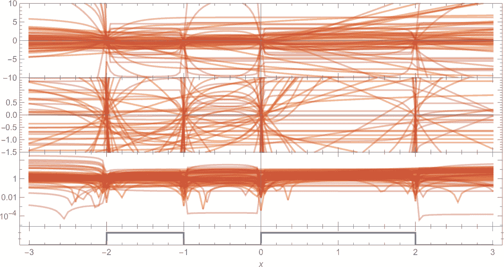

那么我们如何训练网格神经网络？基本上我们可以使用与我们上面看到的那种全连接网络相同的过程（ReLU 激活函数似乎不太适合网格网络，所以我们这里使用 ELU）：

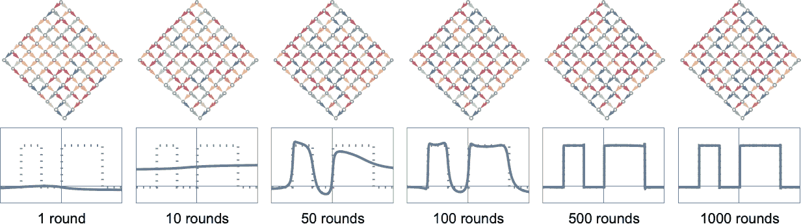

这是训练过程中每个单独权重差异的演变：

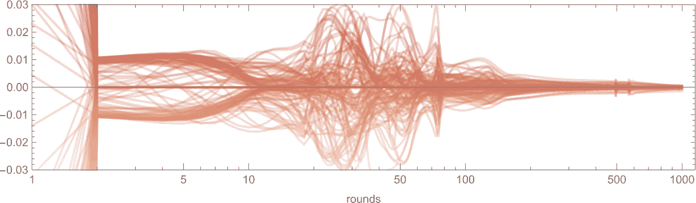

以下是不同随机种子的结果：

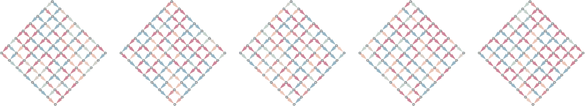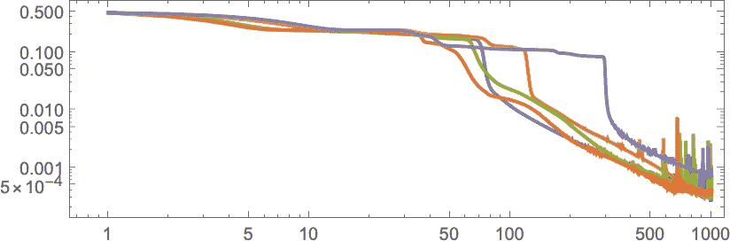

在我们使用的规模下，网格神经网络的连接数（因此权重数）与我们上面主要示例中的全连接网络大致相同。我们看到，如果尝试减小网格神经网络的规模，它在复现我们的函数方面表现不佳：

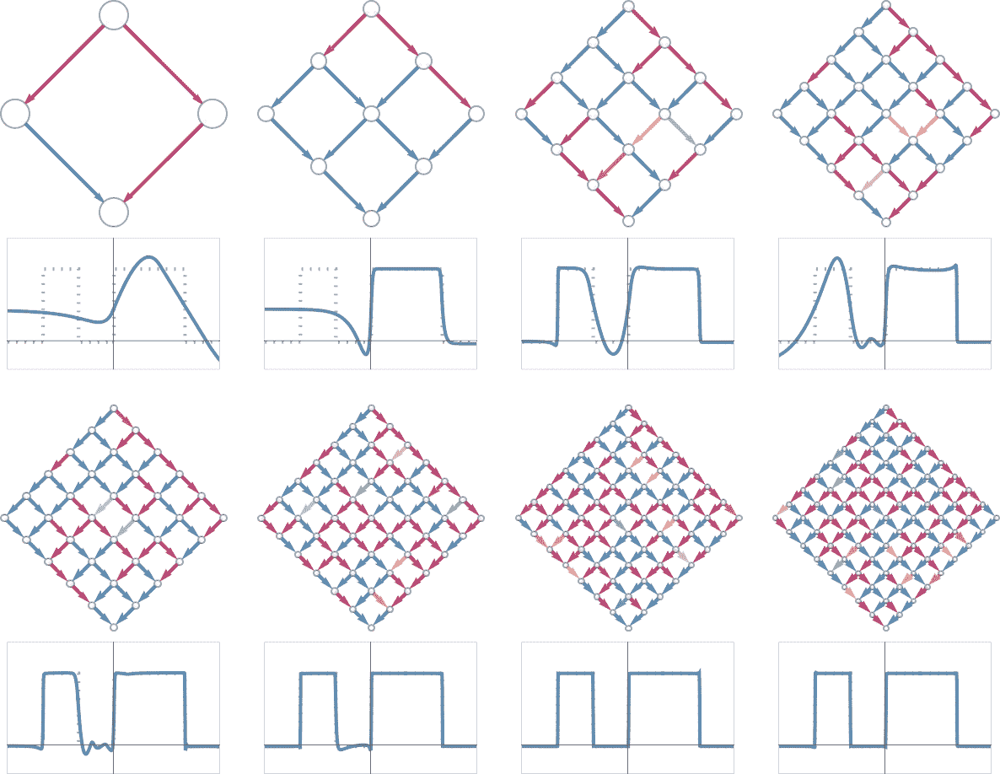

### 使一切离散化：生物进化类比

网格神经网络简化了神经网络连接的拓扑结构。但正如最初看起来有些令人惊讶的那样，似乎我们可以在简化所用系统方面走得更远——并仍然成功地进行机器学习的版本。特别是我们会发现，我们可以使我们的系统完全离散。

神经网络训练的典型方法论涉及逐步调整实值参数，通常使用基于微积分、寻找导数的方法。人们可能会想象，任何成功的自适应过程最终都必须依赖于能够进行任意微小的更改，而这只有实值参数才能做到。

但在[研究生物进化的简单理想化模型](https://writings.stephenwolfram.com/2024/05/why-does-biological-evolution-work-a-minimal-model-for-biological-evolution-and-other-adaptive-processes/)时，我最近发现了引人注目的例子，表明情况并非如此——完全离散的系统似乎能够捕捉到正在发生的事情的本质。

作为一个示例，考虑一个（三色）元胞自动机。规则显示在左侧，通过反复应用该规则（从单元胞初始条件开始）生成的行为显示在右侧：

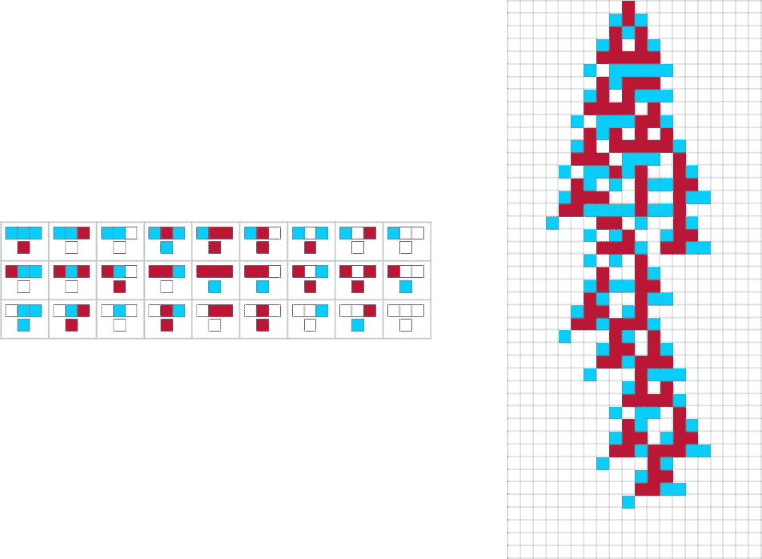

该规则具有这样的性质：它生成的模式（从单个单元的初始条件开始）恰好存活 40 步，然后消亡（即每个单元都变为白色）。重要的是，这个规则可以通过离散自适应过程找到。思路是从一个空规则开始，然后在每一步随机改变规则中 27 个结果中的一个（即在规则中进行“单点突变”）。大多数此类改变会导致模式的“寿命”进一步偏离我们 40 步的目标——这些我们会丢弃。但逐渐地，我们可以积累“有益突变”

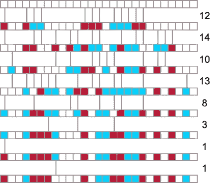

通过“渐进适应”，最终达到我们最初的寿命为 40 的规则：

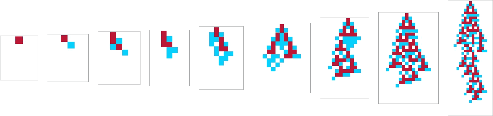

我们可以绘制所有最终让我们达到寿命 40 的尝试——我们可以将这条渐进的“适应度”曲线视为直接类似于我们之前在机器学习中看到的损失曲线：

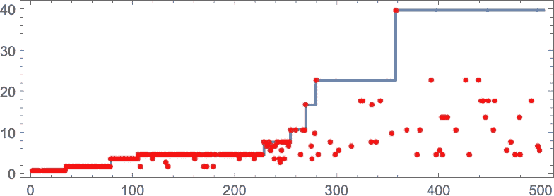

如果我们进行不同的随机突变序列，我们将得到不同的适应性进化路径，以及不同的寿命为 40 的规则“解”：

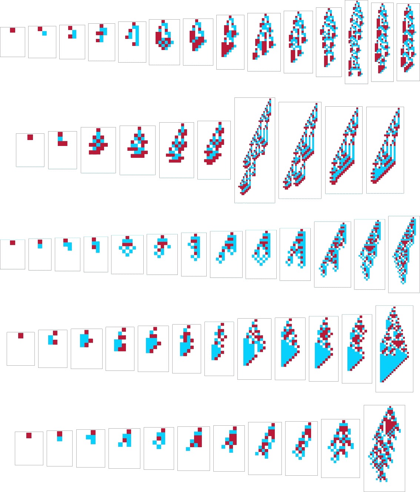

关于这些，有两点立即值得注意。首先，它们似乎本质上都是在“使用不同的想法”来达到目标（推测类似于生命树中不同分支的现象）。其次，它们似乎都没有使用清晰的“机械程序”（即我们可能通过传统工程构建的那种）来达到目标。相反，它们似乎是在寻找“自然”复杂的行为，这种行为恰好实现了目标。

当然，这种行为能够实现我们在此设定的目标，以及基于随机点突变的简单选择能够成功达到必要的行为，这并非微不足道。但[正如我结合生物进化所讨论的](https://writings.stephenwolfram.com/2024/05/why-does-biological-evolution-work-a-minimal-model-for-biological-evolution-and-other-adaptive-processes/)，这最终是一个关于[计算不可约性](https://www.wolframscience.com/nks/chap-12--the-principle-of-computational-equivalence#sect-12-6--computational-irreducibility)的故事——特别是在生成行为的多样性以及达到这种行为所需路径的多样性方面。

但是，好吧，这种自适应进化模型如何与神经网络等系统相关联呢？在神经网络的标准术语中，我们的模型类似于循环卷积网络的离散类比。它是“卷积”的，因为在任何给定步骤，相同的规则都会在元素数组中——局部地——被应用。它是“循环”的，因为实际上数据会反复“通过”同一个规则。通常用于训练传统神经网络的程序（如“反向传播”）将无法训练这样的系统。但事实证明——本质上作为计算不可约性的结果——非常简单的连续随机突变方法可以成功。

### 离散规则阵列中的机器学习

假设我们想建立一个类似神经网络的系统——或者至少是网格神经网络——但我们希望它是完全离散的。（我的意思是“生来离散”，而不仅仅是从现有的连续系统离散化而来。）我们该如何做到这一点？一种方法（碰巧是[我在 20 世纪 80 年代中期首次考虑的](https://content.wolfram.com/sw-publications/2020/07/approaches-complexity-engineering.pdf)——但从未深入探索）是制作我们可以称之为“规则阵列”的东西。像在元胞自动机中一样，有一个单元阵列。但这些单元并不总是根据同一个规则更新，而是在元胞自动机类比的“时空”中每个位置的每个单元都可以选择使用不同的规则。（虽然这是一个相当极端的理想化，但我们可以潜在地想象这些不同的规则代表了网格神经网络中不同局部权重选择的离散类比。）

作为第一个例子，让我们考虑一个有两种可能规则选择的规则阵列：`k = 2, r = 1` [元胞自动机规则 4 和 146](https://www.wolframscience.com/nks/chap-3--the-world-of-simple-programs#sect-3-2--more-cellular-automata)（它们分别是[第 2 类和第 3 类](https://www.wolframscience.com/nks/chap-6--starting-from-randomness#sect-6-2--four-classes-of-behavior)）：

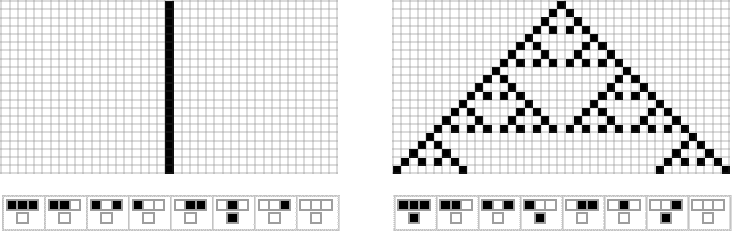

一个特定的规则阵列由在阵列中每个（“时空”）位置将使用哪个规则来定义。这里有几个例子。在所有情况下，我们都是从相同的单个单元初始条件开始。但在每种情况下，规则阵列都有不同的规则选择排列——运行规则 4 的单元被赋予  背景，而运行规则 146 的单元被赋予  背景：

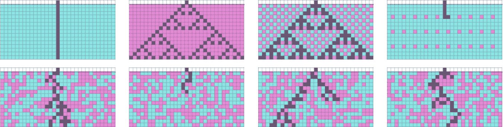

我们可以看到，不同的规则阵列选择可以产生截然不同的行为。但是（在机器学习的精神下）我们能否实际上“反转这一点”，找到一个能产生我们想要的特定行为的规则阵列？

一种简单的方法是做我们在生物进化最小建模中所做事情的直接类比：逐步进行随机的“单点突变”——这里是“翻转”规则阵列中仅一个规则的身份——然后只保留那些没有让情况变糟的突变。

作为我们的示例目标，让我们尝试找到一个规则阵列，使得使用该规则阵列从单个单元生成的模式恰好“存活” 50 步。起初可能并不明显我们能找到这样的规则阵列。但事实上，我们简单的自适应过程轻松做到了这一点：

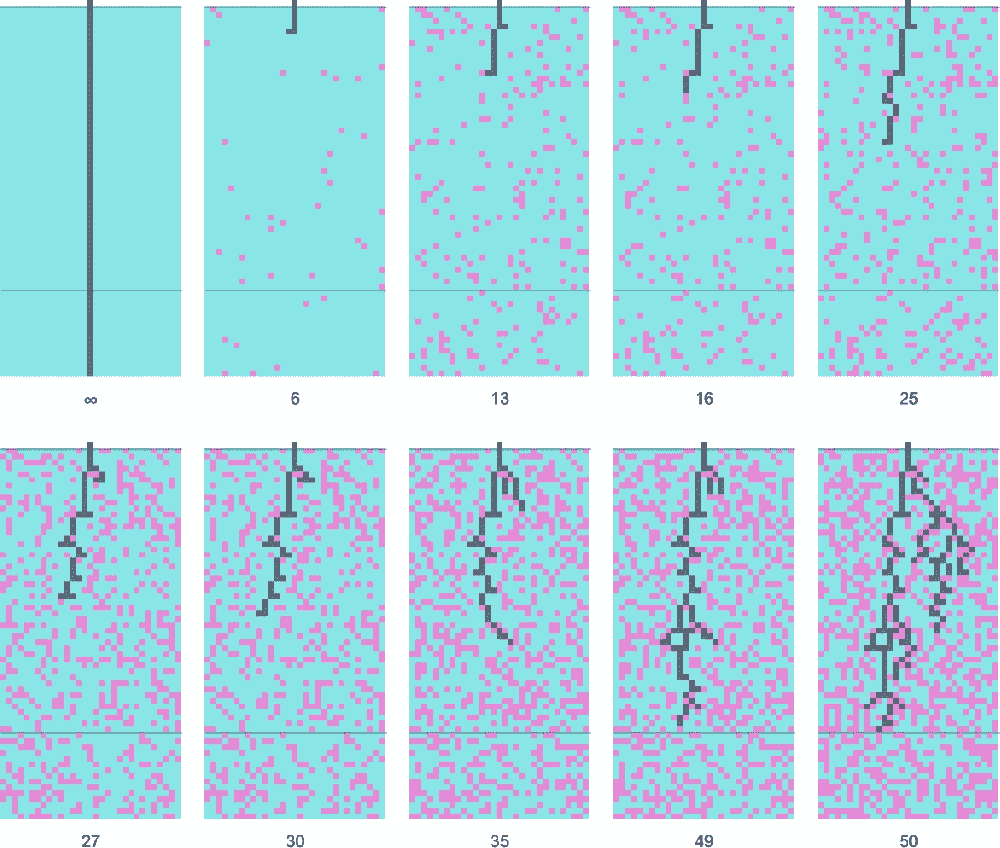

正如这里的点所示，许多突变并没有导致更长的寿命。但偶尔，自适应过程会有“突破”，增加寿命——最终达到 50：

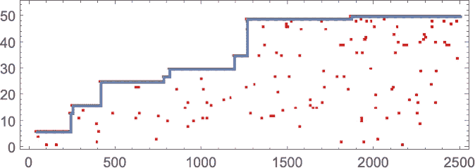

正如在我们的生物进化模型中一样，不同的随机突变序列导致不同的“解”，这里是针对“恰好存活 50 步”这一问题的：

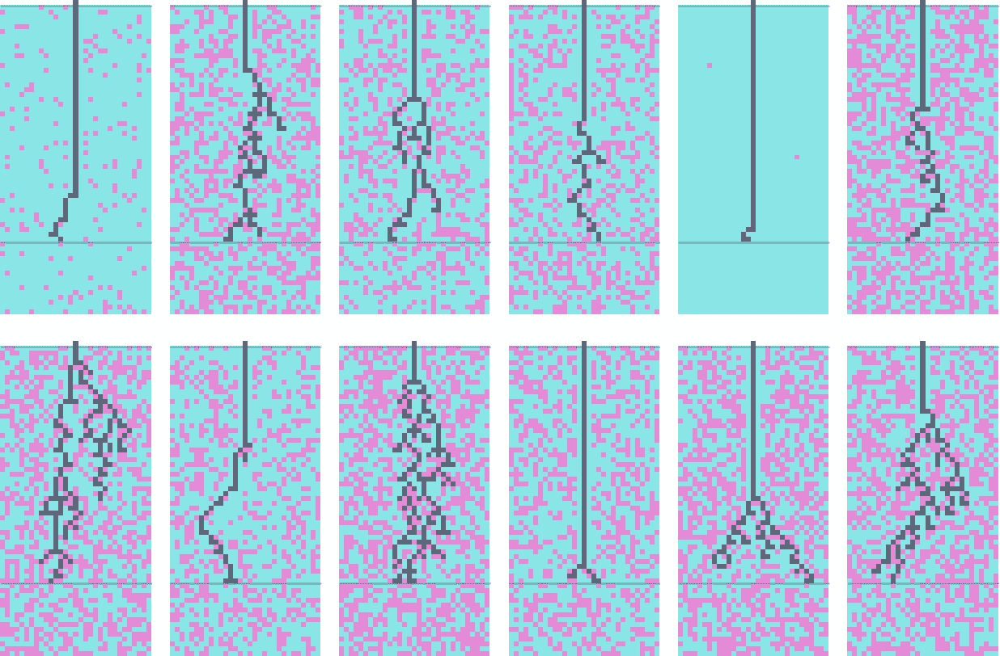

其中一些实际上是“简单解”，只需要少量突变。但大多数——就像我们在生物进化中的大多数例子一样——似乎更像是它们只是“碰巧起作用”，实际上是通过利用恰到好处的、相当复杂的行为。

这些情况之间有明显的区别吗？查看上述示例的“适应度”（又名“学习”）曲线集合，似乎并没有：

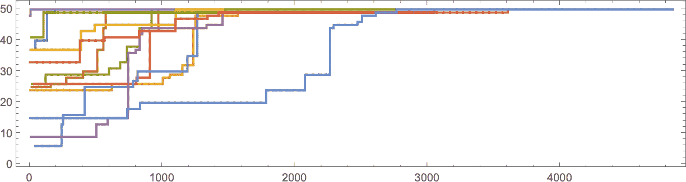

不难看出如何通过在规则阵列中策略性地放置第二个规则的单个实例来“构建一个简单解”：

但关键在于，通过重复突变的自适应进化通常不会“发现”这个简单解。重要的是，自适应进化仍然可以成功找到*某个*解——即使它不是像这样“可理解”的解。

我们迄今为止使用的元胞自动机规则接受 3 个输入。但事实证明，我们可以通过在规则阵列中放置普通的[2 输入布尔函数](https://www.wolframscience.com/nks/p806--implications-for-mathematics-and-its-foundations/)来使事情变得更简单。例如，我们可以用[And](https://reference.wolfram.com/language/ref/And.html)和[Xor](https://reference.wolfram.com/language/ref/Xor.html)函数（[r = 1/2 规则 8 和 6](https://www.wolframscience.com/nks/p806--implications-for-mathematics-and-its-foundations/)）来制作一个规则阵列：

不同的 `And`+`Xor` (\+ ) 规则阵列显示不同的行为：

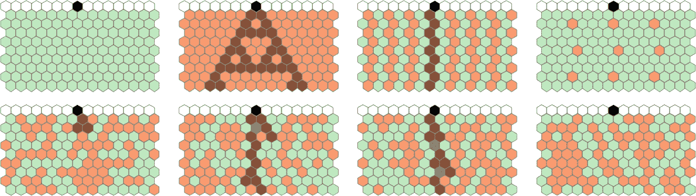

### 多路突变图

但是，例如，是否存在能够计算 16 种可能的（2 输入）函数中任意一种的 And+Xor 规则数组？我们无法用 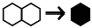 得到 `Not` 或其他 8 个函数——但事实证明，我们可以用 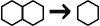 得到所有 8 个函数（此处假设额外输入为 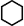）：

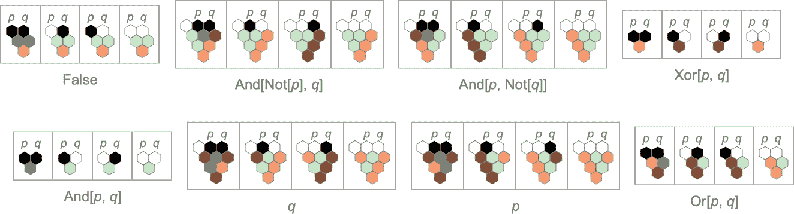

事实上，我们也可以为所有其他“偶”布尔函数设置 And+Xor 规则数组。例如，这里是 3 输入规则 30 和规则 110 布尔函数的规则数组：

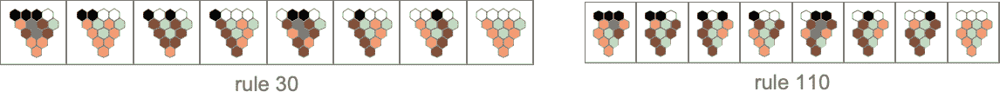

值得评论的是，建立此类规则数组的能力与我们所用底层规则的[函数完备性](https://www.wolframscience.com/nks/p807--implications-for-mathematics-and-its-foundations/)有关——尽管这并不完全是一回事。函数完备性是关于建立任意公式，这实际上可以允许中间结果之间的长程连接。在这里，所有信息都必须显式地流经数组。但例如 `Nand`（r = 1/2 规则 7，）的函数完备性允许它在与 `First`（r = 1/2 规则 12，）结合时生成所有布尔函数，尽管有时所需的规则数组相当大：

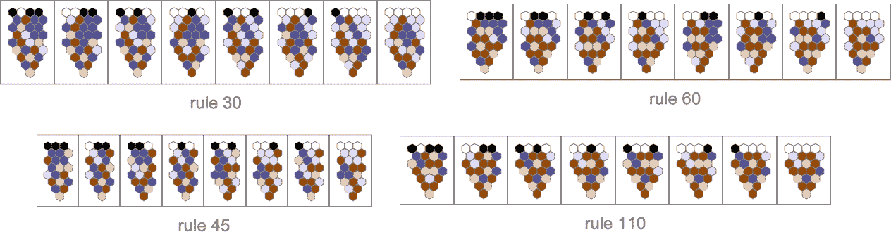

好的，但如果我们尝试使用我们的自适应进化过程——比如说解决寻找一个恰好存活 30 步的模式的问题——会发生什么？这是 And+Xor 规则数组的一个结果：

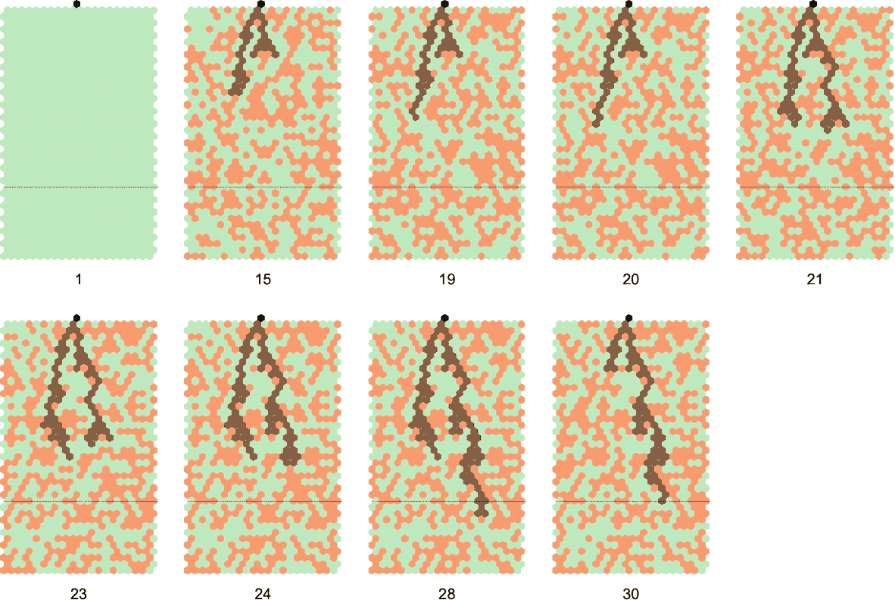

这是其他“解”的示例（在本例中，没有一个看起来特别“机械化”或“构造化”）：

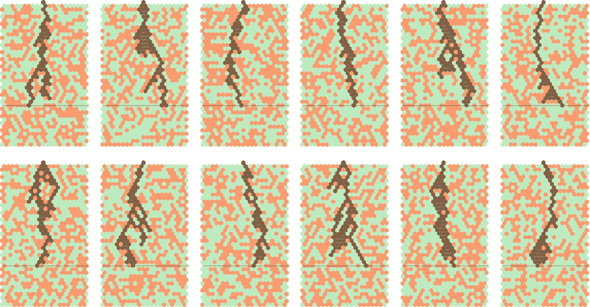

但学习我们最初的 `f[x] = ` 函数呢？首先，我们必须决定如何在离散规则数组系统中表示数字 `x` 和 `f[x]`。一种方法是简单地用黑色单元的位置来表示（“独热编码”）。因此，例如，在这种情况下，初始黑色单元位于对应 `x = –1.1` 左右的位置。然后，通过规则数组后的结果是在对应 `f[x] = 1.0` 位置处的一个黑色单元：

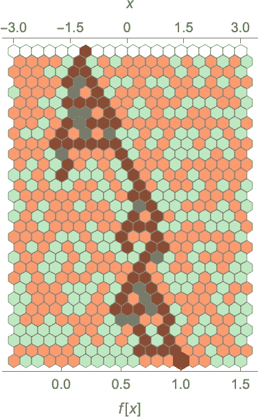

现在的问题是，我们能否找到一个规则数组，根据我们想要的映射 `x  f[x]` 成功地将初始单元位置映射到最终单元位置。好吧，这里有一个至少能接近实现这一点的例子（注意数组被视为循环的）：

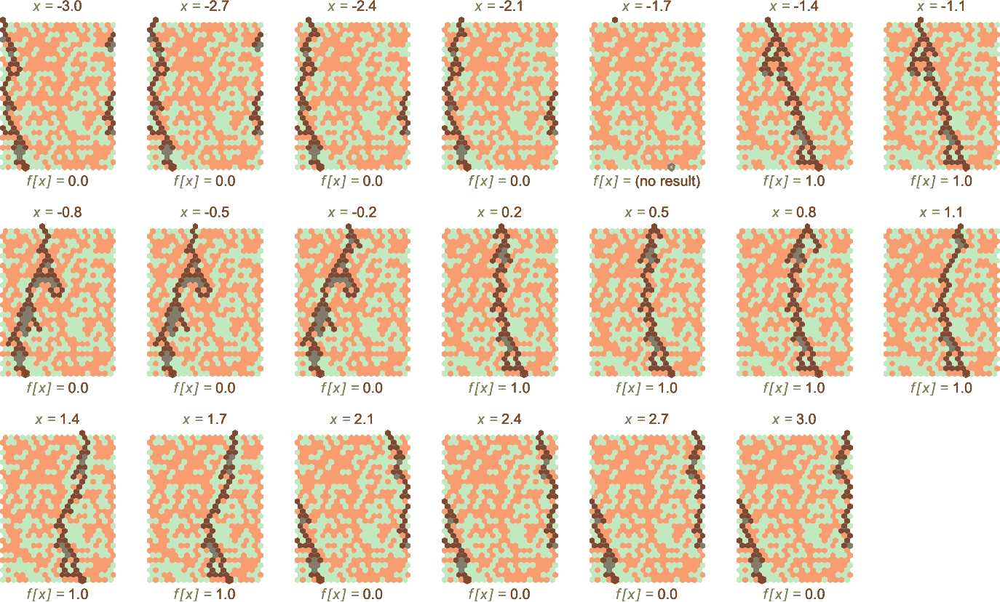

我们是怎么找到这个的？我们只是用了一个简单的自适应进化过程。直接类比机器学习中通常的做法，我们设置了“训练示例”，这里的形式为：

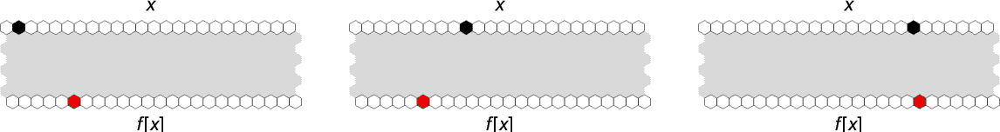

然后我们在规则数组中反复进行单点突变，保留那些使所有训练示例的总差异不增加的突变。经过 50,000 次突变后，得到了上述最终结果。

我们可以通过展示更接近目标的中间结果序列（而不是仅仅不再远离目标的结果）来了解“我们是如何到达那里的”：

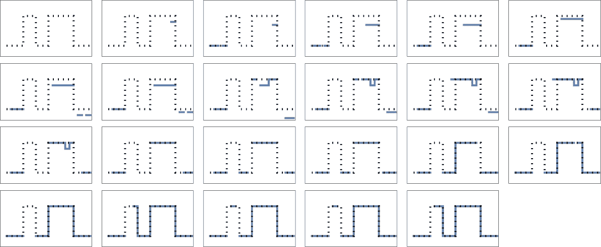

以下是相应的规则数组，在每种情况下都高亮显示了发生变化的元素（并展示了数组中 `f[0]` 的计算）：

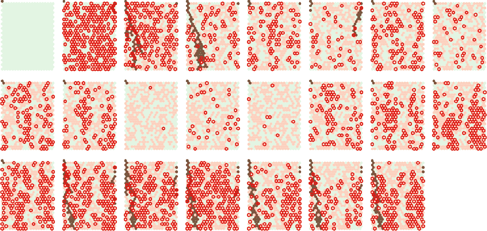

不同的随机突变序列将导致不同的规则数组。但根据此处定义的设置，生成的规则数组几乎总能成功准确计算 `f[x]`。这里有几个例子——我们专门展示 `f[0]` 的计算：

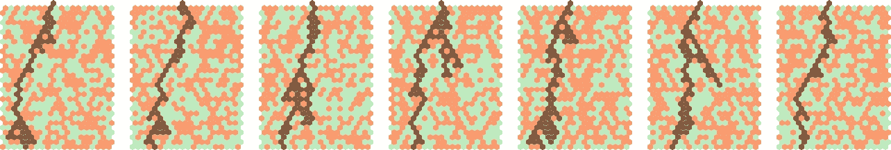

再次，一个重要的结论是，我们在发生的事情中没有看到“可识别的机制”。相反，看起来更像是我们得到的规则数组只是“恰好”在做我们想要的计算。它们的行为很复杂，但不知何故我们设法“利用它”来计算我们的 `f[x]`。

但这种计算有多稳健？典型机器学习的一个关键特征是它可以从特定的给定示例中“泛化”。如何刻画这种泛化从来都不清楚（什么时候一张穿狗装的猫的图片开始[被识别为狗的图片](https://writings.stephenwolfram.com/2015/05/wolfram-language-artificial-intelligence-the-image-identification-project/)？）。但是——至少当我们谈论分类任务时——我们可以用通向对应我们类别的吸引子的[吸引域](https://www.wolframscience.com/nks/p624--human-thinking/)来思考正在发生的事情。

不过，在我们这里探索的这种离散系统中，分析起来要容易得多。例如，我们可以轻松枚举所有训练输入（即所有仅包含单个黑色单元的初始状态），然后查看这些输入导致任何给定单元变为黑色的频率：

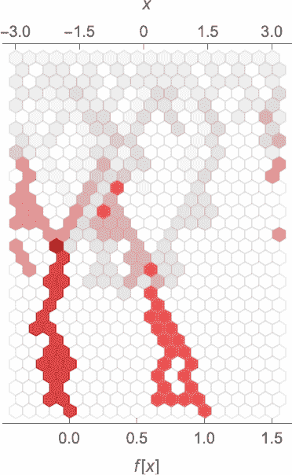

顺便说一下，这是该图在训练期间连续“突破”时的情况：

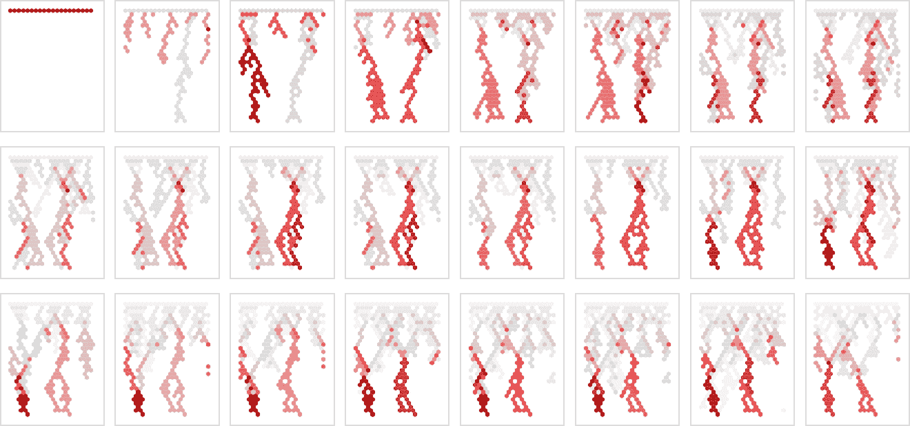

但所有可能的输入呢，包括那些不只包含单个黑色单元的输入？好吧，我们可以枚举所有这些输入，并计算数组中每个单元变为黑色的总体频率：

正如我们所预期的，结果比仅使用训练输入得到的结果要“模糊”得多。但训练数据中出现的 `f[x]` 的离散值仍有强烈的痕迹。如果我们绘制给定最终单元变为黑色的总体概率，我们会看到在对应于 `f[x]` 取值 0 和 1 的位置处有峰值：

但因为我们的系统是离散的，我们可以显式地查看发生的结果：

最常见的总体是“无意义”的全白状态——这基本上发生在来自输入的计算“永远到达不了”输出时。但接下来最常见的结果确切地对应于 `f[x] = 0` 和 `f[x] = 1`。之后是“叠加”结果，其中 `f[x]` 实际上“既是 0 又是 1”。

但是，好吧，那么什么初始状态“在……的吸引域中”（即将演化为）这里的各种结果？上图最后一列中相当平坦的图表表明，黑色单元的总体密度几乎不提供关于特定初始状态将演化到哪个吸引子的信息。

这意味着我们必须查看初始条件中单元的具体配置。作为一个例子，从初始条件开始：

它演化为：

现在我们可以问，如果我们看一系列略有不同的初始条件会发生什么。这里我们用黑白显示仍演化为原始“吸引子”状态的初始条件，用粉色显示演化为其他某个状态的初始条件：

内部实际上发生了什么？这里有几个例子，高亮显示了因改变初始条件而导致值发生变化的单元：

正如机器学习中的典型情况，似乎没有对吸引域形式的简单刻画。但现在我们对其原因有了一种感觉：这是计算不可约性的另一个后果。计算不可约性给了我们有效的随机性，使我们能够通过自适应进化找到有用的结果，但它也导致变化产生看似随机且不可预测的效果。（顺便值得一提的是，我们可以通过在训练数据中专门包含注入了“噪声”的示例，大幅提高吸引域的稳健性。）

### 多路突变图

### 优化学习过程

在实际进行机器学习时，目标通常是找到一组权重等参数，以成功解决特定问题。但通常会存在许多这样的参数组合。对于典型的连续权重和随机训练步骤，很难看到所有“可能性集合”的全貌。但在我们的离散规则数组系统中，这变得更加可行。

考虑一个包含两种可能规则的微小 2×2 规则数组。我们可以[构建一个图，其边表示该规则数组中可能发生的所有“点突变”](https://writings.stephenwolfram.com/2024/05/why-does-biological-evolution-work-a-minimal-model-for-biological-evolution-and-other-adaptive-processes/#the-multiway-graph-of-all-possible-mutation-histories)：

在我们的自适应进化过程中，我们始终在这样一个图中移动。但通常大多数“移动”最终会进入被拒绝的状态，因为它们增加了我们定义的损失。

考虑生成一个 And+Xor 规则数组的问题，要求最终得到生命周期为 4 的模式。将损失定义为距离该生命周期的远近，我们可以绘制一个图，展示所有始终逐步降低损失的自适应进化路径：

结果是一个多路图，这种图我们在[许多情形](https://writings.stephenwolfram.com/2023/11/aggregation-and-tiling-as-multicomputational-processes/)中都见过——特别是我们[最近对生物进化的研究](https://writings.stephenwolfram.com/2024/05/why-does-biological-evolution-work-a-minimal-model-for-biological-evolution-and-other-adaptive-processes/#the-multiway-graph-of-all-possible-mutation-histories)。

虽然这个特定示例非常简单，但总体思路是：这种图的不同部分代表解决问题的“不同策略”。并且——直接类比于我们的[物理项目](https://www.wolframphysics.org/)和[对游戏图等的研究](https://writings.stephenwolfram.com/2022/06/games-and-puzzles-as-multicomputational-systems/)——可以想象这些策略被布局在一个由多路图中配置的共同祖先定义的“[分支空间](https://www.wolframphysics.org/technical-introduction/the-updating-process-for-string-substitution-systems/the-concept-of-branchial-graphs/)”中。

可以预期，在某些情况下分支图会相当均匀，而在其他情况下它会有完全分离的部分——代表根本不同的策略。当然，底层策略不同并不意味着系统的整体行为或性能会有明显差异。实际上，在大多数情况下，计算不可约性会导致足够的有效随机性，以至于不会有可辨别的差异。

但在任何情况下，这里有一个从包含 And 和 Xor 的规则数组开始的示例——我们观察到自适应进化的不同分支，它们通向寻找生命周期恰好为 4 的配置这一问题的不同解：

### 优化学习过程

在机器学习中，究竟该如何进行学习？在传统神经网络的实际工作中，学习通常使用反向传播等系统的算法方法完成。但到目前为止，我们在这里所做的要简单得多：我们通过连续进行随机点突变，仅保留那些不使我们偏离目标的突变来“学习”。是的，这种程序竟然能起作用很有趣——（[正如我们在别处讨论的](https://writings.stephenwolfram.com/2024/05/why-does-biological-evolution-work-a-minimal-model-for-biological-evolution-and-other-adaptive-processes/)）这大概与理解生物进化等现象非常相关。但正如我们将看到的，即使对于我们正在研究的这类离散系统，也存在更高效（甚至可能高效得多）的机器学习方法。

让我们再次审视前面寻找可产生“生命周期”恰好为 30 的 And+Xor 规则数组的示例。在自适应（“学习”）过程的每一步，我们进行单点突变（更改规则数组中的单条规则），如果突变不使我们偏离目标则保留它。突变逐渐累积——偶尔会达到一个使生命周期更接近 30 的规则数组。正如上面所示，下图展示了连续突变达到的生命周期——其中“内部”的红点对应被拒绝的突变：

我们看到一系列“平台期”，突变在累积但整体生命周期未变。在这些平台期之间，我们看到偶尔的“突破”，生命周期发生跳跃。下面是这些突破对应的实际规则数组配置，自上次突破以来的突变已高亮显示：

但最终这个过程相当浪费；在该示例中，我们总共进行了 1705 次突变，但只有 780 次真正有助于生成最终规则数组；其余所有突变在此过程中被丢弃。

那么如何做得更好？一种策略是试图在每一步弄清哪个突变“最有可能产生影响”。实现这一点的一种方法是在每一步尝试每一种可能的突变（如多路演化）——并观察它们每一个对最终生命周期的影响。由此我们可以构建一个“变化图”，给出在每个特定单元格发生突变所关联的生命周期变化。结果对于每种规则数组配置都不同，即自适应演化每一步都不同。但例如，对于上图所示的特定“突破”配置，结果如下（灰色区域的元素若被更改不会影响结果；红色区域将产生正面影响（红色越深影响越正面），蓝色区域产生负面影响）：

假设我们从随机规则数组开始，然后反复构建变化图并应用其暗示的、能带来最正面变化的突变——实际上在每一步遵循“最速下降路径”以达到我们想要的生命周期（即减小损失）。那么我们得到的“突破”配置序列是：

这实际上对应于比纯单点突变序列稍微更直接的“通往解的路径”。

顺便说一下，达到特定生命周期这一特定问题的结构足够简单，以至于这种“最速下降”方法——从简单的均匀规则数组开始——能找到一条非常“机械”的（虽然缓慢）通往解的路径：

那学习 `f[x] = ` 的问题呢？我们再次可以基于定义的损失制作变化图。下面是一系列“突破”配置的结果。灰色区域是更改将是“中性”的区域，因此仍可在不影响损失的情况下进行探索。红色区域实际上是“锁定”的区域，任何更改在损失方面都会是有害的：

如果我们遵循“最速下降路径”，总是根据变化图做出最佳改变，会发生什么？结果实际上相当不令人满意。从几乎任何初始条件开始，系统都会迅速陷入停滞，永远找不到任何令人满意的解决方案。实际上，确定性地遵循最速下降路径似乎将我们引向了一个无法逃脱的“局部极小值”。那么，仅查看变化图我们错过了什么？我们构建的变化图有一个局限性：它分别评估每个可能的单个突变的效果。它不处理一次多个突变的情况——如果要找到“通往成功的最快路径”并避免陷入停滞，一般情况下这可能是必要的。

但即使在构建变化图时，也已经存在一个问题。因为至少直接计算它的方法扩展性相当差。在一个 `n×n` 的规则数组中，我们必须检查翻转约 `n²` 个值的效果，并且对于每一个值，我们都必须运行整个系统——总共需要约 `n⁴` 次操作。并且必须在学习过程的每一步单独执行此操作。

那么传统神经网络如何避免这种低效？答案在某种程度上涉及一个数学技巧。而且至少按通常的表述，它完全基于神经网络中权重和值的连续性——这使我们能够使用微积分中的方法。

假设我们有一个这样的神经网络

它计算某个特定函数 `f[x]`：

我们可以询问当我们改变网络中的每个权重时，该函数如何变化：

实际上，这给了我们类似于上述“变化图”的东西。但有一个重要区别。因为权重是连续的，我们可以考虑对它们的无穷小变化。然后我们可以问诸如“当我们对特定权重 `wi` 进行无穷小变化时，`f[x]` 如何变化？”——或者等价地，“`f` 关于 `wi` 在点 `x` 处的偏导数是多少？”但现在我们可以利用无穷小变化的一个关键特征：它们总是可以被认为只是“线性相加”（本质上是因为 `ε²` 总是可以忽略不计，相比于 `ε`）。换句话说，我们可以通过给出其在权重空间中的“方向”来总结任何无穷小变化，即一个向量，说明每个权重应（无穷小地）改变多少。因此，如果我们想尽可能快地（无穷小地）改变 `f[x]`，我们应该沿着由所有 `f` 关于权重的导数定义的最速下降方向前进。

在机器学习中，我们通常试图实际上设置权重，使我们生成的 `f[x]` 形式成功最小化我们定义的任何损失。我们通过在“权重空间”中增量“移动”来做到这一点——在每一步计算最速下降方向以知道下一步去哪里。（在实践中，有各种技巧，如“ADAM”，试图优化执行此操作的方式。）

但我们如何高效地计算 `f` 关于每个权重的偏导数？是的，我们可以做类似于生成上述图片的类比，分别针对每个权重。但事实证明，微积分中的一个标准结果给了我们一个效率高得多的过程，实际上“最大程度地重用”已经完成的计算部分。

一切始于嵌套（即复合）函数导数的教科书级链式法则：

这基本上说，“整个链” `d[c[b[a[x]]]]` 的值的（无穷小）变化可以计算为链中每个“环节”相关的（无穷小）变化的乘积。但关键的观察是，当我们到达链中某一点的变化计算时，我们已经不得不做了许多我们需要的计算——只要我们存储了那些结果，我们总是只有增量计算要执行。

这如何应用于神经网络？好吧，神经网络中的每一层实际上都在做函数复合。因此，例如，我们的 `d[c[b[a[x]]]]` 就像一个简单的神经网络：

但那些权重呢？毕竟，它们是我们试图寻找改变效果的对象。好吧，我们可以将它们显式地包含在我们计算的函数中：

然后我们原则上可以符号计算关于这些权重的导数：

对于我们上面的网络

对应的表达式（忽略偏置）是

其中 `ϕ` 表示我们的激活函数。我们再次处理嵌套函数，并且再次——尽管在这种情况下稍微复杂一些——导数的计算可以通过增量评估链式法则中的项来完成，实际上使用了标准神经网络的“反向传播”方法。

那么离散情况呢？我们能在那里使用类似的方法吗？我们不会在这里详细讨论这一点，但我们会给出一些可能涉及内容的迹象。

作为一个潜在的更简单的情况，让我们考虑普通元胞自动机。我们变化图的类比询问特定“输出”单元的值如何受其他单元变化的影响——实际上是输出值关于其他单元值变化的“偏导数”。

例如，考虑这个元胞自动机演化中高亮显示的“输出”单元：

现在我们可以查看该数组中的每个单元，并根据仅翻转该单元的值（然后从该点向前运行元胞自动机）是否会改变输出单元的值来制作变化图：

如果我们查看不同的“输出单元”，变化图的形式会不同：

顺便说一下，这里是该规则和其他几个元胞自动机规则的更大变化图：

但是否有方法增量构建此类变化图？人们可能会认为，至少对于[本质上可逆的元胞自动机（不像这里的情况）](https://www.wolframscience.com/nks/chap-9--fundamental-physics#sect-9-2--the-notion-of-reversibility)，会立即存在这样的方法。但实际上这种可逆性似乎帮助不大——因为虽然它允许我们“回溯”元胞自动机的整个状态，但它不允许我们追踪单个单元的单独效果。

那么使用导数和链式法则的离散类比怎么样？例如，让我们称规则 30 元胞自动机演化中一步计算的函数为 `w[x, y, z]`。我们可以将该函数关于 `x` 在点 `x` 处的“偏导数”的离散类比视为表示：从给定值开始翻转 `x` 时，`w` 的输出是否发生变化：

（注意，“无变化”表示为 `False` 或 ，而变化表示为 `True` 或 。而且，是的，人们可以显式计算这里的规则结果，然后从中推导函数形式，或者可以使用符号规则直接推导函数形式。）

可以为任何布尔函数计算导数的离散类比。例如，我们有

和

我们可以写为：

我们也有：

## 布尔导数与变化图谱

下面是所有 2 输入布尔函数的“布尔导数”表：

确实可以为这类导数建立一整套“布尔微积分”。特别是，存在链式法则的直接类比：

其中 `Xnor[x,y]` 实际上是相等性测试 `x == y`：

但是，我们如何利用它来创建变化图谱呢？在我们简单的元胞自动机案例中，可以将变化图谱视为表示[输出单元的变化如何“反向传播”](https://www.wolframscience.com/nks/p604--cryptography-and-cryptanalysis/)到先前单元的过程。但如果我们直接尝试应用离散微积分规则，就会遇到一个问题：不同的“链式法则链”可能暗示同一单元值的不同变化。在连续情况下，由于无穷小量的工作方式，不会出现这种路径依赖性。但在离散情况下却会出现。归根结底，我们正在进行一种回溯，它只能忠实地表示为一个多路系统。（不过如果我们只想要概率，例如，可以考虑[对多路系统的分支进行平均](https://www.wolframphysics.org/bulletins/2021/02/multiway-turing-machines/)——我们上面展示的变化图谱实际上是对多路系统进行阈值处理的结果。）

尽管在“简单”的元胞自动机案例中出现了此类困难，但这类方法在我们最初更复杂的规则数组案例中通常似乎效果更好。这里存在许多微妙之处，源于我们不仅是针对规则数组中的值求导数，也是针对规则的选择求导数（后者是连续情况下权重的类比）。

让我们考虑 And+Xor 规则数组：

我们的损失是底部所示行中值不匹配的单元格数量。现在我们可以为该规则数组以直接的“前向”方式和使用离散导数方法的“反向”方式构建变化图谱（其中我们通过始终选取“多数派”值来有效地解决少量的“多路行为”）：

结果相似，尽管在本例中并不完全相同。这里还有其他几个例子：

确实，细节上前向和反向方法的结果本质上总是存在局部差异。但反向方法——就像普通神经网络中的反向传播一样——可以更高效地实现。对于实际机器学习目的，它实际上很可能完全令人满意——特别是考虑到前向方法本身也只是在近似哪些突变最好这一问题。

作为一个例子，下面是针对学习函数 `f[x] = ` 这一问题，前向和反向方法针对我们上面展示的“突破性”配置所得的结果：

### 什么可以被学习？

我们现在已经展示了不少机器学习实际运作的例子。但还有一个基本问题尚未解决：机器学习究竟能学习什么样的东西。甚至在此之前，还有另一个问题：给定特定类型的底层系统，它到底能表示什么样的函数？

作为第一个例子，考虑一种最小神经网络，其形式为（本质上是单层感知机）：

以 ReLU（即 `Ramp`）作为激活函数，并令第一组权重全为 1，此类神经网络计算的函数形式为：

有了足够的权重和偏置，这种形式可以表示任意分段线性函数——本质上就是通过偏移移动斜坡，并通过权重缩放它们。例如考虑函数：

这是上述神经网络计算的函数——下面展示了它是如何通过加入与各个中间节点（神经元）关联的连续斜坡构建起来的：

（同样可以从 ELU 等激活函数获得所有光滑函数。）

如果我们尝试表示多参数函数，情况会变得稍微复杂一些。仅用单个中间层，我们只能得到“分段（超）平面”函数（即仅在线性“断层线”处改变方向的函数）：

但只要有两个中间层——且每层有足够多的节点——我们就能生成任意参数的任意分段函数。

如果限制节点数量，大致上就是限制函数值中不同线性区域之间边界的数量。但随着在给定节点数下增加层数，我们基本上增加了函数值内多边形区域的边数：

那么我们之前讨论的网格网络（mesh nets）表现如何呢？这里有几个随机例子，显示的结果与具有可比较总节点数的浅层全连接网络非常相似：

好的，那我们的全离散规则数组呢？它们能表示什么函数？我们之前在生成规则数组以表示各种布尔函数时已经看到了部分答案。事实证明，存在一个基于 `SatisfiabilityInstances` 的相当高效的过程，可用于显式寻找能表示给定函数的规则数组——或确定不存在能做到这一点的规则数组（例如给定大小的）。

利用这个过程，我们可以找到表示所有（“偶”）3 输入布尔函数（即 `r = 1` 元胞自动机规则）的最小 And+Xor 规则数组：

总是可以用一个 `2^n` 位的数组来指定任意 `n` 输入布尔函数，如下所示：

但从上图可以看出，当我们将布尔函数“编译”为 And+Xor 规则数组时，它们所需的位数可能不同（即规则数组中的元素数量不同）。（实际上，函数的“算法信息含量”随我们用来表示它们的“语言”而变化。）例如，在所示的 `n = 3` 情况下，最小规则数组大小的分布为：

有些函数难以表示为 And+Xor 规则数组（似乎需要 15 个规则元素）——而另一些则较容易。这类似于将布尔函数表示为布尔表达式（例如合取范式）并[统计所用（一元和二元）操作的总数](https://www.wolframscience.com/nks/notes-10-11--boolean-formula-sizes/)时发生的情况：

好的，原则上我们知道存在一个能计算任意（偶）布尔函数的 And+Xor 规则数组。但现在我们可以问：自适应演化过程能否真正找到这样的规则数组——比如说通过一系列单点突变？如果我们进行这种自适应演化——损失函数计算例如规则 254 的“错误输出”数量——则可以产生如下一系列连续的突破性配置：

结果不如上述最小解紧凑。但似乎总能通过带单点突变的自适应演化，至少找到某个能“解决问题”的 And+Xor 规则数组。

下面是其他一些布尔函数的结果：

不仅所有（偶）布尔函数都可以用 And+Xor 规则数组表示，而且它们在这种形式下也是可学习的，仅通过带有单点突变的自适应进化即可实现。

在上述过程中，我们探讨了机器学习如何在特定情况下（如  函数）与规则数组配合工作。但现在我们遇到了一种可以显式枚举给定类别中所有可能函数的情况。从某种意义上说，我们看到的证据表明机器学习往往具有很强的普适性——至少在原则上能够学习几乎任何函数。

当然，可能存在特定的限制。例如，此处使用的 And+Xor 规则数组无法表示  的（“奇”）函数。（我们上面讨论的 [Nand](https://reference.wolfram.com/language/ref/Nand.html)+[First](https://reference.wolfram.com/language/ref/First.html) 规则数组则可以。）但总的来说，这似乎反映了[计算等价原理](https://www.wolframscience.com/nks/chap-12--the-principle-of-computational-equivalence/)，即几乎任何设置都能表示任何函数——并且也能自适应地“学习”它。

顺便说一句，当处理离散（可数）函数时，讨论表示或学习“任意函数”的问题要容易得多——因为人们可以预期要么能“精确得到”给定函数，要么不能。但对于连续函数，情况更复杂，因为人们几乎不可避免地要处理近似值（除非能使用符号形式，而符号形式本质上是离散的）。因此，例如，虽然我们可以说（如上所述）（ReLU）神经网络可以表示任何分段线性函数，但通常我们只能想象逐步逼近任意函数，这很像在简单傅里叶级数中逐步添加更多项：

回顾我们对离散规则数组的结果，一个显著的观察是：虽然我们可以成功复现所有这些不同的布尔函数，但实现这一点的实际规则数组配置往往看起来相当混乱。确实，这与我们始终看到的情况非常相似：机器学习可以找到解决方案，但它们不是“结构化的解决方案”；实际上它们只是“碰巧奏效”的解决方案。

是否有更结构化的方法用规则数组表示布尔函数？以下是表示规则 30 的两个可能的最小尺寸 And+Xor 规则数组：

在下一个更大的尺寸下，规则 30 有更多可能性：

也存在可以表示规则 110 的规则数组：

但在所有这些情况下，都没有明显的结构让我们能立即看出这些计算是如何工作的，或者正在计算什么函数。但如果我们尝试显式构建——实际上通过标准工程方法——一个计算特定函数的规则数组会怎样？我们可以从获取类似规则 30 的函数开始，并用 And 和 Xor 来表示它（即用 [ANF，或“代数标准形式”](https://reference.wolfram.com/language/ref/BooleanConvert.html)）：

我们可以想象使用“求值图”来实现这一点：

但现在将其转换为规则数组很容易（是的，我们还没有完全安排好复制输入等）：

对不同输入“求值”这个规则数组，我们可以看到它确实给出了规则 30：

对规则 110 做同样的事情，And+Xor 表达式是

求值图是

规则数组是：

至少有了求值图作为指导，我们就能轻易“看清这里发生了什么”。但我们使用的规则数组比上面的最小解——甚至比自适应进化找到的解——大得多。

这是在许多其他类型系统中（例如[排序网络](https://www.wolframscience.com/nks/notes-12-8--sorting-networks/)）都能看到的典型情况：可以有一个具有清晰结构和规律性、且“可理解”的“构造解”。但最小解——或由自适应进化找到的解——往往小得多。但它们在许多方面看起来几乎都是随机的，不易理解或解释。

到目前为止，我们一直在研究计算特定函数的规则数组。但为了了解规则数组能做什么，我们可以考虑“可编程”的规则数组，其输入指定了它们应计算什么函数。例如，这里有一个 And+Xor 规则数组——由自适应进化找到——它将任意（偶）布尔函数的“位模式”作为左侧输入，然后将该布尔函数应用于右侧的输入：

有了这个相同的规则数组，我们现在可以计算任何可能的（偶）布尔函数。因此，例如，它正在求值 [Or](https://reference.wolfram.com/language/ref/And.html)：

### 其他类型的模型和设置

我们的总体目标是建立模型，捕捉神经网络和机器学习最本质的特征——但结构要足够简单，以便我们能随时“深入内部”了解它们在做什么。我们主要集中在规则数组上，作为标准“感知机风格”前馈神经网络的最小类比。但其他架构和设置呢？

实际上，我们的规则数组是元胞自动机的“时空非均匀”推广——其中自适应进化决定每个（空间）位置和每个（时间）步骤应使用哪条规则（比如从有限集合中）。另一种理想化（实际上我们在上一节中已经使用过）是拥有一个普通的均匀元胞自动机——但由自适应进化确定单一的“全局规则”。规则数组是前馈网络的类比，其中规则数组中的给定规则实际上仅在数据“流经”系统时被使用一次。普通均匀元胞自动机则像循环网络，其中单个数据流实际上反复受到同一规则的作用。

在这些情况之间存在各种插值。例如，我们可以想象一个“分层规则数组”，其中不同步骤的规则可以不同，但给定步骤上的规则都相同。这种系统可以被视为卷积神经网络的理想化，其中给定层对所有位置的元素应用相同的核，但不同层可以应用不同的核。

分层规则数组编码的信息不如通用规则数组多。但它仍然能表现出机器学习风格的现象。例如，这里展示了分层 And+Xor 规则数组的自适应进化，逐步解决生成恰好存活 30 步的模式的问题：

人们也可以想象“垂直分层”规则数组，其中不同位置使用不同规则，但任何给定位置永远运行同一规则。然而，至少对于我们这里考虑的问题类型，似乎仅能选择运行不同规则的位置是不够的。似乎要么需要在不同（时间）步骤改变规则，要么需要能够自适应地演化底层规则本身。

## 规则数组、元胞自动机与神经网络

规则数组和普通元胞自动机有一个共同特征：每个单元的值仅取决于前一步相邻单元的值。但在神经网络中，标准做法是给定节点的值取决于前一层大量节点的值。之所以在神经网络中这很直接，是因为来自前序节点的（加权的，或许还经过其他变换的）值被认为仅通过简单的数值加法来组合——而加法（作为 n 元且结合的运算）可以接受任意数量的“输入”。然而，在元胞自动机（或布尔函数）中，输入的数量总是确定的，由函数的结构决定。在最直接的情况下，输入仅来自最近邻单元。但并没有要求必须这样工作——例如，我们可以选取任意“局部模板”来为函数引入输入。该模板可以在每个位置和每一步都相同，也可以在不同位置从某个集合中不同地选取——实际上这给我们提供了“模板数组”以及规则数组。

### 全连接离散网络

那么，像我们在最早的神经网络示例中那样，拥有一个全连接网络又如何呢？要建立其离散类比，我们首先需要某种离散的 n 元结合“累加器”函数来取代数值加法的位置。为此我们可以选择 `And`、`Or`、`Xor`——或 `Majority` 这样的函数。如果我们不想在给定层的每个节点最终得到相同的值，我们需要为每个连接建立某种权重的类比——这可以通过对流经每个连接的值应用 `Identity` 或 `Not`（即翻转或不翻转）来实现。

下面是此类网络的一个示例，经过训练可计算我们上面讨论的函数：

这里只有两种连接：翻转和不翻转。而在每个节点，我们计算的是多数函数——如果其输入的多数为 1 则给出值 1，否则为 0。使用我们之前采用的“独热编码”表示输入和输出，以下是该网络评估该函数的几个示例：

这仅使用了 1000 步应用于连接类型的单点突变进行训练。损失系统性地下降——但连接类型的配置即便在达到零损失时（即函数已完全学会后）看起来仍相当随机：

在我们刚才所做的过程中，我们假设所有连接持续存在，尽管它们的类型（或有效符号）可以改变。但我们也可以考虑一种网络，其中连接在训练过程中可能被归零——从而实际上不再存在。

### 规则数组自编码

我们在这里用机器学习做的许多工作，都集中在试图学习 `x → f[x]` 形式的变换。但机器学习的另一个典型应用是自编码——实际上是学习如何压缩代表某组示例的数据。同样，也可以使用规则数组来完成此类任务，学习通过一系列单点突变来实现。

作为起点，考虑训练一个规则数组（元胞自动机规则 4 和 146）以原样复现任意宽度的黑色单元块。人们可能会认为这很容易。但并非如此，因为实际上初始数据不可避免地在规则数组内部被“粉碎”，并必须在最后重新组合。但是，是的，仍然可以训练规则数组至少大致做到这一点——尽管我们找到的能做到这一点的规则数组再次看起来相当随机：

但要建立一个非平凡的自编码器，让我们设想在中间逐渐“挤压”数组，创建一个越来越窄的“瓶颈”，数据必须通过它流动。在瓶颈处，我们实际上拥有了原始数据的压缩版本。我们发现，至少直到某个瓶颈宽度，可以创建规则数组——且具有合理的概率——能作为原始数据的成功自编码器：

### 最小 Transformer 模型

LLM 的成功凸显了机器学习在序列延续中的应用——以及 Transformer 为此的有效性。但正如其他神经网络一样，实践中使用的 Transformer 形式通常非常复杂。但能否找到一个最小模型，仍能捕捉“Transformer 的本质”？

假设我们有一个想要延续的序列，如：

我们想用向量编码每个可能的值，如

这样，例如，我们的原始序列被编码为：

然后我们有一个“头”，它读取一块连续的向量，挑选特定的值并将成对值送入 `And` 和 `Xor` 函数，以得到一个布尔值向量：

最终，这个头将沿着我们的序列“滑动”，通过“预测”序列中的下一个元素是什么。但我们必须以某种方式从布尔值向量过渡到序列元素（的概率）。我们潜在地可能仅用规则数组做到这一点。但为了我们这里的目的，我们将使用一个全连接单层 `Identity`+`Not` 网络，其中在每个输出节点，我们只需找到送达该节点的值的数量之和——并将其视为通过 `softmax` 确定相应元素的概率：

在这种情况下，具有最大值的元素是 5，因此在“零温度”下，这将是我们对下一个元素的“最佳预测”。

要训练这个完整系统，我们只需对所有内容进行一系列随机点突变，保留那些不增加损失的突变（损失基本上是预测的下一个值与实际下一个值之间的差异，或更精确地说是“分类交叉熵”）。以下是典型此类训练中损失的进展情况：

训练结束时，以下是我们最小 Transformer 的组件：

首先是序列中不同可能元素的编码。然后是头，这里展示了其应用于原始序列首个元素编码的情况。最后是一个单层离散网络，它接收来自头的输出，并推断不同元素作为下一个元素出现的相对概率。在这种情况下，下一个元素的最高概率预测是元素 6。

要进行类似 LLM 的操作，我们从某个初始“提示”开始，即一个适合头宽度（“上下文窗口”）的初始序列。然后我们逐步应用我们的最小 Transformer，例如在每一步将下一个元素设为预测概率最高的那个（即在“零温度”下操作）。在此设置下，“预测强度”的集合显示为灰色，“最佳预测”显示为红色：

### 最后，机器学习到底在做什么？

即使运行远远超出我们最初的训练数据，我们看到它也能对正弦波的延续给出“预测”：

正如我们所预期的，我们的最小 Transformer 能做出如此合理的预测，这依赖于正弦曲线的简单性。如果我们使用“更复杂”的训练数据，例如

中“数学定义”的（）蓝色曲线，

那么训练并运行最小 Transformer 的结果现在变成了：

毫不奇怪，它无法“弄清计算过程”以正确延续曲线。顺便说一句，不同的训练运行将涉及不同的突变序列，并产生不同的预测（通常带有周期性的“幻觉”）：

在研究“感知机风格”的神经网络时，我们最终使用了规则数组——实际上是时空非均匀元胞自动机——作为我们的最小模型。在这里，我们为 Transformer 神经网络得到了一个稍微复杂一点的最小模型。但如果我们进一步简化它，最终得到的将不是类似元胞自动机的东西，而是类似[标签系统](https://www.wolframscience.com/nks/p93--tag-systems/)的东西，在标签系统中，有一个元素序列，每一步从开头移除一个块，并根据其形式在末尾添加特定的块，如下所示：

而且，是的，这样的系统[能产生极其复杂的行为](https://writings.stephenwolfram.com/2021/03/after-100-years-can-we-finally-crack-posts-problem-of-tag-a-story-of-computational-irreducibility-and-more/)——这强化了这样一个观点（我们在此反复看到）：机器学习通过选择与设定目标相一致的复杂性来发挥作用。

顺着这条思路，可以考虑各种不同的计算系统作为机器学习的基础。在这里我们一直在研究类元胞自动机和类标签系统的例子。但例如我们的[物理学项目](https://www.wolframphysics.org/)向我们展示了基于[超图重写](https://www.wolframphysics.org/technical-introduction/basic-form-of-models/)的系统的威力和灵活性。从我们在这里看到的情况来看，超图重写似乎非常有可能作为一个更强大、更灵活的基底来服务于机器学习。

我认为，从我们在这里所做的事情中可以得出几个相当引人注目的结论。首先，比传统神经网络简单得多的模型似乎就能捕捉机器学习的基本特征——实际上，这些模型很可能成为新一代实用机器学习的基础。

但从科学角度来看，这些模型之所以重要，是因为它们的结构足够简单，以至于可以立即生成它们内部运作过程的可视化。研究这些可视化，最直接的显著特征是它们看起来有多么复杂。

本来机器学习可能会以某种方式“攻克系统”，找到它们行为的简单表示。但那似乎完全不是正在发生的事情。相反，似乎发生的是，机器学习在某种意义上只是在“搭便车”，利用[计算宇宙的普遍丰富性](https://www.wolframscience.com/nks/chap-3--the-world-of-simple-programs/)。它不是“专门构建所需的行为”；而是在利用计算宇宙中“已经存在”的行为。

之所以可能奏效，依赖于一个关键的——且最初出人意料的——事实：在计算宇宙中，即使是非常简单的程序也能普遍产生各种复杂行为。关键在于，这种行为具有足够的丰富性和多样性，使得我们能找到与所定义的机器学习目标相一致的实例。从某种意义上说，机器学习是在为实现目的的程序“挖掘”计算宇宙。

机器学习并不是精准锁定某个特定的精确程序。相反，在机器学习典型的成功应用中，有许多程序“或多或少都能做正确的事”。如果试图做的事情涉及计算不可约性，机器学习通常无法“足够好地对齐”以正确“走完”不可约计算的所有步骤。但似乎许多[“类人任务”](https://writings.stephenwolfram.com/2023/02/what-is-chatgpt-doing-and-why-does-it-work/#models-for-human-like-tasks)——这是现代机器学习特别关注的焦点——可以成功完成。

顺便说一句，通过这里探索的最小模型，人们可以预期更可行地真正刻画出机器学习能成功实现哪些目标，哪些不能。机器学习运作的关键不仅在于存在能做特定事情的程序，还在于它们能被自适应进化过程切实地找到。

在我们在这里所做的工作中，我们经常使用本质上最简单的自适应进化过程：点突变序列。我们发现，即使是这种过程，通常也足以引导我们找到令人满意的机器学习解决方案。我们的自适应进化路径本可能总是陷入停滞——无法达到任何解决方案。但这种情况没有发生，这似乎[关键地关联于](https://writings.stephenwolfram.com/2024/05/why-does-biological-evolution-work-a-minimal-model-for-biological-evolution-and-other-adaptive-processes/#the-fitness-landscape)我们所研究系统中普遍存在的计算不可约性，它导致了有效的随机性，以压倒性的概率“给我们一条出路”，让我们摆脱陷入的困境。

从某种意义上说，计算不可约性为不同的自适应进化过程“拉平了竞争环境”，让即使是简单的过程也能成功。类似的事情似乎也发生在我们使用的整个框架中。广泛类别的系统似乎都能成功进行机器学习，即使它们没有传统神经网络的详细结构。我们可以将其视为[计算等价原理](https://www.wolframscience.com/nks/chap-12--the-principle-of-computational-equivalence/)的典型反映：尽管系统在细节上可能不同，但它们最终在能进行的计算上都是等价的。

计算不可约性现象导致了一个根本性的权衡，这在[思考 AI 等问题时尤为重要](https://writings.stephenwolfram.com/2023/03/will-ais-take-all-our-jobs-and-end-human-history-or-not-well-its-complicated/)。如果我们想预先知道——并广泛保证——系统将做什么或能做什么，我们必须将系统设置为计算可约的。但如果我们想让系统能最充分地利用计算，它必然会表现出计算不可约的行为。机器学习也是同理。如果我们想让机器学习发挥其最大潜能，也许给我们带来“实现魔法”的印象，我们就必须允许它表现出计算不可约性。而如果我们想让机器学习“可理解”，它就必须是计算可约的，从而无法访问计算的全部力量。

## 机器学习的基础：计算不可约性与鲁里奥洛吉

起初，机器学习是否真的必须利用计算不可约性的力量并不显而易见。可能存在计算可约的方法来解决我们想用机器学习解决的问题。但我们在这里发现，即使在解决非常简单的问题时，作为机器学习核心的自适应进化过程，最终也会采样并利用我们预期为计算不可约的过程。

与生物进化一样，机器学习本质上是在寻找行之有效的事物——不受人类在显式逐步工程化事物时所面临的“可理解性”约束。人们能否设想约束机器学习使其产生可理解的结果？这样做将有效地阻止机器学习访问计算不可约过程的力量，而从这里的证据来看，在这种约束下，我们在机器学习中看到的成功似乎不太可能实现。

### 对“机器学习科学”的意义

人们或许希望能“深入”机器学习系统内部，获得关于正在发生什么的详细叙事解释；实际上，人们希望能“解释一切背后的机制”。但我们在这里看到的表明，一般来说，这行不通。我们只能说，在计算宇宙的某处，存在某种（通常是计算不可约的）过程，“碰巧”与我们想要的目标一致。

是的，我们可以做出一般性陈述——强烈基于计算不可约性——关于此类过程的可发现性，例如通过自适应进化。但如果我们问“系统究竟是如何详细工作的？”，将不会有太多答案。当然，我们可以追踪其所有计算步骤，看到它以某种方式表现。但我们不能指望获得相当于“全局人类级解释”来说明它在做什么。相反，我们基本上只能观察某个计算不可约过程，并注意到它“碰巧有效”——而我们不会有关于“为什么”的高层解释。

### 可约性的口袋：一个重要的漏洞

但这一切有一个重要的漏洞。在任何计算不可约系统中，总不可避免地存在计算可约的“口袋”。正如我在[与物理学项目相关的大量讨论中所述](https://writings.stephenwolfram.com/2023/12/observer-theory/)，正是这些计算可约的口袋，使得像我们这样计算有限的观察者能够识别出“自然定律”等事物，并以此构建“人类级叙事”。

那么机器学习呢？那里出现了哪些计算可约的口袋，我们可能从中构建“人类级科学定律”？正如从气体分子层面或空间终极离散元素层面发生的计算不可约过程中涌现出“简单连续行为”一样，我们可以预期，当处理大量组件时，至少某些计算可约特征会更加明显。确实，在足够大的机器学习系统中，当观察训练曲线等探测聚合行为时，看到平滑曲线和表观规律性是常态。

但关于可约性口袋的问题始终是：它们最终是否与我们认为有趣或有用的事物对齐。是的，机器学习系统可能会表现出某种集体（“类脑电图”）行为。但不清楚的是，这种行为是否能告诉我们系统中实际发生的“信息处理”（或其他）的任何情况。如果要有“机器学习科学”，我们必须希望能在机器学习系统中找到与我们可测量且关心的事物对齐的计算可约口袋。

### 机器学习系统的终极力量

鉴于我们在这里探讨的机器学习基础，我们能对[机器学习系统的终极力量](https://writings.stephenwolfram.com/2024/03/can-ai-solve-science/)说些什么？一个关键观察是，机器学习通过“搭便车”利用计算不可约性发挥作用——实际上是通过寻找“碰巧”符合目标的“自然计算不可约片段”。但如果这些目标本身涉及计算不可约性——正如在用计算术语成功形式化的过程中（如数学、精确科学、计算 X 等）常见的那样——会怎样？仅靠机器学习系统“在内部使用某些计算不可约片段”是不够的。要实现特定的计算不可约目标，系统必须做与该实际、特定目标紧密对齐的事情。

不过必须承认，通过在这里揭示机器学习更多的本质，至少更容易定义将典型“形式计算”与机器学习融合的问题。传统上，系统的计算能力与其可训练性之间存在权衡。确实，从我们在这里看到的情况来看，这似乎反映了这样一种感觉：“更大块的计算不可约性”更难通过自适应进化的增量构建过程塞入其中。

### 如何终极看待机器学习

实际上，机器学习的力量来自于利用计算不可约性这一“自然资源”。但当它使用计算不可约性时，是通过“觅食”碰巧推进其目标的片段来实现的。想象一下在砌墙。一种可能是塑造特定形状的砖块，知道它们能拼合。另一种则是看看周围躺着的石头，然后尽力把这些石头拼凑起来砌墙。

如果接着问“为什么墙会有这种图案？”，答案基本上会是“因为这就是碰巧躺在那里的石头能拼出的样子”。这本身没有总括性的理论；它只是可用资源的反映。在机器学习的情况下，人们可以预期，所看到的很大程度上将反映计算不可约性的原始特征。换句话说，机器学习的基础在很大程度上植根于[鲁里奥洛吉科学](https://writings.stephenwolfram.com/2021/09/charting-a-course-for-complexity-metamodeling-ruliology-and-more/#the-pure-basic-science-of-ruliology)。在我们努力理解机器学习中“真正发生了什么”，以及很可能在神经科学中理解更多时，我们很大程度上应该求助于这门科学。

### 历史与个人注记

从某种意义上说，智力史上的某种偶然导致我在这里讨论的基础性问题很久以前没有得到解决；从另一种意义上说，这似乎是某些直觉和工具直到最近才发展起来的必然结果。

## 神经网络与机器学习的演变

### 早期基础（1940 年代–1960 年代）

大脑从根本上由相连的神经细胞构成这一观点在十九世纪后期被提出，并在二十世纪的最初几十年站稳脚跟——以计算方式运作的[神经网络的形式化概念](https://www.wolframscience.com/nks/notes-10-12--history-of-ideas-about-thinking/)在 Warren McCulloch 和 Walter Pitts 1943 年的工作中以完整形式出现。到 1950 年代末，已有以“感知机”形式出现的神经网络硬件实现（通常用于图像处理）。但尽管早期热情高涨，实际效果好坏参半，到了 1960 年代末，人们宣称适合数学分析的简单情况已被“解决”——导致普遍认为“神经网络无法做任何有趣的事”。

自 1940 年代以来，一直有关于神经网络的零星通用分析，特别是使用物理学方法。但这些分析通常最终得到连续近似之类的结果——这对神经网络的信息处理方面几乎无法说明什么。同时，一直存在一种潜在的信念，认为神经网络 somehow 能够解释并复现大脑的工作原理——但似乎不存在能确切说明如何做到这一点的方法。

### 复兴与停滞（1980 年代–2010 年）

随后在 1980 年代初，神经网络迎来了兴趣的复苏，源头有多个方向。部分工作集中在让神经网络执行特定的“类人”任务这一非常实用的努力上。但也有部分更偏向理论，通常使用统计物理学或动力系统的方法。

然而，热度很快消退，随后几十年里只剩下少数团队仍在研究神经网络。

### 深度学习突破（2011 年至今）

然后在 2011 年，将神经网络用于图像分析取得了一个惊人的突破。这是一个重要的实际进展。但它是由技术理念和开发驱动的——而非任何重大的新理论分析或框架。

这也是随后几乎所有进展的模式。人们投入巨大精力设计出行之有效的神经网络系统——并围绕如何最好地做到这一点积累了[各种民间经验](https://writings.stephenwolfram.com/2023/02/what-is-chatgpt-doing-and-why-does-it-work/#the-practice-and-lore-of-neural-net-training)。但并没有真正尝试建立底层理论；这是一个工程实践领域，而非基础科学。

正是在这种传统下，[ChatGPT 于 2022 年底横空出世](https://writings.stephenwolfram.com/2023/02/what-is-chatgpt-doing-and-why-does-it-work/)。关于 LLMs 的几乎一切似乎都很复杂。是的，经验上确实存在一些大尺度规律（如缩放定律）。我很快怀疑 LLMs 的成功是人类语言中存在[此前未被清晰识别的普遍规律](https://writings.stephenwolfram.com/2023/02/what-is-chatgpt-doing-and-why-does-it-work/#what-really-lets-chatgpt-work)的有力暗示。但除了极少数异常例子外，几乎没有关于“LLMs 内部发生了什么”似乎容易解码的内容。而试图给系统运行加上“强护栏”——实际上是为了使其在某种程度上变得“可预测”或“可理解”——通常会大幅降低其能力（这一点在计算不可约性的背景下现在讲得通了）。

### 个人历程与理论探索

我自己与机器学习和神经网络的渊源[始于 1980 年](https://writings.stephenwolfram.com/2015/05/wolfram-language-artificial-intelligence-the-image-identification-project/#personal-backstory)，当时我正在开发我的 [SMP 符号计算系统](https://writings.stephenwolfram.com/2013/06/there-was-a-time-before-mathematica/)，并思考是否可能将该系统的符号模式匹配基础推广为某种“模糊模式匹配”，使其更接近人类思维。我了解神经网络，但将其视为大脑的半写实模型，而非例如我设想的可能“解决”模糊匹配的那类潜在算法来源。

部分正是由于试图理解神经网绘等系统的本质，[1981 年我提出了](https://www.wolframscience.com/nks/p17--the-personal-story-of-the-science-in-this-book/)后来被认知为一维元胞自动机的东西。很快我深入研究元胞自动机，并建立了关于复杂行为如何从简单规则中产生的新直觉。但当我得知近期有人利用统计力学思想建立神经网络的理想化模型时，我至少好奇到建立模拟来尝试更多地理解这些模型。

但我做的并不成功。我既无法让模型做出任何有实际意义的有趣事情，也未能获得对它们的良好理论理解。我一直在想，只是“运行”的元胞自动机，与还能“学习”的神经网络等系统之间，可能存在什么关系。事实上，[1985 年我尝试制作了一个基于元胞自动机的最小模型](https://content.wolfram.com/sw-publications/2020/07/approaches-complexity-engineering.pdf)来探索这一点。这就是我现在称之为的“垂直分层规则阵列”。虽然在许多方面我已经在问正确的问题，但这是一个不幸的具体系统选择——我对它的实验并未揭示出我们现在看到的那类现象。

岁月流逝。我在《[新科学](https://www.wolframscience.com/nks/)》中写了一个关于[“人类思维”](https://www.wolframscience.com/nks/chap-10--processes-of-perception-and-analysis/#sect-10-12--human-thinking)的章节，讨论了思维本质的简单基础规则的可能性，甚至包含了一个神经网络的最小离散类比。不过当时我并未发展这些想法。到了 2017 年，即该书出版 15 年后——且了解深度学习的突破后——我开始[更具体地思考神经网络是通过从计算宇宙中采样程序来获得其能力](https://writings.stephenwolfram.com/2017/05/a-new-kind-of-science-a-15-year-view/#machine-learning-and-the-neural-net-renaissance)的。但我仍未完全看清这将如何运作。

与此同时，从机器学习实践经验中涌现出一种新直觉：如果你对几乎任何系统“猛击”“足够用力”，它就会学会。这是否意味着或许不需要神经网络的所有细节也能成功进行机器学习？能否或许构建一个结构足够简单、其运作例如可通过可视化访问的系统？当我在 2023 年初[撰写关于 ChatGPT 和 LLMs 的阐述](https://writings.stephenwolfram.com/2023/02/what-is-chatgpt-doing-and-why-does-it-work/)时，我特别对此感到好奇。我一直在谈论“LLM 科学”，但没太有机会去研究它。

但随后，几个月前，作为[一项旨在理解科学所做之事与 AI 所做之事之间关系的努力](https://writings.stephenwolfram.com/2024/03/can-ai-solve-science/)的一部分，我尝试了一种[“一次性实验”](https://writings.stephenwolfram.com/2024/03/can-ai-solve-science/#exploring-spaces-of-systems)——令我非常惊讶的是，它似乎成功捕捉到了[使生物进化成为可能的本质](https://writings.stephenwolfram.com/2024/05/why-does-biological-evolution-work-a-minimal-model-for-biological-evolution-and-other-adaptive-processes/)。但其他适应性进化——特别是机器学习——又该如何呢？所需的模型与[我 1985 年研究的内容](https://content.wolfram.com/sw-publications/2020/07/approaches-complexity-engineering.pdf)有着令人尴尬的相似性。但现在我有了新的直觉——并且多亏了 [Wolfram Language](https://www.wolfram.com/language/)，拥有了强大得多的工具。这里呈现的成果正是我在此方面努力的结果。

当然，这只是个开始。但我非常激动，能够看到我认为是机器学习基础科学开端的东西。已经有了明确的实际应用方向（不必说，我计划深入探索这些方向）。并且有迹象表明，我们或许最终能够理解机器学习的“魔力”究竟为何——以及在何时——奏效。

### 致谢

感谢 [Wolfram Institute](https://www.wolframinstitute.org/) 的 Richard Assar 提供的大量帮助。还要感谢 Brad Klee、Tianyi Gu、Nik Murzin 和 Max Niederman 提供的具体成果，感谢 [Symbolica](https://www.symbolica.ai/) 的 George Morgan 及其他人员的早期关注，以及感谢 Kovas Boguta 多年前建议将机器学习与《新科学》中的思想联系起来。

