# 极酷 PHP：让困难成为可能的实用脚本


# 引言


这本书是为那些偶然接触到 PHP 并想知道如何完成任务的开发者编写的。你应该具备编程基础，并且很可能已经看过许多在线代码示例。但你可能会好奇，为什么有些示例在做同样的事情时比其他示例复杂得多。

本书已尽力保持示例尽可能简单，并尽可能详细地解释每一段代码。为了最大限度减少客户端和服务器端代码的混淆，本书中 JavaScript 含量不多。每个人都很急躁，因此第 1 章“生活中的常见问题——每个 PHP 程序员想要（或需要）了解的脚本”包含了大家最喜欢的那些小任务和问题的快速解决方案。等你冷静下来，请查看第 2 章“配置 PHP”，了解如何安装和配置 PHP——相当多的问题源于配置不当。顺着这个思路，第 3 章“PHP 安全”涉及如何保障脚本安全。

第 4 章“使用表单”回归基础——具体来说，如何从表单和其他动态输入源获取用户输入。第 5 章“处理文本和 HTML”展示了如何使用多种工具（包括正则表达式）处理文本和字符串。第 6 章“处理日期”讨论了如何在 PHP 和 MySQL 中处理时间和日期，第 7 章“处理文件”涉及文件操作。

涵盖了这些基础知识后，第 8 章“用户和会话跟踪”介绍了会话跟踪和管理的细节。在复杂网站上有多个用户时，跟踪每个用户正在做什么很重要，以免一个用户的会话干扰另一个用户。

第 9 章“处理电子邮件”和第 10 章“处理图像”分别涵盖电子邮件和图像操作。这些任务通常不太适合 Web 服务器脚本，因此这些章节描述了一些相对轻量的任务，这些任务可以为您的网站增加显著价值。

在第 11 章“使用 cURL 与 Web 服务交互”中，您将学习如何通过 XML 让您的服务器与其他站点上的 Web 服务进行交互。

最后，第 12 章“中级项目”包含三个有趣的小项目，可以集成到较大的网站中。这些项目基于您在本书其他部分学到的内容。

# 1

## 生活中的常见问题——每个 PHP 程序员想要（或需要）了解的脚本


本章包含的脚本回答了全球 PHP 论坛和讨论组中反复出现的几个问题。它们包括以下内容：

- 如何在购物车中添加“上一页/下一页”链接？
- 是否有简单的方法让表格中每隔一行显示不同的颜色？
- 我有一个需要排序的大数组——求帮助！
- 最好的模板系统是什么，可以让相同的 HTML 在每个页面上包裹我的数据？

尽管本书后面有更复杂的脚本，还有许多您可能认为更有价值的脚本，但这些脚本回答了我反复看到的问题。这些入门脚本唯一共同点是，它们要么是每个人都应该知道的东西，要么是每个人都想知道的东西。把本章交给您关爱的初级 PHP 程序员。她会感谢您的。

**注意** 如果您不怕在 Web 服务器上摸爬滚打，第 2 章也会帮助初级 PHP 脚本编写者，并能让中级 PHP 程序员的生活更轻松。您可能想接下来去那里。

## #1: 将另一个文件作为脚本的一部分包含

大多数严肃的应用程序都有一个在几乎每个页面上都使用的核心变量和脚本库。例如，如果您正在编写一个连接到 MySQL 数据库的购物车，您可以在购物车的每个页面上声明 MySQL 登录名和密码。但是，如果您需要更改密码怎么办？更改并上传购物车中的每个文件可能会成为一个巨大的问题。

与其在每个页面脚本中声明密码，不如将该名称和密码存储在一个单独的文件中。然后，您可以将该文件作为脚本的一部分包含进来，而您在该文件中声明的任何变量都会在您的脚本中被声明！

此外，您可以将长脚本或函数存储在单独的文件中，仅在需要时才包含它们。例如，获取实时 UPS 运输报价的函数包含 24KB 的 XML 处理内容，但只有在有人选择 UPS 作为运输选项时才会使用。为什么不将它存储在 ups_ship_quotes.php 中，仅在必要时调用它呢？

事实上，几乎所有功能强大的 PHP 应用程序都有一个名为类似 config.php 的文件，用于声明每个页面需要知道的关键变量，例如 MySQL 名称和密码。这些应用程序还将经常使用的脚本存储在不同的目录中。程序员然后进行混合搭配，从一个目录获取检查用户是否已登录的脚本，从另一个目录包含从数据库获取相关数据的脚本，并编写一个中央脚本，根据用户是否登录来筛选数据。
下面是具体做法。

```
<?php
require_once("/path/to/file.php");
?>
```

您传递给 require_once() 的文件现在已成为您脚本的一部分，就好像您已将文件的内容剪切并复制到脚本中一样。您甚至可以包含 HTML 文件来创建一个粗糙的模板系统。

无论您如何命名文件，PHP 都会尝试将其作为有效的 PHP 读取。与任何 PHP 文件一样，您需要在包含文件中的 PHP 代码周围使用 <?php 和 ?> 标记；否则，PHP 将简单地打印整个文件（即使它是二进制文件）。

您可以像使用任何其他语句一样使用 require_once()，因此请随意将其嵌入到控制结构中。

```
if ($we_need_this_file === true) {
    require_once("needed_file.php");
}
```

### 可能出错的问题？

在包含文件时，有几种事情可能会出错。

**脚本路径错误。**

如果发生这种情况，脚本会返回致命错误并停止运行。如果您希望即使找不到包含文件，脚本也能运行，请使用 include_once() 而不是 require_once()。

**脚本路径正确，但脚本位于禁止的目录中。**

如果您配置了 open_basedir 设置以限制 PHP 可以访问的目录，则可能发生这种情况。Web 开发人员出于安全目的限制对重要文件和目录的访问。我们将在“#16：限制 PHP 可以访问的文件”第 26 页中向您展示如何更改目录权限。

**包含文件在 PHP 脚本的代码前后有空行或空格。**

如果您的脚本设置了 Cookie 或执行其他创建非标准 HTTP 的操作，则必须在向浏览器发送任何输出之前执行这些操作。请记住，PHP 会打印包含文件中 <?php 和 ?> 标记之外的任何内容。因此，如果您在这些标记前后有空行，该行将作为普通 HTML 发送到浏览器，一旦 HTML 发送到浏览器，就无法设置 Cookie 并启动会话。如果您要包含脚本，请确保它在 PHP 标记外没有空白。要特别小心 ?> 结束标记后的空格，因为编辑时通常看不见它们。

**注意** Cookie 用于跟踪用户和存储隐藏信息。有关更多详细信息，请参见第 8 章。

**包含文件可以通过非 PHP 方法查看。**

您可以将 PHP 变量存储在任何文件中，无论其文件名如何，但如果您没有专门配置 Apache 使这些文件不可读，Apache 可以将它们作为纯文本提供给任何请求的人。因此，任何知道包含文件名称的人都可以在您不小心的情况下读取其中的所有内容。

不用说，将您的 MySQL 密码和主帐户名称存储在任何拥有 Internet Explorer 的人都能看到的地方，不被认为是良好的安全实践。


为了加强安全性，您可以将包含文件放在 Web 目录之外（最好放在受密码保护的目录中），这样人们只能通过 FTP 访问脚本。事实上，如果您在处理诸如信用卡授权数据等敏感信息，您应该有义务这样做。

**NOTE** 我们将在第 52 页的“#30: 验证信用卡号”中介绍如何验证信用卡号。

#### 您陷入了包含过载。

我曾经购买过一个购物车程序，因为它是用 PHP 编写的，我打算定制脚本以适应我的业务。当我发现购物车脚本的中心模块（人们在其中添加、删除和调整项目）由 7 个包含、12 行实际代码和 3 个 Smarty 模板组成时，您可以想象我的惊讶。我打开其中一个包含文件，结果——您猜对了——是一系列三个额外的包含。

包含可以使您的代码非常紧凑。但听我说一句：如果您试图解读一个高度包含的脚本是如何工作的，那简直是活地狱。为了其他程序员和后代着想，请不要在没有注释说明该包含文件的作用的情况下包含文件。谢谢您。

#### 您使用未经检查的变量作为包含文件名。

虽然您可以使用类似 include($file) 的方式根据用户的选择打开正确的脚本，但这样做可能会让黑客在经过一些调整后包含站点中的任何文件，或者（取决于您的服务器设置）包含他站点上的文件，从而入侵您的服务器。事实上，一些基于 PHP 的蠕虫就依赖于像这样编写糟糕的脚本。此外，这类脚本更容易出现奇怪的 Bug，而且通常无法阅读。

如果必须使用变量来包含一系列文件，请使用类似第 51 页所示“#28: 确保响应是给定值集合之一”的脚本来验证文件名是否允许，这可以防止有人打开您的根密码文件。

## #2: 在表格中突出显示交替行颜色

当大量信息以行的形式呈现时，例如论坛中的主题或购物车中的行项目，当每隔一行颜色略有不同时，单个行就更容易阅读。第一步是在样式表中定义表格行的颜色。

```css
tr.row1 {
    background-color: gray;
}

tr.row2 {
    background-color: white;
}
```

这里为表格行标记（<tr>）定义了两个样式类，row1 和 row2。与任何 CSS 一样，您可以将此放入文档所包含的现有 CSS 文件中，或者将其包含在文档头部的 <style> </style> 标签内。

现在让我们定义一个函数，用于交替返回这些类。这里有个小技巧——您通过引用将一个整数变量传递给此函数。函数会自动更新此变量，因此您可以进行重复调用，而无需担心表格的当前状态：

```php
function table_row_format(&$row_counter) {
    // Returns row class for a row
    if ($row_counter & 1) {
        $row_color = "row2";
    } else {
        $row_color = "row1";
    }
    $row_counter++;
    return $row_color;
}
```

现在让我们看看如何使用此函数。首先，让我们设置一个 SQL 查询，从附录中描述的表中检索一些数据行并开始表格格式化：

```php
$sql = "SELECT product_name FROM product_info";
$result = @mysql_query($sql, $db) or die;

echo "<table>";
```

剩下的很简单；我们只需初始化行状态变量（这里是 $i），反复调用 table_row_format($i) 以获取交替的行样式类，然后为每一行分配正确的 class 属性。最后，我们关闭表格：

```php
$i = 0;
while($row = mysql_fetch_array($result)) {
    /* Print results. */
    $row_class = table_row_format($i);
    echo "<tr class=\"$row_class\"><td>$row[product_name]</td></tr>";
}
echo "</table>";
```

使用 table_row_format() 函数的关键是了解其工作原理。您始终初始化一个用于状态的整数变量，但值是什么无关紧要，因为 table_row_format() 会为您处理它。

### 脚本黑客技巧

使用样式表可以进行无数种小技巧。有关 CSS 的更多详细信息，请查阅您选择的在线资源，或参阅 Eric Meyer 所著的《Cascading Style Sheets: The Definitive Guide, 2nd Edition》（O'Reilly Media, 2004）。也许更有趣的是，您可以轻松地将此函数转换为面向对象的表格格式化程序。您不需要显式声明状态变量，而是可以创建一个带有私有变量来跟踪状态的类。构造函数和析构函数分别打开和关闭表格标记。类如下所示：

```php
class AltTable {
  function __construct() {
    $this->state = 0;
    print "<table>";
  }
  function __destruct() {
    print "</table>";
  }
  function print_row($row) {
    if ($this->state & 1) {
      $row_color = "row2";
    } else {
      $row_color = "row1";
    }
    print "<tr class=\"$row_color\">";
    foreach ($row as $value) {
      print "<td>$value</td>";
    }
    print "</tr>";
    $this->state++;
  }
}
```

以下是使用该类的方法（假设查询与前面的示例相同）：

```php
$mytable = new AltTable;
while($row = mysql_fetch_row($result)) {
  /* Print results. */
  $mytable->print_row($row);
}
unset($mytable);
```

乍一看，您可能会认为这很棒，因为使用起来更轻松一些——您不需要处理状态变量，print_row() 方法可以处理任意数量的列，而且您甚至不需要编写任何 HTML 来开始和结束表格。如果所有表格都长得一样，这当然是一个巨大的优势。然而，这种整洁是以牺牲灵活性和一定效率为代价的。当然，您可以添加方法和属性来做一些花哨的事情，例如添加表格标题，但您需要问自己这是否真的值得。

## #3: 创建上一页/下一页链接

如果您需要在页面上显示大量项目，可能希望将其分成多个页面，每页显示有限数量的项目，以简化显示。这样做可以使结果更易于查看，并加快页面加载时间。

导航栏让用户可以控制这些页面。您需要一个带有“上一页”和“下一页”链接以及直接页码链接的栏。以下是一个可以完成所有这些功能的脚本：

```php
<?php
function create_navbar($start_number = 0, $items_per_page = 50, $count) {
// Creates a navigation bar
$current_page = $_SERVER["PHP_SELF"];

if (($start_number < 0) || (! is_numeric($start_number))) {
$start_number = 0;
}

$navbar = "";
$prev_navbar = "";
$next_navbar = "";

if ($count > $items_per_page) {
$nav_count = 0;
$page_count = 1;
$nav_passed = false;

while ($nav_count < $count) {
// Are we at the current page position?
if (($start_number == $nav_count) && ($nav_passed != true)) {
$navbar .= "<b><a href=\"$current_page?start=$nav_count\">[$page_count]</a></b>";
$nav_passed = true;
// Do we need a "prev" button?
if ($start_number != 0) {
$prevnumber = $nav_count - $items_per_page;
if ($prevnumber < 1) {
$prevnumber = 0;
}
$prev_navbar = "<a href=\"$current_page?start=$prevnumber\">&lt;&lt;&lt;Prev - </a>";
}
}

$nextnumber = $items_per_page + $nav_count;
// Do we need a "next" button?
if ($nextnumber < $count) {
$next_navbar = "<a href=\"$current_page?start=$nextnumber\"> - Next&gt;&gt;</a><br>";
}
} else {
    // Print normally.
    $navbar .= "<a href=\"$current_page?start=$nav_count\">[$page_count]</a>";
}
$nav_count += $items_per_page;
$page_count++;
}
$navbar = $prev_navbar . $navbar . $next_navbar;
return $navbar;
}
?>
```

假设您将使用此脚本来处理从数据库检索的信息。两点将使显示更加准确和高效：

### 仅从数据库中显示行的一个子集

如果想法是每页仅显示 25 个项目，那么您应该编写一个只返回 25 个项目的 SQL 查询。（好吧，您可以全选然后遍历整个结果集，在成千上万行中筛选直到找到想要的 25 行，但有更好的方法。）此外，您想显示特定的 25 个项目。当用户想查看产品 #176 到 #200 时，从数据库中提取前 25 个项目并没有帮助。

幸运的是，这两个目标都可以通过 SQL LIMIT 子句轻松实现，该子句从数据库中仅检索指定数量的行。您的 SQL 查询应该如下所示：

```
SELECT * FROM your_table
WHERE conditions
LIMIT $start_number, $items_per_page
```

将 LIMIT 子句添加到查询末尾时，它只从结果集中检索选定数量的行。例如，将 LIMIT 75, 25 放在查询末尾，将从第 75 行开始从数据库中检索 25 行。

**NOTE** 如果用于起始行的数字大于行数，MySQL 将不返回任何数据。例如，如果您运行 LIMIT 200, 25 而表中只有 199 行，您将得到一个空结果集而不是错误。编写良好的程序会通过使用 if (mysql_num_rows($result) > 0) 检查来处理空集。


现在你只保留了想要的行，但仍需要做一件事。

### 统计结果集中的总行数

结果集是 SQL 中一个花哨的说法，指“所有 WHERE 语句处理完毕后返回的任何数据”。我们需要知道总行数，以便了解当前处于第几页，以及还要翻多少页才能看完。如果没有总行数，我们可能会在没有更多项目可查看时显示“下一页”链接，并且无法告诉用户还有多少页可供查看。

你的 SQL 查询应该如下所示：

```
SELECT count(*) AS count FROM your_table
WHERE conditions
```

获得这些宝贵信息后，你需要将三个信息片段插入到 create_navbar() 函数中。create_navbar() 函数包含多个变量，让我们逐一查看：

- **$current_page** 包含导航栏的当前页面。在此脚本中，我们使用 `$_SERVER["PHP_SELF"]` 特殊变量，该变量始终设置为不包含主机名和任何 GET 参数的当前页面。例如，在访问 http://example.com/navbar.php?start=0 的脚本中，`$current_page` 将被设置为 /navbar.php。

- **$start_number** 起始行号。例如，如果用户正在查看第 100 行到第 125 行，则起始编号为 100。此数字通过 URL 中的 GET 方法作为 startnum 参数传递。默认值为 0。

- **$items_per_page** 用户在每一页看到的行数。例如，如果你有 100 行数据，$items_per_page 值为 25 会生成四页，每页 25 行。相同的 100 行数据，如果 $items_per_page 值为 50，则只生成两页。如果 $items_per_page 值为 200，则 100 行数据没有导航栏，因为所有内容都在一页中显示完毕。本脚本的默认 $items_per_page 值为 50。

- **$count** 数据行的总数。我已在上文“统计结果集中的总行数”中向你展示了如何获取此信息。

- **$nav_count** 此变量从 0 开始，不断按 $items_per_page 递增，直到大于 $count。当该值超过 $count 时，脚本已到达结果集的末尾——即导航栏的末尾。

- **$page_count** 结果集中的页数。

- **$nav_passed** 一个临时变量，首次当 $nav_count 超过 $start_number 时将其设置为 Y；换句话说，即当我们查看当前页面时。这使我们能够在导航栏显示中高亮显示当前页码。

### 使用此脚本

```
<?php
$start_number = intval($_GET["start"]);
$items_per_page = 100;
$category_sales = null;
if ($start_number >= 0) {
    // Count the items in the category.
    $sql = "SELECT count(*) AS count FROM product_info
            WHERE category = 'shoes'";
    $result = @mysql_query($sql, $connect_string) or die("Error is " .
    mysql_error());
    while($row = mysql_fetch_array($result)) {
        $count = $row['count'];
    }
    // Now get the results to show to the customer.
    $sql = "SELECT product_id, product_name FROM product_info
            WHERE category = 'shoes'
            LIMIT $start_number, $items_per_page";
    $result = @mysql_query($sql, $connect_string) or die("Error is " .
    mysql_error());
    if (mysql_num_rows($result) > 0) {
        while($row = mysql_fetch_array($result)) {
            // Loop through and add your HTML display info
            // into $category_sales.
            $category_sales .= "Data from SQL query";
        }
    } else {
        $category_sales = "There were no items in this category.";
    }
    $navbar = create_navbar($start_number, $items_per_page, $count);
}
if (is_null($category_sales)) {
    echo "Invalid input.";
} else {
    echo "$navbar<br />$category_sales";
}
?>
```

此示例展示了如何将 create_navbar() 函数与数据库表中的一组数据结合使用（有关数据详细信息，请参见附录）。脚本的工作原理如下：

- 1. 从 GET 参数中提取起始行号到 $start_number 变量。
- 2. 执行初始 SQL 查询以提取表中可显示行的总数。
- 3. 第二个查询从表中最多提取 $items_per_page 行，起始位置为 $start_number。
- 4. 对行数据进行格式化。
- 5. create_navbar() 函数创建导航栏；格式化后的导航栏存入 $navbar 变量。
- 6. 脚本打印格式化后的导航栏和数据。

## #4：打印数组的内容

假设你一直在向数组中添加和删除项目，但遇到了一些问题。你真正需要的是查看脚本中某一特定行时数组的内容。实现这一点有一个非常简单的方法，但全球的 PHP 教程并未给予其应有的*足够*关注——print_r() 函数！下面是一个示例：

```
<?php
$alacarte = array("chocolate ice cream",
    "vanilla pudding",
    "snozberry whip");
$menu = array ("appetizer" => "fruit",
    "entree" => "roast beef",
    "dessert" => $alacarte);
print_r($menu);
?>
```

print_r() 函数以人类可读的格式将数组打印到屏幕上。在处理*多维数组*（如果你不熟悉这个术语，即包含其他数组的数组）时，这特别实用。将数组传递给 print_r()，你将获得一个简单的纯文本显示。因为它使用空白字符但不使用 HTML 标记，你可能需要查看页面源代码才能按预期看到它。前面的示例产生以下输出：

```
Array
(
    [appetizer] => fruit
    [entree] => roast beef
    [dessert] => Array
    (
        [0] => chocolate ice cream
        [1] => vanilla pudding
        [2] => snozberry whip
    )
)
```

## #5：将数组转换为以后可恢复的非数组变量

尽管数组非常有用，但在某些地方它们并不受欢迎。例如，你无法直接将数组存储在 cookie 或会话中。MySQL 和 XML 也无法处理原生的 PHP 数组类型。

幸运的是，有一种方法可以将 PHP 数组转换为可存储在几乎任何地方的字符串：serialize() 函数。下面是一个说明该函数工作原理的脚本（假设 $alacarte 与前一节中的相同）：

```
<?php
$menu = array(
 "appetizer" => "fruit",
 "entree" => "roast beef",
 "dessert" => $alacarte);
$menu_s = serialize($menu);
echo $menu_s;
?>
```

运行此脚本会产生以下输出：

```
a:3:{s:9:"appetizer";s:5:"fruit";s:6:"entree";s:10:"roast beef";s:7:"dessert";a:3:{i:0;s:19:"chocolate ice cream";i:1;s:15:"vanilla pudding";i:2;s:15:"snozberry whip";}}
```

你可以将此值存储在几乎任何地方——cookie、数据库、隐藏的 POST 输入字段等。当你需要将序列化的数组还原为真实数组时，请使用 unserialize()，如下所示：

```
$menu = unserialize($menu_s);
```

### 可能出现什么问题？

serialize() 是一个很棒的函数，但有几件事你应该知道。首先，序列化的数组可以相对轻易地被读取，因此如果你在 cookie 或会话中存储敏感数组，你可能希望先对其进行加密，以便入侵者无法窃取你的数据。（参见第 41 页的“#23：使用 Mcrypt 加密数据”。）

不要滥用此函数。如果你发现自己一直将数组存储在数据库中，或者开始得到序列化字符串，你可能应该重新设计数据库结构或存储机制。

最后，你应避免随 HTTP GET 方法传递序列化的数组，因为 URL 的长度是有限且相对较短的。

## #6：排序多维数组

编程中一个长期存在的任务是对复杂的数组进行排序。例如，假设你有以下数组：

```
$items = array(
 array("name" => "Mojo Nixon", "price" => 19.96, "quantity" => 2),
 array("name" => "ABBA", "price" => 14.99, "quantity" => 1),
 array("name" => "Iced Earth", "price" => 12.96, "quantity" => 4),
);
```

你的目标是按每个子数组中的 name 键对其进行排序。PHP 与许多其他脚本语言一样，有一个名为 usort() 的排序函数，它通过用户定义的比较函数进行排序。换句话说，你可以按任何喜欢的标准对数组进行排序，而无需为排序算法的机制绞尽脑汁。使用 usort() 的基于名称的排序脚本归结如下：

```
function name_cmp($a, $b) {
 return strcasecmp($a["name"], $b["name"]);
}

usort($items, "name_cmp");
```

如果这个脚本看起来很简单，那是因为它确实很简单。用户定义的比较函数名为 name_cmp。usort() 使用该比较函数来比较两个元素。这些元素是参数（这里是 $a 和 $b）。你在比较函数中需要做的只是弄清楚 $a 与 $b 之间的关系：

- 如果 $a 小于 $b，则应返回 -1。
- 如果 $a 等于 $b，则应返回 0。
- 如果 $a 大于 $b，则应返回 1。

因为在我们的比较函数中，$a 和 $b 是数组，并且我们关心这些数组中 name 键下的值，所以我们想比较 $a["name"] 和 $b["name"]。使用一堆 if/then 语句可以轻松做到这一点，但由于这些是字符串，你应该使用 strcasecmp() 内置函数，以确保速度、清晰度并避免错误。

**注意** PHP 中有一个名为 array_multisort() 的函数，它试图成为多维数组排序的万能解决方案。它极其复杂；你最好避免使用它。


### 脚本修改技巧

对比较函数最明显的修改就是在两个元素相等时添加额外的排序条件。沿用之前的示例，以下是当名称相同时按价格排序的方法：

```
function name_cmp($a, $b) {
    $r = strcasecmp($a["name"], $b["name"]);
    if ($r == 0) {
        if ($a["price"] < $b["price"]) {
            $r = -1;
        } elseif ($a["price"] > $b["price"]) {
            $r = 1;
        } else {
            $r = 0;
            /* Not strictly necessary; $r is already 0. */
        }
    }
    return($r);
}
```

## #7：使用 Smarty 为网站制作模板

大多数网站都具有一致的外观和感觉。虽然页面中间的动态内容可能会变化，但通常会有页眉、侧边导航栏，或许还有一两个广告。实现这一点的简单方法有很多，从自定义页眉打印函数到包含文件。取决于你网站的大小，这些解决方案可能运行良好，但内容越庞大越复杂，修改起来就越麻烦。

最常用的模板解决方案是 Smarty（http://smarty.php.net/）。使用 Smarty，你可以创建带有变量的模板。换句话说，你可以创建一个带有 PHP 生成数据占位符的 HTML 文件。此外，你可以在模板中包含其他 Smarty 模板，从而更好地组织和编辑网站的各个部分。一旦你真正熟悉 Smarty，就可以缓存数据并显著加快网站速度，但这属于超出本书范围的高级技术。

接下来的内容足以让大多数网站上手运行。

### 安装 Smarty

按照以下步骤在服务器上安装 Smarty。

- 1. 在服务器的 Web 根目录下创建一个名为 *smarty* 的目录，用于存储核心 Smarty 文件。
- 2. 访问 http://smarty.php.net/ 并下载最新版本的 Smarty。将其解压并提取到计算机上的一个文件夹中。
- 3. 将计算机上的所有 Smarty 文件传输到服务器上的 smarty 目录中。
- 4. 在服务器上创建另一个名为 *templates* 的目录，用于存放 Smarty 模板。在此处创建两个子目录：*html* 用于存放原始模板，*compile* 用于存放 Smarty 编译后的模板。
- 5. 使编译目录可由 Web 服务器写入。如果不确定如何操作，第 91 页的“文件权限”将向你展示方法。
- 6. 在 templates 目录中，创建（或上传）一个名为 smarty_initialize.php 的文件，包含以下内容：

```
<?php
define ("SMARTY_DIR", "/path/to/web/root/smarty/");
require_once (SMARTY_DIR."Smarty.class.php");
$smarty = new Smarty;
$smarty->compile_dir = "/path/to/web/root/templates/compile";
$smarty->template_dir = "/path/to/web/root/templates/html";
?>
```

smarty_initialize.php 文件有四个非常重要的方面：

- SMARTY_DIR 常量指向 Smarty 库目录。
- 要加载库，smarty_initialize.php 需要 Smarty.class.php 文件。
- 由于 Smarty 是面向对象的，你必须创建一个新的 Smarty 对象。此脚本使用 $smarty = new Smarty 来实现。
- Smarty 需要知道模板目录和编译目录的位置。两个对象属性（compile_dir 和 template_dir）控制此位置。

既然已设置好 Smarty，是时候学习如何使用它了。

### Smarty 简要教程

让我们来看看 Smarty 语言。在上一节概述的 smarty_initialize.php 文件中，Smarty 模板位于 templates/html 目录中。通常，模板文件是日常的 HTML、JavaScript、CSS 或任何你想发送到 Web 浏览器的内容。假设你在名为 basic.tpl 的模板中有一些 HTML。要让 Smarty 显示此模板，请使用 Smarty 的 display() 方法，如以下代码所示：

```
<?php
require_once("smarty_initialize.php");
$smarty->display("basic.tpl");
?>
```

要发挥 Smarty 的真正威力，需要将 PHP 创建的数据放入模板。使用带有美元符号 ($) 的花括号来创建 Smarty 变量。为了向你展示其工作原理，我们假设 basic.tpl 文件如下：

```
<HTML>
<head>
<title>{$assigned_title}</title>
</head>
<body>
My name is {$assigned_name}.
</body>
</HTML>
```

这里有两个变量，$assigned_title 和 $assigned_name。要设置变量以便 Smarty 显示这些值，请使用 assign() 方法，如下所示：

```
<?php

require_once("smarty_initialize.php");

$page_title = "The Smarty Template Test";
$page_name = "William Steinmetz";

$smarty->assign("assigned_title", $page_title);
$smarty->assign("assigned_name", $page_name);

$smarty->display("basic.tpl");

?>
```

你可以将变量分配给几乎任何类型的 PHP 字符串数据；无论是 MySQL 数据、来自其他来源的 HTML、用户提供的数据还是其他内容，都无关紧要。如果一切顺利，HTML 将如图 1-1 所示呈现。

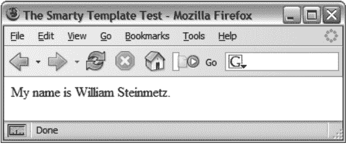

图 1-1：在浏览器中显示的 HTML

### 可能出现的问题

除了典型的琐碎路径错误外，你会遇到的最常见错误是 Web 服务器无法写入你为编译后的 Smarty 模板定义的编译目录。如果编译目录没有为服务器提供 *写入* 和 *执行* 权限，Smarty 会尝试写入新文件，失败并崩溃。页面仍然会显示，但不是你的模板，而是会返回一个难看的警告。

你还应该确保分配了所有变量。如果没有使用 `$smarty->assign()` 函数分配某个变量，Smarty 会将空字符串作为默认值。这不会导致 Smarty 错误，但你的页面会显得非常难看，有些元素可能无法按预期工作。

### 脚本修改技巧

为了充分利用 Smarty 的威力，你还应了解一些额外的内容。例如，你可以在脚本中包含多个模板，如下所示：

```
<?php
// Initialize the Smarty file.
require_once("smarty_initialize.php");

// Display the first Smarty template.
$smarty->display("header.tpl");

echo "Middle stuff<br />";

// Display the second Smarty template.
$smarty->display("footer.tpl");
?>
```

有时你会有由多个部分组成的复杂模板。例如，如果 header.tpl 文件中有一个很少更改的横幅广告，你可能希望能够在单独的文件中编辑广告，以获得灵活性。你可以让 Smarty 在 header.tpl 文件中显示 advertisement.tpl 文件，如下所示：

```
<tr><td></td>
<td>
{include file="advertisement.tpl"}
</td>
</tr>
```

Smarty 非常强大——例如，你可以以这种方式构建表格，只需将 PHP 数组分配给 Smarty 变量即可格式化整个表格。还有基本的 if/then 函数、缓存功能、预过滤和后过滤函数等等。既然你了解 Smarty 的工作原理，最好查看在线文档以了解更多用途。

# 2

## 配置 PHP

与任何软件包一样，PHP 有许多影响其运行方式的配置选项。其中大多数选项并不重要，但每个程序员都应该了解一些重要选项。

此外，PHP 有许多称为库的附加组件，可为 PHP 增加新功能。例如，cURL 扩展允许你的服务器向其他服务器发送表单数据并处理返回的数据。Mcrypt 是另一个有用的扩展，允许你轻松执行高级加密，以便安全地存储敏感数据。

本章展示了程序员在 PHP 中经常使用的设置以及何时应该使用它们。

## 配置设置和 php.ini 文件

大多数初学者都把 PHP 的默认设置当作是搬进公寓楼的租户——害怕做出更改，以免失去押金。但你真的应该把 PHP 当作自己的房子。你要在这里住一段时间，为什么不重新布置家具、敲掉一两堵墙呢？

**注意** 取决于你的 Web 服务器主机，你可能无法自行更改设置。但是，好的托管服务应该愿意为你进行更改，许多高端服务器主机允许你使用特定于用户的配置文件更改指令。

PHP 的设置在一个名为 php.ini 的文件中，你可以使用任何文本编辑器查看和修改。设置分为几个部分，大致如下所示：

```
max_execution_time = 30 ; Maximum execution time
max_input_time = 60 ; Maximum input parsing time
memory_limit = 8M ; Maximum memory a script may consume
```

你使用等号 (=) 设置配置参数。分号 (;) 表示注释；但是，某些参数中的分号有一些例外。如果你想永久更改设置，请备份 php.ini，编辑原文件，然后重新启动 Apache。如果你希望针对每个脚本单独更改，请使用 ini_set() 函数。

### 查找你的 php.ini 文件

有时在系统上找到 php.ini 的位置可能有点困难，尤其是当系统中有多个 PHP 安装实例时。以下是几种查找方法：

- 在 Unix 系统上，查看 /usr/lib 或 /usr/local/lib。它应该位于安装 PHP 的任何位置的 lib 目录中。
- 在 Windows 上，尝试 C:\php。
- 在 PHP 脚本中调用 phpinfo() 函数（有关更多详细信息，请参见下一节）。位置会出现在输出的开头附近，标签为“Configuration File (php.ini) Location”。
- 在许多 Unix 系统上，locate php.ini 命令会返回所有匹配 php.ini 的文件名。

**注意** 许多设置不在默认的 php.ini 文件中；PHP 对未指定的值使用默认值。PHP 默认设置列表可在 http://www.php.net/manual/en/ini.php 上找到。


## 8：揭示 PHP 的所有设置

PHP 具有许多功能，但并非所有功能都可能在您的安装中启用或内置。如果您想查看特定 PHP 安装包含的内容，一个非常简单的脚本可以向您显示一切。然而，此脚本的危险在于它显示了_如此多的_信息，以至于实际上向潜在的破解者交付了一份蓝图，上面写着：“给你。这些是薄弱点。请闯入我的系统。”因此，您应该在用完后尽快删除此脚本。

```
<?php
phpinfo();
?>
```

phpinfo() 函数会打印 PHP 关于其配置所知道的一切。我的意思是_一切_。它不仅向您显示每个可用 PHP 设置的状态、php.ini 文件的位置以及您的 PHP 版本，还会告诉您正在运行的 Web 服务器软件版本、与 PHP 一起编译的扩展以及服务器 API 是什么。它非常适合查看配置选项，并确保您已正确安装并启用所需功能。

要运行该脚本，请使用 Web 浏览器访问页面。完成后不要忘记删除它。

## 9：读取单个设置

如果您知道自己在寻找什么，有时 phpinfo() 可能会过于繁琐。例如，您可能只想查找 magic quotes 是否已打开，或检查包含路径。此外，如果您正在编写一个脚本，该脚本在设置启用时以一种方式运行，在未启用时以另一种方式运行，那么 phpinfo() 也无法帮助您。

要获取特定配置设置的值，请按以下方式使用 ini_get() 函数：

```
<?php
echo "The register_globals value is ". ini_get('register_globals');
?>
```

为 ini_get() 提供一个有效的配置参数名称，它将返回当前服务器上的当前设置。设置作为常规值返回，因此您可以打印它、将其分配给变量等等。但是，有两个小事需要注意。首先，输出“false”等布尔值时，通常会以空字符串返回，因此如果 register_globals 设置为“off”，您可能会看到以下输出：

```
The register_globals value is
```

其次，数值经常以缩写形式存储。例如，如果 upload_max_filesize 设置为 8,192 字节，则返回的值将为 8KB。同样，如果上传文件的最大大小为两兆字节，则 upload_max_filesize 不是 2,097,152 字节，而是 2MB。

如果您需要对这些数字进行算术运算，这可能会成为一个问题。官方 PHP 文档包含将 K 和 M 转换为真实数字的函数：

```
function return_bytes($val) {
    $val = trim($val);
    $last = $val{strlen($val)-1};
    switch(strtoupper($last)) {
        case 'K':
            return (int) $val * 1024;
            break;
        case 'M':
            return (int) $val * 1048576;
            break;
        default:
            return $val;
    }
}
```

## 10：错误报告

编写代码时，很容易忘记变量名或编写弃用代码。有时，PHP（按照编程标准）非常用户友好，以至于它实际上会绕过许多微妙的编码错误。

例如，PHP 允许您在不在开头声明所有变量的情况下编写程序，这很方便，直到您将 $string 拼写为 $stirng，而您的程序因空值而出错。您还可以以完全错误的方式将变量传递给函数，*大多数*时间都能正常工作，因为 PHP 会对您的意图做出一些假设。这很棒，直到 PHP 猜错为止，然后您就会对一个神秘的错误感到困惑。

要防止 PHP 猜测修复问题，您可以启用错误报告，这将导致 PHP 在屏幕上输出它发现的每个问题——无论多么微不足道。您可以使用这些错误消息来修补潜在的安全漏洞，并在程序上线前捕捉错误变量。要开启错误报告，只需将以下代码放在正在编写的脚本开头即可：

```
<?php
error_reporting(E_ALL);
// The rest of your script goes here.
?>
```

开启错误报告会导致 PHP 在处理程序其余部分之前将错误消息打印到屏幕上。（这使得在发生错误时无法设置 Cookie，因此在首次开启错误报告时，不要指望更改 Cookie 值。）

### 常见错误消息

值得理解的三种最常见的错误消息如下。

```
Notice: Undefined variable: var in script.php on line n
```

此消息表示您正在使用脚本中之前未定义的变量。这可能在多种情况下发生：

- 您拼写错误了变量名。
- 您有一个包含变量定义的条件，例如：

```
if ($fred == "I'm Fred") {
$he_is_fred = "yes";
}
```

- 您在从未显式声明变量的情况下对其进行拼接。

下一个问题是您在尝试在程序中使用的旧 PHP 代码中更可能看到的问题：

```
Notice: Use of undefined constant k - assumed 'k' in script.php on line n
```

此警告消息通常意味着您正在将字符串传递给函数，但未将其用引号括起来。换句话说，您使用了类似 strtolower(string) 而不是 strtolower("string") 的内容。

最后，访问数组时可能会遇到一个常见的错误消息：

```
Notice: Undefined index: i in script.php on line n
```

实际上，这意味着您尝试读取 $array[i]，但 $array 在索引 i 处未定义。当您通过 $_POST 或 $_GET 从表单获取值，但 $_POST 或 $_GET 中没有以该名称存储任何值时，此错误经常出现。实际上，这通常意味着用户没有选中相应的复选框或单选按钮（因此未赋值），或者在 GET 请求的 URL 中未传递该变量。

您应该在正式网站上禁用此脚本错误检查，因为不仅用户会看到它并骚扰您，它还会干扰 Cookie，这意味着您可能会遇到会话跟踪问题。

## 11：禁止所有错误消息

有时您可能有一个运行正常的脚本，但 PHP 仍然坚持报错。在其他情况下，如果出了问题，您不希望用户看到难看的错误消息（这些消息会泄露黑客喜欢看到的信息）。

幸运的是，您可以通过 php.ini 文件中的设置来禁止所有错误消息：

```
display_errors = Off
```

您应该在生产环境中使用此设置，以免担心互联网上任何人都能看到您的 PHP 诊断消息。

如果您需要查看这些诊断消息来排查问题，请使用以下配置设置将消息发送到 Apache 日志：

```
log_errors = On
```

如果需要，您还可以通过将 error_log 参数设置为 syslog 或文件名，将诊断信息发送到 syslog 或文件。

您的开发环境则是另一回事；在那里，您希望尽可能多地看到诊断消息。开启 display_errors 配置设置后，您可以将 php.ini 中的 error_reporting 参数设置为您选择的位字段（有关更多详细信息，请参阅 PHP 随附的示例 php.ini 文件）。但是，如果开发环境中某个脚本特别令人烦恼，而您只想让它安静下来，请在脚本中使用以下函数调用作为临时措施：

```
error_reporting(0);
```

## 12：延长脚本运行时间

曾几何时，我所在的公司更改了其在线购物车，迫使我编写一个脚本，将 250 MB 的存储产品数据从旧购物车格式转换为新购物车格式。脚本运行完美，但我正在评估和转换大量数据，PHP 在 30 秒后就不断使我的程序超时，远在它有机会完成之前。


就是在那时，我发现了一个方便实用的小扩展，它让我能完成工作。将下面这行代码添加到脚本开头，可以让脚本最多运行 240 秒才会结束。

```
ini_set(max_execution_time, "240");
```

max_execution_time 配置参数控制脚本在被自动关闭前允许运行的最长时间。要小心滥用此参数。如果你的脚本无法在四分钟或更短时间内运行，那么你要么在处理一个远大多数人都不会接触到的更大数据库，要么你的脚本效率极其低下，要么你使用了错误的编程语言。

### 可能出错的情况？

你的服务器可能正在安全模式下运行，这会禁用对 max_execution_time 的运行时修改。

另外，再次检查你的代码。也许你某处有个死循环，或者你在一个循环内部运行另一个不做任何操作的循环。

## #13：防止用户上传大文件

如果你不希望用户上传最新《星球大战》电影的 70GB MPEG 文件，可以在用户向服务器上传文件时设置最大文件大小。（有关如何处理上传文件的信息，请参见第 97 页的“#54：将图像上传到目录”。）

```
upload_max_filesize = 500K
```

可以通过以下三种方式之一指定最大文件大小：

- 一个整数（表示字节总数）
- 使用数字和 M 表示兆字节，例如 2M（2 兆字节）
- 使用数字和 K 表示千字节，例如 8K（8 千字节）

无论如何，用户现在都无法上传大于你设置的大小的文件。默认值为 2MB。

## #14：关闭注册的全局变量

PHP 有一个遗留的设计缺陷，使访问 GET 和 POST 参数稍微容易一些。例如，如果有一个名为 myparm 的 POST 参数，PHP 可以自动将其提取并放入名为 $myparm 的变量中。不幸的是，这是一个巨大的安全风险，因为你可以通过这种方式设置任何全局变量，如果你忘记初始化变量，用户就可能操纵你脚本中易受攻击的部分。

你可以通过在服务器的 php.ini 文件中将 register_globals 变量设置为 Off 来禁用此功能：

```
register_globals = Off
```

幸运的是，PHP 4.2 或更高版本已默认关闭此功能。然而，这是一个如此严重的问题，你应该始终仔细检查。

## #15：启用魔术引号

魔术引号是服务器主机用来防止 SQL 注入攻击的一个实用工具（如第 35 页的“#19：SQL 注入攻击”所示）。其原理是：每当表单向 PHP 脚本传递变量时，魔术引号会自动在所有单引号、双引号和反斜杠前添加反斜杠进行转义，将 "Ferrett's Book" 转换为 "Ferrett\'s Book"。

如果你使用 MySQL，这不是一个理想的解决方案——你应该改用专门为 MySQL 定制的 mysql_real_escape_string() 函数——但在紧急情况下，魔术引号也能派上用场。以下是在 php.ini 文件中启用它的方法：

```
magic_quotes_gpc = 1
```

### 可能出错的情况？

如果没有开启魔术引号，你就必须使用 mysql_real_escape_string() 函数来确保数据已转义。但是，如果在魔术引号也启用的情况下对表单数据使用这个函数，反斜杠的数量就会加倍，将 "Ferrett's Book" 变为 \"Ferrett\\'s Book\"。如你所见，保持一致很重要，因为如果不小心，数据库表中的字符串会累积反斜杠。

## #16：限制 PHP 可访问的文件

如果你担心恶意 PHP 脚本访问系统文件（如密码文件），可以使用 open_basedir 设置来限制 PHP 可访问的目录。启用 open_basedir 后，PHP 无法打开或以其他方式操作定义目录之外的任何文件。以下是一个限制对 /home/www 访问的 php.ini 示例：

```
open_basedir = /home/www
```

你可以通过用冒号 (:) 分隔 Unix 上的多个目录，或在 Windows 上使用分号 (;) 来添加对多个目录的访问。

> 注意 默认情况下，PHP 会允许访问指定目录及其下的所有子目录。如果你想将其限制为仅访问指定目录中的文件，请在路径末尾添加一个斜杠；例如，/home/www/。

### 可能出错的情况？

如果你的用户需要上传文件，临时文件目录会在你用脚本处理这些文件之前存储它们。因为这个目录传统上与其他 PHP 文件相距较远，你必须记得将其添加到 open_basedir 访问列表中。

## #17：禁用特定函数

假设你已经决定允许 PHP 脚本直接在服务器上运行命令的 exec() 函数太危险了。你可以单独禁用 PHP 函数，排除安全风险，同时让其他函数正常运行。以下是在 php.ini 文件中禁用多个函数的示例：

```
disable_functions = system, exec, passthru, shell_exec, proc_open
```

## #18：为 PHP 添加扩展

如果你是一名专业开发人员，最终会遇到原生 PHP 构建的限制。尽管 PHP 拥有大量内置功能，但它没有原生加密、图形、访问其他网页的便捷方式或 XML 数据访问函数。

PHP 完成这些任务的方式是通过许多使用第三方库处理繁重工作的扩展。一些实用的扩展如下。

### cURL

cURL 允许你的 PHP 服务器访问其他网站，通过类似 URL 的协议发送和接收信息。（你最常使用 HTTP，它允许你与其他网页通信；以及 FTP，它允许你上传和下载文件。）从实际角度来看，这意味着你可以让服务器模仿网络浏览器，访问其他网站，并将它们的网页下载到你选择的变量中。

cURL 是任何严肃的在线购物车的重要工具，因为它允许你批准信用卡收费并为客户获取实时运费报价。你使用 cURL 连接并将事务数据发送到另一家公司的服务器。服务器会回复，告知你诸如收费是否获批或被拒绝以及原因等信息。

### Mcrypt

曾经需要加密什么吗？Cookie 或会话中的任何敏感信息都应该出于安全考虑进行加密，如果你正在存储信用卡号码或其他个人信息等贵重数据，你肯定想确保它无法通过原始数据库转储被访问。幸运的是，Mcrypt 库允许你在不了解任何加密技术的情况下执行高级加密！（我将在“#23：使用 Mcrypt 加密数据”中向你展示如何使用 Mcrypt。）

### GD

如果你想按需创建图形，或者在需要时获取图像信息，GD 就是你需要的库。GD 允许你处理 JPEG 和 GIF 文件，要么按需创建它们（例如用于图表），要么修改它们以创建现有图像的缩略图。

### MySQL

完全原生的 PHP 构建不知道如何访问数据库。幸运的是，由于 MySQL 和 PHP 形影不离，大多数启用 PHP 的 Web 服务器默认安装了必要的 MySQL 库，因此大多数人从未意识到 `mysql_connect()` 函数是扩展的一部分。

其他 PHP 扩展包括 SOAP（允许你访问 Web 服务）、PDF 和 Verisign Payment Pro。向 PHP 添加所有现有扩展可能听起来是个好主意，但请记住，每个添加的扩展都可能减慢初始化时间并增加安全漏洞。此外，不常见的扩展通常没有人积极维护，这会使你无法升级。

### 为 PHP 添加扩展

既然你知道扩展中有哪些可用功能，让我们来探讨如何安装它们。第一步是检查你是否已经拥有所需内容。

### 检查扩展是否已加载

许多 Web 服务器默认安装了更有用的扩展，因此在麻烦地安装扩展之前，先检查以确保你没有已经安装并加载它。

检查扩展的最简单方法是运行 `phpinfo()` 函数（如第 21 页的“#8：揭示 PHP 的所有设置”中所述）。浏览输出，搜索你的库。例如，如果 MySQL 已启用，你会看到如下部分：

```
mysql

MySQL Support => enabled

...
```

如果这对你不起作用，或者你觉得有点慢，还有其他方法可以尝试。

扩展会为 PHP 添加新函数——例如，cURL 添加 `curl_init()` 和 `curl_setopt()` 等函数，Mcrypt 添加 `mcrypt_encrypt()` 和 `mcrypt_decrypt()` 等等。但假设 Mcrypt _未_ 安装。在这种情况下，PHP 对 `mcrypt_decrypt()` 一无所知——它只是一个未定义的函数。


您可以通过使用 PHP function_exists() 函数来利用这一点。尝试这个脚本来检测 MySQL 扩展：

```
<?php
if (function_exists(mysql_connect)) {
    print 'MySQL present';
} else {
    print 'MySQL not present';
}
?>
```

### 请求您的托管公司加载扩展

如果您不是自行运行网络服务器（这是大多数人的情况），那么您可能不得不听凭网络主机安排。由于您没有 root 访问权限，无法自行安装库。在这种情况下，您必须请求服务器管理员为您安装。提出请求时，请务必非常具体；否则，您可能无法获得正确的版本，甚至无法获得正确的扩展。

有些公司会欣然照办。其他公司则要求您支付费用，转移到功能更强大、拥有更多扩展的服务器上。还有些公司会说：“您现有的就是我们所能提供的全部。我们不提供定制版本。”

如果您无法获得所需的扩展，那么您要么就不使用它们，要么转移到另一家托管公司。

> 注意 即使您拥有服务器，让技术支持为您安装新扩展通常也更容易，只要您能说服他们这么做。这样，如果在安装过程中出了问题，他们实际上能够修复它（理论上）。

### 使用基于 Web 的控制面板安装扩展

整台租用的服务器通常配备控制面板，允许您通过网络浏览器执行常见的网站管理员任务，例如重启 Apache 服务或重新启动服务器。

这些控制面板有时允许您自动重新编译 Apache 或 PHP，使用复选框或下拉菜单来选择要添加到 PHP 的扩展。例如，WHM（一个常见的、稍微有些麻烦的控制面板）带有“更新 Apache”选项，允许您重新安装 Apache 和 PHP，并附带您需要的任何扩展。

> 注意 如果您的服务器未预装控制面板，通常可以支付少量费用来安装一个。

### 手动安装扩展

重新编译 PHP 是 Unix 世界中表达“同时重新安装 PHP 并添加所需扩展”的说法。对于不熟悉 Unix 管理的人来说，重新编译 PHP 可能有些具有挑战性。

最好先在本地 Apache 服务器上远离生产环境进行实验。您真的可能会把线上服务器搞乱，因此您不仅要确保手头有技术支持以防万一，还要确保自己见过一些可能出错的情况。如果您觉得自己对这项任务完全没有准备，应该找人帮忙。

让库与 PHP 配合使用是一个两步过程：首先，您必须安装扩展的库，然后必须让 PHP 识别这些扩展。

### 安装库

安装扩展的实际步骤因您想使用的库而异。我可以为您粗略介绍如何操作，但在执行任何操作之前，请务必在库的下载页面查找教程并阅读所有 README 文件。如果您想了解一切如何结合在一起的详细解释，您可能需要查阅 Brian Ward 所著的 *Linux 如何运作*（No Starch Press, 2004）中关于编译软件的解释。

一般步骤如下：

- 1. 以 root 身份或以具有安装新程序权限的用户身份登录到您的服务器。
- 2. 将库归档文件下载到服务器的根目录。在搜索引擎中快速搜索库名和 PHP（例如 *mcrypt php*），通常会带您到达库的主页，在那里您会找到源文件。它们通常会被 gzip 压缩并打包为 tar 以节省存储空间，看起来类似于 *libraryfilename.tar.gz*。
- 3. 提取归档文件的内容。*tar 归档*是文件和目录的捆绑包。在此基础上，整个归档文件使用 Gzip 包进行压缩，因此末尾带有 .gz 扩展名。因此，您可以将 .tar.gz 文件视为与 .zip 文件相同，只不过 .tar.gz 是分两个阶段、使用两个不同的程序完成的。然而，您实际上不需要显式运行两者，因为 GNU tar 知道如何运行解压缩程序。要提取 tar 文件的内容，请在命令提示符下键入 *tar zxvf libraryfilename.tar.gz*。您将看到正在提取的所有文件和目录的列表。大多数归档文件会在一个顶级目录下创建树形结构，请查找该目录。
- 4. 通过键入 *cd directoryname* 更改到库的安装目录。如果您不记得或没有从上一步中获取名称，通常就是库的名称——例如 *cd curl*。（顺便说一句，目录名称区分大小写，因此 *cURL* 与 *CURL* 不同。）
- 5. 运行 *configure* 命令，以查看是否具备在此机器上 *完成安装* 所需的所有 *组件*。由于存在多种不同类型的 Unix，在其上安装软件包需要相当的专业知识。幸运的是，*configure* 命令可以为您完成大部分脏活累活，它会查看服务器的设置并猜测安装此程序所需的正确值。在提示符下键入 ./configure。

某些扩展要求您在 configure 命令后添加其他标志，以使其正常工作。例如，Mcrypt 扩展要求您键入 ./configure --disable-nls --disable-posix-threads 以保证与 Apache 的兼容性。由于这是特定于库的，请查阅教程和 README 文件，看看是否有针对您的软件包需要设置的特定 configure 标志。

- 6. 构建并安装软件包。在 Unix 中，make 是用于编译和安装软件包的标准实用程序。首先，键入 make 来编译软件包。您将看到构建软件包的命令在运行。然后，键入 make check 来运行软件包附带的任何自测试（有时没有测试，因此不必担心那些情况）。最后，键入 make install 来安装扩展。安装过程会在屏幕上显示。完成后，您的扩展将被安装。
- 7. 创建一个 phpinfo() 脚本。哦，您以为完事了？抱歉，老兄，您所做的只是在服务器上安装了扩展。现在您实际上需要重新安装 PHP，并告诉它扩展的位置以及如何使用它。

phpinfo()（参见第 21 页的“#8: 揭示 PHP 的所有设置”）为您提供服务器的完整设置。在 phpinfo() 脚本的第一页大约三分之一处，您会找到一个名为“配置命令”的部分。其中将包含一份晦涩的列表，看起来类似于这样：

```
`./configure' '--with-apxs=/usr/local/apache/bin/apxs' '--with-xml' '--enable-bcmath' '--enable-calendar' '--enable-ftp' '--enable-magic-quotes' '--with-mysql' '--enable-discard-path' '--with-pear' '--enable-sockets' '--enable-track-vars' '--enable-versioning' '--with-zlib'`
```

如果您想以当前配置重新安装 PHP，这将是您要使用的命令——几乎是这样。首先，删除 configure 命令周围的单引号，以得到类似这样的内容：

```
`./configure '--with-apxs=/usr/local/apache/bin/apxs' '--with-xml' --enable-bcmath '--enable-calendar' '--enable-ftp' '--enable-magic-quotes' '--with-mysql' '--enable-discard-path' '--with-pear' '--enable-sockets' '--enable-track-vars' '--enable-versioning' '--with-zlib'`
```

此步骤的目的是，当您添加 GD 之类的扩展时，不希望丢失已安装的现有扩展。将此 configure 信息复制到文本文件中，然后在末尾添加适当的 --with 语句。例如，如果您要向此服务器添加 Mcrypt，则会在末尾添加 --with-mcrypt。查看扩展文档以找到正确的 --with 参数。


**注意** 如果你替换了 tar 目录结构并将库放入非默认文件夹，则需要将路径添加到 --with 标志中，以便 PHP 找到它。我们在上面的示例中，apxs（Apache 扩展工具概要）库就发生了这种情况，而 --with-apxs=/usr/local/apache/bin/apxs 标志告诉 PHP，apxs 存储在 /usr/local/apache/bin/apxs 目录中。

- 8. **获取并解压新的 PHP 源代码分发版；然后切换到该目录。** 你可以像之前处理库源代码一样解压 PHP 源代码。如果你已经有一个之前的 PHP 源代码树，可以使用它，但请事先在其中运行 `make clean`。

- 9. **复制你之前从文本文件中创建的 configure 命令，将其粘贴到命令提示符，然后按 ENTER 运行它。** 这将使用新库重新配置 PHP，并保留任何旧库。

- 10. **编译 PHP。** 运行 `make`，然后运行 `make install`。每个命令构建和安装 PHP 的所有组件时都需要等待很长时间。

**注意** 如前面本章所示，如果你对 .ini 文件做过任何更改，当 PHP 重新编译时，这些更改可能会被默认值覆盖。之后请查看以验证你的设置是否已保留。

- 11. **重新启动 Apache。** 运行 `apachectl graceful` 命令。

- 12. **测试 PHP。** 首先，尝试运行一个通用的“您好，世界！”脚本，以确保 PHP 已正常运行且无错误，然后尝试运行几个库特定的函数，以查看新库是否正常工作。

### 可能出现的问题

构建过程中可能出错的事情太多，几乎无法全部列出。虽然许多错误很复杂，且其中许多是库特定的，因此你需要寻求具体建议，但三个常见问题会不断出现。

首先可能发生的重大问题是，你的发行版或版本可能未安装软件开发包。你需要 C 编译器以及许多其他库的各种“开发”版本，以便可以针对它们构建代码。

其次，你可能需要使用带有显式路径的 --with 参数来配置 PHP；例如，--with-mcrypt=/usr/lib/mcrypt。

另一个常见故障是，你可能错误地配置了扩展的库包。如前所述，你应该使用 --disable-nls --disable-posix-threads 标志配置 Mcrypt；否则，可能会导致 Apache 崩溃。其他库需要类似的调整，以便与 PHP 和 Apache 顺畅协作。有关详细信息，请查阅 FAQ、man 页面和 README 文件。

# 3 PHP 安全


提供互联网服务时，开发代码时必须始终牢记安全。大多数 PHP 脚本看起来对安全问题不敏感，这主要是由于该语言中大量缺乏经验的程序员所致。但是，没有理由根据对代码重要性的粗略猜测就采取不一致的安全策略。一旦在服务器上放置任何与财务相关的内容，就很可能有人会尝试随意攻击它。创建论坛程序或任何类型的购物车，攻击的概率就会上升到必然。以下是一些一般安全准则。

## 不要信任表单。

攻击表单微不足道。是的，通过使用一个愚蠢的 JavaScript 技巧，你可能能够将表单限制为仅允许评分字段中输入 1 到 5 的数字。一旦有人在浏览器中关闭 JavaScript 或发布自定义表单数据，你的客户端验证就会不攻自断。

用户主要通过表单参数与你的脚本交互，因此它们是最大的安全风险。教训是什么？_始终在 PHP 脚本中验证传递给任何 PHP 脚本的数据。“验证策略”在第 46 页显示如何验证离散数据。在本章中，我们将向你展示如何分析和防范跨站点脚本（XSS）攻击，此类攻击可能会劫持你的用户凭据（甚至更糟）。你还将看到如何防止可能污染和破坏数据的 MySQL 注入攻击。

## 不要信任用户。

假设你的网站收集的每一条数据都充满了有害代码。消毒每一条数据，即使你确信没有人会尝试攻击你的网站。多疑会有回报。

## 关闭全局变量。

你可能拥有的最大安全漏洞是启用了 register_globals 配置参数。幸运的是，PHP 4.2 及更高版本默认已将其关闭。请参阅“#14：关闭注册全局变量”第 25 页以禁用此设置。

初级程序员将注册全局变量视为一种便利，但他们没有意识到此设置有多危险。启用全局变量的服务器会自动将全局变量分配给任何表单参数。为了了解其工作原理以及为何危险，让我们看一个例子。

假设你有一个名为 process.php 的脚本，用于将表单数据写入用户数据库。原始表单如下所示：

```
<input name="username" type="text" size="15" maxlength="64">
```

运行 process.php 时，启用注册全局变量的 PHP 会将此参数的值放入 $username 变量中。这样可以节省通过 $_POST['username'] 或 $_GET['username'] 访问它们的输入。不幸的是，这也会使你面临安全问题，因为 PHP 会为通过 GET 或 POST 参数发送到脚本的_任何_值设置一个变量，如果你没有显式初始化变量且不希望有人操纵它，这将是一个大问题。

例如，请看下面的脚本——$authorized 变量为 true 时，它会向用户显示机密数据。在正常情况下，$authorized 变量仅在用户已通过假设的 authenticated_user() 函数正确验证时才设置为 true。但是，如果你启用了 register_globals，任何人都可以发送 authorized=1 之类的 GET 参数来覆盖此设置：

```
<?php
// Define $authorized = true only if user is authenticated
if (authenticated_user()) {
    $authorized = true;
}
?>
```

这个故事的寓意是，你应该遵循“#25：一致且安全地获取表单变量”第 47 页中的程序来访问表单数据。这听起来不像经常发生，但 register_globals 的漏洞利用在 PHP 中仅次于 XSS 攻击。此外，全局变量可能会导致更微妙的问题，*将会* 导致你代码中日后出现错误。

## 推荐的安全配置选项

有几个 PHP 配置设置会影响安全功能。以下是我用于生产服务器的设置（有关如何设置它们，请参见第 2 章）：

- register_globals 设置为 off。请参见前面的讨论。
- safe_mode 设置为 off。此参数实际上并不能使任何东西变安全。
- error_reporting 设置为 off：这是可见的错误报告，如果出错，会向用户浏览器发送消息。对于生产服务器，请改用错误日志（请参见“#11：禁止所有错误消息”第 24 页）。开发服务器可以启用错误日志，只要它们位于防火墙后面即可。
- 禁用这些函数：system()、exec()、passthru()、shell_exec()、proc_open() 和 popen()。请参见“#17：关闭特定函数”第 27 页。
- open_basedir 同时为 /tmp 目录（以便可以存储会话信息）和 Web 根目录设置，这样脚本就无法访问所选区域之外的文件。
- expose_php 设置为 off。此功能会将包含版本号的 PHP 签名添加到 Apache 标头中。你为什么要这样做？
- allow_url_fopen 设置为 off。如果你在代码中访问文件时小心（即，验证所有输入参数），则这并非严格必要。
- allow_url_include 设置为 off。没有人真的有任何正当理由想要通过 HTTP 访问包含文件。

一般来说，如果你发现代码想要使用这些功能，你不应该信任它。对任何想要使用 system() 之类函数的代码要格外小心——它几乎肯定是有缺陷的。

有了这些设置，让我们来看一些特定攻击以及将帮助你保护服务器的方法。

## #19：SQL 注入攻击

因为 PHP 传递给 MySQL 数据库的查询是用功能强大的 SQL 编程语言编写的，所以你面临有人尝试通过 Web 查询参数使用 MySQL 进行 _SQL 注入攻击_ 的风险。攻击者通过将恶意 SQL 代码片段插入表单参数，试图进入（或禁用）你的服务器。


假设你有一个表单参数，最终将其放入名为 $product 的变量中，并创建如下的 SQL 语句：

```
$sql = "select * from pinfo where product = '$product'";
```

如果该参数直接来自表单，请使用数据库特定的转义方式配合 PHP 的原生函数，如下所示：

```
$sql = "Select * from pinfo where product = '" .
mysql_real_escape_string($product) . "'";
```

如果不这样做，有人可能会决定将以下片段抛入表单参数中：

```
39'; DROP pinfo; SELECT 'FOO
```

那么 $sql 的结果是：

```
select * from pinfo where product = '39'; DROP pinfo; SELECT 'FOO'
```

因为分号是 MySQL 的语句分隔符，数据库会处理以下三条语句：

```
select * from pinfo where product = '39'
DROP pinfo
SELECT 'FOO'
```

那么，你的表就没了。

请注意，这种特定语法在 PHP 和 MySQL 中实际上并不会奏效，因为 mysql_query() 函数每次请求只允许处理一条语句。但是，子查询仍然有效。

为防止 SQL 注入攻击，请执行以下两项操作：

- 始终验证所有参数。例如，如果某个内容需要是数字，请确保它是数字。

- 始终在数据上使用 mysql_real_escape_string() 函数来转义数据中的单引号或双引号。

> NOTE 若要自动转义任何表单数据，可以开启 Magic Quotes。请参见第 26 页的“#15：启用 Magic Quotes”。

通过限制 MySQL 用户权限，可以避免某些 MySQL 损坏。可以将任何 MySQL 账户限制为仅在选定表上执行某些类型的查询。例如，你可以创建一个只能选择行但不能执行其他操作的 MySQL 用户。然而，对于动态数据来说，这并不十分有用；而且，如果你有敏感的客户信息，某人可能会访问你原本不打算提供的某些数据。例如，访问账户数据的用户可能会尝试注入一些代码，以访问另一个账户编号，而不是当前会话分配的账户编号。

## #20：防止基本 XSS 攻击

XSS 代表 _跨站点脚本_。与大多数攻击不同，此漏洞利用在客户端工作。XSS 最基本的形式是将一些 JavaScript 放入用户提交的内容中，以窃取用户 cookie 中的数据。由于大多数网站都使用 cookie 和会话来标识访问者，因此被窃取的数据随后可用于冒充该用户——当是典型用户账户时这会非常麻烦，而如果是管理员账户，则简直灾难性。如果你的网站不使用 cookie 或会话 ID，则你的用户不易受攻击，但你仍应了解此攻击的工作原理。

与 MySQL 注入攻击不同，XSS 攻击难以防范。Yahoo!、eBay、Apple 和 Microsoft 均曾受到 XSS 影响。尽管该攻击不涉及 PHP，但你 _可以_ 使用 PHP 来清理用户数据以防止攻击。要阻止 XSS 攻击，你必须限制和过滤用户提交到你网站的数据。正是出于这一原因，大多数在线公告栏不允许在帖子中使用 HTML 标签，而是将其替换为 [b] 和 [linkto] 等自定义标签格式。

让我们来看一个简单的脚本，它说明如何防范某些此类攻击。如需更完整的解决方案，请使用本章后面将讨论的 SafeHTML。

```
function transform_HTML($string, $length = null) {
 // Helps prevent XSS attacks

 // Remove dead space.
 $string = trim($string);

 // Prevent potential Unicode codec problems.
 $string = utf8_decode($string);

 // HTMLize HTML-specific characters.
 $string = htmlentities($string, ENT_NOQUOTES);
 $string = str_replace("#", "&#35;", $string);
 $string = str_replace("%", "&#37;", $string);

 $length = intval($length);
 if ($length > 0) {
   $string = substr($string, 0, $length);
 }
 return $string;
 }
```

此函数将 HTML 特定字符转换为 HTML 文本。浏览器将通过此脚本处理的任何 HTML 渲染为无标记的文本。例如，请考虑以下 HTML 字符串：

```
<STRONG>Bold Text</STRONG>
```

通常，此 HTML 将呈现为如下形式：

```
Bold Text
```

但是，当通过 transform_HTML() 运行时，它会呈现为原始输入。原因是标记字符在处理后的字符串中是 HTML 实体。transform_HTML() 生成的纯文本字符串如下所示：

```
&lt;STRONG&gt;Bold Text&lt;/STRONG&gt;
```

此函数的关键在于 htmlentities() 函数调用，它将 <、> 和 & 转换为其等效实体 &lt;、&gt; 和 &amp;。虽然这可以应对最常见的攻击，但经验丰富的 XSS 黑客还有一个鬼点子：他们不使用普通 ASCII 文本，而是将恶意脚本编码为十六进制或 UTF-8，希望绕过你的过滤器。他们可以将代码作为 URL 中的 GET 变量发送，说：“嘿，这是十六进制代码，但请无论如何帮我运行一下。”十六进制示例如下所示：

```
<a href="http://host/a.php?variable=%22%3e
%3c%53%43%52%49%50%54%54%45%44
%6f%73%66%dd%65%74%68%89%69%e6%7f%d6%1c%c6%93%39%69%6f%75%73%c3%c2%f5%43%43%52
%49%50%54%3e">
```

但是，当浏览器呈现该信息时，结果如下：

```
<a href="http://host/a.php?variable="> <SCRIPT>DoSomethingmalicious</SCRIPT>
```

为防止这种情况，transform_HTML() 还采取了额外步骤：将 # 和 % 符号转换为其实体，以防止十六进制攻击，并转换 UTF-8 编码的数据。

最后，为了防止有人尝试通过超长输入使字符串过载，希望导致某些东西崩溃，你可以添加可选的 $length 参数，将字符串修剪到你指定的最大长度。

## #21：使用 SafeHTML

之前脚本的问题是它太简单，并且不允许任何用户标记。不幸的是，有数百种方法试图将 JavaScript 绕过他人的过滤器，除非删除某人输入中的所有 HTML，否则无法防止它。

目前，没有一种脚本能保证完全不可破解，尽管有些脚本比大多数脚本更好。如你将在第 46 页的“验证策略”中详细了解，安全有两种方法：白名单和黑名单，白名单通常不那么复杂且更有效。

一种白名单解决方案是来自 PixelApes 的 SafeHTML 反 XSS 解析器。SafeHTML 足够智能，可以识别有效 HTML，因此可以查找并剥离任何危险标签。它使用名为 HTMLSax 的另一个包进行解析。

要安装和使用 SafeHTML，请执行以下操作：

- 1. 前往 http://pixel-apes.com/safehtml/?page=safehtml 并下载 SafeHTML 的最新版本。
- 2. 将文件放在服务器上的 classes 目录中。该目录包含 SafeHTML 和 HTMLSax 正常运行所需的所有内容。
- 3. 在脚本中包含 SafeHTML 类文件 (safehtml.php)。
- 4. 创建一个名为 $safehtml 的新 SafeHTML 对象。
- 5. 使用 $safehtml->parse() 方法清理数据。

以下是完整示例：

```
<?php
/* If you're storing the HTMLSax3.php in the /classes directory, along
with the safehtml.php script, define XML_HTMLSAX3 as a null string. */
define('XML_HTMLSAX3', '');
// Include the class file.
require_once('classes/safehtml.php');
// Define some sample bad code.
$data = "This data would raise an alert <script>alert('XSS Attack')</script>";
// Create a safehtml object.
$safehtml = new safehtml();
// Parse and sanitize the data.
$safe_data = $safehtml->parse($data);
// Display result.
echo 'The sanitized data is <br />' . $safe_data;
?>
```

如果要在脚本中清理任何其他数据，无需创建新对象；只需在整个脚本中使用 $safehtml->parse() 方法即可。

### 可能出什么问题？

你可能犯的最大错误是假设此类完全阻止了 XSS 攻击。SafeHTML 是一个相当复杂的脚本，几乎会检查所有内容，但无法保证万无一失。你仍需执行适用于你网站的参数验证。例如，此类不会检查给定变量的长度以确保其适合数据库字段。它不会检查缓冲区溢出问题。

XSS 黑客很有创造力，并使用各种方法试图实现其目标。只需查看 RSnake 在 http://ha.ckers.org/xss.html 上的 XSS 教程，就能了解有多少种方法试图将代码绕过他人的过滤器。SafeHTML 项目有优秀的程序员加班加点试图阻止 XSS 攻击，并且它采用了稳健的方法，但无法保证不会有人提出某种奇特而新颖的方法来短路其过滤器。

> **NOTE** 如需了解 XSS 攻击的强大效果示例，请查看 http://namb.la/popular/tech.html，该页面展示了创建 JavaScript XSS 蠕虫（该蠕虫使 MySpace 服务器过载）的逐步方法。


## 22: 使用单向哈希保护数据

此脚本对数据执行单向转换——换句话说，它可以生成某人密码的哈希签名，但你绝无法解密它并还原回原始密码。你为什么想要这样做？其应用在于存储密码。管理员不需要知道用户的密码——事实上，最好是只有用户自己知道自己的密码。系统（且只有系统）应该能够识别正确的密码；多年来，这一直是 Unix 密码安全模型。单向密码安全的工作流程如下：

- 1. 当用户或管理员创建或更改账户密码时，系统会对密码进行哈希并存储结果。主机系统会丢弃明文密码。
- 2. 当用户通过任何方式登录系统时，输入的密码会再次被哈希。
- 3. 主机系统会丢弃输入的明文密码。
- 4. 将此新哈希的密码与存储的哈希进行比较。
- 5. 如果哈希后的密码匹配，则系统授予访问权限。

主机系统在完全不知道原始密码的情况下完成此操作；事实上，原始值完全无关紧要。作为副作用，如果有人闯入你的系统并窃取你的密码数据库，入侵者将拥有一堆哈希密码，而无法将其反转以找到原始值。当然，给予足够的时间、计算能力以及用户选择的弱密码，攻击者很可能会使用字典攻击来推断出密码。因此，不要让别人轻易获取你的密码数据库，如果真的发生了，就让所有人都修改他们的密码。

### 加密与哈希对比

从技术上讲，这个过程不是加密。它是哈希，与加密有两点不同：

- 与加密不同，数据无法被解密。
- 两个不同的字符串可能会（但极不可能）产生相同的哈希。无法保证哈希是唯一的，因此不要尝试将哈希用作数据库中的唯一键之类的东西。

```
function hash_ish($string) {
    return md5($string);
}
```

`md5()` 函数返回一个基于 RSA Data Security Inc. 消息摘要算法（也因其方便而被称为 MD5）的 32 字符十六进制字符串。然后，你可以将该 32 字符字符串插入数据库，与其他经过 `md5` 处理的字符串进行比较，或者只是欣赏其 32 字符的完美之处。

### 脚本黑客技巧

几乎不可能解密 MD5 数据。也就是说，这_非常_困难。然而，你仍然需要好的密码，因为为整个字典创建哈希数据库仍然很容易。存在在线 MD5 字典，你可以输入 06d80e8bc0b50a49a509b49f24f24e8c805 并得到 "dog" 的结果。因此，尽管 MD5 从_技术上讲_无法解密，但它们仍然存在漏洞——如果有人拿到你的密码数据库，可以肯定他们会查阅 MD5 字典。因此，在创建基于密码的系统时，你最好确保密码较长（最少六个字符，最好是八个），并同时包含字母和数字。并且确保密码不在字典中。

## 23: 使用 Mcrypt 加密数据

如果你不需要以可读形式查看数据，MD5 哈希工作得很好。不幸的是，情况并非总是如此——如果你提供以加密格式存储某人的信用卡信息，你稍后需要解密它。

最简单的解决方案之一是 Mcrypt 模块，这是一个允许高级加密的 PHP 扩展。Mcrypt 库提供了 30 多种可用于加密的密码，并提供了口令的可能性，以确保_只有_你（或者，可选地，你的用户）可以解密数据。要使用 Mcrypt，请按照第 27 页“#18: 向 PHP 添加扩展”中的说明，重新编译 PHP 以启用 Mcrypt 支持。

让我们看看实际用法。以下脚本包含使用 Mcrypt 加密和解密数据的函数：

```
<?php

$data = "Stuff you want encrypted";
$key = "Secret passphrase used to encrypt your data";
$cipher = "MCRYPT_SERPENT_256";
$mode = "MCRYPT_MODE_CBC";

function encrypt($data, $key, $cipher, $mode) {
// Encrypt data

return (string)
    base64_encode
    (
    mcrypt_encrypt
    (
    $cipher,
    substr(md5($key),0,mcrypt_get_key_size($cipher, $mode)),
    $data,
    $mode,
    substr(md5($key),0,mcrypt_get_block_size($cipher, $mode))
    )
    );
}

function decrypt($data, $key, $cipher, $mode) {
// Decrypt data
return (string)
mcrypt_decrypt
(
$cipher,
substr(md5($key),0,mcrypt_get_key_size($cipher, $mode)),
base64_decode($data),
$mode,
substr(md5($key),0,mcrypt_get_block_size($cipher, $mode))
);
}
?>
```

`mcrypt()` 函数需要几条信息：

- 要加密的数据。
- 用于加密和解锁数据的口令，也称为密钥。
- 用于加密数据的密码，即用于加密数据的特定算法。此脚本使用 MCrypt_SERPENT-256，但你可以从一系列听起来很花哨的密码中选择，包括 MCrypt_TWOFISH192、MCrypt_RC2、MCrypt_DES 和 MCrypt_LOKI97。

**注意** 要了解服务器上有哪些可用密码，请查看第 21 页“#8: 揭示 PHP 的所有设置”，然后转到 phpinfo() 页面上的“Mcrypt”部分。如果 Mcrypt 可用，你会看到两个部分：“Supported Cipher”和“Supported Modes”。按原样使用它们来加密你的数据。

- 用于加密数据的模式。你可以使用多种模式，包括电子密码本和密码反馈。此脚本使用 MCRYPT_MODE_CBC，即密码块链。
- 初始化向量——也称为 IV 或种子——是用于为加密算法播种的额外二进制数据。也就是说，这是一种额外的加入项，用于使算法更难破解。
- 密钥和 IV 所需的字符串长度，因密码和块而异。使用 `mcrypt_get_key_size()` 和 `mcrypt_get_block_size()` 函数找到适当长度；然后使用方便的 `substr()` 函数将键值修剪到适当长度。（如果密钥短于所需值，请不要担心——Mcrypt 会用零填充它。）

如果有人同时窃取你的数据和口令，他们可以遍历密码直到找到有效的那个。因此，我们在使用密钥之前对其应用 `md5()` 函数来增加安全性，这样即使同时拥有数据和口令，入侵者也得不到她想要的东西。

入侵者需要同时拥有函数、数据和口令——如果*那样*的话，他们可能已经完全控制了你的服务器，而你无论如何都完蛋了。

这里存在一个小的数据存储格式问题。Mcrypt 以难看的二进制格式返回加密数据，当你尝试将其存储在某些 MySQL 字段中时，会导致可怕的错误。因此，我们使用 `base64_encode()` 和 `base64_decode()` 函数将数据转换为 SQL 兼容的字母格式并检索行。

### 脚本黑客技巧

除了尝试各种加密方法之外，你还可以为这个脚本添加一些便利性。例如，不必每次都提供密钥和模式，你可以将它们作为包含文件中的全局常量声明（参见第 2 页“#1: 将另一个文件作为脚本的一部分包含”）。

## 24: 生成随机密码

随机（但难以猜测）的字符串对用户安全很重要。例如，如果有人丢失了密码，而你使用的是 MD5 哈希，你既无法查询，也不应该想查询。相反，你应该生成一个安全的随机密码并发送给用户。随机数生成的另一个应用是创建激活链接以访问你网站的服务。以下是一个创建密码的函数：

```
<?php
function make_password($num_chars) {
if ((is_numeric($num_chars)) &&
($num_chars > 0) &&
(! is_null($num_chars))) {
$password = '';
$accepted_chars = 'abcdefghijklmnopqrstuvwxyz1234567890';
// Seed the generator if necessary.
srand(((int)((double)microtime()*1000003)));
for ($i=0; $i<$num_chars; $i++) {
$random_number = rand(0, (strlen($accepted_chars) -1));
$password .= $accepted_chars[$random_number] ;
}
return $password;
}
}
?>
```


### 使用脚本

make_password() 函数返回一个字符串，因此您只需将字符串长度作为参数提供：

```php
$fifteen_character_password = make_password(15);
```

函数的工作原理如下：

- 1. 函数确保 $num_chars 是正整数且不为零。
- 2. 函数将 $password 变量初始化为空字符串。
- 3. 函数将 $accepted_chars 变量初始化为密码可能包含的字符列表。此脚本使用所有小写字母和 0 到 9 的数字，但您可以选择喜欢的任何字符集。
- 4. 随机数生成器需要种子，因此会获取一组类似随机的值。（在 PHP 4.2 及更高版本中，这并非严格必要。）
- 5. 函数循环 $num_chars 次，每次迭代对应要生成的密码中的一个字符。
- 6. 对于每个新字符，脚本查看 $accepted_chars 的长度，选择 0 到长度之间的数字，并将 $accepted_chars 中该索引处的字符添加到 $password。
- 7. 循环完成后，函数返回 $password。

# 4

## 使用表单


表单是用户与脚本交互的方式。要充分发挥 PHP 的优势，您必须掌握表单。首先需要理解的是，虽然 PHP 让访问表单数据变得容易，但您必须小心如何处理这些数据。

### 安全措施：表单不可信

新手常见的错误之一是信任 HTML 表单提供的数据。如果您有一个只允许用户输入三个值之一的下拉菜单，您仍然必须检查这些值。如前面第 3 章所述，您也不能依赖 JavaScript 阻止用户向服务器发送他们想要的任何内容。您网站的用户可以编写自己的 HTML 表单来攻击您的服务器；用户还可以完全绕过浏览器，使用自动化工具与 Web 脚本交互。当您将脚本放置在 Web 上时，应该假设用户会篡改参数，因为他们可能试图发现更轻松的使用网站的方式（尽管他们可能在尝试完全不利的事情）。为了确保服务器安全，您必须验证脚本接收的所有数据。

### 验证策略

检查表单数据有两种方法：黑名单和白名单。

*黑名单* 是指假设表单提交是有效的，然后显式查找不良数据的过程，试图过滤掉所有不良数据。一般来说，这种技术既无效又低效。例如，假设您想从字符串中消除所有“坏”字符（例如引号）。您可以搜索并替换引号，但问题在于*总会*有您没想到的坏字符。一般来说，黑名单假设您收到的大部分数据都是友好的。

对您接收到的表单数据，更好的假设是其本质上具有恶意；因此，您应过滤数据，只*接受*有效的数据提交。这种技术称为*白名单*。例如，如果字符串应仅由字母数字字符组成，则可以使用仅匹配完整字符串 A-Za-z0-9 的正则表达式对其进行检查。白名单还可以包括将数据强制转换为已知的值范围或更改值的类型。以下是几种具体策略的概述：

- 如果值应为数字，请使用 `is_numeric()` 函数验证该值。您可以使用 `intval()` 函数将值强制转换为整数。如果值应为数组，请使用 `is_array()`。
- 如果值应为字符串，请使用 `is_string()`。要强制转换，请使用 `strval()`。
- 如果值应为 null，请使用 `is_null()`。
- 如果值应已定义，请使用 `isset()`。

### 对整数进行白名单验证

以下是针对数值执行白名单验证的典型示例。如果数据不是数字，则使用默认值零（当然，这假设零是可接受的值）：

```php
if ( ! is_numeric($data) ) {
    // Use a default of 0.
    $data = 0;
}
```

对于整数，如果您知道所有整数值都是安全的，则有另一种方法。使用 `$data = intval($data);` 将 `$data` 强制转换为其整数值。这种技术称为*类型转换*。

### 使用 $_POST、$_GET、$_REQUEST 和 $_FILES 访问表单数据

在第 2 章中，我们向您展示了如何关闭根据表单数据自动设置全局变量的 register_globals 设置。
要关闭此危险设置，请参阅第 25 页上的“#14：关闭注册的全局变量”。如何使用 $_POST、$_FILES 和 $_GET 检索表单数据？请继续阅读。

## 25：一致且安全地获取表单变量

您应从预定义的服务器变量中获取表单数据。通过 POST 表单传递到网页的所有数据会自动存储在名为 $_POST 的大型数组中，所有 GET 数据均存储在名为 $_GET 的大型数组中。文件上传信息存储在名为 $_FILES 的特殊数组中（有关文件的更多信息，请参见第 97 页的“#54：将图像上传到目录”）。此外，还有一个名为 $_REQUEST 的组合变量。

要访问 POST 方法表单中的 username 字段，请使用 $_POST['username']。如果 username 在 URL 中，请使用 $_GET['username']。如果您不关心值来自何处，请使用 $_REQUEST['username']。

```php
<?php

$post_value = $_POST['post_value'];
$get_value = $_GET['get_value'];
$some_variable = $_REQUEST['some_value'];

?>
```

$_REQUEST 是 $_GET、$_POST 和 $_COOKIE 数组的并集。如果同一个参数名有两个或多个值，请小心 PHP 使用哪一个。默认顺序是 cookie、POST，然后是 GET。

关于 $_REQUEST 的安全性一直存在一些争议，但不应该有。因为它的所有来源都来自外部世界（用户的浏览器），因此您需要验证此数组中计划使用的所有内容，就像对待其他预定义数组一样。您可能遇到的唯一问题是由于包含 cookie 而可能出现的令人困惑的错误。

## 26：删除多余空白

处理表单数据时，多余空白是一个持续存在的问题。trim() 函数通常是程序员首选的工具，因为它会删除字符串开头或结尾的任何多余空格。例如，" Wicked Cool PHP " 变为 "Wicked Cool PHP"。事实上，它非常方便，您可能会在几乎每个用户输入的非数组数据上使用它：

```php
$user_input = trim($user_input);
```

但有时字符串内部会有过多空白——例如，有人可能会从电子邮件中剪切和复制信息。在这种情况下，您可以使用 preg_replace() 函数将多个空格和其他空白替换为单个空格。reg 代表正则表达式，这是一种强大的模式匹配形式，在本章中您会多次看到。

```php
<?php
function remove_whitespace($string) {
    $string = preg_replace('/\s+/', ' ', $string);
    $string = trim($string);
    return $string;
}
?>
```

您会发现此脚本在表单验证之外还有很多用途。它非常适合清理来自其他外部来源的数据。

## 27：将表单变量导入数组

PHP 中最实用的技巧之一其实不是 PHP 技巧，而是 HTML 技巧。当用户填写表单时，您经常需要检查多个复选框的值。例如，假设您正在进行调查，了解网站访问者喜欢哪类电影，并希望自动将这些值插入名为 customer_preferences 的数据库。实现此目的的困难方法是在 HTML 表单中为每个复选框指定单独的名称，如下所示：

```html
<p>What movies do you like?</p>
<input type="checkbox" name="action" value="yes"> Action
<input type="checkbox" name="drama" value="yes"> Drama
<input type="checkbox" name="comedy" value="yes"> Comedy
<input type="checkbox" name="romance" value="yes"> Romance
```

遗憾的是，在下一页处理表单时，您需要一系列 if/then 循环来检查数据——一个循环检查 $action 的值，一个循环检查 $drama 的值，依此类推。向 HTML 表单添加新复选框会导致处理页面再增加一个 if/then 循环。

简化此过程的好方法是在 name 后面添加 []，将所有复选框值存储在单个数组中，如下所示：

```html
<form action="process.php" method="post">
<p>What is your name?</p>
<p><input type="text" name="customer_name"></p>

<p>What movies do you like?</p>
<p><input type="checkbox" name="movie_type[]" value="action"> Action
<input type="checkbox" name="movie_type[]" value="drama"> Drama
<input type="checkbox" name="movie_type[]" value="comedy"> Comedy
```


<input type="checkbox" name="movie_type[]" value="romance"> 浪漫</p>
<input type="submit">
</form>

当 PHP 从这样的表单获取数据时，它会将选中的值存储在一个单一数组中。你可以这样遍历该数组：

```php
<?php
$movie_type = $_POST["movie_type"];
$customer_name = strval($_POST["customer_name"]);

if (is_array($movie_type)) {
    foreach ($movie_type as $key => $value) {
        print "$customer_name likes $value movies.<br>";
    }
}
?>
```

这种技术不仅适用于复选框，而且在处理任意数量的行时也非常方便。例如，假设我们有一个购物菜单，想要显示给定类别中的所有项目。尽管我们可能不知道某个类别中会有多少项目，但客户应该能够为他想要购买的所有项目在文本框中输入数量，并单击一次添加所有项目。该菜单将如图 4-1 所示：

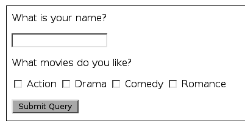

图 4-1：带有复选框数组的表单

让我们访问附录中描述的 product_info MySQL 表中的产品名称和 ID 数据，以构建如下表单：

```php
<?php
/* Insert code for connecting to $db here. */

$category = "shoes";
/* Retrieve products from the database. */
$sql = "SELECT product_name, product_id
FROM product_info
WHERE category = '$category'";

$result = @mysqli_query($sql, $db) or die;

/** Initialize variables. */
$order_form = ""; /* Will contain product form data */
$i = 1;

print '<form action="addtocart.php" method="post">';

while($row = mysql_fetch_array($result)) {
    // Loop through the results from the MySQL query.
    $product_name = stripslashes($row['product_name']);
    $product_id = $row['product_id'];

    // Add the row to the order form.
    print "<input type=\"hidden\" name=\"product_id[$i]\" value=\"$product_id\">";
    print "<input type=\"text\" name=\"quantity[$i]\" size=\"2\" value=\"0\"> $product_name<br />";
    $i++;
}

print '<input type="submit" name="add" value="Add to Cart"></form>';

?>
```

要处理表单，你需要检查传递给处理脚本的两个数组——一个包含所有产品 ID 的数组 ($product_id) 和另一个包含数量文本框中对应值的数组 ($quantity)。无论页面上显示多少项目都无关紧要；$product_id[123] 包含显示的第 123 个项目的产品 ID，$quantity[123] 存储客户在相应文本框中输入的数字。

处理脚本 addtocart.php 如下：

```php
<?php

$product_id = $_POST["product_id"];
$quantity = $_POST["quantity"];

if (is_array($quantity)) {
    foreach ($quantity as $key => $item_qty) {
        $item_qty = intval($item_qty);
        if ($item_qty > 0) {
            $id = $product_id[$key];
            print "You added $item_qty of Product ID $id.<br>";
        }
    }
}

?>
```

如你所见，此脚本完全依赖于使用 $quantity 数组中的索引 ($key) 来访问 $product_id 数组。

## #28: 确保响应是给定值集中的一个

如我之前所说，你 _绝不能_ 假设表单传递的数据是安全的。让我们看看这个简单的表单项：

```html
<SELECT NAME="card_type">
<OPTION value="visa">Visa</OPTION>
<OPTION value="amex">American Express</OPTION>
<OPTION value="mastercard">MasterCard</OPTION>
</SELECT>
```

你如何确保你看到的数据真的是 Visa、American Express 或 MasterCard？很简单：将数据存储在数组键中，然后检查数组以确保存在精确匹配。下面是一个示例：

```php
<?php
$credit_cards = array(
    "amex" => true,
    "visa" => true,
    "mastercard" => true,
);
$card_type = $_POST["card_type"];
if ($credit_cards[$card_type]) {
    print "$card_type is a valid credit card.";
} else {
    print "$card_type is not a valid credit card.";
}
?>
```

### 脚本黑客技巧

这种数据存储方法的一个优点是，你可以通过将值更改为 false 来临时禁用某个项目。你也可以稍微修改脚本，以同时提供详细值和数据值。例如，你可能在数据库中将 American Express 卡存储为 _amex_，但在屏幕上显示卡片名称时，你希望它显示为 _美国运通_。

在这种情况下，你可以使用映射来记住对应关系，方法是将数据库值存储为数组中的键，将显示名称存储为值。以下示例演示了该技术。

```php
<?php
$credit_cards = array(
    "amex" => "American Express",
    "visa" => "Visa",
    "mastercard" => "MasterCard",
);
$card_type = $_POST["card_type"];
if (count($credit_cards[$card_type]) > 0) {
    print "Your payment type: $credit_cards[$card_type].";
} else {
    print "Invalid card type.";
}
?>
```

注意：将前一示例中的信息存储在中央配置文件中非常有用。

## #29: 使用多个提交按钮

偶尔，你希望一个表单根据用户点击的按钮执行两个不同的操作——一个按钮更新文章，而另一个按钮删除它。你可以在一个页面上放置两个表单，将用户发送到两个不同的页面，但这样你就不得不担心在两个表单中插入冗余信息，更不用说这对用户来说是难以忍受的了。

在 HTML 中，按钮也有值，你可以读取这些值。按如下方式构建表单：

```html
<form action="process.php" method="post">
<input name="postid" type="hidden" value="1234">
<input name="action" type="submit" value="Update">
<input name="action" type="submit" value="Delete">
</form>
```

现在，在 process.php 中，访问 $_POST['action'] 以获取用户点击的按钮。

## #30: 验证信用卡

以下是关于在线信用卡交易工作原理的简要概述。首先，你需要找到一个商户解决方案（例如 Authorize.net 或 Secpay.com 这样的在线提供商），它为你提供一个商户账户。这个账户类似于银行账户，只不过它允许你处理信用卡交易的收费。商户提供商通常会对每笔信用卡操作收取每笔交易费用。

如果你有一家接受信用卡的实体店，你几乎肯定已经有商户解决方案。然而，并非所有商户解决方案都提供在线交易。提供在线交易的解决方案会为你提供一个支付网关，即用于处理信用卡收费的安全服务器。通常，交易通过 XML 数据流进行。你可以使用 cURL 与支付网关交换 XML（有关更多详细信息，请参见第 11 章）。

然而，在与支付网关通信之前，你可以先进行一些初步的表单验证工作，以节省交易和交易费用，并可能在用户错误输入信用卡号码时加快速度。事实证明，你可以使用一个简单的算法来剔除完全错误的信用卡号码。此外，你甚至可以从有效号码中确定信用卡类型。不过，请记住，通过这些测试并不能保证卡片没有被盗或被取消，或者它不属于另一个人。

```php
<?php
function validate_cc_number($cc_number) {
/* Validate; return value is card type if valid. */
$false = false;
$card_type = "";
$card_regexes = array(
"/^\d{4}\d{12}/(\d\d\d){0,1}$/" => "visa",
"/^\d{1}[12345]\d{14}$/" => "mastercard",
"/^\d{3}[47]\d{13}$/" => "amex",
"/^\d{6011}\d{12}$/" => "discover",
"/^\d{30}\d{12345}\d{11}$/" => "diners",
"/^\d{3}[68]\d{12}$/" => "diners",
);

foreach ($card_regexes as $regex => $type) {
if (preg_match($regex, $cc_number)) {
$card_type = $type;
break;
}
}

if (!$card_type) {
return $false;
}

/* mod 10 checksum algorithm */
$revcode = strrev($cc_number);
$checksum = 0;

for ($i = 0; $i < strlen($revcode); $i++) {
$current_num = intval($revcode[$i]);
if ($i & 1) { /* Odd position */
$current_num *= 2;
}
/* Split digits and add. */
$checksum += $current_num % 10;
if ($current_num > 9) {
$checksum += 1;
}
}

if ($checksum % 10 == 0) {
return $card_type;
} else {
return $false;
}
}
?>
```


此函数包含两个主要阶段。第一阶段确定卡片类型，第二阶段确定卡片校验和是否正确。如果卡片通过两项测试，返回值为字符串形式的卡片类型。如果卡片无效，你将得到 false（你可以使用 $false 变量将此返回值更改为任何你喜欢的值）。

第一阶段就是这里的关键所在，我们在一个快速步骤中确定卡片类型并确认前缀。信用卡号码遵循特定格式。例如，所有 Visa 卡都以 4 开头并有 13 或 16 位数字，所有 MasterCard 卡都以 51 到 55 开头并有 16 位数字，所有 American Express 卡都以 34 或 37 开头并有 15 位数字。这些规则可以用几个正则表达式轻松表示，由于它们是唯一规则，我们可以将正则表达式映射到名为 $card_regexes 的数组中的卡片类型。要检查有效格式，我们只需循环遍历正则表达式，直到有一个匹配为止。当得到匹配时，我们设置 $card_type 并进入下一阶段。如果没有表达式匹配，我们返回失败。

信用卡号码的校验和测试使用 mod 10 算法，这是一个实现起来相当简单的检查，它执行以下操作：

- 它从校验和值 0 开始。
- 它从右到左逐位处理信用卡号码。
- 如果当前数字的索引为奇数（即从索引 0 开始，每隔一位数字），则将该数字翻倍。如果翻倍后的数值超过 9，则将这两个数字相加并加到校验和中（例如，8 变成 16，变成 1 + 6，再变成 7）。否则，将当前（如果在奇数索引上则翻倍）数字加到校验和中。
- 处理完所有数字后，最终校验和必须能被 10 整除。如果不是，则该数字未通过测试。

编写此算法有几种方法；此处的实现相当精简，但足够易于理解。

### 使用脚本

只需将包含数字的字符串传递给 validate_cc_number() 并检查返回值。你需要注意的唯一事项是字符串中的非数字字符；你应该在运行函数之前使用 preg_replace() 处理此问题。以下是一段在多个测试数字上运行该函数的代码片段：

```
$nums = array(
    "3721 0000 0000 000",
    "340000000000009",
    "5500 0000 0000 0004",
    "4111 1111 1111 1111",
    "4222 2222 222222",
    "4007000000027",
    "30000000000004",
    "6011000000000004",
);

foreach ($nums as $num) {
/* Remove all non-digits in card number. */
$num = ereg_replace("[^0-9]", "", $num);

$t = validate_cc_number($num);
if ($t) {
    print "$num valid (type: $t).\n";
} else {
    print "$num invalid.\n";
}
}
```

### 修改脚本

如果你知道其他主要信用卡的格式，可以添加它们。其他卡片的一个优秀资源是 http://www.sitepoint.com/print/card-validation-class-php。

## #31：再次检查信用卡的过期日期

当你接受信用卡时，需要知道它是否已过期。在 HTML 中，最好创建一个下拉菜单，让客户选择卡片的过期日期，以避免日期格式的歧义：

```
<select name="cc_month">
<option value="01" >01 : January</option>
    <option value="02" >02 : February</option>
    <option value="03" >03 : March</option>
    <option value="04" >04 : April</option>
    <option value="05" >05 : May</option>
    <option value="06" >06 : June</option>
    <option value="07" >07 : July</option>
    <option value="08" >08 : August</option>
    <option value="09" >09 : September</option>
    <option value="10" >10 : October</option>
    <option value="11" >11 : November</option>
    <option value="12" >12 : December</option>
</select>

<select name="cc_year">
<?php
/* Create options for all years up to six years from now. */
$y = intval(date("Y"));
for ($i = $y; $i <= $y + 10; $i++) {
    print "<option value=\"$i\">$i</option>\n";
}
?>
</select>
```

现在你有了一个输入过期日期的表单，需要验证其发送的数据。

```
<?php
function check_exp_date($month, $year) {
	/* Get timestamp of midnight on day after expiration month. */
	$exp_ts = mktime(0, 0, 0, $month + 1, 1, $year);

	$cur_ts = time();
	/* Don't validate for dates more than 10 years in future. */
	$max_ts = $cur_ts + (10 * 365 * 24 * 60 * 60);

	if ($exp_ts > $cur_ts && $exp_ts < $max_ts) {
		return true;
	} else {
		return false;
	}
}
?>
```

要检查信用卡过期日期，你只需确保日期介于当前日期和将来的某个日期之间（此函数使用 10 年）。处理该任务的最佳工具在第 6 章中有描述，因此可以将此视为抢先预览。

这里唯一的诀窍是，信用卡在其过期日期所在月份的最后一天之后即失效。也就是说，如果卡片的过期日期是 06/2005，它实际上在 2005 年 7 月 1 日就停止工作了。因此，我们必须给给定的日期加上一个月。这可能会很麻烦，因为它还可能将实际目标日期提前一年，但如你将在第 6 章中学到的，这里用于计算过期时间戳的 `mktime()` 函数会自动补偿超出范围的月份数。计算过期时间戳后，你只需要当前时间戳和最大时间戳，验证过期时间就归结为一对简单的比较。

### 使用脚本

```
if (check_exp_date($cc_month, $cc_year)) {
	// Approve the card.
} else {
	// The card has expired.
}
```

## #32：检查有效的电子邮件地址

客户会在电子邮件表单字段中输入各种奇怪的数据。本节中的脚本验证电子邮件地址是否大体遵循 RFC 2822 中概述的规则。这不能阻止有人输入错误（但符合 RFC）的电子邮件地址，例如 leavemealone@nonexistentdomain.com，但它可以捕获一些拼写错误。

**注意** 如果拥有有效的电子邮件地址至关重要，则需要要求用户通过仅通过电子邮件发送的链接激活的用户帐户。你将在页面 124 的 "#65：使用电子邮件验证用户帐户" 中了解如何操作。这是一个相当极端的措施；如果你想让更多人与你分享他们的地址，只需告诉用户你不会向他们发送垃圾邮件（并信守承诺）。

```
<?php
function is_email($email) {
// Checks for proper email format
    if (! preg_match( '/^[A-Za-z0-9!#$%&*+\/=?^_`{|}~.-]+@[A-Za-z0-9-]+(\.[A-Za-z0-9-]+)+(\.[A-Za-z]{2,})$/', $email)) {
        return false;
    } else {
        return true;
    }
}
?>
```

此脚本利用正则表达式来检查给定的电子邮件是否使用正确的电子邮件字符（字母、点、短横线、斜杠等），中间有一个 @ 符号，末尾至少有一个点和后缀。你可以在第 69 页的 "#39：正则表达式" 中阅读更多有关正则表达式的内容。

## #33：检查美国电话号码

与电子邮件地址类似，除了拨打真实电话之外，无法确保电话号码有效。但是，你可以验证数字位数并将其格式化为标准格式。如果给定的号码是 10 位数字或以 1 开头的 11 位数字，则以下函数返回纯 10 位电话号码。如果号码不符合要求，返回值为 false。

```
<?php
function is_phone($phone) {
    $phone = preg_replace('/[^\d]/', '', $phone);
    $num_digits = strlen($phone);
    if ($num_digits == 11 && $phone[0] == "1") {
        return substr($phone, 1);
    } else if ($num_digits == 10) {
        return $phone;
    } else {
        return false;
    }
}
?>
```

此脚本展示了正则表达式与标准字符串函数结合的强大功能。关键是首先丢弃任何非数字字符——这是 preg_replace() 函数的完美任务。一旦你知道字符串中只有数字，你就可以简单地检查字符串长度来确定数字位数，其余部分基本上不言而喻。


# 5
## 处理文本和 HTML


学习如何查找、转换和删除单词是任何站长的关键技能。本章中的一些函数相当简单，但我还是会提一句，以防你没见过。较复杂的函数使用 _正则表达式_，这是 PHP 的强大部分，是每个站长都需要知道的。让我们先从一些基础的字符串操作开始。

## #34: 提取字符串的一部分

我的日常工作是出售收藏卡（想想带有奇幻元素的棒球卡）。关于收藏卡的一个有趣之处是，人们经常以复数形式搜索卡片——例如，搜索 _Shivan Dragons_ 而不是 _Shivan Dragon_。这给我们的卡片查找系统带来了问题，因为客户输入的 _Shivan Dragons_ 无法从 MySQL 查询中返回任何行。为解决这个问题，我使用了一些字符串操作函数来检查用户查询的结尾并删除字母 s 的实例。让我们逐一探讨这些函数。

substr() 函数允许你提取字符串的一部分，用于比较和其他操作。例如，如果字符串的最后一个字母是字符 s，你可以将其删除，如果初始查询未产生结果，则重新尝试。

substr() 的调用方式如下：

```
substr(str, begin, end)
```

在这里，str 是原始字符串，begin 是起始字符索引，end 是要移除的字符数。字符串的开头是索引 0。例如，以下代码打印 cde，即从索引 2 开始的三个字符：

```
echo substr('abcdef', 2, 3);
```

> 注意 为了计算 substr() 的索引，你可能需要知道字符串的长度。使用 strlen(str) 来确定字符串的长度。

一个非常有用的快捷方式是，如果你省略 end 参数，substr() 将返回从起始索引（begin）到字符串末尾的所有字符。以下是如何获取从索引 2 开始的字符串中所有字符：

```
echo substr('abcdef', 2); // cdef
```

此外，如果为 begin 指定负值，substr()（以及许多其他字符串函数）将从字符串末尾开始计数，如本示例提取字符串中从倒数第三个字符开始的两个字符：

```
echo substr('abcdef', -3, 2); // de
```

一旦你找到感兴趣的子字符串，你可以对字符串执行许多操作，包括以下内容：

- **使用 substr() 重新赋值字符串的指定部分**，以删除多余字符。例如，$string = substr($string, 0, 10); 将 $string 设置为其原始值的前 10 个字符。

- **使用 substr() 和 strlen() 函数一起删除最后 N 个字符**。例如，$string = substr($string, 0, strlen($string) - 3); 将 $string 设置为初始值中除最后三个字符外的所有字符。

- **使用 substr_replace() 函数替换字符**，该函数允许你指定子字符串并将其替换为你喜欢的字符串。例如，substr_replace('abcdef', 'bbb', 1, 2) 返回 abbbdef。

要了解如何在日常编程中使用子字符串，让我们回到 Shivan Dragons 示例。请记住，用户可能会搜索 Shivan Dragons，但单个商品可能有 Shivan Dragon 的列表。此代码片段展示了处理此情况的一种方法：

```
$sql = "SELECT * FROM product_table WHERE product_name = '$user_input'";
$result = @mysql_query($sql, $connection);

if (mysql_num_rows($result) == 0) {
    // There were zero rows in the result set (no matching products).
    if (substr($user_input, -1) == 's') {
        // The last character in the string is an "s".
        $user_input = substr_replace($user_input, '', -1);
        // Remove last character in the string (the s).
        // Do another SQL query with the updated $user_input.
        $sql = "SELECT * FROM product_table WHERE product_name = '$user_input'";
        $result = @mysql_query($sql, $connection);
    }
}
```

此算法首先针对 $user_input 中的字符串检查库存。如果没有匹配项 _且_ $user_input 的最后一个字符是 s，则会在不带 s 的情况下再次尝试。无论最后一个字符是什么，运行此算法后，你都可以在 $result 中检查查询结果。

### 对脚本进行黑客改造

此片段的一个问题是，你可能同时在 Shivan Dragons 和 Shivan Dragon 名下拥有库存。目前，该脚本仅返回其中一种情况的结果，搜索结果不一致，具体取决于复数形式的可用性。例如，如果你有一项列为 Shivan Dragons，两项列为 Shivan Dragon，你将只得到第一项，但如果没有库存中的第一项，你将得到另外两项。

你可以通过使用 substr() 检查向 SQL 查询添加内容，而不是完全替换它，来添加此功能。具体做法如下：

```
$sql = "SELECT * FROM product_table WHERE product_name = '$user_input'";
if (substr($user_input, -1) == 's') {
    // The last character in the string is an "s".
    // Add another possibility to the WHERE clause.
    $sql .= " OR product_name = '' . substr_replace($user_input, '', -1) . ''";
}
$result = @mysql_query($sql, $connection);
```

这是一种相当不同的方法，因为它涉及使用单个 SQL 查询来完成所有工作。与其在第一个查询失败时才尝试第二个查询，不如在用户输入以 s 结尾时，向查询的 OR 子句中添加另一部分。

## #35: 将字符串转换为大写、小写或首字母大写

PHP 的一个偶尔出现的问题是，MySQL 支持不区分大小写的字符字段，但 PHP 中的字符串区分大小写。在查询中，MySQL 不区分 *Ferrett*、*FERRETT* 和 *FerReTt* 这些词，但在 PHP 中作为字符串，它们毫无共同之处。因此，在 PHP 中，你可能需要在比较或打印字符串之前更改字符串中字符的大小写。

PHP 有三个用于转换字符串大小写的基本函数：`strtolower()`、`strtoupper()` 和 `ucwords()`。以下是它们的示例：

```
<?
$string = "hey how are you doing?";
echo strtoupper($string);
// Displays "HEY HOW ARE YOU DOING?"

echo strtolower($string);
// Displays "hey how are you doing?"

echo ucwords(strtolower($string));
// Displays "Hey How Are You Doing?"
?>
```

这些函数的工作原理如下：

- `strtoupper()` 将字符串中的所有字符更改为大写。
- `strtolower()` 将字符串中的所有单词更改为小写。
- `ucwords()` 将字符串中每个单词的首字母转换为大写。

**注意** *请注意，此脚本有一个小技巧；我们在使用 ucwords() 之前先使用了 strtolower()。否则，输出将是 HeY HOw ArE YoU DoinG？*

### 可能出错的问题

`ucwords()` 存在一些问题；第一个问题是，它不会在非字母字符后大写字母，因此像 *mrs. johnston-brown* 这样的字符串会变成 *Mrs. johnston-brown*，而 *ac/dc* 会变成 *Ac/dc*。如果这让你困扰，你可以创建一个函数，该函数使用正则表达式将给定字符串拆分为单个单词的数组，然后使用 `ucwords()` 将每个单词大写，最后将其重新连接成一个字符串。

第二个问题是，`ucwords()` 会将某些不应大写的单词大写，例如 *and*、*or* 和 *a*。如果你想使用正确的标题样式，可以编写一个简单的函数，使用 `str_replace()` 来修正这些单词：

```
<?
function fussy_capitalize($string) {
    // Uppercase, but leave certain words in lowercase
    $uppercase_words = array("Of ", "A ", "The ", "And ", "An ", "Or ");
    $lowercase_words = array("of ", "a ", "the ", "and ", "an ", "or ");
    $string = ucwords(strtolower($string));
    $string = str_replace($uppercase_words, $lowercase_words, $string);
    // Uppercase the first word.
    return ucfirst($string);
}
?>
```

最后，如果你处理的是人名，ucwords(strtolower()) 会消除现有的大写形式，因此像 McMurdo 这样的名字会变成 Mcmurdo。如果保留这些大小写形式非常重要，但你仍需在 PHP 中比较字符串，请使用 strcasecmp(str1, str2)，它在比较 str1 和 str2 时忽略大小写。

## #36: 查找子字符串

PHP 有多个用于在字符串中查找子字符串的函数。你的选择取决于你想对结果做什么。以下是三个基本的子字符串函数：

- `strpos()` 查找子字符串第一次出现的位置。
- `strrpos()` 查找子字符串最后一次出现的位置。将此函数与 substr() 配合使用，以提取字符串中该位置之后的所有内容。
- `strstr()` 返回子字符串第一次出现之后的所有内容。

如果不存在子字符串，这三个函数都返回 False。由于位置和字符串在用于条件判断时都可能求值为 False，因此检查返回值的类型非常重要，如以下脚本所示：

```
<?php
$string = "I approve of Senator Foghorn's performance in the War on Buttermilk. My name is Ferrett Steinmetz, and I approved this message.";
$search_term = "approve";
// Does it appear in the string?
$pos = strpos($string, 'approve');
if ($pos === False) {
    print "$term not in string\n";
} else {
    print "position: $pos\n";
    print "last position: " . strval(strrpos($string, $search_term)) . "\n";
    print strstr($string, $search_term) . "\n";
    // Prints "approve of Senator Foghorn's ... "
    print substr($string, strpos($string, $search_term)) . "\n";
    // Prints "approved this message."
}
?>
```


### 可能出错？

可能出现三种常见问题。首先，如前所述，在比较时应始终使用三重等号（===）而非双重等号（==）。三重等号确保比较项的值和类型相同。这一点很重要，因为你可以从 strpos() 中得到 0 作为有效位置，以及从 strstr() 和 strrpos() 中得到空字符串作为有效返回值，而这两者用 == 都会匹配 False。

其次，这些函数区分大小写。在上述示例中，使用 strstr($string, 'Approved') 将返回 False。strpos()、strrpos() 和 strstr() 的不区分大小写版本分别是 stripos()、strripos() 和 stristr()。

最后，请记住，此处检查的是非常简单的子字符串，而非单词。如果你需要做一些花哨的事情，例如查找以 *批准词根* 开头的单词，包括 *批准* 和 *已批准* 但不包括 *不批准*，则需要更强大的工具：正则表达式。我们将在第 69 页的 “#39：正则表达式” 中介绍如何使用它们。

## #37：替换子字符串

使用 str_replace() 函数执行简单的字符串替换。以下是如何从卡通字符串中将 *兔子* 替换为 *鸭子*：

```php
$string = "It's wabbit season!";
print(str_replace("wabbit", "duck", $string));
```

请注意，str_replace() 不会替换原始字符串中的子字符串。如果要这样做，请将其重新分配给原始字符串：

```php
$string = str_replace("wabbit", "duck", $string);
```

str_replace() 还有几个额外功能。要仅替换子字符串的前 n 次出现，请将数字作为第四个参数添加（这对于仅替换第一次出现尤其有用）：

```php
str_replace("wabbit", "duck", $string, n);
```

要删除子字符串的所有出现，只需将空字符串作为替换参数：

```php
$string = str_replace("wabbit", "", $string);
```

你可以通过将多个子字符串放入数组来指示 str_replace() 替换它们：

```php
$ugly_words = array("hamburger", "bacon", "bucket o'grease");
$string = str_replace($ugly_words, "Atkins-friendly foods", $string);
```

此示例将 $string 中的所有 hamburger、bacon 和 bucket o'grease 替换为 Atkins-friendly foods。

你甚至可以提供两个大小相同的数组作为查找和替换参数，str_replace() 将用搜索数组中与替换数组相同索引的项进行替换：

```php
$ugly_words = array("hamburger", "bacon", "bucket o'grease");
$replacements = array("carrot", "broccoli", "2% milk");
$string = str_replace($ugly_words, $replacements, $string);
```

这将把所有 hamburger 替换为 carrot，所有 bacon 替换为 broccoli，所有 bucket o'grease 替换为 2% milk。

### 可能出错？

str_replace() 的一个问题是，它会替换与你给出的模式匹配的所有内容，无论它在字符串中的什么位置。如果你将 off 替换为 on，你会发现你的 officials 变成了 onicials，你的 coffins 变成了 conins。

因此，虽然 str_replace() 对于从小规模字符串中删除不需要的单词非常有价值，但对于更复杂的任务，你需要正则表达式。（参见第 69 页的 “#39：正则表达式”。）

## #38：使用 pspell 查找并修正拼写错误的单词

任何使用过 Google 的人都在搜索中拼错过单词，例如 alternative music。而 Google 始终会乐意地返回 “Did you mean alternative music?”

如果你的网站有搜索功能，在未找到结果（或结果不足）时能够建议拼写错误的单词，这是一个非常有用的功能，尤其是因为客户的拼写能力不足可能会让你失去一笔交易。幸运的是，有一个名为 pspell 的 PHP 模块，它允许你检查单词的拼写，并从 pspell 的默认词典中建议替换词。如果你愿意，甚至可以创建自定义词典。不过，首先你需要确保已安装 pspell 扩展库。请尝试这个测试脚本：

```php
<?php
$dict_config = pspell_config_create('en', 'american');
?>
```

如果出错，说明你没有安装 pspell 扩展库。请翻回到第 27 页的 “#18：为 PHP 添加扩展” 查看如何操作。

### 使用默认词典

下面是一个帮助你开始使用 pspell 的小函数：

```php
<?php
function suggest_spelling($string) {
    // Suggest words for misspelled strings.
    $dict_config = pspell_config_create('en', 'american');
    pspell_config_ignore($dict_config, 3);
    pspell_config_mode($dict_config, PSPELL_FAST);
    $dictionary = pspell_new_config($dict_config);

    // Make sure we know whether we've suggested anything.
    $suggested_replacement = false;

    // Now we've got it set up, break it up by words.
    $string = explode(' ', $string);
    foreach ($string as $key=>$value) {
        $value = trim(str_replace('.', '', $value));
        if ((strlen($value) > 3) && (! pspell_check($dictionary, $value))) {
            // If we can't find a suggestion
            $suggestion = pspell_suggest($dictionary, $value);
            // Suggestions are case sensitive, so check first
            if (strtolower($suggestion[0]) != strtolower($value)) {
                $string[$key] = $suggestion[0];
                $suggested_replacement = true;
            }
        }
    }

    if ($suggested_replacement) {
        // We had a suggestion, so return the data.
        return implode(' ', $string);
    } else {
        return null;
    }
}
?>
```

要使用此函数，请使用字符串参数调用 suggest_spelling()，如本示例所示：

```php
<?php
// Searchstring is taken from the previous form.
$searchstring = $_POST['customer_input'];

$spell_suggest = suggest_spelling($searchstring);
if ($spell_suggest) {
    // pspell found a suggestion.
    echo "Did you mean <i>$spell_suggest</i>?";
}
?>
```

要初始化 pspell，必须配置一个词典。为此，你需要创建一个指向词典配置文件的句柄，修改该句柄上的几个设置，然后使用词典配置创建指向实际词典的第二个句柄。

如果这听起来有点复杂，请别担心。代码很少更改，因此你通常可以直接从其他脚本复制。不过，让我们逐块看一下。以下是配置词典的代码：

```php
$dict_config = pspell_config_create('en', 'american');
pspell_config_ignore($dict_config, 3);
pspell_config_mode($dict_config, PSPELL_FAST);
```

$dict_config 是控制词典设置的初始句柄。你必须将所有设置加载到 $dict_config 中，然后使用它创建词典。在此示例中，pspell_config_create() 创建一个使用美国拼写的英语（en）词典。

pspell_config_ignore() 将词典设置为忽略所有三个字母及以下的单词。这样做是因为检查每个 a 和 the 会很耗时。

最后，pspell_config_mode() 告诉 pspell 你希望如何查找。你有三种选择：

- PSPELL_FAST 是一种快速方法，返回尽可能少的建议拼写。
- PSPELL_NORMAL 以正常速度返回中等数量的拼写。
- PSPELL_SLOW 检查需要一些时间，但返回尽可能多的建议。

我们可以在此处使用其他配置（例如添加自定义词典，我稍后会介绍），但由于这是一个快速而粗糙的拼写检查，我们将使用这一行仅创建词典本身：

```php
$dictionary = pspell_new_config($dict_config);
```

此时，使用词典有两种基本方法：

- 1. pspell_check($dictionary, word) 如果 word 在词典中，则返回 True。
- 2. pspell_suggest($dictionary, word) 如果 word 不在词典中，则返回建议单词的数组，数组中的第一个条目是最可能的候选项。如果单词在词典中，或没有建议，则此函数不返回任何内容。返回的单词数量因情况而异，但使用 PSPELL_SLOW 时会更多，使用 PSPELL_FAST 时会更少。

> **注意** 这些函数不检查上下文拼写。即使你本意是 Mary had a little lamb，Mary hat a ladle lam 也能完美通过检查。此外，如果单词长度低于 pspell_config_ignore() 设置的字符串长度，pspell 始终返回 True，因此在这种情况下，像 jlz 这样小巧但明显拼写错误的单词仍会返回 True。


让我们回到原始脚本。既然词典已经准备好，我们将客户提交的 `$string` 拆分为单词数组，所以 `lemony snicket` 变成了 `lemony` 和 `snicket` 组成的数组。

然后我们将每个词与 pspell 的词典进行比对。请注意，pspell 不喜欢逗号，因此在检查之前我们会从单词中删除逗号。如果单词长度超过三个字符，我们会检查拼写。如果 pspell 检测到拼写错误，我们将执行以下操作：

- 1. 我们要求 pspell 建议一个潜在拼写数组。
- 2. 我们采用最可能的拼写（`$suggestion array` 中的第一个项目），并用新的建议单词覆盖旧的拼写错误单词。
- 3. 我们将 `$suggested_replacement` 标志设置为 `True`，以便在循环结束时得知我们在 `$string` 的某处发现了拼写错误单词。

在循环结束时，我们检查 `$suggested_replacement` 以查看是否有拼写错误的单词。如果有，我们将 `$string` 中的修正后的单词用空格连接并返回该值。如果没有这样的单词，我们返回 null，表示没有拼写错误。

### 将自定义词典添加到 pspell

如果某个词不在默认词典中，你无法轻松地将其添加。但是，你可以创建一个自定义词典，与 pspell 的默认词典配合使用。具体做法如下：

在你的网站上创建一个 PHP 可写文件夹，并在其中初始化新词典。使用以下脚本在服务器的 `path` 目录中创建名为 `custom.pws` 的新词典文件：

```
<?
$dict_config = pspell_config_create('en', 'american');
pspell_config_personal($dict_config, 'path/custom.pws');
pspell_config_ignore($dict_config, 2);
pspell_config_mode($dict_config, PSPELL_FAST);
$dictionary = pspell_new_config($dict_config);
?>
```

这是上一节中的脚本，但有一个关键变更：添加了 `pspell_config_personal()` 调用，用于初始化个人词典文件。如果没有词典文件存在，pspell 会为你创建一个空的。

你可以使用此函数向词典中添加任意多个单词：

```
pspell_add_to_personal($dictionary, word);
```

添加到词典中的单词是临时的，除非你将其保存。在添加完单词后，在脚本末尾添加以下行：

```
pspell_save_wordlist($dictionary);
```

接下来，如上所述在任何其他脚本中使用 `pspell_config_personal()` 调用，你的新词典即可与默认词典一起使用。

### 可能出什么问题？

请记住，pspell 无法处理单词中通常不存在的标点符号——逗号、分号、冒号等等。你应该努力在将单词添加到自定义词典之前将这些标点符号删除。

## #39：正则表达式

迟早你都得挽起袖子学习正则表达式，它们是可用于文本匹配的最强大工具。想要找出字符串中所有尖括号内的单词以便剥离 HTML 代码？你需要正则表达式。想要查找字符串中的任何 IP 地址吗？想要确保用户选择的密码不仅仅是一串数字（如 123456）或包含大小写字母的混合吗？在数据库中筛选糟糕的数据，结果发现你的数据录入人员将产品状况列为 nearmint、near/mint、near mint 和 near-mint？你可以使用正则表达式完成所有这些任务。

无论正则表达式多么强大，你都应该意识到它们可能难以阅读。例如，除非你逐字阅读，否则以下表达式晦涩难懂：

```
/^([1-9]|\*\?)(?\d{3})[?].[.- ]*\d{3}[.- ]*\d{4})$/
```

乍看之下它像一堆垃圾，但这个正则表达式可以匹配字符串中的电话号码。这就是正则表达式的权衡之道；它们能完成惊人的任务，但你必须像搭建世界上最大的纸牌屋一样逐字构建它们；弄错一个字符，你的整个模式就会土崩瓦解。

让我们来了解正则表达式的基础知识。

### 正则表达式基础

PHP 有两种正则表达式：POSIX 扩展和 Perl 兼容。POSIX 扩展函数通常以 ereg 开头，而 Perl 兼容函数以 preg 开头。两者在语法上存在细微差异，有时在性能上也有差异。Perl 兼容语法非常流行，我们将在本书中使用这些函数。

Perl 兼容函数的一个特点是，你需要将表达式包围在分隔字符中。大多数开发者使用斜杠 (/)，因为这与我们在 vi 编辑器中搜索正则表达式的方式类似。

假设你想查看字符串中是否包含单词 *fred*。为此的正则表达式就是 *fred*；它不需要任何特殊字符或修饰符。以下是使用 `preg_match()` 函数的方法：

```
if (preg_match('/fred/', 'I saw Alfred over there')) {
    print 'I found fred!';
}
```

请注意，正则表达式是一个字符串，分隔字符（斜杠）位于字符串内部。此外，你应该尽量使用 PHP 单引号而不是双引号，因为 PHP 不会在单引号字符串内进行变量扩展和转义序列处理。正则表达式语法经常与双引号字符串中的转义序列发生冲突。

**注意** 当你有一个充满斜杠的表达式时，使用不同的分隔符（如管道符 |）很方便；例如，一个 URL。

Perl 兼容正则表达式中的分隔符主要是为了让 Perl 人士更自在，并让初学者感到困惑，但它们允许一组称为 *修饰符* 的额外功能，你可以通过在第二个分隔符后放置额外字符来启用这些功能。最常见的修饰符是 i，它使正则表达式不区分大小写。因此，如果你想搜索 *fred*、*Fred*、*FRED*、*fRed* 等等，你的正则表达式将是 /fred/i。

### 特殊字符序列

为了使正则表达式更紧凑并扩展其实用性，你可以使用许多匹配特殊情况的字符和序列。其中最基础（但仍然非常有用）的是点号 (.)，它匹配除换行符外的任何字符。例如，正则表达式 /f.ed/ 匹配 *fled*、*fed*、*fled* 等等。要在字符串中匹配实际的点号（或任何其他特殊字符），请使用反斜杠；/f\.ed/ 仅匹配包含 *f.red* 的字符串。

以下是一些其他派上用场的字符序列：

- `^` 匹配字符串的开头。例如，/^fred/ 匹配 *fred* 和 *frederick*，但不匹配 *alfred*。
- `$` 匹配字符串的结尾。/fred$/ 匹配 *fred* 和 *alfred*，但不匹配 *frederick*。
- `\s` 匹配空白字符，例如空格或制表符。
- `\S` 匹配任何非空白字符。
- `\d` 匹配任何十进制数字（0–9）。

你可以在 PHP 手册中找到许多其他字符序列，但这些是最基本的。

### 模式重复符

现在是时候开始通过指定模式如何重复来释放正则表达式的真正威力了。让我们从星号字符 (*) 开始，它意味着 *匹配星号前面的任意字符或子表达式零次或多次*。例如，表达式 /fr*ed/ 匹配 fed、fred、fried、frrred 等等。

将其与点号字符结合，你就得到了一个 DOS 风格的通配符；/fr.*ed/ 匹配任何以 fr 开头、后跟任意字符、再跟 ed 的字符串；这包括 fred、fried、fritterpated 以及无数其他字符串。

加号 (+) 重复符类似，但它的意思是 *一次或多次* 而不是 *零次或多次*。因此，/fr.+ed/ 不匹配 fred，但匹配 /fr.*ed/ 可以匹配的任何其他字符串。

问号 (?) 重复符表示零次或一次。例如，/photo-?synthesis/ 匹配 photosynthesis 和 photo-synthesis。

最后，你可以使用花括号 ({}) 指定自定义重复次数。/fr.{3}ed/ 匹配包含 fr、后跟三个任意字符、再跟 ed 的任何内容。你还可以指定最小和最大出现次数；例如，{3,5} 表示 *三到五个实例*。

**注意** *请记住，如果你想让这些字符按字面意思匹配，需要使用反斜杠！例如，要匹配 fred?，请使用 /fred\\?/，而不是 /fred?/。*

### 分组

我们要探讨的下一个正则表达式技巧是如何将一系列字符分组在括号中。分组只是意味着你可以对子表达式使用重复符，而不仅仅是单个字符。例如，在表达式 /f(re)+d/ 中，(re)+ 表示匹配 re 一次或多次。因此，整个表达式匹配 fred、fre red、freered 等等。

分组内经常见到的另一个特性是管道符 (|)，用于告诉 PHP 匹配管道符左侧或右侧的内容。表达式 /milk (and|or) meat/ 匹配 *milk and meat* 和 *milk or meat*。另一个稍微高级的示例是 /fred(ing|ed)?/，它匹配 *freding*、*freded* 和 *fred*。

### 字符类

我们要探讨的最后一种语法是如何使用方括号 ([ ]) 创建字符类；即一组可以作为单字符匹配通过的字符。使用连字符表示字符范围；例如，[0-9] 匹配任何数字字符，[0-9a-fA-F] 匹配任何十六进制字符。

将插入符 (^) 作为方括号内的第一个字符，会创建一个反向字符类；即它将匹配除括号内字符以外的所有内容。例如，[^0-9] 匹配不是 0 到 9 的任何内容。


### 把所有内容组合在一起

你现在已经了解正则表达式的所有基本构建块了。
单独使用它们，功能并不多，但当你把它们组合在一起时，就能
创建出非常强大的表达式。不过，有两点需要记住：首先，学习如何创建复杂表达式
确实需要练习；其次，你应该始终一步步构建即使是最复杂的表达式。
让我们一起看看下面这个正则表达式是如何工作的：

```
/<a\s+[^>]*href="[^"]+"/i
```

这个正则表达式匹配包含链接的 HTML 锚点标签。各个部分的解析如下：

- 1. 所有锚点标签都以 <a 开头，所以这是第一部分。
- 2. 接下来必须出现一些空白字符，否则我们会匹配诸如
      <apple> 这样的无意义内容。因此，接下来是 \s+。
- 3. 现在，我们想要匹配标签中直到链接之前的任何字符，因为
      可能存在 target="blank" 之类的额外属性。标签
      以 > 结尾，因此我们使用 [^>]* 匹配零个或多个不是
      > 的字符。如果这一步听起来不太直观，你是对的。通常，
      在写完表达式的其余部分后，你才会意识到这一点（或者，至少只有耐心去处理它）。
- 4. 链接属性以 href="" 开头，因此我们将其放在下一位。（为了简单起见，
      目前我们忽略有些人会省略引号这一事实。）
- 5. 现在我们已经来到链接的第一个字符。我们想要匹配整个
      链接。因此，我们可以使用步骤 3 中的同样的技巧；[^"]+ 匹配
      一个或多个链接字符。
- 6. 为了匹配结束属性的单引号，我们放入一个双引号
      (")。这可能看起来没必要，因为我们已经匹配了链接，但通常最好
      对我们的模式稍作收尾，以免不小心匹配到完全是垃圾的内容。
- 7. HTML 中的标签名和属性名不区分大小写，因此我们在分隔符后面的表达式末尾添加
      i 修饰符。

如你所见，使用正则表达式匹配模式相当
简单。现在是时候学习如何在 PHP 中实际使用它们了。

### 使用正则表达式进行匹配和提取

PHP 包含多个正则表达式函数。最简单的是那些
告诉你是否有匹配项、匹配项是什么以及匹配项位置的函数。让我们从 preg_match() 函数开始，它用于查找单个匹配项：

```
<?php
$s = 'blah<a href="a.php">blah</a><a href="b.php">blah</a>';
if (preg_match('/<a\s+[^>]*href="[^"]+"/i', $s, $matches)) {
    print "match: $matches[0]";
}
?>
```

这里我们正在用上一节的正则表达式检查一个字符串。preg_match() 至少接受两个参数：表达式和要搜索的字符串。额外的 $matches 参数告诉 preg_match() 将第一个匹配的子串放入 $matches 数组中。在这种情况下，该数组中只有一个元素，因此我们可以通过 $matches[0] 访问它。

继续这个示例，如果你只想要匹配中的链接，而不想要它前面的字符，该怎么办？你可以在正则表达式中使用分组来标记你想要查看的部分：

```
preg_match('/<a\s+[^>]*href="([^"]+)"/i', $s, $matches);
```

我们在这里使用 [^"]+ 周围的括号来表示分组。如果匹配成功，$matches[0] 仍然包含整个匹配字符串，但 $matches[1] 包含第一个分组内的匹配项（在此例中为 a.php）。如果有更多分组，它们将通过 $matches[2]、$matches[3] 等等来引用。

此时，提醒你 print_r() 函数可能很有用，它会打印数组的全部内容。当你试图弄清楚匹配数组的工作原理时，它非常有用，特别是如果你还想查找匹配项的字符索引，因为如果你想知道这些信息，匹配数组的格式会发生变化。要获取该信息，请添加 PREG_OFFSET_CAPTURE 参数：

```
preg_match('/<a\s+[^>]*href="([^"]+)"/i', $s, $matches, PREG_OFFSET_CAPTURE);
```

如果匹配成功，$matches[0] 和 $matches[1] 仍然包含整个匹配和分组的信息，但它们不再是字符串，而是数组。这些数组中的第一个元素是匹配字符串；第二个是匹配项的索引。下面是我们示例中 print_r($matches) 的略微压缩后的输出：

```
Array (
    [0] => Array (
        [0] => <a href="a.php"
        [1] => 4
    )
    [1] => Array (
        [0] => a.php
        [1] => 13
    )
)
```

### 提取所有匹配项

要提取正则表达式的所有匹配项，请使用 preg_match_all()。该函数的工作方式与 preg_match() 类似，但匹配数组的结构不同，返回值是找到的匹配项数量。假设你再次将 $matches 用作匹配数组，并使用上一节中分组示例的相同示例。现在 $matches[0] 对应第一组匹配项——$matches[0][0] 是整个匹配的子串，$matches[0][1] 是分组内的字符串匹配（a.php）。而 $matches[1] 是具有相同结构的数组，对应下一个匹配项，因此在我们的示例中 $matches[1][1] 是 b.php。

这可能会变得非常棘手，特别是当你添加 PREG_OFFSET_CAPTURE 参数时，因为该参数会将匹配数组中的所有字符串替换为另一层数组，就像 preg_match() 中的情况一样。同样，请记住 print_r()；它在这里可能非常有价值。

### 使用正则表达式替换子字符串

preg_replace() 函数的工作方式与 preg_match() 非常相似，但它还会替换匹配的子字符串并返回结果。让我们从一个简单的示例开始，看看如果我们用 deb 替换 $s 中任何匹配 /fr+ed/ 的出现项会发生什么：

```
print preg_replace('/fr+ed/', 'deb', $s);
```

这很棒，但还有更多潜力可以释放。假设你想使用原始字符串的一部分——而不是仅仅使用 deb，你想保留原始字符串中的 es。在这种情况下，fred 变成 deb，freed 变成 deeb，以此类推。要做到这一点，请对正则表达式的相关部分进行分组，然后在替换中使用反向引用。在这个示例中，具体做法如下：

```
print preg_replace('/fr(e)+d/', '$1b', $s);
```

分组与之前一样使用括号，替换中的 $1 是反向引用，表示第一个分组。如果有多个分组，请使用 $2、$3 等等来引用它们。整个匹配项在 $0 中。

> **注意** 你可能会看到带有反斜杠的反向引用（\0、\1、\2 等等）。这是语义相同的旧语法。

## #40: 重新排列表格

让我们看看几个使用正则表达式的工具。为了更复杂的示例，假设你有一个 HTML 表格中的大量条目，如下所示：

```
<tr><td>last_name, first_name</td>
<td>address</td>
<td>phone number</td>
</tr>
```

现在假设你的老板就是不肯善罢甘休，坚持要求你将其更改为以下格式：

```
<tr><td>first_name</td>
<td>last_name</td>
<td>address</td>
<td>phone number</td>
</tr>
```

你可以利用反向引用一次性完成此操作：

```
$table = preg_replace('/<td>([^<]*)\s*<([^<]*)<\/td>/',
   '<td>$1<<td>', " \n" . '<td>$2<<td>',
   $table);
```

需要稍作解释。我将参数分成三行，因为这样更易读。请注意，有两个分组，在第二个分组（姓氏）之前，有一个 \s* 用于匹配多余的空白字符。最后，请注意替换是一个连接。这是因为我们想要一个换行符，但 \n 仅在双引号字符串中表示换行符。否则，你需要使用单引号字符串，否则可能需要在反向引用中添加大量反斜杠。

现在，只要确保告诉你的老板这项任务花了你很长时间，这样你就还有时间在假装工作的同时玩电子游戏了。

## #41: 创建网页抓取器

网页抓取程序会访问网页并在 HTML 中查找有趣或有用的数据。下面是一个非常简单的示例，它会提取页面中的所有超链接并对其进行分类。这个抓取器包含大量正则表达式，因此让我们一步步来。首先，让我们检查输入（在 $_REQUEST["page"] 中）是否真的是一个超链接，而不是有人试图在本地系统中玩弄文件：

```
<?php
$page = $_REQUEST["page"];
if (!preg_match('|^https{0,1}://|', $page)) {
   print "URL $page invalid or unsupported.";
   exit;
}
```


比方说，如果这检查通过了，那么现在是时候获取数据并提取锚标签中所有的超链接了（参见第 72 页的示例）。请注意，我们使用简单的 file_get_contents() 函数而不是 cURL；这假设我们不需要 cURL 的任何高级功能，例如 HTTP 身份验证或 cookie 管理。

```
$data = file_get_contents($page);
preg_match_all('/<a\s[^>]*href=("[^"]+")[\'|"]/', $data, $matches);
```

现在所有超链接都在 $matches[1] 中（记住 $matches[0] 包含所有匹配项）。让我们初始化一些数组，用于存储和分类超链接：

```
$all_links = array();
$js_links = array();
$full_links = array();
$local_links = array();
```

是时候遍历所有链接并进行真正的分类工作了。首先，我们要确保没有已经见过此链接。如果是新链接，我们将使用多个正则表达式来确定它是什么类型的链接：

```
foreach ($matches[1] as $link) {
    if ($all_links[$link]) {
        continue;
    }
    $all_links[$link] = true;

    if (preg_match('/^javascript:/i', $link)) {
        $js_links[] = $link;
    } elseif (preg_match('/^https{0,1}:/i', $link)) {
        $full_links[] = $link;
    } else {
        $local_links[] = $link;
    }
}
```

现在是时候打印分析结果了（如图 5-1 所示）：

```
print '<table border="0">';
print "<tr><td>number of links:</td><td>";
print strval(count($matches[1])) . "</td></tr>";
print "<tr><td>unique links:</td><td>";
print strval(count($all_links)) . "</td></tr>";
print "<tr><td>local links:</td><td>";
print strval(count($local_links)) . "</td></tr>";
print "<tr><td>full links:</td><td>";
print strval(count($full_links)) . "</td></tr>";
print "<tr><td>javascript junk:</td><td>";
print strval(count($js_links)) . "</td></tr>";
print '</table>';
?>
```

| | |
| - | - |
| 链接数量： | 210 |
| 唯一链接： | 141 |
| 本地链接： | 89 |
| 完整链接： | 36 |
| JavaScript 垃圾： | 16 |

图 5-1: 锚标签摘要

### 脚本黑客技巧

有了这样的脚本，你可以随心所欲：想怎么分类就怎么分类，跟踪几个链接，或者随便做点什么。然而，一个非常有用的练习是弄清楚如何将原始 URL 拆分为其组成部分，以便可以将本地（相对）链接转换为完整 URL。

## #42: 将纯文本转换为 HTML 就绪标记

Web 编程中一个令人恼火的方面是 HTML 和纯文本不兼容，但它们却经常被混用。人们在表单的文本区域中输入纯文本，但很可能你希望以 HTML 形式显示它们。

以下是你可能在表单中发现的一个示例：

```
Hey folks,

I recently had my brain removed as a part of my therapy. I am fine,
and I can now enjoy Pauly Shore movies with my friends.

Sincerely,

Fred
```

因为标记中没有用于换行的 <BR /> 或 <P> 标签，所以当将其作为 HTML 塞回 Web 浏览器时，它看起来是这样的：

```
Hey folks, I recently had my brain removed as a part of my therapy.
I am fine, and I can now enjoy Pauly Shore movies with my friends.
Sincerely, Fred
```

虽然盲目地回显用户给你的任何文本是个坏主意，因为这会让你易受 XSS 攻击，但让我们暂且忽略这一点（你可以在第 37 页的“#20：防止基本 XSS 攻击”中阅读有关如何清除这些内容的更多信息），并假设你信任用户。

将换行符转换为 HTML 的最简单方法是使用 nl2br() PHP 函数。不幸的是，此方法相当不灵活，因为它将每个换行符翻译成 <br> 标签。如果纯文本中混有 HTML，它可能开始看起来很丑。请看这个示例 HTML：

```
<table>
<tr><td>Hi, I'm a row in a table
</td></tr>
</table>
```

nl2br() 将此 HTML 转换为以下内容：

```
<table><br>
<tr><td>Hi, I'm a row in a table<br>
</td></tr><br>
</table><br>
```

此代码的呈现效果与原始代码大相径庭。在寻找更好的替代方案过程中，我遇到了来自 WordPress 创始开发者 Matthew Mullenweg 的一个出色脚本。它被称为 autop()：

```
<?
function autop($pee, $br = 1) {
// Converts plaintext to HTML-compliant stuff

$pee = $pee . "\n"; // Just to make things a little easier, pad the end.
$pee = preg_replace('|<br />\s*<br />|', "\n\n", $pee);
$pee = preg_replace('!(<(??:table|ul|ol|li|pre|form|blockquote|h[1-6])[^>]*!)', "\n$1", $pee); // Space things out a little.
$pee = preg_replace('!(</(??:table|ul|ol|li|pre|form|blockquote|h[1-6])>)!', "$1\n", $pee); // Space things out a little.
$pee = preg_replace("/(\r\n|\r)/", "\n", $pee); // Cross-platform newlines.
$pee = preg_replace("/\n/n+/", "\n\n", $pee); // Take care of duplicates.
$pee = preg_replace('/\n?(.+?)(?:\n\s*\n|\z)/s', "<p>$1</p>\n", $pee); // Make paragraphs, including one at the end.
$pee = preg_replace('<p>\s*</p>', '', $pee); // Under certain strange conditions, it could create a P of entirely whitespace.
$pee = preg_replace('|<p>(<li.+?)</p>|', "$1", $pee); // Problem with nested lists
$pee = preg_replace('|<p><blockquote([^>]*)>|i', "<blockquote$1><p>",
$pee);
$pee = str_replace('</blockquote></p>', '</p></blockquote>', $pee);
$pee = preg_replace('!<p>\s*(</?(?:table|tr|td|th|div|ul|ol|li|pre|select|form|blockquote|p)[^>]*>)\s*</p>!', "$1", $pee);
$pee = preg_replace('!(</?(?:table|tr|td|th|div|ul|ol|li|pre|select|form|blockquote|p)[^>]*>)\s*<p>!', "$1", $pee);
if ($br) $pee = preg_replace('|<\\?br \\s*/>|', "<br />\n", $pee); // Optionally make line breaks.
$pee = preg_replace('!<(?:table|tr|td|th|div|dl|dd|dt|ul|ol|li|pre|select|form|blockquote|p)[h1-6])[^>]*>)<s*br />!', "$1", $pee);
$pee = preg_replace('!<br \\s*/(?:s*?(?::p|li|div|th|pre|td|ul|ol)>)!', ' $1',
$pee);
$pee = preg_replace('/&([^#])(?![a-z]{1,8};)/', '&#038;$1', $pee);

return $pee;
}
?>
```

用单个参数运行 autop()：要过滤的字符串。返回值是过滤后的字符串。autop() 足够智能，可以保留块级 HTML 元素（表格和格式化列表不会在有空白处随机插入额外的 <br />），同时忽略现有的 <p> 和 <br />。请看以下代码：

```
print autop('A haiku is five         <br />
Syllables on other lines
Seven in the middle ');
```

运行此片段会产生以下输出：

```
<p>A haiku is five         </p>
<p>Syllables on other lines<br />
Seven in the middle
</p>
```

autop() 函数有三个基本阶段：清理、替换和标签剥离。在详细介绍每个阶段之前，我们需要了解函数中到处可见的分组修饰符。特别是，正则表达式中的 (?:stuff) 是什么意思？

这是一个与 (stuff) 相同的分组，但 ?: 告诉正则表达式解析器不要对该分组进行后向引用。也就是说，你想知道括号内的值，但你想使用分组的功能——对分组进行模式重复、选项等等。这样更容易跟踪你实际关心的分组，特别是如果你需要在编写了大量依赖于某个后向引用的代码之后插入一个分组。请考虑 autop() 代码中的这个表达式：

```
!</(/?(?:table|ul|ol|li|pre|form|blockquote|h[1-6]))>!
```

这意味着查找带有 table、ul、ol、li、pre、form、blockquote 或 h1 到 h6 的任何标签。但 Matthew Mullenweg 在这里关心的只是分组；它允许他在单个正则表达式中指定多个标签。

无需逐行分析脚本，autop() 的工作流程如下：

- 1. **清理。** autop() 脚本将所有多个 <br> 实例替换为换行符，将任何跨平台换行符更改为适用于 Unix 的格式（Unix 使用简单的 \n，而 Windows 使用 \r\n），并将任意长的换行符字符串减少为两行。
- 2. **替换。** autop() 查找任何换行符，后跟文本，再后跟两个换行符，并将换行符替换为适当的段落标签，如 <p>Stuff</p>。
- 3. **标签剥离。** autop() 查找任何块级 HTML 元素（例如编号列表和表格），这些元素会被 <p> 或 <br> 搞乱，并删除那些 <p> 和 <br> 标签。


## 43: Automatically Hyperlinking URLs

大多数论坛和博客软件会自动将帖子和评论中的 URL 转换为超链接文本。你可能会想到一种简单的方法来在自己的网站上实现此功能：匹配 http:// 然后使用反向引用在其周围添加锚标签。但是，如果有人实际上正在使用锚标签呢？那么你就会得到一团糟！

因此，你需要想出一种方法来确保 URL 不已经位于锚标签内部。你可能会想到使用分组修饰符 ?!，它表示拒绝任何匹配此组的内容。但是，这仅在不需要的组位于你想要匹配的内容之后时才在正则表达式中起作用，因为正则表达式的工作方式——它们一次消耗一个字符的输入，永远不会回头查看。因此，你需要一个称为“后行断言”的功能，它本质上表示在正则表达式中稍后获得匹配时检查此条件。要表示负后行断言，请使用 (?<! 分组修饰符。

说了这些，以下是自动链接 URL 的代码，我们不希望干扰任何带有锚标签中会发现的 href=" 前缀的内容：

```php
preg_replace('|(?<!href=")(https?://[A-Za-z0-9\+=-._/*]@\'$:;&!%?+]+)|i',
     '<a href="$1">$1</a>',
     $string);
```

这个正则表达式的大部分是一个包含 URL 中有效字符的字符类。显然，这个主题有许多变体——检查有效域、查找其他奇怪 HTML 中的异常、查找尾随点或逗号，等等。你可能不需要过分深究。

## 44: Stripping HTML Tags from Strings

正则表达式很有用，但它们不是解决每个问题的万能药。假设你计划在另一个 HTML 页面中显示可能包含丰富 HTML 的文本，并且需要剥离出任何潜在的有害 HTML。请使用 strip_tags() 函数：

```php
<?php
 print strip_tags($string);
 ?>
```

要添加一些你认为用户应该能够使用的标签，请添加一个包含要允许的开放标签的额外字符串参数：

```php
print strip_tags($string, "<i><b><p>");
```

这个函数只是 PHP 提供的众多文本处理函数之一，作为正则表达式或其他 DIY 解决方案的替代方案。查阅 PHP 手册以了解是否有内置函数满足你的需求，这总是值得的。但在必要时，不要害怕动手实践。

# WORKING WITH DATES


本章将向你展示如何在 PHP 中处理日期和时间。Web 程序通常涉及大量的日期提取、操作、比较和显示。当你加入 MySQL 时，任务会变得更加复杂。但首先，让我们谈谈服务器上的原生时间格式。

## How Unix Time Works

在详细介绍如何使用日期之前，我必须先了解符合 POSIX 标准的 Unix/Linux 服务器（因此也是 PHP）如何记录时间。幸运的是，这是一个相当简单的系统。

对于 Unix 计算机来说，时间“始于”1970 年 1 月 1 日午夜。在 Unix 术语中，该时间戳为 0，并被称为纪元日期。

自那时起的任何日期都计算为 1970 年 1 月 1 日与该时间之间经过的秒数。例如，我写下这些文字时是 2008 年 1 月 11 日下午 12:17:25，自那个传奇日期以来已经过去了 1,200,082,645 秒。因此，我写下这些文字时的时间戳就是——你猜到了——1200082645。

这种方案使得在 PHP 中操作日期相对容易，只要你不需要以可读格式显示日期即可。例如，你可以通过向当前时间戳添加 (60 x 60 x 24) 秒来往后推一天，或者通过减去 3,600 秒来回退一小时。使用时间戳时，表 6-1 是一个方便的参考图表。

## Table 6-1: Common Time Increments as Measured in Seconds

| 秒数 | 时间 |
| --- | --- |
| 60 | 一分钟 |
| 3,600 | 一小时 |
| 28,800 | 八小时 |
| 86,400 | 一天 |
| 604,800 | 一周 |

因为时间戳只是一个数字，你可以轻松比较两个时间戳。如果一个时间戳大于另一个时间戳，那么第一个时间戳对应两个日期中较晚的那个。当你与当前时间戳进行比较时，这特别方便。

除了提取、操作和存储时间戳之外，本章还将向你展示如何将它们转换为可读日期并获取其他详细信息，例如星期几。此外，我们还将简要介绍如何在 MySQL 中处理日期格式。

## 45: Getting the Current Timestamp

要获取当前时间戳，请调用不带参数的 time() 函数。返回值是服务器上的当前时间戳。这个简单的示例打印当前时间：

```php
echo 'The current timestamp is ' . time();
```

你也可以将 time() 函数的返回值赋给变量，如下所示：

```php
$time = time();
```

许多与 PHP 日期相关的函数接受时间戳参数，如果不提供该参数，其中大多数使用当前时间。例如，date() 函数使用自定义格式（如 Nov 1, 2006）返回格式化的日期字符串，语法为 date("format", timestamp)。但是，如果不给它一个时间戳，默认值为当前时间。这意味着对于大多数时间函数，如果你想使用当前时间戳，甚至不需要将 time() 作为参数包含在内。

**注意** 时间戳始终表示为 UTC（协调世界时，一种非常精确的全球时间标准）。但是，日期/时间显示函数使用你的服务器时区来确定要显示的本地时间。例如，时间戳 1136116800 在中欧时间（MET）服务器上会是凌晨 1:00，但在设置为东部标准时间的服务器上则是前一天的晚上 7:00。

## 46: Getting the Timestamp of a Date in the Past or Future

既然你知道如何获取当前时间戳，让我们来探讨如何确定其他接近当前时间的时间戳。例如，你可以提取昨天的时间戳或者比如说下周五的。查找这些值有两种通用方法：

- 基于字符串确定时间戳
- 从日期值确定时间戳（这可能有点棘手）

### Creating Timestamps from a String

strtotime() 函数有时可以是 PHP 程序员最好的朋友。正如其名称所暗示的那样，strtotime() 从英语日期短语（例如 April 1 或 Friday）生成时间戳。这些字符串可以是相对于当前日期的，也可以是绝对的。表 6-2 概述了一些可能性。

| 调用 | 输出（作为时间戳） |
| :--- | :--- |
| strtotime("Friday") | 星期五午夜 |
| strtotime("+1 week Friday") | 下下周五午夜 |
| strtotime("+1 week") | 从现在起一周 |
| strtotime("-2 months") | 从现在起两个月前 |
| strtotime("October 1, 2008") | 2008 年 10 月 1 日午夜 |
| strtotime("2008-10-01") | 2008 年 10 月 1 日午夜 |
| strtotime("Friday 12:01 p.m.") | 星期五 12:01 p.m. |
| strtotime("+7 days 12:01 p.m.") | 从现在起七天后 12:01 p.m. |

虽然大多数日期格式都适用于 strtotime()，但有些会导致 strtotime() 出错——并且不总是很明显哪些有效、哪些无效。例如，strtotime("2008-10-01") 运行良好，但 strtotime("10-01-2008") 会产生一个奇怪的时间，该时间转换为 2015 年 6 月 28 日。为了获得一致的结果，请使用完全符合 ISO 8601 标准的日期（参见 http://www.cl.cam.ac.uk/~mgk25/iso-time.html），其形式为 YYYY-MM-DD。这种格式尤其重要，因为它是 MySQL 理解的几种格式之一，如你在第 90 页的“MySQL 日期格式”中将看到。

如果 strtotime() 根本无法翻译你的请求，它将返回 false（PHP 5.1 或更高版本）或 -1（较早版本的 PHP）。特别是 -1 结果可能令人困扰，因为这意味着日期处理函数通常会将 strtotime() 的失败读取为 1969 年 12 月 31 日，也就是纪元日期之前的一秒。

### Verifying Dates with strtotime()

你有时可以使用 strtotime() 来验证日期是否在有效范围内。例如，如果你允许用户以 2008-01-01 形式输入日期，可以使用 strtotime() 验证日期输入是否正确。当然，日期是否有效是另一回事。用户可以输入“昨天”，它也会被视为 true。例如，如果你要将日期放入数据库中，你应该使用额外的日期检查层以确保获得有效字段。以下脚本检查用户提供的日期是否在有效范围内，然后将其转换为数据库的日期格式：

```php
<?php
$user_supplied_date = $_GET['date'];
$user_timestamp = strtotime($user_supplied_date);

// Beginning/end of valid date range
$start_date = strtotime('2008-01-01');
$end_date = strtotime('2009-01-01');

if ($user_timestamp < $start_date ||
    $user_timestamp >= $end_date) {
    die('Date does not fall within the valid range of dates');
}

$database_date = date('Y-m-d', $user_timestamp);
// Now use $database_date in a database query.

?>
```

注意：你将在本章后面看到如何使用 date() 格式化函数。

### Creating Timestamps from Date Values

如果你知道需要的精确日期和时间，可以使用 mktime() 函数创建时间戳。要使用 mktime() 函数，你需要想要创建的时间戳的小时、分钟、秒、月份、日期和年份。

```php
$future_date = mktime($hour, $minute, $second, $month, $day, $year);
```


你可以省略右侧的参数；在这种情况下，mktime() 使用当前时间的值。例如，mktime(12, 00, 0) 创建一个表示今天月份、日期和年份中午时间的时间戳值。你必须向 mktime() 传递实际数字，而不是包含数字的字符串。这可能看起来很烦人，但 mktime('12', '05', '2008') 会导致错误。

**NOTE** 如果你使用 mktime() 创建日期，通常最好将默认小时设置为 12，以防你的服务器出现时区问题。例如，某些服务器设置为使用 UTC，但如果 PHP 设置为使用东部标准时间，创建从午夜开始的日期时间戳可能在四个小时后才会被识别为该日期。

程序员常用的一个技巧是使用 date()（见下文“#47：格式化日期和时间”）和 strtotime() 函数来获取当前月份或日期，以便在 mktime() 语句中使用。

例如，这行代码使用 date() 函数获取当前月份的 01-12 数字格式，然后将其插入到 mktime() 函数的月份位置：

```php
$first_of_this_month = mktime(0, 0, 0, intval(date("m")), 1);
```

而这段代码片段使用 strtotime() 函数获取下个月的时间戳格式，然后将该时间戳转换为 01–12 月份数字和四位数年份，以便在 mktime() 函数中使用。（请注意，我们在此处特别使用年份，以防万一发生十二月到一月的年度跨年，例如 12 月 15 日的下个月也是下一年。）

```php
$next_month_timestamp = strtotime("+1 month");
$first_of_next_month = mktime(0, 0, 0, intval(date("m", $next_month_timestamp)), 1, intval(date("Y", $next_month_timestamp)));
```

当然，有时候 mktime() 函数还不够，因为我们不仅要处理月份和日期，还要处理星期。这时候就需要 strtotime() 了。

与 mktime() 配合使用良好的最后一个函数是 checkdate()，它用于检查月份、日期和年份是否构成有效日期。返回值 true 或 false 表示这是否是日历上存在的日期。例如，checkdate(12, 31, 2008) 返回 true，而 checkdate(2, 31, 2008) 返回 false。

现在你已经了解了如何在 PHP 中创建和操作日期，让我们看看如何输出它们。

## #47：格式化日期和时间

由于人类对时间戳的理解不够直观，因此每当你想要输出日期时，都应该使用类似 Oct 15, 2008 的格式。

我们之前在本章中已经涉及过 date() 函数；现在让我们来看看它的工作原理。它的两个参数是日期格式（例如 'M j, Y'）和一个时间戳，返回值是一个字符串。例如，

date('M j, Y', 1151884800) 在太平洋标准时间下输出 Jul 2, 2006。如果你省略时间戳参数，date() 将使用当前时间。

日期格式可以包含额外字符，例如冒号和逗号，但与其他接受格式的函数（例如 printf()）不同，你必须特别小心不要使用保留的格式字符，因为没有格式前缀。表 6-3 欣然直接摘录自官方 PHP 文档，概述了格式字符串。

### 表 6-3：date() 格式字符串

| 日期格式字符 | 描述 | 示例返回值 |
|---|---|---|
| **日期** | | |
| d | 月份中的日期，两位数字，前导零 | 01 到 31 |
| D | 星期的文本表示，三个字母 | Mon 到 Sun |
| j | 月份中的日期，无前导零 | 1 到 31 |
| l (小写 L) | 星期的完整文本表示 | Sunday 到 Saturday |
| S | 月份日期的英语序数后缀，两个字符 | st, nd, rd, 或 th；与 j 配合使用效果良好 |
| w | 星期的数字表示 | 0（星期日）到 6（星期六） |
| z | 一年中的天数 | 0 到 365 |
| **周** | | |
| W | ISO-8601 年份周数，周始于星期一（PHP 4.1.0 中添加） | 42（当年第 42 周） |
| **月** | | |
| F | 月份的完整文本表示，例如 January 或 March | January 到 December |
| m | 月份的数字表示，带前导零 | 01 到 12 |
| M | 月份的短文本表示，三个字母 | Jan 到 Dec |
| N | 月份的数字表示，无前导零 | 1 到 12 |
| t | 指定月份的天数 | 28 到 31 |
| **年** | | |
| L | 表示闰年 | 如果是闰年则为 1，否则为 0 |
| Y | 年份的完整数字表示，四位数 | 1999 或 2003 |
| y | 年份的两位数字表示 | 99 或 03 |
| **时间** | | |
| a | 小写午前和下午标识 | am 或 pm |
| A | 大写午前和下午标识 | AM 或 PM |
| B | Swatch 因特网时间 | 000 到 999 |
| g | 12 小时制小时，无前导零 | 1 到 12 |
| G | 24 小时制小时，无前导零 | 0 到 23 |
| h | 12 小时制小时，带前导零 | 01 到 12 |
| H | 24 小时制小时，带前导零 | 00 到 23 |
| i | 分钟，带前导零 | 00 到 59 |
| s | 秒，带前导零 | 00 到 59 |
| **时区** | | |
| I | 表示夏令时 | 如果是夏令时则为 1，否则为 0 |
| O | 与 UST 的小时差 | +0200 |
| T | 此机器的时区设置 | EST, MDT 等 |
| Z | 时区偏移量（秒）。UTC 西侧时区的偏移量始终为负，UTC 东侧时区始终为正。 | -43200 到 43200 |
| **完整日期/时间** | | |
| c | ISO 8601 日期（PHP 5 中添加） | 2008-12-18T16:01:07 +02:00 |
| r | RFC 2822 格式日期 | Thu, 18 Dec 2008 16:01:07 +0200 |

格式字符串中未识别的字符将按原样输出。如果你想将保留字符用作文本，可以使用反斜杠转义，例如 date("\l \t\h \e \j\s")。不幸的是，很容易忘记可能需要的反斜杠数量，因为反斜杠用于某些字符串转义序列。

### 表 6-4：date() 函数示例字符串

| 日期格式字符串 | 示例输出 |
|---|---|
| l (小写 L) | Saturday |
| M | Oct |
| H:m | 1:36 |
| G:i:s A | 5:26:01 PM |
| m-d-Y | 10-04-2008 |
| M-j-y | Jun-1-08 |
| M-d-Y h:m:s a | Aug-16-2008 12:08:00 am |

## #48：从给定日期计算星期

作为“#47：格式化日期和时间”（第 85 页）的衍生内容，让我们来看看如何从日期中获取非常具体的信息。

再次强调，获取日期的时间戳是一切的关键：

```php
<?php
$timestamp = strtotime("2008-07-03");
$day_of_week = date('l', $timestamp);
echo 'The day of the week is ' . $day_of_week;
?>
```

此脚本执行三个简单步骤：

- 1. 将 2008 年 7 月 3 日的时间戳存储在 $timestamp 中。
- 2. 使用 date() 格式函数提取 $timestamp 的星期几。
- 3. 输出星期几。

## #49：查找两个日期之间的差异

如果你发现自己需要了解两个日期之间经过了多少时间，那么你需要的就是这个。

```php
<?php
function calculate_time_difference($timestamp1, $timestamp2, $time_unit) {
	// Determines difference between two timestamps

	$timestamp1 = intval($timestamp1);
	$timestamp2 = intval($timestamp2);
	if ($timestamp1 && $timestamp2) {
		$time_lapse = $timestamp2 - $timestamp1;

		$seconds_in_unit = array(
			'second' => 1,
			'minute' => 60,
			'hour' => 3600,
			'day' => 86400,
			'week' => 604800,
		);

		if ($seconds_in_unit[$time_unit]) {
			return floor($time_lapse/$seconds_in_unit[$time_unit]);
		}

		return false;
	}
}
```

calculate_time_difference() 函数接受三个参数：第一个时间戳、第二个时间戳以及你想要差异的计量单位。该计量单位可以是 second、hour、day 或 week。

脚本首先将时间戳强制转换为数值形式，然后用第一个时间戳减去第二个时间戳的值，以确定两个度量之间的总秒数。（请记住，时间戳仅仅是自 1970 年 1 月 1 日的纪元日期以来经过的秒数，因此任何两个时间戳之间的差值都是以秒为单位。）接下来，它检查数组以查看用户希望以哪个计量单位返回数据。这些单位以秒为单位计量。如果是有效单位，函数将总经过秒数除以所选单位中的秒数。例如，如果用户选择了 minute，并且两个时间戳之间的差值为 60，那么 60 秒除以每分钟 60 秒等于 1 分钟。

如果用户选择了无效单位（或输入了错误的时间戳），函数将默认返回 false。

### 使用脚本

此示例将七天的时间差转换为所有单位。

```php
<?php
// Get the current time and seven days from now as an example.
$timestamp_1 = time();
$timestamp_2 = strtotime('+7 days');

$units = array("second", "minute", "hour", "day", "week");
foreach ($units as $u) {
    $units = calculate_time_difference($timestamp_1, $timestamp_2, $u);

    echo $units . " $u(s) have passed between " . date("m-d-Y", $timestamp_1)
    . " and " . date("m-d-Y", $timestamp_2);
    print "\n";
}
?>

### 脚本黑客技巧

这个脚本如果在第二个时间戳早于第一个时间戳时，可能会返回负值。例如，如果 $timestamp_1 是 2008 年 7 月 7 日，而 $timestamp_2 是 2008 年 7 月 1 日，则返回的差值为 6 天。如果你只关心总差值，则可以插入以下代码片段，以替换 $time_lapse = $timestamp_2 - $timestamp_1 部分：

```
if ($timestamp2 > $timestamp_1) {
    $time_lapse = abs($timestamp2 - $timestamp_1);
}
```

无论日期的顺序如何，这段代码始终会返回正值（或最坏情况下为零）。

在了解了 PHP 日期和时间的细节后，我们来简要讨论一下 MySQL 日期和时间，以此结束。

### MySQL 日期格式

与 PHP 类似，MySQL 5 使用一种时间戳形式，但其原生形式与 PHP 时间戳不兼容。MySQL 有三种时间/日期字段类型：DATE（日期）、TIME（时间）和 DATETIME（日期和时间）。MySQL 还有一种名为 TIMESTAMP 的特殊日期字段类型，其工作方式类似于 DATETIME，但每次插入和更新时都会自动更新为当前时间戳，并且具有不同的内部存储机制。

为这些类型在查询中表示数据有数值方法，但在 SQL 中使用字符串要容易得多。例如，你可以使用 2008-09-26 作为日期，13:23:56 作为时间，以及 2008-09-26 13:23:56 作为日期和时间。要将 $timestamp 中的 PHP 时间戳转换为适合 MySQL 的形式，请使用以下代码：

```
date('Y-m-d H:i:s', $timestamp)
```

虽然可以将 PHP/Unix 时间戳存储为 INT(10)，但使用原生 MySQL 格式非常有帮助，因为你可以独立于 PHP 使用数据。要从 SELECT 查询中获取 PHP 时间戳，请使用 SQL UNIX_TIMESTAMP() 函数，如以下骨架示例所示：

```
SELECT UNIX_TIMESTAMP(my_date) FROM table;
```

MySQL 5 拥有许多非常有用的日期函数，例如 DATE_FORMAT 和 DATE_ADD。要查看完整列表，请访问 http://www.mysql.com/ 的在线文档。

# 7 使用文件


文件操作是 PHP 编程的重要组成部分。为了完成任务，你可能需要即时创建文本文件、读取制表符分隔的文件以导入大量数据，或者甚至创建缓存文件以加速服务器并降低处理器开销。

## 文件权限

为了执行任何有用的文件操作，PHP 需要有权访问文件。在大多数 Web 服务器上，PHP 可以轻松读取文件，但它没有创建和修改文件所需的权限。这是一件*好事*，因为通用的文件写入访问权限通常会让黑客对你的服务器为所欲为。

在 Unix 服务器上，针对所有者、组和其他用户有三组权限。拥有文件的用户 ID 是 *所有者*，系统上的每个用户都是 *其他用户*（本书不会讨论*组*；将组权限设置为其他用户的权限）。

安全的服务器将 PHP 视为一个非常不特权的用户，它对系统上的任何东西都没有写入权限。你不希望 PHP 在机器上拥有任何权限，因为外部用户会影响 PHP 所做的至少一部分事情。如果他们找到某种方式来攻破 PHP，你不希望这会波及到系统的其余部分。

访问文件有三种基本方式，因此有三种文件权限：读取、写入和执行。它们是独立的，因此，例如，你可以授予读取和执行权限，而不授予写入权限。

- 读取允许 PHP 读取文件，即检查其内容。对于目录，读取权限允许查看目录的内容（但不一定是访问其内容；请参阅下面的执行权限）。

- 写入允许 PHP 更改文件的内容、删除文件，并且（在目录中）创建新文件或子目录。

- 执行允许 PHP 运行程序。这通常是个坏主意，因为它允许服务器运行恶意程序。如果你已正确为 Web 配置服务器，PHP 脚本应该在没有执行权限的情况下也能正常运行。执行权限在目录中有不同的含义；它允许访问目录内的文件（假设你有权读取这些文件）。因此，你通常需要在目录上将执行权限与读取权限一起设置。

大多数文件默认针对用户、组和其他用户权限集设置为读取权限。此外，用户通常具有写入权限。目录也类似，只是当设置了读取权限集时，它们几乎总是设置了执行权限。

如果你希望 PHP 创建新文件（本书中的几个脚本需要这样做），你需要创建一个 PHP 具有写入权限的目录。

设置权限最常见的方式是使用绝对方式，即一次使用三位数字代码设置用户、组和其他用户。例如，用户读/写、组读、其他用户读的代码是 644，其中 6 代表用户，4 代表组，4 代表其他用户。每个数字都是一个位字段。最实用的值如下：

- 0: 无权限
- 4: 读取权限
- 5: 读取/执行权限
- 6: 读取/写入权限
- 7: 读取/写入/执行权限

设置权限有两种主要方式：使用 FTP 程序和在命令行上。让我们来看看这两种方式。

## 使用 FTP 程序设置权限

大多数 FTP 程序允许你为文件和目录设置权限。你通常可以右键单击目录，查找诸如 CHMOD、设置权限或属性等选项。应该会出现一个对话框。如果所有方法都失败了，当然，请阅读随 FTP 程序附带的文档。

对于目录，通常应将权限设置为 755（如下所示），这是 Unix 代码，表示所有者读/写/执行，组读/执行，其他用户读/执行。设置属性，然后单击确定。对于文件，模式应为 644，这与上述相同，只是没有执行位。

## 命令行

如果你可以访问 Unix shell 提示符，可以使用一种更直接的方法来更改目录的权限，以便所有者可以写入，其他人可以读取和执行。只需键入以下内容：

```
chmod 755 directory
```

## 可能出错的地方

可能出现的几个问题之一是，你的 ISP 可能以与你的登录名不同的用户身份运行 PHP。在这种情况下，你可能需要设置其他用户写入权限，而你的 ISP 可能会自动检测并禁止此操作。如果是这种情况，你只能满足于对文件的读取访问权限，而仅凭这一点你也能做很多事情。

请记住，给予目录写入访问权限可能会使你面临多种安全问题。你绝不应该让 PHP 在可写目录中运行任何文件——事实上，你应该让 Web 服务器禁止访问该目录。如果你不小心脚本命名和访问文件的方式，可能会惹上一堆麻烦。

## 50：将文件内容放入变量中

假设你想将文本文件的所有内容放入一个变量中，以便以后访问。这是文件访问的一个很好的介绍，因为它展示了所有基本步骤。以下是将 file.txt 的内容放入 $file_data 变量的方法：

```
<?php
$file_data = '';

$fd = fopen('file.txt', 'r');
if (!$fd) {
    echo "Error! Couldn't open the file.";
    die;
}

while (! feof($fd)) {
    $file_data .= fgets($fd, 5000);
}
fclose($fd);

?>
```

fopen() 函数是大多数文件访问中必不可少的第一步。它充当系统和 PHP 之间的网关。打开文件时，你指定如何访问文件。在此示例中，我们以读取权限打开它。你也可以以写入权限打开文件。

fopen() 返回一个资源 ID，你可以使用其他函数与其配合来执行文件操作。在此示例中，我们使用 fgets() 和 feof() 来完成实际工作。

fopen() 有两个参数：文件的路径和模式。以下是常用的模式（请记住，如果你没有相应的权限，这些模式中的任何一个都可能失败）。

- r 仅打开用于读取；从文件开头开始。

- w 仅打开用于写入（参见下一节）；从文件开头开始，并擦除文件的内容。如果文件不存在，则尝试创建它。

- x 创建并仅打开用于写入；从文件开头开始。如果文件已存在，则 fopen() 调用返回 false。该选项在 PHP 4.3.2 及更高版本中受支持。

- a 仅打开用于写入；从文件末尾开始。如果文件不存在，则尝试创建它。

以下文件操作同时打开文件以进行读取和写入。除非你真的知道自己在做什么，否则不要使用它们：

- w+ 打开用于读取和写入；从文件开头开始，如果文件有内容则擦除其内容。如果文件不存在，则尝试创建它。

- r+ 打开用于读取和写入；从文件开头开始。

- a+ 打开用于读取和写入；从文件末尾开始。如果文件不存在，则尝试创建它。

- x+ 创建并打开用于读取和写入；从文件开头开始。如果文件已存在，则 fopen() 函数调用返回 false。该选项在 PHP 4.3.2 及更高版本中受支持。

回到脚本中，$fd = fopen('file.txt', 'r') 表示仅打开此文件以进行读取，并将资源 ID 分配给 $fd。要查看打开是否成功，我们只需查看 $fd 是否有值。

现在我们准备在循环中执行实际工作。feof() 函数会告诉我们何时到达文件末尾，因此我们将其用作测试条件以跳出循环。此处的 fgets() 函数调用一次检索文件的下一行，最多 5,000 个字节。我们将其追加到 $file_data。完成后，我们使用 fclose($fd) 来释放系统资源并告诉系统我们已完成文件访问。


### 骇客脚本

许多脚本按行处理文件数据，而不是将其保存到一个巨大的变量中。这种情况相当常见，尤其是在查看其他程序生成的项目列表时。（“#55：读取逗号分隔文件”第 101 页展示了你可能需要逐行检查的示例。）要做到这一点，只需更改循环内部，如下例所示，该示例打印每个匹配 bob 的行。

```
while ( ! feof($fd) ) {
    $file_data = fgets($fd, 5000);
    if (strstr($file_data, 'bob') != FALSE) {
        print $file_data;
    }
}
```

注意，原脚本中的 .= 追加运算符在此处已更改为 = 赋值运算符。这很微妙，但非常重要。

根据服务器配置，你可能能够使用 fopen() 从 URL 读取数据，例如：

```
$fr = fopen('http://www.yahoo.com', 'r');
```

但是，如果你运行自己的服务器，应该非常小心地允许 fopen() 访问网站外部的文件；一些特定于 PHP 的蠕虫曾以非常恶劣的方式使用 fopen()。基本上，你必须非常小心文件名——确保用户对 fopen() 访问的文件名没有任何控制权！你可以通过将 allow_url_fopen 设置为 false 来关闭 fopen，如“配置设置和 php.ini 文件”第 20 页所示。作为更强大的替代方案，使用 cURL 访问网站，如第 11 章所示。

### 可能出错的情况？

最常见的错误发生在 PHP 没有权限读取文件时。有些文件 PHP 根本不应该查看（例如密码文件），如果你尝试打开其中一个，可能会收到错误消息。检查权限，如“文件权限”第 91 页所示。

这引出了一个更大的问题：永远，绝对不要允许用户在验证用户确实有打开该文件的必要之前打开文件。记住，你不能信任用户将要发送给你的内容。如果你过于依赖用户数据来决定文件名，那么用户完全可能访问你网站上的任何文件。基本上，你需要制定规则，绝对限制对网站文件的目录访问。

你还应验证用户尝试上传的文件中的数据。请参阅“#54：将图片上传到目录”第 97 页，了解如何验证文件类型、位置、大小等的示例。

## #51：创建并写入文件

以下是将字符串写入文件的方法：

```
<?
$file_data = "Hello, file.\nSecond line.";
$fd = fopen('file.txt', 'w');
if (!$fd) {
    echo "Error! Couldn't open/create the file.";
    die;
}
fwrite($fd, $file_data);
fclose($fd);
?>
```

注意，此脚本明确包含换行符。在 Unix 机器上查看时，文件如下所示：

```
Hello, file.
Second line.
```

两行之间的分隔符称为换行符。在 Unix 和 Mac 上，它是 PHP 中双引号内表示的单个字符 \n。但是，在 Windows 和 Mac 上，换行符是 \r\n 序列（“回车，然后换行”）。

因此，如果你确实关心跨平台文本文件可读性，就需要小心一点。Unix 文本文件在 Windows 上显示为一大行，而 Windows 文本文件在每行末尾前都有一个回车符。

如果你愿意，可以明确将换行符表示为 \r\n，但如果你真的担心可移植性，请在 fopen() 的模式末尾加上 t，使模式为 wt。这会在 Windows 上自动将 \n 转换为 \r\n。

## #52：检查文件是否存在

如果你尝试打开不存在的文件，fopen() 会生成错误消息，unlink() 等函数在尝试删除不存在的文件时也是如此。在执行文件操作之前检查文件是否存在，请在测试条件中使用 file_exists() 函数：

```
<?
if (file_exists('file.txt')) {
    print 'OK, file.txt exists.';
}
```

如你所见，如果文件存在，此函数返回 true；如果不存在，则返回 false。

## #53：删除文件

在 Unix 上删除文件，请使用 unlink() 函数：

```
<?
if (unlink("file.txt")) {
    echo "file.txt deleted.";
} else {
    echo "file.txt: delete failed.";
}
?>
```

当然，你需要有适当的权限才能删除文件。但是，这里最大的危险是你可能会删除不想删除的文件。在 Unix 上删除文件后，它就永远消失了；没有未删除或回收站。你可能找回东西的唯一方法是从系统管理员的备份中恢复。

如果你计划让用户操作删除文件，这里也要小心。出于迄今讨论的每个原因以及迄今讨论的每个其他文件操作，这都是危险的。

## #54：将图片上传到目录

每周定期上传 5 或 10 张照片到 Web 服务器是一件麻烦事。当我更新我的 Web 服务器时，我必须将照片保存到硬盘，启动 FTP 客户端，将它们放到网站上，然后将 URL 发送给任何感兴趣的人。有很多图片库程序可以做到这一点，但大多数都非常复杂；我想看看是否可以做一些更简单的事情。

像任何优秀的懒惰程序员一样，我决定自动化这个过程，构建一个相当防傻的系统，允许用户将图片（仅限图片）上传到目录。我想要包含的功能将阻止过大的图片，并生成带有高度和宽度属性的完整 HTML。系统的第一部分是一个名为 upload.html 的脚本，用于获取图片输入数据：

```
<table border="0" cellpadding="10">
<form action="image_process.php" enctype="multipart/form-data" method="post">
<tr>
<td valign=top><strong>Image file:</strong></td>
<td><input name="upfile" type="file"><br>
Image files must be in JPEG, GIF, or PNG format.
</td>
</tr>
<tr>
<td valign="top"><strong>Target directory:</strong></td>
<td>
<select name="location">
<option value="article" selected>Article Images</option>
<option value="banners">Banners/Advertisements</option>
</select>
</td>
</tr>
<tr>
<td valign="top"><strong>Filename (Optional):</strong></td>
<td><input name="newname" type="text" size="64" maxlength="64"></td>
</tr>
<tr>
<td colspan="2">
<div align="center"><input type="submit" value="Upload Image"></div>
</td>
</tr>
</form>
</table>
```

以下是处理此表单的 image_process.php 脚本。我们首先要做的是设置一些配置变量：

```
<?php
/* Configuration */

$root = "/home/www/wcphp/images"; /* Image directory root */
$urlroot = "http://www.example.com/images"; /* URL root */
$max_width = 420; /* Max width */
$max_height = 600; /* Max height */
$overwrite_images = false; /* Allow overwrite */

/* Permitted subdirectories */
$target_dirs = array("article", "banners");

/* End config */
```

将 $root 变量设置为要存储图片的位置，将 $urlroot 设置为从 Web 浏览器查看图片的位置。$target_dirs 中的项目是 $root 下的子目录。这些是允许用户存储图片的唯一位置。

配置完成后，让我们先检查脚本是否可用——这完全取决于 getimagesize() 函数是否可用：

```
if (!function_exists('getimagesize')) {
    die("getimagesize() required.");
}
```

从表单提取字段信息遵循标准流程：

```
/* Get upload information. */
$location = strval($_POST['location']);
$newname = strval($_POST['newname']);
$upfile = $_FILES['upfile']['tmp_name'];
$upfile_name = $_FILES['upfile']['name'];
```

我们需要确定在服务器上将文件命名为什么。在这样做时，我们要确保名称中没有奇怪的字符，并且不会通过添加一堆斜杠 (/) 离开目标目录。你可以使用正则表达式一次性删除任何你不认识的字符。完成后，$newname 包含上传文件的新名称：

```
/* Delete any unwanted characters in the target name. */
if ($newname) {
    $newname = preg_replace('/[^A-Za-z0-9_.-]/', '', $newname);
} else {
    $newname = preg_replace('/[^A-Za-z0-9_.-]/', '', $upfile_name);
}
```

是时候开始验证参数了。首先，我们检查目标子目录是否在有效列表中：

```
/* Validate parameters. */
if (!in_array($location, $target_dirs)) {
    /* Invalid location */
    die("invalid target directory.");
} else {
    $urlroot .= "/$location";
}
```

这里有一个合理性检查，用于确保 PHP 实际上上传了一个文件：

```
if (!$upfile) {
    /* No file */
    die("no file for upload.");
}
```

现在是时候验证数据本身了。我们初始化要接受的文件类型，然后使用 getimagesize() 获取上传图片的尺寸及其类型（$attr 在脚本后面出现）。

```
/* Verify file type. */
$file_types = array(
    "image/jpeg"  => "jpg",
    "image/pjpeg" => "jpg",
    "image/gif"   => "gif",
    "image/png"   => "png",
);
$width = null;
$height = null;

/* Extract MIME type and size for the image. */
$img_info = getimagesize($upfile);
$upfile_type = $img_info["mime"];
list($width, $height, $t, $attr) = $img_info;
```


使用刚刚提取的参数，我们确保图像格式可接受，确定其后缀应该是什么，并确保它不太大：

```
/* Validate type. */
if (!file_types[$ufile_type]) {
    die("image must be in JPEG, GIF, or PNG format.");
} else {
    $file_suffix = $file_types[$ufile_type];
}
/* Validate size. */
if ($width > $max_width || $height > $max_height) {
    die("size $width x $height exceeds maximum $max_width x $max_height.");
}
```

不时，有人会上传带有错误后缀的文件。这通常不是什么大问题，但服务器发送时会搞错 MIME 类型。因为我们现在知道正确的后缀，所以通过切掉任何可能的错误后缀并添加自己的后缀来强制设定该后缀。某人也可能拼错后缀，此步骤也会通过简单追加正确后缀来纠正。例如，foo.jpg 可能变成 foo.jpg.jpg。虽然你也可以尝试纠正这种情况，但你会发现自己在怀疑那些真的应该学会如何打字的用户。在确定上传文件的最终名称后，我们将其完整路径名赋值给 $new_fullpath：

```
/* Force file suffix. */
$newname = preg_replace('/\.(jpe?g|gif|png)$/i', "");
$newname .= $file_suffix;
$new_fullpath = "$root/$location/$newname";
```

有了最终名称后，我们可以在设置为不覆盖模式时验证文件是否已存在：

```
if ((!$overwrite_images) && file_exists($new_fullpath)) {
    die("file exists; will not overwrite.");
}
```

现在是将文件复制到最终位置并确保复制成功的时候了：

```
/* Copy the file into final location. */
if (!copy($ufile, $new_fullpath)) {
    die("copy failed.");
}
```

如果我们走到这一步，说明上传成功了，我们只需打印一些 HTML 来给用户一个链接：

```
$image_url = "$urlroot/$sname";

/* Display status. */
print "HTML for image:</strong><br><textarea cols=\"80\" rows=\"4\">";
print ";";
print "</textarea><br>";
print '<a href="upload.html">Upload another image?</a>';?>
```

### 使用脚本

此脚本要求 $target_dirs 中的所有目标目录都可由 PHP 写入。此外，你需要 GD 模块，这是一个 PHP 扩展，允许 PHP 分析和创建图像文件。大多数服务器默认已安装它，但如果你的服务器没有，请参阅第 27 页的“#18: 向 PHP 添加扩展”。就这些；你只需将浏览器指向 upload.html，PHP 就会完成其余工作。

### 可能出什么问题？

除了常见的权限问题外，最大的问题是安全性。目前，任何能访问此脚本 URL 的人都可以随意上传任意数量的图片，并可能覆盖你的图片。如果此脚本位于防火墙之外，你可能希望将此脚本与登录功能结合使用，以防止未经授权的访问，如第 116 页的“#63: 简单登录系统”中所示。

### 对脚本进行黑客改造

你可以通过查看 $_FILES['upfile']['size'] 变量来限制任何给定文件的大小。只需加入如下行：

```
if ($_FILES['upfile']['size'] > $max_size) {
	$_fatal_error = "This file is larger than $max_size bytes.";
}
```

注意：你可能还想查看第 25 页的“#13: 防止用户上传大文件”，它展示了如何设置全局上传文件大小限制。

## #55: 读取逗号分隔文件

一项常见的编程任务是将 Excel 电子表格中的数据转换为某种有用的形式，例如 HTML 或 MySQL 表中的行。如果我们都必须使用 Excel (XLS) 格式，那将是一个真正的问题。幸运的是，在 Excel 和 OpenOffice.org 中，你都可以将 Excel 文件导出为 CSV（逗号分隔值）格式。CSV 格式是一种花哨的说法，意思是它是一个文本文件，每行对应一个数据行，行中的字段之间用逗号分隔。它看起来像这样：

| 机场 | 城市 | 活动 |
| --- | --- | --- |
| LON | 伦敦 | 博物馆 |
| PAR | 巴黎 | 餐饮 |
| SLC | 盐湖城 | 滑雪 |

你可能会认为这只不过是抓取行并使用逗号作为分隔符来拆分它们的问题，但你还要担心引号、反斜杠以及格式的其他小细节。不过，大多数语言都有内置功能来处理这些东西，PHP 也不例外。使用内置的 fgetcsv() 函数处理 CSV 文件轻而易举。它的工作方式与 fgets() 类似，只不过它返回一个包含当前行行值的数组，而不是一个字符串。下面是一个非常简单的脚本，用于处理表单 csvfile 字段中上传的 CSV 文件：

```
<table>
<tr>
<th>Field 1</th>
<th>Field 2</th>
<th>Field 3</th>
</tr>
<?php

$fn = $_FILES["csvfile"]["tmp_name"];

$fd = fopen($fn, "r");

while (!feof($fd)) {
    $fields = fgetcsv($fd);
    print "<tr>";
    print "<td>$fields[0]</td><td>$fields[1]</td><td>$fields[2]</td>";
    print "</tr>";
}
fclose($fd);
?>
</table>
```

如你所见，此脚本以 HTML 表格格式打印 CSV 文件的前三列。

有时你会得到一个制表符分隔的文件，而不是 CSV 文件。要读取这样的文件，只需将包含 fgetcsv() 的行改为类似这样的内容：

```
$fields = fgetcsv($fd, 0, "\t");
```

第三个参数是分隔符；确保对 \t 使用双引号。第二个参数是 CSV 文件中行的最大长度。如果你不想要长度限制，请将其设置为 0。

# 8

## 用户和会话跟踪


万维网的初始设计只不过是一系列静态页面和媒体。该设计使发布和导航页面变得容易，但当网站开始提供动态内容时，Web 才真正变得有用。其中大部分内容特定于会话——例如，购物车就是会话数据；它通常特定于一个浏览器（或用户）。

跟踪 Web 会话的工具和技术是事后补救和权宜之计——它们碰巧能完成尚算合理的工作。有时事情会搞混乱，你必须小心安全（一如既往），但 PHP 可以为你去除一些复杂性。

## 使用 Cookie 和会话跟踪用户数据

要了解特定用户在你网站上在做什么，你需要存储关于该用户的信息，例如用户名、密码、访问间隔时间、偏好设置等。在 Web 编程中，为此目的的两种流行技术是 Cookie 和会话。

### Cookie

*Cookie* 是你存储在用户计算机上的小块数据。当用户访问你网站上的多个页面时，用户的浏览器会在这些访问中将任何有效的 Cookie 发送回你的服务器。因为在用户不知情的情况下在其计算机上存储任何类型的数据都是潜在的安全风险，你无法直接控制如何存储 Cookie。浏览器（和用户）设定了一些规则，如果你遵循这些规则，浏览器就会接受你的 Cookie，并在正确的情况下将它们发送回去。被接受的 Cookie 被称为已 *设置*。

### 优点

- Cookie 可以存储信息多年。
- Cookie 适合高流量网站所需的分布式、负载均衡 Web 服务器，因为所有数据都在用户的计算机上。

### 缺点

- 你需要小心遵循规则，否则许多浏览器不会接受你的 Cookie，而且它们也不会告诉你拒绝的情况。
- Cookie 的大小受到限制（通常最好不要超过 512Kb）。
- 如果用户愿意，可以轻松删除 Cookie。
- Cookie 通常特定于一台计算机上的一个用户。如果用户切换到另一台计算机，他通常不会使用任何旧的 Cookie。

### 会话

*会话* 由唯一会话 ID 和服务器上的某种存储机制组成。因为数据在你的服务器上，用户没有机会操纵它。

### 优点

- 尽管大多数会话通过在 Cookie 中设置会话 ID 来工作，但 PHP 和其他 Web 编程系统有无需 Cookie 即可使会话工作的方法。因此，此方法几乎总是有效。
- 你可以存储任意数量的会话数据。
- 用户通常无法查看或编辑会话数据，即使他们这样做，你也能控制该编辑过程。


### 缺点

- 会话通常特定于一个浏览器窗口或一个浏览器进程。当你关闭该窗口时，除非将会话 ID 存储为持久 Cookie，否则用户将无法找回旧数据。但是，借助登录系统，你可以将会话 ID 与用户名关联。
- 默认情况下，PHP 的会话是服务器特定的。如果你有一个销售服务器和一个内容服务器，销售服务器将无法看到来自内容服务器的任何会话数据。你可以自定义会话存储系统来解决这个问题。
- 因为会话 ID 是用户读取和发送的数据，除非你采取预防措施，否则窃听者可能会访问会话。

从抽象的角度来看，你可以将会话视为增强型 Cookie。用户的计算机仍然会以某种方式获取某些数据（例如会话 ID），但真实数据始终存储在你的服务器上。会话技术有多种不同的实现方式，但基本理念始终相同。不过请记住，如果有一些你不希望用户读取或修改的数据，你应该将其放在会话中，而不是 Cookie 中。你需要对 Cookie 执行与对待任何表单数据相同的验证过程，因为它来自客户端，因此很容易被伪造。

## #56: 使用 Cookie 创建“欢迎回来，用户名！”消息

许多网站采用的一种廉价小把戏是向回访用户显示“欢迎回来”。如果你告诉网站你的名字，它可以称呼你的名字问候你。

为了演示一种实现方法，这里有一个脚本可以将用户信息存储在 Cookie 中，并在可用时显示该 Cookie：

```php
<?php
if (isset($_REQUEST["user_name"])) {
    setcookie("stored_user_name", $_REQUEST["user_name"], time() + 604800, "/");
    $_COOKIE["stored_user_name"] = $_REQUEST["user_name"];
}
if (isset($_COOKIE["stored_user_name"])) {
    $user = $_COOKIE["stored_user_name"];
    print "Welcome back, <b><?=$user?></b>";
} else {
?>
<form method="post">
User name: <input type="text" name="user_name" />
</form>
<?php
}
```

在 PHP 中，访问和存储 Cookie 涉及两种不同的机制。你可以通过 $_COOKIE 数组读取客户端发送给你的 Cookie。这就像 $_POST 和 $_GET 数组一样工作。

要设置 Cookie，请使用 setcookie() 函数，它有三个必需参数：

- Cookie 名称。本脚本使用 stored_user_name。
- Cookie 值。
- Cookie 在用户计算机上应过期的时间，以 Unix 时间戳形式表示。本脚本使用 time()+604800——即从当前时间起七天后（有关时间戳的更多详细信息，请参见第 6 章）。

还有三个可选参数：

- 一条路径，用于限制本站点中 Cookie 有效的位置。它的工作方式类似于目录；例如，如果你希望 Cookie 仅对站点下 /content/ 路径下的所有内容有效，请将 /content/ 用作此参数。如果你希望 Cookie 在站点的所有位置都有效，请使用 /。
- Cookie 有效的域。假设你有 www.example.com 和 sales.example.com 主机，并且希望 Cookie 对两者都有效。为此，请将 .example.com 用作域参数。如果你的域中只有一个 Web 服务器主机，则无需关心此项。
- 安全连接的设置。将此参数设置为 1 表示浏览器应仅在连接安全时发送 Cookie。

### 可能出什么问题？

在设置和检索 Cookie 时，经常会出现许多问题：

- 你在调用 setcookie() 之前向用户的浏览器发送了数据。Cookie 请求信息位于 Web 服务器响应的 HTTP 标头中。因此，在调用 setcookie() 之前，你不能向客户端发送任何真实文档数据，也就是说，不能打印或执行其他会导致输出的操作。启用警告后，PHP 会在你犯此错误时提示你。

  导致此问题的常见原因是对 PHP 文件中的空白字符处理不当。如果在开始 PHP 代码部分的 `<?` 之前有任何空行或空格，就会发生此问题。此情况也适用于在调用 setcookie() 之前包含的任何文件；此外，包含的文件在关闭 `?>` 标记之后不能有任何空白字符。

- 用户的浏览器拒绝接受 Cookie。如果浏览器不接受 Cookie，你将不会收到任何反馈。要检查 Cookie，请使用 isset() 查看 $_COOKIE[] 数组槽中是否有任何内容。浏览器拒绝 Cookie 的最常见原因是域不正确（浏览器通常不接受与请求的服务器主机不匹配的域的 Cookie）。

- **有人传入了错误的参数。** Cookie 像客户端发送的其他任何内容一样，很容易被伪造。不要信任它们的值；就像对待任何表单数据一样验证它们。

- **你试图将数组存储在 Cookie 变量中。** 你无法这样做。但是，你可以使用序列化数组（请参见第 12 页的“#5: 将数组转换为以后可恢复的非数组变量”）。

## #57: 使用会话临时存储数据

一个相当常见的用户界面设计是让用户在多个表单中输入大量数据。你可能还希望在用户浏览器打开期间存储一组数据（例如，用于购物车）。虽然从技术上讲可以使用隐藏表单字段实现这一点，但在大多数情况下这并不可取，因为其复杂性和浏览器状态问题。

PHP 有一个内置的 *会话管理* 系统，你可以使用它来按浏览器存储和访问数据。它完成了设置 Cookie（或设置会话 ID 参数）以及将数据存储在服务器某处的大部分脏活累活。在你的 PHP 脚本中，你只需要使用 *session_start()* 函数启动会话管理器，然后使用 $_SESSION 数组访问会话数据即可。

这是一个使用会话管理来捕获、汇总和编辑数据的表单。让我们从一个简单的表单脚本开始。第一部分启动会话并提取现有会话数据：

```php
<?
session_start();

$name = $_SESSION["name"];
$color = $_SESSION["color"];
?>
```

新用户不会设置这些变量，但如果他们随时返回此表单，脚本的这部分将捕获他们的旧值。在打印表单时，我们将这些旧值用作默认值：

```php
print '<form action="sessionview.php" method="post">';
print 'What is your name? ';
print '<input name="name" type="text" value="" . $name . " " /><br/>';
print 'What is your favorite color? ';
print '<input name="color" type="text" value="" . $color . " " /><br/>';
print '<input type="submit" />';
print '<input type="submit" name="clear" value="Clear Details" />';
?>
```

请注意，有一个额外的提交按钮用于清除会话值（你很快就会看到它是如何工作的）。以下是 sessionview.php 脚本，它存储表单数据并给用户机会返回并编辑值。首先，我们启动会话并检查名称和/或颜色是否已作为表单数据发送。如果已发送，我们将这些值设置为会话变量：

```php
<?
session_start();

if ($_REQUEST["name"]) {
    $_SESSION["name"] = $_REQUEST["name"];
}

if ($_REQUEST["color"]) {
    $_SESSION["color"] = $_REQUEST["color"];
}
?>
```

下一部分检查用户是否在表单上按了 Clear Details 按钮。如果是这样，我们使用 unset() 清除会话值：

```php
if ($_REQUEST["clear"]) {
    unset($_SESSION["name"]);
    unset($_SESSION["color"]);
}
```

现在我们知道 $_SESSION 数组包含所有正确的值，因此我们可以根据这些值打印用户的信息：

```php
$name = $_SESSION["name"];
$color = $_SESSION["color"];

if ($name) {
    print "Your name is <b>$name</b>.<br />";
}
if ($color) {
    print "Your favorite color is <b>$color</b>.<br />";
}
```

最后，我们给用户机会返回并编辑详细信息或清除值。我们已经在脚本中完成了所有工作，因此只需提供指向正确位置的超链接即可：

```php
print ' <a href="sessionform.php">Edit details</a>';
print ' | <a href="sessionview.php?clear=1">Clear values</a>';
?>
```


这是一个非常简单的示例，但如你所见，它说明了会话在你需要创建多部分表单或跟踪其他状态信息时，能让你的生活变得轻松许多。

### 可能出什么问题？

和设置 Cookie 时一样，你必须在脚本中尽早放置 session_start()，在发送任何数据之前，这样服务器才能在客户端上设置会话 ID。否则，客户端不会接受会话 ID，服务器将无法将客户端与会话关联起来。

## #58: 检查用户的浏览器是否接受 Cookie

要查看浏览器是否接受 Cookie，必须在两个不同的步骤、两个不同的 Web 请求中进行检查。客户端浏览器必须发出两次请求，因为浏览器只有在收到第一个请求的响应后才会设置 Cookie。

可以使用一个脚本来处理这两个请求，但必须小心，不要让浏览器陷入无限循环。其思路是检查 Cookie，如果未设置 Cookie，则尝试设置它并重新加载页面。但你只希望重新加载一次，因此还必须告诉脚本它正在执行重新加载，以防止在 Cookie 未设置时再次加载。

这是一个很小的脚本，但由于存在无限重新加载页面的风险，你必须小心。我们要做的第一件事是检查我们正在测试的 Cookie 是否已经设置。如果是，由于浏览器支持 Cookie，就无需再做其他事情了：

```
<?php
if (isset($_COOKIE["test"])) {
    print "Cookies enabled.";
```

如果此 Cookie 不存在，则有两种可能的情况：首先，浏览器可能不接受 Cookie。但是，我们要直到*第二次*加载页面才能确定，并且需要知道浏览器何时重新加载了页面。为了实现这一点，我们将在第二次访问时设置一个名为 testing 的 GET 参数。如果此参数存在且 Cookie 不存在，则我们知道浏览器没有发送 Cookie：

```
} else {
if (isset($_REQUEST["testing"])) {
    print "Cookies disabled.";
```

但是，如果 Cookie 不存在且 testing 参数也不存在，那么这是浏览器第一次访问该页面。因此，我们想要设置 Cookie 然后重新加载页面，这一次设置 testing 参数以指示这是第二次访问。你将在下一节中了解 location 标头的工作原理。

```
} else {
    setcookie("test", "1", 0, "/");
    header("Location: $_SERVER[PHP_SELF]?testing=1");
}
?>
```

非常重要的是，不要忘记包含 testing 参数。如果你省略了它，当浏览器不支持 Cookie 时，页面将无限重新加载。

这个脚本阅读起来并不十分直观，因为用户遇到的第一部分代码并不对应代码的第一行。但是，它非常小，你可以轻松完全理解它，一旦你理解了，就不应该有任何问题。

## #59: 将用户重定向到不同页面

在编程动态网站时，将用户重定向到新页面是家常便饭。主要原因是，在进行会话状态更改后，你通常需要将用户重定向。例如，当你将商品添加到购物车时，你希望用户前往当前购物车等页面，并且如果你重新加载该购物车页面，你不希望再次将相同的商品添加到购物车中。大多数网站通过一个脚本来实现这一点，该脚本处理状态更改，然后重定向到他们希望用户看到的页面。

本质上有两种方法。第一种也是首选的方法是使用 HTTP Location 标头，如下所示：

```
<?
header("Location: new_page.php");
?>
```

header() 函数将原始 HTTP 标头发送到用户的浏览器。因此，你需要在向浏览器发送任何其他输出之前执行此操作，就像设置 Cookie 时一样。

这种方法有两个优点。首先，它是即时的，中间脚本不会出现在 Web 浏览器的历史记录中。其次，由于它是基于 HTTP 的，不需要 Web 浏览器来处理；自动 Web 爬虫和诸如 wget 之类的程序可以理解它。

但是，如果你希望在延迟后向用户显示一个中间页面，则需要使用一种不同的方法，该方法使用 HTML <meta> 标签。这很简单；要在显示当前页面五秒钟后将用户发送到另一个页面，请将以下内容放在 HTML 标头中：

```
<meta http-equiv="Refresh" content="5;URL=new_page.php" />
```

所有 Web 浏览器都理解这个，但自动页面爬虫有时不理解。此外，这个中间页面会出现在用户的浏览器历史记录中。

## #60: 强制用户使用 SSL 加密页面

在处理信用卡信息时，你希望保证所有卡片信息始终通过 SSL（安全套接层）连接传输。

如果用户在 Web 浏览器中输入 www.example.com，他会得到 http://www.example.com/，而不是 https://www.example.com/。如果你所有的表单都特别指向 https://www.example.com/ 下的页面，这不是问题，但如果你的主机名发生变化，要确保这一点并对其进行维护就很困难。

下面是一个用于检查用户是否通过 SSL 连接的简单函数：

```
function is_SSL() {
/* Checks to see whether the page is in secure mode */
if ($_SERVER['SERVER_PORT'] == "443") {
return true;
} else {
return false;
}
}
```

该函数通过检查客户端连接到服务器的端口来工作（SSL 是端口 443）。如果访问不安全但应该是安全的，你可以使用 $_SERVER['PHP_SELF'] 和前一节中描述的 header() 函数将页面重定向到安全版本。

## #61: 提取客户端信息

Web 服务器可以通过查看 TCP/IP 状态和 HTTP 标头来提取有关其连接客户端的信息。你可以通过 PHP 变量轻松访问客户端的 IP 地址和浏览器版本。但是，就像客户端发送给你的几乎任何东西一样，这些信息对于会话跟踪完全无用。由于代理和网络地址转换（NAT），IP 地址不是唯一的，浏览器版本也可能完全是虚假的。

然而，这些信息对于了解用户的基本统计数据很有用。如果你查看 100,000 次访问，那么偶尔出现的几个虚假标头也不会有什么影响。

以下函数提取 IP 地址。第一部分相对简单，因为它查看服务器认为自己了解的关于客户端的信息：

```
function get_ip() {
/* First, look for an IP address from the server. */
if (!empty($_SERVER["REMOTE_ADDR"])) {
$client_ip = $_SERVER["REMOTE_ADDR"];
}
```

这可能就是你所需要的全部，具体取决于你实际关心的程度。

但是，如果你有迫切需要查看用户是否来自代理服务器，以下代码会查找代理服务器并检查基础客户端 IP 地址：

```
/* Look for proxy servers. */
if ($_SERVER["HTTP_CLIENT_IP"]) {
    $proxy_ip = $_SERVER["HTTP_CLIENT_IP"];
} else if ($_SERVER["HTTP_X_FORWARDED_FOR"]) {
    $proxy_ip = $_SERVER["HTTP_X_FORWARDED_FOR"];
}
```

查找代理服务器后面的客户端的问题在于，许多用户使用代理是因为他们身处私有网络。私有网络上的 IP 地址对你来说毫无用处，因为它不是唯一的，也不提供任何人口统计价值。在这种情况下，最好使用原始 IP 地址。以下代码会查找有效的 IP 地址，如果地址有效，它将确定它是否位于私有网络上。如果网络是私有的，我们使用原始 IP 地址：

```
/* Look for a real IP address underneath proxies. */
if ($proxy_ip) {
    if (preg_match("/^([0-9]+\.[0-9]+\.[0-9]+\.[0-9]+)/",
        $proxy_ip, $ip_list)) {
        $private_ip = array(
            '/^0\./',
            '/^127\.0\.0\.1/',
            '/^192\.168\..*/',
            '/^172\.16\..*/',
            '/^10\..*/',
            '/^224\..*/',
            '/^240\..*/',
        );
        $client_ip = preg_replace($private_ip, $client_ip, $ip_list[1]);
    }
}
```

最后，我们返回我们认为的 IP 地址：

```
return $client_ip;
}
```

PHP 将用户代理信息存储在 $_SERVER['HTTP_USER_AGENT'] 变量中。不幸的是，这个字符串非常混乱，不遵循任何标准。例如，在 Windows 上使用 Internet Explorer 时，你会得到如下内容：

```
Mozilla/4.0 (compatible; MSIE 6.0; Windows NT 5.1; SV1)
```

在 Opera 中，它看起来像这样：

```
Mozilla/4.0 (compatible; MSIE 6.0; Windows NT 5.1) Opera 7.54 [en]
```


以下是 Linux 上的 Firefox：

```
Mozilla/5.0 (X11; U; Linux i686; en-US; rv:1.8.1.4) Gecko/20070515 Firefox/2.0.0.4
```

用户代理字符串看起来像是赤裸裸的谎言，原因是大多数浏览器都试图欺骗服务器，让其相信它们是别的什么。这里，Internet Explorer 的用户代理声称自己是 Mozilla（Netscape Navigator 的代号）。Opera 自称是 Mozilla，然后又说它是 Explorer（MSIE 6.0），最后才告诉你它是 Opera。虽然这种行为完全愚蠢，但相比一开始就针对特定浏览器优化页面，它还不算太愚蠢。

你真正应该关心的用户代理字符串部分只有浏览器、版本和操作系统，因为这些能告诉你关于用户的信息。例如，如果你看到异常大比例的 Mac 用户，那么你的市场基础中很可能有一部分人喜欢购买昂贵的小玩意儿，唯一目的是为了显得时髦。下面是一个函数，它尝试将浏览器和操作系统信息提取为可用形式。它很丑陋，但在这种情况下，我们不得不以丑攻丑。

首先，让我们初始化输出数组，并将浏览器识别字符串放入 $agent 变量：

```
function find_browser() {
// Determine OS, version, and type of client browsers.
$browser_info = array(
"name" => "Unknown",
"version" => "Unknown",
"OS" => "Unknown",
);
// Get the User Agent.
if (!empty($_SERVER["HTTP_USER_AGENT"])) {
$agent = $_SERVER["HTTP_USER_AGENT"];
}
```

现在，让我们查找用户的操作系统。这相对容易，因为操作系统字符串是唯一的：

```
// Find operating system.
if (preg_match('/win/i', $agent)) {
$browser_info["OS"] = "Windows";
} else if (preg_match('/mac/i', $agent)) {
$browser_info["OS"] = "Macintosh";
} else if (preg_match('/linux/i', $agent)) {
$browser_info["OS"] = "Linux";
}
```

然后，弄清楚浏览器细节的困难部分开始了。我们检查浏览器的顺序很重要，因为有些浏览器字符串声称自己是好几种其他浏览器。最大的罪魁祸首是 Opera，所以我们先从它开始。关于 Opera 最糟糕的地方是，它可以用两种方式之一声明其版本——带斜杠或不带。我们两种都试试：

```
if (preg_match('/opera/i', $agent)) {
    // Must start with Opera, since it matches IE string
    $browser_info["name"] = "Opera";
    $agent = stristr($agent, "Opera");
    if (stripos("/", $agent)) {
        $agent = explode("/", $agent);
        $browser_info["version"] = $agent[1];
    } else {
        $agent = explode(" ", $agent);
        $browser_info["version"] = $agent[1];
    }
}
```

嫌疑名单上的下一个是 Internet Explorer，因为它声称自己是 Mozilla。提取它的版本更容易，因为你可能需要从版本字符串中删除的唯一东西是末尾的分号：

```
} else if (preg_match('/msie/i', $agent)) {
    $browser_info["name"] = "Internet Explorer";
    $agent = stristr($agent, "msie");
    $agent = explode(" ", $agent);
    $browser_info["version"] = str_replace(";", "", $agent[1]);
```

截至目前，没有其他浏览器声称自己是 Firefox，但 Firefox 是 Mozilla 的一个版本，所以现在是检查此浏览器的好时机。注意这里提取版本要容易得多：

```
} else if (preg_match('/firefox/i', $agent)) {
    $browser_info["name"] = "Firefox";
    $agent = stristr($agent, "Firefox");
    $agent = explode("/", $agent);
    $browser_info["version"] = $agent[1];
```

Safari 声称使用类似于“Gecko”（Mozilla 引擎）的东西。但是，因为我们使用 Gecko 作为各种 Mozilla 版本的测试，我们需要先检查 Safari：

```
} else if (preg_match('/safari/i', $agent)) {
    $browser_info["name"] = "Safari";
    $agent = stristr($agent, "Safari");
    $agent = explode("/", $agent);
    $browser_info["version"] = $agent[1];
```

当然，Netscape Navigator 是 Mozilla 的一个版本：

```
} else if (preg_match('/netscape/i', $agent)) {
    $browser_info["name"] = "Netscape Navigator";
    $agent = stristr($agent, "Netscape");
    $agent = explode("/", $agent);
    $browser_info["version"] = $agent[1];
```

最后，如果我们查看的是基于 Gecko 的浏览器，我们知道它可能是 Mozilla 或其变体：

```
} else if (preg_match('/Gecko/i', $agent)){
    $browser_info["name"] = 'Mozilla';
    $agent = stristr($agent, "rv");
    $agent = explode("/", $agent);
    $agent = explode(" ", $agent[1]);
    $browser_info["version"] = $agent[1];
}
return $browser_info;
}
```

如前所述，这个函数笨拙不堪，因为它只是随意地在用户代理字符串中乱戳，直到找到看起来半点明白的信息。即使你有了这个函数，你仍然需要将信息存储在某个地方并弄明白它。如果你有权访问自己的 Web 日志文件，你应该考虑像 awstats (http://awstats.sourceforge.net/) 这样的日志文件分析器解决方案，它可以提取大量信息，包括 IP 地址和浏览器。

## 62: 会话超时

用户不应长时间保持对高安全性网站的登录状态。如果有人在 PayPal 等网站上离开会话，其他人可能走到电脑前移动一些资金。因此，此类网站使用会话超时来自动登出一段时间（例如 10 分钟）内没有任何操作的用户。需要注意的是，如果网站不需要如此高的安全性，你就不应该这样做，因为这会让用户感到烦恼。

下面是两个实现会话超时的函数。请注意，超时变量在会话变量中——你不能将这些信息托付给浏览器，因此必须将其保存在你自己的服务器上。第一个函数验证登录会话：

```
function login_validate() {
    /* Set the timeout on a login session. */
    /* Default timeout is ten minutes (600 seconds). */
    @session_start();
    $timeout = 600;
    $_SESSION["expires_by"] = time() + $timeout;
}
```

注意 如果你确定在调用此函数时会话已经启动，可以删除 @session_start() 调用。

第二个函数检查当前登录，查看会话是否已过期。如果会话有效，它会重置会话超时：

```
function login_check() {
 @session_start();
 /* Checks for session activity timeout. */
 $exp_time = intval($_SESSION["expires_by"]);
 if (time() < $exp_time) {
 /* Session still valid; refresh the time. */
 login_validate();
 return true;
 } else {
 /* Session expired; remove session variable. */
 unset($_SESSION["expires_by"]);
 return false;
 }
}
```

使用两个独立函数的原因是，当用户首次登录时，你需要使用 login_validate() 第一次设置超时。尽管设置超时是一个非常简单的过程，但保持一致性很重要，因为你之后可能会使事情变得更复杂。

使用 login_check() 非常简单。下面是一个示例，展示如何保护需要通过 login.php 登录才能访问的页面：

```
<?
 if (!login_check()) {
 header("Location: login.php");
 exit(0);
 }
 ?>
```

与任何基于会话的用户跟踪一样，请记住，你必须在脚本开头、任何标头之前运行 session_start()。这些函数忽略 session_start() 的错误，因为可能有之前的 session_start() 调用。

## 63: 简单登录系统

在某些网站上，你想要一个用于管理目的的简单身份验证系统。只有少数几位管理员的小型网站不需要带有单独用户名的完整登录系统；你只想挡门外那些闲杂人等。这样的网站的一个示例是第 97 页上的“#54: 将图像上传到目录”。

以下是单用户身份验证的代码。其大致思路是，在登录时将名为 $_SESSION["auth"] 的会话变量设置为 completed。

我们首先定义密码。像往常一样，我们不存储明文密码。这个是一个 MD5 哈希——你需要将字符串更改为你自己生成的字符串。你很快就会看到如何做到这一点。


<?
 $enc_passwd = "206bfaa5da7422d2f497239dcf8b96f3";
```

现在让我们先定义当有人登出时该怎么做（由 logout 参数指示）。首先，我们将会话变量设置为 incomplete，将用户发送到一个通用页面（这里是 index.php），然后退出：

```
session_start();
if ($_REQUEST["logout"]) {
    $_SESSION["auth"] = "incomplete";
    header("Location: index.php");
    exit(0);
}
```

如果用户正在登录，她将通过 pwd 参数进行登录。为了检查密码是否正确，我们会对参数进行 MD5 哈希，并将哈希与加密的密码进行比对。如果一切检查通过，我们验证会话变量并将用户发送到主页。你可能不需要执行此重定向，具体取决于你的网站如何发送表单参数。然而，危险始终在于你可能正在尝试更改需要登录的内容，然后你登录了，但在登录过程中，你失去了原本想要使用的参数。将新登录发送到某种主页会更安全。

```
if ($_REQUEST["pwd"]) {
    if (md5($_REQUEST["pwd"]) == $enc_passwd) {
        $_SESSION["auth"] = "completed";
        header("Location: index.php");
        exit(0);
    }
}
```

如果我们已经走到这一步，就知道既不是登录也不是登出，所以我们只需要检查用户是否已经登录。请记住，这在 $_SESSION["auth"] 变量中，所以我们检查该变量。如果用户未登录，我们通过打印登录表单给用户登录的机会，然后退出。你也可以通过将用户重定向到专用登录页面来实现这一点，如果你想让它看起来更好，但重要的是在重定向或打印表单后始终退出。过了这一点，你不希望 PHP 执行任何已登录用户能够执行的操作！

```
$authed = $_SESSION["auth"];
if ($authed != "completed") {
    ?><html><head></head><body>
    <form method="post">
    Enter password: <input type="password" name="pwd" />
    </form>
    </body></html><?php
    exit(0);
}
?>
```

要使用此脚本，请将其命名为 login.php，并在任何需要身份验证的脚本开头加载它。当客户端首次遇到该页面时，脚本会打印登录表单并退出，在给其他代码运行机会之前。

要为脚本设置新密码，请运行此脚本以生成新密码的哈希值，然后将 $enc_passwd 字符串设置为输出：

```
<?php
print md5("newpassword");
?>
```

请记住，这是一个非常简单的登录系统。你可以通过添加前一节中的会话超时代码来增强它，但如果你发现自己需要更多功能，你可能希望从一个经过充分测试的登录系统开始。互联网上有几种免费系统可用——它们绝对值得检查。

# 9

## 使用电子邮件


在 PHP 中你不需要处理太多电子邮件，但你需要做的一件事是向用户和管理员发送有关账户设置、订单等的确认消息。在 PHP 中发送电子邮件最简单的方法是使用 mail() 函数。如果你的邮件服务器设置正确，并且你只需要向自己发送消息，那么这可能是你唯一需要的函数。

下面是一个简单的脚本，用来说明 mail() 的工作原理。将 user@example.com 替换为有效的电子邮件地址：

```
if (mail('user@example.com', 'PHP email test', 'It worked!')) {
    echo "Mail sent.";
} else {
    echo "Mail delivery failed.";
}
```

如果运行此脚本时显示 *Mail sent.*，请检查目标电子邮件以验证它是否实际成功。主题应为 *PHP email test*，正文应为 *It worked!*

`mail()` 函数（像任何其他发送电子邮件的系统一样）容易受到邮件投递系统问题的影响。你可能需要修复邮件服务器的配置才能使其正常工作。然而，由于现在电子邮件中有大量垃圾邮件，格式不规范或不规则的邮件标头可能会导致远程服务器拒绝你的电子邮件而不告诉你。此外，当你发送附件或添加 HTML 文本时，你需要做大量额外的工作。下一节将向你展示如何使用 PHPMailer 克服这些问题。

## 64: 使用 PHPMailer 发送邮件

PHPMailer 是一个开源电子邮件包，支持附件、多个收件人、SMTP 身份验证以及许多其他功能。它经过了良好测试，相对容易使用和升级。你只需要将核心 PHPMailer 文件作为脚本的一部分包含进去，即可开始使用。

### 安装 PHPMailer

安装 PHPMailer 只需遵循以下步骤：

- 1. 从 http://phpmailer.sourceforge.net/ 下载核心 PHPMailer 文件。
- 2. 在服务器上创建一个名为 *phpmailer* 的目录来存储核心 PHPMailer 文件。
- 3. 将 PHPMailer 文件提取到 phpmailer 目录中。
- 4. 确定你的邮件传输方法。PHPMailer 有三种不同的方法来发送电子邮件：`mail`、`sendmail` 和 `smtp`。默认值为 `mail`，它使用前一节讨论的 PHP `mail()` 函数。假设你的 Web 服务器邮件配置正确，这是最容易配置的方法。如果此方法不奏效，你还有两个剩余选项：
  - a. 你可以为 PHPMailer 提供一个要通信的 SMTP 服务器。SMTP 代表简单邮件传输协议，是传输电子邮件消息最常用的协议。要为 SMTP 配置 PHPMailer，你需要知道 SMTP 服务器主机名。如果服务器要求 SMTP 身份验证（大多数服务器都要求），你需要该服务器的用户名和密码。你的 ISP 能够告知你有关其 SMTP 服务器设置的详细信息。
  - b. 如果你的 Web 服务器使用 `sendmail` 或带有与 `sendmail` 兼容二进制文件的包（例如 Postfix），你可以配置 PHPMailer 使用它来发送邮件。你需要知道核心 `sendmail` 可执行文件所在位置的 `sendmail` 二进制文件路径。它通常位于 `/usr/sbin/sendmail` 或 `/usr/lib/sendmail`。
- 5. 通过编辑 class.phpmailer.php 文件调整 PHPMailer 默认设置。你需要更改文件顶部 Public Variables 部分中的设置。最重要的设置如下：
  - var $Mailer = "mail"; PHPMailer 用于发送电子邮件的方法。根据步骤 4 将其设置为 mail、sendmail 或 smtp。
  - var $From = "root@localhost"; 默认发件人电子邮件地址。
  - var $FromName = "Root User"; 与默认电子邮件地址关联的默认名称。
  - var $Host = ""; 使用 SMTP 连接时要使用的 SMTP 服务器。向你的 ISP 查询详细信息。你可以用分号 (;) 分隔列出多个 SMTP 服务器，以防第一个 SMTP 服务器宕机或拒绝电子邮件。
  - var $SMTPAuth = false; 如果你的 SMTP 服务器要求发送电子邮件时进行身份验证，请将此项设置为 true。如果设置了此项，还必须设置以下两个变量。
  - var $Username = ""; 使用 SMTP 身份验证时，SMTP 服务器上的用户名。
  - var $Password = ""; 与 $Username 关联的密码（如果需要）。
  - var $Helo = ""; 你的 Web 服务器名称，例如 www.example.com。

更改任何必要的配置变量后，你就可以查看发送测试消息的简单脚本了。

### 使用脚本

确保 class.phpmailer.php 文件位于你的包含路径中，并尝试此脚本：

```
<?php
include_once("class.phpmailer.php");
$mail = new PHPMailer();
$mail->ClearAddresses();
$mail->AddAddress('theferrett@theferrett.com', 'The Ferrett');
$mail->From = 'you@example.com';
$mail->FromName = 'Your Name';
$mail->Subject = 'Test Message Subject';
$mail->Body = 'This is the test message body.';
if ($mail->Send()) {
    echo "Message sent.";
} else {
    echo $mail->ErrorInfo;
}
?>
```

PHPMailer 具有面向对象的接口。你需要创建一个对象（前面示例中的 $mail），然后设置一些属性并调用一些方法来设置消息。完成后，使用对象的 Send() 方法发送消息。如果 PHPMailer 能够将消息交给其投递代理，此方法将返回 true。如果此阶段出现问题，详细信息会在 ErrorInfo 变量中。

以下是示例中使用的方法和属性概述：

```
$mail->AddAddress(email_address, real_name)
```

为当前消息添加收件人。email_address 是收件人的地址，real_name 是收件人的真实姓名（或者，至少是你希望称呼收件人的名称）。

```
$mail->ClearAddresses()
```

此行会清除当前的收件人地址列表。由于 AddAddress() 方法不会删除先前的地址，因此如果你使用单个 PHPMailer 对象在循环中发送消息，就有可能多次向某人发送消息。因此，你应该养成在处理消息之前或调用 Send() 方法后清除收件人列表的习惯。

```
$mail->isHTML = true|false
```

如果此属性设置为 true，PHPMailer 将使用 HTML 而不是纯文本。你可以使用 HTML 嵌入精美的图片，但并非所有邮件客户端都支持 HTML。如果这是一个问题，请参见以下属性。

```
$mail->AltBody = text
```

如果你将 isHTML 属性设置为 true，可以将 AltBody 属性设置为消息正文的纯文本等效内容。

### 添加附件

如果要将文件附加到消息，请使用此方法：

```
$mail->AddAttachment(path, name, encoding, type)
```

参数如下：

| 参数 | 说明 |
|-----------|-------------|
| path | 要附加的文件的完整路径名。 |
| name | 附加文件的新名称。例如，如果系统中的文件名为 011100.jpg，但你希望将其命名为 product_sample.jpg，请将此参数设置为 product_sample.jpg。此参数是 |


optional，但你应始终包含它，以确保收件人的客户端能够正确保存附件。

encoding 附件的编码。默认值为 base64，非常适合二进制附件。

type 附件的 MIME 类型。默认值为 application/octet-stream，适用于大多数文件。在某些情况下，你可能需要更改此设置。例如，image/jpeg 适用于 JPEG 图像。但是，除非你知道自己在做什么，否则最好不要动此设置，让收件人的电子邮件客户端自行判断。

如需随附附件发送消息，请使用常规的 PHPMailer Send() 方法。如果需要清除对象中的附件（例如，在遍历收件人且每个收件人都有唯一附件的情况），请使用此方法：

```
$mail->ClearAttachments()
```

最后，如果你在 PHP 变量中有一个附件，可以使用 AddStringAttachment() 方法来包含该附件。它与 AddAttachment() 类似，但不使用路径参数，而是使用 PHP 字符串或变量。

### 可能出错的问题？

如果你使用 mail() 函数发送邮件，需要确保 PHP 实际上能够发送。如果不能，请改用 SMTP 或 sendmail。

使用 SMTP 发送电子邮件时，可能会收到以下错误消息：

```
SMTP Error: The following recipients failed [email@example.com]
```

在大多数情况下，这意味着连接 SMTP 服务器时出错。你可能输入错误了 SMTP 主机名，或者 SMTP 服务器可能已宕机。不过，最常见的情况是服务器要求 SMTP 身份验证。请确保 SMTPAuth 设置为 true，为该服务器设置正确的用户名和密码，然后重试。

请务必记住，电子邮件可能非常复杂。某封电子邮件无法发送到特定地址的原因有千千万万。电子邮件地址可能不正确，你的服务器可能被列入垃圾邮件服务器黑名单，或者某个服务器可能不喜欢你的附件——这仅仅是个开端。

调试问题的最佳方法是先向已知可用的地址发送一条纯文本消息。在此基础上，你可以深入服务器日志来查找特定问题。

## #65: 使用电子邮件验证用户账户

在有用户账户的网站上，有些人仅为了惹是生非而创建账户。也许有人会在你的公告板上发布一大堆荒唐的评论，或试图压垮系统的其他部分。网上商店常见的问题是，有人可能会下单并使用虚假电子邮件地址，因为他或她不想收到垃圾邮件，如果你需要就订单向其提问，这就很难联系到这个人。

一种相当有效的方法来验证用户是真实的，就是强制他们验证电子邮件地址。首次创建用户账户时，将其保持为禁用状态，直到用户点击电子邮件中的验证链接。访问该链接即可激活账户。

本节演示了一个系统，用于跟踪尚未激活账户的新用户。当用户尝试登录你的系统时，你可以先检查账户是否尚未激活。你需要以下组件：

- 一个 MySQL 数据库
- 一个名为 pending_logins 的表，包含两个字段：login 和 key。你可以使用以下 SQL 创建此表（我们使用名为 ukey 的字段，因为 key 是保留关键字）：

```
CREATE TABLE pending_logins (
 'login' varchar(32), 'ukey' varchar(32),
 PRIMARY KEY ('login'),
 INDEX (ukey));
```

- 已安装并在 phpmailer 目录中的 PHPMailer

总共有三个函数：验证生成器、激活器和验证器。所有这些函数都假设你已经将登录名验证为 MySQL 安全字符串，因为它们始终出现在其他代码内部。让我们先来看看验证生成器函数。你需要将调用放入账户生成代码中，以生成用于解锁账户的密钥，然后将该密钥发送到用户的电子邮件地址。第一部分生成一个随机的 32 字符小写字母字符串，作为解锁账户的密钥：

```
function make_verification($login, $email, $db) {
 /* Generate an account verification link and send it to the user. */
 /* Generate key. */
 $key = ""; $i = 0;
 while ($i < 32) {
 $key .= chr(rand(97, 122));
 $i++;
 }
}
```

接下来，我们将密钥放入 pending_logins 表中。由于 login 是主键，因此不允许每个 login 有多行，我们需要确保没有预先存在的行，然后将数据插入表中：

```
/* Place the key in the table; first delete any preexisting key. */
$query = "DELETE FROM pending_logins WHERE login = '$login'";
mysql_query($query, $db);
$query = "INSERT INTO pending_logins (login, ukey) VALUES ('$login',
'$key')";
mysql_query($query, $db);
if (mysql_error($db)) {
    print "Key generation error.";
    return false;
}
```

现在，我们需要生成用户必须访问的 URL 来激活账户。显然，你需要将此更改为自己的服务器名称和激活脚本，但请确保将密钥作为参数发送到某个位置：

```
/* Activation URL */
$url = "http://accounts.example.com/activate.php?k=$key";
```

剩下要做的就是将电子邮件发送给用户。你可能还想自定义此部分。

```
include_once("phpmailer/class.phpmailer.php");
$mail = new PHPMailer();
$mail->ClearAddresses();
$mail->AddAddress($email, $login);
$mail->From = 'generator@example.com';
$mail->FromName = 'Account Generator';
$mail->Subject = 'Account verification';
$mail->Body = "To activate your account, please click
on the account generation URL below:

$url
";
if ($mail->Send()) {
    print "Verification message sent.";
} else {
    print $mail->ErrorInfo;
    return false;
}
return true;
```

如需使用此函数，请按如下方式调用（`db` 是你先前打开的 MySQL 数据库句柄）。如果账户已放入 pending_logins 表且 PHPMailer 能够发送激活消息，则返回 true：

```
make_verification(login, email_address, db)
```

现在验证部分已搞定，下一部分是当用户点击链接时激活账户的函数。首先要做的是清理我们收到的密钥，以防用户出错或有人试图闯入。由于生成器仅使用了小写字符，我们将丢弃任何不符合要求的内容：

```
function activate_account($key, $db) {
/* Activate an account based on a key. */

/* Clean up the key if necessary. */
$key = preg_replace("/[^a-z]/", "", $key);
```

现在，我们查看密钥是否有效。如果它甚至不在 pending_logins 表中，则无需执行任何操作，并返回 false 以指示未执行任何操作：

```
$query = "SELECT login FROM pending_logins WHERE ukey = '$key'";
$c = mysql_query($query, $db);
if (mysql_num_rows($c) != 1) {
    return false;
}
```

如果走到这一步，我们知道密钥存在于表中，因此我们只需删除该行来激活登录。请注意，我们甚至不需要知道登录名是什么。

```
$query = "DELETE FROM pending_logins WHERE ukey = '$key'";
mysql_query($query, $db);
if (mysql_error($db)) {
    return false;
}
return true;
}
```

如需使用此函数，请按如下方式调用：

```
activate_account($_REQUEST["k"], $db)
```

最后一部分是你需要放入用户登录代码中的函数，用于确定账户是否处于活动状态。如果账户未激活，则它在 pending_logins 表中有一行。因此，你只需在该表中查找用户名：

```
function is_active($login, $db) {
  /* See if an account has been activated. */
  $query = "SELECT count(*) AS c FROM pending_logins WHERE login = '$login'";
  $c = mysql_query($query, $db);
  if (mysql_error($db)) {
    return false;
  }
  $r = mysql_fetch_array($c);
  if (intval($r["c"]) > 0) {
    return false;
  }
  return true;
}
```

你可能需要对此系统做很多事情，以使其适应你的网站。例如，你可以向表中添加一个时间戳字段，以便清除从未经过验证的非活跃账户。可能有很多其他原因导致账户被停用；在这种情况下，你需要在表中存储停用原因。你甚至可能希望将激活密钥包含在主登录表中。此处说明的激活机制旨在以最小的痛苦插入外部登录系统。


# 10 使用图像


本章将向你展示如何创建和操作 GIF 和 JPEG 等图像。你无法编写用于繁重图像操作或处理的脚本，例如在线字符识别（你的 Web 服务器限制了单个脚本可以执行的计算量），但在开发网站时，有许多小的图像操作非常实用。

## #66：创建 CAPTCHA（安全）图像

由于本书中的许多示例使用 cURL 连接网站并与其交互，你知道自动化网站交互有多容易。你也知道，如果你有一个希望只有真人才能使用的网站功能，就需要对其进行保护。否则，你至少可能会发现你的网站被垃圾评论完全淹没。解决这个问题的一种方法是动态绘制一张包含文本的图像，用户必须输入该文本才能发布评论（或执行其他仅限人类的操作，例如投票或评分）。如果你从用户那里得到了正确的文本，那么该用户很可能是人类。

这种测试被称为 CAPTCHA，即 *Completely Automated Public Turing Test to Tell Computers and Humans Apart*。它有两个缺点。首先，如果你是盲人，你无法读取 CAPTCHA 图像中的文本。视障人士可以借助语音软件朗读网页来使用互联网，但如果没有描述性的 alt 属性，该软件无法解读图像。CAPTCHA 会将这些用户锁定在外。

此外，CAPTCHA 并不总是有效。发垃圾邮件者一直在寻找绕过你障碍的方法。更有创意的方法之一是将 CAPTCHA 图像链接到垃圾邮件者拥有的色情网站，并贴上“输入此短语即可看到裸体！”的标签。然后某个孤独的家伙输入密码，该密码随后被传回你的网站。

牢记这两个缺点，你应该谨慎使用 CAPTCHA，并将其与替代方案（例如 Akismet 扫描器）进行权衡。此处介绍的 CAPTCHA 很简单（请参阅图 10-1 的屏幕截图），但它是有效的。要使用它，你的 PHP 必须安装带有 Freetype 支持的 GD 图形库。要查看是否有 GD 支持，请使用 phpinfo()，如第 21 页“#8: Revealing All of PHP’s Settings”中所述。如果一切正常，输出中将包含带有 Freetype 信息的 GD 部分。如果该部分不存在，请按照第 27 页“#18: Adding Extensions to PHP”中所述重新构建 PHP。

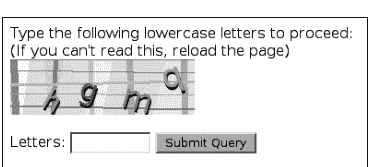

### 图 10-1: CAPTCHA 界面

你还需要将一种或多种字体与脚本放在同一目录中。最好选择至少半可读的字体。这个系统包含两个部分：

- 1. 主要部分是一个创建 CAPTCHA 图像的脚本。这些图像具有不规则的背景，带有奇怪的色彩区域和水平及垂直方向的线条。然后脚本选择一段通行短语，将其存储在 `$_SESSION['tt_pass']` 变量中，并以不同的方式绘制短语中的每个字母。最后，它发送图像输出。
- 2. 第二部分是一个脚本，用于将 CAPTCHA 表单的输入与 `$_SESSION['tt_pass']` 变量进行比较。此处的脚本是一个简单的演示，但由于图像生成脚本完成了大部分工作，你不需要做太多工作就可以使其适应自己的需求。

让我们从图像生成器开始。第一步是为图像生成器设置几个配置变量：通行短语的长度、图像大小以及查找字体的位置：

```php
<?php
/* captcha_image.php */

/* Passphrase length */
$pass_length = 4;

/* Image dimensions */
$width = 200;
$height = 60;

/* TTF font path */
$font_path = dirname(__FILE__);
```

现在让我们创建通行短语。与大多数密码不同，这不需要特别具有挑战性：没必要比必须的更让用户感到烦躁。

```php
session_start();

/* Create a passphrase. */
$passwd = "";
$i = 0;
while ($i < $pass_length) {
    $passwd .= chr(rand(97, 122));
    $i++;
}
```

我们将把通行短语放入会话变量中。因此，它绝不会以任何编码形式出现在任何页面中。这样可以避免需要想出一种别人会破解的编码。

```php
/** Store passphrase. */
$_SESSION["tt_pass"] = $passwd;
```

在绘制任何内容之前，我们要确保有可用于图像的字体。这段代码会在当前目录中创建一个字体列表。如果你希望加快这部分速度，可以将 $fonts 数组设置为一组 TrueType 字体文件名：

```php
/** Get a list of available fonts. */
$fonts = array();

if ($handle = opendir($font_path)) {
    while (false !== ($file = readdir($handle))) {
        /* Look for TTF fonts. */
        if (substr(strtolower($file), -4, 4) == '.ttf') {
            $fonts[] = $font_path . '/' . $file;
        }
    }
}
if (count($fonts) < 1) {
    die("No fonts found!");
}
```

客户端需要知道你发送的是什么类型的图像。此脚本创建 JPEG 图像，因此会发送相应的 MIME 类型。此外，我们不希望浏览器缓存图像，因此会发送多个用于使缓存失效的标头：

```php
/* Image header */
header("Content-Type: image/jpeg");
/* Invalidate cache. */
header("Expires: Mon, 01 Jul 1998 05:00:00 GMT");
header("Last-Modified: " . gmdate("D, d M Y H:i:s") . " GMT");
header("Cache-Control: no-store, no-cache, must-revalidate");
header("Cache-Control: post-check=0, pre-check=0", false);
header("Pragma: no-cache");
```

完成所有准备工作后，我们现在可以开始创建图像了。GD 函数以 image 前缀开头。要初始化彩色图像画布，请使用 imagecreatetruecolor()。

```php
/* Create image. */
$img = imagecreatetruecolor($width, $height);
```

我们要绘制的第一件事是一个用于覆盖整个背景的矩形。要绘制任何内容，你需要使用 imagecreatetruecolor() 在图像中分配一种颜色。此函数的第二、第三和第四个参数分别是颜色的红色、绿色和蓝色值。该值为 0 到 255 之间的整数，0 表示最暗，255 表示最亮。以下语句会创建一种随机的淡色：

```php
/* Fill background with a random shade of pastel. */
$bg = imagecolorallocate($img, rand(210,255), rand(210,255), rand(210,255));
```

现在让我们使用 imagefilledrectangle() 函数绘制该矩形。矩形与图像坐标轴平行，因此可以通过两个点来定义它：(0, 0) 和 ($width, $height)：

```php
imagefilledrectangle($img, 0, 0, $width, $height, $bg);
```

为了进一步复杂化背景，我们会在画布上绘制多个垂直方向的多边形。以下循环使用 imagefilledpolygon() 函数创建多边形。这与绘制矩形不同，因为多边形可以有三条或更多边且方向任意，因此你需要提供一个点数组作为参数（这里是 $poly_points），而不是两组坐标。

不要被这个循环的细节所困扰。它不是脚本中非常重要的部分。

```php
/** Make the background jaggedly by creating different-colored
four-cornered polygons to cover the background area. */
/** Create swaths between 10 and 30 pixels wide across the image. */
$right = rand(10, 30);
$left = 0;
while ($left < $width) {
    $poly_points = array(
        $left, 0,               /* Upper left */
        $right, 0,              /* Upper right */
        rand($right-25, $right+25), $height,   /* Lower right */
        rand($left-15, $left+15), $height);    /* Lower left */
    /** Create the polygon, using four points from the array. */
    $c = imagecolorallocate($img, rand(210,255), rand(210,255), rand(210,255));
    imagefilledpolygon($img, $poly_points, 4, $c);
    /** Advance to the right edge. */
    $random_amount = rand(10, 30);
    $left += $random_amount;
    $right += $random_amount;
}
```

为了进一步阻止可能使用 OCR 软件试图破解该系统的人，让我们在屏幕上绘制一些随机的水平线和垂直线。为了进一步增加变化，我们将为每张图像定义不同的线条颜色范围。通过为颜色选择随机的上下限，线条的强度可能会变化也可能不会变化，并且在每张图像之间的一致性也会有所不同。

```php
/** Choose base value range for vertical and horizontal lines. */
$c_min = rand(120, 185);
$c_max = rand(195, 280);
```

要绘制垂直线，请从左侧开始，选择一种粗细和一个轻微偏移来倾斜线条。然后选择一种颜色（使用上述界限），将线条作为多边形绘制，并再次向右移动一个随机距离：

```php
/** Draw random vertical lines across the width. */
$left = 0;
while ($left < $width) {
    $right = $left + rand(3, 7);
    $offset = rand(-3, 3);   /* Offset for angle */
    $line_points = array(
        $left, 0,       /* Upper left */
        $right, 0,      /* Upper right */
```


$right + $offset, $height,
$left + $offset, $height);
/* Lower right */
/* Lower left */
$pc = imagecolorallocate($img, rand($c_min, $c_max),
rand($c_min, $c_max),
rand($c_min, $c_max));
imagefilledpolygon($img, $line_points, 4, $pc);
/** Advance to the right. */
$left += rand(20, 60);
}

使用相同的过程来创建水平线：

```
/** Create random horizontal lines across the height. */
$top = 0;
while ($top < $height) {
$bottom = $top + rand(1, 4);
$offset = rand(-6, 6); /** Offset for angle */
$line_points = array(
0, $top, /** Upper left */
0, $bottom, /** Lower left */
$width, $bottom + $offset, /** Lower right */
$width, $top + $offset); /** Upper right */
$pc = imagecolorallocate($img, rand($c_min, $c_max),
rand($c_min, $c_max),
rand($c_min, $c_max));
imagefilledpolygon($img, $line_points, 4, $pc);
$top += rand(8, 15);
}
```

我们终于准备好处理口令字符了。在绘制之前，先确定大致希望字母之间的间距，然后将一个变量设置为最左侧字符的位置：

```
/** Determine character spacing. */
$spacing = $width / (strlen($passwd)+2);
/** Initial x coordinate */
$x = $spacing;
```

现在，遍历字符，每次选择略微不同的偏移量、角度、大小和字体：

```
/** Draw each character. */
for ($i = 0; $i < strlen($passwd); $i++) {
$letter = $passwd[$i];
$size = rand($height/3, $height/2);
$rotation = rand(-30, 30);

/* Random y position with room for character descenders */
$y = rand($height * .90, $height - $size - 4);

/* Pick a random font. */
$font = $fonts[array_rand($fonts)];
```

如果不添加某种描边效果，这些字母将非常难以辨认。你可以通过将原始颜色值除以 3 来创建阴影颜色：

```
/* Pick a color for the letter. */
$r = rand(100, 255); $g = rand(100, 255); $b = rand(100, 255);

/* Create letter and shadow colors. */
$color = imagecolorallocate($img, $r, $g, $b);
$shadow = imagecolorallocate($img, $r/3, $g/3, $b/3);
```

使用 imagettftext() 先绘制阴影，再绘制字母，然后移到下一个字符：

```
/* Draw shadow, then letter. */
imagettftext($img, $size, $rotation, $x, $y, $shadow, $font, $letter);
imagettftext($img, $size, $rotation, $x-1, $y-3, $color, $font, $letter);

/* Advance across the canvas. */
$x += rand($spacing, $spacing * 1.5);
}
```

循环完成后，你就可以将图像发送给客户端了。使用 imagejpeg() 发送，然后使用 imagedestroy() 释放内存：

```
imagejpeg($img); /* Send image output. */
imagedestroy($img); /* Free image memory. */

?>
```

CAPTCHA 系统的另一部分是一小段代码，用于显示表单、嵌入前面脚本生成的图像，并验证表单输入是否与图像生成器创建的口令一致。由于图像脚本完成了所有繁重工作，你无需注释就能理解下面的代码：

```
<?php

session_start();

/* Look for a submitted password. */
if ($_REQUEST["tt_pass"]) {
    if ($_REQUEST["tt_pass"] == $_SESSION["tt_pass"]) {
        echo "passphrase correct.";
    } else {
        echo "passphrase incorrect.";
    }
    exit(0);
}

/* By default, send the form. */
print '<form action="' . $_SERVER['PHP_SELF'] . '" method="post">';
?>
Type the following lowercase letters to proceed:<br />
(If you can't read this, reload the page)<br />
<br /><br />
Letters: <input name="tt_pass" type="text" size="10" maxlength="10">
<input type="submit">
</form>
```

显然，你需要将此脚本更紧密地集成到代码中，但该系统最佳的特点之一是它相对自包含。你可以做一些小改进来使其更严密，例如在验证后删除存储的口令（这样它只能使用一次）。但如果你发现需要更多功能，可能需要解决一个更大的问题，即使用登录系统。

## 67：创建缩略图

当你允许用户向站点上传图片（参见第 97 页的“#54：将图片上传到目录”）时，通常需要一个小预览图片（称为 _缩略图_），用于嵌入大型页面和图片画廊浏览。本节将向你展示一个名为 `mkthumb()` 的函数，它借助 GD 创建缩略图。要使用该函数，你需要以下内容：

- 一个 PHP 可写的目录，用于写入缩略图（如果你不知道如何使目录可写，请参见第 91 页的“文件权限”）
- GD 库

`mkthumb()` 函数接受两个参数：输入图像文件的名称和缩略图所需的名称。你需要独立验证图像文件存在，且扩展名为 .jpg、.gif 或 .png。如果尚未执行此操作，请查看第 97 页的“#54：将图片上传到目录”。完成上述步骤后，首先定义缩略图最大宽度和高度的默认值（对于此函数，这些尺寸必须相等）：

```
<?php
function mkthumb($filename, $thumbname) {
/* Generate an image thumbnail. */
$thumb_width = 125;
$thumb_height = $thumb_width;
```

现在根据文件扩展名将图像加载到内存中。GD 的 imagecreatefromformat() 函数返回图像资源句柄。你会立即注意到，此处没有错误检查，主要是因为 `mkthumb()` 假设你已处理好先决条件。如果需要错误检查，之后检查 `$src_image` 以查看它是否存在。

```
if (preg_match('/\.gif$/i', $filename)) {
    $src_image = imagecreatefromgif($filename);
} else if (preg_match('/\.png$/i', $filename)) {
    $src_image = imagecreatefrompng($filename);
} else {
    /* Assume JPEG by default. */
    $src_image = imagecreatefromjpeg($filename);
}
```

现在使用 `imagesx()` 和 `imagesy()` 函数从图像中提取像素宽度和高度：

```
$width = imagesx($src_image);
$height = imagesy($src_image);
```

只有在原始图像大于最大缩略图尺寸时才会调整图像大小，因此请检查是否存在此情况：

```
if (( $height > $thumb_height ) || ( $width > $thumb_width )) {
```

调整图像大小时，需要知道最终图像的像素尺寸。不能使用最大缩略图高度和宽度，因为原始图像可能不是正方形。如果试图将非正方形矩形强行放入正方形，最终会得到失真的图像。要解决这个问题，请找到原始图像的最长边，然后根据最长边长度与缩略图边长度的比例创建缩放比例：

```
/* Create a thumbnail. */
if ($width > $height) {
    $ratio = $thumb_width / $width;
} else {
    $ratio = $thumb_height / $height;
}
```

**警告** 此函数中最大缩略图尺寸为正方形的原因是，前面的逻辑对于通用矩形不正确。如果尝试将 `200 × 400` 图像放入 `100 × 400` 缩略图配置文件中，`$ratio` 将为 `1`，最终会得到 `200 × 400` 的缩略图（参见以下代码）。该尺寸大于所需的最大缩略图大小。修复此问题并不困难，但留给读者作为练习。

```
$new_width = round($width * $ratio);
$new_height = round($height * $ratio);
$dest_image = ImageCreateTrueColor($new_width, $new_height);
```

现在可以使用 imagecopyresampled() 执行调整大小：

```
imagecopyresampled($dest_image, $src_image, 0, 0, 0, 0,
                       $new_width, $new_height, $width, $height);
```

然后可以释放原始图像的内存：

```
imagedestroy($src_image);
```

此时，$dest_image 是一个包含调整大小后图像的图像资源，已准备好输出。但如果不需要调整大小呢？代码会落入以下 else 子句，该子句表示将 $dest_image 赋值给原始图像句柄没问题：

```
} else {
    /* Image is already small enough; just output. */
    $dest_image = $src_image;
}
```

既然现在知道 $dest_image 已准备好输出，可以将其写入文件并清理：

```
imagejpeg($dest_image, $thumbname);
imagedestroy($dest_image);
}
?>


下面是一个使用 mkthumb() 函数的非常简单的示例脚本：

```php
<?php
include("mkthumb.inc");
$upfile = $_FILES["upfile"]["tmp_name"];
$fn = $_FILES["upfile"]["name"];
$thumb_filename = "thumbs/$fn";

if ($upfile) {
    mkthumb($upfile, $thumb_filename);
    print "";
} else { ?>
    <form action="thumb.php" enctype="multipart/form-data" method="post">
    Upload an image:<br />
    <input name="upfile" type="file" /><br />
    <input name="Submit" type="submit" value="Upload Image" />
    </form>
    <?php
}
?>
```

显然，这个脚本做了 *大量* 假设，你绝对不希望将其用于普通用户。同样，如需完整的图片上传器，请参阅第 97 页的“#54：将图片上传到目录”。

为了满足特定需求，你可以对 mkthumb() 进行多项优化。例如，JPEG 是一种有损格式。如果你对卡通风格的 GIF 或 PNG 制作缩略图，生成的缩略图质量会很差。为解决这个问题，你可以选择使用 imagepng() 函数而非 imagejpeg() 以 PNG 格式写入。你也可以尝试一些技巧，将图片调整为其原始格式。不过，这可能会适得其反，因为 GIF 图像的颜色映射有限，调整图片大小时，颜色映射往往会发生变化。

总体而言，不过，在使用 PHP 进行图像处理时，要小心不要 *过于* 巧妙。PHP 通常是按需使用的，因此你没有太多时间进行花哨的操作。除了用户会失去耐心之外，Web 服务器也不会允许脚本运行太久。

# 11 使用 cURL 与 Web 服务交互


互联网中存储着大量非常有用的数据：UPS 可以告诉你将一个五磅重的包裹从路易斯安那州巴吞鲁日运送到康涅狄格州哈特福德的准确费用。Authorize.net 可以告诉你客户的借记卡中是否还有足够的额度从你的网站购买一本 60 美元的图书。但在每种情况下，你都需要知道如何请求这些信息。

为了找到这些信息，你首先需要 cURL PHP 库来处理你的 Web 服务器与其他 Web 服务器之间的连接。其理念是让你的脚本表现得像客户端，类似于 Web 浏览器的工作方式。你可以要求 cURL 执行从检索网页 HTML 到直接访问基于 XML 的 Web 服务的任何操作。访问数据有三种基本方式：

- 下载网站的网页并分析 HTML。第 5 章包含一个示例：“#41：创建网页抓取器”，第 75 页。

- 将查询参数发布到网站，并分析结果。

- 使用基于 XML 的 Web 服务访问数据，并使用 XML 解析器访问结果。你会遇到多种不同的访问协议，例如 SOAP（简单对象访问协议）和 REST（表述性状态转移；通常这只是发送 POST 或 GET 参数的一个花哨说法）。不要指望会有太多一致性。即使是两个提供相同类型数据的网站，也很可能拥有完全不同的输出格式和访问方法。

根据你需要完成的任务，你可能还需要以下库的子集：

- 1. cURL（库和 PHP 扩展）。如果你没有安装该扩展，请参阅第 27 页的“#18：为 PHP 添加扩展”。
- 2. OpenSSL 用于访问安全网站。
- 3. XML 用于解析来自 Web 服务的数据。大多数 PHP 服务器默认包含此库。

## #68：连接到其他网站

为了说明 PHP cURL 函数的工作原理，让我们看看如何连接到网页并检索其数据。首先，使用 curl_init() 函数创建一个 cURL 连接句柄：

```php
$c = curl_init();
```

现在使用 curl_setopt() 函数指定连接设置。最重要的设置是目标 URL。按如下方式调用该函数，将 CURLOPT_URL 作为选项名称，最后一个参数作为所需 URL：

```php
curl_setopt($c, CURLOPT_URL, "http://www.google.com/");
```

默认情况下，cURL 会启用某些功能，这些功能要么无用，要么会妨碍正常的页面处理。其中一项功能是将 HTTP 头包含在输出中。你可以按如下方式将其关闭：

```php
curl_setopt($c, CURLOPT_HEADER, false);
```

同样，cURL 会自动打印访问的页面，而不是将其作为字符串返回。如果你打算以某种方式分析页面，就需要一个字符串，因此请使用 CURLOPT_RETURNTRANSFER 选项表示你希望输出为字符串：

```php
curl_setopt($c, CURLOPT_RETURNTRANSFER, true);
```

现在你可以使用 curl_exec() 函数访问该页面了：

```php
$page_data = curl_exec($c);
```

此时，cURL 访问页面并返回页面数据，PHP 将其赋值给 $page_data。最后，使用 curl_close() 清理连接：

```php
curl_close($c);
```

这是一个很好的开始；你现在可以通过 GET 方法访问 Web 数据了。但是，如果你需要使用 POST 方法提交表单数据怎么办？在这种情况下，你需要使用 curl_setopt() 设置更多选项。让我们构建一个名为 retrieve_page() 的函数，它可以使用 GET 或 POST 方法访问页面。

该函数接受两个参数：要访问的 URL 和一个可选的 POST 参数数组（该数组以参数名作为键、以参数值作为值）。如果它没有接收到第二个参数，则函数使用 GET 方法。函数的第一部分从参数数组构建查询字符串，形式为 param1=value1&param2=value2[...]，类似于 GET 查询中的形式，只是不包含开头的问号。幸运的是，PHP 内置了 http_build_query() 函数，可用于从数组创建查询字符串，因此我们真正需要做的只是验证参数数组：

```php
function retrieve_page($url, $post_parameters = null) {
/* Connects to a site using POST or GET; fetches data */
$query_string = null;
if (!is_null($post_parameters)) {
    if (!is_array($post_parameters)) {
        die("POST parameters not in array format");
    }
    /* Build query string. */
    $query_string = http_build_query($post_parameters);
}
```

现在是时候设置 cURL 连接句柄了。如果此时存在查询字符串，则我们知道正在使用 POST 方法，因此按此方式配置连接，并将查询字符串作为 POST 数据：

```php
$ch = curl_init();
if ($query_string) {
    curl_setopt($ch, CURLOPT_POST, true);
    curl_setopt($ch, CURLOPT_POSTFIELDS, $query_string);
}
```

从这一点开始，我们像之前一样配置连接，执行查询并返回数据：

```php
curl_setopt($ch, CURLOPT_URL, $url);
curl_setopt($ch, CURLOPT_HEADER, false);
curl_setopt($ch, CURLOPT_RETURNTRANSFER, true);
$return_data = curl_exec($ch);
curl_close($ch);
return $return_data;
}
```

以下是使用该函数在 Yahoo! 上搜索的示例：

```php
print retrieve_page("http://search.yahoo.com/search", array("p" => "beans"));
```

此函数可以满足大多数常规客户端访问需求。从这里开始，我们将说明如何满足某些网站和服务的众多额外要求。

## #69：使用 Cookie

如果你的应用程序需要登录到使用基于 Cookie 身份验证的服务器，则需要在 cURL 中启用 Cookie 收集系统。其理念是：当你访问页面时，cURL 将接收到的 Cookie 存储在一个文件中（称为 _Cookie Jar_），而在后续访问时，你希望 cURL 检查该文件，查找应发送到服务器的任何 Cookie。

通常，你需要添加两行配置：第一行设置写入位置，第二行设置读取位置：

```php
curl_setopt($c, CURLOPT_COOKIEJAR, 'cookiejar');
curl_setopt($c, CURLOPT_COOKIEFILE, 'cookiejar');
```

在这里，c 是 cURL 连接句柄，而 _cookiejar_ 是一个 PHP 可写文件。

此方案最大的问题是它不适用于并行连接；如果有多个进程使用同一个 Cookie Jar，它们将共享同一个会话，互相覆盖，或者更糟。你可以通过将 PHP 进程 ID（使用 getmypid()）插入到 Cookie Jar 文件名中来绕过此问题。但是，如果你这样做，请务必在完成时删除 Cookie Jar 文件进行清理，否则你会手头积累大量 Cookie Jar，这可能会混淆后续进程。

## #70：将 XML 转换为可用形式

XML（可扩展标记语言）是标记语言热潮中最流行的产品之一。它旨在为任何类型的数据提供标准交换格式。虽然 XML 臃肿且效率极低，但大多数 Web 服务现在在其输出中使用 XML，有些服务甚至要求将 XML 作为输入。因此，你可能会在某个时刻需要处理它。

入门 XML 的最佳方法是解析其中一段数据——也就是说，验证数据是否是有效的 XML 并检查数据。你可能会认为，随着 XML 推出时伴随的所有炒作，总有人会想出一种简单的处理方法。不幸的是，多年来，


访问 XML 数据曾经极其复杂；因此，出现了大量解析系统，例如 DOM 和 SAX。如果你曾被 PHP 中可用的 27,000 种不同的 XML 扩展搞晕过，那你现在就知道原因了。

好消息是，随着时间的推移，人们意识到大多数时候他们只是将 XML 数据解析为由一堆嵌套数组组成的树，以便程序员可以使用运算符和索引等常规数据访问工具。为此目的出现了一代新的解析器；PHP 5 包含这样一个扩展，称为 SimpleXML。

下面是一些示例 XML，帮助我们开始使用 SimpleXML：

```xml
<?xml version="1.0" encoding="utf-8"?>
<preaching>
<sins>
    <sin type="deadly">gluttony</sin>
    <sin type="minor">bad puns</sin>
    <sin type="required">flatulence</sin>
</sins>
</preaching>
```

此 XML 包含嵌套节点、数据和属性，因此涵盖了你几乎会遇到的所有情况。要使用 SimpleXML 解析它，请将数据加载到字符串中，并从字符串创建一个 SimpleXMLElement 对象：

```php
$xs = file_get_contents("test.xml");
$data = new SimpleXMLElement($xs);
```

**注意** _你可以使用 simplexml_load_file() 从文件创建对象，而无需使用这个两步过程。_

如果你没有收到过于冗长的错误消息，XML 现在就在 $data 对象中。要查看 <sins> 节点中的第一个 sin，请使用对象和数组访问语法的组合：

```php
print $data->sins->sin[0];
```

输出是 gluttony；如果你想访问 bad puns 节点，则查看 $data->sins->sin[1]。如果你省略数组索引 ($data->sins->sin)，你将获得数组的第一个元素；如果你知道只有一个元素，这很有用。

你也可以使用数组索引查看节点的属性，只不过这次索引是键而不是数字。例如，要查明 bad puns 是什么类型的 sin，请使用以下内容：

```php
print $data->sins->sin[1]["type"];
```

数组语法最好的地方大概是你可以遍历节点。

以下是如何打印示例中所有 sin 的方法：

```php
foreach ($data->sins->sin as $sin) {
    print $sin . " : " . $sin["type"];
    print "<br />";
}
```

如你所注意到的，使用这种语法时可能会在属性和子节点之间混淆，但总的来说还不错。如果你迷路了，甚至可以使用 print_r() 来打印一团乱码。输出如下：

```
SimpleXMLElement Object
(
    [sins] => SimpleXMLElement Object
        (
            [sin] => Array
                (
                    [0] => gluttony
                    [1] => bad puns
                    [2] => flatulence
                )

        )

)
```

SimpleXML 远不止这些，包括创建和修改 XML 的功能，但这是你开始使用 Web 服务所需要知道的一切。在接下来的几个部分中，我们将看一些现实世界的应用。

## #71：使用映射 Web 服务

到这一点，你已知道如何访问 URL 以及如何解析 XML，现在是将两者结合起来的时候了。让我们以 Yahoo! 地理编码服务为简单示例。API 是一项可通过 GET 参数访问的 REST 服务。假设你有来自“#68：连接到其他网站”（第 142 页）的 retrieve_page() 函数，以下是如何获取华盛顿特区一个知名地址的信息：

```php
$qs = http_build_query(array(
    "appid" => "YahooDemo",
    "street" => "1600 Pennsylvania Avenue NW",
    "city" => "Washington",
    "state" => "DC",
    "zip" => "20006",
));
$page = retrieve_page("http://local.yahooapis.com/MapsService/V1/
geocode?$qs");
```

**注意** 理想情况下，你希望将 YahooDemo 替换为 Yahoo! 提供的应用程序 ID，尽管如果你不打算在生产环境中使用此应用程序或重复使用它，可以保留原样。

运行此代码后，$page 包含以下 XML 结果：

```xml
<?xml version="1.0"?>
<ResultSet xmlns:xsi="http://www.w3.org/2001/XMLSchema-instance" xmlns="urn:yahoo:maps" xmlns:maps="http://api.local.yahoo.com/MapsService/V1/GeoCodeResponse.xsd">
<Result precision="address">
<Latitude>38.898563</Latitude>
<Longitude>-77.037223</Longitude>
<Address>1600 PENNSYLVANIA AVE NW</Address>
<City>WASHINGTON</City>
<State>DC</State>
<Zip>20006</Zip>
<Country>US</Country>
</Result>
</ResultSet>
```

因此，要提取地址的纬度和经度，请使用以下 PHP 代码：

```php
$data = new SimpleXMLElement($page);
$lat1 = $data->Result->Latitude[0];
$lon1 = $data->Result->Longitude[0];
```

如果你只想要地址的纬度和经度，那么你现在已经成功地使用了 Web 服务。但让我们做点更有趣的事情。首先，假设脚本名为 mapdemo.php，并从以下表单运行：

```html
<form action="mapdemo.php">
Street: <input type="text" name="street" /><br />
City: <input type="text" name="city" /><br />
State: <input type="text" name="state" /><br />
<input type="submit" /><br />
</form>
```

将以下内容添加到 mapdemo.php，以便从上一表单中输入的任意地址提取第二个地理位置：

```php
$qs = http_build_query(array(
	"appid" => "YahooDemo",
	"street" => $_REQUEST["street"],
	"city" => $_REQUEST["city"],
	"state" => $_REQUEST["state"],
	));
```

```php
$page = retrieve_page("http://local.yahooapis.com/MapsService/V1/
geocode?$qs");
$data = new SimpleXMLElement($page);
$lat2 = $data->Result->Latitude[0];
$lon2 = $data->Result->Longitude[0];
```

现在让我们使用 Google Maps API 在浏览器中绘制一些东西，但基于我们从 Yahoo! 服务获得的数据。首先关闭 PHP 块，并使用以下 HTML 和 JavaScript 设置 Google 地图（将 _your_key_here_ 替换为你的 Google Maps API 密钥）。如果你不懂 JavaScript，也不要太担心这部分，因为它非常标准：

```php
?>
<!DOCTYPE html "-//W3C//DTD XHTML 1.0 Strict//EN"
"http://www.w3.org/TR/xhtml1/DTD/xhtml1-strict.dtd">
<html xmlns="http://www.w3.org/1999/xhtml">
<head>
<meta http-equiv="content-type" content="text/html; charset=utf-8"/>
<title>Map Example</title>
<script src="http://maps.google.com/
maps?file=api&amp;v=2&amp;key=your_key_here"
type="text/javascript"></script>
<script type="text/javascript">
function initialize() {
if (GBrowserIsCompatible()) {
var map = new GMap2(document.getElementById("map_canvas"));
```

现在，为之前提取的两个地理位置在地图上创建点，并将地图居中于第一个点（在执行任何操作之前必须先将地图居中）：

```javascript
var latlon1 = new GLatLng(<?php print "$lat1, $lon1"; ?>);
var latlon2 = new GLatLng(<?php print "$lat2, $lon2"; ?>);
map.setCenter(latlon1);
```

在地图上将点所在位置放置标记：

```javascript
map.addOverlay(new GMarker(latlon1));
map.addOverlay(new GMarker(latlon2));
```

在点之间绘制一条线：

```javascript
var line = new GPolyline([latlon1, latlon2], "#3333aa", 5);
map.addOverlay(line);
```

现在，重新居中并重新缩放地图，以便整条线完全可见：

```javascript
var bounds = line.getBounds();
level = map.getBoundsZoomLevel(bounds);
map.setCenter(bounds.getCenter(), level);
```

最后，添加一个用户控制面板（用于缩放和平移），并使用显示地图的 HTML 结束：

```javascript
map.addControl(new GLargeMapControl());
}
}

</script>
</head>
<body onload="initialize()" onunload="GUnload()">
<div id="map_canvas" style="width: 500px; height: 300px"></div>
</body>
</html>
```

现在你有了一个简单的应用程序，它在白宫和你选择的地址之间在地图上绘制一条线。单独来看，这个脚本有点像玩具（尤其是因为你可以从 Google 而不是 Yahoo! 获取地理编码），但你可能可以想象出它作为实际应用起点的许多不同方式。

关于 Web 服务，我们可以没完没了地讲下去，教你如何授权信用卡和获取运输报价，但到现在这一切都是琐碎的工作——你从客户端收集数据，为服务器打包，发送请求并检查结果。对于其中很多，你甚至可以找到 PHP 客户端代码来替你完成工作。然而，一个我们尚未讨论的主题是 SOAP，该协议在许多 Web 服务中非常重要。

## #72：使用 PHP 和 SOAP 从 Amazon.com 请求数据

简单对象访问协议（SOAP）是一项成熟的 Web 服务标准，就像名称中带有 *simple* 的任何东西一样，远非简单。其理念是将有关 Web 服务输入和输出的所有细节都放入 Web 服务描述语言（WSDL）文档中，以便你可以自动生成编程接口，并像调用方法或函数一样调用 Web 服务。你不必折腾 cURL、构建查询或任何那些东西——只需创建一个带有请求的对象，告诉 PHP 创建接口，调用方法，你就会得到一个包含你所需内容的对象。事实上，当一切按预期工作时，它 *是* 就这么简单，本节中的脚本将向你展示如何入门。

PHP 5 包含一组内置的 SOAP 类，包括我们很快会看到的 SoapClient 类。但是，这些类通常默认不是内置的。要使用它，你需要在配置和构建 PHP 时包含 –enable-soap 参数（有关此过程的更多详细信息，请参阅第 2 章）。

我们的示例基于 Amazon.com 提供的关联 Web 服务，该服务可帮助你从自己的网站销售其商品。你只需要申请一个访问密钥 ID，然后就可以免费访问它（速率为每一


请求/秒）。首先使用 WSDL 文档的位置创建 SoapClient 实例：

```
<?php
$client = new SoapClient("http://webservices.amazon.com/AWSECommerceService/
AWSECommerceService.wsdl");
?>
```

现在，你需要为要发送的请求设置一个对象。设置一个名为 $search 的对象，包含访问密钥 ID、类别和搜索关键字的节点：

```
$search->AWSAccessKeyId = "your_key_id";
$search->Request->SearchIndex = "Music";
$search->Request->Keywords = "Merle Haggard";
```

要执行搜索，请运行客户端的 itemSearch() 方法：

```
$r = $client->itemSearch($search);
```

如果一切顺利，XML 结果将出现在 $r 中。你可以像访问 SimpleXML 实例一样访问这个对象：

```
foreach ($r->Items->Item as $item) {
    $attributes = $item->ItemAttributes;
    if (is_array($attributes->Artist)) {
        $artist = implode($attributes->Artist, ", ");
    } else {
        $artist = $attributes->Artist;
    }
    print "artist: $artist; title: $attributes->Title<br />";
}
?>
```

如果你碰巧知道一切是如何工作的，使用起来出奇地简单。不幸的是，大多数时候，你不会知道一切是如何工作的。WSDL 文件通常没有附带文档。所以，假设你知道如何读取 WSDL 或者你有一个浏览器，你可以找到客户端可用的所有方法，并且你会知道方法期望哪些参数，但你不会知道这些参数的作用。此外，即使你知道方法返回的响应是什么样子，你甚至也不会确切知道这些方法应该做什么。部分原因是，当你不知道自己正在处理哪种编程语言或 SOAP 实现时，很难对文档做出具体说明。此外，没人愿意编写文档。

性能是另一个严重问题。在前面的示例中，PHP 需要获取 WSDL 文件，解析其 XML，然后根据 WSDL 内容设置一个全新的类和实例。这效率极低，尤其是考虑到你通常只需要向服务发送几个简短的参数。PHP 会缓存它遇到的 WSDL 文件（其他语言可能要求你根据 WSDL 生成和编译代码，这也没好多少）。

归根结底，如果你计划一次性运行多个基于 WSDL 的 Web 服务查询，你要么需要大量硬件，要么需要一种手动构建 SOAP 查询来绕过大部分过程的方法。

出于这些原因，纯 SOAP Web 服务并没有你想象中那么常见。例如，Amazon.com SOAP Web 服务只是最近才添加的，与传统的 REST 服务并存。Amazon.com 记录了 REST 参数，但告诉你要“查看 WSDL”来了解如何使用 SOAP。另一家名为 Google 的大公司决定停止对其 Web 搜索服务的 SOAP 支持。但是，SOAP 并不会消失。特别是，每当你遇到基于 Microsoft .NET 的服务时，你几乎肯定需要处理它。

## #73：构建 Web 服务

为了结束本章，让我们快速看看如何构建 REST Web 服务。其思路与几乎任何其他类型的动态网页相似，但你不需要担心页面外观，只需正确构建一个对象，将对象转换为 XML，然后打印结果。之后，其他一切都是别人的问题（至少在理论上是这样）。

我们将使用附录中示例表的数据。Web 服务接受一个类别参数（作为 POST 或 GET），并返回类似于此的 XML 产品列表：

```
<?xml version="1.0" encoding="utf-8"?>
<Items>
<Item>
<Name>Cowboy Boots</Name>
<ID>12</ID>
<Price>19.99</Price>
</Item>
<Item>
<Name>Slippers</Name>
<ID>17</ID>
<Price>9.99</Price>
</Item>
</Items>
```

在 PHP 中创建 XML 有很多方法，从使用 DOM 到使用 xmlWriter 函数。我们将使用本章前面介绍的 SimpleXML 类。首先要做的是初始化数据库，告诉客户端即将接收 XML，并验证类别参数。这主要是些琐碎的工作；到目前为止，你已经看到了大量这样的代码（不用担心 printerror()，我们稍后会讲到）：

```
<?php
$db = mysql_connect("localhost", "username", "passwd");
mysql_select_db("wcphp");

header("Content-type: text/xml");
$category = $_REQUEST["category"];

if ($category) {
    $results = mysql_query("SELECT DISTINCT category FROM product_info", $db);
    $categories = array();
    while ($row = mysql_fetch_array($results)) {
        $categories[] = $row["category"];
    }
    if (!in_array($category, $categories)) {
        printerror("invalid category");
        exit;
    }
}
```

**注意** 从技术上讲，你不需要经历所有这些工作来找出有效的类别名称，因为你可以缓存它们（如果你需要经常使用它们，你应该这样做）。

现在让我们从数据库中获取产品信息：

```
$results = mysql_query("
    SELECT product_name, product_id, price
    FROM product_info
    WHERE category = '$category'", $db);
```

事情开始变得有点有趣了。要初始化 XML 文档，我们将从现有的 XML 文档创建一个 SimpleXMLElement 实例。这可以像你喜欢的那样复杂或简单。我们的基本 XML 结构非常简单，所以我们将直接使用内联字符串：

```
$doc = new SimpleXMLElement('<?xml version="1.0" encoding="utf-8"?>
<Items></Items>
');
```

我们的文档已准备好填充，数据就在 $results 中，所以让我们遍历各行。首先要做的是使用 $doc->addChild() 方法在 Items 节点下添加一个新的 Item 子元素：

```
while ($product = mysql_fetch_array($results)) {
    $child = $doc->addChild("Item");
```

第一个新子元素可通过 $doc->Item[0] 访问，但使用 addChild() 方法返回的句柄更方便。那个新子元素现在需要为 Name、ID 和 Price 节点添加自己的子元素，所以你将再次使用 addChild() 方法，不过这次是从 $child 而不是 $doc 调用。此外，这些新节点有值，因此请将这些值作为第二个参数提供：

```
$child->addChild("Name", $product["product_name"]);
$child->addChild("ID", $product["product_id"]);
$child->addChild("Price", $product["price"]);
}
```

遍历完所有项目后，你只需输出 XML。使用 $doc->asXML() 函数，然后就完成了：

```
print $doc->asXML();
```

嗯，你还没有*完全*完成。还记得我们之前提到的 printerror() 函数吗？让我们现在处理它。此外，让我们假设错误消息非常简单，所以我们甚至不想使用对象：

```
function printerror($message) {
	$message = htmlentities($message);
	print "<?xml version="1.0" encoding="utf-8"?>
<Error>$message</Error>
	";
}
?>
```

Web 服务大致就是这些。有很多方法可以让它们更加复杂，例如使用 SOAP 和 WSDL，但归根结底，你所做的就是收集数据并将其放入适当的位置中。

# 12

## 中级项目


本章最后包含三组脚本，用于实现许多基于内容的网站上常见的功能：投票系统、电子贺卡服务和博客。这些都只是起点。虽然它们按所示形式当然可以工作，但要在生产环境中使用，你需要根据自己的需求对其进行调整，并使其符合你的安全模型。

所有这些项目都使用 MySQL 存储数据。这里的表结构和查询比你迄今在本书中看到的要稍微复杂一些，但这并不是大跃进。每个系统都有自己的一组表，你将看到如何创建它们。


## #74: 用户投票

网络投票可能并不能很好地赋能民众，但它们是弄清楚你如何调整内容以保持用户兴趣、优化页面浏览量或尽可能惹恼更多人的绝佳工具。网络投票最好的地方在于其实现极其简单。这里展示的投票支持多个投票，因此其问题和答案并未硬编码。

对于典型的网络投票，你无需过多担心重复投票，因为这很少有影响。为了阻止大多数人多次投票，我们将使用基于 Cookie 的系统。这很容易被绕过，但对于大多数用途来说，风险如此之低，以至于无人在意。如果你需要更好的方案，请使用登录系统进行选民登记。

网络投票包含四个脚本：

- vote_form.php：向用户显示选票
- vote_process.php：处理选票
- vote_tally.php：显示投票结果
- vote_include.php：连接到数据库

有三个数据库表。poll 表包含问题：

```
CREATE TABLE `poll` (
`ID` INT NOT NULL AUTO_INCREMENT ,
`question` MEDIUMTEXT NOT NULL ,
PRIMARY KEY (`ID`)
) TYPE = MYISAM ;
```

answer 表包含 poll 表中问题的答案。ID 字段用于与 poll 表的 ID 字段进行连接：

```
CREATE TABLE `answer` (
`answer_ID` INT NOT NULL AUTO_INCREMENT ,
`ID` INT NOT NULL ,
`answer` MEDIUMTEXT NOT NULL ,
PRIMARY KEY (`answer_ID`)
) TYPE = MYISAM ;
```

vote 表包含投票。ID 和 answer_ID 字段分别对应 poll 和 answer 表中的字段。

```
CREATE TABLE `vote` (
`ID` INT NOT NULL ,
`answer_ID` INT NOT NULL ,
INDEX (`ID`)
) TYPE = MYISAM ;
```

最后，这里有一些示例问题和答案行：

```
INSERT INTO poll (question) VALUES ("Would you like a cheeseburger?");
INSERT INTO answer (ID, answer) VALUES (1, "Yes.");
INSERT INTO answer (ID, answer) VALUES (1, "No.");
INSERT INTO answer (ID, answer) VALUES (1, "Maybe.");
```

所有脚本都要连接到数据库，因此将连接详细信息放入名为 vote_config.php 的单个包含文件中是合理的：

```
<?php
$db = @mysql_connect("localhost", "sql_login", "sql_password") or
      die("Couldn't connect.");
@mysql_select_db("wcpch", $db) or die("Couldn't select database.");
?>
```

现在让我们来看看各个组件脚本。

### 创建选票表单

vote_form.php 脚本非常简单直接；通过 poll 参数传入投票 ID，它就会显示选票。图 12-1 展示了一个示例选票。

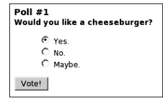

图 12-1：投票选票

首先加载数据库配置，并将 poll 参数强制转换为整数：

```
<?php
/* Display a vote form. */
require_once("vote_config.php");
$poll = $_GET['poll'];
if (!is_numeric($poll)) {
    die("Invalid poll");
}
```

我们可以在一次查询中验证投票 ID 是否有效，并查找要显示的选项。其思路是，如果没有匹配的投票，查询将不返回任何行。

```
/* Look up the poll in the database. */
$sql = "SELECT P.question, A.answer, A.answer_ID
    FROM poll P, answer A
    WHERE P.ID = $poll
    AND A.ID = P.ID";

$result = mysql_query($sql, $db) or die ("mysql error: " . mysql_error());
if (mysql_num_rows($result) == 0) {
    die('Invalid poll.');
}
```

如果投票 ID 有效，我们需要确保用户尚未投票。如前所述，我们将使用 Cookie 来实现这一点。假设如果存在 Cookie poll_voted_id（其中 id 为投票 ID），则表示用户已投票，我们应该将用户重定向到投票结果页面。

```
/* If the user has already voted, show the results. */
if ($_COOKIE["poll_voted_$poll"]) {
    header("Location: vote_tally.php?poll=$poll");
    exit;
}
```

如果走到了这一步，就可以遍历选项列表来构建 HTML 表单了。这个循环将一系列单选按钮输入元素放入 $question_list 变量中：

```
/* Vote form */
$question_list = "";
while($row = mysql_fetch_array($result)) {
    $question = $row['question'];
    $question_list .= '<li><input name="answer" type="radio" value="' . $row['answer_ID'] . '">' . $row['answer'] . '</li>';
}
```

剩下的就是输出 HTML 了。我们可以大部分使用原文模式来完成：

```
?>
<html>
<head></head>
<body>
<span style="font-size: 12px;">
<span style="font-weight: bold; font-size: 14px;">
Poll #<?php print $poll; ?>
</span><br />
<span style="font-weight: bold"><?php print $question; ?></span>
<form action="vote_process.php" method="post">
<ul style="list-style-type: none;">
<?php print $question_list; ?>
</ul>
<input name="poll" type="hidden" value="<?php print $poll; ?>">
<input name="" type="submit" value="Vote!"</form>
</span>
</body></html>
```

请注意，表单的 action 是 vote_process.php。这就是我们下一个脚本。

### 处理选票

vote_process.php 的作用是在投票有效时将其添加到数据库中。首先加载数据库配置，并确保 poll 和 answer 参数是数字。

```
<?php
require_once("vote_config.php");

$poll = $_POST['poll'];
$answer = $_POST['answer'];
if (!is_numeric($poll) || !is_numeric($answer)) {
 die("Invalid poll or answer");
}
```

我们可以通过在数据库中查找匹配的行来验证投票 ID 和答案是否有效。如果它们有效，使用这些键对 poll 和 answer 表进行连接将正好返回一行。不过，仅查看该查询是否无结果也足够了：

```
/* Look up the poll and answer. */
$sql = "SELECT A.answer_ID
 FROM poll P, answer A
 WHERE P.ID = A.ID
 AND P.ID = $poll
 AND A.answer_ID = $answer";

$result = @mysql_query($sql, $db) or die (mysql_error());
if (mysql_num_rows($result) == 0) {
 die("Invalid poll or answer.");
}
```

如果走到了这一步，我们可以验证用户是否已投票，并在一切检查通过后向 vote 表插入一行投票：

```
/* Check for prior votes. */
if (!$_COOKIE["poll_voted_$poll"]) {
 /* Insert the vote. */
 $sql = "INSERT INTO `vote` ( `answer_ID` , `ID`)
 VALUES ($answer, $poll)";
 $result = @mysql_query($sql, $db) or
 die ("Couldn't insert: ". mysql_error());
```

如果投票插入成功，我们可以设置一个表示用户已投票的 Cookie。此 Cookie 将在 30 天后过期。

```
/* Mark the poll as voted. */
setcookie("poll_voted_$poll", "1", time() + (60*60*24 * 30));
}
```

最后，无论用户是否之前投票过，我们都会将用户重定向到投票结果：

```
/* Redirect to poll results. */
header("Location: vote_tally.php?poll=$poll");
?>
```

现在让我们来看看结果。

### 获取投票结果

当然，参与投票的每个人都想知道结果。我们将使用一些简单的 HTML 技巧来显示结果，如图 12-2 所示。

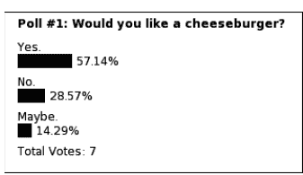

图 12-2：投票结果

vote_tally.php 脚本的开头与其他两个脚本类似，先加载数据库配置，然后检查 poll 参数中的投票 ID 是否有效：

```
<?php
/* Display the results of a poll. */
require_once("vote_config.php");

$poll = $_REQUEST['poll'];
if (!is_numeric($poll)) {
    die("Invalid poll");
}
```

在检查有效投票 ID 时，我们不妨同时查询投票问题，因为我们最终需要显示此信息：

```
/* Look up the question. */
$sql = "SELECT question
        FROM poll
        WHERE ID = $poll";
$result = @mysql_query($sql, $db) or die ("mysql error: " . mysql_error());
if (mysql_num_rows($result) != 1) {
    die('Invalid poll.');
}
$row = mysql_fetch_array($result);
$question = $row["question"];
```

让我们找出总投票数，以便稍后为各个选项提供百分比：

```
$query = "SELECT count(*) AS num_total_votes
FROM vote V
```


```
WHERE V.ID = $poll";

$result = @mysql_query($query, $db) or die ("mysql error: " . mysql_error());
$row = mysql_fetch_array($result);
$num_total_votes = $row["num_total_votes"];
```

现在是时候进行这个大查询了，用于获取每个投票的计数。这是使用 LEFT JOIN 子句配合 SQL 分组来对所有投票进行分类的绝佳位置。虽然这个查询比本书迄今展示的任何内容都要稍微复杂一些，但它很容易拆解和理解：

```
$query = "SELECT A.answer, A.answer_ID, count(V.answer_ID) as num_votes
FROM answer A
LEFT JOIN vote V
ON V.ID = A.ID
AND V.answer_ID = A.answer_ID
WHERE A.ID = $poll
GROUP BY A.answer_ID
ORDER BY num_votes DESC, A.answer ASC
";
```

```
$result = @mysql_query($query, $db) or die ("mysql error: " . mysql_error());
```

查询结果准备就绪后，我们准备 HTML 标头和页面的第一部分：

```
print "<html><head><title>Poll: $question</title></head><body>";
print '<ul style="list-style-type: none; font-size: 12px;">';
print '<li style="font-weight: bold; padding-bottom: 10px;">';
print "Poll #$poll: $question";
print '</li>';
```

然后我们遍历每个选项并显示每个选项的结果：

```
while ($row = mysql_fetch_array($result)) {
	if ($num_total_votes != 0) {
		$pct = sprintf("%.2f", 100.0 * $row["num_votes"] / $num_total_votes);
	} else {
		$pct = "0";
	}
	$boxwidth = strval(1 + intval($pct)) . "px";
	print '<li style="clear: left;">';
	print "$row[answer]";
	print '</li>';
	print '<li style="clear: left; padding-bottom: 7px;">';
	print '<div style="width: ' . $boxwidth . '; height: 15px;' .
		'; background: black; margin-right: 5px; float: left;">' .
		"</div>$pct%";
	print '</li>';
}
```

最后，我们使用总票数和关闭标签来完成 HTML：

```
print '<li style="clear: left;">';
print "Total Votes: $num_total_votes";
print '</li>';
print '</ul>';
print '</body></html>';
?>
```

当然，总有改进的空间。

### 对脚本进行黑客攻击

你可以做很多事情来改造这个系统以满足自己的需求。首先，你需要一个用于投票管理的图形界面。你不仅应该能够创建新投票，还应该能够激活或禁用投票。

你可以使投票可嵌入。也就是说，投票不再在其独立页面上出现，而是可以将其转换为一组函数。然后，在显示页面时，可以使用 <div> 标签将选票放置到位。可嵌入投票的最佳之处在于，你可以使结果支持 AJAX。当用户单击“投票”按钮时，让浏览器运行 JavaScript 代码来投出投票，然后用投票结果替换选票。

最后，你可以考虑其他方法，以确保用户不会重复投票。为此，你需要将投票表与登录系统耦合。为登录 ID 添加一个索引字段，然后检查此表，而不是使用 cookie 来查看用户是否已经投票。

## 75：电子贺卡

电子贺卡几乎自网络流行以来就存在了。它们没什么花哨的。只需想出一些贺卡内容，添加一些代码来显示内容，然后添加一些功能，例如取件通知，你就拥有了一个电子贺卡服务。

本节的系统包含四个脚本。与前一节一样，它们只包含最少量的代码；你可以根据需要对其进行自定义。

- **card_choose.php** 显示可用卡片
- **card_send.php** 提供用于发送特定卡片的表单并发送卡片
- **card_show.php** 向收件人显示卡片并通知发件人已查看
- **card_include.php** 设置数据库连接并包含一个实用函数

该系统需要两个数据库表。第一个名为 card_list，结构如下：

```
CREATE TABLE `card_list` (
`ID` INT NOT NULL AUTO_INCREMENT ,
`description` MEDIUMTEXT NOT NULL ,
`content` VARCHAR( 500 ) NOT NULL ,
`category` VARCHAR(20) NOT NULL ,
`width` INT NOT NULL ,
`height` INT NOT NULL ,
`thumbnail` VARCHAR(120),
PRIMARY KEY ( `ID` )
) TYPE = MYISAM ;
```

每一行都是一张卡片。将 content 字段设置为要显示的卡片的 HTML——它可以是图像标签、嵌入式 Flash 文件，甚至是纯文本。thumbnail 字段用于卡片选择页面上的预览；它不是必需的。以下是一个简单的示例卡片：

```
INSERT INTO card_list
(description, content, category, width, height, thumbnail)
VALUES
("birthday card 1", "<b>Happy Birthday!</b> (1)", "birthday",
600, 300, NULL );
```

cards_sent 表跟踪已发送的卡片。当你首次实现系统时，此表为空：

```
CREATE TABLE `cards_sent` (
`sent_ID` INT NOT NULL AUTO_INCREMENT ,
`sender_email` VARCHAR( 50 ) NOT NULL ,
`sender_name` VARCHAR( 50 ) NOT NULL ,
`recip_email` VARCHAR( 50 ) NOT NULL ,
`recip_name` VARCHAR( 50 ) NOT NULL ,
`message` MEDIUMTEXT NOT NULL ,
`token` VARCHAR( 32) NOT NULL ,
`ID` INT NOT NULL ,
`notified` TINYINT NULL ,
PRIMARY KEY ( `sent_ID` )
) TYPE = MYISAM ;
```

以下是 card_include.php，这是配置 MySQL 连接并包含名为 card_display() 的函数的脚本：

```
<?php
$connection = @mysql_connect("localhost","db_login","db_password") or die(mysql_error());
$db = @mysql_select_db("wcphp", $connection) or die(mysql_error());

function display_card($card) {
print '<div style="height: ' . $card["height"] . ';' .
' width: ' . $card["width"] . ';' .
' border: 1px solid; ' .
' text-align: center;">';
print $card["content"];
print '</div>';
}
?>
```

$card 参数是一个带有反映 card_list 表中字段名的键的数组。因此，你可以直接将从 mysql_fetch_array() 获得的行传递给 display_card()。

### 选择卡片

发送电子卡片的第一阶段是选择卡片，因此让我们来看看 card_choose.php。这只不过是一个显示可用卡片菜单的循环，因此我们将使用一些 HTML 来配置标头和几个 CSS 类来开始：

```
<html><head>
<title>Choose a Card - e-cards</title>
<style>
table.choose { font-family: sans-serif; font-size: 12px; }
table.choose th { text-align: left; }
</style>
</head>
<body>
```

从实际的 PHP 开始，我们加载数据库配置，然后使用查询查找可用卡片：

```
<?php
require_once("card_include.php");

/* Look up the cards. */
$sql = "SELECT ID, thumbnail, description, category
    FROM card_list
    ORDER BY category, description";

$result = @mysql_query($sql, $connection) or die (mysql_error());
```

如果没有卡片，我们会指出这个问题。否则，我们会指示有多少张卡片可用，并为卡片启动 HTML 表格格式。每张卡片将在 HTML 表中拥有自己的行。

```
if (mysql_num_rows($result) == 0) {
    die('No cards listed.');
}

$num_cards = mysql_num_rows($result);
$plural = ($num_cards == 1) ? "card" : "cards";
```

```
print "$num_cards $plural available:<br />";
print "(click card to send)<br />";
print '<table class="choose">';
print "<tr><th>Category</th><th>Name</th><th>Thumbnail</th></tr>";
```

我们已准备好打印卡片的所有表格行。这是一个相对简单的循环，不需要格式干预，因为我们已在 HTML 标头中指定了它。请注意，这里引用了下一个脚本 card_send.php。

```
while($row = mysql_fetch_array($result)) {
    $link = "card_send.php?ID=$row[ID]";
    print '<tr>';
    print "<td>$row[category]</td>";
    print "<td><a href=\"$link\">$row[description]</a></td>";
    if ($row["thumbnail"]) {
        print "<td><a href=\"$link\"></a></td>";
    } else {
        print "<td>(no thumbnail)</td>";
    }
    print "</tr>";
}
```

我们使用关闭标签来完成。从技术上讲，</table> 标签可以放在纯 HTML 部分中，但由于开始标签来自 print 语句，保持一致性也没有坏处，因为我们最终可能会将此代码复制到另一个脚本中。

```
print "</table>";
?>
</body>
</html>
```

当脚本运行时，它看起来如图 12-3 所示。

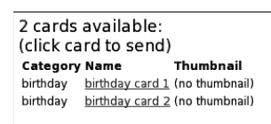

图 12-3：卡片选择菜单

### 发送卡片

选择卡片后，用户填写包含收件人、发件人和消息的表单，并发送卡片通知。

与此类许多脚本一样，card_send.php 处理两种功能，因此监控控制流很重要。在呈现表单时，脚本接受名为 ID 的卡片 ID 参数。当它接受表单时，还有几个其他参数：sender_email、sender_name、recip_email、recip_name 和 message。


脚本首先验证卡片 ID 并在数据库中查找卡片：

```php
<?php
require_once("card_include.php");

/* Validate card ID. */
$ID = $_REQUEST['ID'];
if ((!is_numeric($ID)) || ($ID == "") || ($ID < 1) ) {
    die("Invalid ID");
}

$sql = "SELECT ID, category, content, width, height, description
FROM card_list
WHERE ID = $ID";

$result = @mysql_query($sql, $connection) or die (mysql_error());
if (mysql_num_rows($result) == 0) {
    die('Invalid ID.');
}
$card = mysql_fetch_array($result);
```

现在是时候通过检查参数来查看我们是在显示表单还是发送卡片了。我们将从发送卡片的情况开始。首要任务是检查输入参数。我们将使用的方法很简单；你很可能想要添加一个 CAPTCHA（参见“#66：创建 CAPTCHA（安全）图像”，第 129 页）或某种有效电子邮件地址格式检查。

```php
/* Determine mode - Are we displaying or sending a card? */
if (isset($_POST['rec_email'])) {
    /* Sending card */

    /* Check and clean data. */
    $sender_email = substr($_POST['sender_email'], 0, 50);
    $send_name = substr($_POST['sender_name'], 0, 50);
    $rec_email = substr($_POST['rec_email'], 0, 50);
    $rec_name = substr($_POST['rec_name'], 0, 50);
    $message = substr($_POST['message'], 0, 600);
    $message = strip_tags($message);
    $rec_name = strip_tags($rec_name);
    $send_name = strip_tags($send_name);

    if ($_POST['message'] == '') {
        die("You must give a message!");
    }
}
```

脚本刚刚从消息中删除了所有 HTML 标签，但你可能想要在其中添加某种格式，因此我们将使用来自“#42：将纯文本转换为 HTML 就绪标记”，第 77 页的 `autop()` 函数。

```php
/** Transform the text message into HTML. */
require("autop.php");
$message = autop($message);

/** Create a pickup token. */
$token = md5(strval(time()) . $send_email . $rec_email . $ID);

/** Insert the row into sent cards. */
$sql = 'INSERT INTO cards_sent
        (sender_email, sender_name, message,
         recip_email, recip_name, token, ID)
        VALUES
        ("' . $send_email . '","' .
        mysql_escape_string($send_name) . '","' .
        mysql_escape_string($message) . '","' .
        $rec_email . '","' .
        mysql_escape_string($rec_name) . '","' .
        $token . '","' .
        $ID . '")';
$result = @mysql_query($sql, $connection) or die (mysql_error());

/** PHPMailer class for sending mail */
include_once("phpmailer/class.phpmailer.php");
$mail = new PHPMailer;

$mail->ClearAddresses();
$mail->AddAddress($rec_email, $rec_name);
print "$rec_email, $rec_name<br />";
$mail->From = 'cards@example.com';
$mail->FromName = $send_name;
$mail->Subject = "You have received an e-card from $send_name!";
$mail->Body = "You have received an e-card!\n";
$mail->Body .= "Please go to
http://www.example.com/card_show.php?token=$token to view it.\n\n";
$mail->Body .= "Sincerely,\nThose e-card guys";

if ($mail->Send()) {
    print 'Your e-card was sent!';
} else {
    print 'There was an error: ' . $mail->ErrorInfo;
}
}
```

当给定表单数据时，发送卡片就只需这些。注意外发电子邮件消息中对最终脚本 card_show.php 及其 token 参数的引用。你需要修改前面片段的部分内容，特别是 URL，你可能希望将其放在 card_include.php 中。此外，此脚本应将用户重定向到另一个看起来更好的页面。

如果我们只是显示表单，任务就归结为琐碎的工作：

```php
} else {
/* Display card and sending form. */
    print '<span style="font-family: sans-serif; font-size: 12px;">';
    print '<form action="card_send.php" method="post">';
    print '<input name="ID" type="hidden" value="" . $card['ID'] . "">';
    display_card($card);
    print '<br />';
?>
Recipient Email:<br />
<input name="recip_email" type="text" size="30" maxlength="50">
<br /><br />
Recipient Name:<br />
<input name="recip_name" type="text" size="30" maxlength="50">
<br /><br />
Message (No HTML, 600 characters max):<br />
<textarea name="message" cols="40" rows="6"></textarea>
<br /><br />
Sender Email:<br />
<input name="sender_email" type="text" size="30" maxlength="50">
<br /><br />
Sender Name:<br />
<input name="sender_name" type="text" size="30" maxlength="50"></td></tr>
<br /><br />
<input name="" type="submit" value="Send Your Card!"></td></tr>
</form>
</span>
<?php
}
?>
```

图 12-4 显示了表单。

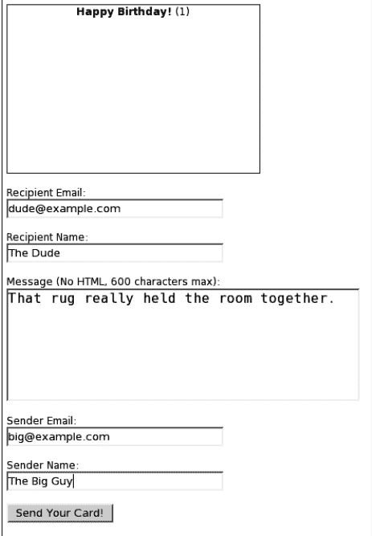

图 12-4：发送卡片

### 查看卡片

我们快完成了；现在只需要 card_show.php 脚本来向收件人显示卡片并通知发件人卡片已被查看。第一部分与几乎任何其他脚本一样；它加载包含文件并清理输入参数。在此示例中，我们丢弃 token 参数中的任何非字母数字字符：

```php
<?php
require_once("card_include.php");
$token = preg_replace('/[^a-z0-9]/i', '', $_REQUEST['token']);

$sql = "SELECT S.sender_name, S.sender_email, S.message,
        S.recip_name, S.recip_email, S.notified,
        C.content, C.width, C.height
        FROM cards_sent S, card_list C
        WHERE C.ID = S.ID
        AND S.token = '$token'";
$result = @mysql_query($sql, $connection) or die (mysql_error());
if (mysql_num_rows($result) == 0) {
    die('Invalid card.');
}
$row = mysql_fetch_array($result);
```

注意 cards_sent 中的 notified 字段：这指示卡片是否已被查看。它应在发送卡片后始终设置为 0。

打印卡片和消息是乏味的工作，但幸运的是我们有来自 card_include.php 的 display_card() 函数，因此不必记住如何根据数据库字段进行显示。

```php
print '<span style="font-family: sans-serif; font-size: 12px">';
print '<p>A card for you!</p>';
display_card($row);
print '<br />';
print '<strong>'. stripslashes($row["sender_name"]) . '</strong> writes:';
print '<br />';
print stripslashes($row["message"]);
```

现在让我们处理通知。显然，如果这不是卡片第一次被查看，我们不想再次向发件人发送电子邮件，因此我们首先检查这一点。与我们在 card_send.php 中所做的一样，我们将使用 PHPMailer 发送电子邮件：

```php
if (!$row['notified']) {
    /* Notify sender that the message was picked up. */
    include_once("phpmailer/class.phpmailer.php");
    $mail = new PHPMailer();
    $mail->ClearAddresses();
    $mail->AddAddress($row['sender_email'], $row['sender_name']);
    $mail->From = 'example@example.com';
    $mail->FromName = 'E-card People';
    $mail->Subject = 'e-card retrieved';
    $mail->Body = "Your e-card to $row[recip_name] has been picked up.
                    Sincerely,
                    Those e-card guys";
    $mail->Send();
}
```

现在我们更新 cards_sent 表中卡片的 notified 字段，以便这是唯一会发出的通知消息：

```php
$sql = "UPDATE cards_sent
    SET notified = 1
    WHERE token = '$token'";
@mysql_query($sql, $connection);
}
?>
```

图 12-5 显示了收件人从 card_show.php 看到的内容。显然，这并不十分花哨，但作为 HTML 高手的你，没有困难将其美化起来，对吧？

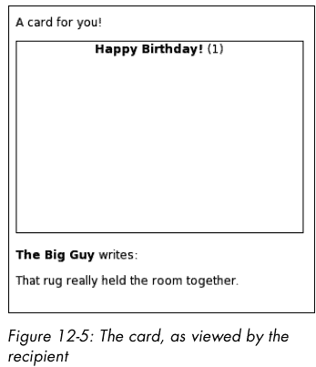

### 黑客脚本

改进此系统有多种方法。首要且最重要的改进之一是安装 CAPTCHA 或类似系统，以使自动发送卡片作为垃圾邮件变得困难（参见 #66：创建 CAPTCHA（安全）图像，第 129 页）。

另一个重要组成部分是管理工具，可让你添加、编辑和禁用卡片。当卡片数量达到一定程度时，在单个页面上显示和管理它们会变得困难，因此你应该添加搜索功能。

## 76：博客系统

博客很常见，因为它们非常容易编写——你真正需要的是一个跟踪日期和内容的系统。此处出现的基本博客包括用于添加条目、添加评论和查看条目的工具。该系统将条目和评论存储在 MySQL 数据库中，并使用 Smarty 进行显示模板。

以下是博客条目的主表，最初名为 blog_entries：

```sql
CREATE TABLE `blog_entries` (
  `id` INT NOT NULL AUTO_INCREMENT ,
  `title` VARCHAR( 120 ) NOT NULL ,
  `content` TEXT NOT NULL ,
  `teaser` TINYTEXT NOT NULL ,
  `entry_time` DATETIME NOT NULL ,
```


```
`category` VARCHAR( 12 ) NOT NULL ,
PRIMARY KEY ( `ID` )
) TYPE = MYISAM ;
```

大多数字段都不言而喻。teaser 是条目中不包含任何标记的摘要片段。以下是 `blog_comments` 表：

```
`CREATE TABLE `blog_comments` (
 `comment_ID` INT AUTO_INCREMENT ,
 `name` VARCHAR( 50 ) NOT NULL ,
 `comment` TEXT NOT NULL ,
 `comment_time` timestamp,
 `ID` INT NOT NULL ,
 PRIMARY KEY ( `comment_ID` )
) TYPE = MYISAM ;
```

`comment_time` 字段采用 `timestamp` 类型的原因是，我们不打算让评论可编辑；评论一旦发布，就不会再更改，因此无需手动设置日期。

与我们的其他脚本一样，名为 `blog_config.php` 的配置文件用于配置 MySQL 连接并创建 Smarty 对象。使用此默认配置，Smarty 模板将放置在 `templates` 目录中：

```
`<?php
session_start();
$connection = @mysql_connect("localhost","login","password") or die("Couldn't connect.");
$db = @mysql_select_db("wcphp", $connection) or die(mysql_error());
require_once ("smarty/Smarty.class.php");
$smarty = new Smarty();
?>`
```

以下是系统中四个脚本的概述：

- **blog_edit.php** 编辑并添加新的博客条目
- **blog_index.php** 显示博客条目列表
- **blog_display.php** 显示单个博客条目
- **blog_comment.php** 向博客条目添加评论

### 创建博客条目

在做其他任何事情之前，能够先添加内容很重要。因此，我们直接进入条目编辑器。使用这个脚本，我们将真正开始看到使用 Smarty 将 HTML 模板与 PHP 分离是多么清晰。让我们从名为 `templates/blog_edit.tpl` 的模板开始：

```
`<html><head>
<title>{$title}</title>
{literal}
<style>
h1 {
	font-family: sans-serif;
	font-size: 20px;
}
table.inputfields {
	font-family: sans-serif;
	font-size: 12px;
}
table.inputfields td {
	vertical-align: top;
}
</style>
{/literal}
</head>
<body>
<h1>New Blog Entry</h1>
<form method="post" action="blog_edit.php">
<table class="inputfields">
<tr> <td>Title:</td><td><input name="title" type="text" /></td> </tr>
<tr> <td>Body:</td><td><textarea name="content" rows="15" cols="40"></textarea></td>
</tr>
<tr> <td>Category:</td><td><input name="category" type="text" /> </tr>
<tr> <td> </td><input name="submit" type="submit" value="Post" /> </td> </tr>
</table>
</form>
</body>
</html>`
```

这个模板只不过是一个包含标题、内容和分类字段的表单，通过 POST 方法发送到 blog_edit.php。图 12-6 显示了浏览器在通过 Smarty 发送此表单时的渲染方式。

| 功能 | 值 |
| :--- | :--- |
| **新建博客条目** | |
| 标题： | test post |
| 正文： | This is the first test posting. |
| 分类： | test [Post] |

图 12-6：发布博客条目

以下是 blog_edit.php，这是一个双模式脚本。如果它正在接收前一个表单的输入，它会清理输入字段，将新条目插入数据库，然后将用户重定向到显示新条目的页面：

```php
<?php
require_once("blog_config.php");

if ($_REQUEST["submit"]) {
	$content = mysql_escape_string(strip_tags($_REQUEST["content"],
	"<a><i><b>"));
	$teaser = substr(strip_tags($content), 0, 80);
	$title = mysql_escape_string(strip_tags($_REQUEST["title"]));
	$category = mysql_escape_string(strip_tags($_REQUEST["category"]));
	$q = "INSERT INTO blog_entries
		(title, content, category, teaser, entry_time)
		VALUES ('$title', '$content', '$category', '$teaser', now())";
	mysql_query($q, $connection) or die(mysql_error());
	$id = mysql_insert_id($connection);
	header("Location: blog_display.php?ID=$id");
}
```

请注意 mysql_insert_id() 的用法。这个实用函数返回最后插入的 AUTO_INCREMENT 数据库字段的值。在此例中，它是新 blog_entries 行的 ID 字段，因此我们可以使用它将用户发送到新条目的显示页面。

如果我们只是显示博客条目表单而不是插入条目，只需让 Smarty 显示它即可：

```php
} else {
	$smarty->assign("title", "blog: post an entry");
	$smarty->display("blog_edit.tpl");
}
?>
```

从技术角度讲，你可以将标题硬编码到模板中，但分配一个变量可以让你为制作更高级的编辑器做好准备（如果需要的话）。

### 显示条目

blog_display.php 脚本必须输出三项内容：博客条目、博客的评论，以及允许用户添加自己评论的表单。让我们先在 templates/blog_display.tpl 中检查这三个组件。第一部分是头部信息以及一段我们稍后用于显示评论表单的 JavaScript：

```
`<html><head>
<title>{$title}</title>
{literal}
<style>
h1 {
	font-family: sans-serif;
	font-size: 20px;
}
h4 {
  font-family: sans-serif;
  font-size: 12px;
}
.content {
  font-family: sans-serif;
  font-size: 12px;
}
</style>
<script>
function show_cform() {
  o = document.getElementById("comment_form");
  if (o) { o.style.display = ""; }
  o = document.getElementById("comment_link");
  if (o) { o.style.display = "none"; }
}
</script>
</literal>
</head>`
```

接下来是博客条目内容部分。这部分相对简单，因为结构是静态的。请注意 blog_index.php 链接，这将是我们的最后一个脚本：

```
<body>
<span class="content">
<a href="blog_index.php">my blog</a>
<h1>{$title}</h1>
{$date}
<p>
{$content}
</p>
Category: {$category}<br />
<br />
```

对于博客评论，Smarty 的 {section} 功能允许我们通过在数组中遍历评论来显示任意数量的评论。在此例中，我们将把 $comments 变量分配给一个评论数组。每个评论本身也是一个数组，带有 name、time 和 comment 键，用于访问单个评论内容。Smarty 遍历评论，为每个评论显示此部分的内容，从而实现非常紧凑的表示。如果你感到困惑，请跳至前面查看 blog_display.php 如何分配 $comments 变量。

```
<h4>Comments</h4>
{section name=i loop=$comments}
<b>{$comments[i].name}</b> ({$comments[i].time})<br />
{$comments[i].comment}
<br /><br />
{/section}
```

最后，我们需要显示用于允许用户添加评论的表单。为此，我们会使用一个小技巧；我们不会直接显示表单，而是将其保持隐藏，直到用户单击标记为“添加评论”的 JavaScript 链接。表单的操作是 blog_comment.php。

```
<div id="comment_link">
 <a href="javascript:show_cform();">Add a Comment</a>
</div>
<div id="comment_form" style="display: none;">
<form method="post" action="blog_comment.php">
<input type="hidden" name="ID" value="{$id}">
Your name:<br />
<input name="name" type="text" />
<br /><br />
Comment:<br />
<textarea name="comment" rows="8" cols="40"></textarea>
<br />
<input type="submit" value="Post comment">
</form>
</div>
</span>
</body>
</html>
```

图 12-7 显示了一个带有隐藏评论表单的条目显示示例。

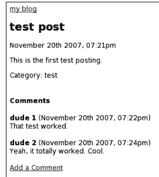

图 12-7：博客条目（带评论）

在把所有混乱的 HTML 抛在脑后之后，blog_display.php 很快就能组装完成。我们遵循常规的初始流程，验证 ID 输入参数并在数据库中查找条目：

```php
<?php
require_once("blog_config.php");
$ID = intval($_REQUEST['ID']);

$query = "SELECT title, category, content,
 UNIX_TIMESTAMP(entry_time) AS entry_time
 FROM blog_entries
WHERE ID = $ID";

$result = @mysql_query($query, $connection) or die(mysql_error());
if (mysql_num_rows($result) == 0) {
    die('Invalid ID.');
}
```

如果走到这里，说明条目有效，因此我们将其数据分配给 Smarty 对象：

```php
$row = mysql_fetch_array($result);
$smarty->assign("title", $row["title"]);
$smarty->assign("content", $row["content"]);
$smarty->assign("category", $row["category"]);
$smarty->assign("date", date("F dS Y, h:ia", $row["entry_time"]));
$smarty->assign("id", $ID);
```

现在我们使用一个非常简单的 MySQL 查询来查找评论（无需连接表）：

```php
/* Look up comments. */
$query = "SELECT comment, name,
    UNIX_TIMESTAMP(comment_time) AS comment_time
    FROM blog_comments
    WHERE ID = $ID
    ORDER BY comment_time ASC";
$result = @mysql_query($query, $connection) or die (mysql_error());
```

是时候完成脏活累活了，即将评论放入名为 $comments 的二维数组，并将其分配给 Smarty 的 $comments 变量。通常，这种代码是一团用于标签关闭和打印的打印语句，但如前所述，借助 Smarty 的 {section} 功能，这小菜一碟：

```php
$comments = array();
while ($row = mysql_fetch_array($result)) {
    $comments[] = array(
        "name"    => $row["name"],
        "comment" => $row["comment"],
        "time"    => date("F dS Y, h:ia", $row["comment_time"]),
    );
}
$smarty->assign("comments", $comments);
```

现在只剩下处理模板了。

```php
/* Display page. */
$smarty->display("blog_display.tpl");
?>
```


现在，当用户添加评论时，我们该怎么办？

### 添加评论

向条目添加评论的脚本 blog_comment.php 是本系统中唯一没有模板的脚本，因为它不显示任何内容。还记得前一节中提到的，它接受三个参数：ID、comment 和 name，分别对应条目 ID、评论内容和发表评论的人的姓名。第一步是确保条目 ID 有效：

```php
<?php
require_once("blog_config.php");

$ID = intval($_REQUEST["ID"]);
/* Look up the blog posting; make sure it’s real. */
$query = "SELECT title FROM blog_entries WHERE ID = $ID";
$result = mysql_query($query, $connection) or die(mysql_error());
if (mysql_num_rows($result) != 1) {
	header("Location: blog_index.php");
	exit;
}
```

然后，通过删除其中的所有 HTML 来清理评论和姓名。如果清理完之后仍有内容剩余，我们将其插入 blog_comments 表中：

```php
$name = mysql_escape_string(strip_tags($_REQUEST["name"]));
$comment = mysql_escape_string(strip_tags($_REQUEST["comment"]));
$comment = nl2br($comment);

if (!empty($name) && !empty($comment)) {
	$query = "INSERT INTO blog_comments
		(ID, comment, name)
		VALUES ($ID, '$comment', '$name')";
	mysql_query($query, $connection) or die(mysql_error());
}
```

完成后，我们将用户发送回博客条目页面来结束操作，该页面现在（理论上）包含了用户自己的两 cents（看法）：

```php
header("Location: blog_display.php?ID=$ID");
?>
```

我们的博客系统现在缺少的唯一东西就是一个索引页面。

### 创建博客索引

显示最新博客条目的问候页面与博客条目页面相似，因为它使用了 Smarty {section} 功能来减少迭代混乱。

让我们来看看 templates/blog_index.tpl 文件，它以这个标准的头部信息开始：

```html
<html><head>
<title>{$title}</title>
{literal}
<style>
table.entries {
font-size: 12px;
}
table.entries td {
padding-bottom: 7px;
}
.headline {
font-size: 14px;
font-weight: bold;
}
</style>
{/literal}
</head>
<body>
<a href="blog_index.php">my blog</a>
```

如果需要，博客索引将能够按类别显示条目。下一部分会在存在类别时显示当前类别：

```html
{if $category}
<br />
Category: {$category}
{/if}
```

现在我们使用 {section} 遍历 $blog_items 变量，这是一个数组的数组，每个数组包含关于博客条目的信息：

```html
<br />
<table class="entries">
{section name=i loop=$blog_items}
<tr><td>
<span class="headline">
<a href="blog_display.php?ID={$blog_items[i].ID}">{$blog_items[i].title}</a>
</span>
</br>
{$blog_items[i].date}<br />
{$blog_items[i].teaser}<br />
Category: <a href="blog_index.php?category={$blog_items[i].category_parm}">{$blog_items[i].category}</a>
</td></tr>
{/section}
</table>
</body>
</html>
```

blog_index.php 脚本首先检查 category 参数。如果存在该参数，索引应仅显示该类别的条目。为此，创建一个 SQL WHERE 子句来限制你很快将看到的查询，但请确保先清理输入参数。如果没有类别，则将其变量设置为空字符串。

```php
<?php
require_once("blog_config.php");

if ($_REQUEST["category"]) {
  $category = mysql_escape_string($_REQUEST["category"]);
  $where_clause = "WHERE category = '$category'";
  $smarty->assign("category", $category);
} else {
  $where_clause = "";
  $smarty->assign("category", "");
}
```

按如下方式构建并运行 SQL 查询：

```php
$sql = "SELECT title, category, teaser,
             UNIX_TIMESTAMP(entry_time) AS entry_time, ID
             FROM blog_entries
             $where_clause
             ORDER BY entry_time DESC
             LIMIT 0, 20";
$result = @mysql_query($sql, $connection) or die (mysql_error());
if (mysql_num_rows($result) == 0) {
  die('No entries in this blog.');
}
```

假设查询成功，你可以直接构建要分配给 $blog_items Smarty 变量的数组：

```php
$items = array();
while ($row = mysql_fetch_array($result)) {
  $items[] = array(
  "ID"       => $row["ID"],
  "date"     => date("F dS Y, h:ia", $row['entry_time']),
  "title"    => $row['title'],
  "teaser"   => $row["teaser"],
  "category" => $row["category"],
  "category_parm" => urlencode($row["category"]),
  );
}
$smarty->assign("blog_items", $items);
```

最后，分配标题并显示模板（有关最终结果，请参见图 12-8）：

```php
$smarty->assign("title", "blog: index");
$smarty->display("blog_index.tpl");
?>
```

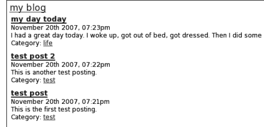

图 12-8：博客条目索引

### 脚本黑客技巧

博客生来就是为了被修改扩展。你可以向这个系统添加许多功能，所有这些功能都建立在或扩展你的 PHP 知识之上。以下是几个示例想法：

- **存档** 一旦条目超过几条，你就需要按页面拆分索引。“第 3 条：创建上一页/下一页链接”第 7 页可以帮助你实现这一点。
- **RSS 源** 将你从“第 3 条：构建 Web 服务”第 151 页中了解到的创建 Web 服务的知识应用到这个系统，你就实现了博客的订阅。
- **登录和管理** 目前，任何人都可以向博客添加条目。你可以通过要求登录后才能添加条目来防止这种情况。此外，你可以通过向博客表中添加用户名来添加多个博客。
- **评论 CAPTCHA** 如果你有一个博客，你就会遇到垃圾评论。你可以使用“第 66 条：创建 CAPTCHA（安全）图像”第 129 页中的脚本，或使用 Akismet 来消除它们。

无论你做什么，都要享受其中的乐趣！

# 附录

本书中的几个脚本引用了一个 product_info 表，其中包含假设商店的库存详细信息。以下是表定义：

```sql
CREATE TABLE `product_info` (
`product_name` varchar(50) default NULL,
`product_id` int(10) default NULL,
`category` enum('shoes','gloves','hats') default NULL,
`price` double default NULL,
PRIMARY KEY (`product_id`)
);
```

一旦建立了表，你可能希望提供一些示例数据：

```sql
INSERT INTO `product_info` VALUES ('Cowboy Boots',12,'shoes',19.99);
INSERT INTO `product_info` VALUES ('Slippers',17,'shoes',9.99);
INSERT INTO `product_info` VALUES ('Snowboarding Boots',15,'shoes',89.99);
INSERT INTO `product_info` VALUES ('Flip-Flops',19,'shoes',2.99);
INSERT INTO `product_info` VALUES ('Baseball',20,'hats',12.79);
```

请注意，尽管 product_id 字段中的数字有些任意，但每一行必须是唯一的。

# 索引

## 符号

- . = 追加运算符，95
- ?!= 分组修饰符，80
- ?! 分组修饰符，80
- <? 标记，2
- *（星号），71
- @（at 符号），57
- \（反斜杠），71, 74, 87
- [ ]（方括号），48, 71
- ^（插入符号），70, 71
- :（冒号），26
- { }（花括号），71
- -（连字符/破折号），71
- $（美元符号），15–16, 70
- ==（双等号），64
- "（双引号）
  - 转义，26
  - 查找，46
  - Magic Quotes，26
  - 字符串与，70
- =（等号），20, 64
- （）（圆括号），71
- .（句点），70, 71
- |（管道符号），70, 71
- +（加号），71
- ?（问号），71
- ;（分号），20, 26, 121
- '（单引号）
  - 错误与，23
  - 转义，26
  - 字符串与，70
- /（斜杠），70
- ===（三重等号），64

## A

- $a 数组，13
- 访问控制，26–27
- 访问密钥 ID，149–150
- AddAddress() 方法，122
- AddAttachment() 函数，122–123
- AddChild() 方法，152
- 插件。另见：扩展；库
- AddStringAttachment() 方法，123
- AJAX，162
- allow_url_fopen() 函数，35, 95
- allow_url_include 参数，35
- Amazon.com，149–151
- 锚标签，72, 75–77
- 存档，tar，30
- array_multisort() 函数，13
- 数组。另请参见：特定数组
  - 转换为字符串，12
  - 转换为变量，12–13
  - Cookie 与，107
  - 错误，23
  - $_FILES，47
  - $_GET，47
  - 将表单变量导入其中，48–50
  - 匹配，72–73
  - 多维数组，11, 13–14
  - $_POST，47
  - 打印内容，11, 73, 145–146
  - $_REQUEST，47
  - 序列化，12–13
  - 排序，13–14
  - 查看内容，11
- assign() 方法，16
- Associates Web 服务，149–151


- 星号 (*), 71
- at 符号 (@), 57
- 附件, 电子邮件, 122–123
- 身份验证。另见 密码; 安全; 验证
- Cookie。另见 Cookie
- 电子邮件, 121
- SMTP, 121, 123
- 用户, 116–118
- 网站登录, 116–118
- autop() 函数, 78–79
- awstats 分析器, 115

## B

- $b 数组, 13
- 后向引用, 74, 75
- 反斜杠 (\), 71, 74, 87
- 在线选票, 156–162
- base64decode() 函数, 43
- base64encode() 函数, 43
- 黑名单, 46
- 博客系统, 171–181
- 布尔值, 22
- <br> 标签, 77–78, 79
- 方括号 ([ ]), 48, 71
- 浏览器。另见 Web 浏览器
- 按钮, 52, 108

## C

- calculate_time_difference() 函数, 89
- CAPTCHA, 129–130, 166, 181
  - 图片, 129–136
- $card_regexes 数组, 54
- 贺卡, 162–171
- 插入符号 (^), 70, 71
- 层叠样式表 (CSS), 4–6
- 类, 164
- 大小写敏感, 62–63, 70
- 字符类, 71
- 字符
  - 在字符串中查找, 70
  - 分组, 71
  - 小写, 62–63
  - 删除, 60
  - 在字符串中替换, 60
  - 特殊字符, 70–71
  - 大写, 62–63
  - 通配符, 71
- 复选框值, 48–50
- checkdate() 函数, 85
- 校验和测试, 54
- 密码, 42
- 类
  - 字符, 71
  - CSS, 164
  - SOAP, 149
- 客户端
  - 关于客户端的信息提取, 111–115
  - 邮件, 122
- 代码。另见 数据
  - 已弃用, 22
  - 十六进制, 38
  - 源代码, 11
  - UTF-8 编码, 38
  - 查看, 11
- 冒号 (:), 26
- 颜色
  - 图像, 132
  - 多边形, 133–134
  - 行, 4–6
- 列, 6。另见 表格
- 命令行, 93
- 逗号分隔值 (CSV)
  - 格式, 101–102
- 注释, 129, 171–181
- $comments 变量, 175, 177–178
- comment_time 字段, 172
- 全自动公共图灵测试以区分计算机和人类。另见 CAPTCHA
- config.php 文件, 2, 157, 172
- configure 命令, 30–31
- 配置 PHP, 19–32
  - 添加扩展, 27–32
  - 启用 Magic Quotes, 26
  - 错误报告, 22–24
  - 延长脚本运行时间, 24–25
  - 文件访问, 26–27
  - 大文件上传及, 25
  - 概述, 19
  - 安全, 35
  - 设置, 20–22
  - 关闭特定函数, 27
  - 抑制错误消息, 24
  - 关闭全局变量, 25–26
- 常量, 23
- $_COOKIE 数组, 106
- Cookie 容器, 144
- Cookie。另见 身份验证
  - 访问, 106
  - 数组和, 107
  - 在 cURL 中, 144
  - 描述, 104
  - 过期日期, 106, 159
  - 名称, 106
  - 在线投票和, 156, 162
  - 路径, 106
  - 问题, 106–107, 109
  - 优缺点, 104
  - 拒绝, 106–107
  - 会话 ID, 104–105, 109
  - 与会话的比较, 105
  - 设置, 106
  - 设置, 106
  - 从中窃取数据, 37–39
  - 存储, 106
  - 使用 Cookie 追踪用户数据, 104–105
  - 值, 106
  - Web 浏览器和, 106–110
  - “欢迎回来”消息, 105–106
  - XSS 攻击, 37–39
- 协调世界时 (UTC), 83
- 复制文件, 100
- $count() 变量, 9
- create_navbar() 函数, 9–11
- 信用卡
  - 过期日期, 55–56
  - 号码格式, 54–55
  - SSL 加密, 111
  - 验证事务, 52–55
  - 在表单数据中验证, 51–52
- 跨文件可读性, 96
- 跨站点脚本。另见 XSS (跨站点脚本)
- CSS (层叠样式表), 4–6
  - 类, 164
- CSV (逗号分隔值)
  - 格式, 101–102
- cURL 库, 142
- cURL 工具, 141–153
  - 连接到网站, 142–144
  - 将 XML 数据转换为可用形式, 144–146
  - 中的 Cookie, 144
  - 描述, 19, 27
  - Web 服务器连接, 141, 142–144
- curl_close() 函数, 143
- curl_exec() 函数, 142
- curl_init() 函数, 142
- CURLOPT_RETURNTRANSFER() 函数, 142
- curl_setopt() 函数, 143
- 花括号 ({ }), 71
- $current_page() 变量, 9

## D

- \d 字符, 70
- 连字符 (-), 71
- 数据。另见 加密
  - MD5, 40–41
  - 从 URL 读取, 95
  - 从 Amazon.com 请求, 149–151
  - 会话 ID, 104–105, 109
  - 存储用户数据, 107–109
  - 临时存储, 107–109
  - 追踪用户数据, 104–105
  - UTF-8 编码, 38
  - 验证, 99
  - XLS, 101–102
  - XML, 144–146
- 数据库。另见 行; 表格
  - 自动向其中添加值, 48–50
  - 注入攻击, 26, 35–36
  - 加载, 157, 159
  - 密码, 40–41
  - 在其中存储数组, 12
- DATE 字段类型, 90
- date() 函数, 82–88
- 日期。另见 时间
  - 计算星期几, 88
  - 从 创建时间戳, 84–85
  - 使用 mktime() 创建, 85
  - 纪元日期, 81
  - 查找 之间的差异, 88–90
  - 格式化, 82, 83, 85–88, 90
  - MySQL, 90
  - 过去/未来, 83–85
  - 之间的已过时间, 88–90
  - 时间戳。另见 时间戳
  - Unix 时间, 81–82
  - 使用 checkdate() 验证, 85
  - 使用 strtotime() 验证, 84
  - 处理, 81–90
- DATETIME 字段类型, 90
- 删除文件, 96
- 删除子字符串, 64
- deserialize() 函数, 12
- $dest_image, 138
- 词典, pspell, 65–69
- 目录
  - 访问, 26–27
  - 权限, 92–93
  - 上传图像到, 96–101
- display() 方法, 15
- display_errors 设置, 24
- 美元符号 ($), 15–16, 70
- DOM 系统, 145, 151
- 域, 106
- 句点字符。另见 句点 (.)
- 双引号 ("")
  - 转义, 26
  - 查找, 46
  - Magic Quotes, 26
  - 字符串和, 70
- 加密
  - 数组, 12
  - 与 哈希的比较, 40
  - Mcrypt, 27, 41–43
  - 密码, 117
  - SSL, 111
- 纪元日期, 81
- 等号 (=), 20, 64
- ereg() 函数, 69
- error_log 参数, 24
- error_reporting 参数, 24, 35
- 错误。另见 故障排除
  - 数组, 23
  - 构建过程中, 32
  - 常见, 23–24
  - 文件打开, 96
  - 索引, 23
  - 日志记录, 35
  - 权限, 95
  - 打印, 155
  - 引号和, 23
  - 报告, 22–24, 35
  - 抑制, 24
  - 变量, 23

## E

- 东部标准时间, 83
- 电子贺卡服务, 162–171
- 电子贺卡, 162–171
- 电子邮件, 119–127
  - 附件, 122–123
  - 身份验证, 121
  - 贺卡, 165–171
  - HTML, 122
  - 垃圾邮件, 120, 124
  - 密码, 121
  - PHPMailer, 120–123, 167
  - 发送, 119–127
  - sendmail, 120–121, 123
  - SMTP, 120, 121, 123
  - 垃圾邮件, 120, 124
  - 验证地址, 56–57, 124, 166
  - 使用  验证用户帐户, 124–127
- --enable-soap 参数, 149
- 转义序列, 87
- Excel (XLS) 格式, 101–102
- Excel 电子表格, 101–102
- exec() 函数, 27, 35
- 执行权限, 92
- expose_php 参数, 35
- 表达式, 正则。另见 正则表达式
- 可扩展标记语言。另见 XML (可扩展标记语言)
- 扩展。另见 库
  - 添加到 PHP, 27–32
  - 检查, 28–29
  - 示例, 27–28
  - 查找, 28
  - .gif, 136
  - .gz, 30
  - 安装库, 30–32
  - .jpg, 122, 136
  - .png, 136

## F

- fclose() 函数, 94
- feof() 函数, 94
- fgetcsv() 函数, 102
- fgets() 函数, 94
- file_exists() 函数, 96
- 文件名
  - 电子邮件附件, 122–123
  - fopen() 和, 95
  - 未经检查的变量作为, 4
  - 上传的文件, 99
- 文件, 91–102
  - 中的空行/空格, 3
  - 逗号分隔, 101–102
  - config.php, 2, 157, 172
  - Cookie 容器, 144
  - 复制, 100
  - 创建, 96
  - 删除, 96
  - 文件打开错误, 96
  - 中的函数/脚本, 2
  - GIF, 28, 129, 139
  - 包含, 3–4, 35
  - 在脚本中包含, 2–4
  - 错误后缀, 100
  - JPEG, 28, 123, 132, 135
  - 日志, 24
  - 模式, 94
  - 名称。另见 文件名
  - 打开, 94, 95, 96
  - 中的密码, 2–4
  - 路径, 94, 122
  - 权限, 91–93
  - 将内容放入变量中, 93–95
  - PNG, 136, 139
  - 阻止用户上传, 25
  - 读取, 94
  - 限制对 的访问, 26–27
  - 大小, 25, 99–100, 101, 138
  - 存储的项目, 2–4
  - 中的变量, 2
  - 验证 的存在, 96, 100
  - 将字符串写入, 96
  - 写入, 94, 96
  - WSDL, 150
- $_FILES 数组, 47
- 查找项目
  - Amazon.com 数据, 150–151
  - 在博客中, 171
  - 字符串中的字符, 70
  - 通过 Google 搜索, 30, 65, 151
  - 拼写错误的单词, 65–69
  - PHP 扩展, 28
  - 引号, 46
  - 正则表达式, 70
  - 子字符串, 61, 63–64
  - 通过 Yahoo! 搜索, 144
- Firefox 浏览器, 113–114
- 字体, 130–132。另见 文本
- fopen() 函数, 94, 95, 96
- 表单变量, 47, 48–50
- 格式化项目
  - 逗号分隔值, 101–102
  - 信用卡号码, 54–55
  - 日期, 82, 83, 85–88, 90
  - 时间, 85–88
- 表单, 45–57
  - CAPTCHA, 130–136
  - 复选框值, 48–50
  - 安全问题, 33–34, 45–46, 51
  - 验证, 45–46, 51–52
  - 验证策略, 46
  - 空白, 47–48
- Freetype, 130
- FTP 程序, 92–93
- function_exists() 函数, 29
- 函数。另见 特定函数
  - 大小写敏感性, 62–63
  - 禁用, 27
  - Perl 兼容, 69–70
  - POSIX 扩展, 69
  - 关闭, 27
  - 在文件中存储, 2

## G

- GD 库
  - CAPTCHA 图像和, 130, 136
  - 描述, 28
  - 缩略图图像, 136–137
- $_GET 数组, 47
- GET 参数
  - 访问页面, 143
  - REST 服务, 142
  - 安全风险, 25–26
- getimagesize() 函数, 98, 99
- getmyid() 函数, 144
- .gif 扩展名, 136
- GIF 文件, 28, 129, 139
- 全局变量
  - 已注册, 25–26
  - 安全和, 34–35


Google，151
Maps API，148–149
搜索，30, 65, 151
图形，创建，28
贺卡，电子，162–171
字符分组，71
分组修饰符 (?!, ?<!)，80
组，71, 91
.gz 扩展名，30

## H

- 哈希密码，40–41, 118
- 哈希值
  - 与加密对比，40
  - MD5，40–41, 116–117, 167
  - 单向，40–41
  - 密码，40–41, 118
- header() 函数，110, 111
- 标头，106, 110, 111, 142
- 十六进制代码，38
- 托管服务，20, 29
- HTML
  - 锚标签，72, 75–77
  - 将纯文本转换为 HTML，77–79
  - 将 URL 转换为超链接，80
  - 电子邮件，122
  - 表单。参见 表单
  - HTMLSax，38–39
  - SafeHTML，38–39
  - 屏幕抓取程序，75–77
  - Smarty 模板，14–17
  - XSS 攻击，37–38
- HTML 标签
  - 从字符串中去除，80
  - XSS 攻击，37–38
- htmlentities() 函数，38
- HTMLSax，38–39
- HTTP 标头，106, 110, 111, 142
- http_build_query() 函数，143
- 超链接。另参见 URLs
  - 属性，72
  - 将 URL 转换为超链接，80
  - 从锚标签中提取，75–77

## I

- i 修饰符，72
- if/then 循环，48
- imagecopyresampled() 函数，138
- imagecreatetruecolor() 函数，132
- imagedestroy() 函数，135, 138
- imagefilledpolygon() 函数，132–133
- imagejpeg() 函数，135, 139
- imagepng() 函数，139
- 图像
  - CAPTCHA，129–136
  - GIF，28, 129, 136, 139
  - JPEG，28, 123, 132, 135
  - PNG，136, 139
  - 安全，129–136
  - 大小，99–100, 138
  - 缩略图，136–139
  - 上传到目录，96–101
- imagettftext() 函数，135
- 导入数据，48–50
- 包含文件，3–4, 35
- include_once() 函数，3
- 索引
  - 博客系统，178–181
  - 计算，60
  - 错误，23
  - 未定义，23
- 无限循环，25, 109
- ini_get() 函数，21–22
- ini_set() 函数，20
- 初始化向量 (IV)，42
- 注入攻击，26, 35–36
- 整数，白名单，46
- 互联网，141。另参见 网络服务
- Internet Explorer，112–114
- intval() 函数，46
- IP 地址，从客户端提取，111–112
- is_array() 函数，46
- isHTML 属性，122
- is_null() 函数，46
- is_numeric() 函数，46
- isset() 函数，46, 106
- is_string() 函数，46
- itemSearch() 方法，150
- $items_per_page() 变量，9
- IV (初始化向量)，42

## J

- JavaScript，33, 38, 39, 148
- 连接，156–159, 161, 169
- JPEG
  - 文件，28, 123, 132, 135
  - 格式，139
- .jpg 扩展名，122, 136
- 垃圾邮件，120, 124

## K

- 键，42

## L

- LEFT JOIN 子句，161
- 库。另参见 扩展
  - cURL，142
  - GD，28, 130, 136–137
  - 图形，28
  - 安装，30–32
  - Mcrypt，19, 27, 41
  - OpenSSL，142
  - Smarty，15
  - 第三方，27–28
  - XML，142
- LIMIT 子句，8
- 行，空白，3
- 链接属性，72
- 链接，上一页/下一页，7–11
- 字面量字符串，87
- 日志文件
  - 分析器，115
- 日志记录：参见 错误日志记录
- 登录系统，116–118, 162, 181
- login_check() 函数，116
- 登录，MySQL，2
- login_validate() 函数，116
- 后行断言，80
- 循环
  - if/then，48
  - 无限，25, 109
  - 多边形创建，132–133
  - 发送消息，122

## M

- 基于 Mac 的系统，96
- 魔术引号，26
- 邮件。参见 电子邮件
- mail() 函数，119–120, 123
- make
  - check 命令，31
  - clean 命令，32
  - install 命令，31, 32
  - 实用程序，31
- make_password() 函数，43–44
- 映射网络服务，146–149
- 匹配数组，72–73
- $matches 参数，73
- $matches 数组，72–73
- max_execution_time 参数，25
- Mcrypt 应用程序，41–43
- Mcrypt 库，19, 27, 41
- mcrypt() 函数，42
- MD5 (消息摘要算法)，40–41
  - 数据，40–41
  - 哈希值，40–41, 116–117, 167
  - md5() 函数，40, 42–43
- 内存，20, 135, 137, 138
- 商户账户，52
- 商户解决方案，52
- 消息摘要算法。参见 MD5
- MET (中欧时间)，83
- Microsoft .NET，151
- 中欧时间 (MET)，83
- MIME 类型，123, 132
- mkthumb() 函数，136, 139
- mktime() 函数，56, 84–85
- 修饰符，70
- Mozilla 浏览器，112–115
- 马特·穆伦韦格，78
- 多维数组，11, 13–14

## MySQL

- 日期格式，90
- 描述，28
- 注入攻击，35–36
- 登录名/密码，2–4
- 限制用户权限，36
- mysql_fetch_array() 函数，164
- mysql_query() 函数，36
- mysql_real_escape_string() 函数，26, 36

## N

- \n (换行符)，70, 75
- name_comp.usr() 函数，13
- NAT (网络地址转换)，111
- $nav_count() 变量，9
- 导航栏，7–11
- $nav_passed() 变量，9
- Netscape Navigator，113, 114
- 网络地址转换 (NAT)，111
- 换行符 (\n)，70, 75
- 换行符，77–78, 96
- 下一页链接，7–11
- nl2br() 函数，77–78
- 空值，46

## O

- OCR 软件，133
- 在线博客系统，171–181
- 在线信用卡交易，52–55
- 在线贺卡，162–171
- 在线投票，156–162
- open_basedir 参数，35
- open_basedir 设置，26–27
- OpenSSL 库，142
- Opera 浏览器，112–114
- 所有者权限，91

## P

- <p> 标签，79
- $page_count() 变量，9
- 页面。参见 网页
- 圆括号 ([ ])，71
- 解析器，79, 142, 144–146, 150
- 密码短语，41–43, 130–136
- passthru() 函数，35
- 密码。另参见 身份验证
  - 电子邮件，121
  - 加密，117
  - 数据库，40–41
  - 生成，43–44, 118
  - 指南，41
  - 哈希处理，40–41, 118
  - 登录系统，116–118
  - MySQL，2–4
  - 单向安全性，40–41
  - 密码短语，41–43, 130–136
  - 随机，43–44
  - 存储，2–4
- 路径
  - Cookie，106
  - 文件，94, 122
  - 到脚本，3
- 模式，重复，71
- 支付网关，52
- PDF 格式，28
- 句点 (.)，70, 71
- Perl 兼容函数，69–70
- 权限
  - 目录，92–93
  - 错误，95
  - 执行，92
  - 文件，91–93
  - 文件删除，97
  - 组，91
  - 所有者，91
  - 读取，92
  - 设置，92–93
  - 其他用户，91
  - 写入，92
- 电话号码验证，57
- <?php 标记，2
- PHP
  - 添加扩展到 PHP，27–32
  - 基础，1–17
  - 大小写敏感性，62–63
  - 配置。参见 配置 PHP
  - 默认值，20
  - 安全性，33–44
  - 设置，20–22
  - SOAP 与 PHP，149–151
  - 版本号，35
- PHP 脚本。参见 脚本
- phpinfo() 函数，20, 21, 31, 130
- phpinfo() 脚本，31
- php.ini 命令，20, 28
- php.ini 文件，20, 24, 26–27
- PHPMailer，120–123, 167
- 管道符 (|)，70, 71
- 加号 (+)，71
- .png 扩展名，136
- PNG
  - 文件，136, 139
  - 格式，139
- 投票 ID，157–160
- 投票，在线，156–162
- 多边形，132–133
- popen 函数，35
- POSIX 扩展函数，69
- $_POST 数组，47, 49–52
- POST 参数
  - 访问页面，143
  - REST 服务，142
  - 安全风险，25–26
- 预定义服务器变量，47
- preg_match() 函数，70, 73
- preg_match_all() 函数，74
- PREG_OFFSET_CAPTURE 参数，73, 74
- preg_replace() 函数，48, 54, 57, 74
- 上一页链接，7–11
- printerror() 函数，151, 153
- 打印
  - 数组内容，11, 73, 145–146
  - 电子贺卡，170
- print_r() 函数，11, 73–74, 146
- print_row() 方法，6
- 权限。MySQL 用户，36
- 问题。参见 故障排除
- proc_open 函数，35
- 项目
  - 博客系统，171–181
  - 电子贺卡，162–171
  - 用户投票，156–162
- 代理服务器，112
- pspell，65–69
- pwd 参数，117

## Q

- 问号 (?)，71
- 引号，单引号 (')。参见 单引号 (')
- 引号，双引号 (")。参见 双引号 (")

## R

- 读取权限，92
- 重定向 URL，110–111
- reg. 参见 正则表达式
- 注册的全局变量，25–26
- register_globals 参数，34–35
- register_globals 变量，22, 26
- 正则表达式
  - 基础，69–70
  - 大小写敏感性，70
  - 字符类，71
  - 描述，48
  - 使用正则表达式提取，74
  - 字符分组，71
  - 使用正则表达式匹配，72–74
  - 模式重复符，71
  - 使用正则表达式替换子字符串，74
  - 搜索，70
  - 特殊字符序列，70–71
- 表述性状态转移 (REST)，142, 146, 151
- $_REQUEST 数组，47
- require_once() 函数，2–3
- 资源 ID，94
- 响应，验证，51–52
- REST (表述性状态转移)，142, 146, 151
- 结果集，9
- retrieve_page() 函数，143, 146
- $root 变量，98
- 行。另参见 表
  - 颜色，4–6
  - 计数，9
  - 限制，8
  - 数量，9
  - 处理任意数量的行，49–50
  - 子集，8
- RSS 订阅源，181
- 运行时，扩展，24–25

## S

- \s 字符，70
- \s 字符，70
- Safari 浏览器，114
- SafeHTML，38–39
- safe_mode 参数，35
- SAX 系统，145
- 屏幕抓取程序，75–77
- 脚本
  - 延长运行时间，24–25
  - 文件名和脚本，93
  - 常用，2
  - 在其中包含文件，2–4
  - 长脚本，2
  - 恶意脚本，38
  - 脚本路径，3
  - 存储在文件中，2
  - Web 脚本，45
- 搜索。参见 查找项目
- 安全套接层。参见 SSL (安全套接层)
- 安全性，33–44
  - CAPTCHA 图像，129–136, 166, 181
  - 配置选项，35


- 安全，续
  - 加密。参见 加密
  - 表单和, 33–34, 45–46, 51
  - GET/POST 参数和, 25–26
  - 全局变量和, 34–35
  - 包含文件和, 3–4, 35
  - Mcrypt 应用程序, 41–43
  - 单向哈希, 40–41
  - 通行短语, 41–43, 130–136
  - 密码。参见 密码
  - SQL 注入攻击, 26, 35–36
  - 用户和, 34
  - XSS 攻击, 37–38
  - 安全图片。参见 CAPTCHA 图片
- 种子, 42
- 分号 (;), 20, 26, 121
- send() 方法, 122, 123
- sendmail, 120–121, 123
- serialize() 函数, 12
- 服务器。另参见 Web 服务器
  - 预定义变量, 47
  - 代理, 112
  - SMTP, 120, 121, 123
  - 垃圾邮件, 123
- $_SESSION 数组, 107, 108
- 会话 ID, 104–105, 109
- 会话
  - 与 Cookie 相比, 105
  - 描述, 104–105
  - 管理, 107
  - 优缺点, 104–105
  - 使用会话进行临时数据存储, 107–109
  - 超时, 115–116
  - 使用会话跟踪用户数据, 104–105
- session_start() 函数, 107–108, 109, 116
- setcookie() 函数, 106
- shell_exec() 函数, 35
- 简单邮件传输协议。参见 SMTP (简单邮件传输协议)
- 简单对象访问协议。参见 SOAP (简单对象访问协议)
- SimpleXML, 145–152
- SimpleXMLElement 对象, 145
- simplexml_load_file() 函数, 145
- 单引号 (')
  - 错误和, 23
  - 转义, 26
  - 字符串和, 70
- 斜杠 (/), 70
- Smarty 系统
  - 博客系统, 171–181
  - 错误, 16–17
  - 安装, 14–15
  - 模板, 14–17
  - 教程, 15–16
- SMTP (简单邮件传输协议), 120
  - 服务器, 120, 121, 123
  - SMTPAuth 设置, 123
- SOAP (简单对象访问协议), 28, 149–151
  - 类, 149
  - SoapClient 类, 149
- 对数组排序, 13–14
- 查看源代码, 11
- 空格，空白, 3
- 垃圾邮件, 120, 124, 129–130
- 垃圾邮件服务器, 123
- 特殊字符序列, 70–71
- SQL 注入攻击, 26, 35–36
- 方括号 [ ], 48, 71
- SSL (安全套接层), 111
- SSL 加密页面, 111
- $start_number() 变量, 9
- strcasecmp() 函数, 63
- 字符串。另参见 子字符串; 文本
  - 将数组转换为, 12
  - 转换大小写, 62–63
  - 从字符串创建时间戳, 83–84
  - 字符串中的多余空白, 48
  - 提取字符串的部分, 59–61
  - 在字符串中查找字符, 70
  - 在字符串中查找子字符串, 63–64
  - 字面量, 87
  - 引号和, 70
  - 在字符串中删除字符, 60
  - 在字符串中替换字符, 60
  - 从字符串中剥离 HTML 标签, 80
  - 写入文件, 96
- strip_tags() 函数, 80
- strlen() 函数, 60
- strpos() 函数, 63–64
- str_replace() 函数, 62–65
- strrpos() 函数, 63–64
- strstr() 函数, 63–64
- strtolower() 函数, 62–63
- strtotime() 函数, 83–84, 85
- strtoupper() 函数, 62
- strval() 函数, 46
- 样式表, 4–6
- 提交按钮, 52, 108
- substr() 函数, 60–61, 63
- 子字符串
  - 删除, 64
  - 查找, 61, 63–64
  - 替换, 64–65
  - 在子字符串中替换字符, 60
  - 使用正则表达式替换, 74
  - 故障排除, 64, 65
- syslog, 24
- system() 函数, 35

## T

- table_row_format() 函数, 5
- 表格。另参见 数据库
  - 表格中的颜色, 4–6
  - 列, 6
  - 重新排列, 75
  - 行。参见 行
- tar 存档, 30
- $target_dirs 变量, 98
- .tar.gz 文件, 30
- 电话号码验证, 57
- Smarty 模板, 14–17
- 文本。另参见 字符串
  - 转换为 HTML, 77–79
  - 字体, 130–132
  - 超链接, 80
  - 文本中的拼写错误单词, 65–69
- 缩略图, 136–139
- 时间。另参见 日期; 时间戳
  - 常见增量, 82
  - 已过时间, 88–90
  - Unix 时间, 81–82
- TIME 字段类型, 90
- time() 函数, 82–83
- 时区, 83, 85
- 会话超时, 115–116
- TIMESTAMP 字段类型, 90
- timestamp() 函数, 82
- 时间戳
  - 常见时间增量, 82
  - 比较, 82
  - 从日期值创建, 84–85
  - 从字符串创建, 83–84
  - 当前, 82–83
  - MySQL, 90
  - 过去/未来, 83–85
  - 存储, 88
  - Unix 时间, 81–82
- 信用卡交易, 52–55
- transform_HTML() 函数, 38
- trim() 函数, 47–48
- 故障排除。另参见 错误
  - 数组, 12–13
  - 大小写敏感问题, 62
  - Cookie 问题, 106–107, 109
  - 电子邮件问题, 123
  - 文件访问, 27
  - FTP 程序, 93
  - 图像上传, 101
  - 包含文件, 3–4
  - 注入攻击, 26, 35–36
  - Magic Quotes, 26
  - 权限问题, 95
  - pspell 问题, 69
  - 运行时执行, 25
  - SafeHTML, 39
  - Smarty 模板, 16–17
  - 子字符串, 64, 65
  - 变量, 12–13
  - 验证数据, 95
  - XSS 攻击, 37–39

## U

- ucwords() 函数, 62–63
- 未定义常量错误, 23
- 未定义索引错误, 23
- 未定义变量错误, 23
- 统一资源定位符。参见 URL
- 基于 Unix 的系统
  - 库安装和, 30
  - make 实用程序, 31
  - 多个目录和, 26
  - 换行符和, 79
  - 密码安全, 40
  - 权限, 91–92, 93
  - php.ini 位置, 20
  - 时间戳和, 90
  - Unix 时间, 81–82
  - UNIX_TIMESTAMP() 函数, 90
- unlink() 函数, 97
- 上传图像, 96–101
- $urlroot 变量, 98
- URL。另参见 cURL; 超链接
  - 与 URL 的连接, 142–144
  - 将本地链接转换为 URL, 77
  - 转换为超链接, 80
  - 从 URL 读取数据, 95
  - 重定向, 110–111
  - 重定向, 110–111
  - 用户代理信息, 112–115
- 用户投票, 156–162
- 用户权限, MySQL, 36
- 用户
  - 身份验证, 116–118
  - 强制使用 SSL 加密页面, 111
  - 安全问题, 34
  - 会话超时, 115–116
  - 存储用户数据, 107–109
  - 跟踪用户数据, 104–105
  - 通过电子邮件验证, 124–127
  - "欢迎回来"消息, 105–106
- usort() 函数, 13
- UTC (协调世界时), 83
- UTF-8 编码的数据, 38

## V

- validate_cc_number() 函数, 54–55
- 验证。另参见 身份验证
  - 信用卡, 52–55
  - 数据, 99
  - 电子邮件地址, 56–57, 124
  - 表单响应, 45–46, 51–52
  - 电话号码, 57
- 值
  - 自动添加到数据库, 48–50
  - 按钮, 52
  - 复选框, 48–50
  - 在响应中验证, 51–52
- 变量。另参见 特定变量
  - 将数组转换为变量, 12–13
  - 错误, 23
  - 表单, 47, 48–50
  - 全局。参见 全局变量
  - 导入到数组, 48–50
  - 将文件内容放入变量, 93–95
  - 预定义服务器变量, 47
  - 在文件中存储, 2
  - 故障排除, 12–13
  - 未选中, 4
  - 未定义, 23
- Verisign Payment Pro, 28
- 语音软件, 130
- 投票系统, 156–162

## W

- Web 浏览器
  - Cookie。参见 Cookie
  - 提取关于 Web 浏览器的信息, 112–115
  - Firefox, 113–114
  - Internet Explorer, 112–114
  - Mozilla, 112–115
  - Netscape Navigator, 113, 114
  - Opera, 112–114
  - Safari, 114
  - 用户代理字符串, 112–115
  - 通过 Web 浏览器进行的站长任务, 29
- Web 托管公司, 20, 29
- 网页
  - 与网页的连接, 142–144
  - 重定向, 110–111
  - SSL 加密, 111
- Web 服务。另参见 因特网
  - Amazon.com, 149–151
  - Associates Web Service, 149–151
  - 构建, 151–153
  - 映射, 146–149
  - REST, 142, 146, 151
  - SOAP, 28, 149–151
  - WSDL, 149–151
  - 基于 XML 的, 142
- Web 服务描述语言 (WSDL), 149–151
  - 文件, 150
- Web 会话。参见 会话
- 基于 Web 的控制面板, 29–32
- Web 服务器主机, 20, 29
- Web 服务器。另参见 服务器
  - Web 服务器之间的连接, 141, 142–144
  - 提取客户端信息, 111–115
  - 将图像上传到 Web 服务器, 97–101
- 网站
  - 博客系统, 171–181
  - 评论, 129, 171–181
  - 连接到网站, 142–144
  - 登录系统, 116–118
  - 从网站销售商品, 149–151
  - "欢迎回来"消息, 105–106
- 白名单
  - 描述, 46
  - 整数, 46
  - SafeHTML, 38–39
- 空白，修剪, 47–48
- 通配符字符, 71
- 基于 Windows 的系统, 20, 26, 96, 112
- WordPress, 78
- 其他用户权限, 91
- 万维网, 103
- 蠕虫, 95
- 写入权限, 92
- WSDL (Web 服务描述语言), 149–151
  - 文件, 150

## X

- XLS (Excel) 格式, 101–102
- XML (可扩展标记语言), 144–152
  - 数据, 144–146
  - 数据流, 52
  - 库, 142
  - 解析器, 79, 142, 144–146, 150
  - 基于 XML 的 Web 服务, 142
- XSS (跨站点脚本), 37–38
  - 攻击, 37–38
  - 教程, 39

## Y

- Yahoo!
  - 地理编码服务, 146–148
  - 搜索, 144


## 电子前沿基金会捍卫您的权利！
立即成为会员！
http://www.eff.org/support/

## 当前 EFF 项目包括：

保护您投票的基本权利。关于电子投票机安全漏洞的广泛曝光表明，尽管这项技术潜力巨大，但远非完美。EFF 正在捍卫对电子投票问题的公开讨论，并正在协调一项全国诉讼策略，以解决因使用开发和测试不佳的电子投票机而产生的问题。

阻止 FBI 在互联网上创建监控后门。EFF 是反对 FBI 扩大《执法辅助通信法案》（CALEA）的联盟成员之一，该法案将要求将电话系统中内置的窃听功能扩展到互联网，迫使 ISP 为执法部门构建后门。

为您提供联系网络自由问题关键决策者的途径。EFF 维护一个行动中心，向超过 50,000 名订阅者提供技术、公民自由问题和待定立法的警报。EFF 还发布一份名为 EFFector 的周通讯在线通讯，以及一个提供即时信息和评论的博客。

确保您不会通过您的物品被追踪。图书馆、学校、政府和私营企业正在采用射频识别标签，或称 RFID——这是一种能够精确定位标签嵌入物品的物理位置的技术。虽然这似乎是一种方便的追踪物品的方式，但它也是一种做些不那么良善之事的方便方式：通过人们的财物追踪人员及其活动。EFF 正在努力确保，对这项技术的采用不会削弱您的隐私权。

捍卫您收听和复制数字音乐和电影的权利。娱乐行业在保护其版权方面过于热心，在过程中往往削弱了合理使用权利。EFF 在多个方面与电影和音乐行业抗争。

## 网络机器人、蜘蛛和屏幕抓取器
### 使用 PHP/CURL 开发互联网代理指南
作者：MICHAEL SCHRENK

互联网的远大非浏览器所能允许。《网络机器人、蜘蛛和屏幕抓取器》面向程序员、网络爱好者和商业经理人，旨在以非传统方式解锁互联网的竞争优势。学习如何编写隐蔽的网络机器人来读取电子邮件、模拟在线表单、自动身份验证、管理 Cookie 并处理加密。示例项目展示了如何创建更复杂的网络机器人和蜘蛛来跟踪在线价格、创建匿名浏览环境、在拍卖即将结束时出价，等等。

2007 年 4 月，328 页，39.95 美元（49.95 加元）
ISBN 978-1-59327-120-6

## 面向对象的 PHP
### 概念、技术和代码
作者：PETER LAVIN

《面向对象的 PHP》向开发者展示了如何利用 PHP 的新面向对象特性。本书从具体示例入手，首先介绍与 PHP 4 和 5 兼容的代码，然后着重介绍 PHP 5 中的面向对象编程。作者采用实用的方法，使用大量代码示例，帮助开发者快速上手，并向他们展示如何将所学应用到日常情境中。所有代码示例均可在本书的配套网站上下载。

2006 年 6 月，216 页，29.95 美元（38.95 加元）
ISBN 978-1-59327-077-3

## JavaScript 权威指南（第 2 版）
### 交互式网页实用指南
作者：THAU!

本书教会读者如何使用 JavaScript 为网站添加交互性、动画和其他技巧。与其提供一系列复制粘贴的脚本，thau! 带领读者通过现实世界的 JavaScript 代码示例，侧重于理解。每一章侧重于几个重要的 JavaScript 特性，展示专业网站如何融入这些特性，并向读者展示如何将这些功能添加到自己的网站中。这本经过彻底更新和完全重构的第二版涵盖了 Ajax、修订的附录以及全书新的示例。

2006 年 12 月，528 页，39.95 美元（49.95 加元）
ISBN 978-1-59327-106-0

## Java 酷炫技巧
### 代码片段、开源库和项目创意
作者：BRIAN D. EUBANKS

《Java 酷炫技巧》包含 101 种有趣、有趣且有用的方法，可让您从 Java 中获得更多收益。本书充满示例代码以及将代码组合成有用项目的创意，非常适合寻求技巧和开源项目以改进代码并简化工作的爱好者和专业人士。主题包括使用解析器生成器将非 XML 文本结构转换为 XML、使用 Java 模拟器实验 Cell Matrix、在 Java 中创建动态音乐和声音、使用面向科学和数学应用程序的开源类库，以及更多内容。

2005 年 11 月，248 页，29.95 美元（40.95 加元）

ISBN 978-1-59327-061-2

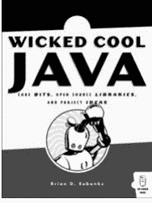

## 通过示例学习 Ruby
### 概念和代码
作者：KEVIN C. BAIRD

学习编程可能没有比解剖您所选语言编写的真实、有代表性的示例更好的方法了。《通过示例学习 Ruby》分析了一系列 Ruby 脚本，检查代码的工作原理，解释其说明的概念，并展示如何修改代码以满足您的需求。Baird 的示例演示了语言的关键特性（例如继承、封装、高阶函数和递归），同时解决了棘手问题（例如验证 XML、创建双语程序和创建命令行界面）。每一章都在前一章的基础上构建，每个关键概念都在页边栏中突出显示，以便您更轻松地浏览本书。

2007 年 6 月，312 页，29.95 美元（37.95 加元）

ISBN 978-1-59327-148-0

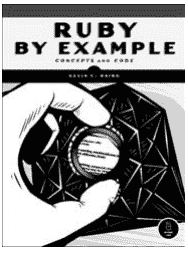

电话：
800.420.7240 或
415.863.9900
周一至周五，
上午 9 点至下午 5 点（PST）

传真：
415.863.9950
全天 24 小时，
每周 7 天

电子邮件：
SALES@NOSTARCH.COM

网址：
WWW.NOSTARCH.COM

邮寄：
NO STARCH PRESS
555 DE HARO ST, SUITE 250
旧金山，CA 94107
美国

## 更新

访问 http://www.nostarch.com/wcphp.htm 获取更新、勘误表和其他信息。

## 印制说明

《Wicked Cool PHP》使用的字体为 New Baskerville、Futura 和 Dogma。本书由美国密歇根州安娜堡的 Malloy Incorporated 印刷装订。纸张为 Glatfelter Thor 60# Antique，含 15% 的消费后回收材料。本书采用 RepKover 精装，打开后可平放。

## 76 个节省时间、解决问题的 PHP 脚本


PHP 是一种易于使用的脚本语言，非常适合快速创建您需要的 Web 功能。一旦您了解该语言的工作原理，拥有一系列可解决棘手问题并为您的网站添加有趣功能的有用脚本岂不是太棒了吗？我们也这么认为。

与其从“Hello, world!”开始，不如说《Wicked Cool PHP》假设您已经熟悉该语言，并直接进入精华部分。在学习了生活中的常见问题——最常被期待的 PHP 脚本之后，您将学习智能配置选项和表单艺术，一直到复杂的数据库驱动脚本。

《Wicked Cool PHP》包含大量用于处理信用卡、检查电子邮件地址有效性、对 HTML 进行模板化以及提供动态图像和文本的脚本。这 76 个易于实现的脚本还将教您如何：

- 发送和接收电子邮件通知
- 使用 Cookie 和会话跟踪访问者行为
- 覆盖 PHP 的默认设置
- 即时处理日期、图像和文本
- 利用 SOAP 和其他 Web 服务
- 创建在线投票、电子贺卡发送系统和博客

但事情并非全然有趣。编程任何 Web 应用程序时，安全性都是一大关注点，因此您将学习如何加密机密数据、保护密码并防止常见的跨站脚本攻击。您还将学习如何自定义所有脚本以满足您自己的需求。

动态 Web 内容并不一定困难。通过《Wicked Cool PHP》，向两位经验丰富的 PHP 开发人员学习这门技艺的秘诀。

### 关于作者

William Steinmetz 是《局域网聚会：举办终极残局盛宴》（Wiley 出版）的作者，也是《傻瓜绘图专家》（IDG 出版）的合著者。他是 StarCityGames.com 的站长兼编辑，该网站的流量因他设计和实施的更改（均使用 PHP）而增长了四倍。

Brian Ward 是《Linux 运行原理》、《VMware 之书》和《Linux 问题求解器》（均由 No Starch Press 出版）的作者。

