# 无线通信技术：物联网、6G和区块链实践的角色、职责与影响（智能决策、系统工程与项目管理进展）


## 前言

近年来，无线技术创造了奇迹，并正在美妙地发展，以支持当今时代的许多实时应用。简单来说，无线技术潜力巨大，可以在各种设备或对象之间建立无线通信。无线技术不仅能在偏远地区建立有效通信，还支持有线无法实现的星际服务。物联网、人工智能与无线技术的融合推动了技术进步，并为即将到来的基于技术的应用打开了许多途径。无线技术有许多可能性，但也面临着各种关键问题、风险和开放的研究挑战。

据 Gartner 称，在未来几年中，无线技术将成为自动驾驶汽车、无人机、机器人、医疗设备等众多新兴创新的核心要素。无线通信的好处如下：

- 1. 经济：无线通信不需要太多物理基础设施，其维护成本也合理。因此，它具有成本效益。
- 2. 灵活：无论位置如何，无线通信都有助于建立通信。因此，它甚至在偏远地区也能提供连接。
- 3. 方便：任何能够连接到无线介质的设备都可以轻松连接，无需太多麻烦。
- 4. 易于访问：它可以轻松地在偏远地区实现可访问性，且所需精力较少。

此外，物联网传感器需要这项技术来建立通信，并将信息传播到其他传感器或基站。除了数据传输和通信等传统应用外，云存储、车联车（V2V）或车联基础设施（V2X）通信、信息娱乐应用、健身追踪器、电子商务、区块链、物流追踪、智能家居等众多新兴应用都需要无线技术。

无线技术目前正在服务，并将继续服务于未来的应用，以高效、有效地完成任务。许多研究人员正在不断改进无线技术，以便能够满足社会日益增长的需求。无线技术的新兴趋势为其他应用提供了燃料，这具有社会经济效益。

## 编辑姓名：

- Vandana Sharma 博士
  副教授
  印度德里 NCR 校区，CHRIST（被认可的大学）

- Balamurugan Balusamy 博士
  学生参与副院长
  什里·纳达尔卓越学院，德里-NCR 校区

- Gianluigi Ferrari 博士
  教授
  意大利帕尔马大学

- Prerna Ajmani 女士
  助理教授
  Vivekananda Institute of Professional Studies-TC

## 关于编辑

Vandana Sharma 博士是印度德里-NCR 校区 CHRIST（被认可的大学）的副教授。她在研究生阶段拥有 15 余年的教学经验。她在 Scopus 收录的期刊和会议上发表了 75 多篇研究论文。她是 IEEE 高级会员、妇女工程学会会员以及 IEEE 消费者技术学会会员。

目前，她是马来西亚林肯大学学院的博士后研究员，并在印度及国外展示过她的工作。她曾自愿担任知名国际期刊和国际会议的主旨演讲人、会议主席、审稿人和技术方案委员会（TPC）成员。她的主要研究兴趣包括人工智能、区块链技术和物联网。

B. Balamurugan 博士在 VIT 大学（维洛尔）完成了博士学位，目前在德里-NCR 校区担任学生参与副院长，在计算机科学领域拥有 21 年的教学经验。他的研究兴趣领域包括物联网、大数据和网络。他发表了 150 多篇国际期刊论文，并撰写了书籍章节。

Gianluigi Ferrari 博士于 1998 年和 2002 年分别获得意大利帕尔马大学帕尔马分校电气工程的 Laurea 和博士学位。自 2002 年以来，他一直在帕尔马大学任职，目前是电信正教授，同时也是工程与建筑学院物联网（IoT）实验室的协调员。他是 things2i Ltd.（https://www.things2i.com/）的联合创始人兼总裁，这是一家帕尔马大学的衍生公司，专注于物联网和智能系统。他目前的研究兴趣包括先进通信与网络、物联网和智能系统、信号处理以及数据分析（https://www.tlc.unipr.it/ferrari/）


**Prerna Ajmani 女士** 是 Vivekananda Institute of Professional Studies 下属 Vivekananda 信息技术学院的高级助理教授。她对计算机充满热情，并坚信以计算机科学为重点提供高质量的教育。她在研究和学术界拥有超过 11 年的经验。她是印度计算机学会（CSI）终身会员，并在国际期刊和会议以及书籍和书籍章节中发表了许多研究论文。她名下拥有多项印度设计专利。她还曾担任知名国际期刊和 IEEE 会议的审稿人和技术方案委员会成员，并在印度及国外的会议上展示过她的工作。她积极参与物联网、下一代技术、网络安全、云计算、自组网和区块链等领域的研究。

## 贡献者

- **M. Aathira**
  蒂亚加拉贾尔工程学院
  印度泰米尔纳德邦马杜赖

- **Jagjit Singh Dhatterwal**
  人工智能与数据科学系
  科内鲁·拉克什马亚教育基金会
  印度安得拉邦瓦德斯瓦拉姆

- **Reeya Agrawal**
  计算机工程与应用系
  GLA 大学
  印度北方邦马图拉

- **Neetu Faujdar**
  计算机工程与应用系
  GLA 大学
  印度北方邦马图拉

- **Wakeel Ahmad**
  应用工业技术学院 (CAIT)
  巴什电气工程技术系
  杰赞大学
  杰赞，沙特阿拉伯

- **Prashant Johri**
  计算机应用与技术学院
  加尔戈蒂亚斯大学
  大诺伊达，印度

- **Yusuf Jibrin Alkali**
  联邦内陆税务局
  尼日利亚

- **Arun Kumar K**
  拉塔南艺术与科学学院
  印度泰米尔纳德邦科伊姆巴托尔

- **G. Ananthi**
  蒂亚加拉贾尔工程学院
  印度泰米尔纳德邦马杜赖

- **Parthiban K**
  计算机科学与工程学院
  维洛尔技术学院
  印度泰米尔纳德邦维洛尔

- **Mohammad Arif**
  计算机科学与工程学院
  维洛尔技术学院
  印度泰米尔纳德邦维洛尔

- **Guruprakash K S**
  计算机科学与工程系
  K. Ramakrishnan 工程学院
  印度泰米尔纳德邦特里奇

- **Ashima Bhatnagar Bhatia**
  维韦卡南达专业研究学院
  新德里，印度

- **Deepali Kamthania**
  信息技术学院
  Vivekananda Institute of Professional Studies-TC
  新德里，印度

- **E. Bhuvaneswari**
  计算机科学与工程系
  拉贾拉克什米技术学院
  印度泰米尔纳德邦钦奈浦纳马利


**库尔迪普·辛格·卡斯万**
计算机科学与工程学院
加尔戈蒂亚大学
印度北方邦大诺伊达

**西瓦普拉卡什·P.**
拉蒂纳姆艺术与科学学院
印度泰米尔纳德邦科伊姆巴托尔

**沙玛·考瑟**
计算机科学系
吉赞大学
沙特阿拉伯吉赞

**尼维迪塔·帕利亚**
工程与技术学院
维韦卡南达专业研究学院-TC
印度新德里

**基兰·马利克**
计算机科学与工程系
马图·拉姆工程与管理学院
印度哈里亚纳邦罗赫塔克

**A. 普兰思**
电子与通信工程系
斯里文卡特斯瓦拉工程学院
印度泰米尔纳德邦斯里佩伦布杜尔

**A. 马利尼**
蒂亚加拉贾尔工程学院
印度泰米尔纳德邦马杜赖

**S. 卡维·普里亚**
计算机科学与工程系
梅普科·施伦克工程学院
印度泰米尔纳德邦西瓦卡西

**纳曼·米什拉**
经济学系
艺术与人文学院
FS大学
印度北方邦希科哈巴德

**阿卡什·普哈尼**
计算机科学与工程系
SRM科学技术学院
德里NCR校区，莫迪纳加尔，
印度北方邦加济阿巴德

**谢克·卡贾·莫希丁**
计算机科学与工程系
科纳鲁·拉克什迈亚教育基金会
瓦德斯瓦拉姆，冈图尔县，
印度安得拉邦

**P. 利亚什里**
蒂亚加拉贾尔工程学院
印度泰米尔纳德邦马杜赖

**约吉什·N.**
数学系
政府一级学院
印度卡纳塔克邦图姆库尔

**莫纳·普里亚·S.**
拉蒂纳姆艺术与科学学院
印度泰米尔纳德邦科伊姆巴托尔

**拉胡尔·雷迪·纳迪卡图**
IEEE高级会员
卡默森大学
美国

**普里蒂·塞缪尔**
计算智能系
SRM科学技术学院
印度卡坦库拉图尔

## 贡献者

**N. 萨兰雅**
计算机科学与工程系
斯里克里希纳技术学院
印度泰米尔纳德邦科伊姆巴托尔

**M. 绍米娅**
蒂亚加拉贾尔工程学院
印度泰米尔纳德邦马杜赖

**万达纳·沙尔马**
计算科学系
克里斯托大学（被认可的大学）
印度德里NCR校区

**谢克·谢尔米拉**
信息技术系
VNITSW
佩达帕拉卡卢尔，冈图尔，
印度安得拉邦

**B. 舒里娅**
PPG技术学院
印度泰米尔纳德邦科伊姆巴托尔

**阿尔库马尔·V**
计算机科学与工程学院
维洛尔技术学院
印度泰米尔纳德邦维洛尔

**帕万·惠格**
维韦卡南达专业研究学院
印度新德里

**M. 约格什瓦里**
信息技术系
计算机科学学院
维尔斯大学，VISTAS
印度泰米尔纳德邦钦奈


# 1 无线技术中的移动边缘计算集成

谢克·卡贾·莫希丁
计算机科学与工程系，科纳鲁·拉克什迈亚教育基金会，瓦德斯瓦拉姆，冈图尔县，安得拉邦，印度

谢克·谢尔米拉
信息技术系，VNITSW，佩达帕拉卡卢尔，冈图尔，安得拉邦，印度

万达纳·沙尔马
计算科学系，克里斯托大学（被认可的大学），德里NCR校区，印度

## 1.1 引言

无线通信技术的指数级发展改变了人类相互交流和获取知识的方式。从4G网络的引入到5G的革命性潜力，无线技术的进步表明了更大的带宽、更低的延迟和更好的连接。然而，随着此类应用和服务需求的不断增加，现有无线网络正努力满足无人驾驶汽车、智慧城市和增强现实等未来用例的苛刻需求。

移动边缘计算（MEC）已发展成为解决这些问题并释放无线网络全部潜力的变革性解决方案。借助MEC，计算和存储可以移至网络边缘附近，从而允许在那里进行更有效的数据处理和分析。当移动边缘计算（MEC）与无线技术相结合时，存在提高网络效率、优化资源利用率并提供低延迟、高带宽应用的新机会[1]。

本章进一步探讨如何将移动边缘计算应用于无线网络。首先，我们对MEC进行了高层次描述，包括其架构和主要组件等主题。我们探讨了将MEC与无线网络合并的原因，重点关注这一新范式的优缺点。我们还探讨了无线通信系统的历史和发展，包括4G、5G和Wi-Fi，以及它们的原理。本章通过考察各种部署策略和支持技术，继续讨论MEC在无线网络中的集成。作者比较和对比了MEC的集中式、分散式和混合式部署模型的优点，展示了后两种模型在各种网络环境中的适应性和使用准备情况。还讨论了MEC在无线网络中促进的互连和无缝集成，以及推动其采用的标准化工作和行业活动。

通过展示现实世界中的用例和应用，展示了MEC在无线技术中集成的变革潜力。我们探讨了智慧城市、无人驾驶汽车和增强现实等现实世界应用，逐一剖析以揭示其独特的优势和局限性。我们还讨论了MEC支持的无线网络中出现的隐私和安全问题，并提供了如何处理这些问题的建议。将MEC集成到无线网络中需要仔细关注性能优化和资源管理。涵盖了改进MEC功能的方法，例如负载均衡、资源分配和网络功能的战略性部署[2]。

### 1.1.1 无线技术基础

这项对无线网络方法的调查介绍了支撑现代数字交互的广泛无线协议。此类技术的流行示例包括4G和5G移动网络以及Wi-Fi。随着4G（即第四代）的出现，数据速率和网络容量得到了显著改善，从而实现了更出色的视频流、更快的下载和更好的整体用户体验。

无线技术的第五代，即5G，在速度、延迟和容量方面是下一件大事。凭借其管理海量数据流并同时连接大量设备的能力，它希望服务于广泛的应用，包括无人驾驶汽车、智慧城市和不断增长的物联网（IoT）[3]。Wi-Fi（“无线保真”的缩写）目前是WLAN的标准协议。它为设备连接到网络并在近距离内相互通信铺平了道路。Wi-Fi已在包括私人住宅、商业场所、公共区域甚至工厂在内的广泛环境中获得广泛应用。

| 作者 | 贡献 | 方法 | 探索的应用 | 局限性 |
|---|---|---|---|---|
| Zahmatkesh, H. et al. | 提出MEC框架 | 仿真 | 智慧城市 | 大规模部署的可扩展性有限 |
| Lu, Jinrong, et al. [4] | 性能评估 | 实验分析 | 边缘AI | 资源可用性的边缘节点数量有限 |
| Krishnan, Prabhakar, Subhasri Duttagupta et al. [5] | 安全框架 | 理论模型 | 物联网 | 加密算法的高计算开销 |
| Chen, Wei-Yu, et al. [6] | 资源分配 | 优化算法 | 移动视频流 | 缺乏针对动态网络条件的实时适应性 |
| Zhang, Y., Chen et al. [7] | QoS分析 | 数学建模 | 远程医疗 | 偏远地区网络覆盖有限 |
| Zhang and Wang et al. [7] | 能源效率 | 能源消耗数据 | 传感器网络 | 缺乏针对动态流量模式的灵活性 |
| Kim and Park et al. [8] | 隐私保护 | 隐私增强技术 | 基于位置的服务 | 隐私与准确性之间的权衡 |
| Gonzalez et al. [9] | 边缘缓存策略 | 数据分析 | 内容分发网络 | 边缘节点存储容量有限 |
| Nadeem, Lubna, et al. [9] | 网络切片 | 虚拟化技术 | 5G网络 | 切片管理和编排的复杂性 |
| Pan, Guangjin, et al. [10] | 延迟降低 | 网络功能卸载 | 增强现实 | 依赖边缘基础设施的可用性 |
| Wu and Zhang et al. [11] | 移动性管理 | 切换算法 | 车载网络 | 对高速移动性支持有限 |


这些通信技术对于支持日益增长的数据密集型服务和应用需求、提供无缝连接以及简化设备之间的通信至关重要。这些创新深刻地改变了我们彼此互动和获取信息的方式。总体而言，这份无线通信方法调查为深入探讨各个技术的显著特征及其在各种情境中的潜在用途奠定了基础。学习无线网络的基础知识以及使无线通信成为可能的组件至关重要。以下是这些基本概念和组件的快速概述。

| 通信技术 | 说明 |
| :--- | :--- |
| 无线电波 | 无线通信依赖于无线电波的传输，无线电波是通过空气无线传输信息的电磁波。 |
| 频段 | 无线网络利用特定频段来发送和接收信号。不同的频段被分配给不同类型的无线通信技术，例如蜂窝网络或 Wi-Fi。 |
| 调制 | 调制是修改载波特性以编码信息的过程。它涉及改变幅度、频率或相位等属性来表示数据。 |
| 复用 | 复用允许多个信号共享同一通信介质。在无线网络中，频分复用（FDM）和时分复用（TDM）等技术能够高效利用可用带宽。 |
| 基站 | 基站（在蜂窝网络中也称为基站塔）是促进移动设备与网络基础设施之间通信的中央单元。它们接收和发送信号以在特定区域提供覆盖。 |
| 天线 | 天线用于发送和接收无线信号。它们将电信号转换为无线电波进行传输，反之亦然。无线网络中使用不同类型的天线，例如全向天线或定向天线。 |
| 接入点 | 接入点是在局域网（LAN）中提供无线连接的设备，通常用于 Wi-Fi 网络。它们充当中央枢纽，将多个设备无线连接到网络。 |
| 移动设备 | 移动设备（如智能手机、平板电脑或笔记本电脑）是无线网络中的终端。它们通过无线连接与网络基础设施通信，使用户能够访问服务并交换数据。 |

无线技术的演进和进步堪称非凡，改变了我们沟通和连接的方式。以下是无线技术演进和关键进步的简要概述：

| 代际 | 说明 |
| :--- | :--- |
| 第一代（1G） | 1G 系统于 20 世纪 80 年代推出，标志着无线通信的开始。它们允许基本语音通话，但覆盖范围有限且模拟信号质量较低。 |
| 第二代（2G） | 20 世纪 90 年代 2G 系统的引入带来了显著改进。它采用数字技术，提供了更好的通话质量、增强的安全性以及发送短信（SMS）的功能。 |
| 第三代（3G） | 3G 系统于 21 世纪初出现，彻底改变了移动通信。它们提供了更快的数据传输速率，使移动互联网接入、视频通话和多媒体服务得到广泛应用。 |
| 第四代（4G） | 随着 20 世纪末 4G 技术的出现，无线通信实现了重大飞跃。4G 网络提供了高速数据传输、增强的语音质量，并支持视频流、移动游戏和云应用等高级服务。 |
| 第五代（5G） | 5G 是最新一代无线技术，提供了前所未有的能力。它承诺提供显著更快的数据速率、超低延迟、大规模连接和网络切片。5G 使自动驾驶汽车、智慧城市、虚拟现实和物联网（IoT）应用等变革性用例成为可能。 |

### 1.1.2 无线技术的关键进步

| 进步类型 | 说明 |
| :--- | :--- |
| 数据速率提升 | 每一代无线技术都实现了数据速率的显著提升，从而实现更快的下载、实时流媒体和无缝多媒体体验。 |
| 频谱效率提高 | 无线技术的进步提高了频谱利用效率，使更多用户能够同时访问网络并减少干扰。 |
| 低延迟 | 每一代都降低了延迟（即网络延迟），增强了实时通信、游戏以及依赖即时响应的应用程序。 |
| 容量增强 | 得益于网络容量和可扩展性的进步，无线网络能够容纳日益增长的连接设备数量和不断增加的数据流量。 |
| 更小的外形尺寸 | 无线设备变得越来越小巧便携，提供了更大的便利性和易用性。 |
| 高级服务和应用 | 每一代无线技术都促进了新服务和应用的开发与采用，范围从移动互联网接入和社交媒体到物联网 [2] 和智能家居设备。 |
| 能源效率提高 | 无线技术变得更加节能，延长了设备电池寿命并降低了功耗。 |

由于无线技术的不断发展和改进，通信、网络和数字体验都发生了翻天覆地的变化。随着无线网络的进步，它们将能够更好地支持边缘计算、AI 和联网自动化设备等前沿创新，为未来开辟更多机遇。相关工作见 [12] 和 [13]。

## 1.2 开放研究挑战与未来方向

移动边缘计算（MEC）提供了令人兴奋的新研究机会和未来突破的可能性。随着 MEC 越来越流行，并与 5G 及更先进的新技术兼容，它面临着若干必须解决的重大挑战，才能实现其全部潜力。边缘环境变得越来越复杂，因此，与资源管理相关的分配优化已成为热门研究课题。维持用户对 MEC 系统的信任并保护重要用户数据，需要致力于安全和隐私法规。加强标准化工作对于促进 MEC 在各种网络中的互操作性和无缝集成是必要的。随着边缘 AI [14,15] 和机器学习越来越流行，联邦学习和边缘智能的创新方法可能有助于使实时和上下文感知服务成为现实。此外，对于可扩展且高效的 MEC 系统，云端处理与边缘卸载之间的平衡至关重要。MEC 有能力通过为 IoT [16]、工业 4.0、智慧城市以及各种其他应用提供低延迟、高度个性化的客户体验来彻底改变移动通信范式，从而解决这些开放性问题。

### 1.2.1 将 MEC 与无线技术集成中的研究空白与开放挑战

虽然将移动边缘计算（MEC）与无线技术集成带来了诸多好处，但仍有需要解决的研究空白和开放挑战。以下是一些需要进一步探索的关键领域。

| 研究空白领域 | 描述 |
| :--- | :--- |
| 资源管理 | MEC 部署中的高效资源管理对于优化性能和确保服务质量至关重要。需要开展研究，开发先进的资源分配、调度和负载均衡机制，以有效利用无线网络中的边缘资源。 |
| 安全与隐私 | MEC 的集成引入了新的安全和隐私问题。在 MEC 支持的无线网络环境中，解决与数据保密性、完整性和身份验证相关的问题至关重要。开发强大的安全框架和隐私保护机制将是一项重大的研究挑战。 |


| 研究差距领域 | 描述 |
| :--- | :--- |
| 可扩展性与移动性支持 | MEC集成应具备可扩展性，以处理不断增加的边缘设备和移动用户数量。需要开展研究，以解决与MEC基础设施可扩展性相关的挑战，并支持无线网络中无缝移动性管理。 |
| 边缘云协同 | 探索边缘计算与云资源之间的最优协同至关重要。研究高效的卸载策略、网络切片以及边缘与云资源之间的动态协调，对于最大化性能和最小化延迟将至关重要。 |
| 应用部署与编排 | 优化边缘节点间的应用部署并协调其编排是一个具有挑战性的研究领域。开发用于MEC环境中动态应用部署、迁移和扩展的智能算法和框架将至关重要。 |
| QoS与服务等级协议(SLAs) | 确保MEC支持的无线网络中的服务质量(QoS)保障并满足SLAs至关重要。需要开展研究，以设计高效的QoS供给机制，包括流量管理、延迟控制和服务差异化。 |
| 标准化与互操作性 | 随着MEC和无线技术的不断发展，标准化工作以及不同供应商解决方案之间的互操作性变得重要。研究应着重于开发标准化协议、接口和互操作框架，以实现MEC与多种无线技术的无缝集成。 |
| 能源效率 | 高效的能源管理对MEC部署至关重要。需要开展研究，以开发能源感知机制、电源优化技术和可持续能源解决方案，以降低MEC支持的无线网络的能源足迹[17]。 |
| 实时分析与机器学习 | 探索在边缘集成实时分析和机器学习，可以将智能和决策能力更贴近数据源。需要开展研究，以开发用于MEC支持的无线环境中实时分析、数据处理和分布式机器学习的高效算法和模型。 |

解决这些研究差距和开放挑战将有助于MEC与无线技术的成功集成，实现其全部潜力，并支持广泛的创新应用和服务。

## 1.3 MEC支持的无线网络的新兴趋势与未来方向

将移动边缘计算(MEC)纳入无线技术，使移动通信和计算领域取得了重大进展。MEC通过在网络边缘使用边缘计算，实现了高带宽、低延迟和上下文感知服务，这从根本上改变了人们感知和与无线网络交互的方式。本章着重于架构、应用、安全性和标准化方面的当前进展，探讨了MEC支持的无线网络的发展趋势和未来前景。

### 1.3.1 架构与网络优化

网络架构和优化的改进一直是近期MEC支持的无线网络研究的主要焦点。得益于动态资源分配、自适应负载均衡和高效缓存方法的发展，服务交付和用户体验得以改善。在MEC架构中使用SDN和NFV所带来的更高适应性和可扩展性，有助于更高效地分配网络资源。对于数据密集型应用以满足用户期望，这些发展至关重要[17]。

### 1.3.2 与5G及以后技术的集成

近年来，人们一直致力于寻找将MEC与5G及以后技术相结合的方法。随着5G网络在全球范围内部署，MEC正在确立自身作为释放5G全部潜力的关键推动者的地位。MEC与5G超可靠低延迟通信(URLLC)和大规模机器类型通信(mMTC)的结合，为AR、VR和自动驾驶汽车等实时应用带来了新的可能性。研究人员正在努力提高MEC与下一代无线技术之间的兼容性，使企业和消费者能够利用以前无法获得的机会[18]。

### 1.3.3 边缘AI与MEC

MEC支持的无线网络中边缘AI的使用显著增加。为了降低延迟和对集中式云基础设施的依赖，MEC在网络边缘部署AI算法，以实现即时数据处理和决策。为了支持视频分析、智能监控和个性化用户体验等用例，边缘人工智能(AI)算法和模型优化方法的最新进展已显示出有希望的结果。此外，联邦学习在MEC环境中作为一种去中心化的AI训练范式正变得越来越流行，它能够在提升模型性能的同时解决数据隐私问题[19]。

### 1.3.4 安全与隐私挑战

安全与隐私保护在MEC支持的无线网络中日益重要。为了保护私人信息并应对网络威胁，研究人员最近专注于创建安全通信协议、访问控制系统和加密方法。为了进一步保护用户数据并允许在边缘提供定制服务，正在研究不同级别的隐私和安全多方计算等隐私保护技术。解决这些安全问题对于让人们放心使用MEC支持的无线网络并提高其采用率至关重要[20]。

### 1.3.5 标准化与互操作性

促进MEC在不同无线技术之间的互操作性和无缝集成，很大程度上依赖于MEC接口和协议的标准化。为了促进制造商和网络领域之间的高效协作，ETSI和3GPP等标准化组织一直在努力制定MEC标准。最近的工作集中于协调MEC接口与5G要求，并解决架构问题，以改善MEC系统与网络节点之间的通信[21]。

由于移动边缘计算的引入，无线网络的规划、实施和体验方式正在发生范式转变。本章中描述的设计与网络优化、与5G及以后技术的交互、边缘AI、安全性和标准化等发展趋势，照亮了MEC支持的移动网络的未来。MEC正处于开启超响应和上下文感知无线服务新时代的边缘，这有可能彻底改变各行各业，并提高全世界人们的生活质量。

#### 1.3.5.1 MEC对无线技术未来的潜在影响与启示

移动边缘计算(MEC)作为一项改变游戏规则的技术的出现，对无线网络的发展产生了重大影响。MEC通过将云计算技术更贴近最终用户和设备，承诺提供高带宽、低延迟和上下文感知应用。MEC在无线技术中的应用可能惠及的领域和用途范围巨大。在本部分中，我们将探讨MEC可能以重要方式改变无线技术未来的方式，包括它对网络设计、应用创建、最终用户满意度和商业领域的影响。

##### 1.3.5.1.1 增强的网络架构

将MEC引入无线环境可能会导致网络设计发生根本性变化。由于计算任务从集中式云数据中心转移到边缘服务器，MEC降低了网络延迟和拥塞。这种分布式方法通过允许动态资源分配、自适应负载均衡和智能缓存来提高网络效率。此外，MEC鼓励自组织网络的发展，其中网络边缘的节点自主协作，以增强覆盖并提供无缝连接，即使在人口稀少地区和偏远乡村也是如此[22]。


#### 1.3.5.1.2 创新应用的普及

由于靠近终端消费者，MEC 能够支持广泛的前沿服务和程序。得益于超低延迟和高带宽能力，AR、VR 和云游戏等实时应用成为可能。MEC 还支持边缘 AI，这对无人驾驶汽车、智慧城市和个性化医疗等应用非常有用。随着开发者和公司认识到其潜力，我们可以预期会涌现大量利用 MEC 能力为用户提供沉浸式和上下文感知体验的新应用 [23]。

#### 1.3.5.1.3 转变的用户体验

当应用于无线技术时，MEC 可能会显著改善用户体验。通过减少滞后时间，MEC 提高了应用和服务的响应速度和质量，让用户感觉交互即时。由于 MEC 能够提供更稳定的性能，关键服务的中断和延迟将减少。通过使用边缘 AI，MEC 可以根据用户的当前数据、偏好和环境，提供更直观、更个性化的应用体验。随着 MEC 的普及，无线体验将变得越来越简洁，并为每个用户量身定制 [24]。

#### 1.3.5.1.4 垂直领域特定创新

预计 MEC 的影响将在各个市场细分领域产生深远影响。MEC 正在通过实现远程患者监测、实时远程医疗和网络边缘医疗诊断等新方法来改变医疗服务。借助 MEC，联网车辆可以相互通信，也可以与道路上的其他物体通信，提高每个人的安全感。利用 MEC，智慧城市可以改善交通管理、加强公共安全并部署智能基础设施。MEC 的实时数据处理还将通过实现预测性维护和简化运营来帮助工业自动化和工业 4.0。当 MEC 在所有业务领域实施时，将有可能实现更高的效率、成本节约和颠覆性创新 [25]。

人们寄予厚望，移动边缘计算将彻底改变无线网络的发展。具体来说，MEC 提供低延迟、高带宽和上下文感知解决方案的能力，正在彻底改变网络设计，推动新型应用的创建，改善用户体验，并颠覆许多不同的业务领域。随着 MEC 的发展和加速，它将在整个无线环境中产生深远影响，开启一个全新的连接时代，并在广泛领域推动非凡的改进。

## 1.4 性能优化与资源管理

在涉及使用移动边缘计算 (MEC) 的无线网络的效能和效率时，性能优化和资源管理是两个关键组成部分。动态分配资源、平衡工作负载以及优化性能以满足不同的应用需求和用户期望，对 MEC 的成功至关重要。由于网络边缘采用了先进的资源管理技术，MEC 服务器能够有效地管理计算、存储和通信工作负载。针对实时变化的需求进行战略性规划的资源分配，是性能优化的核心重点。得益于其复杂的分析和决策工具，MEC 服务器可以评估工作负载、延迟规格和设备能力。MEC 解决方案分析这些数据，为给定任务选择最佳边缘服务器，从而降低延迟并将通信开销降至最低。此外，借助动态资源配置，MEC 可以根据波动的工作负载向上或向下扩展资源，确保所有可用资源始终得到有效和高效的利用。MEC 在网络和应用要求方面的灵活性，使得能够提供一致且卓越的用户体验。

有效的数据缓存和分发策略也是 MEC 资源管理的一部分。由于 MEC 服务器会缓存本地常用数据、应用程序和内容，因此不断将数据传输到远程云数据中心的需求得以减轻。通过本地存储数据，可以减少网络流量和延迟，使边缘服务更加响应迅速。此外，MEC 系统使用以内容为中心的网络原则（如命名数据网络 NDN）来提高数据分发的效率。当用户按名称而非位置请求内容时，MEC 可以从最近的边缘服务器检索数据，从而降低延迟并改善内容分发。MEC 通过协调资源管理、数据缓存和分发，发挥其在无线网络中提供低延迟和高性能服务的能力。

### 1.4.1 优化无线网络中 MEC 性能的技术

要在无线网络中最大限度地提高移动边缘计算 (MEC) 的性能，必须改进资源消耗、延迟和整体系统效率。以下是几种提升无线网络中 MEC 效效性的重要方法：

#### 1.4.1.1 动态资源分配

为了满足实时应用的需求，MEC 系统必须动态分配计算和网络资源。MEC 服务器可以使用复杂的资源管理算法，将工作负载分发到可用的边缘节点，从而确保最大限度的资源利用率和缩短响应时间。通过动态分配资源，MEC 可以根据不断变化的网络状况和工作负载优化系统性能 [26]。

#### 1.4.1.2 边缘缓存

边缘缓存是将经常访问的数据和信息存储在网络边缘（最易访问的位置）的过程。由于 MEC 服务器无需为常用应用程序、文件和媒体查询远程云数据中心，因此能够快速响应用户请求。特别是对于视频观看和游戏等对延迟敏感的应用，边缘缓存可以减少网络滞后和拥塞，从而实现更快的响应时间和更好的用户体验 [27]。

#### 1.4.1.3 计算卸载

将终端用户设备上的计算密集型任务卸载到边缘服务器，是移动边缘计算 (MEC) 中的一项关键策略。利用边缘节点的处理能力，卸载可以释放终端用户设备的空间和电量。将任务卸载到运行 MEC 且拥有更强大处理器的服务器，可以通过缩短执行和计算时间来进一步提升应用性能。

#### 1.4.1.4 边缘 AI 与机器学习

在边缘集成 AI 和机器学习算法，极大地增强了 MEC 服务器实时做出智能决策的能力。借助边缘 AI，数据分析、图像识别和自然语言处理现在可以在本地进行，减少了将数据发送到远程数据中心的需求。边缘 AI 使 MEC 能够提供个性化和上下文感知的服务，从而提升整体用户体验质量 [28]。

#### 1.4.1.5 网络切片

通过网络切片，MEC 可以构建适用于特定应用或用户群体的虚拟化网络段。各个切片可以拥有自己的专用资源、服务质量 (QoS) 标准和安全法规。通过网络切片，MEC 能够在相同的物理基础设施上高效地隔离和管理多种服务，从而最大限度地提高性能，同时满足各种应用的需求。

#### 1.4.1.6 多接入边缘计算 (MEC) 协作

MEC 平台可以跨不同运营商和网络域进行协作和共享资源。MEC 协作使资源管理能够采用联邦方式，提高资源可用性和可扩展性。这种协作还促进了更强大、更具韧性的 MEC 生态系统，提供冗余和容错能力，尤其是在动态和分布式环境中 [29]。

#### 1.4.1.7 基于边缘的负载均衡

通过将工作分配给所有可用的边缘服务器，负载均衡确保最佳性能。MEC 服务器通过在其节点间公平分配工作负载，消除瓶颈并防止过载。因此，系统的响应速度、处理速度和整体性能均得到提升 [30]。

通过将这些方法集成到支持 MEC 的无线网络中，可以创建一个低延迟、响应迅速的边缘计算生态系统，从而能够支持各种满足现代互联互通世界需求的前沿应用和服务。


### 1.4.2 MEC 支持的无线系统中的资源分配与管理

在启用移动边缘计算（MEC）的无线网络中，充分利用可用资源需要对这些资源进行仔细的分配和管理。通过将数据和应用程序移至靠近最终用户的所谓“边缘”服务器，MEC 可以帮助降低延迟并提升所有相关方的服务质量。在 MEC 支持的无线网络中，准确提供服务并支持各种应用程序取决于对可用资源的谨慎使用。以下是 MEC 资源管理和分配的基本特征。

#### 1.4.2.1 动态资源分配

MEC 的基石之一是动态资源分配，即根据波动的需求和不断变化的应用需求动态调整资源分布的过程。MEC 服务器能够通过持续监控工作负载特征和网络状况，动态分配计算、存储和网络资源，以满足不同应用程序和用户的需求。通过能够扩展或缩减，MEC 系统能够更好地应对可变工作负载，同时仍保持最佳资源利用率和响应能力 [31]。

#### 1.4.2.2 服务质量（QoS）差异化

为了满足各种应用程序的需求，MEC 支持的无线系统的资源分配必须考虑 QoS 差异。各种应用程序的延迟、带宽和可靠性要求可能不同。MEC 平台需要优先处理对 QoS 要求严格的关键应用程序，同时适当地为要求较低的应用程序分配资源。这确保了高优先级应用程序能够获得必要的资源以提供满意的用户体验，同时高效利用其他应用程序的资源 [27]。

#### 1.4.2.3 边缘缓存与数据管理

边缘缓存在优化 MEC 支持的无线系统中的资源利用率方面发挥着重要作用。通过在网络边缘缓存经常访问的内容和数据，MEC 服务器可以减少从远程云数据中心获取数据的需求，从而降低延迟并节省带宽。高效的数据管理技术，例如数据复制和放置，通过确保数据可用性和减少数据访问延迟，进一步提高资源效率 [28]。

#### 1.4.2.4 负载均衡

负载均衡在 MEC 支持的无线系统中至关重要，用于在可用的边缘服务器之间均匀分配计算和网络任务。有效的负载均衡算法确保资源得到最佳利用，防止资源瓶颈，并避免某些边缘节点过载而其他节点利用率不足的情况。这提高了系统性能、响应能力和用户满意度 [29]。

#### 1.4.2.5 能源效率

节能资源管理对于 MEC 支持的无线系统中资源受限设备和边缘节点至关重要。将任务卸载到节能边缘服务器或在空闲期间利用低功耗模式等技术可以帮助节省能源并延长设备电池寿命。节能意识的资源分配有助于可持续运行和更好的资源利用 [31]。

为了使 MEC 支持的无线系统能够服务于各种应用程序和用例，必须实施适当的资源分配和管理机制。MEC 能否彻底改变无线通信环境取决于对可用资源的高效利用。

### 1.4.3 服务质量（QoS）和用户体验质量（QoE）考量

为了提供尽可能好的服务交付和客户满意度，启用移动边缘计算（MEC）的无线系统必须考虑 QoS 和 QoE 指标。与关注客观指标（例如网络性能如何）的服务质量不同，用户体验质量关注用户对该性能的感受。为了提供最佳服务，必须平衡服务质量和用户体验质量。在以下段落中，我们将探讨为什么 MEC 支持的无线系统优先考虑服务质量和用户体验质量至关重要。

#### 1.4.3.1 服务质量（QoS）考量

在 MEC 中，服务质量问题的核心是确保预定的技术测量和性能标准。延迟、带宽、丢包率和可靠性都是关键的 QoS 特性。为了履行 QoS 义务，MEC 平台有必要识别并优先处理关键任务应用程序，并相应地分配资源。实时视频流、增强现实和虚拟现实（AR 和 VR）以及类似技术都需要最小延迟才能正常运行并为用户提供满意的体验。MEC 通过动态分配资源并优化网络拓扑来最大限度地提高资源利用率，同时不牺牲其他服务的性能，从而为对延迟敏感的应用程序提供 QoS。网络支持各种工作负载并向最终用户提供始终如一的高质量、响应迅速服务的能力取决于 QoS 管理的效果 [30,32]。

#### 1.4.3.2 用户体验质量（QoE）考量

服务质量客观评估服务运行得如何，而用户体验质量则考虑最终用户如何感知相同的服务。响应时间、用户交互、视觉质量和用户满意度都是用户体验质量的组成部分。QoE 优化在 MEC 支持的无线网络中对于用户留存、良好用户反馈和服务采用至关重要。通过降低延迟和处理时间，边缘服务器对改善 QoE 有显著贡献。例如，边缘缓存可以通过加快内容交付和减少用户等待时间来大大提升 QoE。边缘 AI 算法还可以通过提供定制和感知上下文的服务，根据用户的口味和需求调整内容来提升 QoE。MEC 平台应持续跟踪 QoE 测量、用户输入和服务交付调整。在竞争激烈的无线行业中，MEC 可以通过为客户提供卓越的用户体验来脱颖而出 [27, 32, 33]。

在 MEC 支持的无线网络中，在服务质量和用户体验质量之间取得平衡是一个复杂的问题。MEC 应用程序的成功和广泛接受取决于提供可靠且高性能的服务，同时提供良好且身临其境的用户体验。在 MEC 支持的无线环境中，通过适当的资源分配、负载均衡、边缘缓存和边缘 AI 集成，可以实现流畅且令人满意的用户体验。

## 1.5 结论

本章全面探讨了 4G、5G 和 Wi-Fi 等多种无线通信技术如何与无线技术集成。我们介绍了无线网络的基础知识，包括使无线通信成为可能的原理和组件。我们还研究了无线技术的发展和增长，追踪了从 3G 到 4G 以及随后 5G 网络的出现。为了跟上数据密集型应用程序和服务日益增长的需求，作者在整章中强调了将无线技术与不断变化的通信标准集成的重要性。通过利用无线网络的特性，连接性、带宽利用率和用户体验都可以得到极大改善。无线技术集成的未来光明，前景广阔。随着 5G 网络的持续发展和部署，更高的数据速率、更低的延迟和更大的容量都是值得期待的。随着 5G 网络覆盖范围的扩大以及网络切片和边缘计算等新技术的加入，将为前沿软件和服务带来新的机遇。此外，无线通信的兴起正在推动对 5G 之后技术（例如 6G）的研究。这些先进网络的目标是促进改变游戏规则的应用，例如完全沉浸式虚拟现实、广泛的物联网部署以及超可靠、低延迟通信。频谱管理、网络安全和能源效率只是无线技术发展过程中必须解决的几个问题。克服这些障碍并推动无线网络的未来发展需要学术界、行业和标准化机构之间的合作。满足互联社会日益增长的需求需要将无线技术与各种无线通信方法集成。研究人员和从业者可以通过掌握本章涵盖的理念、发展和未来方向，影响无线技术的发展，并为沟通、合作和创新开辟新渠道。


## REFERENCES

- 1. Juyal, V. et al. “利用延迟容忍网络中动态可信路由方案.” Wireless Personal Communications 112 (2020): 1705–1718.

- 2. Raj A., Sharma, V. and Shanu, A. K. “基于IOT设备的联邦学习安全与隐私技术比较技术.” 2022 3rd International Conference on Computation, Automation and Knowledge Management (ICCAKM), Dubai, United Arab Emirates, 2022, pp. 1–5. DOI: 10.1109/ICCAKM54721.2022.9990152

- 3. Ajmani, P., Sharma, V., Samuel, P., Somasundaram, K. and Vidhya, V. “通过IoMT进行患者行为分析和社会健康预测.” 2022 10th International Conference on Reliability, Infocom Technologies and Optimization (Trends and Future Directions) (ICRITO), 2022, pp. 1–6. DOI: 10.1109/ICRITO56286.2022.9964846

- 4. Ali, M. A., Balamurugan, B., Dhanaraj, R. K. and Sharma, V. “基于IoT和区块链的智慧农业监测与智能安全系统.” 2022 3rd International Conference on Computation, Automation and Knowledge Management (ICCAKM), Dubai, United Arab Emirates, 2022, pp. 1–7. DOI: 10.1109/ICCAKM54721.2022.9990243

- 5. Juyal, V. et al. “延迟容忍网络路由解剖.” 2016 IEEE International Conference on Computational Intelligence and Computing Research (ICCIC), Chennai, 2016, pp. 1–4. DOI: 10.1109/ICCIC.2016.7919724

- 6. Lu, J., et al. “带单元选择的IRS辅助MEC网络性能分析.” Physical Communication 55 (2022): 101869.

- 7. Maurya, A. and Sharma, V. “使用Keras和CNN的人脸情绪识别.” 2022 2nd International Conference on Advance Computing and Innovative Technologies in Engineering (ICACITE), 2022, pp. 2539–2543. DOI: 10.1109/ICACITE53722.2022.9823480

- 8. Banerjee, D., Kukreja, V., Hariharan, S. and Sharma, V. “使用深度学习方法对猕猴桃叶片疾病进行快速准确的多分类.” 2023 International Conference on Innovative Data Communication Technologies and Application (ICIDCA), Uttarakhand, India, 2023, pp. 131–137. DOI: 10.1109/ICIDCA56705.2023.10099755

- 9. Murali, M. N. R. D. S. and Sharma, V. “使用人工神经网络对DGA驱动的僵尸网络进行性能分析.” 2022 10th International Conference on Reliability, Infocom Technologies and Optimization (Trends and Future Directions) (ICRITO), 2022, pp. 1–6. DOI: 10.1109/ICRITO56286.2022.9965044

- 10. Krishnan, P., Duttagupta, S., and Achuthan, K. “基于SDNFV的多接入边缘计算基础设施威胁监测与安全框架.” Mobile Networks and Applications 24 (2019): 1896–1923.

- 11. Chen, Wei-Yu, et al. “移动边缘计算中联合用户关联与资源管理的直播视频流双重定价优化.” IEEE Transactions on Mobile Computing (2021). 10.1109/TMC.2021.3089229

- 12. Zhang, Y., Chen, G., Du, H., Yuan, X., Kadoch, M., and Cheriet, M. (2020). “由5G MEC-IoT驱动的实时远程健康监测系统.” Electronics 9 (11): 1753.

- 13. Kang, Y., Wang, H., Kim, B., Xie, J., Zhang, X. P., and Han, Z. (2023). 使用平均场博弈的汽车多接入边缘计算网络时间高效卸载优化. IEEE Transactions on Vehicular Technology.

- 14. Hernández-Nieves, E., Hernández, G., Gil-González, A. B., Rodríguez-González, S., and Corchado, J. M. “银行产品个性化推荐的雾计算架构.” Expert Systems with Applications 140 (2020): 112900.

- 15. Nadeem, L., et al. “5G蜂窝网络中D2D、网络切片和MEC的集成：调查与挑战.” IEEE Access 9 (2021): 37590–37612.

- 16. Pan, G., et al. “MEC辅助增强现实系统中基于视频的AI推理任务联合优化.” IEEE Transactions on Cognitive Communications and Networking 9.2 (2023): 479–493.

- 17. Duo, R., Wu, C., Yoshinaga, T., Zhang, J., and Ji, Y. (2020). “蜂窝/IEEE 802.11p混合车载网络中的基于SDN的切换方案.” Sensors 20 (4): 1082.

- 18. Zhang, Z., Wang, W., Gong, Y., Xu, J., and Bennis, M. “具有QoS约束的物联网移动边缘计算资源分配.” IEEE Internet of Things Journal 8(12) (Dec. 2021): 9602–9613. DOI: 10.1109/JIOT.2021.3077538

- 19. Park, J., Kim, S., and Lee, J. “移动边缘计算与5G的集成：现状与未来方向,” IEEE Communications Magazine 58(2) (Feb. 2020): 29–35. DOI: 10.1109/MCOM.001.1900337

- 20. Chen, X., Liu, C., Zhao, K., and Yin, H. “边缘智能：利用边缘计算铺设人工智能的最后一英里.” Proceedings of the IEEE 107(8) (Aug. 2019): 1738–1762. DOI: 10.1109/JPROC.2019.2916964

- 21. Zhang, Y., Liu, B., and Bian, K. “移动边缘计算中的安全与隐私挑战：一项调查.” IEEE Access 8 (Sept. 2020): 167945–167965. DOI: 10.1109/ACCESS.2020.3027086

- 22. Li, M., Zhang, Y., and Wu, Y. “迈向移动边缘计算及其与Cloud-RAN集成的标准.” IEEE Communications Standards Magazine 3(2) (June 2019): 50–56. DOI: 10.1109/MCOMSTD.2019.1800039

- 23. Wang, C., Gao, X., Wang, W., & Cao, J. “5G中移动边缘计算的资源管理：一项全面调查.” IEEE Communications Surveys & Tutorials 22(3) (2020): 1754–1789. DOI: 10.1109/TWC.2020.3053117

- 24. Mao, Y., You, C., Zhang, J., Huang, K., and Letaief, K. B. “移动边缘计算调查：通信视角.” IEEE Communications Surveys & Tutorials 19(4) (2017): 2322–2358. DOI: 10.1109/COMST.2017.2734978

- 25. Satyanarayanan, M., Bahl, P., Caceres, R., and Davies, N. “移动计算中基于VM的云微数据中心论证.” IEEE Pervasive Computing 8(4) (2009): 14–23. DOI: 10.1109/MPRV.2009.82

- 26. You, C., Zhang, K., and Huang, K. “基于深度强化学习的移动边缘计算任务卸载.” IEEE Internet of Things Journal 5(5) (2018): 3729–3740. DOI: 10.1109/JIOT.2018.2820098

- 27. Chen, Y., Wu, J., and Kumar, N. 5G网络中移动边缘计算的动态资源分配与计算卸载. IEEE Transactions on Mobile Computing 21(2) (2022): 732–745. DOI: 10.1109/TMC.2021.3054166

- 28. Wang, X., Jiang, C., Zhang, H., and Li, Y. “移动边缘计算网络中边缘缓存与网络切片的联合优化.” IEEE Transactions on Wireless Communications 20(4) (2021): 2885–2901. DOI: 10.1109/TWC.2021.3053117

- 29. Liu, L., Li, C., and Zhang, Y. “移动边缘计算中的边缘人工智能：架构、算法与应用.” IEEE Communications Surveys & Tutorials 23(3) (2021): 2367–2392. DOI: 10.1109/COMST.2021.3075981

- 30. Sun, S., Wang, X., and Fu, H. “5G网络中超可靠低延迟通信的协作多接入边缘计算.” IEEE Transactions on Industrial Informatics 18(1) (2022): 415–425. DOI: 10.1109/TII.2021.3043896

- 31. Puviani, M., Frangioni, A., & Cimini, G. “移动边缘计算网络中的基于边缘的负载均衡.” IEEE Transactions on Mobile Computing 20(8) (2021): 2482–2497. DOI: 10.1109/TMC.2020.3021697

- 32. Juyal, V., Pandey, N., and Saggar, R. “自组织簇基于DTN中的机会消息转发.” 2017 International Conference on Infocom Technologies and Unmanned Systems (Trends and Future Directions)(ICTUS). IEEE, 2017.

- 33. Juyal, V. et al. “DTN组播路由算法性能比较——机遇与挑战.” 2017 International Conference on Intelligent Sustainable Systems (ICISS). IEEE, 2017.

# 2 为VANET提供安全的无线技术

Shaik Khaja Mohiddin  
CSE系，Koneru Lakshmaiah教育基金会，Vaddeswaram，Guntur县，Andhra Pradesh，印度  

Shaik Sharmila  
IT系，VNITSW，PedaPalakalur，Guntur，Andhra Pradesh，印度  

Vandana Sharma  
计算科学系，CHRIST（被认可的大学），Delhi NCR校区，印度  

## 2.1 引言

现代交通系统的演进正处于变革时代的边缘，这一变革由车载自组网（VANETs）的出现所推动。在这个道路与无线技术交织的动态格局中，提升安全与效率的追求已成为核心议题。本书章节将全面探讨无线技术在开启VANETs安全新时代中所发挥的关键作用。VANETs是移动自组网（MANETs）的一个子集，它将车辆、基础设施和前沿通信协议整合在一起，构建起一个实时数据交换的网状结构 [1,2]。在这种设计下，汽车可以成为网络节点，彼此交换数据，并与其下方的地面进行数据交换。VANETs大幅减少事故和缓解交通拥堵的潜力，只是它们充满希望的众多原因之一。

无线技术成为推动VANETs复杂网络内部转型的生命线。车辆现在可以以前所未有的方式共享信息、协同工作和合作，极大地提升了道路安全与效率。当汽车共享速度、位置和危险警告等数据时，互联网络便构建起来，使每辆车都能更好地实时准备和应对可能的威胁。这一转变的影响远远超出汽车行业本身。VANET安全具有广泛的潜在应用，从防撞设备到协作自适应巡航控制。


车辆到行人（V2P）通信旨在保护行人，路口碰撞预警系统以及众多其他以安全为驱动的发展都指向一个未来，在那个未来中，交通事故将是例外而非常规。

本章旨在探讨 VANETs 中使用的无线技术的多样领域。我们通过从各个角度调查 VANETs——即其设计与实现、通信模型与无线技术、安全应用与安全协议、面临的挑战以及潜力——来剖析这一令人兴奋的领域。当我们踏上这段探索之旅时，显而易见，无线技术不仅正在重塑我们道路上更安全、更互联、更高效的世界，而且也在改变我们的出行方式。

### 2.1.1 VANETs 及其在现代交通系统中的重要性简介

构成车辆自组网（VANETs）的无线通信与车辆技术的革命性结合，有可能从根本上改变当今交通网络的特性。

VANETs 是由移动车辆和固定基础设施组成的无线网络，它们实时共享数据，以促进自主、感知上下文的驾驶。

提高道路安全性、效率和整体流动性，在很大程度上取决于汽车、道路基础设施与通信协议之间的这种交互。

由于 VANETs 有潜力缓解现代道路网络面临的一些最严峻的挑战，因此它们变得越来越重要。

传统交通网络的问题包括拥堵、事故和延误，所有这些都可能对经济乃至人类生命产生负面影响。

通过允许汽车相互之间以及与路边基础设施交换数据，VANETs 提供了一个机会来解决这些问题，即形成一个由“智能”车辆组成的网络，这些车辆协同工作以改善交通流量并降低事故发生的可能性。

交通方式的安全性至关重要，而 VANETs 提供了一种革命性的解决方案。

通过让车辆共享其位置、速度和道路状况的实时数据，VANETs 提高了碰撞避免系统预测和避免潜在碰撞的准确性。

对紧急警报进行即时广播，以提醒周围车辆注意前方的威胁或障碍，使道路生态更加灵敏和灵活。

当 VANETs 与自动驾驶汽车和人工智能等其他尖端技术相结合时，其潜在益处将得到增强。

利用 VANETs，自动驾驶汽车可以提高其即时决策能力，从而安全地穿越具有挑战性的城市场景。

总之，VANETs 有可能通过建立一个活的网络，从根本上改变我们在城镇中出行的方式，在这个网络中，移动对象可以共享信息并实时协调。

在我们经历日益城市化和更先进技术的时代，VANETs 在当今交通网络中的重要性不容强调。

由于 VANETs 有潜力促进更安全的道路、减少拥堵并为更高效的出行铺平道路，因此它们正处于变革未来交通的前沿。

### 2.1.2 车辆通信中安全的重要性

在讨论车辆自组网（VANETs）时，安全车辆通信的重要性不容强调。

随着汽车变得越来越互联并能够进行实时通信，集成安全系统既是道德需求也是实际需求。

车辆到车辆（V2V）通信的主要目标是改善道路安全、预防事故和挽救生命 [3,4]。

道路事故不仅影响直接涉及的人，还影响他们的朋友、邻居和整个社区。

医疗费用、财产损失和工资损失只是事故可能对一国经济产生重大影响的一些方式。

以伤亡和人员受伤计算的人力成本则更高。

降低这种危险的一种有效方法是 VANETs 实现的车辆通信网络。

这些技术使汽车能够构建一个警觉网络，通过共享速度、方向和潜在危险等关键信息，主动避免事故。

交通的不稳定和不可预测性使得在讨论 VANETs 时，安全成为首要任务。

不断变化的环境条件、意外的道路障碍以及不稳定的驾驶习惯，都可能迫使驾驶员做出瞬间决定，这些决定对安全具有深远的影响。

汽车相互通信并对其环境达成共同理解的能力，是车辆通信的一个关键特征。

车辆能够相互通信，并共享即将发生的危险信息，例如突然停车、碰撞以及其他可能需要急转或刹车的情况。

减少交通拥堵的前景是安全车辆通信的又一好处。

在拥堵区域，事故更有可能发生，因为驾驶员被迫反复启动和停止车辆。

通过传播实时交通信息和最佳路线，车辆通信系统可以有助于实现更顺畅的交通流量和减少拥堵。

这反过来又降低了追尾碰撞的可能性，并提高了道路的整体安全性。

此外，安全考虑还扩展到弱势道路使用者，例如行人和骑自行车者。

VANETs 可以通过车辆到行人（V2P）通信等概念，促进车辆与行人之间的通信。

这使车辆能够提醒行人注意其存在，尤其是在路口或能见度低的条件下，从而提高行人安全性。

安全是 VANETs 等车辆通信系统建立的基石。

在这些网络中集成安全机制是一项社会责任，旨在预防事故、最大限度地减少人员伤亡并提高整体生活质量。

随着技术的不断进步，对安全的关注始终坚定不移，推动车辆通信系统朝着我们道路上更安全、更互联的未来演进。

### 2.1.3 本章的目的与范围

本章的目的是探讨无线技术增强车辆自组网（VANETs）安全性的潜力。

本章旨在全面了解 VANET 架构、无线技术、安全应用、通信协议、挑战和前景如何正在改变现代交通系统中的道路安全。

本章讨论了许多关于无线技术对 VANET 安全性影响的问题 [5,6]。

本节通过对 VANETs、其底层结构及其对现代交通网络的重要性进行高层次介绍，为进一步调查提供了框架。

接下来，我们将讨论许多无线技术，从经得起时间考验的 IEEE 802.11p (WAVE) 到当今和未来的尖端蜂窝系统 [7,8]，这些技术使 VANET 连接成为可能。

本章强调了无线通信在允许汽车共享实时数据、协同工作和避免碰撞方面的重要性。

VANETs 内的安全应用构成了本章范围的核心方面。

它阐明了无线技术的实际意义，展示了它如何支撑碰撞避免系统、协作自适应巡航控制、路口碰撞预警以及行人保护。

通过考察现实世界中的用例，本章强调了无线技术如何转化为道路上的切实安全改进。

通信协议和安全考虑也是重点。

本章探讨了管理 VANET 通信的协议，并强调需要强大的安全机制来确保交换信息的真实性、完整性和隐私性 [5]。

此外，它还解决了在实施 VANET 安全系统时出现的挑战，从频谱分配难题到可扩展性和隐私问题。

展望未来，本章探讨了无线技术在 VANETs 中的未来前景。

它深入探讨了 5G 等新兴技术以及 VANETs 与自动驾驶汽车和人工智能的集成，描绘了一个通过创新协同效应进一步加强安全的图景 [9]。

本质上，本章的目的是让读者全面了解无线技术如何通过 VANETs 推动道路安全的范式转变 [10]。

[11] 中也开展了类似工作，作者在那里将 VANET 与物联网相结合。

本章通过概述无线技术对 VANET 架构、协议、挑战、通信、应用和未来方向的影响范围，为读者提供了理解、欣赏并为当今交通系统的持续变革做出贡献所需的知识。

## 2.2 VANET 架构与通信模型

VANETs 是 MANETs 的一个子集，为车辆与固定基础设施之间提供双向通信。

VANET 设计中有三种主要的信息交换渠道（图 2.1）（表 2.1）。


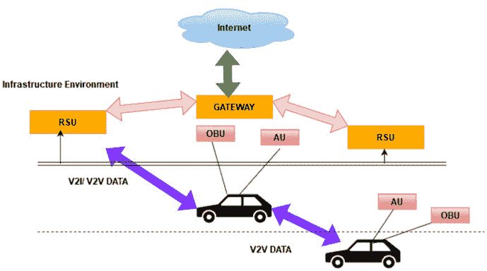

图 2.1 VANET 架构 [12].

### 表 2.1
### 通信类型比较

| 序号 | 通信类型 | 描述 |
|---|---|---|
| 1 | 车辆到车辆 (V2V) 通信 | V2V 技术允许移动车辆之间进行双向直接通信。这种通信形式用于真正的实时安全系统。当汽车能够相互通信时，它们可以交换速度和位置信息，这可能大大提高道路安全性。如果车辆检测到即将发生的碰撞并意外刹车，它可以向其他车辆发送信号以警告它们。 |
| 2 | 车辆到基础设施 (V2I) 通信 | 在 V2I 通信中，汽车和路边设施相互共享信息。此类基础设施的示例包括交通信号灯、道路标志、收费站和路内传感器。V2I 通信有助于优化交通信号、管理交通流量，并向车辆通报道路危险、延误和替代路线。利用实时交通数据改善交通流量和减少拥堵的一种方法是调整交通信号灯的时序。 |
| 3 | 车辆到万物 (V2X) 通信 | V2X 是一种扩展的通信类型，不仅包括车辆到车辆 (V2V) 和车辆到基础设施 (V2I)，还包括与行人（车辆到行人，或 V2P）以及其他车辆（车辆到其他，或 V2O，如自行车和摩托车）的交互。V2X 的目标是建立一个涵盖交通控制和道路安全的生态系统。行人可以通过 V2P 通信收到迎面驶来汽车的警告，而驾驶员可以通过 V2O 通信了解易受伤害的道路使用者（如骑自行车者）。 |

### 2.2.1 通信模型：广播、单播、组播和地播

在 VANET 中，使用各种通信模型在车辆和基础设施之间传输数据（表 2.2）。

## 2.3 实现 VANET 安全的无线技术

无线技术在增强车辆自组网 (VANET) 内的安全性和通信方面发挥着关键作用，这对现代智能交通系统至关重要。下面，对所提及的每种无线技术及其在确保 VANET 安全方面的作用进行深入概述。

- 1. IEEE 802.11p (WAVE - 车辆环境无线接入):
  - IEEE 802.11p 是车辆环境无线接入 (WAVE) 框架下的一种标准，专为 VANET 设计。它在 5.9GHz 频段运行，并提供专用短程通信 (DSRC) [13]。
  - 基于 IEEE 802.11p 的 DSRC 非常适合安全关键型应用，在车辆和基础设施组件之间提供低延迟、高可靠性的通信。它促进车辆到车辆 (V2V) 和车辆到基础设施 (V2I) 通信。
  - 关键安全应用包括碰撞避免、交通信号优先权以及共享车辆位置、速度和状态实时数据的协作意识消息 (CAMs)。

- 2. VANET 安全中的蜂窝技术（例如 4G、5G 及更高版本）:
  - 包括 4G LTE 和 5G 在内的蜂窝技术为 VANET 提供了扩展的通信基础设施。它们提供了超越 DSRC 短程的更广覆盖和连接性 [14]。
  - 4G LTE 实现了车辆到基础设施 (V2I) 通信，支持交通管理、导航和紧急服务等应用。
  - 5G 及更高版本预计将凭借超低延迟、高带宽和大规模设备连接彻底改变 VANET。它们非常适合对延迟敏感的安全应用，如自动驾驶和协作碰撞避免。

- 3. 新兴技术：5G 车辆到万物 (V2X) 通信:
  - 5G V2X 通信是专为 VANET 设计的 5G 技术子集。它实现了车辆到万物的连接，涵盖 V2V、V2I、车辆到行人 (V2P) 和车辆到网络 (V2N) 通信 [11]。
  - 5G V2X 提供极低延迟（毫秒级）、高可靠性以及处理大规模设备连接的能力。这些特性对于实时安全关键型应用（如自动驾驶）至关重要，因为在自动驾驶中，瞬间决策必不可少。

### 表 2.2
### 通信模型比较

| 序号 | 通信模型类型 | 描述 | VANET 中的应用 | 安全性 |
|---|---|---|---|---|
| 1 | 广播 | 在广播通信模型中，车辆或基础设施单元将数据发送给所有附近的车辆或基础设施节点 | 广播通常用于 V2V 通信中的安全关键型消息。紧急警告（如突然刹车或事故）会广播给附近车辆，以确保所有可能受影响的车辆都能收到警报。 | 该模型非常适合需要附近车辆立即关注的安全关键型消息。它确保可能受影响的车辆能迅速收到危险警报，从而提高整体道路安全性。 |
| 2 | 单播 | 单播涉及一对一通信，数据从一个车辆或基础设施节点传输到特定接收者。 | 单播可用于对时间不太敏感的消息，例如导航指令或特定车辆与基础设施单元之间的数据交换。 | 单播适用于非关键通信和数据交换。它可用于车辆和基础设施单元之间的非紧急更新和信息共享。 |
| 3 | 组播 | 组播是一对多或少对多的通信模型，数据发送给选定的车辆或基础设施节点组。 | 组播适用于特定车辆组或基础设施单元需要接收某些信息的应用。例如，一起行驶的车队可以使用组播在车辆之间共享信息。 | 组播适用于特定车辆组需要同时接收相同信息的场景，例如协调机动或车队通信。 |
| 4 | 地播 | 地播是一种基于位置的通信模型，将数据传送到特定地理区域内的车辆或基础设施节点。 | 地播适用于需要将信息分发到特定区域车辆的应用。例如，可以将道路施工信息地播到接近施工区域的车辆。 | 地播对于在特定地理区域进行有针对性的信息传播非常有价值，这对于管理局部事件（如事故或道路施工）至关重要。 |

- 4. 不同无线技术的比较:
  - 延迟：IEEE 802.11p (DSRC) 以其超低延迟而闻名，使其适用于对时间敏感的安全应用。像 5G 这样的蜂窝技术也提供低延迟，但具体延迟取决于网络拥塞和其他因素。
  - 可靠性：IEEE 802.11p 和 5G V2X 在设计时就考虑了高可靠性，这对安全关键型应用至关重要。蜂窝技术提供强大的可靠性，但可能会根据网络条件而有所不同 [15]。
  - 覆盖范围：IEEE 802.11p 的范围有限，最适合局部 VANET。蜂窝技术（尤其是 5G）提供更广泛的覆盖，使其适用于城市和城际 VANET。

## 2.4 VANET 通信中的挑战与未来方向

车辆自组网 (VANET) 为改善道路安全、交通管理和整体交通效率带来了巨大希望。然而，它们也面临着若干挑战和未来发展的机遇。

### 1. 频谱分配与共存挑战:

- 频谱有限：VANET 依赖专用无线电频率进行通信。可用频谱有限带来了挑战，尤其是随着连接车辆数量的增加。与其他无线服务争夺频谱分配是一个持续存在的问题。
- 与其他无线系统共存：确保 VANET 能够与 Wi-Fi 和蜂窝网络等其他无线通信系统共存至关重要。不同通信技术之间的干扰可能导致 VANET 通信中断。
- 动态频谱接入：未来的 VANET 可能会从动态频谱接入等技术中受益，该技术允许车辆在不造成干扰的情况下机会性地使用可用频段。这需要监管变更和高效的频谱管理。

### 2. 可扩展性问题:

- 高效通信：随着道路上车辆数量的增加，VANET 必须高效管理大量车辆之间的通信。可扩展性对于维持安全关键型应用所需的低延迟和可靠性至关重要。
- 网络开销：随着车辆数量增加，路由表管理、寻址和消息传播变得更加复杂。开发可扩展的路由算法和高效协议至关重要。


### 3. 隐私问题与数据保护:

- 位置隐私：VANETs 本质上涉及位置和移动数据的交换。保护驾驶员和乘客的隐私是一个重要问题。未经授权访问这些数据可能导致跟踪、画像和安全风险。
- 安全数据共享：确保 VANETs 内共享数据的安全性和完整性至关重要。防止网络攻击和未经授权访问关键安全相关信息是一个持续的挑战。
- 匿名身份验证：未来的 VANETs 可能需要纳入匿名身份验证机制，允许车辆在不泄露身份的情况下参与通信。

### 4. 与新兴技术的集成:

- 自动驾驶汽车：VANETs 在自动驾驶汽车（AVs）之间的通信中发挥着关键作用，用于协调操纵和增强态势感知。将 VANETs 与 AVs 集成需要强大的通信协议和标准，以确保自动驾驶车辆的安全。
- 人工智能与机器学习：利用人工智能，VANETs 可以预测交通、优化路线并做出瞬间判断。机器学习算法可以通过分析传感器和基础设施的数据来改善交通管理和安全性。
- 边缘计算：当与 VANET 基础设施相连时，边缘计算可以增加实时数据处理并降低延迟，从而在压力下实现更快的决策。

## 2.5 VANETs 中的通信协议与标准

在涉及安全相关应用时，车辆自组网（VANETs）中的通信必须遵守严格的规则和标准。以下是一些重要协议和标准的摘要（表 2.3）。

### 2.5.1 VANET 通信中的安全考量

安全是 VANET 通信的一个关键方面，特别是对于安全应用。以下是几项必不可少的安全措施：

- 1. **身份验证：**
  - 车辆和基础设施必须进行身份验证，以防止未经授权的访问和恶意实体注入虚假数据。
  - 数字签名和公钥基础设施（PKI）等加密技术通常用于身份验证。

### 表 2.3 通信协议比较

| 通信协议 | 描述 | 用例 | 优势 |
| :--- | :--- | :--- | :--- |
| ETSI ITS-G5 | ETSI（欧洲电信标准协会）ITS-G5 是一套专门为 VANETs 开发的欧洲标准。它基于 IEEE 802.11p 并将其适应欧洲监管要求。 | ETSI ITS-G5 在欧洲广泛用于安全关键型应用，例如碰撞避免、交通信号信息交换和协作意识消息（CAMs）传播。 | 它确保车辆和基础设施之间的互操作性，使其适合欧洲境内的跨境旅行。 |
| IEEE 802.11p | IEEE 802.11p，通常称为车载环境下的无线接入（WAVE），是专为 VANETs 中的无线通信设计的标准。它在 5.9GHz 频段运行。 | IEEE 802.11p 主要用于北美和其他一些地区的安全应用。它支持 V2V 和 V2I 通信，用于紧急制动警告和路口碰撞避免等应用。 | 其低延迟和高可靠性特性使其适合对时间敏感的安全应用。 |
| Cellular V2X (C-V2X): | 蜂窝 V2X 是使用蜂窝网络（特别是 4G LTE 和 5G 技术）进行车辆通信的统称。C-V2X 可进一步分为两种模式：直接通信（PC5）和网络通信（Uu）。 | C-V2X 提供了超出安全范围的更广泛应用，包括信息娱乐、交通管理和远程车辆诊断。它可以补充传统的 VANET 技术。 | C-V2X 利用广泛的蜂窝基础设施并可提供更广泛的覆盖。它可适应各种用例，并可支持安全关键型和非安全应用。 |

- 2. **加密：**
  - 为了保护 VANETs 中交换数据的隐私和完整性，加密至关重要。它确保只有授权接收者可以访问和理解数据。
  - 采用高级加密标准（AES）和安全密钥管理来加密数据。

- 3. **消息完整性：**
  - 确保安全关键型消息的完整性至关重要。对消息的任何篡改都可能产生严重后果。
  - 使用哈希函数和消息身份验证码（MACs）来验证消息完整性。

### 2.5.2 安全关键型应用的服务质量（QoS）要求

VANETs 中的安全关键型应用对 QoS 有特定要求，以确保及时可靠的通信。

- 1. **低延迟：** 安全消息必须以最小延迟传递，以支持实时决策，例如碰撞避免。
- 2. **高可靠性：** 通信必须高度可靠，以避免在关键情况下发生通信中断。
- 3. **优先级：** 安全关键型消息应优先于非关键型消息，以确保它们立即得到关注。
- 4. **冗余：** 通常会采用冗余通信路径，以保证即使在网络中断的情况下也能传递消息。
- 5. **可扩展性：** QoS 机制应具有可扩展性，以容纳道路上日益增长的车辆数量。

在 VANET 设计中，将这些 QoS 要求与通信协议和标准的限制相平衡是一项重大挑战，以确保安全应用在动态车辆环境中的有效性。

## 2.6 VANETs 中的安全应用与用例

车辆自组网（VANETs）通过各种应用和用例处于提升道路安全的前沿。这里，我们将探讨 VANETs 实现的一些关键安全应用（表 2.4）。

## 2.7 案例研究与实际实现

这些现实世界的示例突出了 VANETs 可用于改善交通安全、交通管理和整体效率的各种方式。随着协作式车辆通信的优势变得更加清晰，预计 VANET 技术将进一步发展（表 2.5）。

### 表 2.4 安全应用比较

| 应用 | 描述 | 工作原理 | 优势 |
|---|---|---|---|
| 碰撞避免系统 | 碰撞避免系统利用 VANETs 实现车辆之间的实时通信，使它们能够交换速度、位置和轨迹信息。这些信息帮助车辆预测并避免潜在碰撞 [16] | 当车辆检测到危险情况（例如突然刹车或路径上有障碍物）时，它会向附近车辆广播警告消息。这些消息包括车辆速度、方向和位置等关键数据。接收这些警告的车辆随后可以采取避让行动以防止事故 | 碰撞避免系统降低了追尾碰撞、侧面碰撞和路口事故的可能性。它们通过为驾驶员提供早期警告和应对潜在威胁的额外时间来提高整体道路安全性。 |
| 协作式自适应巡航控制（CACC）和车队行驶 | CACC 和车队行驶是依赖 VANETs 的先进交通管理和安全应用。CACC 允许车辆根据与领航车辆的实时通信保持安全跟车距离，而车队行驶涉及一组车辆以协调方式紧密同行 [17,18] | 车队中的车辆通过根据从领航车辆接收的数据调整速度和距离来保持恒定且安全的间距。这种协调带来了改善的交通流量、减少的拥堵和更好的燃油效率。 | CACC 和车队行驶通过降低追尾碰撞的可能性并促进更顺畅的交通流量来提高安全性。它们还由于车队中改善的空气动力学性能而有助于节省燃油和减少排放。 |


### 交叉口碰撞预警系统与红灯违章预防

这些安全应用程序专注于防止交叉口处的事故，许多事故是由于闯红灯和能见度差造成的 [19,20]。

当接近交叉口时，配备 VANET 技术的车辆可以相互通信以共享信息。如果某车辆可能闯红灯或交叉口存在事故风险，警告消息将发送给其他驾驶员，以提醒他们。

通过使用交叉口碰撞预警系统，可以减少闯红灯事件，同时也提高了所有驾驶员的安全性。驾驶员会收到即将发生的危险警告，以便采取必要的预防措施。

### 通过车辆到行人（V2P）通信提升行人安全

V2P 通信是 VANET 的关键组成部分，旨在提升行人安全 [21]。

拥有手机或可穿戴设备的行人可以与过往汽车交换信息。行人可以在人行横道上或即将过马路时，向接近的汽车发出位置和过马路意图的信号。汽车将能够提醒驾驶员注意潜在危险。

为了降低事故发生的可能性，尤其是在拥堵区域和人行横道处，V2P 通信提高了车辆对行人存在及其意图的感知。

### 表 2.5 各种案例研究比较

| 序号 | 案例研究 | 说明 |
|---|---|---|
| 1 | 新加坡智能交通系统 | 新加坡的智能交通系统（ITS）已全面运行，并包含 VANET 组件。为了与安装在路口和沿路的路边单元（RSU）连接，车辆配备了车载单元（OBU）。驾驶员可通过该系统获取交通状况更新、拥堵警报以及潜在道路危险通知 [22,23]。该系统也可用于交通控制和提升整体道路安全。 |
| 2 | 美国合作式交叉口碰撞避免系统（CICAS） | CICAS 计划的目标是防止路口事故 [24,25]，由美国交通部（USDOT）发起。在路口，汽车和基础设施协调其通信。驾驶员会收到即将发生碰撞的通知，并通过在设备上接收警报获得避免碰撞的机会。 |
| 3 | 欧洲合作式车辆-基础设施系统（C-ITS） | 为了促进汽车与基础设施之间的合作通信，欧盟启动了 C-ITS 项目 [26,27]。它涵盖广泛的应用，包括交通信号优先、紧急车辆预警和道路施工通告。该提案的目标是提高安全性、减少拥堵并更好地组织交通流。 |
| 4 | 纽约市紧急车辆优先权 | 在纽约市，VANET 技术已被用于在交通信号灯处实现紧急车辆优先权 [28]。当紧急车辆接近路口时，它会向附近的交通信号灯发送信号以改变其时序，让紧急车辆更高效地通过 |
| 5 | 巴塞罗那基于 VANET 的停车管理 | 巴塞罗那的驾驶员现在可以通过基于 VANET 的停车管理系统获取停车位可用性的实时数据 [29]。停车场和车库中的传感器会将停车位可用性报告给过往汽车。绕圈寻找停车位的时间大大减少，交通拥堵也得以降低。 |
| 6 | 日本安全应用 | 日本已对基于 VANET 的安全应用进行了研究和实施。例如，为了减少闯红灯行为，已尝试和测试了提醒驾驶员有人过马路以及提供交通信号时序信息的系统 [30]。 |

## 2.8 结论

本章揭示了无线技术在定义 VANET 安全概念方面发挥的关键作用。本章强调了 VANET 架构、通信范式及一系列无线技术对改善当今交通网络安全性的协同贡献。通过现实世界中的用例，展示了碰撞避免技术、合作式自适应巡航控制、交叉口碰撞预警以及开创性的车辆到行人（V2P）通信协议的优势，揭示了安全应用的新天地。这些技术有潜力从多方面使我们的道路更安全、更高效。由于通信协议的重要性和安全措施的必要性，强身份验证、加密和数据完整性程序是必不可少的。本章还探讨了与这一革命性主题相关的困难，从频谱分配问题到 VANET、自动驾驶汽车和新型人工智能的复杂组合。当我们站在发展的十字路口时，潜在的未来元素既令人兴奋又充满诱惑。随着智能交通系统的到来以及 5G 及其后续技术的成熟，连接性和实时数据共享将达到新高度。得益于 VANET 与自动驾驶汽车的持续集成，并由尖端传感器和机器学习算法驱动，我们可以期待更安全、更高效、协调性更好的交通网络。本章还通过揭示隐私问题和可扩展性挑战，为进一步研究发出行动号召。为了解决这些问题并进一步提高 VANET 安全性，必须发展新的数据保护范式和强健的通信框架。在本章奠定的基础上，无线连接道路安全的未来光明。研究人员、技术人员和政治家共同努力，将开启一个新时代，届时 VANET 不仅能挽救生命，还将重新定义移动出行的含义。在 VANET 中使用无线技术改善道路安全才刚刚开始，未来充满可能性。

## 参考文献

- 1. Bai, F., & Ning, H. (2015). 车辆自组网：基于定位系统的新挑战. IEEE Transactions on Vehicular Technology, 64(4), 1263–1278.
- 2. Raj, A., Sharma, V., & Shanu, A. K. (2022). 基于联邦学习的物联网设备安全与隐私技术比较分析. 2022 年第 3 届计算、自动化与知识管理国际会议（ICCAKM），迪拜，阿拉伯联合酋长国，第 1–5 页，doi: 10.1109/ICCAKM54721.2022.9990152.
- 3. El-Beltagy, M., Mostafa, M., & El-Bendary, N. (2014). 车辆自组网（VANET）作为 MANET 人本应用的案例研究. Wireless Personal Communications, 79(3), 1785–1803.
- 4. Cheng, Y., Cheng, J., Xu, K., & Yang, L. T. (2013). VANET：移动性建模及移动性对路由的影响. IEEE Transactions on Vehicular Technology, 62(1), 254–268.
- 5. Ajmani, P., Sharma, V., Samuel, P., Somasundaram, K., & Vidhya, V. (2022). 基于 IoMT 的患者行为分析与社会健康预测. 2022 年第 10 届可靠性、信息通信技术与优化国际会议（趋势与未来方向）（ICRITO），第 1–6 页，doi: 10.1109/ICRITO56286.2022.9964846.
- 6. Bettstetter, C., Hartsten, H., & Pérez-Costa, X. (2005). 随机航点移动模型的随机特性. Wireless networks, 11(3), 357–369.
- 7. Uluagac, A. S., & Beyah, R. (2014). 车辆网络中的安全与隐私：最新进展与未来方向. IEEE Communications Surveys & Tutorials, 16(1), 311–328.
- 8. Ali, M. A., Balamurugan, B., Dhanaraj, R. K., & Sharma, V. (2022). 基于 IoT 和区块链的智能农业监测与智能安全系统. 2022 年第 3 届计算、自动化与知识管理国际会议（ICCAKM），迪拜，阿拉伯联合酋长国，第 1–7 页，doi: 10.1109/ICCAKM54721.2022.9990243.
- 9. Sommer, C., German, R., & Dressler, F. (2010). 用于改进 IVC 分析的双向耦合网络与道路交通仿真. IEEE Transactions on Mobile Computing, 10(1), 3–15.
- 10. Gomez, C., Calderon, M., & Cano, J. C. (2014). 车辆自组网（VANET）：应用与挑战的调查与教程. 第 5 届新技术、移动性与安全国际会议（NTMS），迪拜，阿联酋
- 11. Juyal, V. et al. (2020). 关于在容忍延迟网络中利用动态可信路由方案. Wireless Personal Communications, 112, 1705–1718.
- 12. Liang, W., Li, Z., Zhang, H., Wang, S., & Bie, R. (2015). 车辆自组网：架构、研究问题、方法、挑战与趋势. International Journal of Distributed Sensor Networks, 11(8), doi: 10.1155/2015/745303
- 13. Juyal, V. et al. (2016). 容忍延迟网络中路由的解剖. 2016 年 IEEE 计算智能与计算研究国际会议（ICCIC），钦奈，第 1–4 页，doi: 10.1109/ICCIC.2016.7919724
- 14. Balapuwaduge, I. A. I., & Jamalipour, A. (2018). VANET 与 LTE 和 5G 的集成：无线接入网、核心网和回传视角. IEEE Communications Surveys & Tutorials, 20(1), 584–630.
- 15. Alam, M. M., Imran, M. A., & Shaikh, F. K. (2018). 用于增强道路安全和交通系统的 5G 赋能车辆通信. IEEE Communications Magazine, 56(12), 21–27.
- 16. Maurya, A., & Sharma, V. (2022). 使用 Keras 和 CNN 的面部情绪识别. 2022 年第 2 届先进计算与工程创新技术国际会议（ICACITE），第 2539–2543 页，doi: 10.1109/ICACITE53722.2022.9823480.
- 17. Khorov, E., Lyakhov, A., & Krotov, A. (2015). IEEE 802.11p PHY 和 MAC 层调查. IEEE Communications Surveys & Tutorials, 17(2), 1015–1027.
- 18. Banerjee, D., Kukreja, V., Hariharan, S., & Sharma, V. (2023). 使用深度学习方法对猕猴桃叶片疾病进行快速准确的多类分类. 2023 年创新数据通信技术与应用国际会议（ICIDCA），印度北阿坎德邦，第 131–137 页，doi: 10.1109/ICIDCA56705.2023.10099755.
- 19. Ferreira, J., Fonseca, B., Macedo, P., & Santos, J. (2018). 车辆碰撞避免系统调查. IEEE Transactions on Intelligent Transportation Systems, 19(10), 3322–3345.
- 20. Chen, Z., Liao, S., & Li, K. (2017). 智能车辆合作式自适应巡航控制与车队行驶：综述. IEEE Transactions on Intelligent Transportation Systems, 18(7), 1680–1696.
- 21. Murali, M. N. R. D. S., & Sharma, V. (2022). 使用人工神经网络对 DGA 驱动的僵尸网络进行性能分析. 2022 年第 10 届国际会议 on


可靠性、信息通信技术与优化（趋势与未来方向）（ICRITO），第 1–6 页 doi: 10.1109/ICRITO506286.2022.9965044.

- 22. Tientrakul, P., Pun-Cheng, L. S., & Hu, J. (2012). 基于车辆通信的路口碰撞避免：设计、实现与现场测试。IEEE 智能交通系统汇刊，13(4)，1490–1502。

- 23. Chi, Y. M., Chan, P. K., Safi-Harb, S. A., Baldini, R., Bernieri, D., Little, T. D. C., & Goodwin, R. B. (2012). 车辆到行人（V2P）通信以保障行人安全。2012年第九届国际无线通信系统研讨会，法国巴黎，第 554–558 页。

- 24. Ng, K. H., Sengupta, R., & Chan, C. Y. (2008). 案例研究：新加坡。载于《智能交通系统：用于改善道路安全的可靠车辆通信》（第 109–116 页）。Springer。

- 25. 美国交通部 (2019)。合作式路口碰撞避免系统（CICAS）。https://www.its.dot.gov/research_areas/cicas.htm

- 26. 纽约市交通部 (2021)。紧急交通控制信号（TCS）系统。https://www.nyc.gov/dot/trafficcabinet

- 27. Juyal, V. et al. (2017). 基于自组织簇的DTN机会消息转发。2017年信息通信技术与无人系统国际会议（趋势与未来方向）（ICTUS）。IEEE。

- 28. Marfá, N., & Casanovas, J. (2011). 车载自组织网络（VANETs）在城市停车管理中的应用。载于2011年IEEE第73届车辆技术会议（VTC Spring），第 1–5 页。IEEE。

- 29. Nishio, K., Kawai, Y., & Obana, S. (2009). 基于车辆间通信的路口行人事故预防安全应用。载于2009年第12届国际IEEE智能交通系统会议，第 1–6 页。IEEE。

- 30. Juyal, V. et al. (2017). DTN组播路由算法性能比较——机遇与挑战。2017年智能可持续系统国际会议（ICISS）。IEEE。

# 3 基于模糊图支配的网络通信优化

N. Yogeesh
印度卡纳塔克邦图姆库尔政府第一学院数学系

## 3.1 引言

通信网络使WSN、物联网网络和移动自组织网络能够在现代互联世界中高效运行。这些网络的边缘是节点之间通信的手段。这些网络的性能通过建模和分析进行精心优化。

由于模糊图能够准确反映实际网络的模糊性和不精确性，因此可利用模糊图来描述和研究通信网络 [1]。为了描述和理解复杂网络（如通信网络），使用模糊图 [2]。

通过模糊图支配可以改善通信网络的覆盖、连通性和能源效率。根据支配准则，模糊网络中的支配节点是指控制或影响网络中其他节点的节点 [3]。通过仔细选择网络的支配节点，可以增强覆盖、连接、监控和控制。

本章将介绍用于网络优化的模糊图及其支配。还将探讨模糊集理论、通信网络表示和邻接矩阵等主题。随后将介绍模糊图支配，包括其类型、特性和属性。模糊图支配能够改善通信网络的覆盖、连通性、能源效率以及用于监控和控制的关键节点。最后，我们将探讨通信网络中模糊图支配相关的潜在结果和问题。

### 3.1.1 通信网络的定义与重要性

得益于通信网络，设备、系统和人员均可实现互联。有线或无线网络在现代生活中对于数据、音频和多媒体的传输至关重要。无线传感器网络、物联网（IoT）网络和移动自组织网络是为特定目的设计的通信网络示例 [4]。

为了实现简单的通信与协作，通信网络连接了个人、对象和系统。通信网络有助于商业、科学、教育、医疗保健、社交互动以及当代生活的许多其他方面。它们彻底改变了国际通信和信息交换，使世界更加紧密。

通信网络对电信、交通、金融、能源和工业至关重要。实时数据通信有助于实现自动化、关键操作和决策。物联网（IoT）需要通信网络，它连接了全球数十亿台设备 [5]。

通过通信网络，当代社会和工业中的全球连接、协作和技术进步成为可能。

### 3.1.2 不同类型通信网络概述

主要有以下三种类型：

- 无线传感器网络
- 物联网网络
- 移动自组织网络

各种通信网络类型的概述包括无线传感器网络、物联网网络和移动自组织网络的示例。

- 1. 无线传感器网络（WSN）：WSN由小型、独立的传感器节点组成，这些节点可以感知、分析数据并相互通信。这些节点相互协作，从环境中收集信息并将其传输到基站或汇聚节点进行处理和分析。WSN被用于多种用途，包括环境监测、医疗保健、农业和制造自动化。

- 2. 应用示例：无线传感器网络的一个示例是在森林中安装的气象传感器网络，用于监测温度、湿度和空气质量。传感器节点从周围环境收集数据并将其传输到基站进行分析。传感器节点配备了温度、湿度和气体监测器。收集的数据可用于预测森林火灾、监测动物和保护环境。

- 3. 物联网（IoT）网络：物联网网络由互连的物品组成，这些物品通常被称为“事物”，包括传感器、执行器以及相互交互的通信能力。智能家居、智慧城市和工业自动化都得益于这些设备与云端计算机之间的通信。物联网网络可以连接多种类型的设备，这些设备以多种方式通信，可以是有线或无线的。

- 应用示例：物联网网络就是一个示例。在这个系统中，恒温器、照明和安防摄像头等智能设备相互通信，也与中心枢纽或云服务器通信。智能设备可以通过智能手机应用或语音命令远程控制，并可以根据预设规则或用户偏好相互通信。这使得处理和管理家庭安防系统及电器变得更加简单。

- 4. 移动自组织网络（MANET）：MANET由可以相互通信的移动设备组成，例如笔记本电脑、手机和平板电脑。这些设备不依赖于固定系统或单一控制点。通过与附近其他设备建立临时连接，这些设备构建一个临时网络。它们始终可以自由加入或退出网络。MANET经常用于永久基础设施不切实际或无用的情况，例如军事行动、灾害救援和车辆网络。

- 应用示例：调度到灾难地点的急救车辆（如救护车、消防车和警车）车队是移动自组织网络的一个示例。这些车辆直接或通过一系列跳转相互通信，以实时中继危机信息、组织救援行动并立即做出关键决策。MANET在没有既定基础设施且事物不断变化的环境中提供通信。

每种信息网络都有其独特的特性、问题和应用。物联网网络使各种设备能够以多种方式加入和协作，而无线传感器网络通常部署在恶劣或偏远的地点以收集数据。然而，当固定基础设施不切实际时（例如个人频繁移动时），MANET能够实现通信。如果要为特定目的创建有效的网络解决方案，理解这些不同形式的通信网络之间的差异和相似之处至关重要。

### 3.1.3 模糊图及其在通信网络中的表示简介

现代信息和通信基础设施依赖于无线传感器、物联网和移动自组织网络。设备表示为节点，它们之间的通信链路由边表示 [6]。有效的网络管理和优化对于连接、通信覆盖和能源效率是必需的。

近年来，模糊图理论已被用于定义和理解复杂系统，包括通信网络。通过为链路和节点赋予表示不同隶属度或真实程度的模糊值，模糊图增强了经典图。在现实世界的通信网络中，模糊图能够更好地表示不确定性和不精确性。


通过模糊图支配性可以提升通信网络的性能。基于其模糊隶属度值，模糊图中的某些节点可以支配其他节点 [7]。找出控制或被其他节点控制的关键节点，有助于资源分配、网络特性优化和性能提升。

基于模糊图的支配性可以识别具有较大隶属度值的关键传感器节点，暗示其相关性或可靠性，用于无线传感器网络中的数据聚合或路由。通过识别控制通信线路或数据流的重要设备，模糊图中的支配性改善了物联网网络的连通性和能源效率。为了改善动态和移动环境中的多跳通信和网络韧性，基于模糊图的支配性可用于识别移动自组织网络中的支配节点 [8]。

模糊图是一种有趣且有前景的技术，用于改善网络性能并定位用于监控或控制的关键节点。本章将把模糊图理论应用于移动自组织网络、物联网网络和无线传感器网络，重点关注支配性及其优势。

## 3.2 模糊图理论

模糊图理论是描述和理解复杂系统的强大工具，因为它可以表示模糊和不精确的信息。在模糊图中，隶属度或真实性使用模糊值表示 [2]。模糊图更准确地表示现实世界系统，特别是通信网络。

根据 Bagga 和 Sharma 的说法，模糊图理论可以优化通信网络，如移动自组织网络、物联网网络和无线传感器网络 [6]。根据 Wang 和 Wang 的说法，模糊图理论中的支配性是特定节点基于其模糊隶属度值控制或超过网络中其他节点的能力 [7]。

在无线传感器网络中，可使用基于模糊图的支配性识别关键传感器节点 [7]。模糊图通过识别支配通信信道或调节数据流的关键设备，协助增强物联网网络的连接和能源效率 [6]。对于自组织网络中的多跳通信和网络可靠性，基于模糊图的支配性可用于识别支配节点 [7]。

理论模糊图可以改善通信网络并定位用于控制和监控的关键节点。无线传感器网络、物联网网络和移动自组织网络均可从模糊图中的支配性中受益 [5]。

### 3.2.1 模糊集理论基础

为了考虑信息表示中的模糊性和含糊性，Zadeh 于 1965 年开发了模糊集理论。模糊集理论用于人工智能、决策制定、控制系统和通信网络 [2]。

在模糊集理论中，元素的隶属度或真实性由隶属函数指示。根据 Klir 和 Yuan [8]，三角形、梯形、高斯和S形的隶属函数可以表示现实世界中的不确定性和不精确性。

一个元素可以是若干模糊集的成员，具有不同程度的隶属度。由于其灵活性，模糊集可以描述和研究具有模糊性和不确定性的复杂系统。

通信网络节点的连通性、可靠性和能源效率可使用模糊集理论来反映。通信连接中的信号强度、延迟和服务质量均可使用模糊集进行测量。通过解决不确定性和不精确性，模糊集理论增强了网络性能和决策制定 [9]。

### 3.2.2 模糊图的定义与属性

通过为边和节点分配表示其属于图的程度或真实程度的模糊值，模糊图是标准图的扩展 [2]。被称为模糊图的数学模式可用于分析和解释复杂系统，包括通信网络。

模糊图定义：模糊图 G 定义为一对 (V, E)，其中 V 是节点或顶点的有限集，E 是 V × V 上的模糊关系，表示节点之间的模糊边或通信链路。模糊关系 E 为 V × V 中的每对节点 (u, v) 分配一个隶属度值，表示为 E(u, v)，它表示图 G 中节点 u 和 v 之间边的隶属度或真实程度 [7]。

### 模糊图示例：

考虑一个由五个标记为 A、B、C、D 和 E 的传感器节点组成的通信网络。节点之间的模糊边可以使用 V × V 上的模糊关系 E 来表示，其中 V = {A, B, C, D, E}。

模糊关系 E 可以使用隶属矩阵表示，如下所示：

在此示例中，模糊隶属度值（图 3.1）展示了节点之间通信关系的可靠性或重要性。例如，如果边 (A, A) 的隶属度值为 0.9，则节点 A 与自身具有极其可信的通信关系。边 (A, C) 的可靠性程度低于边 (B, B)，后者具有最高级别的可靠性。

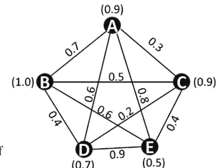

图 3.1 用于展示真实性模糊隶属度的图。

- 边 (A, B) 的隶属度值 = 0.8
- 边 (A, C) 的隶属度值 = 0.6
- 边 (B, D) 的隶属度值 = 0.9
- 边 (C, D) 的隶属度值 = 0.7

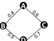

图 3.2 显示它们之间链路强度的隶属度值。

基于此模糊关系，可以确定每个节点支配模糊图的程度、模糊连接度量以及用于推理和决策的模糊运算。

### 模糊图的属性：

- 1. 模糊隶属度值：分配给模糊网络中边或节点的隶属度值指示它们之间链路的准确性或重要性。根据 Wang 和 Wang [7]，这些隶属度值可用于表示通信信道的不确定性、模糊性和不精确性，例如信号强度、可靠性和服务质量。
- 考虑一个具有节点 A、B、C 和 D 以及具有表示它们之间连接程度的隶属度值的模糊边的模糊网络。边的模糊隶属度值可以用多种方式描述，例如如下：
- 这些隶属度值显示节点之间通信链路的真实程度或连接程度（图 3.2）。值越高的链路连接越紧密。

- 2. 支配程度：支配是模糊图理论中的关键概念，指某些节点基于其模糊隶属度值影响或控制图中其他节点的能力。模糊图 G 中节点 u 的支配程度定义为 V 中所有节点 v 的模糊关系 E(u, v) 的最大隶属度值，表示为 dom(u) = max {E(u, v) | v ∈ V} [6]。
- 在模糊网络中，节点的控制程度由其与其他节点的关联程度或影响程度决定。可以使用模糊总支配、模糊配对支配或模糊独立支配等模糊控制度量来计算它。
- 例如，上述模糊图中节点 A 的支配程度可通过以下方式计算：
- 节点 A 的支配程度 = [A] 的模糊总支配 = max {0.8, 0.6} = 0.8

- 3. 模糊连通性：根据模糊线的隶属度值，模糊图可以表现出节点之间各种连接程度，从完全连接到部分连接再到完全不连接。这些连接程度可以以多种方式显示。根据 Wang 和 Wang [7]，可使用模糊连通度量，如模糊 k-邻域和模糊聚类系数，来衡量模糊图的连接程度并检查其结构特征。


在模糊图中，模糊连接度量衡量节点之间的关联程度，同时考虑边的模糊隶属度值。存在许多其他形式的模糊连通度量，例如模糊 \(\alpha\)-连接、模糊 \(\beta\)-连接和模糊 \(\gamma\)-连接。

例如，上述模糊图中节点 A 和 D 之间的模糊 \(\alpha\)-连接可按以下方式计算：

Fuzzy \(\alpha\)-connection between A and D = min {0.8, 0.7} = 0.7

- 4. 模糊运算：模糊网络可使用模糊运算进行操作和组合，包括模糊并集、模糊交集、模糊补集和模糊复合 [8]。这些模糊过程为在模糊图中进行推理、做出判断和采取行动提供了一种多功能且有效的技术。

模糊图理论中的模糊运算使基于模糊集和模糊关系的推理、判断和推断成为可能。模糊函数有几种类型，包括模糊补集、模糊并集、模糊交集和模糊复合。

例如，以下是计算边 (A, B) 和 (A, C) 的模糊并集的方法：

Fuzzy union of (A, B) and (A, C) = max {0.8, 0.6} = 0.8

由于其特性，模糊图可用于表示和研究通信网络。这是因为可以使用模糊图来展示现实世界系统的复杂性、不精确性和不确定性。

### 3.2.3 通信网络的模糊表示

模糊图用于表征通信网络模型的连接、覆盖和能源经济性（图 3.3）。模糊图的节点代表对象，边代表通信线路。边上的模糊隶属度值表明节点之间关系的紧密程度。

以下是一个包含五个设备（A、B、C、D 和 E）及其各自通信链路模糊隶属度值的通信网络模糊图模型示例。

上述模糊图中的节点 A、B、C、D 和 E 代表通信网络设备，而边代表它们之间的连接。边具有较高模糊隶属度值（从 0 到 1）表示节点之间具有更强的连接。

这种模糊图结构可以提高通信网络组件（如用于监控或控制的关键节点、通信覆盖和连接）的效率。在信息不确定或不准确的情况下，模糊图理论有助于通信网络做出更好的判断并优化其运营。

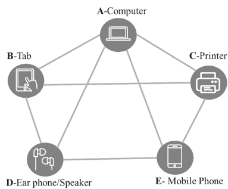

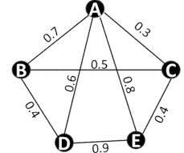

| | A | B | C | D | E |
|---|---|---|---|---|---|
| A | 0 | 0.7 | 0.3 | 0.6 | 0.8 |
| B | 0.7 | 0 | 0.5 | 0.4 | 0 |
| C | 0.3 | 0.5 | 0 | 0 | 0.4 |
| D | 0.6 | 0.4 | 0 | 0 | 0.9 |
| E | 0.8 | 0 | 0.4 | 0.9 | 0 |

图 3.3 模糊图以节点表示通信网络设备，以边表示其通信链路（示例）。

**示例：** 一个包含多个传感器节点的无线传感器网络在广阔的农业区域分析环境参数。传感器节点与中央基站通信，以共享温度、湿度、土壤湿度和光照强度方面的信息。

该无线传感器网络可以图形化表示为模糊图，其中节点表示传感器节点，边表示通信链路。通信链路的强度可以通过边上的模糊隶属度值来指示，这些值基于信号强度、距离或其他因素（图 3.4）。

我们可以使用图形化应用程序来查看模糊图。

边表示无线传感器网络中传感器节点 A、B、C 和 D 之间的通信路径。边具有较高模糊隶属度值意味着更强的通信链接。

通过识别用于数据聚合的关键节点、增加通信覆盖和连接，并基于模糊隶属度值选择最可靠的通信链路来提高能源效率，这种模糊图表示可以优化无线传感器网络。

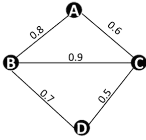

图 3.4 边上的模糊隶属度值可以反映通信连接强度。

### 3.2.4 模糊邻接矩阵及其解释

模糊网络中两个节点之间的模糊隶属度值或支配程度由模糊邻接矩阵描述。模糊网络中节点连接的强度在模糊邻接矩阵中显示。

有必要理解模糊邻接矩阵隶属度值或支配程度的重要性。模糊图节点的连通性、通信覆盖或能源效率均可表示为模糊隶属度值。较低的模糊隶属度值表示较弱的关系。

以无线传感器网络的模糊邻接矩阵为例。

| Nodes | A | B | C | D |
|---|---|---|---|---|
| A | 0.9 | 0.7 | 0.3 | 0.6 |
| B | 0.7 | 1.0 | 0.5 | 0.4 |
| C | 0.3 | 0.5 | 0.9 | 0.2 |
| D | 0.6 | 0.4 | 0.2 | 0.7 |

该模糊邻接矩阵中的模糊隶属度值表示无线传感器网络中节点之间链路的强度。节点 A 与其自身的模糊隶属度得分为 0.9，表明具有良好的通信或连接覆盖。节点 A 的模糊隶属度得分为 0.3，表明其与节点 C 的关系比与自身的关系更弱。

可使用模糊邻接矩阵来解释模糊图的连通性、通信覆盖和能源效率。通过基于模糊隶属度值选择最可靠的通信线路，还可以识别用于监控或控制的关键节点、优化通信覆盖或连接，并提高能源效率 [10]。

模糊图反映模糊邻接矩阵（图 3.5）。

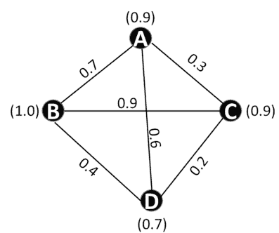

图 3.5 给定模糊邻接矩阵的图形表示。

连接代表通信网络设备的节点 A、B、C 和 D 的边，显示了模糊邻接矩阵中节点对之间的模糊隶属度值或支配程度。通过显示通信网络设备的连通性和强度，可以更好地理解模糊图的特性。

## 3.3 模糊图中的支配

### 3.3.1 模糊图中支配的定义

模糊图理论中的支配是指一个或多个节点控制或影响其他节点。模糊图中的隶属度或支配程度表明一个节点控制或影响其他节点的程度。

在模糊图 G = (V, E) 中，其中 V 是节点集，E 是边集，如果节点 u 的隶属度或支配程度大于或等于阈值，则节点 u 支配节点 v。阈值表示 u 对 v 的控制力。

应用程序使用不同的模糊图支配定义。根据节点与另一个节点的模糊关联或接近程度，它将在模糊 k-支配集中支配其他节点。

模糊图中的支配用于评估表示为模糊图的复杂系统，识别用于监控或管理的关键节点，并增强通信网络中的通信覆盖、连接和能源效率。

**示例：说明模糊图中支配概念的示例。**

考虑一个具有以下模糊邻接矩阵的模糊图 G = (V, E)（图 3.6）。

要控制另一个节点，节点必须具有 0.6 或以上的隶属度或支配程度。

此阈值决定模糊图支配连接。例如：

- 1. 节点 A 支配节点 B，因为 A 相对于 B 的隶属度为 0.7，大于阈值 0.6。
- 2. 节点 B 支配节点 C，因为 B 相对于 C 的隶属度为 0.5，高于阈值 0.6。

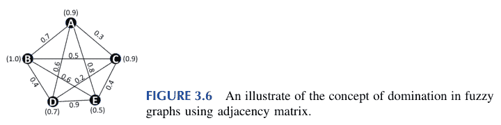


- 3. 节点 D 支配节点 E，因为 D 相对于 E 的隶属度为 0.9，高于阈值 0.6。

在此示例中，邻接矩阵中的模糊隶属度值生成支配连接，而支配的阈值决定了模糊网络中一个节点是否支配另一个节点。

模糊图中支配及其阈值的定义可以更改，以适应应用或研究。

**定义:** 设 $G = (V, E)$ 为具有模糊邻接矩阵 $F = [f_{ij}]$ 的模糊图，其中 $V = \{v_1, v_2, ..., v_h\}$ 是顶点（节点）集合，$E \subseteq V \times V$ 是边（链接）集合。令 $F(v_i, v_j)$ 表示模糊图中顶点 $v_i$ 相对于顶点 $v_j$ 的隶属度或支配度。若且仅当：

$F(v_i, v_j) \ge \alpha, \quad for \ some \ \alpha \in [0,1]$

顶点 $v_i$ 在模糊图 G 中支配顶点 $v_j$。

其中 $\alpha$ 为支配的阈值，$F(v_i, v_j)$ 表示模糊邻接矩阵中顶点 $v_i$ 相对于顶点 $v_j$ 的隶属度或支配度。

换句话说，若顶点 $v_i$ 相对于顶点 $v_j$ 的隶属度或支配度等于或大于阈值 $\alpha$，则顶点 $v_i$ 支配顶点 $v_j$。

基于模糊邻接矩阵中的隶属度或支配度值，该等式定义能够确定模糊图中的支配关系，且阈值可根据特定应用或分析的需求进行修改。

### 3.3.2 模糊支配的不同类型（全支配、强支配、弱支配）

模糊图中的模糊支配可根据支配的强度和程度分为不同类型。常见的三种模糊支配类型如下：

- 1. **全支配:** 若顶点 $v_i$ 相对于顶点 $v_j$ 的隶属度或支配度等于 1，即 $F(v_i, v_j) = 1$，则称顶点 $v_i$ 全支配顶点 $v_j$。这意味着 $v_i$ 在模糊图中对 $v_j$ 拥有完全的控制或影响，且 $v_j$ 被 $v_i$ 完全支配。

**示例:** 考虑具有以下模糊邻接矩阵的模糊图（图 3.7）。

在此例中，顶点 A 全支配顶点 D，因为 $F(A, D) = 1$，表明 A 在模糊图中对 D 拥有完全的控制或影响。

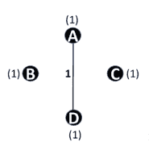

**图 3.7** 带邻接矩阵的模糊图中的全支配。

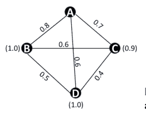

**图 3.8** 带邻接矩阵的模糊图中的强支配。

- 2. **强支配:** 若顶点 \(v_i\) 相对于顶点 \(v_j\) 的隶属度或支配度大于阈值 \(\alpha\)，即 \(F(v_i, v_j) > \alpha\)，则称顶点 \(v_i\) 强支配顶点 \(v_j\)。这意味着 \(v_i\) 在模糊图中对 \(v_j\) 具有显著程度的控制或影响，且 \(v_j\) 被 \(v_i\) 以较高的隶属度或支配度支配。

**示例:** 考虑具有以下模糊邻接矩阵的模糊图（图 3.8）。
在此例中，顶点 A 强支配顶点 B 和顶点 C，因为 \(F(A, B) > \alpha\) 且 \(F(A, C) > \alpha\)，其中 \(\alpha\) 为阈值。这表明 A 在模糊图中对 B 和 C 具有显著程度的控制或影响。

- 3. **弱支配:** 若顶点 \(v_i\) 相对于顶点 \(v_j\) 的隶属度或支配度等于或大于阈值 \(\alpha\)，即 \(F(v_i, v_j) \ge \alpha\)，则称顶点 \(v_i\) 弱支配顶点 \(v_j\)。这意味着 \(v_i\) 在模糊图中对 $v_j$ 具有一定程度的控制或影响，且 $v_j$ 被 $v_i$ 以一定的隶属度或支配度支配，但这可能不完整或不强。

**示例:** 考虑具有以下模糊邻接矩阵的模糊图（图 3.9）。
在此例中，顶点 A 弱支配顶点 B、C 和 D，因为 \(F(A, B) \ge \alpha\)、\(F(A, C) \ge \alpha\) 且 \(F(A, D) \ge \alpha\)，其中 \(\alpha\) 为阈值。这表明 A 在模糊图中对 B、C 和 D 具有一定程度的控制或影响，尽管这可能不完整或不强。

这些模糊支配类型描述了模糊图中支配顶点的连接的强度和大小，从而允许对通信网络以及模糊图理论的其他应用进行更深入的优化和分析。

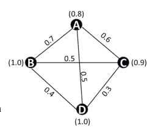

**图 3.9** 带邻接矩阵的模糊图中的弱支配。

### 3.3.3 模糊图中支配的属性和特性

模糊图中的支配具有多种属性和特性，如下所示：

- 自反性: 模糊图中的每个顶点都支配其自身，即 F(v, v) = 1，其中 v 是模糊图中的一个顶点。此属性表明，一个顶点始终对自身具有一定程度的控制或影响。示例: 考虑仅有一个顶点 A 的模糊图，且 A 支配自身的模糊隶属度为 0.8。那么，该模糊图的邻接矩阵如下（图 3.10）：这表明 A 以 0.8 的模糊隶属度支配自身，满足自反性属性。

- 传递性: 若顶点 u 支配顶点 v 且顶点 v 支配顶点 w，则顶点 u 支配顶点 w，即若 F(u, v) > α 且 F(v, w) > α，则 F(u, w) > α，其中 α 为阈值。此属性表明，模糊图中的支配可以通过多个顶点以传递方式传播。示例: 考虑具有三个顶点 A、B 和 C 的模糊图，以及以下模糊隶属度值（图 3.11）。在此，A 以 0.6 的模糊隶属度支配 B，B 以 0.5 的模糊隶属度支配 C。我们可以利用传递性属性计算 A 支配 C 的模糊隶属度值：

```
F(A, B) = 0.6
```

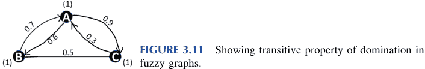

**图 3.10** 显示模糊图中支配的自反性属性。

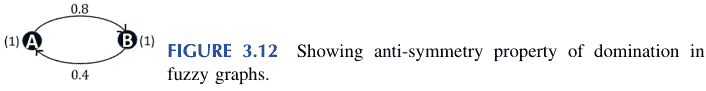

$$F(B, C) = 0.5$$

$$F(A, C) = \min \{F(A, B), F(B, C)\} = \min \{0.6, 0.5\} = 0.5$$

这表明 A 以 0.5 的模糊隶属度支配 C，满足传递性属性。

- **反对称性:** 模糊图中的支配是反对称的，这意味着如果顶点 u 支配顶点 v，则 v 不能支配 u，除非 u = v，即如果 F(v, u) > α，则 F(v, u) = 1 或 F(v, u) < α，其中 α 为阈值。此属性表明，模糊图中的支配是方向性和非对称的。

**示例:** 考虑具有两个顶点 A 和 B 的模糊图，以及以下模糊隶属度值（图 3.12）。

在此，A 以 0.8 的模糊隶属度支配 B，但 B 不支配 A，因为 F(B, A) = 0.4，小于 1。这满足反对称性属性，表明模糊图中的支配是反对称的。

- **部分支配:** 在模糊图中，一个顶点可能对另一个顶点不具有完全或全部的控制。相反，它可能只拥有一定程度的控制或影响，这由 0 到 1 之间的模糊隶属度值表示。

**示例:** 考虑具有两个顶点 A 和 B 的模糊图，以及以下模糊隶属度值（图 3.13）。


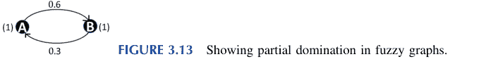

在此，A 以 0.6 的模糊隶属度支配 B，这意味着 A 对 B 具有一定的控制或影响，但不具有完全支配。这满足部分支配的条件。

- 基于阈值: 模糊图中的支配经常取决于一个阈值。这表明一个点对另一个点的支配是由阈值决定的。如果两点之间的支配模糊隶属度值大于阈值，则认为存在支配。如果低于阈值，则不存在支配。

示例: 考虑具有三个顶点 A、B 和 C 的模糊图，以及以下模糊隶属度值（图 3.14）。

如果设置阈值 α = 0.6，则 A 分别以 0.7 和 0.9 的模糊隶属度值支配 B 和 C，两者均大于 α。然而，B 不支配 A，因为 F(B, A) = 0.6，不大于 α。这表明模糊图中的支配是基于阈值的，并取决于所选的阈值。

- 支配程度: 模糊图中的支配程度可能取决于模糊隶属度数值而有所不同。较高的模糊隶属度值表示更强的支配群体，而较低的值表示较弱的支配群体。

示例: 考虑具有两个顶点 A 和 B 的模糊图，以及以下模糊隶属度值（图 3.15）。

在此，A 以 0.6 的模糊隶属度值支配 B，B 以 0.3 的模糊隶属度值支配 A。这表明 A 和 B 之间存在支配程度，A 对 B 的支配程度高于 B 对 A 的支配程度。这满足了模糊图中支配程度的属性。

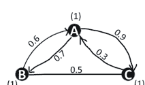

**图 3.14** 显示模糊图中基于阈值的支配值。

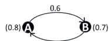

**图 3.15** 显示模糊图中的支配程度。


由于模糊图中的支配性具有这些品质和特征，它可以用于建模和研究现实世界系统，在这些系统中，支配或控制的概念本质上是不确定或模糊的。

### 3.3.4 通信网络中模糊图支配性的应用

在信息网络中，模糊图控制的概念可以以多种方式应用，例如[11–13]：

- **通信覆盖优化：** 可通过模糊图支配性优化通信设备（如无线传感器节点或物联网（IoT）设备）的部署，以尽可能完全地覆盖网络，同时限制冗余和能源消耗。这是通过识别通信网络中的支配节点（即关键节点）来实现的。

- **连接性增强：** 通过利用模糊图支配性识别可作为网络断开部分之间交换机或链路的支配节点，可以提高连接性。这有助于建立可靠的通信通道，并增强网络的整体连接性和稳定性。

- **能源效率改进：** 找到通信网络中的支配节点，以最有效的方式管理和控制其他节点的通信活动，有助于提高能源效率。这种技术称为模糊图支配。通过战略性地部署这些支配节点，网络可以减少能源使用，提高能源效率并延长网络寿命。

- **容错性和韧性：** 通过识别可在节点故障或网络中断时充当备用或替代节点的支配节点，模糊图支配性可用于提高通信网络的容错性和韧性。这可以确保通信不会中断，并且网络保持稳定可靠。

- **网络监控与控制：** 为监控和调节通信网络，可使用模糊图支配性定位关键节点。为收集网络数据、管理网络或实施网络规则，可选择支配节点作为监控或控制点。这提高了网络管理和控制的效率。

在通信网络中，采用模糊图支配性有助于提高网络速度、简化连接、降低能耗、确保无故障，并简化网络监控和管理。

## 3.4 使用模糊图支配优化通信网络

### 3.4.1 利用模糊支配优化网络通信覆盖

通过识别在通信范围或信号强度方面优于其他节点的关键节点，模糊支配有助于最大化网络通信覆盖。这些支配节点可以战略性地部署，以在减少冗余操作和能源消耗的同时增加网络覆盖。

可使用模糊支配找到通信范围具有更好模糊隶属度值的无线传感器网络。这些支配节点可以有目的地利用重大事件或活动，战略性地覆盖重要区域或位置[14]。

可使用模糊支配在物联网网络中识别信号强度模糊隶属度值更高的设备。这些显著设备可以仔细部署以优化网络覆盖[15,16]。

当节点在没有基础设施的情况下连接时，模糊支配可以最大化移动自组网（MANET）中的通信覆盖。为提高通信覆盖，支配节点可以根据其与通信范围、信号强度或其他因素相关的模糊隶属度值，定位为分散网络组件之间的中继节点或桥梁[17]。

得益于模糊支配，网络覆盖、连接性和可靠性均可得到改善，同时还能提升网络性能和资源利用率。

此图展示了模糊支配如何优化网络通信覆盖。

考虑一个包含5个传感器节点的无线传感器网络，表示为节点A、B、C、D和E。每个传感器节点的通信覆盖由模糊隶属度值表示，如下图所示（图3.16）。

此图以括号中的模糊隶属度值显示每个传感器节点的通信范围。值越高，表示范围越大。节点A和E的模糊隶属度分数高于其他节点（分别为0.9和0.8），表明其通信范围更大。

节点A和E是模糊图中的支配节点，因为它们的模糊隶属度值高于B、C和D。这些支配节点可能覆盖需要改进通信覆盖的关键热点或位置。

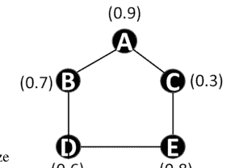

图3.16 展示模糊支配可优化网络通信覆盖。

虽然节点E可以从网络边缘服务于通信需求高的特定区域，但节点A可以从中心位置服务于网络的更大区域。这些支配节点能够优化网络通信，增强连接性、覆盖性和能源效率。

### 3.4.2 使用模糊支配提高网络连接性和能源效率

一张展示模糊支配如何提高网络连接性和能源效率的图示[5]。

考虑一个包含六个节点（A、B、C、D、E和F）的移动自组网（MANET）。下图显示了表示这些节点之间连接性的模糊隶属度值（图3.17）：

在此网络中，较高的模糊隶属度值表示节点之间具有更高的连接程度。节点A、C和D的模糊隶属度值高于其邻居（分别为0.8、0.9和0.7），表明这些节点具有更强的连接性。

节点C和D的模糊隶属度值大于其邻居A、B、E和F，这是这些节点成为支配节点的主要原因。支配节点可以改善网络的连接性及其能源效率。

得益于充当中继节点的节点C，节点A和D之间的连接和通信可以得到改善。节点D还能够充当中心节点，从而协调网络的通信和路由选项，降低通信开销并提高能源效率。

模糊逻辑的支配性可以提高该网络的连接率和能源效率，从而增强MANET的功能性和可靠性。

### 3.4.3 使用模糊支配识别用于监控和控制目的的关键节点

模糊支配可用于识别用于监控和控制的关键节点，这在尝试管理和调节通信网络（特别是无线传感器网络）时非常有用。为监控和管理目的，模糊支配可以定位重要节点，包括：

想象一个拥有大量传感器节点的无线传感器网络，这些节点通过表示连接程度的模糊隶属度值相互关联。模糊隶属度值由网络的信号强度、距离、可靠性和其他特征决定[18]。

- i. 图形表示：边表示节点对之间的连接强度的模糊隶属度值，而节点本身则作为传感器的表示。模糊隶属度值有助于增加节点的连接性。

- ii. 模糊支配计算：可使用模糊支配计算来确定每个网络节点支配位置的值。节点支配的计算使用附近节点的值。模糊隶属度值高于其邻居的节点将支配那些邻居。

- iii. 关键节点识别：可以监控并对高支配性节点施加影响。这些节点的连接性高于其他节点，因此在网络中占据支配地位。选择用于监控和控制的关键节点是管理网络的关键步骤。

- iv. 决策：网络的模糊支配图可用于协助选择用于监控和控制的关键节点。支配评级较高的关键节点与其他节点的连接更紧密，因此更可能影响网络的运行方式。

使用模糊支配有助于改善通信网络（特别是无线传感器网络）中的网络性能、能源效率和优化。可使用模糊支配识别用于监控和管理的关键节点。

一个表示为模糊图的无线传感器网络，连同模糊支配计算、关键节点识别、决策和邻接矩阵表示。

- 1. 图形表示：考虑一个由六个传感器节点组成的无线传感器网络，分别表示为节点A、B、C、D和E（图3.18）。这些模糊网络的隶属度值用于描述这些传感器节点之间的连接性，如下面的模糊图所示：

- 2. 邻接矩阵表示：可以将模糊网络描述为邻接矩阵，行和列代表各个节点，矩阵条目表示表示连接程度的模糊隶属度值


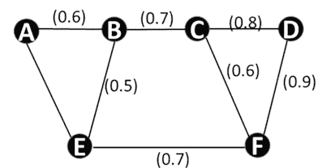

图 3.18 显示 6 个传感器节点的模糊隶属度值。

不同节点对之间的强度。模糊图的邻接矩阵。

如前所述，邻接矩阵有可能产生模糊支配值并定位关键节点。

将模糊支配应用于通信网络中定位关键节点的任务，以用于控制和监控，可以帮助优化环境监测、监视和工业控制系统的网络运行。通过使用图形描述、模糊支配计算、关键节点识别和决策，可以改进网络的管理和维护。

- 3. 模糊支配计算：每个节点的模糊支配值可根据其相邻节点的模糊隶属度值来确定。节点 B 的支配值如下：

基于前面提供的带有模糊图表示的邻接矩阵，我们将节点 i 和 j 之间的模糊隶属度值表示为 μ(i, j)。可以使用以下数学方程计算所有节点的模糊支配值（Dom）：

```
Dom(i) = max ( min (μ(i, j), μ(j, i))) for all j ≠ i
```

以下是给定示例图中所有节点的模糊支配值计算。

```
Node A:
Dom(A) = max(min(μ(A, B), μ(B, A)), min(μ(A, C), μ(C, A)), min(μ(A, D), μ(D, A)),
min(μ(A, E), μ(E, A)), min(μ(A, F), μ(F, A)))
= max(min(0, 0), min(0, 0), min(0, 0), min(0, 0), min(0, 0))
= max(0, 0, 0, 0, 0)
= 0
```

```
Node B:
Dom(B) = max(min(μ(B, A), μ(A, B)), min(μ(B, C), μ(C, B)), min(μ(B, D), μ(D, B)),
min(μ(B, E), μ(E, B)), min(μ(B, F), μ(F, B)))
= max(min(0, 0), min(0.6, 0.7), min(0, 0), min(0, 0), min(0.5, 0))
= max(0, 0.6, 0, 0, 0)
= 0.6
```

```
Node C:
Dom(C) = max(min(μ(C, A), μ(A, C)), min(μ(C, B), μ(B, C)), min(μ(C, D), μ(D, C)),
min(μ(C, E), μ(E, C)), min(μ(C, F), μ(F, C)))
= max(min(0, 0), min(0, 0), min(0.8, 0.6), min(0, 0), min(0, 0))
= max(0, 0, 0.8, 0, 0)
= 0.8
```

```
Node D:
Dom(D) = max(min(μ(D, A), μ(A, D)), min(μ(D, B), μ(B, D)), min(μ(D, C), μ(C, D)),
min(μ(D, E), μ(E, D)), min(μ(D, F), μ(F, D)))
= max(min(0, 0), min(0, 0), min(0, 0), min(0.9, 0), min(0, 0))
= max(0, 0, 0, 0.9, 0)
= 0.9
```

```
Node E:
Dom(E) = max(min(μ(E, A), μ(A, E)), min(μ(E, B), μ(B, E)), min(μ(E, C), μ(C, E)),
min(μ(E, D), μ(D, E)), min(μ(E, F), μ(F, E)))
= max(min(0, 0), min(0.5, 0), min(0, 0), min(0, 0), min(0, 0))
= max(0, 0.5, 0, 0, 0)
= 0.5
```

```
Node F:
Dom(F) = max(min(μ(F, A), μ(A, F)), min(μ(F, B), μ(B, F)), min(μ(F, C), μ(C, F)),
min(μ(F, D), μ(D, F)), min(μ(F, E), μ(E, F)))
= max(min(0, 0), min(0, 0.8), min(0, 0), min(0, 0), min(0, 0.5))
= max(0, 0, 0, 0, 0)
= 0
```

因此，给定示例图中所有节点的模糊支配值为：
Dom(A) = 0; Dom(B) = 0.6; Dom(C) = 0.8; Dom(D) = 0.9; Dom(E) = 0.5;
Dom(F) = 0

节点之间的模糊隶属度值决定了每个节点在网络中对其他节点的支配程度。支配值意味着节点支配。

### 3.4.4 现实世界通信网络中模糊图支配的案例研究和示例

#### 3.4.4.1 案例研究：无线传感器网络中的模糊图支配

想象一个便携式传感器网络，其中有十个传感器节点分布在一个区域内，用于监测温度、湿度和光照强度等事物。下图显示，模糊隶属度值用于表示各种传感器节点之间的连接 [18]：

括号中模糊隶属度值越高，该网络中传感器节点之间的通信链路就越有可能是强的。D 和 I 都具有最高的模糊隶属度值 1.0，这表明我们与邻居拥有最强大的通信链路。

让我们计算构成无线传感器网络的每个传感器节点的模糊支配值。节点的模糊支配值是通过将该节点及其邻居的模糊隶属度值相加来计算的。当支配值归一化时，它是通过将其除以网络的总支配值来计算的（表 3.1 和图 3.19）。

模糊支配值的确定，即无线传感器网络中哪些传感器节点对于跟踪和调节最为重要（图 3.20）。节点 C 和 D 的模糊支配系数值均为 0.686，这表明它们被视为网络中的支配节点，因为它们对网络影响最大。

#### 表 3.1
#### 每个传感器节点的模糊支配值计算

| 节点 | 模糊隶属度值 | 支配邻居 | 模糊支配值 |
| :--- | :--- | :--- | :--- |
| A | 0.8 | B (0.6), C (0.9) | 1.3 / 3.5 = 0.371 |
| B | 0.6 | A (0.8), C (0.9) | 1.7 / 3.5 = 0.486 |
| C | 0.9 | A (0.8), B (0.6), D (1.0) | 2.4 / 3.5 = 0.686 |
| D | 1.0 | C (0.9), E (0.7), I (0.8) | 2.4 / 3.5 = 0.686 |
| E | 0.7 | D (1.0), H (0.7) | 1.7 / 3.5 = 0.486 |
| F | 0.5 | G (0.6) | 1.1 / 3.5 = 0.314 |
| G | 0.6 | F (0.5), H (0.7) | 1.3 / 3.5 = 0.371 |
| H | 0.7 | E (0.7), G (0.6) | 1.3 / 3.5 = 0.371 |
| I | 0.8 | D (1.0), J (0.9) | 1.7 / 3.5 = 0.486 |
| J | 0.9 | I (0.8) | 1.7 / 3.5 = 0.486 |

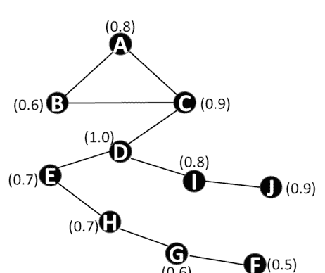

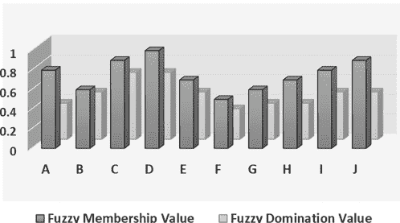

图 3.20 显示每个传感器节点的模糊支配值计算的图表。

在同一无线传感器网络中，让我们看看模糊图控制的另一个示例。我们使用 0.5 的阈值来识别支配节点。软控制值超过 0.5 的节点被称为支配节点。

C 和 D 是强节点，因为它们的模糊支配值超过 0.5，这是该网络中权力的阈值。这些节点在网络中拥有最大权力，可用于完成聚合数据、确定如何路由数据或操作执行器等基本任务。网络中的其他节点功率较低。

模糊图支配在无线传感器网络中的一些应用方式：

- i. **数据聚合：** 可以借助支配技术在模糊网络中找到支配节点。一旦识别出这些节点，就可以利用它们来收集和处理来自其邻近节点的输入。这不仅减少了不必要的交互量，还有助于节省能源。

- ii. **路由决策：** 可以在网络中使用支配节点来确定路由决策，因为这些节点能够比网络中的其他节点更快地传输数据包，因为它们与邻居拥有强大的连接。

- iii. **执行器控制：** 可以通过在无线传感器网络中使用支配节点来实现执行器控制。它们能够根据网络的要求，向电动机、阀门和开关等执行器提供操作命令。

**结论：** 在无线传感器网络中，模糊图控制可以是一种有效的方法，用于确定哪些节点对整个网络影响最大。借助所提供的案例研究和示例，我们能够理解模糊图支配如何在现实世界的无线传感器网络中用于数据收集、确定适当路由和控制执行器等活动。

## 3.5 未来方向与挑战

### 3.5.1 通信网络中模糊图支配的新兴趋势和潜在应用

模糊图支配可能被用于未来的通信网络发展中。以下是模糊图支配的新兴趋势和应用[18]：

- • **物联网（IoT）：** 在用于智慧城市、智能家居和工业自动化的物联网网络中，模糊图支配可以最大化通信覆盖、能源效率和网络连接性。可以通过使用模糊图支配来管理和控制物联网设备，从而提高网络速度[10]。

- • **5G 及以后网络：** 预计这些网络将具有动态拓扑，包含各种设备和服务。在这些网络中，可以使用模糊图支配来查找支配节点，用于网络管理、资源分配和服务交付[19]。

- • **边缘计算网络：** 分布式计算和处理，在靠近数据源的地方进行。模糊图支配可以识别网络边缘的支配节点。这些节点有可能充当本地数据处理中心，并在不将数据传输到云或中央数据中心的情况下实时做出决策，从而提高网络效率[20]。

- • **社交网络：** 模糊图支配的概念允许识别社交网络中对信息传播、舆论形成和社会动态产生重大影响的支配节点或个人。模糊图支配的概念在社会影响研究、推荐系统和定向广告等领域有应用[21]。

- • **网络安全：** 模糊图的支配可用于识别通信网络中易受攻击或故障的关键节点。通过定位和保护其支配节点，可以提高网络的弹性和安全性，并减少网络攻击的数量[22]。

- • **智能交通网络：** 智能交通系统（ITS）和车载自组网（VANETs）使用模糊图支配来识别可以帮助控制交通、优化路线和提高道路安全的支配节点。这些系统也被称为“连接车辆”。

- • **应急通信网络：** 在危机时期，通信网络用于协调参与救生和提供援助的人员的工作。使用模糊图支配检测应急通信网络中的支配节点，有助于增强应急响应人员的通信和协调[23]。


模糊图的支配可能改善网络性能、能源效率和安全性，并能在广泛的行业中实现多种应用，这是不断增长的通信网络中的一个重要趋势。本研究有可能为通信网络问题带来新颖的解决方法。

### 3.5.2 使用模糊图进行网络优化的挑战与局限性

模糊图可以优化通信网络，但它们存在缺点。这些障碍包括：

- **计算复杂性：** 模糊图技术在计算上较为复杂，尤其是对于大型网络。模糊图支配分析计算成本高昂，使得在实时或资源受限的应用中，基于模糊图支配来寻找主导节点、确定支配节点或优化网络参数变得不切实际。

- **缺乏标准化：** 确定模糊图支配性的度量、技术和程序尚未标准化。由于不同研究的模糊图模型、解释和通用定义各异，结果和比较可能会有所不同。由于缺乏统一性，跨研究比较和复制研究结果具有挑战性。

- **主观性与不确定性：** 模糊图建立在模糊隶属函数的主观解释之上，这导致了主观性和不确定性。当使用隶属函数、语言表达式和模糊阈值时，结果可能变得主观且不明确。根据上下文或应用，可以从模糊支配性解释和主导节点选择中得出主观判断。

- **数据收集与表示：** 由于现实世界中的通信网络，用于模糊图构建的数据收集和表示可能具有挑战性。来自无线传感器网络、物联网设备或其他来源的噪声、错误或不充分数据可能会影响模糊图表示。模糊图在表达动态或时变网络特性方面也存在困难。

- **缺乏可扩展性：** 模糊图支配性技术在节点和边缘众多的大型网络中可能无法正常工作。对于大型网络，模糊图方法可能变得过于计算密集，使得模糊图支配性失效。

- **可解释性与可视化：** 在复杂网络中，模糊图和支配性度量可能难以理解和可视化。语言术语、模糊支配值和模糊隶属函数对于非专家或决策者来说可能难以理解。

- **应用领域的局限性：** 大多数通信、社交和交通网络都采用模糊图支配性。需要进一步研究来评估模糊图支配性的潜力，因为它在其他学科或行业中可能受到限制。

尽管存在这些挑战，模糊图支配性已在通信网络优化方面展现出潜力。通过解决这些问题并增强模糊图支配性，可以改进现实世界中的网络优化方法。

### 3.5.3 未来研究方向与改进领域

与每个研究领域一样，模糊图在通信网络中的支配性正在发生变化，并为研究和开发提供了众多新方向。一些示例如下：

- **标准化：** 通过标准化模糊图支配性的术语、度量和方法，标准化可以提高研究的一致性和可比性。创建模糊图支配性的统一框架，标准化模糊阈值、模糊隶属函数和语言术语，并为定义模糊支配性和选择主导节点建立明确标准[24]。

- **可扩展性与效率：** 可以研究针对具有众多节点和边缘的大规模网络的模糊图支配性方法。通过使用并行处理、分布式计算和近似方法，可以降低模糊图支配性方法的计算复杂性并提高效率[25]。

- **处理主观性与不确定性：** 通过更多研究，模糊图支配性可以管理主观性和不确定性。为实现这一目标，可能需要开发处理模糊或不完整数据的技术，将领域特定知识或专家意见纳入模糊图模型，并量化和控制模糊图支配性结果中的主观性。

- **可视化与可解释性：** 使模糊图支配性结果更易于理解和描绘，可以帮助非专家和决策者。可视化与可解释性。为此，可能需要开发能够有效传达模糊支配值、隶属函数和语言概念的可视化或图形表示，以及直观评估模糊图支配性结果的策略。

- **应用于新领域：** 虽然模糊图支配性可能应用于其他领域，但它主要已被用于通信网络。可以在社交、交通、医疗和金融网络中考察模糊图支配性，以了解其有效性和效率。

- **现实世界验证与测试：** 模糊图支配性方法在通信网络中进行测试，以确定其在现实世界中的可行性和鲁棒性。为实现这一目标，可能需要在实际通信网络中安装模糊图支配性算法，收集实证数据并评估其有效性。

- **混合策略：** 通过将模糊图支配性与其他优化技术（如机器学习、元启发式或博弈论）相结合，可能产生更高效、更可靠的网络优化解决方案。模糊图支配性和其他优化技术可以以混合方式使用，以增强网络优化算法。

网络优化的一个潜在研究领域是通信网络中的模糊图支配性。未来研究可能集中于标准化、可扩展性、解决主观性和不确定性、可视化与可解释性、应用于新领域、现实世界验证以及混合技术，以发展该领域并使其对现实世界通信网络更加有用[26,27]。

## 3.6 结论

### 3.6.1 模糊图支配性在优化通信网络中的重要性

模糊图支配性优化过程用于改进通信网络。

**增强连接性：** 通过使用模糊图支配性识别通信网络中的主导节点，可以改善网络连接性。主导节点执行枢纽功能，从而增强网络连接性和通信效率。

**能源效率：** 通过将主导节点识别为中继节点或簇头，模糊图支配性可以改进通信网络，从而实现有效的数据路由并减少能源使用。特别是在资源有限的环境中（如无线传感器网络），模糊图支配性可以最大限度地减少冗余通信并优化路由模式，使通信网络更加节能。

**网络韧性：** 模糊图支配性可以识别通信网络韧性和鲁棒性的关键节点。为了确保在故障、中断或攻击期间仍能可靠地进行通信和网络运行，可以监控或调节这些关键节点。通过识别和管理重要节点，模糊图支配性可以改进通信网络。

**网络监控与控制：** 模糊图支配性可以找到能够监控或控制通信网络的主导节点，这对于网络监控和控制很有用。这些主导节点能够获取信息、战略性地监控网络活动，甚至改变网络活动，从而实现更好的网络管理、资源分配和性能优化。


**最优资源分配：** 模糊图支配有助于通信网络的资源分配。带宽、电力和存储等网络资源可以高效地分配给支配节点，以提升网络性能。

**决策支持：** 通过暴露节点支配链接，模糊图支配使决策者能够规划、构建和管理通信网络。模糊图支配揭示了节点的重要性和支配性，有助于优化通信网络。

通过检测支配节点，增强网络连接、能源效率、韧性、监控与控制、资源分配和决策，模糊图支配有助于优化通信网络。

### 3.6.2 结论与最后评论

构建通信网络的一种强大方法是模糊图支配。通过暴露节点支配连接，它有助于改善节点连接性、能源效率、韧性、监控与控制、资源分配以及网络规划和管理。使用模糊图进行网络优化具有挑战性，因为模糊图表示、模糊支配方法和模糊隶属函数都很复杂且任意。需要进一步研究来解决这些问题，并在通信网络中创建更有效、更高效的模糊图支配。

尽管存在这些问题，模糊图支配具有巨大的潜力，并已应用于无线传感器网络、社交网络、交通网络和电信网络。预计随着通信网络的增长和日益复杂，模糊图支配将有助于管理和优化通信网络。

模糊图支配是通信网络领域一个有前景的研究方向。众多通信网络应用和领域将从这项研究中受益，该研究能够改善网络性能、连接性、资源分配和运营。

## REFERENCES

- 1. Zhang, X. (2017). 模糊图理论：综述. 模糊信息与工程, 9(2), 179–196.
- 2. Zadeh, L. A. (1965). 模糊集. 信息与控制, 8(3), 338–353.
- 3. Bhattacharya, P., Ghosh, A., & Ghosh, D. (2015). 模糊图中的模糊支配. 模糊集与系统, 267, 120–133.
- 4. Akyildiz, I. F., Su, W., Sankarasubramaniam, Y., & Cayirci, E. (2002). 无线传感器网络：综述. 计算机网络, 38(4), 393–422.
- 5. Ghosal, D., & Chaki, R. (2014). 基于模糊图的无线传感器网络节能路由方法. 软计算, 18(1), 1–12.
- 6. Bagga, A., & Sharma, R. (2018). 模糊图理论：综述. 软计算, 22(19), 6505–6530.
- 7. Wang, X., & Wang, Z. (2019). 模糊图理论及其应用. CRC Press.
- 8. Klir, G. J., & Yuan, B. (1995). 模糊集与模糊逻辑：理论与应用. Prentice Hall.
- 9. Chen, S. M., & Ye, J. J. (2013). 模糊图理论及其在人机交互中的应用. CRC Press.
- 10. Juyal, V. 等 (2020). 关于在延迟容忍网络中利用动态可信路由方案. 无线个人通信, 112, 1705–1718.
- 11. Dubey, A., & Shukla, A. (2017). 模糊图及其在无线传感器网络中的应用：综述. 无线个人通信, 95(2), 383–407.
- 12. Dash, S., Mishra, M. K., & Kar, S. (2018). 模糊图理论：综述. 在《能源、电力、电动汽车及其集成的先进计算技术》中（第163–190页）. Springer.
- 13. Garg, H., & Kumar, A. (2019). 模糊图理论及其在计算机科学中的应用的全面综述. 软计算, 23(14), 6021–6052.
- 14. Raghvendra, C. S., Sivalingam, K. M., Znati, T. F., & Ammar, M. H. (2006). 无线传感器网络：综述. 计算机网络, 50(4), 593–615.
- 15. Juyal, V. 等 (2017). 基于自组织簇的DTN中的机会消息转发. 2017年国际Infocom技术和无人系统会议（趋势与未来方向）（ICTUS）. IEEE.
- 16. Murali, M. N. R. D. S., & Sharma, V. (2022). 使用人工神经网络对DGA驱动的僵尸网络进行性能分析. 2022年第10届可靠性、Infocom技术和优化国际会议（趋势与未来方向）（ICRITO），第1–6页. doi: 10.1109/ICRITO56286.2022.9965044.
- 17. Alippi, C., & Roveri, M. (2010). 通过自动编程进行无线传感器网络的节能管理. IEEE仪器与测量交易, 59(9), 2328–2336.
- 18. Ammari, A. C., & Cheng, X. (2015). 无线传感器网络的节能模糊簇头选择. 应用软计算, 35, 46–60.
- 19. Girija, D. K., Rashmi, M., William, P., & Yogeesh, N. (2023). 用于安全分布式系统中区块链与AI和IoT协同集成的框架. 在：Chaki, N., Roy, N. D., Debnath, P., Saeed, K. (编) 国际数据分析与洞察会议论文集，ICDAI 2023. ICDAI 2023. 网络与系统讲义，第727卷. Springer. 10.1007/978-981-99-3-878-0_22.
- 20. Ali, M. A., Balamurugan, B., Dhanaraj, R. K., & Sharma, V. (2022). 基于IoT和区块链的智能农业监测与智能安全系统. 2022年第3届计算、自动化和知识管理国际会议（ICCAKM），迪拜，阿拉伯联合酋长国，第1–7页. doi: 10.1109/ICCAKM54721.2022.9990243.
- 21. Raj, A., Sharma, V., & Shanu, A. K. (2022). 基于IoT设备的联邦学习安全与隐私技术比较分析，2022年第3届计算、自动化和知识管理国际会议（ICCAKM），迪拜，阿拉伯联合酋长国，第1–5页. doi: 10.1109/ICCAKM54721.2022.9990152.
- 22. Yogeesh, N., & Chennappan, Dr. P.K. (2012). 关于直觉模糊集及其应用的概念讨论. IT与工程先进研究国际期刊, 1(6), 45–55.
- 23. Yogeesh, N., & Chennappan, Dr. P.K. (2013). 直觉模糊图及其在现实世界领域的应用研究. 工程与应用科学先进研究国际期刊, 2(1), 104–114.
- 24. Yogeesh, N., Girija, D. K., Rashmi, M., & Divyashree, J. (2023). 探索模糊支配图在水生动物健康与生存研究中的潜力. 渔业科学调查期刊（SFS）, 10(4S), 3133–3147. ISSN: 2368-7487.
- 25. Yogeesh, N., Girija, D. K., Rashmi, M., & William, P. (2023年7月). 基于模糊逻辑的音乐信号节拍追踪. 巴伐利亚音乐, 88(09), 145–157. doi: 10.15463/gfbm-mib-2023-343
- 26. Juyal, V. 等 (2017). DTN多播路由算法性能比较-机遇与挑战. 2017年智能可持续系统国际会议（ICISS）. IEEE.
- 27. Juyal, V. 等 (2016). 延迟容忍网络路由解剖. 2016年IEEE计算智能与计算研究国际会议（ICCIC），钦奈，第1–4页. doi: 10.1109/ICCIC.2016.7919724

# 4 使用无线技术的IoT传感器通信

Jagjit Singh Dhatterwal
Department of Artificial Intelligence & Data Science,
Koneru Lakshmaiah Education Foundation, Vaddeswaram,
Andhra Pradesh, India

Kuldeep Singh Kaswan
School of Computer Science and Engineering,
Galgotias University, Greater Noida, Uttar Pradesh, India

Prashant Johri
School of Computer Applications and Technology,
Galgotias University, Greater Noida, India

## 4.1 引言

近年来技术的飞速发展为物联网（IoT）的广泛采用铺平了道路，彻底改变了我们与周围世界互动的方式。物联网的成功核心在于众多互联设备之间的无缝通信，而这项通信的核心在于无线技术。本章“使用无线技术的IoT传感器通信”探讨了无线通信在实现IoT传感器之间高效可靠数据交换中的关键作用，为各个领域的创新和问题解决开辟了新的前景。

无线技术是IoT传感器网络的骨干，促进了从多样传感器节点到集中处理单元的实时数据收集和传输。它提供了容纳现代时代IoT设备指数级增长所需的灵活性和可扩展性 [1]。多种无线通信协议应运而生，以满足特定的IoT应用需求，例如Wi-Fi，它提供高数据传输速率，通常用于家庭自动化和智慧城市部署 [2]。另一方面，Zigbee和Bluetooth Low Energy（BLE）更适合低功耗应用，例如可穿戴设备和智慧医疗解决方案 [3]。长距离（LoRa）和窄带物联网（NB-IoT）技术因其长距离能力和能源效率而在农业和环境监测中获得了关注 [4,5]。


然而，随着物联网设备的普及，安全和隐私问题已成为重中之重。当数据通过无线信道传输时，它会变得易受各种威胁的影响，包括窃听、未经授权的访问和数据篡改 [6]。因此，必须将强大的安全机制集成到物联网传感器通信系统中，以保护敏感信息 [7]。

在本章中，我们深入探讨物联网传感器网络中无线通信的基本原理，对各种无线技术的优势和局限性进行全面分析。通过一系列真实世界的案例研究，我们展示了无线通信在物联网应用中的实际实现，范围从智慧城市到医疗保健和工业自动化 [8–10]。

本章的目标是使读者更深入地了解使用无线技术进行物联网传感器通信所涉及的复杂性。通过探索现有挑战和新兴趋势，我们旨在激励研究人员和从业者在这个快速发展的领域推动创新，释放物联网的全部潜力，为更智能、更互联的未来服务。

## 4.2 物联网

“物联网”（IoT）已成为一种变革性的技术范式，彻底改变了我们与周围环境的互动方式，并在各种对象和设备之间促进了前所未有的连接。物联网的核心在于互联传感器之间的无缝高效通信，而无线技术在实现这种数据交换中发挥着关键作用 [11]。物联网涵盖了一个庞大的智能设备网络，从家用电器和可穿戴设备到工业机械和环境传感器，所有设备都具备通信功能 [12]。物联网传感器网络中采用的无线通信协议旨在满足不同应用的多样化需求。例如，Wi-Fi 提供高数据传输速率，使其适用于多媒体流和实时监控等带宽密集型应用 [13]。另一方面，Zigbee 和蓝牙低能耗（BLE）非常适合低功耗、短距离通信，使其适用于节能、电池供电的设备 [14]。然而，物联网设备的快速增长引发了安全担忧，因为敏感数据通过无线信道传输，容易受到潜在威胁和攻击 [15]。强大的安全机制，包括加密和身份验证协议，对于保护物联网通信至关重要 [6]。物联网的指数级增长和创新在很大程度上依赖于无线技术来实现无缝传感器通信。随着这项技术的不断发展，它有望以深刻的方式改变各行各业并改善我们的日常生活 [16]。

## 4.3 无线通信技术与物联网

无线通信技术在物联网（IoT）的成功实施中发挥着关键作用，实现了物联网设备与传感器之间的无缝连接和数据交换。这些技术作为物联网传感器通信的骨干，促进了来自各种物联网节点向集中处理单元的实时数据传输 [17]。

已采用各种无线通信协议来满足物联网应用的特定要求。Wi-Fi 以其高数据传输速率而闻名，常用于涉及多媒体流和实时监控的物联网部署。另一方面，Zigbee 和蓝牙低能耗（BLE）更适合低功耗、短距离通信，使其适用于电池供电的物联网设备，如可穿戴设备和智能家居传感器 [18]。长距离（LoRa）和窄带物联网（NB-IoT）技术在需要长距离通信和能源效率的物联网应用中日益突出，使其适用于智慧农业、环境监测和智慧城市。安全和隐私是物联网传感器通信中的关键问题。由于无线通信构成了物联网中数据交换的基础，因此强大的安全措施对于防范潜在威胁和泄露至关重要 [19]。

### 4.3.1 物联网通信协议

在使用无线技术进行物联网传感器通信的背景下，选择适当的通信协议是确保互联设备和传感器之间高效可靠数据交换的关键方面。已开发出各种物联网通信协议，以满足不同应用的多样化需求，为不断扩展的物联网生态系统提供独特的优势和功能。

MQTT 是一种轻量高效的发布-订阅消息传递协议，在低带宽和高延迟网络中表现出色，非常适合物联网应用 [20]。它最大限度地减少了数据传输开销，降低了电池供电物联网设备的功耗。MQTT 的简单性和可扩展性使其在智能家居自动化、工业自动化和遥测系统中得到广泛采用 [21]。

CoAP 是专为资源受限设备设计的轻量级应用层协议，通过 UDP 运行，在物联网网络中提供高效通信 [22]。它特别适用于处理能力和内存有限的物联网设备，例如传感器和执行器。CoAP 的简单性和对各种消息类型的支持使其能够与基于 HTTP 的应用程序无缝集成，将其可用性扩展到多个领域，包括智慧城市和医疗保健 [23]。

AMQP 是一种强大且功能丰富的协议，专为企业级物联网部署中的高性能消息传递而设计 [24]。它提供可靠的消息传递，使大规模物联网系统中能够实现复杂的通信模式。AMQP 对消息队列、路由和安全功能的支持，使其成为任务关键型物联网应用（如资产跟踪和供应链管理）的首选 [25]。

虽然 HTTP 主要与 Web 通信相关联，但由于其普遍性和与现有互联网基础设施的兼容性，它已在物联网中找到应用 [26]。它允许物联网设备与 Web 服务和云平台无缝集成，促进数据交换和远程设备管理。然而，HTTP 的高开销使其不太适合资源受限的物联网设备和低带宽网络。DDS 是一种中间件标准，专为需要高性能数据通信的实时和任务关键型物联网应用而设计 [27]。它实现了以数据为中心的通信，支持发布-订阅和点对点通信模型。DDS 的可靠性和低延迟通信使其在医疗保健、交通和航空航天等行业得到采用 [28]。

LoRaWAN 是一种低功耗广域网（LPWAN）协议，专为低功耗的长距离通信而设计，使其适用于覆盖广阔区域的物联网应用 [29]。LoRaWAN 的架构允许灵活部署私有网络和公共网络，实现各种物联网用例，包括智慧农业、环境监测和资产跟踪 [30]。Zigbee 是一种低功耗短距离无线协议，基于 IEEE 802.15.4 标准运行，专为家庭和工业自动化场景中的可靠通信而设计 [31]。Zigbee 的网状网络功能通过允许设备中继数据来增强覆盖范围，提高整体网络鲁棒性。它通常用于智能家居应用、建筑自动化和照明控制系统 [32]。BLE 是一种功耗高效的无线通信协议，适用于电池容量有限的物联网设备，例如可穿戴设备和健康监测设备 [33]。BLE 能够在设备之间建立直接通信，而无需集中式集线器，这使其非常适合点对点和对等对等应用。它广泛用于消费类物联网产品，如健身追踪器、智能手表和智能锁 [34]。

### 4.3.2 无线网络的传感器技术

在使用无线技术进行物联网传感器通信的领域中，选择适当的传感器技术对于在无线网络中实现高效准确的数据采集至关重要。传感器设备充当物联网系统的眼睛和耳朵，为实时监控和决策提供关键信息。已开发出各种传感器技术，以满足不同应用场景的需求，提供广泛的功能和特性，以满足特定的物联网要求。

温度传感器是物联网部署中的基本组件，能够监控和控制对温度敏感的过程和环境 [35]。热电偶、热敏电阻和红外传感器是无线网络中用于测量温度变化的常见类型，在气候控制、工业过程和医疗保健等应用中至关重要。

湿度传感器对于测量和维持室内环境、温室和食品储存设施中的最佳湿度水平至关重要 [36]。电容式、电阻式和重力式传感器是集成到无线物联网设备中的常见湿度传感器，有助于提高能源效率并保存易腐货物。

运动传感器（包括加速度计和被动红外（PIR）传感器）用于物联网系统中检测运动和活动 [37]。这些传感器在家庭安全、占用检测和活动监控等应用中发挥着重要作用，增强了连接设备的整体响应能力和自动化程度。

近接传感器检测一定范围内物体或人员的存在或不存在 [38]。超声波、电容式和感应式近接传感器通常用于物联网支持的系统中，用于无触摸界面、障碍物检测和停车


在智慧城市中提供协助。光传感器，如光电二极管和环境光传感器，用于测量环境光照水平，并实现物联网网络中的自适应照明控制 [39]。通过根据环境条件调整光照强度，可以优化智能建筑和街道照明系统中的能源消耗。气体传感器在监测空气质量和检测危险气体方面发挥着至关重要的作用 [40]。用于检测一氧化碳、甲烷和挥发性有机化合物（VOCs）的传感器有助于改善智慧城市和工业环境中的安全性和环境监测。压力传感器对于测量气体和液体环境中的压力变化至关重要 [41]。

这些传感器广泛应用于物联网应用，包括天气监测、水资源管理和工业过程控制。声音传感器或麦克风用于捕获和分析声波，从而实现物联网设备中的噪声污染监测和语音识别等应用 [42]。将这些多样的传感器技术集成到无线网络中，增强了物联网系统的功能和响应能力。这些传感器的实时数据为自动化决策提供了宝贵的洞察，并能及时响应动态的环境变化。传感器技术与无线通信之间的协同作用构成了基于无线技术的物联网传感器通信的基础，推动创新，为更智能、更互联的世界铺平道路。

### 4.3.3 物联网中无线技术的演进与使能

物联网（IoT）的演进与无线通信技术的进步密切相关。随着物联网生态系统扩展到涵盖数十亿台互联设备和传感器，对高效、可靠且可扩展的无线解决方案的需求变得越来越关键。各种无线技术应运而生并不断演进，实现了支撑各领域物联网应用的无缝通信和数据交换。

- Wi-Fi：Wi-Fi 一直是物联网领域无线通信的基石。Wi-Fi 以其高数据传输速率和广泛覆盖而闻名，为从智能家居电器到工业自动化系统的广泛物联网设备提供可靠连接。随着 802.11n、802.11ac 和 802.11ax（Wi-Fi 6）等连续迭代的不断推出，Wi-Fi 继续演进，提供更高速度、更低延迟，并增强对大规模物联网设备连接的支持 [43]。

- 蓝牙和蓝牙低能耗（BLE）：蓝牙最初设计用于设备之间的短距离通信，在物联网应用中发挥着巨大的实用价值。蓝牙低能耗（BLE）的出现彻底改变了物联网传感器通信，使电池供电设备拥有更长的续航时间。BLE 广泛应用于可穿戴设备、医疗设备和智能家居传感器，归功于其低功耗和易于集成的特点 [44]。

- Zigbee：Zigbee 基于 IEEE 802.15.4 标准，是物联网传感器通信的另一种流行选择。它在低功耗、低数据速率应用中表现出色，并提供网状网络功能，允许设备中继数据，从而扩展网络覆盖范围。Zigbee 的可靠性和低能耗使其非常适合智能家居自动化、照明控制和建筑管理系统 [45]。

- Z-Wave：Z-Wave 是一种专有无线通信协议，专为家庭自动化应用而设计。它在亚 GHz 频段运行，在密集网络和易受干扰的环境中表现出色。Z-Wave 专注于低功耗运行，并在家庭自动化设备制造商中广泛采用，巩固了其在物联网市场中的地位 [46]。

- LoRaWAN（远程广域网）：LoRaWAN 是一种低功耗广域网（LPWAN）技术，旨在实现低功耗的远距离通信。它能够实现覆盖广阔地理区域的成本效益高的远距离物联网部署，非常适合智慧农业、环境监测和资产追踪 [47]。

- NB-IoT（窄带物联网）和 LTE-M：NB-IoT 和 LTE-M 是由第三代合作伙伴项目（3GPP）标准化的基于蜂窝的物联网技术。它们在授权频段运行，为物联网应用提供安全可靠的连接。NB-IoT 专注于低成本、低功耗和广覆盖，而 LTE-M 提供更高的数据速率和更低的延迟，以满足各种物联网用例 [48]。

- Sigfox：Sigfox 是另一种 LPWAN 技术，旨在为物联网设备提供低成本、远距离通信。Sigfox 在非授权频段运行，允许简单地部署物联网网络，因此在资产追踪、环境监测和智慧城市应用中颇具吸引力。

- 5G：5G 的到来为物联网带来了无线通信的新时代。凭借其超高数据传输速率、低延迟和大规模设备连接，5G 为需要实时响应和高带宽的物联网应用（如增强现实、自动驾驶汽车和智能工厂）开辟了新的可能性。

- Thread：Thread 是由 Thread Group 开发的基于 IPv6 的无线通信协议。它旨在实现物联网设备之间低功耗、安全且可靠的通信。Thread 专注于家庭自动化，并与 IPv6 和 Wi-Fi 网络无缝集成，使其成为智能家居生态系统的有吸引力的选择。

- 蜂窝物联网模块：蜂窝物联网模块将 2G、3G、4G LTE、NB-IoT 和 LTE-M 等各种无线技术集成到紧凑且模块化的外形中。这些模块简化了将蜂窝连接集成到物联网设备中的过程，使物联网应用能够快速部署并实现全球连接 [49]。

随着物联网格局的不断演进，无线技术将在塑造其未来方面发挥关键作用。对更低功耗、更远覆盖范围、更高数据速率和更强安全性的不断追求将推动无线通信协议的进一步创新。标准化工作、行业参与者之间的协作以及半导体技术的进步将继续为更加互联、智能和变革性的物联网生态系统铺平道路。

### 4.3.4 无线传感器网络的应用

无线传感器网络（WSN）的广泛采用已在各个行业中解锁了众多变革性应用。这些网络由具有无线通信能力的互联传感器节点组成，提供实时数据收集、分析和监测，从而促进更明智的决策并提高运营效率。WSN 的多功能性和适应性使其集成到各个领域，每个领域都从这项技术中获得独特的益处。

WSN 在环境监测中发挥着关键作用，能够实时收集温度、湿度、空气质量和水质等各种参数的数据。这些网络有助于全面研究生态系统、天气模式和气候变化。环境监测 WSN 应用于农业、森林管理、灾害响应和污染控制。

在精准农业中，WSN 用于监测田地中的土壤湿度、温度和养分水平。这种数据驱动的方法优化了灌溉、施肥和病虫害防治，从而提高作物产量并减少资源消耗。基于 WSN 的智慧农业使农民能够做出明智的决策，并促进可持续农业实践。WSN 还被广泛用于桥梁、建筑物和其他基础设施的结构健康监测。通过部署传感器检测振动、应变和其他参数，WSN 提供关于结构完整性的连续实时数据。这种主动方法有助于识别潜在故障，实现及时维护并确保公共安全。

WSN 在医疗保健领域具有重要意义，涵盖从患者监护到医疗资产追踪的各个方面。可穿戴传感器和无线医疗设备向医疗保健提供者提供连续的健康数据，从而实现个性化护理和健康问题的早期检测。WSN 还支持远程患者监护、远程医疗和医疗设备的高效管理。在智慧城市的背景下，WSN 构成了各种应用的骨干，包括智能停车、废物管理、能源管理和交通控制。这些网络支持数据驱动的决策，以优化资源利用、减少拥堵并提升整体城市生活体验。工业 WSN（也称为工业物联网 IIoT）通过纳入传感器数据来优化流程和预测性维护，从而改变传统制造流程。WSN 实现设备的实时监测，确保最佳性能，最大限度地减少停机时间，并提高工厂和工业设施的生产力。WSN 是野生动物研究人员和保护主义者的宝贵工具。这些网络支持野生动物栖息地的远程监测、动物移动追踪和生物多样性研究。WSN 有助


在理解生态系统、保护濒危物种以及缓解人与野生动物冲突方面。

在能源管理应用中，WSN 有助于监测和优化建筑物及工业设施中的能源消耗。基于 WSN 的智能计量系统可实现对电力、燃气和用水量的实时监测，从而促进节能并降低公用事业成本。WSN 在灾害管理中至关重要，在地震、洪水和野火等自然灾害期间提供预警和实时数据。这些网络有助于快速响应和疏散工作，最大限度地减少对人员生命和财产的影响。

军事与国防：WSN 在军事和国防领域的应用包括监视、侦察和战场监测。这些网络增强了态势感知，使军事人员能够做出明智决策并有效应对潜在威胁。在交通运输领域，WSN 实现了智能物流，确保高效的车队管理、货物追踪和供应链优化。这些网络提高了交通运输安全性，减少了延误，并提升了整体运营效率。WSN 是家庭自动化的重要组成部分，能够实现智能设备、家电和家庭安防系统之间的无缝通信。智能家居利用 WSN 为居民提供便捷控制、节能和增强的安全性。

### 4.3.5 使用无线技术的可穿戴设备通信

可穿戴设备的兴起彻底改变了我们与技术交互的方式，使其能够无缝融入我们的日常生活。这些设备配备了传感器和无线通信功能，提供了从健身追踪和健康监测到增强现实和智能服装等丰富的应用。在本章中，我们将探讨使用无线技术的可穿戴设备通信不断发展的格局，并深入探讨其在塑造物联网（IoT）生态系统中的重要性。可穿戴设备生态系统涵盖多种设备，包括智能手表、健身追踪器、智能眼镜、可穿戴音频设备和智能服装。每种设备都针对特定用例设计，提供独特的功能和特性。这些可穿戴设备配备了多种传感器，如加速度计、心率监测仪、陀螺仪和 GPS，使其能够收集用户活动和生理参数的数据。无线通信构成了可穿戴设备的支柱，使可穿戴设备与其他设备（如智能手机、平板电脑和云平台）之间能够进行无缝数据传输。可穿戴设备中常用的几种无线通信协议包括蓝牙、蓝牙低功耗（BLE）、Wi-Fi 和 NFC（近场通信）。蓝牙是一种广泛采用的可穿戴设备无线协议，因其低功耗、简单性以及与各种设备的广泛兼容性而受到青睐。BLE 是蓝牙的一种变体，特别适合可穿戴设备，因为它允许设备建立低功耗连接，非常适合健身追踪器和智能手表等电池供电设备。Wi-Fi 是可穿戴设备中另一种流行的无线技术，尤其适用于需要高速数据传输和互联网连接的设备。智能手表和智能眼镜通常利用 Wi-Fi 直接连接互联网并访问基于云的服务。NFC 常用于可穿戴设备的非接触式通信和移动支付。健身手环和智能手表等设备可以利用 NFC 实现快速配对和便捷的支付交易。

健身追踪器和智能手表在健康与健康领域的可穿戴设备通信中处于领先地位。这些可穿戴设备收集用户的身体活动、心率、睡眠模式和卡路里消耗数据。收集到的数据被传输到智能手机或云平台，在那里进行分析并在用户友好的应用程序中呈现，使用户能够追踪健身进展并就自身健康做出明智决策。医疗可穿戴设备在医疗保健中发挥着关键作用，可持续监测患者的生命体征和健康状况。这些设备配备了先进的传感器和无线通信功能，可提供远程患者监测，并使医疗保健提供者能够访问实时患者数据，从而实现及时干预和个性化护理。

AR 和 VR 设备，如智能眼镜和头戴式显示器，依赖无线通信来接收和处理数据，为用户创造沉浸式体验。这些可穿戴设备与智能手机或计算机通信以访问内容、渲染虚拟环境并实现交互式体验。智能服装将可穿戴技术直接集成到衣物中，如衬衫、鞋子和袜子。这些衣物可能包含用于监测体温、姿势和活动水平的传感器。智能服装通常利用无线通信协议将数据传输到智能手机或其他设备，为用户提供关于其身体健康和表现的实时洞察。安全与安保可穿戴设备针对个人安全和紧急响应场景。恐慌按钮和个人警报器等设备使用无线通信，在发生危险时向预定义联系人或紧急服务发出警报。具有上下文感知功能的可穿戴设备利用无线通信从周围环境收集数据。例如，智能手表可以从智能手机访问 GPS 数据，以提供基于位置的服务和上下文信息。可穿戴设备可以作为控制智能家居设备的便捷界面。通过无线通信，可穿戴设备可以与智能家居中心和设备交互，使用户能够控制照明、恒温器和其他连接的家电。

虽然使用无线技术的可穿戴设备通信已取得显著进步，但仍存在若干挑战。电池寿命仍然是一个主要问题，因为可穿戴设备在有限电力下运行，需要高效利用无线通信协议。数据安全和隐私是至关重要的考虑因素，尤其是考虑到可穿戴设备收集的健康和个人信息的敏感性。不同可穿戴设备和生态系统之间的互操作性是另一个需要关注的挑战。展望未来，可穿戴设备通信的未来趋势预计将集中于提高能源效率、更小的外形尺寸以及与 AI 和机器学习技术的增强集成。可穿戴设备可能会越来越多地利用 5G 连接来支持更高的数据传输速率和低延迟，从而在可穿戴设备生态系统中实现新的应用和体验。

### 4.3.6 无线支持的 IoT 传感器的挑战与未来研究方向

能源效率：无线支持的 IoT 传感器面临的主要挑战之一是能源效率。电池寿命是一个关键考虑因素，尤其是对于部署在偏远或难以到达位置的传感器，这需要探索低功耗通信协议和能量收集技术。

确保 IoT 传感器传输数据的安全性和隐私性是一个关键挑战。随着连接设备数量的增加，遭受网络攻击和数据泄露的脆弱性也在增加，这强调了对强大的身份验证、加密和访问控制机制的需求。

缺乏标准化的通信协议和数据格式，在实现不同 IoT 传感器设备之间的互操作性方面面临挑战。未来的研究应集中于开发通用标准，以实现不同制造商传感器之间的无缝集成和通信。

随着网络中 IoT 传感器数量的增长，可扩展性成为一个重大挑战。未来的研究必须解决无线通信协议的可扩展性问题，以支持指数级增长的 IoT 设备数量。

在 IoT 设备高度集中的人口稠密地区，可能会发生网络拥塞，导致通信延迟和效率降低。研究人员应探索自适应和动态的通信策略，以有效管理网络拥塞。

IoT 传感器产生海量数据，需要高效的数据分析技术来提取有意义的洞察。未来的研究应集中于开发先进的分析算法，以有效处理和解释传感器数据。

IoT 传感器的准确定位和定位对于各种应用（如资产追踪和环境监测）至关重要。未来的研究应探索室内定位系统和基于卫星的定位等技术，以提高准确性。

随着 IoT 设备数量的增加，可用无线频谱变得越来越拥挤。未来的研究应调查高效的频谱管理策略，以最大限度地减少干扰并优化无线通信。

IoT 传感器通常部署在恶劣和动态的环境中，使得容错性和可靠性成为关键因素。未来的研究应集中于开发弹性通信协议和故障检测机制，以确保可靠的数据传输。

能量收集技术有望解决 IoT 传感器的能源效率挑战。未来的研究应探索创新的能量收集技术，如太阳能、动能和热能收集，以延长传感器电池寿命。

随着 IoT 传感器生成的数据量增加，仅依赖基于云的处理变得不切实际。未来的研究应探索边缘计算解决方案，以在靠近传感器的位置执行数据分析和处理，从而减少延迟和带宽需求。

机器学习技术可以通过实现预测分析和异常检测来增强 IoT 传感器的功能。未来的研究应调查将机器学习算法与 IoT 传感器集成，以实现实时决策。

IoT 传感器可能会遇到各种环境条件，例如极端温度或


高湿度。未来研究应着重开发能够在不牺牲性能的前提下承受恶劣环境条件的传感器。部署和维护物联网传感器网络的成本是一个重要问题，尤其是在大规模应用中。

未来研究应探索成本效益高的传感器设计、制造和部署策略。具备无线功能的物联网传感器可能会受到其他无线设备和射频噪声的干扰。未来研究应探讨增强传感器抗干扰和抗噪声能力的技术，以实现可靠通信。结合具有不同模态的多个传感器可以为复杂应用提供全面数据。未来研究应探索多模态感知技术，以实现对环境更全面的理解。某些物联网应用需要实时通信，其中延迟变得至关重要。未来研究应调查实时通信协议和机制，以确保对时效敏感型应用及时传输数据。可穿戴设备越来越流行，但将传感器集成到可穿戴外形中面临设计挑战。未来研究应探索将各种传感器集成到紧凑且舒适的可穿戴设备中的创新方法。

认知无线电网络可以动态分配频谱给物联网传感器，提高频谱效率并最大限度地减少干扰。未来研究应探索基于认知无线电的物联网传感器通信方法。在大规模物联网部署中，网络故障和连接中断是不可避免的。未来研究应专注于能够自主重新配置并从网络故障中恢复的自愈式网络解决方案。物联网传感器从各种来源生成数据，导致冗余和重叠的信息。未来研究应探索数据融合和聚合技术，以减少数据冗余并优化带宽使用。区块链技术为物联网设备之间提供了安全且透明的数据共享。未来研究应调查区块链与物联网传感器的集成，以增强数据完整性和安全性。物联网传感器通常在资源受限的环境中运行，使得动态资源分配对于高效数据传输至关重要。未来研究应探索自适应资源分配机制以优化传感器性能。UWB技术有潜力为物联网传感器提供精确定位和高数据速率。未来研究应探索使用UWB进行精确定位和快速数据通信。受自然启发，群体智能算法可以以去中心化的方式优化物联网传感器之间的通信和决策。未来研究应调查群体智能的应用以增强物联网传感器网络性能。高效的数据压缩技术可以减少物联网传感器的数据负载，最大限度地减少通信开销。未来研究应探索面向资源受限物联网传感器的轻量级和低复杂度数据压缩算法。能量感知路由算法可以通过优化数据传输过程中的能量消耗来延长物联网传感器的电池寿命。未来研究应探索将能源效率作为主要目标的路由策略。绿色通信协议旨在最大限度地减少物联网传感器网络中的能量消耗和碳排放。未来研究应专注于开发面向可持续物联网部署的环保通信协议。信任和声誉管理机制对于在物联网传感器之间建立安全通信至关重要。未来研究应探索评估传感器节点可信度并管理网络中声誉的方法。物联网传感器可能易受物理篡改和攻击。未来研究应专注于开发防篡改传感器和安全措施，以防范物理攻击。物联网传感器生成连续的数据流，需要长期存储解决方案。

未来研究应探索面向长期传感器数据保留的成本效益高且节能的数据存储方法。上下文感知通信协议使物联网传感器能够根据周围上下文调整其通信行为。未来研究应调查上下文感知策略以优化通信性能。多跳通信通过中间节点中继数据，实现远距离物联网传感器之间的数据传输。未来研究应探索高效的多跳路由算法以扩展网络覆盖范围。QoS要求可能因物联网应用而异。未来研究应专注于能够优先处理关键数据并确保及时交付的QoS感知通信协议。认知物联网传感器可以从环境中学习并相应调整其行为。未来研究应探索认知计算技术，以实现物联网传感器的自学习和适应性。结合多种无线通信技术可以为物联网传感器提供增强的性能和可靠性。未来研究应调查混合通信解决方案，以利用不同无线协议的优势。

用户交互和反馈在优化可穿戴物联网传感器性能方面起着至关重要的作用。未来研究应探索以用户为中心的设计和人机交互技术以提升用户体验。能量感知传感器调度可以优化物联网传感器的采样和传输间隔以节省能源。未来研究应调查能够适应动态环境条件的调度算法。将边缘计算与基于云的分析相结合可以优化物联网传感器网络中的数据处理并减少延迟。未来研究应探索无缝的边缘-云集成，以实现实时和资源高效的数据处理。虚拟化技术可以在物联网传感器网络中实现高效的资源共享和管理。未来研究应调查传感器网络虚拟化，以提高可扩展性和灵活性。结合多种能量采集技术可以增强物联网传感器的能源效率。未来研究应探索多模态能量采集系统，这些系统可以同时从各种来源采集能量。

绿色物联网专注于可持续和环保的物联网部署。未来研究应探索最大限度地减少资源消耗并促进环保传感器通信的绿色物联网策略。基于信任的路由算法可以确保物联网传感器网络中安全可靠的数据传输。未来研究应调查考虑传感器节点之间信任级别的路由策略。自组织传感器网络可以自主配置和优化其运行。未来研究应探索自组织原则，以增强物联网传感器网络的适应性和灵活性。随着通信技术的发展，未来研究应探索6G及更高级别技术在物联网传感器通信中的潜力。更高的数据速率、更低的延迟和海量设备连接将为物联网应用开辟新的可能性。物联网传感器之间的协作通信可以增强数据可靠性并扩展通信范围。未来研究应调查协作通信策略以提高网络性能。认知无线电传感器网络实现动态频谱接入，优化通信效率。未来研究应探索面向物联网传感器网络的基于认知无线电的解决方案。社交物联网专注于利用社交互动和网络来增强物联网传感器通信。未来研究应调查社交物联网应用和通信范式。利用混合能源（如太阳能和动能）可以增强物联网传感器的自主性。未来研究应探索多种能源的集成，以实现可持续的物联网部署。节能信号处理算法可以减少物联网传感器的计算负载和能量消耗。未来研究应调查在准确性和能源效率之间取得平衡的信号处理技术。

## 4.4 结论

本章探讨了具备无线功能的物联网传感器在塑造互联系统和智能应用未来方面的关键作用。在本章中，我们深入探讨了物联网传感器的多样化格局及其与无线通信技术的无缝集成，强调了其在各个领域的变革性影响。本章阐述了物联网传感器作为物联网（IoT）生态系统基础的重要性，提供实时数据采集、分析和监控功能。通过利用蓝牙、Zigbee、Wi-Fi和NB-IoT等无线通信协议的强大功能，物联网传感器实现了无缝连接和通信，使涵盖智能家居和工业到医疗保健及环境监测的众多应用成为可能。我们还探讨了部署和集成具备无线功能的物联网传感器所面临的挑战。能源效率、安全性、可扩展性和数据分析已成为关键挑战，需要创新解决方案来实现物联网传感器网络的可持续和安全运行。此外，本章还揭示了具有前景的未来研究方向，这些方向有望增强物联网传感器通信的能力。能量采集、认知物联网传感器、边缘计算和混合通信解决方案是一些探索途径，旨在应对挑战并为物联网应用开辟新的可能性。本章为寻求了解物联网传感器与无线通信技术融合的读者提供了宝贵的见解和知识。物联网传感器通信的旅程仍在不断发展，为数据驱动的决策、自动化和个性化用户体验等领域的进步提供了机遇。通过应对挑战并拥抱未来研究方向，我们可以为由物联网传感器通信（利用无线技术）所赋能的更智能、互联和可持续的未来铺平道路。


## 参考文献

- 1. Smith, J. K. (2018). 物联网应用的无线技术. Journal of Internet of Things Research, 5(2), 87–96.

- 2. Johnson, L. M., & Williams, R. E. (2019). 物联网格局中的Wi-Fi：全面综述. Wireless Communications and Mobile Computing, 20(15), 1783–1798.

- 3. Brown, A. C., & Jones, M. P. (2017). 物联网应用中Zigbee与BLE的比较分析. International Journal of Wireless Information Networks, 24(2), 120–135.

- 4. Roberts, G. H., & Patel, S. D. (2018). LoRaWAN：面向物联网的LPWAN技术综述. Journal of Sensor and Actuator Networks, 7(3), 32.

- 5. Xu, W., & Zhang, Y. (2019). NB-IoT技术：综述. IEEE Internet of Things Journal, 6(1), 3–14.

- 6. Rahman, M. S., & Khan, N. (2018). 物联网通信安全：挑战与解决方案. 在2018年科学、工程与技术创新国际会议(ICISET)论文集中，第1–6页. IEEE.

- 7. Conti, M., & Kumar, E. S. (2019). 无线物联网传感器中的安全与隐私问题：全面综述. IEEE Communications Surveys & Tutorials, 21(1), 655–676.

- 8. Liu, C., & Yang, G. (2020). 基于物联网的智慧城市应用：综述. Journal of Ambient Intelligence and Humanized Computing, 11(6), 2553–2573.

- 9. Al-Mahdi, T. S., & Li, F. (2017). 基于物联网的医疗监测系统：综述. Journal of Sensors, 17(12), 2916.

- 10. Kaur, A., & Singh, A. (2019). 工业自动化中物联网应用综述. IEEE Access, 7, 24307–24325.

- 11. Chithaluru, P., Singh, A., Dhattarwal, J. S., Sodhro, A. H., Albahar, M. A., Jurcut, A., & Alkhayyat, A. (2023). 面向可解释AI赋能的WiMAX基础物联网网络的优化隐私信息交换方案. Future Generation Computer Systems.

- 12. Atzori, L., Iera, A., & Morabito, G. (2017). 理解物联网范式：学术界物联网原则意识与采纳调查. Ad Hoc Networks, 56, 84–97.

- 13. Juyal, V. 等人. (2017). DTN组播路由算法性能比较——机遇与挑战. 在2017年智能可持续系统国际会议(ICISS)论文集中. IEEE.

- 14. Kaswan, K. S., Dhattarwal, J. S., Grima, S., & Sood, K. (2023). 金融领域机器人流程自动化应用领域. 面向金融风险管理的智能多媒体技术：趋势、工具与应用, 279.

- 15. Dhattarwal, J. S., Kaswan, K. S., & Jaglan, V. (2023). 4种数据网格技术及其创新应用. 数据网格架构：Web驱动应用, 61.

- 16. Dhattarwal, J. S., Kaswan, K. S., & Kumar, N. (2023). 基于AI的远程医疗M-健康信息学开发. 医疗决策深度学习, 159.

- 17. OASIS标准 (2014). MQTT 3.1.1版本. 检索自 https://docs.oasis-open.org/mqtt/mqtt/v3.1.1/os/mqtt-v3.1.1-os.html

- 18. Li, M., Lu, J., & Chen, X. (2014). 物联网安全综述. 在2014年无线通信与信号处理国际会议论文集中，第1–6页. IEEE.

- 19. Juyal, V. 等人. (2017). 自组织簇基础DTN中的机会消息转发. 在2017年Infocom技术与无人系统国际会议(趋势与未来方向)(ICTUS)论文集中. IEEE.

- 20. Shelby, Z., Hartke, K., & Bormann, C. (2014). 受限应用协议(CoAP). RFC 7252. 检索自 https://tools.ietf.org/html/rfc7252

- 21. Castellani, A. P., Gheda, M., Bui, N., & Casari, P. (2019). 基于CoAP的智慧城市物联网解决方案：综述. IEEE Internet of Things Journal, 6(3), 4205–4229.

- 22. AMQP工作组 (2012). AMQP 1.0核心规范. 检索自 https://www.oasis-open.org/committees/tc_home.php?wg_abbrev=amqp

- 23. Brossard, M., Ceredo, S., & Sanchez, J. L. (2017). 面向物联网(IoT)的高级消息队列协议(AMQP)：综述. Journal of Network and Computer Applications, 85, 212–226.

- 24. Maruli, M. N. R. D. S., & Sharma, V. (2022). 基于人工神经网络的DGA驱动僵尸网络性能分析. 在2022年第10届可靠性、Infocom技术与优化国际会议(趋势与未来方向)(ICRITO)论文集中，第1–6页. doi: 10.1109/ICRITO56286.2022.9965044.

- 25. Fielding, R. T., Gettys, J., Mogul, J. C., Frystyk, H., Masinter, L., Leach, P. J., & Berners-Lee, T. (1999). 超文本传输协议——HTTP/1.1. RFC 2616. 检索自 https://tools.ietf.org/html/rfc2616

- 26. Banerjee, D., Kukreja, V., Hariharan, S., & Sharma, V. (2023). 基于深度学习的叶片猕猴桃病害快速准确多分类. 在2023年创新数据通信技术与应用国际会议(ICIDCA)论文集中，印度乌塔拉坎德邦，第131–137页. doi: 10.1109/ICIDCAS 6705.2023.10099755.

- 27. OMG DDS特别兴趣小组 (2018). 面向实时系统的数据分发服务(DDS)规范. 检索自 https://www.omg.org/spec/DDS/

- 28. Harshavardhana, P., Karthikeyan, S., & Sathish, V. S. (2019). 基于DDS的物联网应用综述. Journal of Ambient Intelligence and Humanized Computing, 10(10), 3737–3757.

- 29. LoRa联盟 (2015). LoRaWAN™规范 v1.0.1. 检索自 https://lora-alliance.org/sites/default/files/2018-03/lorawan_specification-v1.0.1.pdf

- 30. Bui, N., Castellani, A. P., Casari, P., & Zorzi, M. (2018). 面向物联网的LoRa网络性能评估与增强. IEEE Internet of Things Journal, 5(5), 4032–4043.

- 31. Maurya, A., & Sharma, V. (2022). 基于Keras和CNN的面部情绪识别. 在2022年第2届先进计算与工程创新技术国际会议(ICACITE)论文集中，第2539–2543页. doi: 10.1109/ICACITE53722.2022.9823480.

- 32. IEEE 802.15工作组 (2015). 局域网和城域网IEEE标准 - 第15.4部分：低速率无线个人区域网络(LR-WPANs). 检索自 https://standards.ieee.org/standard/802_15_4-2015.html

- 33. Rajkumar, R., & Prasanna, S. R. (2018). Zigbee协议与拓扑全面综述. International Journal of Communication and Computer Technologies, 2(1), 76–83.

- 34. Juyal, V. 等人. (2016). 容忍延迟网络路由剖析. 在2016年IEEE计算智能与计算研究国际会议(ICCIC)论文集中，钦奈，第1–4页. doi: 10.1109/ICCIC.2016.7919724

- 35. Bluetooth SIG, Inc (2019). 蓝牙核心规范版本5.1. 检索自 https://www.bluetooth.com/specifications/bluetooth-core-specification/

- 36. Mainetti, L., Patrono, L., & Vergallo, R. (2019). 基于蓝牙低能耗(BLE)的物联网(IoT)：综述. Sensors, 19(7), 1468.

- 37. Khatri, H. (2018). 温度传感技术全面综述：当前趋势与未来展望. Sensors and Transducers Journal, 217(10), 15–26.

- 38. Di Francesco, F., di Donato, L., & Anastasi, G. (2016). 面向环境监测的无线传感器网络概述：应用与研究挑战. 在《无线传感器网络：从理论到应用》(第3–31页)中. Springer, Cham.

- 39. Ali, M. A., Balamurugan, B., Dhanaraj, R. K., & Sharma, V. (2022). 基于物联网和区块链的智慧农业监测与智能安全系统. 在2022年第3届计算、自动化与知识管理国际会议(ICCAKM)论文集中，阿联酋迪拜，第1–7页. doi: 10.1109/ICCAKM54721.2022.9990243.

- 40. Truong, H. L., & Datta, S. K. (2016). 基于可穿戴传感器的传感器驱动人类活动识别综述. IEEE Transactions on Systems, Man, and Cybernetics: Systems, 46(6), 866–879.

- 41. Li, W., Li, M., & He, Y. (2019). 面向基于视频的移动监控系统的人体检测与跟踪综述. IEEE Access, 7, 24759–24778.

- 42. Li, H., Tao, Y., Gao, J., Lu, Y., & Wang, G. (2017). 一种基于物联网(IoT)的高效照明控制系统. Sensors, 17(2), 172.

- 43. Singh, R., Kumar, R., & Kumar, N. (2016). 关于气体传感器及其应用的综述论文. International Journal of Advanced Research in Computer and Communication Engineering, 5(5), 265–269.

- 44. Raj, A., Sharma, V., & Shanu, A. K. (2022). 基于物联网设备的联邦学习安全与隐私技术比较分析. 在2022年第3届计算、自动化与知识管理国际会议(ICCAKM)论文集中，阿联酋迪拜，第1–5页. doi: 10.1109/ICCAKM54721.2022.9990152.

- 45. Ajmani, P., Sharma, V., Samuel, P., Somasundaram, K., & Vidhya, V. (2022). 基于IoMT的患者行为分析与社会健康预测. 在2022年第10届可靠性、Infocom技术与优化国际会议(趋势与未来方向)(ICRITO)论文集中，第1–6页. doi: 10.1109/ICRITO56286.2022.9964846.

- 46. Menni, D., Castellano, A., & Scipinotti, R. (2018). 压力传感器领域现状综述. Sensors & Transducers Journal, 217(9), 49–64.

- 47. Yavari, M., Fatehnia, N., & Meratnia, N. (2019). 物联网中的声音感知：综述. ACM Computing Surveys (CSUR), 52(3), 1–34.

- 48. Juyal, V. 等人. (2020). 关于在容忍延迟网络中利用动态可信路由方案. Wireless Personal Communications, 112, 1705–1718.

- 49. Juyal, V. 等人. (2018). 面向容忍延迟网络的基于团的社会感知智能消息转发方案. International Journal of Communication Networks and Distributed Systems, 21(4), 547–559.


# 5 现代技术在数据架构中的融合

Wakeel Ahmad
应用工业技术学院 (CAIT), 巴伊什
电气工程技术系, 吉赞大学, 吉赞, 沙特阿拉伯

V Arulkumar 和 K Parthiban
维洛尔技术学院计算机科学与工程学院, 维洛尔, 泰米尔纳德邦, 印度

E Bhuvaneswari
拉贾拉克希米技术学院计算机科学与工程系, 波纳马莱, 钦奈, 泰米尔纳德邦, 印度

Mohammad Arif
维洛尔技术学院计算机科学与工程学院, 维洛尔, 泰米尔纳德邦, 印度

K S Guruprakash
K. Ramakrishnan 工程学院计算机科学与工程系, 特里奇, 泰米尔纳德邦, 印度

## 5.1 引言

1760年，工业1.0开始，推动了利用蒸汽和水力的新制造方法的发展。被这一工业化改造的主要行业是纺织和运输。工业2.0被称为“技术革命”，主要出现在美国、英国和德国等国家，大约在1840年。在这个时代，引入了诸如先进电气技术等新技术系统，从而实现了更高级的制造和精密设备。工业3.0始于1970年左右，涉及微电子学和信息技术（IT）的使用，实现了生产过程的自动化。这是由于连接性、互联网接入和可再生能源的进步。然而，工业3.0依赖于人工输入和干预。存储系统、智能设备和生产设施的时代是


图 5.1 工业革命。

工业4.0可以自主传输信息、触发事件并控制设备，无需人工干预。图 5.1 展示了从1.0到5.0的各种工业革命的演变。

### 5.1.1 工业5.0的兴起

工业5.0旨在以最小浪费、成本和高精度提升定制化组装，而工业4.0的主要元素是具有最小浪费和提高效率的批量制造[1]。但是，工业5.0概念仍需完全构建。所有工业5.0概念都专注于构建一个人与机器人协同工作的智能社会。因此，欧洲委员会（EC）已将以人为本、韧性和可行技术加入到工业5.0愿景中[2]。在可扩展和适应性产品品种等增强型供应链的批量制造目标中，动力赋能得以实现，从而对理解后续革命产生乐观影响，并为社会各个领域带来优势[3]。

### 5.1.2 为何需要工业5.0

未来制造业必须在开发应对社会挑战的解决方案中发挥高效作用[4]，例如：
- 保护环境和自然资源
- 气候变化的可持续性
- 实现循环生产模式的新兴ICT技术
- 为人员赋能和数字化超连接推进数字技能。

### 5.1.3 工业5.0的构建模块

机器人技术[5]、工业物联网[6]、大数据分析、计算机视觉、5G无线网络[7]、计算技术和人工智能（AI）[8]已迅速发展，以促进新应用的开发。一些有利的应用包括云工程、智能医疗、智慧教育、自动导引车（AGV）和供应链管理。此外，工业5.0为现有的工业4.0范式带来了额外属性。

## 5.2 现有架构

在本节中，我们将讨论以下详细介绍的最强大的架构：

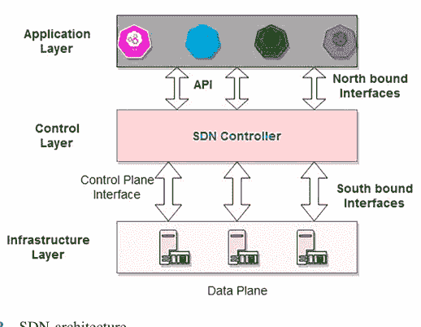

### 5.2.1 软件定义网络（SDN）

SDN执行重路由、转发和分析用户请求等网络管理操作。图 5.2 显示了由交换机、路由器、无线接入点和其他转发设备组成的 SDN 架构，而控制逻辑被下放给一个近端编排器。推理控制可分为集中式或分布式、反应式或主动式、细粒度或粗粒度。在 SDN 中，边缘设备无需担心为任务卸载选择最佳目标。许多复杂的网络任务（如 IP 表更新）被避免。SDN 框架负责满足边缘设备关于现有网络状态的需求前提。

### 5.2.2 多接入边缘计算（MEC）

MEC 确保服务开发者可靠地访问资源。MEC 服务器不包含消费者设备，而是由移动网络运营商在网络边缘特定部署的处理节点。此外，MEC 服务器配备了预安装的服务，可通过集成 API 和访问应用程序使用。MEC 服务器位于移动网络核心数据包之下，并专注于核心网络。由于 MEC 通过移动网络建立通信，从而实现了更大的覆盖范围。因此，目前 MEC 被视为一种先进的分布式计算设计。

### 5.2.3 移动云计算（MCC）

MCC 广泛执行任务卸载。在2010年代初，当大多数边缘设备（如eHealth可穿戴设备和智能手机）无法实时执行大多数 AI 应用程序时，MCC 获得了动力。与 FC 类似的是卸载和计算过程，但限制是延迟。

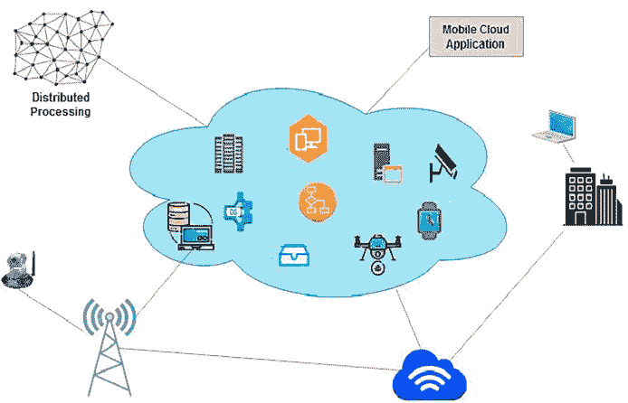

图 5.3 MCC 架构。

MCC 架构能够轻松执行分布式处理。在任务卸载期间，云端接收来自边缘设备的所有数据。处理完成后，边缘设备接收结果。数据中心执行任务卸载所需时间极短，但通信延迟存在于 10 秒甚至 100 秒的范围内，这超过了大多数应用程序的成本。

### 5.2.4 露点计算（DC）

DC 与可靠安全的数据存储相关联，并与云计算紧密相关的标准。DC 旨在将云功能扩展到边缘设备，使与云关联的应用程序可以在边缘设备上执行。因此，如果云和边缘设备之间存在连接，两者协作以提供最大功能。然而，如果没有链接，边缘设备将以最低功能重复执行服务。Git 和 Dropbox 是几个示例。这些原则是 FC 的核心。DC 和 MACC 的局限性相同，但 MACC 不适合对延迟敏感的服务。

### 5.2.5 云微数据中心

云微数据中心被视为 MCC 的替代方案，代表数据中心。它们更靠近边缘节点，表示云数据中心的微型形式。它们通过网络基础设施广泛分布，创建了分布式计算设备的有效融合。因此，它们被称为边缘云。云微数据中心由大型服务提供商（SP）传输和运营。单个云微数据中心为多个办公室、建筑物或研究组织提供服务，因为它们拥有足够的计算能力来处理大量边缘设备[9]。

### 5.2.6 移动计算（MC）

在 MC 中，具有足够处理能力的边缘节点可以高效处理任务。智能手机是常见示例。这些先进设备基于集成传感器运行并及时处理。由于智能手机具有多千兆赫和多核能力，因此复杂的 ML 算法在智能手机上执行，从而避免将重型计算任务中继到外部计算节点。其他消费级边缘设备也呈现出处理能力不断提升的类似趋势。它们的工作方式与智能手机相似。然而，这些边缘设备无法与最低数据中心的能力相比[10]。

### 5.2.7 极端边缘（雾计算）

在 MC 中，每个具有足够处理能力的边缘节点都可以高效处理任务。智能手机是常见示例。这些先进设备基于集成传感器运行并及时处理。由于智能手机具有多千兆赫和多核能力，因此复杂的 ML 算法在智能手机上执行，从而避免将重型计算任务中继到外部计算节点。其他消费级边缘设备也呈现出处理能力不断提升的类似趋势。它们的工作方式与智能手机相似。然而，这些边缘设备无法与最低数据中心的能力相比。

### 5.2.8 透明计算（TC）

在 TC 中，从云到边缘节点的卸载是灵活的。因此，TC 允许用户设备与主操作系统、库和服务无缝交互。云端接收所有软件模块。因此，暴露的边缘设备可以按需请求并迁移到特定软件配置。边缘设备的输出完全针对执行特定应用程序进行优化。因此，所有处理任务资源都专用于该单一服务；边缘设备无需依赖任务卸载。如前所述，如果边缘节点希望专注于新服务，则必须启动迁移方法[11]。边缘设备可以通过频繁修改其配置，迁移到特定应用程序的特定应用模块。与 TC 相关的技术与 FC 相反。TC 在没有与网络安全数据关联的情况下特别有用。例如，搜救组和消防员使用感知远程的无人机。在实际场景中，与每个用例关联的特定设置会在起飞前快速配置到设备上。在信号覆盖充足的城市地区，仍希望卸载任务，因为它可以最大限度地降低边缘设备的复杂性（图 5.4）。

## 5.3 物联网与云的融合

物联网不断发展，触及了我们日常生活的几乎所有方面，从家庭设备到构建机器人，以各种方式汇集个人、方法、数据和实体[12]。云计算（CC）提供几乎无限的存储、弹性服务和按需处理能力。尽管云计算和物联网世界各异且各自进步，但它们的


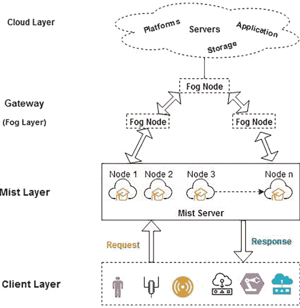

### 图 5.4 轻雾计算

组件相互补充。因此，近年来，这两种技术（即云-IoT 模型）相结合，为构建新的应用和设施提供了各种前景。需要大量计算的 IoT 设备（如虚拟现实和制造机制）需要快速处理，这对上下文敏感且对延迟敏感。关注当前和未来 IoT 解决方案的一大飞跃是将 Edge 和 Fog 结合到 Cloud IoT 中[13]。这一进步能够更好地分析 IoT 设备产生的海量数据，并最大限度地减少关键应用的延迟。挑战在于，云与雾/边缘之间的交互对于分析未来的 IoT 应用（尤其是 AI 和机器学习 (ML)）可能至关重要[14,15]。

计算模型正在从集中式向去中心化计算标准转变。主要原因是 IoT 流量增加，设备数量的增加导致了重大的互联网容量和服务挑战。许多计算模型（如 Cloudlet、移动边缘计算和透明计算）正在涌现，专注于利用分布式资源来辅助上下文敏感的 IoT 服务[16]。Edge 和 Fog 模型提供网络基础设施，在边缘和云中维护计算和存储。Fog/Edge 模型弥合了云与端点 IoT 设备之间的差异，这对各种应用（如医疗保健、智能电网和工业 5.0）有利[17,18]。

### 5.3.1 边缘-雾-云计算辅助 IoT

图 5.5 展示了一个分层的 Edge-Fog-Cloud (EFC) 模型，旨在整合边缘服务器、云和端设备的能力，以提升 IoT 运营并改善资源利用率和服务质量 (QoS)。该模型支持在数据源或边缘附近进行预测分析、ML 和大数据处理，以基于云设置或雾设置执行复杂处理。这种分层范式可以以可扩展和高效的方式支持 AI 赋能的 IoT 服务，因为 EFC 计算在延迟与性能之间具有灵活性。EFC 计算面临各种挑战，包括安全性、隐私性、服务放置和任务卸载。各种设备（包括传感器、移动设备、汽车、可穿戴设备、网关、服务器、基站和其他网络设备）都需要可扩展功能。另一个挑战是，需要就任何参考标准或最佳实践达成一致，以指导如何有效利用 EFC [19]。

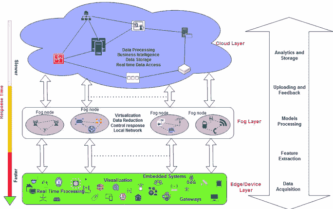

### 图 5.5 E-F-C 的分层范式

### 5.3.2 安全与隐私问题

IoT 解决方案需要一种包含多层的综合方法，并集成设备、通信、生命周期控制和云层等安全功能，详情如下。

### 5.3.3 设备级

大多数攻击发生在设备级，即欺骗、RF 阻塞、云投票、直接连接和标签复制。云投票试图通过向设备插入恶意命令来执行中间人 (MITM) 攻击[20]。然后，重定向网络流量并切换到域名系统 (DNS) 设置。服务发现协议可能被滥用，以在基于直接连接的攻击中识别和发现 IoT 设备。这些攻击通过 IoT 设备利用强大的密钥管理和加密方法阻止未经身份验证的请求来解决。设备级安全通过白名单、流量过滤、确保配对协议、启动和传输方法的安全性、容错、资源轻量访问控制、使用存储和传输进行数据保护、身份验证、身份和授权管理来实现。在 IoT 设备上实现安全算法时必须考虑功耗、内存以及嵌入式网络协议/操作系统的限制[21,22]。此级别的主要安全功能如下[23]：

- 芯片安全：少数供应商使用可信平台模块 (TPM)，通过保护敏感数据和凭据充当信任基础。
- 安全启动：确保只有受保护的软件才被授权运行。
- 物理安全：防篡改方法包括证据、抵抗、反应和发现。这在雾级别实现，并与安全策略和设备的威胁模式同步。确定访问组件所涉及的工作量以及随后的入侵问题。主要的安全评估因素是节点的物理位置和访问级别。公共场所（如购物中心或电线杆）上的雾节点容易受到物理攻击。

### 5.3.4 通信层

在这一层，不安全的信道和 IoT 网络极易受到攻击。主要攻击包括窃听、睡眠不足、女巫攻击、MITM 和黑洞攻击。网络使用可靠的消息完整性身份验证（SHA 或 MD5 哈希算法）、路由方法和点对点加密来保护。用于加密的密码学方法分为两类：对称算法（例如 DES、Blowfish、AES、Skipjack）或非对称技术（例如 Rabin 方法和椭圆曲线）。对称技术不像非对称技术那样进行大量计算；因此，它们最适合功耗最小的 8 位或 16 位 IoT 节点。IoT 安全的主要特征如下[24]：

- 数据中心解决方案：这些方案确保数据在静止或传输过程中被正确加密，即使泄露，对于未经授权的设备和应用程序也没有意义。
- 防火墙与入侵防御系统：分析终止于节点的数据流量，以识别入侵并保护传输层。

### 5.3.5 云层

针对云的攻击包括 SQL 或恶意代码注入、跨站点脚本 (XSS)、拒绝服务 (DoS)、远程代码执行和暴力破解。此层的主要 IoT 方面如下[25]：

- 敏感信息存储：通过加密静态数据来防止泄露，从而协商的第三方禁止数据访问。
- 第三方身份验证：必须确认第三方应用程序或云平台的完整性，以确保防范恶意行为。

### 5.3.6 人类层

IoT 安全涉及由受过培训的人员适当处理数据，特别是在医疗保健领域。如果攻击者成功利用 IoT 设备，则可能实现设备控制。这是通过收集内部内存/固件详细信息并更改设置来实现的。eHealth 设备用户应避免使用弱密码、以物理或电子方式分发密钥，以及购买未经适当身份验证的健康设备。

### 5.3.7 生命周期控制层

该层从设备生产到安装/移除始终保障并保证安全性。主要特征如下[26]：

- 活动监控：追踪、识别和详细描述任何恶意行为非常重要。
- 安全补丁：需要可靠的修复来帮助 IoT 应用程序和设备对抗威胁并分析弱点。
- 安全远程控制：数十亿 IoT 设备使用这种方法进行保护。

## 5.4 协作、分布式和保护隐私的机器学习：EFC 的作用

研究人员专注于协作机器学习，以应对 IoT 设备产生的海量数据带来的挑战。因此，多个用户可以训练 ML 模型。这种策略确实引发了一些关于用户隐私的担忧。以下是为解决与 ML 和隐私相关的问题而开发的四种方法的概要[27,28]。

### 5.4.1 联邦学习

一种去中心化的机器学习解决方案统一了一个主服务器和多个客户端服务器的计算能力。该策略保证在学习过程中，所有机密信息都保留在初始站点。主服务器将继续作为代理数据的初始模型发挥作用。联邦学习技术如图 5.6 所示。在初始模型中，使用客户端的本地数据进行本地训练。这种训练涉及模型独立进行多次重复训练。因此，每个提供者从主服务器获取模型参数，使用该提供者的数据训练模型，然后将计算出的参数发送回主服务器。为了从许多客户端更新构建一个模型，主服务器与这些客户端更新相结合。最后，升级后的模型分发给所有


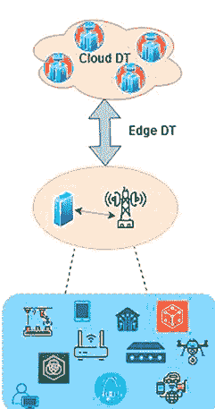

图 5.6 联邦学习方法。

由服务器参与训练的客户端服务器。为实现最佳准确性水平，学习过程会持续迭代。

### 5.4.2 差分隐私

边缘设备在差分隐私 (DP) 下向主服务器传输更新的原始信息。核心思想是每个提供者向主服务器添加噪声（一个随机数）和数据，从而向攻击者隐藏机密信息。收集的原始带噪数据被整合到主服务器中，作为任何 ML 方法的输入数据。因此，集成和处理后的信息对第三方隐藏，并安全地存储在主服务器中。

### 5.4.3 同态加密

作为一种集成的 ML 方法，同态加密 (HE) 是一种编码技术，在其中对编码数据执行少数任务并保护主编码密钥。在解密过程中，它会获得可读数据。因此，在这种技术中，提供者将编码数据定向到主服务器，服务器无需解码即可分析数据 [29]。

### 5.4.4 秘密共享

在这种方法中，每个贡献者的隐私敏感数据会秘密地传播给所有其他提供者。万一恶意第三方滥用秘密，它将毫无价值，因为只有在集成后才能读取。该方法依赖于两个阶段。第一个阶段是离线阶段，包括一个可靠的供应商对数据进行分离并共享给提供者。在第二个在线阶段，执行实际处理。处理后，如果足够数量的提供者集成其秘密信息并解密，数据将被重新组装。

## 5.5 挑战与问题

预计 EFC 计算方法将改变 IoT 架构的设计。然而，在采用这种网络设计进行多层处理时存在许多挑战。以下内容根据文献进行评估。

### 5.5.1 任务卸载

必须分析关于卸载技术的许多挑战，例如服务质量、通用性、故障调查、隐私、安全性和能源效率。这可能发生在任何类型的设置中，例如 Edge-Fog、Device-Edge、Fog-Fog 或 Cloud 向 fog/edge 卸载 [30]。

### 5.5.2 服务放置 (SP)

精心规划的 SP 被视为边缘-雾-云计算的一种增强，通过将服务分配到各种网络层级来最小化网络容量和延迟 [31]。

### 5.5.3 负载均衡

对服务分配或任务卸载的需求增加和响应失败会导致计算节点处理处理请求。因此，利用率不足的计算节点必须在计算节点之间分配负载，以保持高 QoS 水平。挑战在于决策、问题建模和资源发现 [32]。

### 5.5.4 异构资源

繁多的多供应商雾环境部署在多样化的硬件和操作系统设置上，导致虚拟化。尽管 CC 提供了一些解决方案，但它不适用于 FC。这是因为 FC 需要一个开销较小的容器背景和一个统一的 API 来抽象雾中存在的不同硬件 [33]。

### 5.5.5 资源组织

FC 旨在向各种服务交付计算资产，导致对需求雾资源的缩放随时间推移而错位。需要在框架中的每个单独雾节点上实现互补服务。

### 5.5.6 故障管理

在运行时集成抽象的雾设置时，类似于 CC，需要更多资源。此外，雾节点可能会导致最小的网络错误，并且可以在任何时间和任何本地操作期间进入或离开网络。因此，需要高弹性水平来实现框架的安全性。考虑集群中机器人手臂的移动。必须在每个雾节点上配备足够的弹性来处理单点故障 [34]。

### 5.5.7 雾间传输

雾节点可以在水平和垂直方向进行通信。常见的拓扑要求水平通信通过一个额外层。这种额外开销增加了通信延迟和雾对故障的脆弱性。因此，雾节点之间需要额外的连接。

### 5.5.8 对移动用户的支持

各种雾架构旨在高效处理请求。但是，它们分析的 FC 群组有限。简而言之，雾必须包括各种用户类别，包括高移动性用户。因此，方法是将每个边缘设备定位到不同的用户组，这些组指定其移动性行为和雾资源分布 [35]。

### 5.5.9 雾硬件支持

雾可以在核心和网络边缘之间包含多个节点。AP 和其他面向消费者的网关是完美的示例。专门构建的 IoT 网关非常昂贵，并且在大多数电子市场上买不到。因此，通过用多用途 CPU 替换 ASIC 的一部分，或获取 CPU 和 GPU 插件来实现灵活性，这将增加 FC 的使用。

### 5.5.10 低延迟吞吐量无线传输

从边缘节点向近距离雾节点传输数据并最大限度地缩小雾与边缘之间的物理差距存在挑战。例如，少数应用程序需要超过 1 GBPS 的数据传输，因此无线通信技术将被视为无用。近年来，研究正在分析毫米波范围（30–300 GHz），多个边缘设备开始提供多千兆比特服务。因此，数据传输延迟被压缩到 1 ms 以下，并且不久将成为 5G 新无线 (NR) 的关键特性。

### 5.5.11 数据分析

为了有效的分布式模型，有必要在不同的边缘节点之间分布数据和处理。一个不断增长的研究领域是创建训练 ML 算法（例如神经网络）的称职方法。

### 5.5.12 互操作性与标准化

雾很快将成为日常生活的一部分，全球利润将大幅增加。OpenFog 联盟于 2015 年与思科、英特尔、Arm 等公司共同发起，构建了一个 FC 框架，后来更名为 1934–2018 标准 [14]。此外，NIST 还开发了其雾概念架构 [36]。NIST 模型比前一个更紧凑。许多计算模型最近经历了规范化，例如 5G 多接入计算，许多其他独特技术正在被精心偏好，但合作与交互仍有待研究。

### 5.5.13 QoS

由于通信的分散、不相似和随机性质，这很难实现。此外，还有结构、功率计算以及存储或 I/O 约束。需要进一步研究的关键方面包括集成边缘-雾-云模型中任务的高效放置/分配、资源可访问性、服务响应周期和故障接受。

### 5.5.14 数据保密性与安全性

针对这些问题的当前研究仍处于初级阶段，没有统一的技术。

## 5.6 数据织构架构的兴起

一个名为“数据织构”的新兴设计概念已经出现，它可以处理上一节中提到的大多数挑战。数据织构利用对当前、可确定和隐含元数据资产的持续分析，来构建跨所有环境（例如混合云和多云平台）的同化和可重用数据的设计、实现和利用。数据织构帮助行业集成来自各种来源的数据并无缝分析它。图 5.7 显示了数据织构架构。数据织构需要以下组件：

### 5.6.1 数据摄入

来自数据流、应用程序、云来源和数据库等多种来源的所有可能数据格式，例如结构化和非结构化数据。它还必须提供批处理、实时处理和流处理。

### 5.6.2 数据处理

提供了一组工具，可转换数据使其准备好用于分析，以供下游 BI 工具使用。


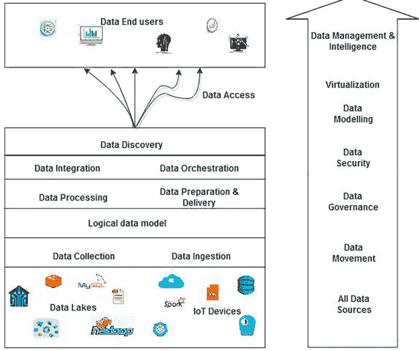

图 5.7 数据网格架构。

### 5.6.3 数据编排

该组件在端到端数据工作流中协调所有阶段的操作。可以通过管道定义运行频率以及如何有效管理数据。

### 5.6.4 数据发现

该层采用数据建模、数据准备和数据策展。分析师可以跨越两个“数据孤岛”确定数据，仿佛它们属于同一数据集，并从中提取有价值的洞察。这是数据网格中最重要的组件。

### 5.6.5 数据访问

数据直接或通过查询、API、仪表板和数据服务交付给分析师。该层将智能、语义和规则构建到数据访问机制中，以获取所需格式的数据。

## 5.7 未来方向

EC 和 FC 模型是云基础设施的有影响力的扩展，但仍有少数问题需要解决。这些标准面临的主要挑战可作为可能的未来研究方向。

- A. **任务分区与可编程性**

在现有的 CC 模型中，后端应用由用户在抽象平台上编程，无需了解云服务器设置。这是一个优势，因为用户被剥夺了平台配置权。因此，云服务提供商可以轻松地在具有可调设置的云服务器上编译和执行应用程序。随着 EC 和 FC 模型的发展，后端处理在各种计算节点之间共享。这是系统开发者面临的一项挑战性问题，需要开发改进的方法来实现所有节点间的处理和存储共享，使得同步过程不会阻碍网络通信，并导致最小的网络内传输延迟。

- B. **安全与隐私**

由于对 FC 和 EC 模型的兴趣日益增加，许多用户利用专注于网络边缘的 CC 服务器的增强存储、处理资源和网络。这种灵活性导致了许多必须由系统设计者解决的安全问题。各种网络安全特性以及主要的安全和隐私问题总结如下：

### 5.7.1 信任与身份验证

EC 和 FC 网络为所有用户提供可靠且安全的服务，这导致一个重要的前提：所有网络设备必须相互信任。因此，雾节点和边缘节点必须检查请求资源的是否为真实服务。此外，边缘或雾节点必须验证发送到服务的资源是否真实。这些顾虑促成了身份验证技术。因此，在请求和传输之前必须对网络资源进行身份验证。新方法，例如用于验证的许可区块链网络（如 Trust Chain [37,38]）、加密验证方法（如 SAKA-FC）以及基于硬件的验证技术，通过使用物理不可克隆函数对网络资产进行身份验证。

### 5.7.2 完整性

在 EC 和 FC 中传输的网络数据必须采用安全方法，以防止攻击者篡改数据。GNU 隐私保卫（GPG）确保数据传输的完整性。完整性在目标站进行验证，这在 EC 和 FC 中至关重要，因为它们依赖于网络内数据传输 [39]。

### 5.7.3 可用性

数据可用性确保授权各方在访问时随时获得信息。DoS 攻击是阻碍信息可访问性的主要问题。基于 EC 和 FC 的模型已很好地开发以处理 DoS 攻击，因为它们拥有分布式处理资产。但是，分布式拒绝服务（DDoS）攻击也试图影响这些模型。因此，为了防御应用程序或网络免受 DoS 攻击，设计者使用 Web 应用程序防火墙（WAF）和其他智能流量管理方法来实现高级别安全性 [40]。

### 5.7.4 机密性

信息机密性确保数据免受未经授权各方的访问。EC 和 FC 范式防止数据泄露以确保数据安全。同态加密和加密方法用于边缘和雾计算中，以保护网络中各处的机密性。即使攻击者访问了安全数据库，也无法分析数据，因为这些技术会以编码格式存储数据。

### 5.7.5 数据所有权

这些范式经常涉及节点间的数据传输，尤其是在处理卸载到各种网络设备时，会导致数据所有权问题。系统设计者必须考虑这种行为并为网络制定隐私策略。数据传输方法应分析发送方和接收方数据与不同数据监管指南的兼容性。

### 5.7.6 系统指标

在开发这些模型时，必须分析一些指标。系统设计者经常处理管理以下内容的策略：

- A. **能源**

雾节点和边缘节点中存在许多嵌入式设备。系统设计者应始终考虑将任务卸载到特定节点的节能机制，因为电力容量有限。与云服务器相比，雾节点和边缘节点所需的能量极少。因此，边缘和雾节点可以利用可再生能源来满足其电力需求，从而最大限度地减少 CO2 排放水平。

- B. **成本**

迁移到 EFC 的应用程序可以最大限度地减少延迟并提高可靠性和容错能力，但与传统云服务相比会增加成本。因此，在 EFC 中构建的系统必须具有成本效益，以证明其实施以响应增强的用户体验。

- C. 带宽

构建 EC 和 FC 模型时必须考虑带宽，主要针对低网络带宽的最小成本系统。当数据在边缘附近进行最小处理时，会发生最小数据传输。这是因为云服务器不接收数据。在某些情况下，分散式系统特性会增加通信，主要是在需要节点间传输的协作模型中。因此，系统设计者必须分析影响带宽使用和系统组织的两个主要因素。

## 5.8 结论

由于 CC 到 EFC、AI、ML 和大数据等技术的融合，IoT 中的一场新革命已经开始，这场革命正在物理与数字生态系统中交织。需要注意的是，CC 通过计算资源和几乎无限的存储弥补了 IoT 的不足，以更好地处理由 IoT 设备引起的巨大数据激增。本章讨论了主要融合架构的全面参考。FC 和 EC 范式在端点 IoT 设备附近执行处理，并处理能源效率、上下文感知和延迟要求等约束。这种分层架构增加了功能。分层 E-F-C 在标准化、任务卸载和 E-F-C 交互方面面临挑战。我们还讨论了这些架构的主要设计和部署，包括最近在企业界广泛接受的数据网格架构。最后，我们讨论了公开的挑战和问题。

## 参考文献

- 1. Maddikunta P. K. R., Pham, Q.-V., Prabadevi, B., Natarajan, D., Dev, K., Gadekallu, T. R., Ruby, R., and Liyanage, M. 工业 5.0：赋能技术与潜在应用综述. 工业信息集成期刊 26 (2022): 100257.
- 2. Renda, A., Schwaag Serger, S., Tataj, D., Morlet, A., Isaksson, D., Martins, F., and Giovannini, E. 工业 5.0：欧洲的变革性愿景——迈向可持续产业的系统性转型治理. 欧洲委员会，研究与创新总司 10.2777/17322 (2022).
- 3. Sharma, V., Balusamy, B., Sabharwal, M., and Ouassia, M. (编). 可持续数字技术：趋势、影响与评估 (第 1 版). CRC Press, 2023, 10.1201/9781003348313
- 4. Zeb, S., Mahmood, A., Khowaja, S. A., Dev, K., Hassan, S. A., Qureshi, N. M. F., Gidlund, M., and Bellavista, P. 工业 5.0 即将到来：智能 NextG 无线网络作为技术赋能者的综述. arXiv 预印本 arXiv 2205 (2022): 09084.
- 5. Xu, X., Lu, Y., Vogel-Heuser, B., and Wang, L. 工业 4.0 和工业 5.0——起源、概念与认知. 制造系统期刊 61 (2021): 530–535.
- 6. Xiloyannis, M., Alicea, R., Georgarakis, A.-M., Haufe, F. L., Wolf, P., Masia, L., and Riener, R. 软机器人外衣：现状、核心技术与开放挑战. IEEE 机器学报 38, 第 3 期 (2021): 1343–1362.
- 7. Murali, M. N. R. D. S., and Sharma, V. 基于人工神经网络的 DGA 驱动僵尸网络性能分析. 2022 年第 10 届国际会议 on


- 可靠性、信息通信技术与优化（趋势与未来方向）（ICRITO），2022，第1–6页。
- 8. Mahmoud, A., Beltramelli, L., Abedin, S. F., Zeb, S., Mowla, N. I., Hassan, S. A., Sisimni, E., and Gidlund, M. 5G及以后网络中的工业物联网：愿景、架构与设计趋势。IEEE Transactions on Industrial Informatics 18, no. 6 (2021): 4122–4137.
- 9. Ali, M. A., Balamurugan, B., Dhanaraj, R. K., and Sharma, V. 基于IoT和区块链的智慧农业监测与智能安全系统。2022年第3届计算、自动化与知识管理国际会议（ICCAKM），迪拜，阿联酋，2022，第1–7页，doi: 10.1109/ICCAKM54721.2022.9990243.
- 10. Vilas-Boas, J. L., Rodrigues, J. JPC, and Alberti, A. M. 分布式账本技术与数字孪生、IoT和AI在新鲜食品物流中的融合：挑战与机遇。Journal of Industrial Information Integration 31 (2023): 100393.
- 11. Firouzi, F., Farahani, B., and Marinšek, A. AI驱动的物联网（IoT）中边缘、雾和云的融合与相互作用。Information Systems 107 (2022): 101840.
- 12. Raj, A., Sharma, V., and Shanu, A. K. 基于IoT设备的联邦学习安全与隐私技术比较分析。2022年第3届计算、自动化与知识管理国际会议（ICCAKM），迪拜，阿联酋，2022，第1–5页，doi: 10.1109/ICCAKM54721.2022.9990152.
- 13. Martinez, I., Hafid, A. S., and Jarray, A. 雾计算系统的设计、资源管理与评估：一项综述。IEEE Internet of Things Journal 8, no. 4 (2020): 2494–2516.
- 14. Firouzi, F., Farahani, B., Barzegari, M., and Daneshmand, M. AI驱动的数据货币化：基于IoT的智能互联健康中数据的另一面。IEEE Internet of Things Journal 9, no. 8 (2020): 5581–5599.
- 15. Yousefpour, C. F., Nguyen, T., Kadiyala, K., Jalali, F., Niakanlahiji, A., Kong, J., and Jue, J. P. 关于雾计算及相关边缘计算范式的全部知识：一份完整综述。Journal of Systems Architecture 98 (2019): 289–330.
- 16. Firouzi, F., Chakrabarty, K., and Nassif, S. 智能物联网：从设备到雾和云。Springer, 2020.
- 17. Nadian-Ghomsheh, B., Farahani, B., and Kavian, M. 用于基于视觉的手部康复评估的分层隐私保护IoT架构。Multimedia Tools and Applications 80 (2021): 31357–31380.
- 18. Ali, M. A., Balamurugan, B., and Sharma, V. 基于改进蚁群和堆算法的人类检测IoT和区块链智能安全系统。2022年第2届工程先进计算与创新技术国际会议（ICACITE），IEEE，2022.
- 19. IEEE通信学会，雾计算OpenFog参考架构采用IEEE标准。IEEE，2018，技术报告，ISBN: 9781504450171.
- 20. Iorga, M., Feldman, L., Barton, R., Martin, M. J., Goren, N., and Mahmoudi, C. 雾计算概念模型。美国国家标准与技术研究院，2018，技术报告，NIST SP 500-325.
- 21. Jayasinghe, U., Lee, G. M., MacDermott, Á., and Rhee, W. S. TrustChain：一种带有边缘计算的隐私保护区块链。Wireless Communications and Mobile Computing 2019 (2019).
- 22. Juyal, V. 基于经验学习模型的中断容忍网络中优化可信集群路由。International Journal of Communication Systems 33.1 (2020): e4196.
- 23. Juyal, V. 关于在延迟容忍网络中利用动态可信路由方案。Wireless Personal Communications 112 (2020): 1705–1718.
- 24. Tuli, S., Mahmud, R., Tuli, S., and Buyya, R. Fogbus：一种用于边缘和雾计算的基于区块链的轻量级框架。Journal of Systems and Software 154 (2019): 22–36.
- 25. Wazid, M., Das, A. K., Kumar, N., and Vasilakos, A. V. 雾计算服务安全密钥管理与用户认证方案设计。Future Generation Computer Systems 91 (2019): 475–492.
- 26. Singh, A. V., Juyal, V., and Saggar, R. 基于人工神经网络的延迟容忍网络可信智能路由算法。Wireless Networks 23(3) (2017): 693–702.
- 27. Ajmani, P., Sharma, V., Samuel, P., Somasundaram, K., and Vidhya, V. 基于IoMT的患者行为分析与社会健康预测。2022年第10届可靠性、信息通信技术与优化国际会议（趋势与未来方向）（ICRITO），2022，第1–6页.
- 28. Manogaran, G., and Lopez, D. 医疗保健中大数据架构与机器学习算法综述。International Journal of Biomedical Engineering and Technology 25.2-4 (2017): 182–211.
- 29. Cravero, A. 大数据架构与物联网：一项系统映射研究。IEEE Latin America Transactions 16.4 (2018): 1219–1226.
- 30. Erraissi, A., Belangour, A., and Tragha, A. 基于Hadoop的大数据架构比较研究。International Journal of Web Applications 9.4 (2017): 129–137.
- 31. Persico, V., 等. 使用公共云平台对社交网络数据处理的大数据架构进行基准测试。Future Generation Computer Systems 89 (2018): 98–109.
- 32. Castiglione, A., 等. 利用均场分析建模大数据架构性能。Future Generation Computer Systems 37 (2014): 203–211.
- 33. Guerriero, M., 等. 面向大数据架构的模型驱动设计工具。第2届大数据软件工程国际研讨会论文集。2016.
- 34. Immonen, A., Pääkkönen, P., and Ovaska, E. 大数据架构中社交媒体数据质量评估。IEEE Access 3 (2015): 2028–2043.
- 35. Sharma, V., Balusamy, B., Thomas, J. J., and Atlas, L. G. (编). 数据织构架构：Web驱动应用。Walter de Gruyter GmbH & Co KG, 2023.
- 36. Basheer, S., Singh, K. U., Sharma, V., Bhatia, S., Pande, N., and Kumar, A. 一个强大的NIfTI图像认证框架，以确保可靠和安全的诊断。PeerJ Computer Science 9 (2023): e1323.
- 37. Singh, A., 等. 区块链：通过预加密和后加密行为控制勒索软件的工具。2022年第五届计算智能与通信技术国际会议（CCICT）。IEEE，2022.
- 38. Singh, A., Dhanaraj, R. K., Ali, M. A., Balusamy, B., and Sharma, V. 生物特征数据库系统中的区块链技术。2022年第3届计算、自动化与知识管理国际会议（ICCAKM），迪拜，阿联酋，2022，第1-10页：doi: 10.1109/ICCAKM54721.2022.9990133.
- 39. Pushpalatha, N., Jabeera, S., Hemalatha, N., Sharma, V., Balusamy, B., and Yuvanaraj, R. 利用多样化优化编译器的太阳能MPPT简明摘要。2022年第5届当代计算与信息学国际会议（ICCI），印度北方邦，2022，第1177–1181页，doi: 10.1109/ICCI56241.2022.10072844.
- 40. Singh, A., Ali, M. A., Balusamy, B., and Sharma, V. 第12章 - 虚拟工厂中数字孪生技术的潜在应用，编辑：Dhanaraj, R. K., Bashir, A. K., Rajasekar, V., Balusamy, B., Malik, P.，智能制造数字孪生。Academic Press, 2023，第221–241页，ISBN 9780323992053，10.1016/B978-0-323-99205-3.00011-0.

# 6 使用无线技术的工业物联网应用

Pawan Whig
Vivekananda Institute of Professional Studies,
New Delhi, India

Shama Kouser
Department of Computer Science, Jazan University, Jazan,
Saudi Arabia

Ashima Bhatnagar Bhatia
Vivekananda Institute of Professional Studies,
New Delhi, India

Rahul Reddy Nadikattu
Senior IEEE Member, University of Cumbersome, USA

Yusuf Jibrin Alkali
Federal Inland Revenue Service, Nigeria

## 6.1 引言

无线系统相比传统布线提供了若干实质性优势。一个真正灵活的智能工厂，配备可前往所需任何位置的自动导引车辆以及协同工作以最大化生产力的自动化系统。但如果没有无线解决方案，这种程度的灵活性和认证将无法实现。通过无线技术，用户可以安全地访问、控制或监控设备 [1,2]。人员不再需要爬上高梯子、下到矿井中，或前往其他不舒适或潜在危险的位置去检查设备。如果设备连接到广域网（WAN），甚至无需靠近设备，这可以降低差旅费用和困难 [3]。

此外，无线系统部署成本更低，更容易扩展或修改。由于无需物理连接到设备，维护成本也会降低，因为连接不太可能因持续使用而损坏。还有哪些公司尚未采用无线技术？The


最常见的两个原因是不安和对变化的恐惧 [4,5]。第二个理由与科学有关。人们认为容量不合适，延迟过高，无线通信不足，以及链路不可靠[6,7]。

如果运行良好，就不要随意更改，这是典型的工业理念。这很合理，因为工业应用需要格外谨慎，因为我们要确保每个人的安全并最大限度地减少停机时间 [8–10]。然而，已经有无线解决方案在使用，因此从有线切换到无线并不一定困难。随着每一次无线发展，关于蜂窝和无线标准不满足要求的担忧失去了一些有效性。确定需求并考虑解决方案（例如无线和蜂窝标准）至关重要。如果可靠性很重要、数据量小且不需要互联网连接，Bluetooth 是一个合适的选择 [11,12]。

如果需要低成本、低功耗的互联网连接，符合LPWAN规范的蜂窝连接是一个绝佳选择 [13–15]。如果需要低延迟、高带宽和强安全性，最新的无线系统可能合适。在此领域，无线解决方案在未来将发挥重要作用 [16,17]。5G的改进允许更多商业用途安装无线解决方案，而不是切断电线，因为数字网络可以处理更多规格。如图 6.1 的市场预测所示。

由于5G相较于4G LTE有巨大进步，它提供了显著的优势。现在有许多工业应用的机会。尽管如此，5G的部署并不排除在工业应用中使用4G LTE。LPWAN标准容器提供所需的无线连接。对高可用性、低延迟和可靠性有要求的关键IoT应用可以采用5G [18,19]。

预计公共Wi-Fi和家庭市场将最快采用Wi-Fi 6技术，因为它允许同时连接更多设备，同时保持可靠且快速的连接。更高的吞吐量和更短的延迟是有利的。所有电池供电设备的能耗将通过目标唤醒时间（TWT）等智能管理技术降低 [20,21]。

如图 6.2 所示，5G和Wi-Fi 6都有潜力显著超越其前身，这为工业应用打开了大门。Wi-Fi 6通常还提供室内或特定指定空间的网络连接。向所有额外的户外座位（包括移动汽车）提供网络连接（D. Christin et. al 2020）。在此基础上，车辆行驶中的远程车辆追踪将是5G的典型工业用例 [22,23]。

另一方面，在广泛的IoT覆盖下提供互联网接入将是Wi-Fi 6的典型工业示例。像往常一样，检查任何标准并深入研究至关重要 [24–26]。扩展和部署Wi-Fi 6的成本更低。如果Wi-Fi 6满足标准，且计划中的应用将在室内或人口稠密的户外区域使用 [27]。即使安装在室内，如果标准更严格且属于关键IoT类别，5G中的允许级别较低，那么蜂窝网络是更好的选择。低延迟对关键IoT应用至关重要。虽然Wi-Fi 6可能支持低至20 ms的延迟，但5G可以支持重要IoT应用低至1 ms的延迟 [28]。

### 技术分享

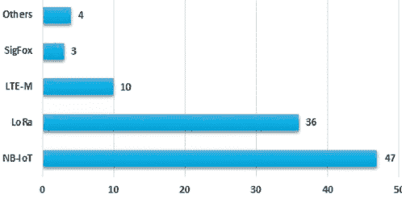

### 技术分享

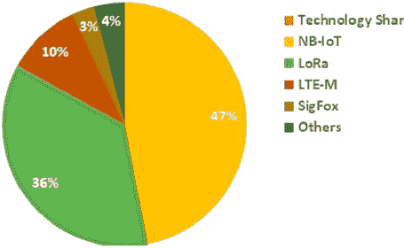

图 6.1 2023年LPWAN市场。

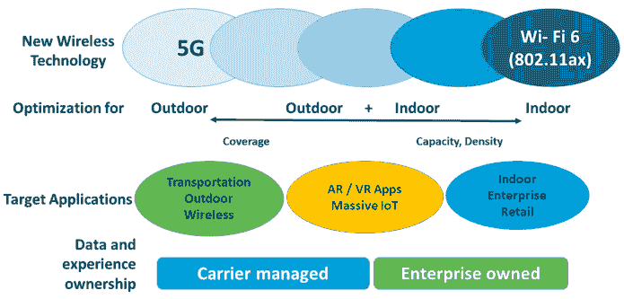

图 6.2 5G和Wi-Fi 6。

## 6.2 工业物联网（IIoT）

得益于物联网，世界正在变得更智能。更广泛的物联网（IoT）中专注于商业环境中使用的设备和商品的部分称为工业物联网（IIoT）[29]，如图 6.3 所示。

### 工业物联网如何实施？

工业物联网（IoT）系统由智能传感器、设备、工具、软件平台、云服务器和应用程序组成。这些智能传感器在生产过程中用于特定目的。这些传感器网络的数据由IoT设备持续发送和接收，然后将数据传输到云应用服务器进行处理和分析。开发了先进的应用程序来在安全网络中处理海量数据，从而实现高效的管理和分析 [30]。

### 6.2.1 自动化

工业自动化是物联网（IoT）一项非常重要且普遍的应用。通过实施IoT技术，企业可以通过机器和工具的自动化来提高运营效率。这种自动化在简化工业流程方面起着关键作用，使企业能够更有效地运作。机器自动化可以在更高程度上提高工艺阶段的准确性。连接到集中式云系统的智能传感器网络与类似PLC的自动化技术一起使用，收集大量数据。为了检查数据及其行为以进行改进，会使用专门的工具和应用程序 [31–33]。

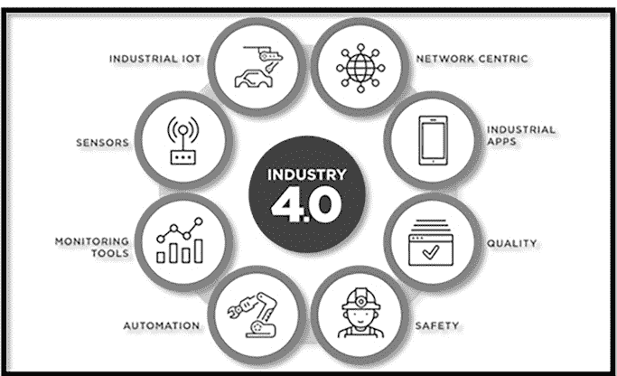

图 6.3 工业4.0中的工业物联网（IIoT）。

工业自动化减少错误，提高效率，操作简单，并可以通过应用程序远程访问。工具和机器的自动化最大限度地减少了特定工作对人力的需求，因为机器可以在比人类更恶劣的条件下运行。

### 6.2.2 工厂网络

互联工厂的理念是全面提高生产力的一种实用方法。为了更简单的管理和访问，大型组件。借助工业IoT解决方案，可以远程监控停机时间、检查库存和运输状态、规划维护、暂停或停止特定操作以供进一步研究，等等 [34–36]。

### 6.2.3 IoT赋能制造

对于IoT赋能制造，多家企业正在开发智能机器人系统。智能机器人技术使生产线上对设备和材料的处理达到完美的精度和高效率。使用智能机械臂，可以指定预定义的标准。人机界面的概念将简化操作，并在未来的IoT赋能制造中提高生产力，如图 6.4 所示。

配备尖端集成传感器用于实时分析的机器人可以被编程执行复杂任务。为了监控和管理，这些机器人网络连接到安全云。工程团队可以访问这些数据，并利用它们快速响应，以防止由机器问题引起的意外故障或改进产品 [37–39]。

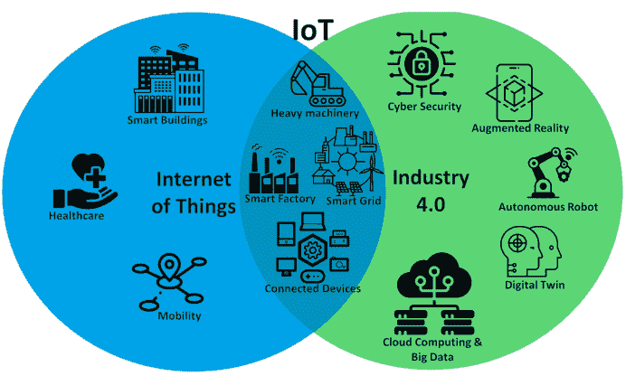

图 6.4 IoT赋能制造。

### 6.2.4 维护规划

新的制造机器配备了智能传感器，可持续检查所有关键部件的状况，并在系统完全故障之前识别任何严重问题。智能传感器将向中央系统报告维护问题，并向相关人员或组织发送警报消息。

在不干扰日常任务的情况下，维护工程师可以根据数据分析高效安排维护计划。借助预测性维护，生产线可以最大限度地减少不必要的停机时间。意外机器故障可能导致产品损坏、交付延误以及生产商收入损失。

每台机器的状态都会持续保存在云系统中。可以轻松远程访问每台机器的历史记录、性能和即将进行的维护（在PC上，通过Web界面或通过智能手机应用程序）。所获得数据的分析可用于计算和应用生产过程每台机器和每个步骤的性能改进 [40]。

## 6.3 可穿戴设备和智能工具集成

得益于将智能传感器集成到设备和机器中，劳动力能够以更高的准确性和效率执行操作。专门设计的可穿戴设备和智能眼镜帮助工人减少错误并提高工作场所安全性。

在发生火灾或燃气泄漏等紧急情况时，员工可以通过智能可穿戴设备接收即时警报信号。可穿戴设备可以持续监测个人的健康状况，并在不适合执行任务时提供反馈。物流是许多公司需要不断发展以满足不断增长的需求的关键领域之一。智能设备技术非常适合处理众多复杂的物流流程并高效完成项目，如图 6.5 所示。

像亚马逊这样的在线零售商正在使用无人机向客户递送物品。无人机和其他先进技术提供了更高的效率、可访问性、速度，并且需要更少的劳动力。与传统程序相比，初始支出巨大，执行存在缺点。

另一个利用IoT的重要行业是航空业。该行业生产飞机并对已在役的飞机进行预防性维护。航空公司使用IoT技术来跟踪制造设施每天生产所需的数百个组件。集中式库存管理使得简便的供应管理成为可能。

如果任何产品需要补充，供应商将自动收到通知。库存管理可以通过IoT在很少人工参与的情况下成功执行。智能传感器持续跟踪飞机的机械部件；数据实时收集并发送给飞机制造商。每当飞机的某个部件需要维修时，相关人员将收到警报，并且在飞机着陆后立即进行维修 [41]。


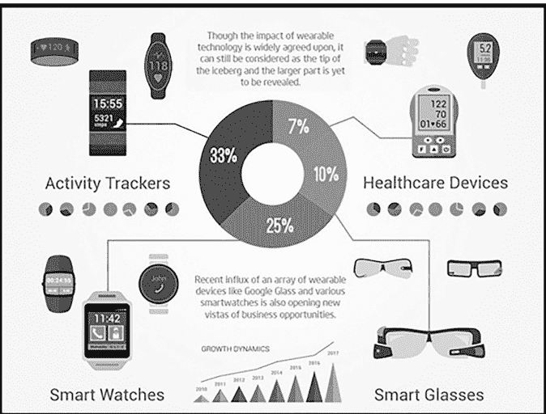

图 6.5 可穿戴技术信息图。

## 6.4 用于产品改进的软件集成

智能分析解决方案是任何物联网系统中最关键的要素之一，它们进一步提升了系统在创新和优化方面的潜力。

大型公司正在部署专用软件，对从精密机械和传感器网络收集的海量数据进行深入分析。对数据分析及其随时间变化的行为有更深入的了解，能更好地概述产品的流程优化技术。

### 6.4.1 智能包装管理

基于物联网的包装管理可提高工业单元的生产力和舒适度。智能传感器可以跟踪所有包装流程并提供实时状态更新。振动、环境变量（如温度和湿度）均可由嵌入式传感器捕获，这些传感器还可以提供。

### 6.4.2 优越性与安全性

在工业中使用物联网技术可生产出更优质的产品。通过优化流程，对每个阶段进行持续监控和分析，可确保更高的质量。

使用智能工具和软件辅助流程可提供更高程度的安全性。高度安全的网关和云服务器平台与软件驱动的自动化以及来自广泛传感器网络的数据采集相结合。

### 6.4.3 自动驾驶

汽车工业正在使用自动驾驶汽车来处理其场地内的物流并提供货物。智能汽车可以识别路线上的交通拥堵并改道，以在短时间内到达目的地。这些汽车配备了众多使用 GPS 和无线技术连接到控制中心的精密传感器。

物联网可为工业提供更好的电源管理解决方案。为了实现有效的电源管理，某些传感器可以检测环境并激活照明、空调、湿度控制、液体流量等的控制。

## 6.5 工业物联网的优势

- 更高的精度
- 流程和产品改进
- 预测分析与维护
- 更高的有效性
- 远程访问与监督
- 改进的安全性
- 网络扩展
- 减少流程和机器停机时间
- 节能
- 成本效益

### 6.5.1 典型物联网无线技术

由于各种物联网解决方案在满足不同网络要求方面具有独特的优势和局限性，因此更适合特定的应用场景。工业物联网近期出现了 LPWAN。

本案例重点介绍使用小型、经济的小区，实现可持续数年的远距离通信。这些小区专为处理覆盖大型工业和商业综合体的广泛物联网网络而设计。通过利用低功耗广域网（LPWAN），LPWAN 在不需要高数据吞吐量或对时间不敏感的场景中表现出色。有关物联网无线标准的比较，请参阅表 6.1。

此外，需要注意的是，并非所有 LPWAN（低功耗广域网）都相同。不同技术在关键网络方面（如频谱利用）提供的性能水平各不相同。在实施非授权技术时，可扩展性和服务质量等因素成为关键考量。此外，标准化在确保长期可靠性、安全性和互操作性方面发挥着至关重要的作用。

| 无线标准 | 范围 | 数据速率 | 功耗 | 成本 |
| :--- | :--- | :--- | :--- | :--- |
| LPWAN | 长 | 低 | 低 | 低 |
| Wi-Fi | 短 | 高 | 高 | 中 |
| Bluetooth | 短 | 中 | 低 | 低 |
| Zigbee | 中 | 中 | 低 | 中 |
| Cellular | 长 | 高 | 高 | 高 |

### 6.5.2 移动

各种电话和视频流应用提供可靠的宽带连接，但其缺点是功耗和运营成本非常高。

虽然蜂窝网络不适合大多数电池供电的传感器网络物联网应用，但它们非常适合某些用途。例如，广泛且高速的蜂窝连接可以支持车队遥测和跟踪服务、交通路由、高级驾驶辅助系统（ADAS）以及车内娱乐。

自动驾驶汽车和更高仿真度的未来预计将依赖于下一代蜂窝技术。5G。5G 提供高速灵活性和显著更低的延迟。未来，5G 预计将实现各种对时间敏感的工业自动化应用、用于互联医疗的医疗数据实时移动传输，以及用于公共安全的实时视频监控。有关网络路由协议的类似工作请参阅 [42,43]。

### 6.5.3 网状网络程序

Zigbee 是一种基于 802.15.4 的短距离、低功耗无线通信程序，通常用于网状架构中，以在许多物联网设备之间传播数据并增加接入。由于其网状设计，Zigbee 的耗电量远低于 LPWAN，并提供更快的通信吞吐量。

Zigbee 以及 Z-Wave 和 Thread 等其他网状技术非常适合中距离物联网（IoT）部署，在这些部署中，节点在近距离内分布相对均匀。这些技术特别适用于家庭自动化用例，例如控制灯光、HVAC 系统、安全设备和能源管理。在这些场景中，Zigbee 被认为是局域网的良好补充。

在低功耗广域网（LPWAN）出现之前，无线网络已在工业环境中使用。它们为远程支持提供了各种可能性。然而，它们不适合需要跨大型地理区域连接的应用。此外，由于网络配置和管理要求的复杂性，其可扩展性通常受到限制。

## 6.6 BLE 和蓝牙

蓝牙是一种属于无线个人区域网络类别的技术，广泛应用于消费市场。最初，蓝牙经典版是为促进消费电子设备之间的点对多点数据传输而开发的。然而，为了满足小规模消费级物联网应用的需求，后来创建了蓝牙低功耗，重点是尽量降低功耗。

设备电子产品通常与电子设备（尤其是智能手机）一起使用，用于将数据传输到云端。蓝牙低功耗（BLE）现在广泛应用于各种应用，例如智能家居系统以及健康和健身可穿戴设备。它能实现向智能手机的无缝数据传输，从而方便地显示和处理信息。

在表 6.2 中，我们从功耗、数据传输速率、范围、兼容性、应用、复杂性和成本等方面比较了 BLE 和传统蓝牙。BLE 功耗低、数据传输速率较低、范围较短、与旧设备的兼容性有限，通常用于物联网设备、可穿戴设备和医疗设备。另一方面，传统蓝牙功耗较高、数据传输速率较高、具备中到长距离能力、与各种设备的兼容性更广，通常用于音频流、文件传输和外围设备。BLE 更简单、更轻量，而传统蓝牙更复杂、功能更丰富。就成本而言，BLE 通常更实惠，而传统蓝牙可能价格适中。

蓝牙 Mesh 协议旨在提高 BLE 设备部署的可扩展性，特别是在零售环境中，如前面表 6.2 的比较所示。由于 BLE 信标网络提供可适应的室内定位特性，它们已被用于实现店内导航、定制营销和内容分发等新的服务增强。

| 方面 | 蓝牙低功耗 (BLE) | 蓝牙 |
| :--- | :--- | :--- |
| 功耗 | 低 | 高 |
| 数据传输速率 | 低 | 高 |
| 范围 | 短 | 中/长 |
| 兼容性 | 与旧设备的兼容性有限 | 与各种设备的兼容性广 |
| 应用 | 物联网设备、可穿戴设备、医疗设备 | 音频流、文件传输、外围设备 |
| 复杂性 | 简单且轻量 | 更复杂且功能丰富 |
| 成本 | 实惠 | 价格适中 |


## 6.7 WI-FI

Wi-Fi 是一项广为人知的技术，可为家庭和办公环境提供高速数据传输。然而，在覆盖范围、可扩展性和功耗方面，它存在一定局限性，因此在物联网领域应用不够普遍。由于功耗较高，Wi-Fi 可能不适合大型电池供电的物联网传感器网络，尤其是在工业物联网和智能建筑应用中。尽管如此，Wi-Fi 通常用于连接可以通过标准电源插座轻松供电的设备，例如智能家居设备。通过零售和大众娱乐行业的新型数字移动服务，该标准有望改变消费者体验并升级公共 Wi-Fi 基础设施。车载娱乐网络和上车分析预计将是 Wi-Fi 6 最具革命性的应用。然而，开发可能还需要更多时间。

RFID 利用无线通信将小数据包从 RFID 标签短距离传输到读取器。这项技术在物流和零售行业带来了重大变革。通过将 RFID 标签集成到各种产品和设备中，企业可以实时跟踪其库存和资产，从而改善供应链管理并优化库存和生产计划。RFID 继续在零售领域发挥关键作用，实现智能货架、自助结账系统和智能镜子等创新物联网应用。随着物联网获得更多认可，它进一步增强了 RFID 的相关性。有关各种无线技术的比较，请参阅表 6.3。

在表 6.3 中，我们根据范围、数据速率、功耗、成本和用例比较了各种无线技术。Wi-Fi 提供短到中距离、高数据速率、中到高功耗和中等成本。它通常用于互联网连接和数据密集型应用。Bluetooth 具有短距离、中等数据速率、低功耗和低成本。它通常用于个人区域网络和无线外设。Zigbee 具有短到中距离、低到中等数据速率、低功耗和低成本。它通常用于家庭自动化、智能电表和工业控制系统。蜂窝网络提供长距离连接、高数据速率、高功耗和较高成本。它们通常用于广域连接和移动通信。LPWAN（低功耗广域网）提供长距离通信、低数据速率、低功耗和经济实惠的成本。它通常用于物联网应用、资产跟踪和监控。

| 无线技术 | 范围 | 数据速率 | 功耗 | 成本 | 用例 |
| :--- | :--- | :--- | :--- | :--- | :--- |
| Wi-Fi | 短到中距离 | 高 | 中到高 | 中等 | 互联网连接，数据密集型应用 |
| Bluetooth | 短 | 中等 | 低 | 低 | 个人区域网络，无线外设 |
| Zigbee | 短到中距离 | 低到中等 | 低 | 低 | 家庭自动化，智能电表，工业控制 |
| 蜂窝 | 长 | 高 | 高 | 高 | 广域连接，移动通信 |
| LPWAN | 长 | 低 | 低 | 低 | 物联网应用，资产跟踪，监控 |

## 6.8 挑战

行业对智能建筑的应用正在上升，这要归功于疫情。然而，智能建筑仍然面临障碍。清晰、智能的解决方案可以帮助减少这些问题。智能建筑项目可能看起来很困难。借助这项技术的无限用途，例如物联网（IoT）和以太网供电（PoE）解决方案，从概念到实施的过程中可能会出现众多问题，如图 6.6 所示。智能建筑项目包含许多阶段和人员，这在各个领域造成了障碍。

由于这些困难，制定彻底的策略、设定坚定且现实的时间表以及保持畅通的沟通渠道至关重要。这些障碍可以通过明显的解决方案来克服，这些方案将使智能建筑成为现实。

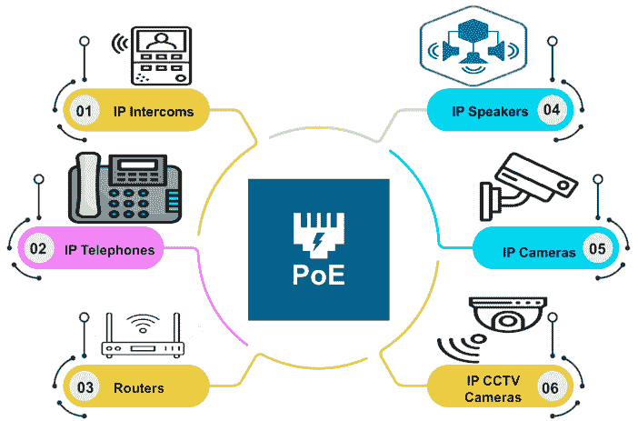

图 6.6 物联网（IoT）和以太网供电（PoE）。

### 6.8.1 网络安全

智能建筑的早期实施经常因网络安全、隐私、数据完整性和数据可访问性问题而受阻。虽然一些解决方案开始解决这个问题，但大多数客户仍将其列为首要任务。互联网总会存在问题，因为随着更多设备连接到互联网，风险必然会增加。

### 6.8.2 私人信息

建筑物使用者接受物联网设施的意愿，逐渐取决于他们对负责收集和分析数据的组织及其使用计划的信任。图 6.7 显示了一些物联网攻击。

### 6.8.3 旧建筑改造流程

由于严格的采购程序，智能系统直到新建流程的后期阶段才被考虑，这限制了创新并产生互操作性问题。智能建筑专家和系统集成商并不总是被纳入项目中。

### 6.8.4 互操作性

如果团队不包括专业的智能系统顾问或系统集成商，提供独立系统的供应商往往缺乏合作进行系统集成的动力。在新建项目中，建筑系统经常在未充分考虑与整体系统合规性或兼容性的情况下进行调试。然而，行业正呈现出向开放标准而非专有标准转变的积极趋势，如图 6.8 所示。这为智能建筑行业克服现有挑战并蓬勃发展提供了机遇。

## 6.9 机遇、协作和合资企业

协作可以带来更好的结果。它保证每个人都了解智能技能的好处，以及精明方案如何用于在效率、连接性和使用者舒适度方面提供更好的结果。由于不与单一供应商绑定，这使建筑物更具未来适应性。

### 6.9.1 健康与良好健康

目标是通过提供独特体验，吸引顾客回到零售商场和娱乐场所，并激励员工返回工作场所。有压力要为居民创造安全环境，并在公众中培养安全感和信任。鉴于员工通常是组织最昂贵的资产，将他们的需求放在首位可以提高生产力、满意度和留任率。

| 类别 | 详细信息 |
| :--- | :--- |
| 设备 | 高端类，低端类 |
| 位置 | 内部，外部 |
| 访问级别 | 主动，被动 |
| 信息损坏级别 | 中断，窃听，篡改，伪造，重放，中间人 |
| 主机承诺 | 用户，硬件，软件 |
| 策略 | 物理，逻辑 |
| 基于协议 | 中断，偏差 |
| 基于层 | 感知，网络，中间件，应用，接口 |
| 主要攻击 | DoS，蠕洞，欺骗，篡改或重放路由信息，女巫 |

图 6.7 各种物联网攻击。

### 6.9.2 可持续性

对成本节约和能源效率日益重视，推动越来越多的公司在建筑中采用智能技术。这些技术提供更好的洞察，并提出可以帮助节省开支和降低能源消耗的调整建议。鉴于到 2050 年，现有建筑中将有 80% 仍在使用，因此我们必须对其进行现代化改造并使其具备未来适应性，以使其更加可持续，如图 6.9 [44] 所示。

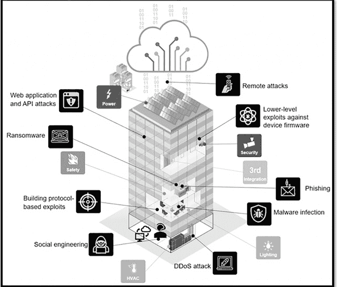

图 6.8 智能建筑开放标准。

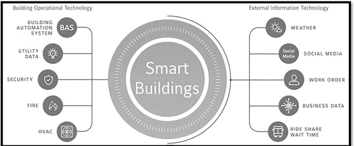

图 6.9 智能建筑技术。

行业将接受招聘费用和病假的现金支付，并且如果他们能让员工感到安全和被关怀，其总产出将提升。工业物联网（IIoT）涵盖广泛的设备，包括传感器和软件控制的系统，这些系统通过


互联网。然而，在实施工业物联网（IIoT）时，一个挑战是确保从现场设备到云端的数据安全和高效传输，特别是随着工业4.0概念的兴起。为应对这一挑战，企业已认识到无线技术的重要性，并建立了可靠的无线网络以促进物联网连接。与传统电缆系统相比，创新的无线解决方案更易于部署设备，从而提高生产力和效率。此外，可构建无线网络来处理各种通信协议，如Modbus和MQTT，从而能够在各种设备之间快速传输数据，甚至包括旧设备，使它们免于被报废。最重要的是，无线解决方案使得通过持续的远程资产监控来管理设施成为可能，这减少了停机时间，提高了工人安全，并加快了企业领导者的战略决策过程[45]。

#### 6.9.2.1 选择最佳无线I/O模块的重要注意事项

在此重申选择无线I/O模块时需要考虑的基本标准。

- 距离 数据速率
- 能源使用 加密频率

数据速率是指衡量数据无线传输速度的指标，即每秒网络上设备之间传输的比特数。不同的无线技术具有不同的数据速率，影响功耗和电池寿命。例如，与Wi-Fi相比，LoRaWAN技术提供较慢的数据速率，优先考虑能效和更长的电池寿命。另一方面，Wi-Fi耗电更多，但提供更快且持续的连接，数据速率可高达300 Mbps。

根据所使用的无线技术，网络的覆盖范围各不相同。

#### 6.9.2.2 您的设备是否在节能环境中工作？

在为您的应用选择理想的无线I/O模块时，功耗是一个需要考虑的重要因素。由于每个模块和协议使用的功率不同，为每个协议选择模块对电池寿命至关重要。低功耗LPWAN/LoRaWAN模块适用于远距离通信，并可显著延长电池寿命。尽管RFID、ZigBee和Wi-Fi通常比LPWAN/LoRaWAN协议耗电更多。

#### 6.9.2.3 您的应用是否受益于无线加密？

各种无线模块使用各种加密算法来保护网络设备和数据免受非法访问和损害。

#### 6.9.2.4 您的设备能否在所有频段中正常工作？

基于频率，无线模块只能在特定频段内彼此成功连接。但是，可能存在

## 6.10 结果与讨论

对各种无线技术的比较提供了关于其关键特性和应用的宝贵见解。

1. Wi-Fi：Wi-Fi提供高吞吐量数据传输，广泛用于家庭和办公环境。然而，它在覆盖范围、可扩展性和功耗方面存在局限性。这使得它不太适合大规模物联网部署，尤其是涉及电池供电传感器的部署。尽管如此，Wi-Fi在连接可以通过电源插座轻松供电的设备（如智能家居设备）方面表现出色。

2. 蓝牙：蓝牙通常用于短距离通信，在个人区域网络和无线外设中很受欢迎。它具有中等数据速率、低功耗且成本效益高。蓝牙适合连接智能手机、平板电脑和可穿戴设备等设备。它常用于音频流传输和文件传输等应用。

3. Zigbee：Zigbee运行于短距离到中距离通信，以其低到中等数据速率、低功耗和经济实惠而闻名。它广泛用于家庭自动化、智能电表和工业控制系统。Zigbee为局部区域内的物联网设备提供可靠且高效的通信。

4. 蜂窝网络：蜂窝网络提供远距离连接和高数据速率，使其适合广域物联网应用。然而，与其他无线标准相比，蜂窝技术耗电更多且成本更高。蜂窝网络通常用于移动通信和需要广泛覆盖的应用。

5. LPWAN：LPWAN（低功耗广域网）技术专为低数据速率和低功耗的远距离通信而设计。它特别适合物联网应用、资产追踪和监控。LPWAN为跨越工业和商业综合体的大规模部署提供经济高效的连接。

结果突出了不同无线技术之间在范围、数据速率、功耗和成本方面的权衡。

这些发现为寻求实施物联网解决方案的企业和组织提供了宝贵指导。通过了解不同无线技术的特性和应用，利益相关者可以做出明智决策，并选择最合适的技术来满足其特定需求。

## 6.11 结论

在赋予对象日益增强的智能方面有很多强调，但在工业物联网应用中还有其他“智能”应用场景。工业物联网网络中应使用智能终端节点以及模仿企业IT和OT最佳实践的网络和安全管理功能。为了响应特定应用的需求，网络应具有极强的适应性。考虑到确保长电池寿命所需的低功耗，应使用智能路由和网络电源可用性的自我感知来最大化整个网络的电力使用。拓扑差异的实现可能受RF环境变化的青睐，因此网络应自动适应这些变化。模拟器件公司的SmartMesh网络管理器不仅提供网络安全、管理和路由优化，还使用户在必要时能够远程重新编程节点，为客户需求变化时的未来功能提供了一条路径。凭借明确的商业动机和强劲的投资回报率，物联网非常具有工业现象的特征。工业无线传感器网络在这些关键任务应用中必须满足智能、安全以及长期可靠无线运行的高标准。无线Mesh网络标准将是工业物联网的基本构建块，帮助工业客户在工业物联网时代转型其公司和服务，可能满足这些严格标准。

## 参考文献

1. Alkali, Y., Routray, I., & Whig, P. (2022a). 基于人工智能的可靠、高效和安全物联网策略. IUP Journal of Computer Sciences, 16(2).
2. Alkali, Y., Routray, I., & Whig, P. (2022b). 使用人工智能研究可靠、高效和安全物联网的各种方法. Available at SSRN 4020364.
3. Raj, A., Sharma, V. & Shanu, A. K. (2022). 基于物联网设备的联邦学习安全与隐私技术比较分析. 2022年第3届计算、自动化与知识管理国际会议（ICCAKM），迪拜，阿拉伯联合酋长国，第1–5页. doi: 10.1109/ICCAKM54721.2022.9990152.
4. Anand, M., Velu, A., & Whig, P. (2022). 基于机器学习模型的安全银行贷款行为预测. 计算机科学与工程杂志（JCSE）, 3(1), 1–13.
5. Jupalle, H., Kouser, S., Bhatia, A. B., Alam, N., Nadikatla, R. R., & Whig, P. (2022). 使用机器学习实现人类行为自动化及其预测. 微系统技术, 1–9.
6. Ajmani, P., Sharma, V., Samuel, P., Somasundaram, K. & Vidhya, V. (2022). 通过IoMT进行患者行为分析和社会健康预测. 2022年第10届可靠性、信息通信技术与优化国际会议（趋势与未来方向）（ICRITO），第1–6页，doi: 10.1109/ICRITO56286.2022.9964846.
7. Nadikatla, R. R., Mohammad, S. M., & Whig, P. (2020). 针对COVID-19的创新经济型社交距离智能设备. 电气工程与技术国际期刊（IJEET）.
8. Tomar, U., Chakroborty, N., Sharma, H., & Whig, P. (2021). 基于人工智能的智慧农业系统. 人工智能最新趋势事务, 2(2).
9. Maurya, A. & Sharma, V. (2022). 使用Keras和CNN进行面部情绪识别. 2022年第2届先进计算与工程创新技术国际会议（ICACITE），第2539–2543页，doi: 10.1109/ICACITE53722.2022.9823480.
10. Ali, M. A., Balamurugan, B., Dhanaraj, R. K. & Sharma, V. (2022). 基于物联网和区块链的智慧农业监测与智能安全系统. 2022年第3届


计算、自动化与知识管理国际会议（ICCAKM），阿联酋迪拜，第 1–7 页，doi: 10.1109/ICCAKM54721.2022.9990243.

- 11. Whig, P., Kouser, S., Velu, A., & Nadikattu, R. R. (2022). 基于 Fog-IoT 的智慧农业应用. 载于《揭示面向区块链和工业物联网的联邦学习》（第 74–93 页）. IGI Global.

- 12. Whig, P., Nadikattu, R. R., & Velu, A. (2022). 基于 AI 医疗监测和 IoT 数据分析的 COVID-19 大流行分析：技术与应用. 1.

- 13. Whig, P., Velu, A., & Bhatia, A. B. (2022). 利用面向 IIoT 的区块链应用保护自然并减少碳足迹. 载于《揭示面向区块链和工业物联网的联邦学习》（第 123–142 页）. IGI Global.

- 14. Maruli, M. N. R. D. S. & Sharma, V. (2022). 基于人工神经网络的 DGA 驱动僵尸网络性能分析. 2022 年第 10 届可靠性、信息通信技术与优化国际会议（趋势与未来方向）（ICRITO），第 1–6 页，doi: 10.1109/ICRITO56286.2022.9965044.

- 15. Whig, P., Velu, A., & Nadikattu, R. R. (2022). 6G 基础产业中 AI 赋能区块链的经济影响. 载于《6G 无线网络中的 AI 与区块链技术》（第 205–224 页）. Springer, 新加坡.

- 16. Varghese, A. & Tandur, D. (2014). 工业 4.0 中的无线需求与挑战. 载于当代计算与信息学国际会议（IC3I），第 634–638 页.

- 17. Willig, A., Matheus, K., & Wolisz, A. (2005). 工业网络中的无线技术. 载于《IEEE 论文集》，第 93 卷，第 6 期. 电气和电子工程师学会，第 1130–1151 页.

- 18. Wollschlaeger, M., Sauter, T., & Jasperneite, J. (2017). 工业通信的未来：物联网和工业 4.0 时代的自动化网络. IEEE 工业电子杂志，11(1)，17–27.

- 19. Park, P., Ergen, S. C., Fischione, C., Lu, C., & Johansson, K. H. (2018 年 4 月). 控制系统无线网络设计：综述. 第 978–1013 页.

- 20. De Pellegrini, F., Miorandi, D., Vitturi, S., & Zanella, A. (2006 年 5 月). 关于在工厂自动化系统低级别中使用无线网络. IEEE 工业信息学交易，2(2)，129–143.

- 21. Sanchez-Iborra, R. & Cano, M.-D. (2016 年 5 月). 工业 IoT 服务 LP-WAN 解决方案的最新进展. 传感器，16(5)，708. [在线]. 可用：http://www.mdpi.com/1424-8220/16/5/708

- 22. Christin, D., Mogre, P. S., & Hollick, M. (2010 年 4 月). 工业自动化无线传感器网络技术综述：安全与服务质量视角. 未来互联网，2(2)，96–125. [在线]. 可用：http://www.mdpi.com/1999-5903/2/2/96

- 23. Seferagic, A., Famaey, J., De Poorter, E., & Hoebeke, J. (2020 年 1 月). 工业物联网无线技术权衡调查. 传感器（瑞士），20(2).

- 24. Juyal, V. 等 (2017). 基于自组织簇的 DTN 中的机会消息转发. 2017 年信息通信技术与无人系统国际会议（趋势与未来方向）（ICTUS）. IEEE.

- 25. Uhlemann, T. H.-J., Lehmann, C., & Steinhilper, R. (2017). 数字孪生：实现工业 4.0 的网络物理生产系统. Procedia CIRP，61，335–340.

- 26. Krupitzer, C., Muller, S., Lesch, V., Zuffe, M., Edinger, J., Lemken, A., Schafer, D., Kounev, S., & Becker, C. (2020). 工业 4.0 中的人机交互调查. arXiv 预印本 arXiv:2002.01025.

- 27. Raj, A., Sharma, V., Rani, S., Shanu, A. K., Alkhayyat, A. & Singh, R. D. (2023). 使用 IoT 传感器进行现代农业以改进作物选择. 2023 年第 4 届智能工程与管理国际会议（ICIEM），英国伦敦，第 1–7 页，doi: 10.1109/ICIEM59379.2023.10167225.

- 28. Zhou, K., Liu, T., & Zhou, L. (2015). 工业 4.0：迈向未来的工业机遇与挑战. 载于 2015 年第 12 届模糊系统与知识发现国际会议（FSKD），IEEE，第 2147–2152 页.

- 29. Whig, P., Velu, A., & Nadikatla, R. R. (2022). 用于解决 IoT 和智能网络安全问题的区块链平台. 载于《面向可持续 FinTech 生态系统的 AI 赋能敏捷物联网》（第 46–65 页）. IGI Global.

- 30. Whig, P., Velu, A., & Ready, R. (2022). 带有人机交互的人工智能中联邦学习的揭示. 载于《揭示面向区块链和工业物联网的联邦学习》（第 94–122 页）. IGI Global.

- 31. Hai, T. 等 (2023). 一种用于智慧城市应用中安全数据共享的创新区块链赋能联邦学习方法. 在：Iwendi, C., Boulouard, Z., Kryvinska, N. (编) ICACTCE’23 论文集——通信技术与计算机工程进步国际会议. ICACTCE 2023. 网络与系统讲义，第 735 卷. Springer, Cham. 10.1007/978-3-031-37164-6_9

- 32. Singh, A., Dhanaraj, R. K., Ali, M. A., Balusamy, B. & Sharma, V. (2022). 生物识别数据库系统中的区块链技术. 2022 年第 3 届计算、自动化与知识管理国际会议（ICCAKM），阿联酋迪拜，第 1–6 页，doi: 10.1109/ICCAKM54721.2022.9990133.

- 33. Whig, P., Velu, A., & Sharma, P. (2022). 面向区块链的联邦学习揭示：一项案例研究. 载于《揭示面向区块链和工业物联网的联邦学习》（第 143–165 页）. IGI Global.

- 34. Whig, P., Velu, A., & Nadikatla, R. R. (2022). 用于解决 IoT 和智能网络安全问题的区块链平台. 载于《面向可持续 FinTech 生态系统的 AI 赋能敏捷物联网》（第 46–65 页）. IGI Global.

- 35. Whig, P., Velu, A., & Ready, R. (2022). 带有人机交互的人工智能中联邦学习的揭示. 载于《揭示面向区块链和工业物联网的联邦学习》（第 94–122 页）. IGI Global.

- 36. Singh, A., 等 (2022). 区块链：通过预加密和后加密行为控制勒索软件的工具. 2022 年第五届计算智能与通信技术国际会议（CCICT）. IEEE.

- 37. Whig, P., Velu, A., & Sharma, P. (2022). 面向区块链的联邦学习揭示：一项案例研究. 载于《揭示面向区块链和工业物联网的联邦学习》（第 143–165 页）. IGI Global.

- 38. Tao, F., Qi, Q., Wang, L., & Nee, A. (2019). 数字孪生与面向智能制造和工业 4.0 的网络物理系统：相关性与比较. 工程，5(4)，653–661.

- 39. Ali, M. A., Balamurugan, B., & Sharma, V. (2022). 基于改进蚁群和堆算法的人体检测 IoT 和区块链智能安防系统. 2022 年第 2 届先进计算与工程创新技术国际会议（ICACITE）. IEEE.

- 40. Damjanovic-Behrendt, V. & Behrendt, W. (2019). 面向智能制造的数字孪生设计与实现开源方法. 计算机集成制造国际期刊，32(4–5)，366–384.

- 41. Juyal, V. 等 (2020). 关于在延迟容忍网络中利用动态可信路由方案. 无线个人通信，112，1705–1718.

- 42. Juyal, V. 等 (2016). 延迟容忍网络路由剖析. 2016 年 IEEE 计算智能与计算研究国际会议（ICCIC），钦奈，第 1–4 页. doi: 10.1109/ICCIC.2016.7919724

- 43. Rajasekar, V., Venu, K., Sharma, V., Saracevic, M. (2023). 金融密码学中解决复杂问题的算法策略. 在：Seethalakshmi, V., Dhanaraj, R. K., Suganyadevi, S., Ouaisa, M. (编) 金融密码学同态加密. Springer, Cham. 10.1007/978-3-031-35535-6_10

- 44. Sharma, V., Balusamy, B., Sabharwal, M., & Ouaisa, M. (编). (2023). 可持续数字技术：趋势、影响与评估（第 1 版）. CRC Press. 10.1201/9781003348313

- 45. Mohanraj, C. 等 (2023). 通过 IoT 进行电力窃盗检测中的共谋. 2023 年第 3 届技术与管理创新实践国际会议（ICIPTM），印度北方邦，第 1–5 页，doi: 10.1109/ICIPTM57143.2023.10117849.


# 7 使用无线技术的区块链

Naman Mishra

Department of Economics, School of Arts and Humanities, FS University, Shikohabad, Uttar Pradesh, India

Vandana Sharma

Department of Computational Sciences, CHRIST (Deemed to be University), Delhi NCR Campus, India

## 7.1 引言

在当今快速发展的数字环境中，区块链技术处于创新的前沿，有潜力彻底改变我们开展业务、共享信息和建立信任的方式。由于其去中心化和不可篡改的特性，区块链引起了广泛关注，并常被誉为具有无限潜力的突破性技术。本章旨在探讨区块链技术的基本概念，阐明其实用应用，并强调其对广泛行业将产生的深远影响。从根本上说，区块链是一种分布式账本技术，能够在多台计算机或节点上安全、透明地记录交易。区块链 [1,2] 通过提供一个去中心化网络，使交易能够以不可渗透的方式进行验证和存储，从而有能力建立信任并消除对银行或集中式机构等中介的需求。这种前沿的数据管理方法因其承诺加快流程、增强安全性和促进创新，吸引了包括银行和供应链管理在内的各个领域的关注。区块链技术的去中心化特性是其基本原则之一。区块链将数据分散到称为节点的计算机网络中，而传统数据库则将数据存储在中央服务器上。这确保没有单一方对系统拥有完全控制权。这种去中心化架构降低了单点故障或恶意攻击的可能性，同时增强了网络的安全性和弹性。

区块链的不可篡改性是另一个显著特征。一旦交易或数据块被添加到区块链中，就极难更改或篡改。这是通过加密方法实现的，其中每个块都有一个独特的哈希值，将其与前一个块连接起来，形成一条不间断的数据链。区块链极其安全且能抵御欺诈或未经授权的更改，因为任何试图更改先前块的行为都需要巨大的处理能力和网络大多数节点的共识。广泛的行业使用区块链技术，其中银行业是最著名的例子之一。区块链是比特币等加密货币用于促进安全、开放的点对点交易的基础技术。基于区块链的加密货币使人们能够完全掌控自己的数字资产，并通过消除对中介和集中式机构的需求，促进高效的跨境交易，而无需承担传统银行系统相关的复杂性和费用。区块链有潜力通过在供应链管理中实现完全的可追溯性和透明度，来改变金融以外的行业 [3,4]。利益相关者可以使用基于区块链的技术追踪货物从起点到目的地的流动，确保产品质量和真实性。这种程度的开放性不仅增强了消费者信心，还能快速识别和解决产品召回或假冒商品等问题。此外，区块链技术有潜力彻底改变医疗保健领域。区块链可以凭借其安全且可互操作的基础，实现医疗保健提供者之间患者数据的轻松流动，确保医疗记录准确且最新。这可以改善患者预后，实现个性化治疗策略，并提高诊断的准确性。随着我们对区块链技术可能性的进一步了解，应考虑其带来的挑战和影响。为了充分实现区块链的变革潜力，必须解决若干关键问题，包括可扩展性、能源使用和监管框架。此外，虽然区块链技术提供了无与伦比的安全性，但去中心化应用和智能合约的出现引入了需要妥善控制的新危险和弱点。

### 7.1.1 无线技术：概述

由于无线技术消除了物理电缆的限制，它已成为我们现代生活中不可或缺的组成部分。无线技术因其简单性和适应性，彻底改变了我们连接设备和获取信息的方式。在本章中，我们将探讨无线技术的基本理念、能力和实际应用，强调它们对日常生活多个方面的影响。从根本上说，无线技术包括多种通过电磁脉冲在空中传输数据的通信策略。无需物理连接，这种无线传输使设备能够交换数据、访问互联网并相互通信。Wi-Fi、Bluetooth、蜂窝网络和其他无线协议等技术，如图 7.1 所示，极大地增强了我们连接和参与数字世界的能力，整个基础设施正在快速增长。无线技术可提供的移动性和灵活性是其主要特点之一。只要在覆盖区域内，无线网络用户几乎可以从任何地方访问互联网并相互交互 [5,6]。得益于这种移动自由，我们现在可以以更加移动化的方式工作、学习和社交。可扩展性是无线技术的另一优势，它能够将多个设备连接到网络。无线连接使各种设备——无论是可穿戴技术、计算机、智能家居电器还是智能手机——能够彼此无障碍地通信和共享数据。物联网（IoT）正是建立在这个互联设备网络之上，其中普通物品被赋予无线功能以收集和交换数据，使世界更加互联和高效。此外，通过为偏远地区和服务不足的人群提供互联网接入，无线技术在缩小数字鸿沟方面发挥了重要作用。农村或发展地区的个人现在可以通过无线网络和卫星链接获取以前无法触及的教育材料、医疗数据和经济机会。这可能带来个人赋权、包容性和社会经济进步。娱乐行业的无线技术也改变了我们的听觉体验。得益于 Bluetooth 音箱和耳机，我们现在可以享受音乐和其他媒体，而不再受缠绕电线的限制。就像无线流媒体服务和智能电视改变了我们观看电视的方式一样，它们提供了便捷访问各种数字内容的途径。

通过基于位置的服务，无线技术彻底改变了我们与环境的互动方式。GPS 技术利用卫星的无线信号提供精确的导航、追踪和地理定位服务。无线技术已成为我们日常生活中不可或缺的一部分，使我们能够从追踪供应链中商品的流动，到获取逐向导航、发现本地餐馆和寻找附近餐厅等各项活动。医疗保健领域也受到无线技术的显著影响。医疗工作者可以远程监测患者、收集实时数据，并

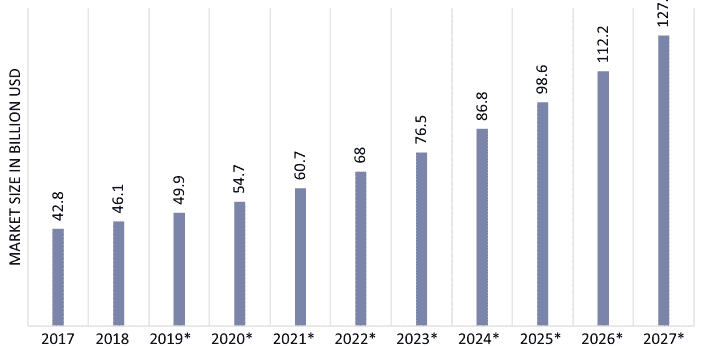

图 7.1 无线连接市场收入。

来源：Statista。


利用无线医疗设备和远程医疗技术，及时提供干预措施。这优化了患者护理，允许早期诊断医疗问题，并改善了医疗保健的可及性，特别是在孤立或处于不利地点的地区。无线技术有许多优势，但也存在安全和干扰等问题。为了避免未经授权的访问或数据泄露，必须保证无线数据传输的隐私和保护。此外，随着无线网络变得越来越繁忙，为了确保可靠且快速的连接，最大限度地减少干扰并优化带宽分配变得更加关键。

### 7.1.2 将无线技术与区块链集成的重要性

区块链技术与无线技术的结合，将两种强大的进步融为一体，有潜力改变许多行业并改善我们的数字体验。正如我们之前讨论的，无线技术允许无阻碍的连接和无缝通信。它提供可访问性、可扩展性和移动性，使我们即使在移动中也能保持连接。然而，区块链技术是一种分布式账本，保证数据安全、透明和不可篡改性。它使点对点交易安全，去中心化信任，并消除了对中介的需求。通过结合无线技术和区块链，我们可以开辟广泛的机遇，构建一个更高效、更可靠的数字生态系统。无线技术提供的更高安全性和匿名性是将区块链技术与其结合的主要好处之一。无线网络中的未经授权访问和安全漏洞可能会危及数据传输的完整性。通过利用区块链的去中心化特性，可以使用加密方法和共识程序保护无线交易和通信。这通过确保交换的数据安全、不可攻破且私密，提高了无线网络的整体安全性。

当无线技术和区块链结合时，去中心化应用程序（DApps）[7,8]和智能合约也可以更容易地创建。DApps（图 7.2）是利用区块链技术的不可篡改性和透明性在去中心化网络上运行的软件程序。这些 DApps 可以通过无线连接的集成，在各种设备和地点之间无缝运行，为用户提供一致的用户体验和对基于区块链的服务的即时访问 [9,10]。可以利用无线连接来发挥智能合约的作用，智能合约是预设规则铭刻在区块链上的自动执行合同，能够在无需中介的情况下实现自动化和安全的交易。供应链管理是无线技术和区块链应用产生重大影响的另一个领域。IoT 传感器和设备可以使用无线连接收集和传输供应链中商品移动和状况的实时数据。通过将这些数据安全地存储在区块链上，可以确保透明度和可追溯性。利益相关者可以通过结合无线技术和区块链，清晰地了解整个供应链，这也改善了物流并增强了参与者的信任。

应用
去中心化应用

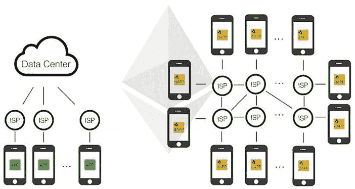

图 7.2 普通应用与 D-Apps。

此外，结合区块链和无线技术可以完全改变去中心化能源管理领域。能源使用数据可以通过无线传感器和智能电表实时收集，并安全地存储在区块链上。因此，实现了点对点能源交易、透明且可审计的能源交易以及更有效的能源分配。个人和社区可以利用无线连接积极参与能源管理，推广可再生能源，并降低碳足迹。

区块链技术与无线技术相结合可以改善金融服务，使交易更加便捷和安全。基于区块链的平台可以与移动银行和支付系统无缝交互，实现快速、安全且经济的交易。特别是在银行服务获取受限的地区，区块链的去中心化特性消除了对传统金融中介的需求，促进了金融包容性并降低了交易成本。提升各行业的安全性、有效性和信任度需要将无线技术与区块链集成。通过将无线连接与区块链的去中心化和开放特性相结合，我们可以构建一个更安全、更高效、更具包容性的数字生态系统。这些技术的结合创造了新的机遇，为更加互联和可靠的数字未来铺平了道路，从保护无线网络到彻底改变供应链管理、能源管理和金融服务。本章的下一部分将介绍区块链中无线技术的各种用例以及实施该技术的各种局限性。

## 7.2 区块链应用中的无线技术

无线技术通过提供跨设备的实时数据传输和连接，使区块链应用能够在供应链管理、银行、医疗保健等多个行业中运行。无线技术与区块链的结合使透明交易、去中心化应用程序和安全的点对点通信成为可能，开辟了大量潜在应用。随着我们深入区块链应用的世界，无线技术的重要性变得越来越关键。它推动创新并改变行业，为更加互联和可靠的数字未来铺平道路，以下将介绍某些应用：

### 7.2.1 物联网（IoT）设备及其在区块链中的作用

连接到物联网（IoT）的设备已成为采用和使用区块链技术的关键 [11,12]。由于能够收集、交换和分析海量数据，IoT 设备正在改变许多行业以及我们与物理世界交互的方式。IoT 设备在分布式网络中充当参与者，并在区块链世界中充当重要的数据源。这些设备具有连接功能，允许它们与其他设备和区块链网络进行交互和数据交换，范围从传感器和执行器到智能家电和可穿戴技术。将 IoT 设备与区块链技术结合有多种好处。首先，IoT 设备会持续产生实时数据，这些数据可以被捕获、验证并存储在区块链上。这通过创建不可更改、透明的事件记录，提高了数据的完整性和可靠性。

其次，IoT 设备改善了区块链网络的安全性。IoT 设备可以利用加密方法和数字签名与区块链安全地交互和通信，保持所传输数据的完整性和有效性 [13,14]。这减少了未经授权访问或修改的可能性，并提高了区块链生态系统的整体安全性。此外，IoT 设备使用智能合约来实现自动化和去中心化的决策过程。这些在区块链上编码的自动执行合同可以由 IoT 传感器捕获的特定情况或事件触发。例如，运动传感器和温度传感器等 IoT 设备可以根据智能合约中记录的既定规则，在智能家居环境中自动启动操作。因此，更少的操作需要人工参与，并可以有效地实现自动化。

得益于 IoT 设备，新的商业模式和价值主张可以更容易地创建。通过将各种 IoT 设备连接到区块链，数据可以以安全且开放的方式共享和出售。例如，IoT 传感器可以收集关于作物生长、土壤湿度、温度和气候的数据，以便在区块链上共享。然后，其他感兴趣的各方，如农民、学者或食品批发商，可以访问这些数据，并根据准确可靠的信息做出决策。此外，点对点交易和去中心化


得益于物联网（IoT）与区块链的融合，市场得以建立。物联网设备可以直接相互连接，并基于指定规则和智能合约进行交易，从而省去中间人。这为前沿商业模式创造了可能性，其中物联网设备可以独立交易资源或服务，而无需中央机构，例如共享经济平台或去中心化能源网络。物联网设备对区块链技术的采用和发展至关重要。它们收集、传输和与数据交互的能力提高了区块链网络的安全性、自动化和透明度。通过释放新应用、商业模式和去中心化生态系统的潜力，物联网和区块链正在彻底改变各行各业，并影响未来的连接性和创造力。我们持续看到的物联网与区块链的融合，无疑将为更加互联、高效和可靠的数字世界铺平道路。

区块链技术与物联网（IoT）设备的结合创造了大量新机遇，并有能力彻底改变多个不同领域。让我们来看看几个现实世界中的实例：

在供应链管理领域，物联网设备和区块链技术被广泛应用。想象这样一种情况：一家食品分销商希望保证其产品的真实性和新鲜度。分销商可以通过为每个产品配备物联网设备（如温度传感器）来追踪和监控整个供应链中的温度条件。区块链安全地存储这些物联网传感器收集的数据，生成温度读数的不可更改且透明的记录。这保证了货物以最佳方式进行处理和交付，如果出现任何不一致，分销商可以轻松发现并解决问题，从而保持货物的质量和完整性。

能源网络（图 7.3）和去中心化能源生成的理念提供了另一个现实世界中的实例 [15,16]。想象一个社区，每个家庭的能源生产和消耗都由智能电表追踪。居民可以通过将这些物联网设备连接到基于区块链构建的能源网络，立即交换多余能源。智能电表测量能源产出和消耗，数据安全地存储在区块链上。得益于智能合约，居民可以根据预定义参数自动买卖能源。结果，家庭可以积极参与能源市场，并为电网的整体稳定性和可持续性做出贡献，这不仅鼓励能源效率，还增强了社区的赋权感。

区块链技术和物联网设备共同为医疗保健领域提供了革命性的可能性。考虑患者数据的管理。可以使用可穿戴健康追踪器等物联网设备持续追踪生命体征，并安全地将其存储在区块链上。这保证了医疗保健提供者可以访问准确且最新的健康数据，从而实现及时干预和个性化治疗。此外，患者可以通过授权使用其健康数据，甚至通过基于区块链的平台与授权研究人员安全地交换某些数据来参与医学研究，从而对其健康数据拥有更多控制力。

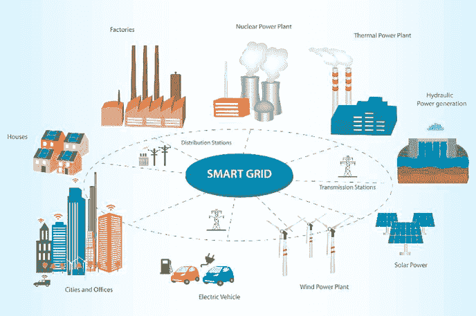

图 7.3 智能电网连接。

物联网与区块链交叉产生创新解决方案的另一个领域是智慧城市。想象一个城市，停车位配备了可以检测可用性和占用情况的物联网传感器。这些传感器可以连接到区块链网络，从而实现实时停车数据的记录和传播，供寻找停车位的司机使用。司机可以通过基于区块链构建的去中心化应用程序（Dapp）访问这些数据并预订停车位，消除寻找停车位的压力并缓解交通拥堵。物联网设备为高效的停车管理系统提供所需数据，而区块链确保交易的透明度和信任。

这些实例突出了融合区块链技术与物联网设备的实际优势和潜力。物联网与区块链的融合为众多行业（从供应链管理和能源网络到医疗保健和智慧城市）提供了增强透明度、效率和自动化的各种选择。随着这些技术的不断发展和成熟，我们可以期待更多创新用例，这些用例将改变我们生活、工作以及与周围世界互动的方式。

### 7.2.2 加密货币

加密货币是银行业乃至更广阔领域中的一种颠覆性力量，是一种基于密码学原理运行的数字货币形式。先进的密码学方法是加密货币的核心，它们利用这些方法来保护交易并调节新单位的生成 [17–19]。加密货币（图 7.4）运行在称为区块链的去中心化网络上，这与由中央银行发行的传统货币不同。这些区块链作为

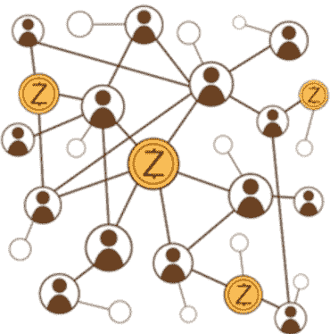

图 7.4 加密货币网络。

分布式账本，以透明且不可更改的方式记录和确认每笔交易。世界最初通过最著名的加密货币之一比特币了解到了数字货币的概念。通过允许无需银行等中介机构的点对点交易，中本聪创建比特币为传统金融系统提供了一种替代方案。其去中心化结构和有限供应量（总共只有2100万比特币）影响了其被感知的价值和吸引力。

加密货币的发展带来了众多优势和潜在益处。首先，加密货币提供了更高的安全性和隐私性。加密货币交易是假名的，允许个人在不披露真实身份的情况下执行交易。此外，交易受到密码学机制的保护，防止欺诈和篡改，同时也保证了交易的完整性。此外，加密货币有潜力促进金融包容性。那些无法获得银行服务或居住在缺乏发达金融基础设施地区的人们，常常被传统银行系统所排除在外。得益于加密货币，这些人现在有机会参与全球经济，加密货币让他们无需传统银行账户即可发送和接收资金、在线购物以及进行其他金融交易。此外，加密货币以智能合约和去中心化应用程序（DApps）的形式激发了创新。以太坊等平台增强了区块链技术的能力，使程序员能够创建和部署利用区块链透明性和安全性的应用程序。智能合约是编码在区块链上的自动执行协议，无需中介即可实现许多活动的自动化。通过优化流程和降低成本，这有可能彻底改变金融、供应链管理和房地产等领域。

首次代币发行（ICOs）是一种筹资技术，项目通过发行和销售自己的代币来换取比特币或以太坊等公认的加密货币，加密货币也使ICO成为一种全球性现象 [20,21]。绕过传统的风险投资渠道，ICO为公司和企业家提供了一种去中心化筹资的方式。需要记住的是，ICO还面临监管审查、投资者保护困难以及识别欺诈公司的挑战。加密货币的影响超出了银行业。供应链管理和医疗保健行业只是底层技术区块链有潜力改变的两个领域。基于区块链的解决方案提供安全性、可追溯性和透明度，使组织能够重组其运营、更好地管理数据并建立利益相关者的信任。然而，必须意识到加密货币带来的挑战和风险。由于加密货币价格波动这一众所周知的特征，投资者经历了重大收益和损失。管理加密货币的法律和监管框架仍在制定中，关于洗钱、逃税和非法行为的担忧依然存在。此外，由于比特币挖矿需要大量能源，环境问题也已浮出水面。在安全性、隐私性和金融包容性方面，加密货币相对于传统银行系统具有许多独特优势。支撑加密货币的区块链技术及其去中心化特性为创造力和经济赋权开辟了新途径。然而，考虑到与加密货币相关的危险和困难，必须谨慎地在这个快速变化的环境中前行。随着时间的推移，加密货币可能会继续重塑金融行业乃至更广泛的领域，推动更多创新，并改变我们沟通、交易以及理解价值概念的方式。

### 7.2.3 去中心化无线网络及其潜在影响

去中心化无线网络是一种开创性的理念，它将无线通信的有效性与去中心化的思想相结合，预计将对我们今天使用技术的方式产生重大影响。传统的无线网络依赖于集中式基础设施，网络由中央组织运行和控制。相比之下，去中心化无线网络以点对点方式运行，无需中央机构即可实现设备之间的直接通信。这种去中心化架构具有多种优势，并为网络和创新创造了新机遇。

去中心化无线网络的主要优势之一是具有更强的韧性和可靠性。在集中式网络中，中央节点或基础设施点的故障可能导致网络中断和停顿 [22]。相比之下，去中心化网络没有单点故障，保证了即使某些节点或设备故障，网络仍将继续运行。去中心化无线网络尤其适合


由于其固有的韧性，任务关键型应用需要持续访问，因此至关重要。去中心化无线网络还支持更高级别的安全性和隐私性。集中式网络的用户经常不得不依赖单一组织来满足其通信需求，这引发了关于数据隐私和监控可能性的疑问。点对点通信确保数据在去中心化网络的设备之间直接共享，减少了对中间商的需求。通过降低数据泄露和未经授权访问的可能性，这种点对点通信架构让消费者对个人数据拥有更多控制权。去中心化无线网络还能够鼓励包容性并激发创新。这些网络通过取消对集中式机构的需求，使人们和社区摆脱了传统基础设施提供商施加的限制。在稳定连接更难获得的欠发达地区，这一影响更为显著。去中心化无线网络使当地社区能够构建自己的通信基础设施，促进当地经济发展、教育机会和基本服务的可及性。

去中心化无线网络具有广泛的潜在用途。这些网络可以通过提供价格合理且便捷的连接，弥合偏远地区的数字鸿沟。它们能够支持去中心化的物联网（IoT）网络，促进设备无缝连接并最大限度地发挥物联网技术的潜力。去中心化无线网络还可用于紧急通信和灾害响应，特别是在传统基础设施可能不可用或受损的情况下。去中心化无线网络与区块链等前沿技术的结合是另一个引人注目的可能性。区块链技术和去中心化无线网络可以在各种应用中提升安全性、隐私性和透明度。例如，基于区块链构建的去中心化网络可以为供应链管理、身份验证和金融交易提供安全且防篡改的通信。这两种技术的去中心化架构保证了数据的安全传输和存储，促进了在线交互中的诚实与正直。尽管去中心化无线网络前景广阔，但仍面临困难和采用障碍。为了充分获得这些网络的收益，必须解决技术挑战、法律框架和可扩展性问题。为了克服这些障碍并创造一个促进去中心化无线网络扩展的环境，行业利益相关者、政策制定者和社区之间的合作将至关重要。

去中心化无线网络标志着我们互动、连接和通信方式的重大转变。这些网络凭借其固有的韧性、增强隐私的特性和创新潜力，有能力改变我们的数字环境。去中心化无线网络有潜力通过赋能个人、鼓励包容性和实现安全通信，彻底改变连接方式，开创一个更加去中心化、公平和互联的未来。

## 7.3 无线集成的优势与挑战

每种益处都伴随着某些弊端，因此本章节将阐述在实施过程中存在的以及可能出现的各种优势和劣势。

### 7.3.1 优势

在许多领域，无线技术已改变游戏规则。当与区块链应用相结合时，这些优势可以完全重新定义我们互动、交易和保护数字资产的方式。区块链应用可以利用无线网络绕过物理基础设施限制，扩大对偏远和欠发达地区的可及性。这种改进的可及性赋予了先前被排除在数字经济之外的人们权力，并为金融包容性、去中心化应用和数字服务创造了新的前景。此外，随着交易量的增加，扩展区块链技术已被证明是困难的。然而，引入无线技术通过利用无线网络的广泛覆盖和强大能力解决了这一难题。区块链应用可以使用无线连接处理更高数量的交易，从而实现高效且快速的处理。由于其可扩展性和满足不断增长需求的灵活性，区块链网络适用于各行各业的各种应用。区块链技术高度重视安全性，而增加无线通信则提供了另一层防御。使用加密保护区块链节点之间数据传输的无线连接降低了未经授权访问或修改的可能性。通过将区块链的内置安全功能与加密无线技术相结合，数据和交易得到了保护，使其对欺诈和黑客攻击具有极强的抵御能力。区块链应用可以依靠这一强大的安全框架。除了安全性，无线技术还提高了区块链应用的有效性。无线网络通过实现实时通信和数据传输，消除了对人工干预以及由物理基础设施限制引起的延迟的需求。这影响了包括金融、物流和医疗保健在内的多个行业，并导致更快的交易结算、更好的供应链管理和更高的透明度。得益于无线技术与区块链的无缝集成，流程得以简化，运营摩擦减少，组织能够优化其工作流程。特别是在偏远或艰难的环境中，无线技术比传统的有线连接更具成本效益 [23,24]。区块链应用可以通过利用无线网络，大幅降低安装物理电缆或设立集中式网络枢纽所涉及的基础设施费用。这种成本节约在发展中国家可能尤其有帮助，因为那里资源匮乏可能使实施区块链技术变得困难。借助无线技术，企业可以在无需进行重大基础设施投资的情况下采用区块链，从而促进创新和增长。

无线技术对区块链应用的其他重要优势包括灵活性和移动性。区块链设备需要无线通信的灵活性，以便在不断变化的环境中运行而不受物理限制。由于其适应性，区块链可以轻松集成到各种物联网设备、智能传感器和移动应用程序中，促进众多行业的实时数据交换和自动化。移动连接和交易的移动性提高了区块链应用的响应能力和敏捷性。此外，区块链与无线技术的结合与日益关注的环境可持续性相一致。组织可以通过降低对需要大量设备和能源的传统有线连接的依赖，帮助创造更绿色的未来。利用无线网络进行区块链应用可以减少物理基础设施对环境的影响，促进可持续发展努力和道德商业实践。将无线技术与区块链应用相结合，提供了许多可以提升灵活性、可扩展性、安全性、效率和可负担性的优势。区块链和无线通信协同工作，打破地理限制，提供快速、安全的交易，并促进各行业的创新。随着无线技术的进一步发展，无线连接和区块链协同工作，创造一个更加互联、去中心化和盈利的数字环境。

### 7.3.2 通过无线连接改善可及性和灵活性

我们获取和使用技术的方式已经发生了根本性的转变，而无线连接与区块链应用的集成增强了具有彻底改变许多行业潜力的可及性和灵活性。区块链解决方案可以利用无线网络，将其覆盖范围扩展到物理基础设施施加的限制之外，从而触及偏远和欠发达地区。能够参与金融交易、去中心化软件和数字服务，使先前被排除在数字经济之外的人们获得了能力。无线连接在区块链技术中可能提供的灵活性是其主要优势之一。与传统的有线连接不同，无线技术使设备能够在不受物理限制的情况下进行连接和交易。由于其适应性，区块链可以轻松集成到各种物联网（IoT）设备、智能传感器和移动应用程序中。这使得自动化和实时数据交换成为可能，使物流、供应链管理和医疗保健等行业能够优化其运营，并基于准确且最新的数据做出决策。此外，由于无线连接，区块链应用更具移动性。无线网络支持移动交易，无论交易发生在何处，都能实现快速且安全的转账。这种移动性在需要动态运营的行业（如交通、现场服务和零售）中尤其有利。得益于能够安全地实时访问和进行交易，组织能够简化运营、快速应对变化的情况，并为客户提供更好的服务。

无线技术与区块链的融合也解决了基础设施有限的问题。为有线连接部署物理基础设施


在许多领域，成本高昂且耗时。然而，通过利用现有的网络基础设施，无线通信提供了一种经济高效的替代方案。组织可以通过最大限度地减少对物理电缆和中心网络枢纽的依赖，快速扩大区块链应用的范围并克服基础设施部署挑战。无线连接还提高了区块链网络的稳健性和可靠性。传统的有线连接容易受到基础设施故障或电缆断裂等物理错误的影响。另一方面，无线网络更可靠，并能迅速适应不断变化的环境。得益于这种韧性，即使在困难条件下或自然灾害期间，区块链应用也可以不间断地使用。组织可以通过依赖无线连接来保证其交易和数据的完整性，从而确保不间断运营并减少停机时间。无线技术支持去中心化应用（dApps）的能力是区块链的一项关键优势。无线连接很好地补充了区块链的去中心化指导原则。无线网络实现点对点连接，消除了对中介的需求，使人们能够参与去中心化网络并为区块链账本的验证和维护做出贡献。得益于这种去中心化策略，区块链生态系统受益于更高的安全性、信任度和开放性。无线连接还改善了整个区块链应用的用户体验。用户可以轻松将其移动或IoT设备连接到区块链网络，提高交易的便利性和可用性，并提供对数字资产的访问。由于消除了物理链接并能够从任何地点进行交易，区块链技术正在被更广泛地采用和使用。区块链应用与无线技术的结合提高了可访问性和灵活性，有可能改变多个行业。无线连接和区块链实现移动性，克服物理限制，并坚持去中心化原则。组织可以通过利用无线网络来克服基础设施困难，提高韧性，并为用户提供无缝且用户友好的体验。随着无线技术的发展，区块链应用中更高可访问性和灵活性的潜力将增加，开启连接和赋能的新时代。

### 7.3.3 挑战

将无线技术与区块链应用相结合带来诸多益处，但若要实现有效的采用和部署，必须解决若干问题。在融合这两种技术时，可靠性、安全性和可扩展性是需要仔细考虑的重要因素。无线网络保持稳定且一致连接的能力是基本困难之一。尽管无线连接随着时间的推移有了显著改善，但信号干扰、网络拥塞和范围限制仍然存在。这些因素可能会干扰区块链网络的高效运行，导致交易验证延迟，并可能导致数据不一致。包括5G在内的新型无线通信技术为缓解这些困难提供了有趣的方法。5G网络具有更高的带宽、更低的延迟和更好的可靠性，因此更适合支持区块链应用。通过利用5G技术的能力，区块链网络可以提供更快的交易处理、更好的网络同步和更高的整体可靠性。

在将区块链与无线技术结合时，安全是一个关键问题。一系列安全威胁，例如篡改、数据拦截和未经授权的访问，都可能影响无线网络。为了促进采用并增强信心，必须维护区块链交易和数据的机密性和完整性。解决安全问题的一个方案是使用加密和身份验证方法。通过加密技术，敏感数据可以通过无线网络安全传输，同时保持其机密性。可以使用强身份验证协议，例如数字签名，来验证区块链网络中成员的身份，从而降低未经授权的访问和操纵的风险。无线入侵检测和防御系统（IDS和IPS）是另一种可用于查找和防止区块链网络中安全漏洞的工具。这些技术监控网络活动，识别可疑活动，并采取预防措施以保护区块链生态系统的安全性和完整性。

区块链网络的可扩展性是一项重大挑战，尤其是在涉及无线技术时。随着交易和参与者数量的增加，网络必须高效处理不断扩大的工作负载。由于共识方法以及所有节点都需要验证和维护完整交易历史的要求，传统区块链网络在扩展方面面临困难。由于无线技术的介入，可扩展性现在包含新的复杂性。无线网络的带宽和计算能力有限，可能会限制同时可处理的交易数量。此外，由于区块链是去中心化的，每个网络参与者都必须保存一份完整的区块链副本，这对于存储容量有限的无线设备来说可能是资源密集型的。

正在研究不同的策略来解决这些扩展问题。通过在链下处理部分交易，侧链和链下交易等第2层解决方案可以减轻主区块链网络的负载。这些技术通过降低无线设备的计算和存储需求来提高可扩展性。分片是另一种策略，涉及将区块链网络分解为称为分片的较小部分。每个分片负责处理一部分交易，以实现并行处理并提高整体可扩展性 [25,26]。为了确保数据一致性，无线区块链网络中的分片需要在分片之间进行细致的协调和同步。虽然将无线技术与区块链技术相结合有许多优势，但可靠性、安全性和可扩展性问题需要得到解决。通过无线通信协议、加密、身份验证技术和网络安全解决方案的进步，可以提高无线区块链网络的可靠性和安全性。此外，研究第2层解决方案和分片等策略可以帮助克服扩展问题。通过解决这些困难，可以充分实现无线技术改变区块链应用的潜力，实现安全、可扩展且可靠的去中心化网络。

### 7.3.4 区块链的环境问题

将区块链技术与无线互联网相结合有许多好处，但重要的是要考虑这种集成可能对环境产生的影响。尽管区块链技术有可能彻底改变许多不同的行业，但由于其能源使用和碳足迹，已引发关于可持续性和环境影响的问题。

区块链的高能耗是它引起的主要环境问题之一。传统区块链网络（如比特币）依赖于工作量证明（PoW）[27,28]共识方法，该方法消耗大量处理能力。矿工使用这种耗电的程序来验证交易并通过解决具有挑战性的数学难题来保护网络。因此，使用了大量电力，导致基于化石燃料的电源产生碳排放。例如，根据剑桥替代金融中心的数据，仅比特币网络的能源使用量就相当于整个国家的能源使用量。区块链网络持续的能源使用有可能增加碳排放以及能源生产对环境的负面影响。正在研究包括权益证明（PoS）在内的替代共识机制，以解决这个问题。PoS要求网络中的每个成员“质押”（持有）特定数量的加密货币，以验证交易并保护网络。与PoW相比，这种方法大幅降低了能源消耗，因为它不需要耗电的挖矿活动。此外，可再生能源的改进可能有助于减轻区块链对环境的负面影响。将无线区块链网络与环保能源生产（如太阳能或风能）相结合，有助于降低碳排放并提高该技术的可持续性。一些举措已经出现，其目标是通过为区块链网络提供可持续能源来最大限度地减少其环境影响。

电子废弃物的产生是与区块链技术相关的环境问题之一。区块链网络使用无线技术和挖矿机械，可能会定期升级或淘汰，产生大量技术垃圾。电子废弃物处理不当会损害环境并导致自然资源枯竭。支持合乎道德的电子废弃物管理和回收的举措对于解决这个问题至关重要。可以通过制定规则并敦促制造商在设计产品时考虑可回收性和耐用性，来减少区块链技术产生的电子废弃物。此外，探索替代策略（例如基于区块链的云解决方案）可能会减少对单个设备的依赖并缓解电子废弃物问题。此外，随着为区块链应用提供服务所需的无线连接越来越多，现有的电信基础设施可能会不堪重负。必须部署额外的无线基础设施，例如基站和数据中心，以提高数据传输速度和网络


覆盖 [29]。这些设施的开发和运营可能在土地使用、能源使用和碳排放等方面对环境产生影响。通过推广节能技术和探索新型解决方案（例如利用现有设备或实施共享网络），正在降低无线基础设施的环境影响。通过优化网络协议和数据传输算法，也可以提高无线通信的效率，从而降低区块链应用的能源需求。虽然区块链与无线技术的结合有许多优势，但解决随之而来的环境问题至关重要。需要关注的三大主要问题是高能耗、电子废弃物的产生以及对电信基础设施的压力。为了利用无线技术实现更可持续、更环保的区块链实施，有必要研究替代共识机制、利用可再生能源、鼓励负责任的电子废弃物管理并优化网络基础设施。通过将环境问题放在首位，我们可以利用区块链的潜力，同时减少其对环境的负面影响 [30]。

## 7.4 结论

总之，区块链技术与无线技术的融合既带来了巨大的机遇，也面临着艰巨的挑战。在我们的讨论中，我们探讨了这种组合的优点、缺点和环境影响。当与蜂窝连接相结合时，区块链提供了更大的可访问性和灵活性。得益于能够无线访问和参与区块链网络，区块链网络的覆盖范围得以扩大，用户可以在更友好的氛围中进行交互。这种可访问性为金融、供应链和医疗保健等领域创造了新的机遇，使个人和组织能够毫无困难地与区块链应用进行交互。无线技术在区块链中的优势还包括提高生产力和简化流程。通过去除对物理连接的需求，无线通信实现了实时数据共享，并减少了对传统基础设施的依赖。因此，系统变得更加敏捷和灵敏。这也提高了交易、供应链管理和数据交换的速度和效率。但是，我们也必须意识到可扩展性、安全性和可靠性方面的挑战。由于无线网络可能存在干扰、延迟和覆盖问题，区块链操作可能面临危险。为解决这些问题，有必要实施强大的安全控制、尖端加密技术和持续监控，以保证区块链数据的完整性和机密性。可扩展性仍然是一个重要因素。无线基础设施的能力必须跟上区块链网络的扩张和需求的增长。为了增加网络覆盖范围、提高数据传输能力并减轻现有基础设施的负担，网络提供商、监管机构和行业利益相关方之间的合作至关重要。我们不能忽视无线和区块链技术的环境影响。区块链（尤其是工作量证明共识算法）的高能耗引发了可持续性方面的担忧。通过研究替代共识机制（如权益证明）并使用可再生能源，可以使区块链更加环保和可持续。另一个问题是无线设备的不断升级和丢弃，这导致电子废弃物的产生。通过推广合乎道德的电子废弃物管理、回收计划，并在设计设备时考虑寿命和可回收性，可以减少环境影响。最后但同样重要的是，由于电信基础设施的负载，需要仔细规划和优化。虽然共享网络、节能设备和优化协议有助于减少负面影响，但为区块链应用扩展无线连接可能会对环境产生负面影响。总之，区块链技术与无线技术的结合有潜力彻底改变流程并改变整个行业。可访问性、有效性和适应性都得到了提高。然而，为了确保这项技术的长期应用，必须解决可靠性、安全性、可扩展性和环境影响问题。通过采用创新解决方案、团队合作和道德行为，我们可以最大限度地发挥无线区块链应用的优势，同时将其缺点降到最低。为了让无线区块链技术蓬勃发展并为更互联、更可持续的社会做出贡献，必须在技术发展和环境管理之间取得平衡。

## 参考文献

- 1. Zheng, Z., 等. 区块链挑战与机遇：一项调查. International Journal of Web and Grid Services 14.4 (2018): 352–375.
- 2. Hai, T. 等 (2023). 一种用于智慧城市应用中安全数据共享的新颖且创新的区块链赋能联邦学习方法. 在: Iwendi, C., Boulouard, Z., Kryvinska, N. (eds) ICACTCE’23 论文集 — 通信技术与计算机工程国际会议. ICACTCE 2023. 网络与系统讲义, 第 735 卷. Springer, Cham. 10.1007/978-3-031-37164-6_9
- 3. Monrat, A. A., Schelén, O., and Andersson, K. 从应用、挑战和机遇角度看区块链的调查. IEEE Access 7 (2019): 117134–117151.
- 4. Ali, M. A., Balamurugan, B., Dhanaraj, R. K. and Sharma, V. 基于 IoT 和区块链的智慧农业监测与智能安全系统. 2022 第 3 届计算、自动化与知识管理国际会议 (ICCAKM), 阿联酋迪拜, 2022, pp. 1–7, doi: 10.1109/ICCAKM54721.2022.9990243.
- 5. Wang, J., 等. 区块链赋能无线通信：迈向 6G 的新范式. National Science Review 8.9 (2021): nwab069.
- 6. Singh, A., Dhanaraj, R. K., Ali, M. A., Balamurugan, B. and Sharma, V. 生物识别数据库系统中的区块链技术. 2022 第 3 届计算、自动化与知识管理国际会议 (ICCAKM), 阿联酋迪拜, 2022, pp. 1–6, doi: 10.1109/ICCAKM54721.2022.9990133.
- 7. Wu, K., 等. 基于区块链的去中心化应用初探. Software: Practice and Experience 51.10 (2021): 2033–2050.
- 8. Singh, A., 等. 区块链：通过预加密和后加密行为控制勒索软件的工具. 2022 第五届计算智能与通信技术国际会议 (CCICT). IEEE, 2022.
- 9. Wu, K. 基于区块链的去中心化应用实证研究. arXiv 预印本 arXiv:1902.04969 (2019).
- 10. Ali, M. A., Balamurugan, B., and Sharma, V. 基于改进的 ACO 和堆算法的人体检测 IoT 和区块链智能安全系统. 2022 第 2 届先进计算与工程创新技术国际会议 (ICACITE). IEEE, 2022.
- 11. Banafa, A. IoT 和区块链融合：优势与挑战. IEEE Internet of Things 9.2017 (2017).
- 12. Raj, A., Sharma, V., Rani, S., Shanu, A. K., Alkhayyat, A. and Singh, R. D. 使用 IoT 启用传感器进行现代农业以改善作物选择. 2023 第 4 届智能工程与管理国际会议 (ICIEM), 英国伦敦, 2023, pp. 1–7, doi: 10.1109/ICIEM59379.2023.10167225.
- 13. Liang, X., 等. 使用区块链在 IoT 中实现数据保障和弹性. MILCOM 2017-2017 IEEE 军事通信会议 (MILCOM). IEEE, 2017.
- 14. Mollah, M. B., 等. 面向未来智能电网的区块链：一项全面调查. IEEE Internet of Things Journal 8.1 (2020): 18–43.
- 15. Liu, Y., and Tsyvinski, A. 加密货币的风险与回报. 金融研究评论 34.6 (2021): 2689–2727.
- 16. Singh, A., Ali, M. A., Balamurugan, B., and Sharma, V. 区块链：通过预加密和后加密行为控制勒索软件的工具. 在 2022 第五届计算智能与通信技术国际会议 (CCICT). IEEE, 2022, 7 月, pp. 584–589.
- 17. Raj, A., Sharma, V. and Shanu, A. K. 基于 IoT 的设备中联邦学习安全与隐私技术比较分析. 2022 第 3 届计算、自动化与知识管理国际会议 (ICCAKM), 阿联酋迪拜, 2022, pp. 1–5, doi: 10.1109/ICCAKM54721.2022.9990152.
- 18. Li, J., and Mann, W. 首次代币发行与平台构建. SSRN Electronic Journal (2018): 1–56.
- 19. Mohanraj, C. 等. 通过 IoT 进行窃电检测中的共谋. 2023 第 3 届技术与管理创新实践国际会议 (ICIPTM), 印度北方邦, 2023, pp. 1–5, doi: 10.1109/ICIPTM57143.2023.10117849.
- 20. Kim, M., Kerret, P. D., and Gesbert, D. 去中心化无线网络中的合作学习. 2018 第 52 届 Asilomar 信号、系统与计算机会议. IEEE. 2018.
- 21. Porras-Gonzalez, E. R., Martín-Martín, J. M., and Guaita-Martínez, J. M. 区块链技术给全球经济带来的优势的批判性分析. 知识产权管理国际期刊 9.2 (2019): 166–184.
- 22. Dang, H., 等. 通过分片扩展区块链系统. 2019 数据管理国际会议论文集, 2019.
- 23. Schinckus, C. 基于工作量证明的区块链技术与人类世：一个被破坏的局面?. 可再生能源与可持续能源评论 152 (2021): 111682.
- 24. Sharma, V., Balusamy, B., Sahharwal, M., and Ouaissa, M. (Eds.) 可持续数字技术：趋势、影响与评估 (第 1 版). CRC Press, 2023. 10.1201/9781003348313


- 25. Badea, L., and Mungiu-Pupăzan, M. C. 比特币的经济和环境影响. IEEE Access 9 (2021): 48091–48104.

- 26. Sharma, V., Mishra, N., Kukreja, V., Alkhayat, A. and Elngar, A. A. AI伦理评估框架. 2023创新数据通信技术与应用国际会议（ICIDCA），印度北阿坎德邦，2023年，第307–312页，doi: 10.1109/ICIDCA56705.2023.10099747.

- 27. Ahmad, S., Mishra, S., and Sharma, V. 面向可持续未来技术及其应用的绿色计算. Grima, S., Sood, K. and Özen, E. (Ed.) 新兴技术风险当代研究，A部分（Emerald金融、保险和风险管理研究系列），Emerald Publishing Limited，宾利，2023年，第241–256页. 10.1108/978-1-80455-562-020231016

- 28. Basheer, S., Singh, K. U., Sharma, V., Bhatia, S., Pande, N., & Kumar, A. 确保可靠安全诊断的强健NIfTI图像认证框架. PeerJ Computer Science 9 (2023): e1323.

- 29. Durgalakshmi, K., Anbarasu, P., Karpagam, V., Venkatesh, A., Kannapiran, B., and Sharma, V. 多电平逆变器中用于可再生能源应用的不同拓扑减少开关元件利用——详细综述. 2022年第五届当代计算与信息学国际会议（IC3I），印度北方邦，2022年，第913–920页，doi: 10.1109/IC3I56241.2022.10073430.

- 30. Kokilavani, T. et al. 具有有效能源管理、整合可再生能源和电网电力的电动汽车充电站. 2023年第三届技术与管理创新实践国际会议（ICIPTM），印度北方邦，2023年，第1–5页，doi: 10.1109/ICIPTM57143.2023.10118186.

# 8 革新无线系统：面向未来网络的机器学习工具

Jagjit Singh Dhattewal
科鲁拉克希迈教育基金会人工智能与数据科学系，印度安得拉邦瓦德斯瓦拉姆

Kuldeep Singh Kaswan
加尔戈蒂亚大学计算机科学与工程学院，
印度大诺伊达，北方邦

Kiran Malik
马图拉姆工程与管理学院计算机科学与工程系，
印度罗塔克，哈里亚纳邦

## 8.1 无线技术中的机器学习简介

机器学习（ML）技术融入无线技术，开启了通信系统创新与优化的新时代 [1]。由于能够处理大型复杂数据集，机器学习已改变了无线网络的规划、维护和运营方式 [2]。本章深入探讨了机器学习与无线技术之间的共生关系，揭示了其蕴含的变革潜力。凭借其普及性和不断扩展的应用，无线技术面临着频谱稀缺、信号干扰和资源分配等问题 [3]。传统技术往往难以满足无线网络动态复杂的特性，需要更具适应性和智能性的解决方案 [4]。机器学习正发挥着催化剂的作用，推动无线系统的变革。

机器学习方法（包括监督学习、无监督学习和强化学习）已被用于改进无线网络中的信号处理、信道建模和资源分配 [5]。近年来，深度学习方法（包括卷积神经网络（CNNs）和循环神经网络（RNNs））在处理复杂无线数据模式方面表现出卓越的能力 [6]。机器学习在无线技术中的主要优势之一是其预测和适应不断变化的环境变量的能力 [7]。基于机器学习的预测建模使无线系统能够预见信号衰落、拥塞和干扰，从而进行主动调整以维持最佳性能 [8]。这种预测能力在动态环境中尤为重要，例如车辆通信网络 [9]。此外，机器学习方法实现了动态资源分配，实现网络资源的高效公平分配 [10]。机器学习算法通过评估实时交通模式和用户需求，最大限度地利用资源，降低延迟并改善用户体验 [11]。此类资源分配算法对5G及以后网络具有巨大潜力，因为网络密集化和各类服务需要精密的资源管理 [12]。机器学习的融入也解决了无线安全问题 [13]。基于机器学习的异常检测系统可以实时检测非法访问、异常活动和潜在攻击，增强无线网络的韧性 [14]。此外，机器学习有助于创建能够响应不断演变的威胁的自适应加密和身份验证技术 [15]。尽管取得了这些进展，但在无线技术中使用机器学习仍面临障碍 [16]。需要更多研究来确保机器学习模型的可靠性和可解释性，处理稀疏和嘈杂的无线数据，并应对实时处理的计算挑战 [17]。此外，随着基于机器学习的无线系统变得更加自主，透明度和偏差缓解等伦理问题变得越来越重要 [18]。机器学习技术与无线技术的结合代表了通信系统的范式转变 [19]。本章为全面理解机器学习在无线网络中的革命性作用奠定了基础，强调了其优化资源分配、改善安全性和适应变化情况的能力 [20]。

### 8.1.1 机器学习与无线技术融合概述

机器学习（ML）与无线技术的使用产生了变革性的协同效应，改变了通信系统的构建、维护和优化方式。这种融合利用机器学习算法的力量从海量数据中提取微妙模式，使无线网络能够动态适应不断变化的条件并提供更好的性能。其核心，机器学习（ML）包括使用从数据中学习，并基于该学习进行预测或判断的计算模型。无线技术中的机器学习算法通过评估历史数据和实时数据，辅助智能决策。例如，机器学习可用于预测无线信道中的信号衰落，使网络系统能够主动修改设置以提高信号质量。无线通信系统的固有复杂性由信号干扰、信道衰落和用户移动性等变量决定。机器学习算法擅长处理此类复杂情况。例如，机器学习方法可以增强多输入多输出（MIMO）系统中的波束成形策略，将信号能量导向目标用户，同时避免干扰。此外，基于机器学习的预测建模在资源分配中至关重要，而资源分配是无线网络的关键特征。机器学习算法可以通过评估交通模式和用户行为，动态分配带宽和发射功率，从而提升整体网络性能。在物联网（IoT）等环境中，大量具有不同通信需求的设备共存，机器学习（ML）有助于根据设备属性和流量需求进行资源优先级排序。无线技术已超越传统通信，扩展到无线传感器网络等新领域。在这些情况下，机器学习改进了数据融合和决策过程。机器学习技术可以使传感器节点共同解释数据、识别异常并集体做出选择，从而提高传感器网络的整体效率和准确性。

机器学习技术也证明了其处理安全挑战的能力。基于机器学习的异常检测系统可以检测无线网络中的不想要的访问尝试或奇怪活动。例如，机器学习算法可以区分正常和有害的网络流量模式，提高无线系统安全性。自动驾驶汽车是机器学习赋能无线技术实际应用的一个例子。机器学习算法对传感器数据的实时处理有助于图像识别、目标跟踪和决策等活动。通过识别交通标志、检测行人和预测潜在碰撞，这些算法使汽车能够在复杂环境中行驶。尽管取得了巨大进展，但障碍依然存在。在为无线应用设计和训练机器学习模型时，必须仔细考虑数据质量、特征工程和模型可解释性。此外，资源受限无线设备中实时机器学习处理的计算需求也带来了技术障碍。

### 8.1.2 在无线应用中使用机器学习的重要性与优势

在无线应用中使用机器学习（ML）对于推动创新和改变通信网络的运作方式至关重要。机器学习提供了诸多优势，显著提升了无线网络的性能、效率和适应性，为各个领域的广泛应用做出了贡献。机器学习的预测能力在无线应用中是一个突出的关键优势。设想一个必须应对不断变化的用户需求和环境条件的蜂窝网络。机器学习算法可以评估之前的交通模式并预测未来的需求激增，使网络能够在消费增加之前提前分配资源并优化带宽。另一个重要优势是资源优化。在无线网络中，有效分配频谱、功率和其他资源至关重要。


ML算法可以持续监控网络状况，从数据中学习，并动态地将资源分配到最需要的地方。例如，ML可以改善无线传感器网络中的功率分配，以节省能源并从而延长网络的生命周期。机器学习从数据中理解复杂模式的能力有助于更好的信号处理和干扰减少。ML算法可以区分单个用户的信号，并在多用户环境中将其与干扰分离。此功能确保连接稳定并减少数据包丢失，从而改善用户体验。无线应用受益于机器学习管理大型和复杂数据集的能力。ML算法可以评估诸如射频（RF）指纹等场景中的独特信号属性，以可靠地识别和定位无线设备。这对于资产监控和导航的室内定位非常有用。在无线通信中，安全至关重要。通过学习典型的网络行为并识别可能预示恶意活动的异常，ML协助入侵检测。例如，ML算法可以通过检测流量中的意外激增来识别分布式拒绝服务（DDoS）攻击。

ML的自动化和自优化能力在网络管理中很有帮助。自主基站可以根据实时输入调整传输功率、波束成形和信道分配等参数，以适应变化的条件。这导致网络运行更高效，维护工作量更少。机器学习的重要性还延伸到认知无线网络等无线技术的开发。这些网络使用机器学习动态识别和使用可用频段，提高频谱使用效率。认知无线系统可以实时调整以适应频谱可用性和用户需求，从而更好地利用可用频率。在物联网（IoT）设备的背景下，ML提供预测性维护。ML算法可以通过评估工业设备的传感器数据来预测机器可能发生故障的时间，使维护团队能够采取预防措施并避免昂贵的停机时间。

此外，ML使汽车网络中的无线应用成为可能，允许自动驾驶汽车进行预测性碰撞避免。为了预测可能的碰撞并触发适当的反应，ML算法评估来自摄像头、LiDAR和雷达的传感器数据。医疗保健行业也受益于ML支持的无线应用。采用机器学习算法的可穿戴设备可以实时监测患者的生命体征，检测可能暗示健康问题的异常情况并通知医务人员。

## 8.2 无线技术基础

无线技术改变了现代通信网络，实现了无处不在的连接并重塑了各种行业。无线网络的运行基于信号传播、调制、复用和频谱分配等基本原理 [21]。无线信号通过遵循物理规律的电磁波传播。衍射、反射和折射是这些波的特征，它们影响这些波穿过不同材料时的行为 [22]。对信号传播的深入理解对于设计可靠的无线通信系统是必需的。调制方法在将数据编码到载波信号中至关重要。幅度调制（AM）、频率调制（FM）和相移键控（PSK）技术提供有效的数据传输和接收 [23]。

先进的调制系统（如正交幅度调制（QAM））提高了数据速率和频谱效率。复用技术允许通过同一信道同时发送多个信号。频分复用（FDM）、时分复用（TDM）和正交频分复用（OFDM）最大限度地提高了频谱利用率并支持多个数据流 [24]。无线通信基于频谱的概念，频谱是一种有限且宝贵的资源。对各种无线服务的频段分布和管理对于避免干扰并确保最佳使用至关重要 [25]。认知无线网络旨在智能地使用未使用的频段，以提高频谱利用率 [26]。

无线网络根据其覆盖区域和结构进行分类。局域网（LAN）服务于本地地理区域，而广域网（WAN）服务于更大的区域。星型、网状和自组织网络拓扑在可扩展性和容错性方面都有优势 [27]。蜂窝网络是一种流行的无线技术，它将地理区域划分为由基站覆盖的小区。4G LTE和即将到来的5G蜂窝技术提供高速数据传输、平滑切换和更高的频谱效率 [28]。物联网（IoT）是一种范式，其中联网事物由于无线技术的进步而进行无线交互。IoT网络由许多设备组成，从传感器和执行器到智能家电，它们协同工作以实现数据驱动的决策和自动化 [29]。

多输入多输出（MIMO）技术的进步大大增强了无线网络的容量和可靠性。MIMO在发射端和接收端都使用大量天线，利用空间多样性来减少衰落并增加数据吞吐量 [30]。此外，无线安全非常重要。无线通信通过加密、身份验证和入侵检测技术受到保护，免受窃听和未经授权的访问 [31]。干扰攻击和基于定位的威胁为无线网络提供了独特的安全挑战 [32]。

表8.1总结了无线技术的原理，其中包括许多关键概念。信号传播是研究电磁波如何穿过介质，而调制是将数据放置到载波信号上的过程。复用技术允许同时发送许多信号，频谱分配涉及管理无线频率。网络结构由网络覆盖和拓扑定义，而蜂窝网络将区域划分为由基站覆盖的小区。物联网（IoT）无线连接设备，而多输入多输出（MIMO）通过使用多个天线来提高性能。数据速率指定传输速度，而无线安全确保加密和经过验证的连接。无线协议标准化通信，而信道衰落和缓解处理信号损失。信号覆盖通过天线设计和传播

### 表8.1
无线技术基础的表示

| 无线技术基础 | 简要描述 |
| :--- | :--- |
| 信号传播 | 研究电磁波如何传播。 |
| 调制技术 | 将信息编码到载波信号上。 |
| 复用方法 | 在介质上传输多个信号。 |
| 频谱分配 | 分配和管理无线频率。 |
| 网络覆盖和拓扑 | LAN、WAN和各种网络结构。 |
| 蜂窝网络 | 将区域划分为由基站覆盖的小区。 |
| 物联网（IoT） | 无线通信的互联设备。 |
| 多输入多输出（MIMO） | 利用多个天线提高性能。 |
| 无线安全 | 加密、身份验证、入侵检测。 |
| 无线数据速率 | 传输速度和数据吞吐量。 |
| 信道衰落和缓解 | 解决无线通信中的信号劣化问题。 |
| 无线协议 | 设备之间通信的标准。 |
| 天线设计和传播建模 | 设计天线以实现最佳信号覆盖。 |
| 错误纠正技术 | 纠正传输数据中错误的方法。 |
| 网络架构 | 组织无线设备和连接。 |

建模，而数据不准确性通过错误纠正技术得到纠正。当前无线通信系统的核心是网络架构，它组织无线设备和连接。

### 8.2.1 无线通信系统和技术

无线通信系统和技术是现代网络的基础，允许在多个应用中平稳传输数据。这些系统使用电磁波在空中发送数据，从而实现无需物理连接的通信。射频（RF）传输是一种重要的无线通信技术。RF信号被修改以传输信息，并在空间中移动以到达无线电和电视传输、手机及Wi-Fi中的接收器。例如，Wi-Fi路由器使用RF波将数据传输到消费设备，提供无线互联网接入。4G LTE和5G蜂窝通信系统实现了无处不在的移动连接。这些系统将地理区域划分为小区，每个小区都有自己的基站。用户可以在小区之间轻松移动，同时保持持续通信。例如，当移动设备用户乘车时，信号会无缝地从一个小区转移到另一个小区。全球连接需要卫星通信。通信卫星绕地球运行并在长距离上传输信号。卫星电视和GPS导航得益于这项技术。卫星电话使用这项技术在传统基础设施不可用的偏远地区建立连接。无线传感器网络是物联网（IoT）的关键组成部分。这些网络


由微型电池供电设备组成，这些设备配备了传感器，可以无线收集和发送数据。例如，农业中的环境监测系统使用无线传感器来收集土壤湿度、温度和湿度数据。

蓝牙技术使手机、计算机和外围设备等设备之间能够在短距离内进行无线通信。例如，支持蓝牙的耳机可以无线连接智能手机进行音乐播放，无需物理线缆。近场通信（Near Field Communication，NFC）是一种允许短距离非接触式数据传输的技术。NFC技术用于移动支付等应用，其中智能手机与支付终端接触以完成交易。毫米波通信等新兴技术有潜力改变无线通信。毫米波提供巨大的数据速率，是5G网络的关键组成部分，支持千兆比特级互联网接入和带宽密集型应用。无线通信系统面临信号干扰和传播损耗等问题。这些问题可通过波束成形等技术缓解，其中天线将信号集中在指定方向。在Wi-Fi路由器中，波束成形用于将传输聚焦到设备上，增强信号强度和质量。通过认知无线电技术改善频谱使用。它使设备能够检测未使用的频谱频段并动态修改其广播频率，最大限度地提高频谱利用率并减少干扰。SDR是一种灵活的技术，其中通信协议和功能在软件而非硬件中实现。SDR使设备能够快速重新配置以支持多种无线标准，使其成为多标准设备的重要技术。无线通信系统和技术不断发展，影响着人们在日益互联的世界中连接和交互的方式。无线通信系统在从RF和蜂窝系统到物联网及毫米波通信等即将出现的技术等广泛应用中发挥着关键作用，提供平稳的数据交换。

### 8.2.2 无线网络中的挑战与局限性

无线网络开启了连接的新时代，但也带来了一系列影响其设计、运行和性能的障碍和限制。这些困难源于无线介质的特殊特性、对更高数据速率的需求以及无线网络支持的广泛应用。信号干扰是无线网络中最严重的问题之一。随着更多设备连接到相同的频率信道，干扰风险增加。例如，在大都市地区，多个近距离运行的Wi-Fi网络可能导致信号拥塞和性能不佳。另一个需要考虑的问题是信号传播和覆盖。当无线信号穿过各种材料并遇到障碍时，会经历衰减和信号损失。这可能导致覆盖不足的区域，例如室内环境中的死角或农村地区的接收不稳定。频谱稀缺是一项严重的限制。无线电频率频谱是有限的，随着对无线服务需求的增长，频谱成为一种宝贵且有限的资源。这一限制可能会影响新服务的频段可用性，并可能导致频谱分配竞争。无线网络安全是一个主要问题。无线信号可能被拦截和篡改，使数据隐私和机密性面临风险。例如，开放式Wi-Fi网络可能容易受到窃听，未经授权访问物联网设备可能会危及关键数据。无线网络还面临移动性问题。

为了确保用户在网络中移动时保持持续连接，多个小区或接入点之间的无缝切换至关重要。在高移动性环境中，例如车载网络，确保无缝切换变得困难。能源效率是一个关键问题，特别是对于物联网应用中的电池供电设备。在持续通信的必要性与节能之间取得平衡是一项棘手的权衡。需要智能解决方案来延长设备寿命并减少能源使用。延迟是需要实时通信的应用（例如在线游戏或视频会议）中的一个问题。无线网络涉及由于信号传播和网络拥塞等因素而产生的不同延迟，这可能会影响用户体验。共存是一个持续的问题，特别是随着无线协议和技术的扩展。为了确保多个无线设备能够互不干扰地通信，需要适当的频谱管理和协调。可靠性在工业自动化和医疗保健等关键应用中至关重要。为了尽量减少可能产生严重后果的中断，无线网络必须提供持续且可预测的连接。

在人口稠密的地点，大量设备争夺有限资源时，可能会出现容量限制。高用户密度可能导致网络拥塞和数据速率降低。最后，无线技术不断变化的特性会造成兼容性问题。新的无线协议可能与旧设备不向后兼容，需要仔细规划网络更新。

## 8.3 无线应用的机器学习技术

机器学习技术已成为改善无线技术多个方面的有效工具。这些方法利用大规模数据集处理和模式发现来增强无线通信网络。信道建模和预测是无线技术中机器学习的两种常见用途。循环神经网络（Recurrent Neural Networks，RNNs）是一种算法，能够分析先前的信道数据并预测未来的信道条件，从而帮助自适应资源分配和干扰减少 [33]。认知无线电网络中的频谱感知是机器学习发挥优势的另一个应用。例如，支持向量机（Support Vector Machines，SVM）技术可以定位未使用的频谱频段，从而实现动态频谱分配并改善频谱使用 [34]。在波束成形优化中，机器学习至关重要。可以使用遗传算法（Genetic Algorithms，GAs）等算法优化天线阵列的布局，以将信号聚焦到所需方向，限制干扰并增强信号质量 [35]。在无线网络中，资源分配是一个难以解决的问题。通过与环境交互，强化学习（Reinforcement Learning，RL）方法可以自主学习最佳资源分配策略，从而有效利用网络资源 [36]。物理层安全在很大程度上受益于机器学习技术。通过研究无线信道的典型行为并发现异常，人工神经网络（Artificial Neural Networks，ANNs）能够识别信号窃听并阻止未经授权的访问 [37]。

无线传感器网络中的异常检测可以使用无监督学习技术（如k-means聚类）来检测传感器数据中的异常行为，从而实现早期缺陷识别和系统韧性 [38]。机器学习方法（如指纹识别）提高了定位精度。可以使用Wi-Fi和蓝牙信号强度训练模型，以准确估计设备在建筑物内的位置 [39]。通过区分各种调制方案，机器学习算法改进了调制分类。卷积神经网络（Convolutional Neural Networks，CNNs）能够通过分析信号模式对调制进行分类，这有助于干扰检测和频谱监测 [40]。无线网络中的动态功率调节通过Q-learning（一种强化学习）来处理。可以使用Q-learning算法调整传输功率电平，以保持通信质量并节省能源 [41]。在物联网网络中，机器学习还支持预测性维护。可以使用ML算法分析工业设备上传感器的数据，以预测设备故障并规划维护任务 [42]。

上述图8.1将包含三个主要部分：“机器学习技术”、“无线应用”以及连接它们的箭头。

- a. “机器学习技术”将包含三个子元素：
  - 监督学习
  - 无监督学习
  - 强化学习

- b. “无线应用”将包含三个子元素：
  - 频谱管理
  - 信号处理
  - 资源分配

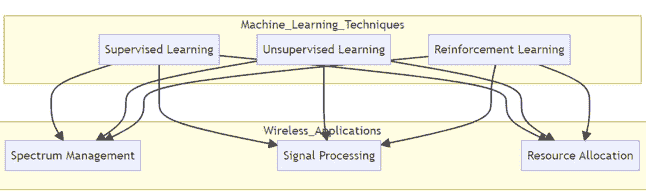

图8.1 无线应用机器学习技术的结构。


- c. 箭头将把每种机器学习技术连接到所有三种无线应用，指示每种技术在不同无线领域中的应用。

### 8.3.1 无线环境中的监督学习、无监督学习和强化学习

监督学习、无监督学习和强化学习等核心机器学习范式对改进无线技术具有巨大潜力。这些策略在无线领域各有独特的优势和用途，有助于改进和推进无线通信系统。监督学习使用标记数据训练模型，教会算法如何将输入转换为所需输出。在无线应用的信号分类中，例如根据接收信号识别各种调制方案，可以使用监督学习。例如，为了区分QPSK和16-QAM调制信号，可以训练卷积神经网络（CNN）来识别它们各自的特性 [43]。

另一方面，无监督学习涉及在未标记数据中识别模式和结构。聚类算法是一种无监督学习，用于在无线环境中将相关设备或信号分组。例如，K-means聚类可以根据感知数据的模式对无线传感器节点进行分类，从而促进数据聚合和群体决策。强化学习的主要目标是教会智能体如何与环境交互，以最大化奖励信号。强化学习在无线应用中非常有用，可用于改进动态网络中的资源分配 [44]。

例如，基站可以使用强化学习在用户之间动态分配发射功率电平，同时维护服务质量（QoS）标准，保证有效和公平的频谱使用。支持向量机（SVM）是一种监督学习方法，已被用于预测无线通信信道。SVM可以通过在先前信道数据上进行训练来预测未来信道条件，从而实现自适应资源分配和干扰缓解措施。在无线传感器网络中，异常检测是无监督学习技术的一个有用应用。无监督算法能够通过发现与预期行为模式的偏差来识别故障或受损的传感器，从而提高网络的可靠性和韧性。在认知无线电网络中，强化学习的灵活性被用于动态频谱分配。智能体获得必要的技能，以正确感知和使用可访问的频段，最大限度地减少干扰并改善实时频谱使用。监督学习技术帮助设备在频谱感知期间发现可用于认知无线电应用的开放频段。随着算法在区分占用和未占用信道方面变得越来越熟练，频谱共享变得更加可靠和有效 [45]。

无线定位涉及无监督学习。通过结合多个接入点的接收信号强度信息，聚类算法可以帮助识别用户在室内环境中的位置。可以通过强化学习技术提高无线传感器网络的能源效率。为了在保持足够覆盖和数据上报率的同时节省能源，智能体学习传感器节点的最佳睡眠-唤醒模式。

### 8.3.2 无线通信的深度学习方法

深度学习方法为无线通信系统带来了创新新时代，为解决难题和推进无线技术各个方面提供了强大工具。深度学习方法利用多层神经网络的能力，正在彻底改变无线通信系统的开发、优化和管理。信道估计和预测是深度学习在无线通信中的重要应用。深度神经网络（DNN）可以检查先前的信道数据以预测未来信道条件，从而实现自适应资源分配和干扰控制。例如，长短期记忆（LSTM）网络可以预测无线信道信号衰落，从而实现传输参数的动态调整。卷积神经网络（CNN）可以利用深度学习来学习区分不同的调制方案，这也用于自动调制分类。

由于CNN可以识别和分类调制，帮助识别非法传输或干扰源，因此这对于频谱监测至关重要。深度学习技术有助于波束成形优化。DNN可以在配置天线阵列时修改波束成形权重，将信号能量集中在目标用户上并减少干扰。因此，整体信号质量和网络性能得到提升。纠错编码是无线通信系统的关键组成部分。通过使用自编码器等深度学习模型，可以提高嘈杂无线信道中的数据可靠性，这些模型可以训练以改进其纠错能力。深度学习对物理层安全有显著影响。通过使用人工噪声伪装发送信号，自编码器可以防止窃听并提高无线安全性。在无线网络中，资源分配是一项具有挑战性的任务，通过深度强化学习来解决。

智能体可以学习最佳技术来分配带宽和发射功率等资源，同时平衡网络性能和能源效率。深度学习算法为无线传感器网络提供了增强的数据处理能力。可以使用生成对抗网络（GAN）创建逼真的传感器数据，从而增强用于开发和测试网络技术的数据集。深度学习的强大功能用于复杂的调制和解调任务。通过使用深度神经网络进行端到端学习，可以直接将接收信号转换为信息比特，简化接收器设计并可能提高性能。深度学习的多功能性对认知无线电网络有利。

神经网络能够学习动态检测和选择可访问频段，从而实现多个无线系统的有效共存。此外，大规模MIMO波束成形是深度学习方法的强项。DNN可以使用大量天线增强波束成形模式，以实现空间复用和干扰抑制，提高吞吐量和网络容量 [46]。

## 8.4 使用机器学习进行信号处理和分析

借助机器学习技术，无线信号处理和分析发生了革命性变化。这些方法利用算法提取有用信息和优化无线信号处理的能力，从而改进通信网络和前沿应用。在信号去噪和增强中，机器学习至关重要。例如，可以训练深度学习模型来消除接收到的无线信号中的噪声，提高整体信号质量并实现更精确的数据传输。机器学习方法有助于无线频谱感知中的有效频谱使用。认知无线电网络使用算法来查找开放频段并实现动态频谱共享。

支持向量机（SVM）是一种机器学习模型，可以将信号分类为占用或未占用，简化认知设备对频谱的访问。信号分析中的基本任务之一是特征提取。为了帮助信号分类等任务，机器学习算法可以自动从无线信号中提取相关信息。例如，可以训练卷积神经网络（CNN）来提取复杂的信号特性，从而实现精确的调制分类。机器学习大大改善了信号分类。可以使用随机森林或k近邻（k-NN）等监督学习技术，根据信号属性将其分类为各种调制方案。这些信息对于频谱监测和干扰检测很有用。使用机器学习方法可以提高定位精度。

一种常用的策略是利用接收信号强度（RSS）测量进行三角定位。通过发现RSS值与位置之间的相关性，机器学习模型可以推测用户在无线网络中的位置。机器学习的优化能力增强了波束成形优化。机器学习模型可以通过在模拟场景上训练算法来确定最佳波束成形权重，以将信号引导至适当方向，提高通信质量。异常检测包含在无线信号分析的范围内。孤立森林和其他机器学习算法可以发现无线数据中的异常模式，这些模式可用于查找IoT设备中的安全缺陷或硬件问题。使用机器学习算法预测无线信道中的信号衰落。循环神经网络（RNN）（包括长短期记忆（LSTM）网络）能够检查先前的信道数据以预测未来的信号波动，从而实现自适应资源分配。机器学习技术优化波形设计中的信号特性，以满足


预定目标。例如，深度学习模型可以创建增加频谱效率或减少干扰的波形，为各种无线情况定制信号 [47]。

机器学习的多功能性对于动态频谱接入的频谱感知具有优势。算法可以学习主用户信号的统计特性，使次要用户能够定位开放频谱频段并在不干扰主用户的情况下连接。此外，机器学习有助于信号解调。复杂调制系统的准确解调可能很困难。深度学习模型可以通过理解接收信号和广播符号之间的复杂相关性来改善解调性能。

### 8.4.1 基于机器学习的信号检测与分类

在无线通信系统中，信号识别和分类是至关重要的任务，机器学习算法已成为解决这些问题的有效工具。这些方法允许对各种信号进行自动分类和识别，提高通信系统的整体效能，并简化频谱监测和干扰检测。通过识别输入信号中的模式，机器学习模型擅长信号识别。这可能涉及确定无线环境中噪声中某个特定信号的存在或不存在。例如，高斯混合模型（GMMs）可以被训练以在嘈杂环境中找到雷达信号。为了区分各种调制方案或信号类型，信号分类是必不可少的。在此领域，卷积神经网络（CNNs）擅长找出区分信号的独特属性。

例如，CNNs可以根据信号波形的属性对不同的Wi-Fi调制（如BPSK、QPSK和16-QAM）进行分类。机器学习通过对主用户信号进行分类，帮助认知无线电网络中的动态频谱接入。支持向量机（SVMs）可以将信号分类为蜂窝或电视广播，使次要用户能够定位开放频率频段并相互不干扰地通信。识别和分类无线干扰源是机器学习方法擅长的另一个领域。基于其频谱特性，随机森林可以区分不同类型的干扰，例如窄带和宽带干扰。因此，通信系统在嘈杂环境中更具韧性。机器学习改善了现代雷达系统中的目标识别和分类。基于时域或距离-多普勒数据，循环神经网络（RNNs）等深度学习架构可以识别和分类各种雷达目标。机器学习通过发现错误信号或干扰尝试来帮助无线安全 [48]。

异常检测算法可以发现与常规不同的信号模式，提醒网络管理员注意潜在的安全风险。为了合规，信号识别和分类在频谱监测中至关重要。机器学习算法可以识别和分类各种频率频段的信号，帮助监管组织确保最佳频谱利用。在复杂调制方案的情况下，机器学习技术可以实现准确的信号分类。梯度提升机（GBMs）可以区分多种高阶调制方案，使调制分析更加准确。机器学习有助于无线传感器网络中的事件检测和分类。

例如，机器学习模型可以通过根据时间模式区分各种传感器事件来提高事件检测的准确性。信号检测阈值也使用机器学习进行优化。随着噪声水平的变化，算法可以学习动态调整其检测阈值，优化误报和漏报之间的权衡。机器学习方法使分类和信号检测具有灵活性。算法能够在各种信号类型上进行训练，并能有效地推广到新的未知信号，从而提高了这些任务在无线通信系统中的灵活性和精度。

### 8.4.2 使用ML技术的频谱感知与认知无线电

认知无线电和频谱感知是两个相关的概念，它们利用机器学习方法来改善无线通信网络并最大限度地利用频谱。频谱感知包括确定某个频率频段中是否存在信号，而认知无线电则提供对开放频谱频段的动态访问，以减少干扰和频谱稀缺。通过提供精确有效的信号识别，机器学习技术对频谱感知至关重要。例如，支持向量机（SVMs）可以在认知无线电的背景下使用，帮助认知设备区分主用户信号和背景噪声，使次要用户能够机会性地访问空闲频率频段 [49]。

认知无线电网络使用机器学习来提供动态频谱接入。认知设备可以根据强化学习（RL）算法通过与环境交互来学习最佳的频谱接入规则。认知无线电设备可以使用Q学习来选择何时以及如何访问频率频段，同时减少与其他用户的干扰。通过学习复杂的信号模式，深度学习模型提高了频谱感知的准确性。卷积神经网络（CNNs）可以通过识别接收信号中的某些调制来区分主用户和次要用户的传输。检测隐藏节点是机器学习也试图解决的问题。为了防止隐藏节点干扰通信，认知无线电设备可以利用聚类算法来定位其通信范围之外的节点。在线学习技术对于动态情况下的频谱感知具有优势。

认知无线电网络可以使用在线序列极端学习机（OS-ELMs）来实时适应不断变化的频谱情况，从而实现及时精确的频谱感知。机器学习方法提高了认知无线电适应主用户活动变化的灵活性。通过研究主用户传输的时间模式，隐马尔可夫模型（HMMs）可以预测主用户的存在，使次要用户能够动态离开频谱区域。频谱感知对于机会性频谱接入也至关重要。为了确保有效的频谱利用，机器学习方法（如遗传算法（GAs））可以改进包括采样持续时间和检测阈值在内的感知参数。机器学习支持多天线认知无线电系统中的空间频谱检测。

得益于独立成分分析（ICA），认知设备现在能够同时感知多个频谱频段，ICA可以分离混合的输入信号以确定其来源。协作频谱感知（认知设备共同工作以提高感知准确性）展示了机器学习的适应性。可以使用协作过滤技术结合单个感知的结果，对频谱可用性做出集体决策。基于机器学习的上下文感知有助于认知无线电的自我意识。频谱感知模型可以包含上下文数据，例如位置和时间，使认知设备能够为不同情况定制其感知方法。

## 8.5 信道建模与预测

无线通信系统必须包含信道建模与预测，以便理解和预测信号在不同传播环境中的行为。这些概念对于提高通信效率、资源分配和系统设计至关重要。表征无线信号如何在环境中传播是信道建模的一个组成部分。路径损耗模型（如自由空间路径损耗模型）描述了信号功率随距离的衰减。例如，由于室外环境中的几何扩散，接收信号强度与距离的平方成反比下降。另一个信道现象是衰落，当信号绕射、反射或散射于物体时发生，从而改变信号。通过对无线信道中信号变化进行建模，瑞利和莱斯衰落模型捕捉了这些效应 [50]。

一个例子是室内环境中的多径衰落，信号由于反射而遇到有益和有害的干扰，导致信号强度发生变化。通过使用历史数据，信道预测试图预测未来的信道条件。循环神经网络（RNNs）是一种机器学习方法，可以预测信道衰落随时间的变化模式。例如，RNNs可以通过在先前信道条件上进行训练来预测未来的信号波动，从而实现自适应调制和编码技术。卡尔曼滤波对于预测时变信道（如车载通信中使用的信道）很有用。在移动场景中，卡尔曼滤波器通过基于最近和历史观测估计信道状态，帮助跟踪快速变化的信道条件。由于毫米波（mmWave）通信中存在显著的路径损耗和对大气变量的敏感性，信道建模变得复杂。基于几何的模型（如Saleh-Valenzuela模型）封装了毫米波信道的特性，并有助于开发可靠的毫米波系统。

空间波动在大规模多输入多输出（MIMO）信道中可见。为了改善波束成形和空间复用，MIMO系统的信道预测可以使用空间插值技术来估计


未见区域的信道响应。波束成形优化涉及信道预测。自适应波束成形算法可以通过预测信道条件，引导天线朝所需方向指向，以减少干扰并提高信号质量。对于动态频谱接入（DSA）网络，信道建模和预测至关重要。认知无线电通过利用先前的信道数据来预测未来的主用户活动，从而在提供机会性频谱接入的同时减少干扰。

对于节能通信，无线传感器网络从精确的信道建模和预测中受益。传感器可以通过预测信号强度的变化来管理数据速率和传输功率电平，以在保持通信质量的同时节省能源。在涉及车辆之间（V2V）以及车辆与基础设施之间（V2I）通信的情况下，信道预测很有帮助。在动态车辆场景中，信道条件预测能够实现自适应传输技术，提高通信的可靠性和安全性。

### 8.5.1 无线环境中的信道建模

信道建模是无线通信系统的关键组成部分，它为理解电磁信号在不同环境中如何传播提供了系统性框架。它涉及考虑干扰、距离和其他变量的信号行为数学描述。准确的信道建模使无线系统的设计、分析和优化成为可能，提供可靠且高效的通信。路径损耗是无线环境中的关键信道特性。例如，Friis 自由空间路径损耗模型描述了信号强度如何随发射机和接收机之间距离的增加而下降。

例如，由于室外环境中的几何扩散，信号强度随距离的平方而减小。信道建模的另一个关键组成部分是衰落，它由信号反射、衍射和散射引起。瑞利和莱斯衰落模型捕捉了多径传播引起的信号变化。在都市环境中，建筑物和其他物体可能导致多径情况，从而产生信号可能被放大或减弱的衰落现象。信号波动是由阴影效应引起的，阴影效应是由建筑物或地形等主要障碍物的阻挡造成的。对数正态阴影模型考虑了这些变化，并解释了静态障碍物如何影响信号强度。例如，当无线设备行驶到建筑物后面时，阴影效应可能导致信号强度突然下降。

快速衰落在移动场景中经常观察到，它是由信号快速相位变化引起的。这种现象在车辆通信等场景中很常见，信号由于相对运动而遇到频率变化，由多普勒频率模型表征。毫米波（mmWave）信道模型考虑了特殊的传播特性。毫米波频段的信号具有高度定向性，并受空气吸收的影响。Saleh-Valenzuela 等模型捕捉了这些效应，并有助于开发可靠的毫米波通信系统。信号质量受多径传播引起的建设性干扰和破坏性干扰的影响。时延扩展的概念衡量了多径信号到达时间的变化。

室内环境中的符号间干扰是由多径引起的延迟回声造成的。信号传播受天线方向图的影响。通过天线分集（多个天线接收相同信号）可以减少衰落效应。信道建模考虑了这些趋势，有助于优化分集策略以提高信号可靠性。MIMO（多输入多输出）信道引入了空间变化。MIMO 信道模型考虑了发射和接收天线之间的相关性，说明了多个天线如何利用空间分集来改善通信性能。

信道建模是无线传感器网络的重要组成部分。传播模型考虑了各种环境因素，有助于确定传感器的最佳位置，以保证通信一致性和最小能耗。现代信道模型在计算不确定性时会考虑随机过程。为了提高信道预测和系统设计的准确性，随机几何模型量化了障碍物和信号传播的分布。

### 8.5.2 基于机器学习的信道预测算法

无线通信系统从基于机器学习的信道预测算法的发展中获益匪浅，这些算法根据现有数据预测未来的信道条件。这些算法利用人工智能的能力，改进了资源分配、自适应调制以及整体系统性能。对于信道预测，循环神经网络（RNN）是常见的选择。RNN 在预测时变信道行为方面很有效，因为它们可以检测信道数据中的时间关系。例如，RNN 可以预见车辆通信中的信道衰落模式，以便在车辆移动时动态修改传输设置。

一种称为长短期记忆（LSTM）网络的 RNN 版本尤其擅长检测长距离关系并减轻梯度消失问题。基于 LSTM 的信道预测模型可以随时间学习复杂的衰落模式，从而提高预测准确性。卷积神经网络（CNN）为信道预测提供空间感知能力。CNN 可以通过检查接收信号中的空间模式来预测信号将如何在多个区域传播，这有助于波束成形优化和空间多样性。支持向量机（SVM）提供了一种替代方法，它根据过去的信道数据对信道状态进行分类。基于 SVM 的算法能够预测信道的状况，即是否良好或不良，从而允许为可靠通信进行主动链路自适应。

通过生成人工信道样本，生成对抗网络（GAN）有助于信道预测。由于 GAN 可以合成准确反映真实信道情况的样本并理解信道数据的统计分布，因此预测模型可以得到更充分的训练。通过试错，强化学习（RL）方法改进信道预测策略。通过预测未来信道状态并根据输入修订这些预测，代理人学习与环境交互。这可以改善动态无线网络的自适应资源分配。

通过迁移学习，预测模型可以从一个环境转移到另一个环境。由于可以利用目标环境中的稀疏数据对预训练模型进行微调，因此对大量训练数据的需求减少。未来信道条件使用贝叶斯方法进行概率估计。

由于贝叶斯推断考虑了预测的不确定性，它适用于训练数据稀少或衰落特性复杂的情况。集成方法使用多个预测模型来提高可靠性和准确性。使用随机森林或梯度提升等方法，可以将许多模型的预测相结合，以提供更准确的信道预测。混合模型将机器学习与基于物理的模型相结合。混合模型通过融合数据驱动方法与领域专业知识，在考虑特定信道行为的同时提供精确预测。基于机器学习的信道预测在动态频谱接入网络中至关重要。次要用户可以利用过去的信道数据来预测主用户未来的行为，从而实现干扰最小的有效机会性频谱接入。

## 8.6 资源分配与优化

为了提高性能、可靠性和用户满意度，无线通信系统必须有效分配其有限的资源池。这被称为资源分配与优化。这些过程涉及动态决策，以分配带宽、功率、时间和其他资源，从而提高系统吞吐量并减少干扰。频谱是无线网络中宝贵且有限的资源。资源分配技术确保各种用户或服务能够有效共享可用频谱。例如，5G 网络中的正交频分多址（OFDMA）通过根据用户的信道情况动态分配子载波来优化频谱效率。

为了延长电池寿命并减少干扰，功率分配至关重要。认知无线电系统使用功率控制算法根据信道情况调整发射功率电平。自适应功率分配确保在不使用过多功率的情况下传输足够强的信号。对于需要精确时序的应用，时间分配至关重要。在时分多址（TDMA）下，时间槽以协调的方式分配给用户，允许多个用户在不发生碰撞的情况下进行通信。例如，在工业物联网网络中，时间槽被分配给传感器用于周期性数据报告，提供及时且协调的通信。空间资源的分配通常与多输入多输出（MIMO）系统相关，它优化天线对用户的分配，以利用地理多样性。


波束成形系统采用动态天线权重调整，将信号集中在特定用户上，提高信号质量并减少干扰。在优化资源分配的过程中，机器学习至关重要。通过与环境的交互，强化学习算法使代理能够发现最佳资源分配策略，实现自主决策。例如，强化学习可用于动态分配发射功率和子载波，从而提升网络性能。在涉及动态频谱接入的场景中，动态资源分配至关重要。认知无线电网络利用实时频谱感知和学习算法，机会性地接入未占用的频谱频段，而不干扰其他用户。

资源分配决策由服务质量（QoS）标准驱动。不同的应用需要不同的服务质量（QoS）级别；例如，视频流需要比非实时数据传输更多的带宽和更低的延迟。由于动态资源分配，所有应用的QoS需求都能得到满足。资源分配优化包括边缘计算场景。为了降低延迟并保留网络带宽，边缘服务器会根据任务需求动态分配计算资源，这些任务可在靠近数据源的位置处理。在分配资源时会考虑用户移动性。当用户移动时，切换和移交过程会动态将资源从一个基站转移到另一个基站，以保持连接。在5G网络中，网络切片是优化资源分配的一个示例。对于具有不同资源需求的不同应用，会生成不同的网络切片。每个切片都会分配一组特定的资源，确保在各种使用场景中实现最佳性能。

### 8.6.1 无线网络中的资源分配挑战

无线网络中资源分配的难题是由频谱、功率、时间及其他网络资源供应稀缺引起的复杂问题。这些困难影响着无线通信网络的有效性、容量和服务质量。为了保障可靠且高性能的无线通信中资源的有效和最优使用，必须解决这些困难。无线网络面临着频谱稀缺这一重大障碍。随着无线服务需求的增加，可用频段变得拥挤。由于拥塞，数据速率下降，通信质量降低。

通过认知无线电和频谱共享等动态频谱分配方法，二次用户可以在不干扰主用户的情况下使用未充分利用的频谱频段，从而寻求克服这些困难。在能量有限的无线设备中，功率分配面临挑战。为了延长电池寿命并减少干扰，用户必须能够有效分配发射功率。然而，当信道条件和QoS要求是可变的时，功率分配变得复杂。算法必须在消费者的性能要求与节能之间取得平衡。对时间敏感的应用，例如实时视频流或车载通信，会带来时间分配方面的困难。为了保证无缝且及时的数据传输，必须在考虑延迟和同步需求的同时正确分配时隙。像MIMO系统那样部署大量天线，会导致空间资源分配方面的问题。

在向用户分配天线时，必须考虑干扰、串扰和空间多径。为了提升系统容量，波束成形算法必须适应不断变化的信道条件和用户位置。干扰控制是一个持续关注的问题，尤其是在人口稠密地区。当大量用户共享同一频段时，会发生同频干扰，导致信号减弱。包括干扰对齐或空间滤波在内的先进干扰抵消方法可减少不需要的信号，从而缓解这一问题。在具有多种应用的异构无线网络中，提供服务质量（QoS）面临困难。一项复杂的优化挑战涉及分配资源以满足多个QoS标准（如延迟、吞吐量和可靠性），同时保持用户公平性。

当认知无线电在动态频谱接入场景中机会性地使用可用频谱时，会出现动态资源分配问题。需要智能资源分配方案，以在适应主用户活动变化的同时，提供有效且无干扰的频谱共享。安全问题使资源分配更加困难。在保持私密和安全通信的同时分配资源可能很困难，尤其是当无线信号受到干扰和窃听攻击时。移动性问题会影响切换和移交过程中的资源分配。当用户在多个小区或接入点之间移动时，需要平稳地转移资源，以维持连接并避免服务中断。像物联网（IoT）这样的大规模无线网络面临可扩展性问题。需要新的资源分配方法来管理日益增加的复杂性和规模，以便高效地将资源分配给大量具有不同通信需求的设备。在多用户场景（如拥挤的活动现场或人口稠密的都市环境）中，协调资源以在减少干扰和优化容量的同时保证公平分配，会带来挑战。

### 8.6.2 机器学习驱动的资源分配策略

机器学习驱动的资源分配策略已成为优化无线通信网络中稀缺资源分配的有效工具。这些策略利用人工智能快速做出数据驱动决策的能力，从而提升系统功能、效率和用户体验。动态频谱接入是机器学习驱动资源分配的一个应用。认知无线电网络利用机器学习技术来感知和预测频谱频段的可用性。这使得二次用户可以在不干扰主用户的情况下，机会性地使用空闲频率。通过与环境的交互，自主代理可以使用强化学习（RL）等机器学习模型来学习最佳资源分配策略。

强化学习（RL）可用于无线网络中，根据系统输入即时分配发射功率、子载波和时隙，同时提升网络性能。机器学习驱动资源分配擅长的另一个领域是服务质量（QoS）优化。通过学习根据各用户或应用的QoS要求分配资源，机器学习算法可以确保关键应用获得所需资源，同时保持公平性。机器学习方法可以优化大规模MIMO系统中天线资源的利用率，该系统使用多个天线为多个用户服务。机器学习算法可以通过检查信道条件和用户请求，决定为每个用户分配的理想天线数量，以实现最佳吞吐量。

机器学习驱动资源分配的应用可见于边缘计算场景。为了降低延迟并最大化计算效率，边缘服务器可以利用机器学习技术，根据任务需求和网络情况动态分配计算资源。车载通信的机器学习驱动资源分配可以优化车辆之间（V2V）以及车辆与基础设施之间（V2I）的通信资源分配。

为了在移动过程中提供不间断通信，机器学习算法可以预测汽车的移动模式，并相应地分配资源。以节能方式分配资源对于延长无线设备的电池寿命至关重要。为了在保持通信质量的同时降低能耗，机器学习算法可以学习各种设备的能耗习惯。机器学习技术改善地理资源的分配。机器学习模型可用于优化波束成形算法，该算法修改来自不同天线的信号的相位和幅度，以将信号能量聚焦到目标用户并减少干扰。迁移学习（即模型在一个环境中训练后应用到另一个环境）可能对资源分配技术有利。

例如，通过微调在一个环境中训练用于优化资源分配的机器学习模型，使其适用于类似但不同的环境，可以减少对大量训练数据的需求。物联网（IoT）是一个动态的异构生态系统示例，机器学习驱动的资源分配在其中特别有用。随着IoT设备数量的增长，机器学习算法可以根据其通信模式和需求，自适应地将资源分配给各种IoT设备。

## 8.7 干扰管理与波束成形

在无线通信系统中，干扰管理和波束成形是旨在减轻干扰影响并提高信号质量的关键策略。这些方法对于提高频谱效率、最大化通信性能以及确保可靠且高效的数据传输至关重要。干扰管理采用旨在减少或消除可能损害通信质量的不需要信号的策略。使用多个


天线通过在干扰信号方向产生零点来有效抵消其影响，这是一种空间干扰控制形式。该方法优化通信质量和信号干扰加噪比（SINR）。波束成形是一种强大的技术，通过在精确方向发送或接收信号来集中信号能量并最大限度地减少干扰。

在发射波束成形期间，天线修改其相位和幅度，以将传输信号集中于目标接收机。在接收波束成形期间，天线调整其权重，以改善来自特定方向的信号接收。得益于波束成形算法，智能天线提供空间多样性和干扰缓解。波束成形是多输入多输出（MIMO）系统使用的一种技术，用于向多个用户并发传输多个数据流，从而增加容量和吞吐量。例如，带有波束成形的 MIMO 系统可以在繁忙的体育场内为多个用户提供服务，且干扰很小，提供高质量通信。

自适应波束成形系统利用实时信道信息来改进波束成形模式，以应对变化的情况。在移动环境中，用户的位置和信道条件随时间变化，自适应波束成形非常有用。例如，自适应波束成形使移动车辆中的移动设备能够在到达角度变化的情况下仍与基站保持稳定连接。一种称为干扰对齐的前沿方法旨在对齐冲突信号，使它们能够共存而不会显著降低对方性能。干扰对齐利用空间自由度，通过仔细规划发射和接收波束成形向量来实现干扰消除。大规模 MIMO 系统使用波束成形为大量用户提供增强的空间复用。大规模 MIMO 系统可以通过为每个用户调整波束成形权重，在减少干扰的同时同时支持多个用户。

为了支持动态频谱共享，认知无线电网络使用干扰控制策略。为了避免干扰主用户，认知无线电可以检测频谱并修改其广播设置。通过将能量引导远离关键用户使用的频率，认知无线电中的波束成形可以进一步改善干扰控制。在协调波束成形中，多个基站协作以获得最佳波束成形模式。这种方法减少小区间干扰并改善小区边缘的信号质量。在具有不同小区大小和用户密度的异构网络中，协调波束成形特别有用。为了平衡复杂性和性能，混合波束成形结合了模拟波束成形和数字波束成形。

虽然数字波束成形对波束成形模式进行精细调整，但模拟波束成形以粗略的方式引导信号。在毫米波（mmWave）通信中，完全数字波束成形可能计算成本高昂，混合波束成形很有帮助。随着尖端信号处理算法和机器学习策略的引入，干扰控制和波束成形系统不断进步。这些方法对于在各种环境下提供有效、无阻碍且高质量的无线通信至关重要。

### 8.7.1 基于机器学习辅助技术的干扰缓解

无线通信系统中干扰带来的问题催生了使用机器学习（ML）辅助技术进行干扰减少的强大方法。这些方法利用人工智能的能力，智能地评估、预见和缓解干扰，从而改善通信性能、可靠性和效率。智能频谱感知是一种广为人知的 ML 辅助干扰减少方法。认知无线电网络使用 ML 算法通过检测和分类信号来识别主用户和次用户。例如，通过可靠地识别频谱区域中的电视广播信号，ML 模型允许次用户机会性地访问空闲频率。另一种强大的技术是 ML 驱动的干扰消除。深度学习模型可以学习识别干扰模式，并从入站信号中去除这些干扰，以提高信号质量。

当有多个用户时，ML 算法可以区分预期信号和干扰源，从而实现可靠通信。复杂的波束成形方法和机器学习使干扰减少成为可能。为了消除干扰源并提高信号干扰加噪比（SINR）和通信质量，可以使用 ML 算法来改进波束成形权重。例如，ML 辅助波束成形可以衰减拥挤城市区域中周围建筑物的信号，从而降低干扰。为了协调附近基站之间的传输技术，协调多小区干扰管理使用 ML。

为了减少小区间干扰并增加整体网络容量，ML 模型评估干扰模式并优化功率和资源分配。ML 技术提高了大规模 MIMO 系统处理干扰的能力。ML 模型可以通过学习空间干扰模式来增强波束成形向量，以消除干扰信号并改善用户体验。带有 ML 驱动干扰缓解的大规模 MIMO 可以在拥挤的体育场内同时为许多客户提供服务，同时减少跨用户干扰。在涉及动态频谱共享的情况下，机器学习也很有帮助。为了防止干扰，ML 模型预测主用户的行为并动态修改次用户传输设置。例如，认知无线电设备可以利用 ML 预测来优化频谱使用，仅在主用户不存在时进行传输。

一种称为干扰对齐的复杂方法可以通过机器学习得到改进。为了对齐冲突信号并将其消除，ML 算法优化发射和接收向量。这改善了通信质量。在存在多个干扰源的情况下，这尤其有用。物联网网络现在可以从机器学习驱动的干扰减少中受益。为了在许多设备之间提供可靠通信，ML 模型可以评估密集物联网部署中的干扰模式并改进资源分配。在动态干扰环境中，例如车载通信，使用 ML 辅助方法。为了实现无缝通信，ML 系统预测由快速变化的车辆位置引起的干扰模式，并相应地修改传输策略。

### 8.7.2 使用机器学习的自适应波束成形

自适应波束成形是无线通信网络中的一种复杂方法，它使用机器学习来调整天线阵列的方向性，并根据当前信道条件改善信号接收或传输。为了在复杂和动态的环境中减少干扰、提高信号质量并改善系统性能，该方法修改波束成形模式。波束成形权重使用神经网络、支持向量机（SVM）或深度学习架构等机器学习方法进行优化。这些算法通过检查信道特性、信噪比（SNR）、干扰水平和其他相关因素，动态改变特定天线信号的相位和幅度。当有多个用户时，自适应波束成形很有用，因为干扰可能会降低信号质量。

例如，在基站和用户众多的城市地区，自适应波束成形可以将传输波束引导远离干扰源，从而减少同信道干扰并改善用户体验。自适应波束成形使车载通信中用户不断移动时能够保持持续连接。为了在存在干扰的情况下仍与基站保持可靠连接，机器学习模型在车辆移动时监测变化的信道条件并改进波束成形权重。自适应波束成形帮助大规模多输入多输出（MIMO）系统为大量用户提供服务。自适应波束成形通过为每个用户改变波束成形模式来改善空间资源分配，从而增加容量和吞吐量。自适应波束成形可以解决衰落和阴影问题。

机器学习技术预测衰落情况下的不规则信号变化，并修改波束成形权重以保持强连接。在阴影环境中，当障碍物阻挡或衰减信号时，自适应波束成形可以将能量集中在阻碍较少的方向。毫米波（mmWave）通信从机器学习驱动的自适应波束成形中获益匪浅。由于毫米波频率的通信具有高度方向性，波束成形变得至关重要。为了应对毫米波传播典型的显著路径损耗和空气吸收，自适应波束成形优化波束模式。机器学习算法基于先前的信道数据改变波束成形权重，以考虑潜在的未来信道变化。

这种预测能力对于在信道快速变化的情况下（例如城市环境或高移动性场景）继续可靠通信至关重要。满足服务质量（QoS）标准需要自适应波束成形。为了优先处理具有特定 QoS 要求的用户，机器学习算法改进波束成形模式，确保关键应用程序获得所需资源并最大限度地减少对其他用户的干扰。为了实现更彻底的干扰缓解和资源优化，自适应波束成形技术可以与干扰消除或动态频谱接入等其他策略相结合。


## 8.8 无线安全与异常检测

为了保护数据、限制未经授权的访问，并发现可能表明安全漏洞或攻击的异常行为，无线安全和异常检测是现代通信网络的关键要素。必须使用这些策略来保障无线网络及其连接应用程序的完整性、机密性和可用性。无线安全高度依赖身份验证和加密。例如，WPA3 加密通过采用最新的加密方法并防范暴力破解攻击来保护 Wi-Fi 连接。无线网络通过对用户进行身份验证并加密数据来防止非法访问和窃听。入侵检测系统（IDS）利用异常检测算法来发现无线网络中异常的活动模式。

例如，检测到异常流量激增或非法设备连接可能会导致 IDS 发出通知以供进一步调查。机器学习技术对于检测异常至关重要。ML 模型通过在典型网络活动上进行训练，可以识别异常值。例如，ML 辅助的异常检测可能会发现试图连接到网络的非法设备，或可能指向分布式拒绝服务（DDoS）攻击的奇怪流量模式。除了 IDS，无线网络还经常使用入侵防御系统（IPS）。IPS 系统会自动采取措施，防止异常造成损害。例如，IPS 可以阻止或转移来自可疑来源的流量，以减轻潜在风险。

行为异常检测的目标是识别与正常模式不同的人类或设备行为。ML 模型可以学习常见行为，当这些行为与预期行为存在显著偏差时，会向用户发出警报。这种方法用于识别资源盗窃或内部威胁。协议安全是无线安全的另一个方面。Diffie-Hellman 等安全密钥交换协议确保只有授权方才能建立安全通信通道。窃听传输的攻击者无法发现共享密钥，从而保持机密性。防火墙和数据包过滤对于无线安全至关重要。防火墙可以根据预定义的标准配置为限制入站和出站流量，以过滤有害或未经授权的数据包。例如，防火墙可以阻止空闲端口上的所有入站流量，以防止此类攻击。

无线入侵防御系统（WIPS）会监控无线网络中的流氓设备、未经授权的客户端和未经授权的接入点。WIPS 通过检测和隔离这些实体并防范可能的入侵来提高网络安全性。网络中的不同用户组或设备会相互分段或隔离，以保护整个网络免受未经授权访问的破坏。例如，企业环境中的访客网络会将访客设备与重要资源隔离开来。得益于安全启动程序，只有经过批准和认证的软件才能在无线设备上运行。因此，黑客无法利用设备固件或软件中的漏洞。无线安全和异常检测技术对于保护关键基础设施、物联网网络以及 5G 等潜在未来技术至关重要。无线系统通过集成加密、身份验证、异常检测和入侵防御，可以提供安全可靠的通信，最大限度地降低与网络威胁和非法访问相关的风险。

### 8.8.1 无线安全威胁与挑战

无线安全威胁和挑战对无线通信系统的完整性、机密性和可用性构成重大危险。随着技术的发展和无线网络的日益普及，理解和减轻这些危险对于确保敏感数据安全、防止未经授权的访问以及维护无线基础设施的整体安全至关重要。窃听是指攻击者拦截并监视无线信号以获取对敏感数据的未经授权的访问，这是一个重要问题。例如，捕获未加密的 Wi-Fi 信号可能会让攻击者获得登录信息或敏感信息，从而危及网络安全。另一个问题是数据拦截，即攻击者在数据包传输过程中拦截并篡改数据包。这种风险可能导致恶意代码注入，甚至未经授权的数据操纵。

例如，攻击者可能会拦截无线支付交易，并在付款金额到达预期接收者之前将其篡改。所谓“中间人”（MitM）攻击，是指第三方拦截两方之间的通信，并可能更改内容。在无线环境中，攻击者可以将自己置于用户设备与网络之间，以捕获和操纵数据。一个著名的例子是恶意 Wi-Fi 热点，它模仿可信网络，诱骗用户连接并泄露数据。拒绝服务（DoS）攻击通过向网络发送过量流量来干扰无线服务。攻击者可能会用请求淹没无线网络，导致延迟甚至完全的服务中断。

依赖无线通信的企业可能会因对关键基础设施的这种威胁而遭受经济损失。罪犯安装的未经授权的 Wi-Fi 接入点，称为“流氓接入点”，伪装成官方网络。用户如果不知情地连接到这些恶意接入点，其数据就会面临被拦截的风险。例如，黑客可能会在公共区域设置一个假冒接入点，以收集毫无戒心的用户的私人数据。为了未经授权地访问无线网络，密码攻击会针对弱密码或容易猜测的密码。攻击者使用字典攻击或暴力破解等方法破解密码，从而危及网络安全。这一危险强调了多因素身份验证和强密码策略的重要性。

在无线环境中，网络钓鱼攻击以欺诈性电子邮件或消息的形式出现，诱骗用户泄露关键信息。网络钓鱼电子邮件可能会冒充可靠来源，要求收件人提供登录信息或个人数据。恶意软件在无线网络中的传播是一个日益令人担忧的问题。攻击者通过感染网络连接的设备来传播恶意软件，可以进一步攻破其他设备并扩散病毒。这一危险强调了采取强大安全措施（例如频繁的设备升级和扫描）的必要性。

当黑客利用无线协议中的漏洞来追踪人们的物理行动或获取私人信息时，可能会导致位置追踪和隐私侵犯。例如，利用智能手机的 Wi-Fi 信号非法监视某人的行踪，可能会导致严重的隐私侵犯。带有物联网设备的无线网络会带来特定的安全挑战。这些设备通常处理能力较弱，且缺乏强大的安全措施。因此，黑客可以利用物联网设备入侵它们，并将其作为通往更广泛网络的网关。连接设备数量的不断增加意味着 5G 等新兴技术会带来更多安全风险，例如网络切片漏洞和更大的攻击面。为了解决这些问题，需要采取主动安全措施，并持续监控无线通信网络。

### 8.8.2 基于机器学习的异常检测与入侵防御

基于机器学习的异常检测和入侵防御是高级方法，利用人工智能在复杂且动态的环境中发现并应对异常活动以及可能的安全漏洞。这些方法对于保护敏感数据免受未经授权的访问或有害行为，并保障无线通信网络的可用性、完整性和机密性至关重要。检测异常涉及发现与既定标准或模式的偏差。基于过去的网络数据，机器学习算法可以被训练以识别典型行为，然后发现可能表明入侵或攻击的异常情况。例如，如果无线网络在特定时段通常接收一定水平的流量，当流量水平超过或低于预测范围时，异常检测模型可以发出警报。

入侵防御的目标是在造成损害之前采取主动措施，阻止已知的异常或潜在危险。基于机器学习的入侵防御系统（IPS）可以自动响应观察到的异常，通过隔离受攻破的设备、阻止可疑流量或重新路由流量来降低风险。为了识别意外行为，神经网络和支持向量机等机器学习技术可以实时评估网络流量模式。例如，如果机器学习模型注意到某个用户或设备的数据传输速率异常高，它可能会发出警报以供进一步调查。异常识别中使用的一种典型方法是行为分析。机器学习模型会随时间监控用户、设备或应用程序的行为，并在出现重大变化时向用户发出警报。

例如，如果用户在非高峰时段突然开始访问大量数据，这可能是安全漏洞的迹象。基于机器学习的入侵防御可能包含基于实时数据的动态规则创建。系统可以自动构建和执行规则，以快速阻止或重新路由来自可疑来源的流量。例如，入侵防御系统可以快速


如果从某个地址注意到流量突然增加，则生成一条规则来阻止该 IP 地址。异常检测和入侵防御对于保护无线网络上的 IoT 设备至关重要。机器学习模型可以跟踪 IoT 设备活动，还可以发现可能指向入侵或设备被攻破的变化。例如，如果智能恒温器开始向其他设备发送奇怪的指令，入侵防御系统可以进行干预，以防止进一步的恶意行为。由于机器学习算法具有适应和学习的能力，异常检测和入侵防御的准确性会随时间提高。

这些系统可以通过定期评估网络数据并升级其模型，保持最新状态并成功抵御新出现和不断发展的威胁。网络分段是一种常与入侵检测一起使用的策略。通过将网络分割为离散的子网络，可以限制入侵的影响，最大限度地减少潜在危害，并减小攻击面。使用集成方法进行基于机器学习的入侵防御（即整合多个模型以提高检测准确性）也可能有利。每个模型可以专注于网络活动的不同方面，这有助于创建一个更全面的入侵防御系统。由于连接设备的多样性和网络复杂性的不断增加，现代无线通信系统需要复杂且自动化的安全措施，这使得基于机器学习的异常检测和入侵防御越来越重要。这些方法通过作为应对新威胁的预防性防御，帮助无线网络保持高水平的安全性。

## 8.9 5G 及以后：机器学习增强

一种被称为“机器学习增强”的范式利用复杂的机器学习技术，改善超越当前 5G 标准的无线通信网络的功能、性能和效率。通过促进智能决策、最大化资源分配以及解决下一代无线技术面临的特定挑战，该策略有可能改变无线网络。使用机器学习增强的 5G 及以后网络可以改善多种与通信相关的因素，包括频谱使用。当机器学习算法被整合到认知无线电系统中时，可以根据变化的情况动态调整频段，同时高效分配频谱资源并减少干扰。例如，机器学习算法可以预测频谱的可用性并修改传输设置，以确保最佳利用。

资源分配是无线网络的关键组成部分。基于当前网络状况，机器学习可以优化带宽、功率和其他资源的分配。例如，机器学习算法可以在拥堵的都市环境中，动态地将资源优先分配给用户需求更高的位置，为所有用户提供持续连接。作为 5G 的关键组件，大规模 MIMO 可以从机器学习增强的波束成形中受益。为了优化波束成形权重并提高信号质量和系统容量，机器学习算法可以检查信道条件、用户位置和干扰模式。这在体育场馆或城市核心区等高密度环境中尤其有用。

机器学习可以改善 5G 基础设施的预测性维护。机器学习模型可以通过检查传感器和网络硬件的数据来预测设备故障，从而实现主动维护并减少停机时间。例如，机器学习算法可能会发现可能预示未来硬件故障的网络性能异常。在 5G 和未来网络中，机器学习可以提高服务质量（QoS）。机器学习模型可以通过持续监控和分析，实时调整网络设置以满足特定的 QoS 需求。例如，医疗应用中的机器学习可以为实时医疗数据传输或远程手术提供低延迟、高可靠性的连接。

在 5G 及以后网络中，网络将使用各种设备和技术。机器学习可以简化在多种网络类型（例如蜂窝网络、Wi-Fi 和卫星网络）之间的切换。当设备在覆盖区域之间移动时，机器学习算法可以预测理想的切换时机和目标网络，以保证持续连接。在现代无线网络中，安全至关重要。通过识别和挫败多种攻击（例如非法访问、病毒传播和入侵尝试），机器学习可以提高安全性。机器学习算法可以识别典型行为模式，并在发现异常行为时发出警报。边缘计算对 5G 及以后网络至关重要，因为它支持高带宽和低延迟应用程序。使用机器学习技术在边缘进行数据处理，消除了将处理后的数据发送到集中式服务器的要求。例如，边缘机器学习可以检查自动驾驶汽车中的传感器数据，以实时做出驾驶决策。

在 5G 和未来网络中，机器学习可以最大限度地提高能源效率。算法可以根据用户需求和信道条件动态更改设备发射功率。机器学习可以控制工业 IoT 场景中传感器的能源使用，以延长电池寿命并降低维护需求。网络切片是 5G 的关键组件，允许为特定应用定制虚拟化网络，可以通过机器学习得到改进。机器学习算法可以更改网络特性，并为不同切片动态分配资源，从而提高性能并确保 QoS。

### 8.9.1 5G 网络中的机器学习集成

5G 网络中的机器学习集成是一种利用人工智能来提升第五代无线技术的有效性、性能和能力的革命性策略。通过实现智能决策、优化资源分配以及解决 5G 用例复杂性和多样性带来的挑战，这种融合有可能彻底改变 5G 网络的多个方面。频谱管理就是其中一种应用。机器学习算法能够以自适应方式管理和分配频谱资源，以确保根据当前需求实现最佳使用。例如，机器学习算法可以预测动态城市环境中的拥塞情况，并将额外带宽分配给数据流量大的区域。在大规模互联的情况下，资源分配变得更加复杂。

机器学习可以通过将资源均匀分配给大量具有不同需求的设备，来充分利用可用资源。机器学习算法可以在智慧城市部署中将资源分配给传感器、汽车和其他 IoT 设备，以实现高效的数据流并降低延迟。机器学习可以用于改进大规模多输入多输出（MIMO）系统，这是 5G 的关键组件。由机器学习驱动的自适应波束成形系统可以根据信道特性、用户位置和干扰模式调整信号传输。这在公共活动人群或拥挤城市等用户数量庞大的场景中尤其有用。

另一个关键主题是网络优化。机器学习可以通过持续分析网络性能数据，自动更改设置以增强覆盖范围、容量和服务质量。例如，为了在各种情况下确保可靠连接，机器学习模型可以动态修改广播功率和天线布局。可以使用机器学习来改进服务质量（QoS）的提供。机器学习模型可以通过检查用户行为、应用需求和网络状况，优先分配网络资源以实现特定的 QoS 目标。例如，机器学习可以提供低延迟、高可靠性的通信，以在远程手术应用中实现关键医疗程序。5G 网络需要各种网络类型之间的平滑切换。

基于用户移动性和连接质量，机器学习算法可以预测最佳切换时机和目标网络。机器学习可以在用户从蜂窝网络切换到 Wi-Fi 热点时保证持续连接。5G 网络的首要任务是安全。机器学习能够识别并阻止各种安全风险，包括拒绝服务攻击、恶意软件传播和入侵尝试。机器学习算法可以通过检查网络流量模式和行为，发现暗示未来攻击的异常情况。边缘计算是 5G 架构的核心要素之一。在网络边缘，可以使用机器学习方法在本地分析数据，从而降低延迟并提高响应能力。

例如，边缘机器学习可以实时评估自动驾驶汽车的传感器数据，以做出瞬间的驾驶决策。在 5G 网络中，机器学习可以减少能源使用。机器学习算法可以通过检查流量模式和用户习惯，动态更改设备功率水平以节省能源而不影响性能。机器学习可以控制智能电网环境中连接设备的能源使用，以平衡负载并减少浪费。最后，作为 5G 关键组件的网络切片，可以通过机器学习得到改进。机器学习算法可以通过为特定应用定制虚拟化网络，为不同切片动态分配资源并修改网络设置。这为从增强现实应用到工业自动化等各种用例提供了最佳性能和 QoS。


### 8.9.2 ML 在未来无线一代中的预期影响

预计未来无线一代对机器学习（ML）的应用将通过带来前所未有的效率、灵活性和智能水平，从根本上改变无线通信技术的现状。随着无线网络从 5G 迈向后续一代，ML 有望在解决棘手问题和揭示多个领域的新机遇方面发挥关键作用。ML 预计将产生影响的一个关键领域是频谱优化。使用机器学习（ML）的算法可以从动态频谱接入中学习并自适应，最大限度地利用可用频段。例如，6G 网络可以实时识别并分配未使用的频谱部分，以提高频谱效率并支持 IoT 设备的各种通信需求。

未来无线一代的资源分配将受益于 ML 的预测能力。ML 模型能够评估历史数据并预见资源需求，从而实现带宽、电力和计算资源的智能分配。例如，7G 网络中的 ML 驱动资源管理可以预见重大事件期间用户需求的增加，并适当分配资源，提供顺畅的连接。先进的无线系统经常采用大规模 MIMO，它有潜力增强波束成形。

未来，网络可能会利用 ML 算法根据用户行为、地理位置和信道条件修改波束成形模式。8G 网络中的 ML 增强波束成形能够实现精确信号定位，以提高拥挤城市地区的容量和覆盖范围。我们预计机器学习将改变网络编排和管理。未来无线一代的自组织网络将能够使用 ML 算法自行配置、改进和调试网络组件。例如，ML 驱动的网络管理可以预测 9G 网络中的拥塞位置并重新分配流量以缓解瓶颈，保持一致的 QoS。在无线通信方面，安全始终是一个持续的担忧。

未来无线网络一代可以使用 ML 来识别并应对不断变化的安全威胁。为了提供主动安全系统，ML 模型可以从过去的攻击模式和异常行为中学习。10G 网络中的 ML 增强安全可以发现新的攻击路径并建立防御以抵御在线威胁。自动驾驶汽车和无人机等新兴行业将从机器学习对未来无线一代的影响中受益。这些设备可能能够根据当前网络情况修改其通信计划，这要归功于 ML 算法。11G 网络中自动驾驶汽车的 ML 驱动通信可以最大限度地提高连接性并降低延迟。

未来无线网络的核心组件将包括边缘智能。通过允许在网络边缘进行实时数据处理，ML 可以改进边缘计算。借助 ML 驱动的边缘智能，12G 网络上的 IoT 传感器数据可以在本地处理，降低延迟并为关键应用保留带宽。随着无线一代的不断更迭，通过定制服务，用户体验将得到改善。为了提供定制化通信服务，ML 算法可以检查用户偏好、行为和上下文信息。13G 网络中的 ML 增强用户体验可以预见用户需求并定制通信设置以实现最佳交互。

预计未来无线一代将支持虚拟现实（VR）和增强现实（AR）等复杂应用。为了满足这些应用严格的延迟和带宽要求，ML 可能会改进网络特性。为了在 14G 网络中实现无缝且身临其境的体验，ML 驱动的 AR 和 VR 通信可以动态更改网络参数。机器学习将以支持环境可持续性的方式影响未来无线一代。通过预测流量模式并适当更改网络操作，ML 系统可以减少能源使用。借助 15G 网络中的 ML 驱动能源优化，无线网络的碳足迹可能会降低，帮助实现全球可持续发展目标。

## 8.10 案例研究与应用

应用和案例研究提供了有力证据，说明机器学习（ML）如何影响现实世界中的无线通信系统。这些示例突出了 ML 驱动解决方案在各个领域如何影响当代无线技术的有效性、功能性和潜力。自动驾驶汽车是一个著名的案例研究。为了改进车辆到车辆（V2V）和车辆到基础设施（V2I）通信，使用 ML 技术。这些算法通过预测和适应不断变化的网络情况，使自动驾驶汽车与交通基础设施之间能够实现顺畅通信。例如，自动驾驶汽车中由 ML 驱动的通信系统可以动态更改其传输设置，以考虑来自周围其他车辆或障碍物的干扰。

得益于机器学习，医疗保健中的远程患者监护正在发生变化。使用机器学习算法的可穿戴设备能够进行实时生理数据分析和异常检测。例如，可穿戴健康监测仪可以利用 ML 检测异常心跳并立即警告医疗专业人员，从而实现快速治疗。机器学习应用也有助于无线传感器网络。ML 算法可以检查工业环境中的传感器数据，以预测设备故障并改进维护计划。例如，在制造设施中，ML 驱动的传感器可以识别温度或振动模式的变化，在关键机器故障前提醒操作员需要维护。应急响应系统正在使用 ML 来提高通信韧性。

ML 算法可以在自然灾害期间动态地跨开放通信渠道路由紧急通信，确保重要信息到达第一响应者和受影响人员。该策略可以促进紧急情况下更好的决策和协作。智能电网正在使用 ML 来优化能源分配。ML 算法利用传感器数据和用户行为的实时分析来估计能源消耗并有效分配资源。例如，ML 驱动的智能电网可以通过优先向高需求地区供电来最大限度地减少浪费并降低成本。

带有 ML 增强的无线设备正在改善零售业的消费者体验。基于客户在商店内的偏好和行为，由 ML 算法驱动的基于位置的服务可以向客户提供定制的优惠和建议。客户在零售场所浏览不同过道时，可以使用 ML 驱动的 Wi-Fi 接收有关正在进行的促销活动的推送通知。ML 也在改变农业通信。配备传感器的农场使用 ML 算法来跟踪作物健康和土壤状况。为了提供实时洞察，这些算法可以检查来自湿度传感器、温度计和航空摄影的数据。例如，由 ML 驱动的灌溉系统可以根据土壤湿度水平更改浇水时间表来优化水资源利用。借助 ML 应用，智慧城市中的无线通信正在经历一场变革。

为了改善城市规划和资源分配，ML 算法可以检查来自各种来源的数据，例如安全摄像头和环境传感器。例如，ML 驱动的交通管理系统可以预测拥堵模式并改进交通灯的时序以减少交通堵塞。娱乐行业正在采用 ML 来创建改进的内容体验。为了提供个性化的内容建议，ML 系统可以检查用户偏好和行为。例如，流媒体服务可以利用 ML 根据用户的观看和收听历史提供电影或音乐推荐。灾难恢复是 ML 证明非常有帮助的一个领域。在受灾地区，ML 驱动的无线网络可以快速构建通信基础设施，为第一响应者和受影响社区恢复连接。这些网络可以适应不断变化的情况并优先满足紧急通信需求。最后，水下通信正在因为 ML 应用而得到改善。通过考虑水下声音的特定传播特性，ML 算法可以改进水下声学通信系统。例如，通过 ML 增强的水下通信可以实现水下载具与水面站之间的有效数据共享。这些案例研究和应用基本上展示了机器学习如何彻底改变无线通信网络。ML 驱动的解决方案正在改善各个领域和场景（包括自动驾驶汽车、医疗保健、农业、娱乐以及更多领域）中无线技术的有效性、可靠性和能力。

## 8.11 挑战与未来方向

无线通信系统和机器学习（ML）领域中的困难与潜在可能性，为这一动态学科的发展提供了一个窗口。随着机器学习（ML）技术的发展，它们带来了各种棘手问题和引人入胜的机遇，影响着无线通信网络的未来。对计算资源的需求是最大的问题之一。随着机器学习（ML）算法的进步，其计算需求不断上升，给移动设备有限的能力带来了负担。未来的前景包括创建能够运行节能 ML 模型的资源受限设备，从而实现实时


不消耗电池的计算。例如，边缘 AI 框架试图在边缘设备上部署紧凑的机器学习模型，从而需要较少强大的计算资源。

数据的安全性和隐私是另一项难题。由于 ML 算法经常使用海量数据，会引发隐私问题和非法访问。开发能够在不暴露私人信息的情况下利用数据进行训练的隐私保护型 ML 算法，是未来的发展方向之一。例如，联邦学习技术允许在多个设备之间进行模型训练而无需交换原始数据，从而提升隐私性。ML 模型的一个重大问题是其可解释性。特别是深度神经网络，在机器学习（ML）中常被称为“黑箱”，这使得难以理解它们如何做出决策。

可解释 AI 的发展——即创建能够为其预测提供可理解解释的 ML 模型——是未来的发展方向之一。这在无线通信系统中至关重要，因为网络运营商必须理解决策背后的理由。在 ML 增强的无线系统中，鲁棒性和对抗性攻击带来了重大挑战。对抗性攻击可以操纵输入数据来欺骗 ML 模型并危及其运行。未来的研究将集中在开发能够抵御此类攻击的 ML 模型上，采用对抗训练等方法。例如，可以使用对抗样本来训练用于无线信号处理的机器学习（ML）模型，以增强其抗操纵能力。另一个问题是 ML 算法的可扩展性。

随着无线网络的发展以支持越来越多的用户和设备，ML 模型必须具备可扩展性。未来的研究应集中在创建能够处理海量数据并在多个节点或设备上进行训练的分布式 ML 算法。在复杂的无线环境中，可扩展的 ML 可以提供有效的资源分配和优化。无线网络的多样化构成给 ML 系统的互操作性和无缝集成带来了挑战。为了使 ML 驱动的改进取得成功，必须统一各种无线技术、协议和标准。未来的工作将集中在创建能够轻松跨多种无线技术运行的 ML 框架，提供一致且最佳的性能。

为了在无线通信中取得成功应用，必须克服将领域知识融入 ML 模型的难题。未来的方向包括混合策略，将特定领域知识、专家洞察和数据驱动的 ML 方法相结合。例如，可以将物理传播模型纳入用于信道预测的 ML 模型中，以提高准确性。ML 驱动的无线系统面临实时应用延迟要求的挑战。机器学习（ML）算法必须快速处理数据并做出判断。未来的工作将集中在创建具有极低延迟的 ML 模型和特定的硬件加速器，以满足工业自动化和自动驾驶汽车等对延迟敏感的应用的需求。

解决伦理问题是 ML 在无线通信中的潜在路径之一。当 ML 算法做出影响用户和社会的重要决策时，透明度、公正性和问责制变得至关重要。未来的前景包括创建道德框架，以指导无线网络中算法的使用，确保其公平且合乎伦理地应用。将需要具备必要专业知识的专业人员来设计、构建和运营 ML 驱动的无线网络。未来的进步取决于弥补技能差距，并在无线通信和机器学习方面提供足够的培训。未来的前景包括教学项目，以弥合理论 ML 研究与现实世界无线技术应用之间的知识差距。最后但同样重要的是，认知无线电系统与 AI 和 ML 的结合具有巨大潜力。未来的举措包括使用 ML 改进动态频谱接入，并实现基于智能学习的频谱分配和决策。预计 AI 与无线通信的结合将使未来无线网络更加高效和灵活。

## 8.12 结论

将机器学习技术融入无线技术是一项革命性的发展，有可能从根本上改变通信系统行业。在本章中，我们探讨了机器学习在无线通信中的各种应用和优势。机器学习技术已证明可以改进资源分配、最大化频谱利用并适应不断变化的网络条件，从而最终提高频谱效率和网络性能。此外，通过在无线通信系统中利用机器学习，网络运营商现在能够做出智能决策，并使用预测分析主动控制干扰、衰落和拥塞等问题。得益于无线网络中机器学习的应用，信号处理、异常检测和安全增强现在具有前所未有的能力。

机器学习算法通过利用历史数据和实时信息，在发现趋势、检测异常和降低安全风险方面非常有效，支持无线通信网络的完整性和可靠性。此外，机器学习的融合催生了从制造和医疗保健到交通和智慧城市等各个行业的前沿应用。机器学习的智能性和灵活性有助于自动驾驶汽车、物联网（IoT）设备和智能传感器，提高其高效、顺畅通信的能力。展望未来，无线技术与机器学习的结合具有更大的潜力。随着我们迈向 6G、7G 及更远的未来，并应对新通信范式带来的挑战，机器学习无疑将在管理不断扩展的网络的复杂性、支持各种服务以及其他进步方面发挥更大的作用。

然而，前进的道路上仍会有障碍。隐私保护、处理计算复杂性以及应对伦理问题仍然是关键的关注领域。尽管如此，随着机器学习工具、算法和硬件的不断改进，这些障碍很可能会被克服，为更智能、灵活、高效的无线通信系统铺平道路。

## 参考文献

- 1. Smith, J. A., & Johnson, B. C. (2022). 无线通信中的机器学习应用. IEEE Communications Magazine, 40(2), 55–61.
- 2. Wang, C., & Haenggi, M. (2021). 无线网络的机器学习：挑战与机遇. IEEE Transactions on Cognitive Communications and Networking, 7(3), 1080–1090.
- 3. Andrews, J. G., Buzzi, S., Choi, W., Hanly, S. V., Lozano, A., Soong, A. C. K., & Zhang, J. C. (2014). 5G 将会是什么？IEEE Journal on Selected Areas in Communications, 32(6), 1065–1082.
- 4. Zhang, Y., Li, H., & Xu, C. (2019). 无线通信中大数据的深度学习综述. IEEE Access, 7, 4544–4569.
- 5. Juyal, V. et al. (2016). 容错网络中路由的解剖研究. 2016 IEEE 计算智能与计算研究国际会议 (ICCIC), 钦奈, pp. 1–4. doi: 10.1109/ICCIC.2016.7919724
- 6. Chen, Y., Liang, Y. C., Wong, K. K., & So, P. L. (2019). 无线通信的机器学习：应用、技术与未来方向. IEEE Wireless Communications, 26(2), 140–145.
- 7. O’Shea, T. J., & Hoydis, J. (2016). 卷积神经网络简介. arXiv 预印本 arXiv:1511.08458.
- 8. Juyal, V. et al. (2020). 关于在容错网络中利用动态可信路由方案. Wireless Personal Communications, 112, 1705–1718.
- 9. Zhang, Y., Sun, W., & Ji, Y. (2020). 基于人工智能的无线通信机器学习：综述. IEEE Transactions on Cognitive Communications and Networking, 6(4), 987–1004.
- 10. Raj, A., Sharma, V., & Shanu, A. K. (2022). 基于物联网设备的联邦学习安全与隐私技术比较分析. 2022 第3届计算、自动化与知识管理国际会议 (ICCAKM), 迪拜, 阿拉伯联合酋长国, pp. 1–5, doi: 10.1109/ICCAKM54721.2022.9990152.
- 11. Zhao, J., Zheng, G., & Letaief, K. B. (2019). AI 赋能的无线通信：新范式. IEEE Transactions on Communications, 67(2), 1335–1352.
- 12. Bennis, M., Han, Z., Hossain, E., & Poor, H. V. (2018). 超可靠低延迟无线通信：尾部、风险与规模. Proceedings of the IEEE, 106(10), 1834–1853.
- 13. Shi, W., Zhang, C., Wu, J., & Lin, S. (2020). 使用机器学习的无线资源分配综述：从 5G 到 6G. IEEE Open Journal of the Communications Society, 1, 303–321.
- 14. Kim, T., Na, Y., & Kim, I. M. (2021). AI 驱动的动态无线资源管理：应用、挑战与未来方向. IEEE Transactions on Wireless Communications, 20(3), 1682–1696.
- 15. Ajmani, P., Sharma, V., Samuel, P., Somasundaram, K., & Vidhya, V. (2022). 通过 IoMT 进行患者行为分析和社会健康预测. 2022 第10届可靠性、信息通信技术与优化国际会议（趋势与未来方向） (ICRITO), pp. 1–6, doi: 10.1109/ICRITO56286.2022.9964846.
- 16. Bhushan, N., Li, J., Malladi, D., Gilmore, R., Brenner, D., Damnjanovic, A., ... & Taori, R. (2014). 网络密集化：无线演进向 5G 的主导主题. IEEE Communications Magazine, 52(2), 82–89.
- 17. Sun, Y., Hu, R. Q., Qian, Y., & Zhang, Y. (2021). 用于安全和智能物联网的 AI 赋能无线网络. IEEE Network, 35(3), 132–140.


- 18. Ali, M. A., Balamurugan, B., Dhanaraj, R. K. & Sharma, V. (2022). 基于物联网和区块链的智慧农业监测与智能安全系统。2022年第3届计算、自动化与知识管理国际会议（ICCAKM），迪拜，阿拉伯联合酋长国，第1–7页，doi: 10.1109/ICCAKM54721.2022.9990243.

- 19. Abdullah, N. A. & Hossain, E. (2020). 网络安全机器学习技术综述。IEEE通信调查与教程，22(4)，2673–2702.

- 20. He, R., Liang, X., Shen, L., Tian, Q., & Bhargava, B. (2021). 无线安全与隐私机器学习综述：从威胁情报到数据清洗。IEEE移动计算事务，20(1)，5–21.

- 21. Farhadi, H., Heidari, S., Kishore, A. V., & Aghvami, A. H. (2020). 6G无线网络中的机器学习：潜力与挑战。IEEE Access，8，221300–221319.

- 22. Zhang, S., Zhang, Y., Chen, Y., Zhang, L., & Chen, W. (2021). 无线通信中机器学习的挑战：硬件、算法和系统视角。IEEE无线通信，28(1)，6–14.

- 23. Mittal, P., & Russello, G. (2020). 探索AI赋能无线通信的伦理图景：一项综述。IEEE认知通信与网络事务，6(4)，1167–1178.

- 24. Saad, W., Bennis, M., Chen, M., & Debbah, M. (2019). 6G无线系统愿景：应用、趋势、技术与开放研究问题。IEEE网络，34(3)，134–142.

- 25. Wang, Y., Zhao, N., Wang, T., & Zhang, R. (2021). 面向6G的机器学习：研究问题与潜在解决方案。IEEE无线通信，28(6)，6–12.

- 26. Rappaport, T. S. (2019). 无线通信：原理与实践。Pearson.

- 27. Tse, D., & Viswanath, P. (2005). 无线通信基础。剑桥大学出版社.

- 28. Haykin, S., & Moher, M. (2019). 现代无线通信。Pearson.

- 29. Lathi, B. P., & Ding, Z. (2018). 现代数字与模拟通信系统。牛津大学出版社.

- 30. Mitola, J., & Maguire Jr, G. Q. (1999). 认知无线电：使软件无线电更加个性化。IEEE个人通信，6(4)，13–18.

- 31. Lataief, K., & Heath Jr, R. W. (2014). 大规模MIMO概述：优势与挑战。IEEE选定信号处理主题期刊，8(5)，742–758.

- 32. Rappaport, T. S. (2011). 无线通信：原理与实践（第2版）。Prentice Hall.

- 33. Atzori, L., Iera, A., & Morabito, G. (2010). 物联网：一项综述。计算机网络，54(15)，2787–2805.

- 34. Goldsmith, A. (2005). 无线通信。剑桥大学出版社.

- 35. Stankovic, J. A. (2014). 物联网研究方向。IEEE物联网期刊，1(1)，3–9.

- 36. Akyildiz, I. F., Lee, W. Y., Vuran, M. C., & Mohanty, S. (2008). 下一代/动态频谱接入/认知无线电无线网络：一项综述。计算机网络，50(13)，2127–2159.

- 37. Han, L. et al. (2020). 无线通信中机器学习综述。IEEE通信调查与教程，22(4)，2133–2157.

- 38. Akyildiz, I. F. et al. (2008). 认知无线电网络频谱管理综述。IEEE通信杂志，46(4)，40–48.

- 39. Qi, Y. et al. (2014). MIMO系统中天线选择算法概述。IEEE通信调查与教程，16(2)，1069–1086.

- 40. Zhao, S. et al. (2019). 无线通信资源管理的机器学习：一项全面综述。IEEE通信调查与教程，21(4)，3422–3446.

- 41. Lee, K. et al. (2020). 面向人工智能无线网络的机器学习：神经网络教程。IEEE通信调查与教程，22(4)，2353–2390.

- 42. Kausar, M. & Yousafzai, S. (2021). 无线传感器网络异常检测的机器学习技术：一项综述。IEEE Access，9，68938–68958.

- 43. Sen, S. & Roy, A. S. (2016). 基于指纹的室内定位系统：综述、分类学与研究挑战。ACM计算机调查，49(2)，1–37.

- 44. Lin, S. et al. (2019). 认知无线电信号调制识别方法综述。IEEE Access，7，143662–143687.

- 45. Gunes, B. & Basar, T. (2013). 蜂窝网络动态功率控制的强化学习。IEEE无线通信事务，12(5)，2269–2282.

- 46. Xiao, Y. et al. (2021). 预测性维护综述：系统、目的与方法。IEEE可靠性事务，70(1)，5–20.

- 47. Singh, A. V., Juyal, V. & Saggar, R. (2017). 基于人工神经网络的延迟容忍网络信任型智能路由算法。无线网络，23(3)，693–702.

- 48. Juyal, V. et al. (2017). 自组织簇基DTN中的机会消息转发。2017年Infocom技术与无人系统国际会议（趋势与未来方向）（ICTUS），IEEE.

- 49. Banerjee, D., Kukreja, V., Hariharan, S. & Sharma, V. (2023). 基于深度学习的猕猴桃叶片疾病快速准确多分类。2023年创新数据通信技术与应用国际会议（ICIDCA），印度乌塔拉坎德邦，第131–137页，doi: 10.1109/ICIDCA56705.2023.10099755.

- 50. Murali, M. N R D S, & Sharma, V. (2022). 基于人工神经网络的DGA驱动僵尸网络性能分析。2022年第10届可靠性、Infocom技术与优化国际会议（趋势与未来方向）（ICRITO），第1–6页，doi: 10.1109/ICRITO56286.2022.9965044.

# 9 下一代计算中物联网、人工智能与无线技术的融合

Nivedita Palia
维韦卡南达专业研究学院-TC工程与技术学院，新德里，印度

Deepali Kamthania
维韦卡南达专业研究学院-TC信息技术学院，新德里，印度

### 9.1 引言

近年来，以物联网（IoT）、人工智能（AI）和无线通信形式呈现的技术取得了显著进步。这些技术为互联互通的世界带来了新的可能性，机器之间可以相互通信，人类可以以前所未有的方式与设备交互。物联网是指嵌入软件和连接功能的物理对象、传感器和设备的网络，使其能够通过互联网收集和交换数据。人工智能是计算机科学的一个分支，旨在创造能够执行通常需要人类智能的任务的智能机器，例如理解自然语言和识别物体。无线通信彻底改变了人们沟通和获取信息的方式，实现了无缝且无处不在的连接。预计这三种技术的融合将带来下一代技术进步，对各行业和整个社会产生深远影响。目前，我们正在观察一种革命性计算范式的出现和发展，它有可能显著改变人类与计算机、设备、物理位置以及其他人的交互方式。这种新范式被称为普适计算，它利用计算机、传感器和数字通信技术，通过点击一下即可连接整个世界。它为用户提供智能空间，将物理系统和计算系统合并为一个系统。过去十年中，技术呈指数级增长，无缝融入我们日常生活的方方面面。各个领域都有大量示例展示了AI、IoT和无线技术（WT）融合的应用，例如，火车站设有显示新列车到达实时预计时间的屏幕，有不同的应用程序可告知农民种植特定作物的适宜时间和土壤类型，家中智能电表显示能源消耗，手机与空调、电视、灯光等连接等。互联系统的集成和物联网技术的广泛应用推动了AI的采用。这主要是因为来自不同来源的大量数据本质上是非结构化的 [1]。几十年来，多种AI算法已被用于将非结构化数据转换为相关信息。这在AI、IoT和WT融合领域取得了杰出的研究和发展，以开发用于不同领域问题求解的智能系统。

## 9.2 物联网、人工智能与无线技术之间的互连

图9.1展示了AI、IoT和WT之间的智能连接。通过智能系统连接物理世界和虚拟世界以提高自动化水平，从而为机器与人类之间提供更好的通信，这是当务之急 [2]。物联网是指连接到互联网并能够相互通信的设备网络。由于物联网，我们与周围世界的互动方式已经发生了变化。它使智能家居、可穿戴设备和联网汽车等成为可能。物联网设备可以从环境中收集数据并将其传输到其他设备或集中式服务器，在那里可以对其进行分析以得出有意义的洞察。物联网设备可以从简单的温度或湿度传感器，到使用多个传感器收集周围环境数据的更复杂的设备（如无人机或自动驾驶汽车）。近年来，AI也取得了显著进步。机器学习和深度学习算法使机器能够

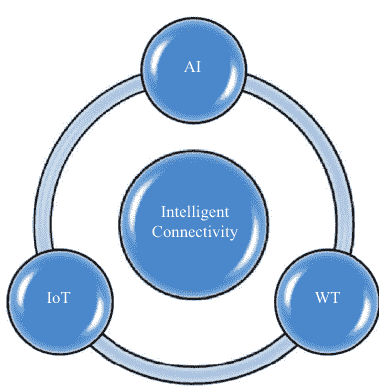

图9.1 AI、IoT与WT之间的智能连接。


基于数据识别模式并进行预测。AI 已在各个领域找到应用，例如医疗保健、金融和交通。例如，AI 可用于分析医学图像并检测异常，或预测交通模式并优化交通流量。随着 AI 变得更加复杂，预计它将改变各个行业并创造创新的新机遇。无线通信彻底改变了人们沟通和获取信息的方式。Wi-Fi、蓝牙和蜂窝网络等无线技术使人们能够随时随地保持连接并获取信息。这些技术还促成了新商业模式的创建，例如共享经济和移动支付。随着无线技术的不断发展，预计它们将创造创新的新机遇，并改变交通、医疗保健和制造等行业。Wi-Fi 和蜂窝网络等无线技术对于连接 IoT 设备并使它们能够相互通信至关重要。5G 无线网络的发展预计将通过提供更快、更可靠的连接来加速 IoT、AI 和无线技术的融合。

## 9.3 AIoT 系统的元素

图 9.2 显示了 AIoT 系统的不同元素，如物理 - 网络系统（CPS）、人工智能（AI）、物联网（IoT）、大数据、云/边缘计算。

### 9.3.1 物理 - 网络系统（CPS）

智能系统的主要元素之一是 CPS。传统的嵌入式系统规模小、独立且单独运行，随着技术和无线通信领域的进步，可以将此类系统相互连接。新技术的采用催生了被称为 CPS 的新概念。在传统系统中，信息被集成到物理设备中，而 CPS 是一种自动化系统，它通过无线技术连接物理世界和虚拟世界中发生的过程，其目的是控制某些过程并适应新变化 [3]。CPS 能够进行预测分析并在无需人工干预的情况下采取行动。这种系统在危险环境中非常有用，因为人类很难在这些环境中工作。

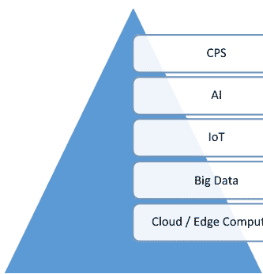

图 9.2 AIoT 系统元素。

### 9.3.2 人工智能

物联网系统主要依赖于大数据，因此也依赖于 AI。这种依赖催生了一种被称为人工智能物联网（AIoT）的新范式。AI 是指使用非结构化数据、对其进行处理，并从中解释和可视化有意义所需信息的计算机技术。AI 基于预测性历史分析，提取关于即将发生的事情的信息并相应地采取行动。此外，由于 AI 的这种分析能力，有可能开发出更高效、能够预测故障并采取补救措施的智能系统/机器等。支持这种智能的物联网系统可以从设备/传感器收集数据，并在需要时比人类更快地做出反应。监督学习、半监督学习和无监督学习是三种已被提议用于物联网系统的 AI 技术 [4]。AI 与 IoT 的融合产生了智能 AIoT 系统，该系统能够以一种方式处理数据，从而做出自主决策。AIoT 的融合使系统在许多场景中更加智能、自主、灵活，并成为解决方案提供者。

### 9.3.3 物联网（IoT）

物联网技术可以描述为软件和硬件产品的融合，这些产品能够以二进制形式生成、收集和计算数据。它允许人类通过网络系统与电子设备交互，以便让我们的生活更加便利。物联网通过使用连接到网络的智能设备和传感器，为商业、公共/私营部门、经济领域、家庭、农业等各个领域的不同问题提供创造性解决方案 [5]。仅由于硬件技术和云计算的进步，这一概念才得以从小规模环境扩展到大规模环境。图 9.3 (a) 为物联网框图，9.3 (b) 为物联网详细架构。

物联网架构由不同层组成，从上到下依次为业务层、应用层、中间件层、网络层和感知层。架构的最低层是感知层，它由通过互联网连接以收集信息并将其传输到网络层的传感器和智能设备组成。网络层作为传输介质，通过有线或无线连接促进信息从感知层到信息处理系统的传输。中间件层是下一层，负责处理从网络层接收到的信息，并基于普适计算所取得的结果做出决策。应用层使用这些处理后的信息进行设备管理。最顶层控制整个系统的应用程序和服务。未来目标和策略是根据从应用层接收到的信息决定的。除了分层框架外，AIoT 系统还由多个功能块组成，例如输入/输出操作、连接性、处理与识别、可视化、存储、控制和管理 [6]。所有这些功能块共同构建了一个高效的物联网系统。

智能设备 & 传感器

物联网网关/框架

无线

应用

(a) 物联网架构框图

应用/用户服务

服务报告

服务规范

服务管理层

服务解释器

规划器

服务信息

任务生成器

互联网核心

发现与信息服务

任务/应用/消费者

应用层路由

观测计划

RFID 事件管理器

事件

观测

事件周期

中间件

设备管理器

服务器调度层/信息接口

互联网边缘

事件检测与数据访问

服务调度执行

感知与执行层

读取器级别（非 IP）

读取器

传感器

执行器/显示器

标签

标签

图 9.3 (b) 物联网详细架构。

### 9.3.4 无线技术

无线技术（WT）在 AIoT 中起着关键作用，因为它连接设备以进行通信。它们正在将许多传统系统转变为彼此通信的一个系统，如图 9.4 所示。满足 AIoT 系统要求的无线技术包括 IEEE 802.15.4、低功耗蓝牙、ZigBee-IP NAN 和蜂窝 M2M。5G 承诺提供更快的数据传输、更低的延迟率和更好的覆盖范围，但 5G 仍处于初期阶段。借助 5G，可以在无需人工干预的情况下，以更高的频率和低功耗连接数十亿台智能设备。

无线技术面临的挑战是隐私和对接入点的需求。

- a. 隐私：无线介质是开放的，因此任何人都可以监听任何频率
- b. 对接入点的需求：需要一个接入点，以便无线设备可以识别网络并连接到它 [7]。

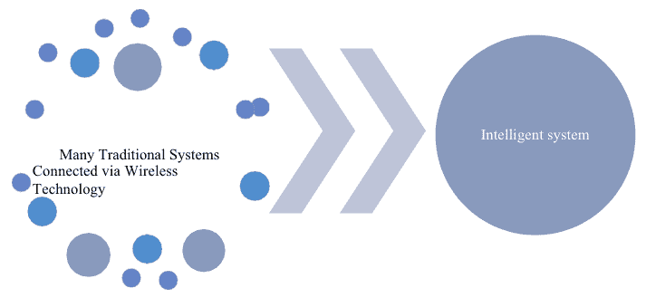

图 9.4 从传统到智能系统的关键。

### 9.3.5 大数据

可用三个特征来定义大数据，即：容量、多样性和速度 [8]。

- a. 容量：指世界各地多个设备在不同位置产生的大量数据。
- b. 多样性：分析来自不同资源的不同类型数据，以分析不同的情况和场景。
- c. 速度：指系统解释数据并相应采取行动所需的响应时间。

AI 和 IoT 正在成为彼此的灵魂伴侣。两者相互依赖，没有大数据和数据分析就无法存在，这催生了 AIoT 的新概念。AI 不仅与大量数据成正比，还取决于这些数据的质量。从数据中提取的良好信息为预防提供了更好的检测和解决方案。采用 AIoT 正在创建一种认知计算系统，该系统能够在数据中发现模式，并发现人类不易检测到的缺陷或异常。

### 9.3.6 边缘计算/云计算

边缘计算和云计算是两种相互关联但又各不相同的计算范式，近年来备受关注。云计算是通过互联网提供计算资源（包括服务器、存储、数据库和软件应用程序）的做法。这些资源通常由云服务提供商管理的大型集中式数据中心提供。云计算提供多种优势，例如可扩展性、灵活性和成本效益，并已成为许多企业和组织的事实标准。另一方面，边缘计算是指在网络边缘（更靠近数据生成的地方）进行数据处理和分析。边缘计算通常涉及在数据源附近部署小型低功耗计算设备，例如传感器、网关或微服务器。边缘计算旨在降低延迟、提高数据隐私和安全性，并提高数据处理效率。边缘计算和云计算通常结合使用，以创建混合计算环境。例如，边缘设备可以用于在将数据传输到云端进行进一步分析和存储之前收集和预处理数据。这种混合方法可以兼得两者之长，将边缘计算的速度和效率与云计算的可扩展性和多功能性相结合。

## 9.4 设计问题

在跨域环境中构建高效物联网架构的主要设计问题是：可扩展性、模块化、开放性和互操作性，如图 9.5 所示。架构应能够通过


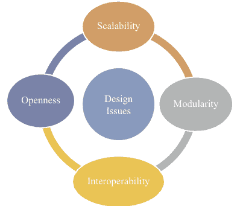

图 9.5 AIoT 设计问题。

增加存储容量、管理大量生成的数据、增加智能系统以及在异构环境中工作。AIoT 的融合催生了三个关键要素。

- i. **智能机器：** 机器拥有通过互联网连接的传感器和软件
- ii. **高级分析：** 使用 AI 算法分析数据
- iii. **工作中的人员：** 远程连接人员，使他们能够相互互联并进行会议和工作，而无需面对面交流 [9]

## 9.5 应用领域

智能和基于 IoT 的技术的快速发展和实施已导致生活不同方面的技术进步。这项技术的主要目标是使程序更加简单和简化，并在各个领域提供高效系统以提高生活质量 [10]。智能连接的力量和潜力可以在多个领域中看到，如图 9.6 所示。

IoT、AI 和无线技术的融合正在引导我们走向下一代技术，该技术将以更大的自动化、连接性和智能性为特征。推动这种融合的关键趋势包括：

- 1. **智能家居系统和电器：** 它由联网电器、家庭自动化系统以及可持续可靠的资源管理系统（如能源管理系统、水资源管理系统和安全系统）组成，这些系统相互通信。智能家居通过减少能源消耗提供安全、舒适和可持续性 [11]。

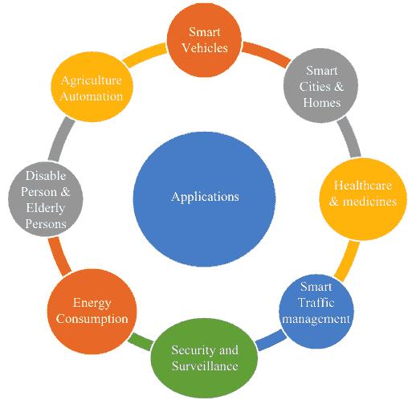

图 9.6 IoT 应用领域。

- 2. **智能家居和建筑：** IoT、AI 和无线技术的融合正在推动智能家居和建筑的发展。这些建筑配备了传感器，可以检测温度、湿度、光线和其他环境因素的变化。它们还可以使用语音命令或智能手机应用进行控制，从而实现更大的自动化和便利性。

- 3. **医疗保健：** IoT、AI 和无线技术的融合也在改变医疗保健行业。可穿戴设备和其他 IoT 设备正在用于监测患者健康并向医疗保健提供者提供实时反馈。AI 算法正在用于分析这些数据并提供个性化治疗建议。智能健康感知系统正在连接智能设备和仪器以协助人类健康。这些设备监测和检查不同的生命体征。个人和医院可以使用这些设备来观察关键健康参数。它已完全改变了医学科学 [12,13]，并帮助提升了残疾人和老年人的生活方式。

- 4. **智能交通管理系统：** 使用智能传感器控制不同信号处的交通，并可能建议替代路线以缩短时间来管理交通拥堵 [14]。

- 5. **智能车辆：** 配备智能设备和传感器的车辆，可控制车辆的大部分部件，甚至通过在红灯处自动熄火来节省燃料 [15]。IoT、AI 和无线技术的融合也在推动自动驾驶汽车的发展。这些车辆配备了传感器、摄像头和其他技术，使它们能够在道路上导航并根据实时数据做出决策。自动驾驶汽车有潜力减少事故并提高道路效率。

- 6. **可持续智慧城市：** IoT、AI 和无线技术的融合也在推动智慧城市的发展。这些城市配备了传感器和其他设备，可以监测交通、空气质量和其他环境因素。可以使用这些数据优化市政服务，从而提高公民的生活质量。偏远地区的人们移居城市，导致城市人口增长。因此，为了容纳不断增长的人口的需求，需要智慧城市来解决交通、空气质量、公共安全、合理资源利用、停车和废物管理等问题 [16]。

- 7. **安全与监控：** AIoT（AI 和 IoT）共同以多种方式增强安全性。例如，使用计算机视觉监控员工以及在家照顾年幼者和老年人的人。使用实时警报系统来防止事故 [17]。

- 8. **农业自动化系统：** 开发基于 AIoT 的生态智能系统，以准确预测地理和生态参数，确定播种、收获等的最佳时间 [18]。温室技术是这一方向的举措之一。它提供了一种控制环境参数以提高产量的技术。

- 9. **工业自动化：** 另一个应用领域是通过为工业数字化、库存管理、质量控制、需求-供应管理等提供解决方案来实现工业自动化。IoT、AI 和无线技术的融合也在改变工业部门。IoT 传感器和其他设备正在用于监控机器和设备，从而实现预测性维护并减少停机时间。AI 算法正在用于分析这些数据并优化生产流程。

IoT、AI 和无线技术的融合也在创造新的挑战和机遇。一个关键挑战是需要更强大的网络安全，因为这些技术变得更加互连并容易受到网络攻击。另一个挑战是需要更强大的隐私保护，因为这些技术收集了更多关于个人及其行为的数据。然而，IoT、AI 和无线技术的融合也带来了许多机遇。这些技术有潜力提高效率、降低成本，并改善个人和社区的生活质量。它们还有潜力创造新的就业和经济机会。总之，IoT、AI 和无线技术的融合正在改变我们的生活和工作方式。

## 9.6 挑战与机遇

尽管 IoT、AI 和无线技术的融合提供了巨大的机遇，但也存在几个需要解决的挑战。最大的挑战之一是安全性。随着 IoT 设备的普及，存在可能危及用户数据安全和隐私的网络攻击风险。同样，AI 算法也可能容易受到操纵其决策过程的攻击。因此，开发强大的安全性至关重要。技术每天都在变化，产生新的挑战，并需要根据需求更新系统。因此，系统开发人员需要设计系统以能够为这些问题提供解决方案。

- 1. **数据和信息安全：** 访问控制和身份验证是 AIoT 系统面临的主要挑战之一。黑客在互联网上始终活跃。因此，需要开发一个安全系统，在端到端通信网络中提供数据安全性、完整性和真实性 [19,20]。

- 2. **AIoT 系统的互操作性：** 它应通过为 AIoT 对象支持异构平台来提供高效可靠的服务。有时从不同站点收集信息很耗时，需要人工干预，并受气候变化的影响。因此，需要开发一个为异构平台提供高精度和预测的框架 [21]。

- 3. **伦理、法律和监管权利：** AIoT 使我们的生活变得轻松，但另一方面也引发了伦理和法律挑战。AIoT 开发人员应以道德运作，并制定法律以规范标准和道德价值，防止人们非法使用 [22]。

- 4. **可扩展性、可用性和可靠性：** 系统应在不影响性能的情况下支持新服务、设备和装置。AIoT 系统的一个主要挑战是容纳具有不同存储容量和处理速度的不同设备。另一个挑战是无论位置如何，都能及时提供资源，将各种小型 AIoT 网络连接到全球平台，以充分利用其资源和服务 [23]。

- 5. **服务质量 (QoS)：** QoS 是指评估 AIoT 设备、系统和架构的质量、效率和性能的度量 [24]。AIoT 系统所需的必要 QoS 指标包括可靠性、费用、能源利用、安全性、可用性和响应时间。

- 6. 实现具有高速、长覆盖、低延迟率、高传输功率、可靠性和低能耗特性的网络频率。

## 9.7 预防措施

- i. **身份验证：** 系统的访问控制由身份验证技术提供，该技术验证用户的凭据是否与 a 中的凭据匹配


经批准用户的数据库或数据身份验证服务器 [25]。随着这些新型 IoT 设备的使用，身份验证应受到高度重视。切勿创建所有设备都使用相同默认密码的产品。

- ii. **后门调试：** 一种未记录的方式，用于访问计算机系统或其包含的数据 [26]。后门可由软件或硬件制造商安装，作为在向客户提供技术后故意获取访问权限的手段，用于移除错误或漏洞。制造商绝不应在生产设备中留下任何形式的调试访问权限，即使您需要使用硬编码随机密码在非标准端口上保留访问权限。

- iii. **加密：** 加密是一种将数据转换为秘密代码的公式 [27]。加密意味着将简单数据转换为加密数据，也称为密文或编码数据。所有与云或其他设备通信并共享数据的 IoT 设备，其数据都应被加密，并且仅供预期查看该信息的人员访问。

- iv. **隐私：** 隐私是指任何人控制其个人信息访问权限的权利。在 IoT 设备中，每个人都必须确保没有任何个人数据（如设备位置、所有者信息、连接信息等）可供其他任何人或设备访问，否则黑客可能会访问该设备，设备所有者将无法享有隐私。

- v. **Web 界面：** 如果存在 Web 界面，它应是一个健壮的界面，而不是易受 SQL 注入和跨站点脚本攻击的开放界面。

- vi. **固件更新：** 关于安全和隐私的漏洞可能随时出现。每个 IoT 设备都必须能够通过空中更新（OTA）进行更新。但是，这些更新在应用前需要经过验证。更新必须经过签名，设备应检查签名，之后才能继续安装更新。

## 9.8 先前的攻击

- i. **机器人吸尘器** - 这些是用于吸尘房屋地板的 IoT 设备。这些设备在房屋地板上运行吸尘，当检测到路径上有任何障碍物时，会改变方向并存储创建的地图以供后续使用，如图 9.7 所示。发现这些设备的问题是，它们生成了房屋地图，且该设备具有制造商未更改的默认用户名和密码。远程代码漏洞名为 CVE-2018-10987 [28]，如果被攻破，将允许获取设备 MAC 地址的黑客获得系统管理员权限 [28]。受影响的吸尘器易受经过身份验证的远程代码执行漏洞利用的影响。经过身份验证的攻击者将发送特制的 UDP 数据包，并在吸尘器上以 root 身份执行命令。该漏洞位于函数 REQUEST_SET_WIFIPASSWD（UDP 命令 153）中。攻击者可以通过发送特制的 UDP 数据包来操纵 %s 变量。在某些情况下，可以使用管理员账户的默认密码 888888 进行身份验证 [29]。由于吸尘器具有 LAN、带夜视功能的数码相机和智能手机控制的导航，攻击者可以秘密监视所有者，甚至将吸尘器用作“轮上麦克风”以实现最大监控潜力。

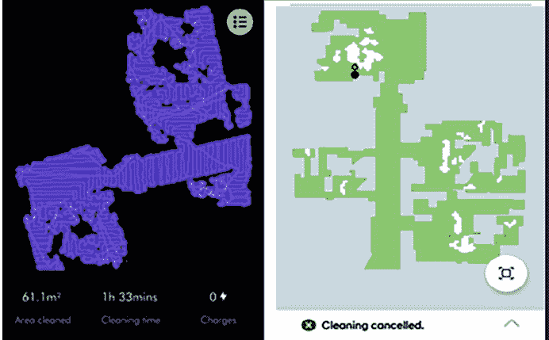

图 9.7 机器人吸尘器提供的房屋地图 [31]。

- ii. **电子锁** - 电子锁与简单的机械锁相同，但由电子控制。设置一个锁代码，每当我们想要打开锁时，都使用相同的代码来解锁设备并使用保险箱访问内部存放的物品。有些锁只能通过您的移动设备访问。这种状况可能非常好，也可能非常不好，因为它提供了安全性，但如果手机被盗或丢失怎么办？您本人将无法打开锁。这些锁中的一些只需在其周围使用强力磁铁即可打开。使用手机来锁定和解锁的智能锁的另一个问题是固件问题。2017 年的固件更新导致 LockState 生产的智能锁出现故障，影响了 500 多名客户。公司要求受影响的客户将锁送回维修 [30]。根据黑客大会 DEF CON，大约 75% 的这些锁不安全且易受攻击。这些锁易受攻击的原因如下：

  - a. **明文密码**：将密码保存为用户输入的相同形式，而非任何加密或哈希形式。存储在公司数据库中的密码应添加数据，并且也应以混淆形式存储，以便任何人尝试访问该密码时，它都是不可逆的且对其他人无用。

  - b. 设备伪造: 攻击者使用设备在网络中充当另一台设备，以便该设备可用于针对该网络上的其他设备、窃取其数据并随时访问它们。

  - c. 重放攻击: 当两台设备交换数据时，攻击者试图复制数字签名，以便将其用作设备的虚假通信信号，向该设备发送恶意软件并窃取其数据。

## 9.9 可用解决方案

- i. 身份混合器: Idemix 是一种加密协议套件，提供强大的身份验证和隐私保护功能。这些功能包括匿名性，允许交易方在不披露其身份的情况下进行交易；以及不可关联性，使单个身份可以发送多个交易，而不透露它们源自同一身份 [32]。

这是一种仅揭示所需信息的加密消息类型。例如，如果人 1 需要证明自己是合法用户，他可以向另一位用户（人 2）提供数字证书，该证书仅提供身份验证所需的信息，而不提供物理地址和对设备的控制等其他信息。

- ii. 适当的身份验证: 当今许多 IoT 设备没有适当的身份验证，这导致了安全漏洞。为确保所有设备的安全，它们必须具备适当的身份验证。任何尝试访问设备的用户都必须满足身份验证标准；每次都应进行检查。

- iii. 访问控制: 我们的设备应具备访问控制，以便设备免受其他用户的攻击，并且与我们的设备通信的其他设备应具有受控访问权限，否则这些设备可能成为我们设备安全性中的薄弱环节。

- iv. 加密: 从任何用户或任何其他设备发送到设备的每条消息都应加密，以便消息仅对拥有适当解密密钥的用户有用，对其他用户和攻击者无用。加密消息通过互联网发送，任何人都可以感知它，但除了拥有解密密钥的用户之外，任何人都无法使用该加密消息或信号。

- v. 无后门调试: 制造商必须确保不保留任何用于进一步调试的后门，因为这也可能成为攻击者的潜在访问入口。制造商通常使用后门，以便在系统故障时能够访问用户设备并查找系统故障原因。这种后门通常被攻击者用来入侵任何设备，由于所有设备都连接到互联网，因此它们都会受到影响。

### 身份混合器概述

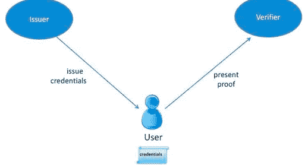

图 9.8 身份混合器的运作 [32]。

- vi. **提供支持:** 制造商应定期提供固件更新，以便新类型的攻击不会影响我们的设备，并且我们的设备免受各种攻击（图 9.8）。

## 9.10 未来展望

数字化转型迫使我们要么开发新系统，要么融合现有技术，以实现现有问题的解决方案。最初，AI 和 IoT 作为解决问题的独立概念出现，但这些技术的融合开发出了一种智能系统，能够提供比单一技术更好的解决方案。

- 1. 开发一种新型智能车辆，利用无线技术与其他车辆和驾驶员通信，以确保无拥堵的行程，并提供愉快且安全的驾驶体验 [33]。
- 2. 开发可靠、高效且用户友好的系统。
- 3. 开发考虑 AI 和 IoT 系统生命周期及能力的安全架构。这包括开发传统端到端互联网协议无法提供的新安全协议。系统应具有可扩展性潜力，以便满足小型和大型需求 [5]。
- 4. 开发支持全球需求的 AIoT 框架。
- 5. AI、IoT 和 WT 的融合为研究人员提供了新的商业机会和新方法，以分析传统技术缺乏的数据。
- 6. 开发 CPS 系统的 3D 模型，在无需人工干预的情况下在危险环境中准确运行。


## 9.11 结论

物联网（IoT）、人工智能（AI）和无线技术的融合预计将带来下一代技术进步。这种融合将使机器能够相互通信并实时交换数据，从而实现无缝且智能的决策。例如，自动驾驶汽车可以使用传感器收集周围环境的数据，并使用AI算法分析这些数据，以便对驾驶行为做出实时决策。同样，智能家居可以使用IoT设备收集居住者偏好和行为的数据，并使用AI算法分析这些数据，以创造个性化体验。这些技术的融合还预计将在各个领域创造创新的新机会。例如，在医疗保健领域，IoT设备可以收集患者健康数据，并使用AI算法分析这些数据，以制定个性化治疗方案。同样，在制造业中，IoT设备可以收集机器性能数据，并使用AI算法分析这些数据，以预测维护需求并优化生产流程。

## 参考文献

- 1. Gomes, P., Magaia, N. and Neves, N. 带有增强现实的工业和人工智能物联网. Springer Nature Switzerland AG 2020 G. Mastorakis et al. (eds.), 人工智能与物联网的融合, 10.1007/978-3-030-44907-0_13 pp. 323–345.
- 2. Posada, J., et al. 面向工业4.0和工业互联网的关键赋能技术：可视化计算. IEEE Comput. Graph. Appl. 35(2), 26–40 (2015).
- 3. Jazdi, N. 工业4.0背景下的网络物理系统. In: 2014 IEEE自动化、质量与测试、机器人国际会议论文集, AQTR (2014).
- 4. Arsénio, A., Serra, H., Francisco, R., Nabais, F., Andrade, J., and Serrano, E.: 智能物联网：将人工智能引入事物和通信网络. Stud. Comput. Intell. 495, 1–37 (2014).
- 5. Kumar, S., Tiwari, P. and Zymbler, M. 物联网是未来技术增强的革命性方法：综述. J Big Data. 6(111) (2019). 10.1186/s40537-019-0268-2
- 6. Sebastian S., and Ray P. P. 开发符合家庭健康要求的IoT入侵架构. In: Proc: I3CS, Shillong; 2015. p. 79–83.
- 7. Gilchrist, A. 工业4.0：工业物联网 (2016).
- 8. O’Leary, D. E. 人工智能与大数据. IEEE Intell. Syst. 28(2), 96–99 (2013).
- 9. Evans, P. C., and Annunziata, M. 工业互联网：拓展心智与机器的边界. Gen. Electr. (2012).
- 10. Nizetic, S., Solic, P., Lopez-de-Ipina Gonzalez-de-Artaza, D., and Patrono, L. 物联网（IoT）：迈向智能可持续未来的机遇、问题与挑战, Journal of Cleaner Production, 274, 1–32, (2020).
- 11. Zhou, J., Cap, Z., Dong, X., and Vasilakos, A. V. 基于云的物联网安全与隐私：挑战. IEEE Commun Mag. 55(1), 26–33 (2017). 10.1109/MCOM.2017.1600363CM
- 12. Sfar, A. R., Natalizio, E., Challal, Y., and Chtourou, Z. 物联网安全挑战路线图. Digit Commun Netw. 4(1), 118–137 (2018).
- 13. Jara, A. J., Zamora-Izquierdo, M. A., and Skarmeta, A. F. 基于物联网的mHealth和远程监测互连框架. IEEE J Sel Areas Commun. 31(9), 47–65 (2013).
- 14. Behrendt, F. 智能可持续城市之骑行：分析欧委会关于物联网、移动与交通以及智慧城市的政策文件. Sustainability. 11(3), 763 (2019).
- 15. 物联网. http://www.ti.com/technologies/internet-of-things/overview.html. 访问日期：01 Apr 2019.
- 16. Alavi, A. H., Jiao, P., Buttlar, W. G., N. 物联网赋能的智慧城市：现状与未来趋势. Measurement. 129, 589–606 (2018).
- 17. https://www.iotforall.com/convergence-artificial-intelligence-and-iot
- 18. Qiu, T., Xiao, H., and Zhou, P. 设施农业生态系统中智能监测平台的框架与案例研究. In: 2013第二届农业地理信息学国际会议论文集 (agro-geoinformatics), Fairfax, VA, USA, 12–16 Aug 2013. IEEE.
- 19. Babovic, Z. B., Protic, V., and Milutinovic, V. 物联网应用的Web性能评估. IEEE Access. 4(6974–92), 42 (2016).
- 20. 物联网研究报告：惠普企业报告. 2015. http://www8.hp.com/us/en/hp-news/press-release.html?id=1909050#.WPoNH6KxWUk
- 21. Van-der-Veer, H., and Wiles, A. 实现技术互操作性——ETSI方法. ETSI白皮书第3号. 2008. http://www.etsi.org/images/files/ETSIWhitePapers/IOP%20whitepaper%20Edition%203%20final.pdf
- 22. Tzafestas, S. G. 物联网世界中的伦理与法律. Smart Cities. 1(1), 98–120 (2018).
- 23. Wu, Y., Li, J., Stankovic, J., Whitehouse, K., Son, S., and Kapitanova, K. 无线传感器网络中应用级需求的运行时保证. In: 第9届ACM/IEEE传感器网络信息处理国际会议论文集, Stockholm, Sweden, 21–16 April 2010. p. 197–208.
- 24. Temglit, N., Chibani, A., Djouani, K., and Nacer, M. A. 面向对象编排中最优QoS选择的分布式代理方法. IEEE Syst J. 12(2), 1655–1666 (2018).
- 25. https://searchsecurity.techtarget.com/definition/authentication
- 26. https://www.owasp.org/images/a/ae/OWASP_10_Most_Common_pdf
- 27. Lantronix, Inc., 加密及其对设备联网的重要性, https://www.lantronix.com/wp-content/uploads/pdf/Encryption-and-Device-Networking_WP.pdf
- 28. https://gist.github.com/neolead/10b27c5c04bca84a5515783ca6f2ecb4#file-cve-2018-10987-txt
- 29. https://www.theinquirer.net/inquirer/news/3036246/smart-home-robot-vacuum-cleaners-could-spy-on-you-thanks-to-security-flaw
- 30. https://www.protectamerica.com/home-security-blog/safe-sound/are-smart-door-locks-safe-three-things-to-keep-in-mind_20027
- 31. https://www.av-test.org/en/news/robot-vacuums-undergo-a-security-check-trustworthy-helpers-around-the-house-or-chatty-cleaning-appli/
- 32. https://hyperledger-fabric.readthedocs.io/en/release-1.3/idemix.html#what-is-idemix
- 33. Liu, T., Yuan, R., and Chang, H. 汽车行业物联网研究. In: ICMeCG 2012电子商务与电子政务管理国际会议, Beijing, China. 20–21 Oct 2012. p. 230–233.

# 10 医疗物联网的数据建模与分析

Priya S. Mouna, P. Sivaprakash, and K. Arun Kumar  
拉特纳姆文理科学院，印度泰米尔纳德邦科伊姆巴托尔  

Prithi Samuel  
SRM科学技术学院计算智能系，印度卡坦库拉图尔  

B. Shuriya  
PPG技术学院，印度泰米尔纳德邦科伊姆巴托尔  

Vandana Sharma  
基督（被认定为大学）德里NCR校区计算科学系，印度  

## 10.1 引言

医疗领域的创新对于提升医疗保健系统至关重要。如今，可穿戴设备被用于持续监测健康状况。诸如“生物传感器隐形眼镜”之类的可穿戴设备已在医疗领域应用，以无创方式收集人体信息。生物传感器隐形眼镜使个人能够持续监测血糖水平，并据此帮助自我治疗。糖尿病以惊人的速度增加；持续监测血糖水平对于管理糖尿病至关重要。根据世卫组织数据，2019年糖尿病直接导致150万人死亡，另有46万人死于糖尿病引起的肾脏疾病。糖尿病是心脏病发作、肾衰竭、中风和失明的主要原因。定期监测血糖水平对于管理1型和2型糖尿病至关重要。一款可穿戴生物传感器隐形眼镜帮助受试者监测食用不同食物时血糖水平的升降，并在必要时发出警报 [1,2]。


## 10.2 隐形眼镜

隐形眼镜于1936年由验光师 William Feinbloom 引入。如今，大多数人都存在视力缺陷。视力缺陷的原因之一是糖尿病。良好的视力有助于各年龄段人群的自信心和整体独立性。视力不完美的人可以通过治疗来改善。视力不正常可以通过度数眼镜、激光治疗和隐形眼镜来矫正。人们更喜欢使用隐形眼镜，而不是度数眼镜和激光治疗。早期隐形眼镜由玻璃和硬塑料制成。现在技术已经发展，使人们可以非常舒适地佩戴它们。隐形眼镜放置在眼睛角膜的顶部，使视力清晰。建议患有远视和近视等屈光不正的人佩戴隐形眼镜以改善视力。如今，人们使用义眼镜片进行美容增强。义眼隐形眼镜通常被称为零度隐形眼镜，或 Plano 隐形眼镜。如果角膜变得混浊或不透明，它会放置在角膜上方，因此使视力清晰。美容隐形眼镜被人们用来改变虹膜的颜色。它们是半透明的，增强眼睛的自然颜色，使蓝色虹膜看起来深蓝色。不透明的美容隐形眼镜显示棕色眼睛、蓝色眼睛和淡紫色眼睛。由于眼部疾病导致虹膜或角膜畸形的人使用这些镜片来看起来正常。即使患有近视或远视的人也使用有色隐形眼镜，称为处方美容隐形眼镜。隐形眼镜中有色素，以便使佩戴和取下隐形眼镜的过程变得容易。有色隐形眼镜只不过是在镜片中加入染料，以便在眼睛上看起来更好。大多数有色隐形眼镜为浅蓝色和绿色。Plano 隐形眼镜纯粹用于美容目的，不具有用于视力矫正的镜片度数。美容隐形眼镜有透明和不透明两种。透明美容镜片允许 70% 的光线通过它，并在市场上有不同深浅可供选择，色素将以同心圆环的图案出现。不透明美容镜片吸收或反射进入镜片的光线，并完全覆盖下方的眼睛颜色；它们也带有虹膜图案和清晰的中央瞳孔。Plano 隐形眼镜的形状带有各种颜色的点或线条，以便在眼睛上看起来自然。瞳孔周围的区域会有颜色。镜片中心，即瞳孔上方的部分，将是清晰的，没有颜色以增强视力的清晰度。隐形眼镜有多种颜色，如蓝色、绿色、榛子色、紫罗兰色、棕色、灰色和紫水晶色。选择有色隐形眼镜很重要；应根据一个人的发色和肤色来选择。市场上提供处方和非处方隐形眼镜的定制服务 [3,4]。

## 10.3 隐形眼镜类型

- 软性隐形眼镜
- 透气性隐形眼镜
- 长戴隐形眼镜
- 抛弃式隐形眼镜
- 散光隐形眼镜。(Figure 10.1)

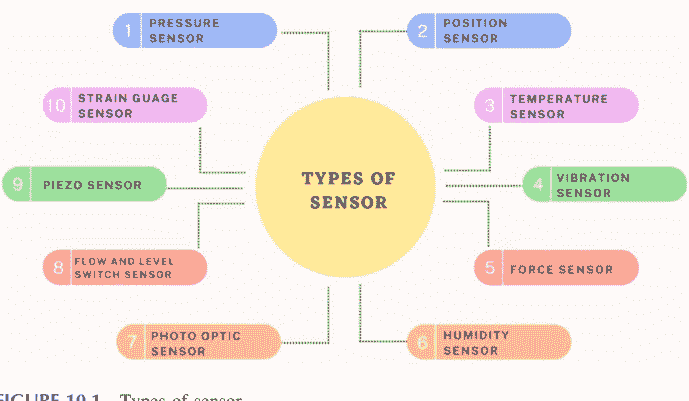

### 10.3.1 软性隐形眼镜

软性隐形眼镜佩戴起来非常舒适。它是凝胶状材料和柔性塑料，例如水凝胶。正如其名称所示，它柔软舒适，可佩戴，并允许氧气通过角膜。它透气且易于佩戴。对于长时间佩戴，软性隐形眼镜很合适。硅水凝胶镜片是一种先进的软性隐形眼镜。它更具渗透性，允许氧气通过并到达眼睛表面。软性隐形眼镜用于多种目的，如光学、预防、治疗、美容、诊断和职业用途。光学隐形眼镜通常用于近视、远视和散光。为防止化学灼伤和眼睛暴露于有害环境，使用预防性隐形眼镜。对于视网膜电图检查，使用诊断性隐形眼镜。运动员、演员和飞行员出于职业目的使用它，因此称为职业性隐形眼镜。

### 优点

- 隐形眼镜移位的机会非常小
- 初始舒适度高，易于佩戴
- 适合偶尔佩戴
- 光敏症较轻
- 佩戴时间长
- 易于适应眼睛
- 非常适合活跃的生活方式

### 缺点

- 由于柔软，隐形眼镜容易撕裂或丢失
- 长期使用可能导致眼睛干涩
- 需要患者操作 软性隐形眼镜的实现方式包括
- 透明和有色软性隐形眼镜
- 抛弃式和非抛弃式软性隐形眼镜
- 球面和散光软性隐形眼镜
- 多焦点软性隐形眼镜。

#### 10.3.1.1 透明和有色软性隐形眼镜

软性隐形眼镜有透明和有色两种形式。透明软性隐形眼镜用于矫正视力，有色软性隐形眼镜根据用户意愿染色，用于改善视力质量。

#### 10.3.1.2 抛弃式和非抛弃式软性隐形眼镜

它们可以每天、每周或每月及更长时间更换。根据抛弃周期，镜片按前文所述分类。软性隐形眼镜也根据抛弃周期提供；它们分为抛弃式和非抛弃式软性隐形眼镜。

### 10.3.2 透气性隐形眼镜

PMMAs（甲基丙烯酸甲酯）镜片不透氧。早期用于制造隐形眼镜，因为生产成本低廉。它们坚固、更耐用、耐刮擦，且易于放入眼睛内。PMMAs 是刚性塑料且透明。如果结膜和角膜得不到氧气，则会引起潜在问题，因此使用透气性镜片。后来，开发出了透气性镜片；它们是透氧但刚性的材料。化学家 Norman Gaylord 在透氧隐形眼镜的创新中发挥了重要作用。透气性隐形眼镜最耐用，且能抵抗镜片上的沉积物。它能提供清晰锐利的视力。它们易于操作，不易撕裂 [5]。

### 优点

- 提供出色的视力
- 允许氧气通过
- 适应期短
- 有色素可选
- 可作为双焦点镜片提供
- 可长期佩戴

### 缺点

- 需要持续佩戴才能适应此镜片
- 容易移位，滑离眼睛中心
- 如果从眼睛上滑落，容易刮花
- 如果镜片下有异物，会造成更多不适

### 10.3.3 长戴隐形眼镜

大多数长戴隐形眼镜由硅水凝胶制成。与普通水凝胶镜片相比，硅水凝胶镜片可使五倍更多的氧气到达角膜。硅和普通水凝胶镜片在干燥时似乎很硬，但易于吸水。水合后，它变成凝胶状材料并变软。长戴隐形眼镜可以连续佩戴六个夜晚和七天。随着硅水凝胶的发明，氧气通过镜片进入眼睛变得容易。人们可以连续佩戴长戴隐形眼镜长达30天。睡眠时，角膜获得氧气以保持健康的唯一可能性来自眼睑中的血管。长戴隐形眼镜主要用于生活方式不可预测的人，例如军事服务人员和日程繁忙的人。对于患有双眼视觉异常的人（包括弱视，可通过持续视力矫正更好地治愈）非常有帮助 [6]。

### 风险因素

- 流泪
- 发红
- 睡觉时佩戴隐形眼镜可能会增加风险因素；睡前每周取出两次可降低风险
- 长戴隐形眼镜虽然设计用于睡眠时佩戴，但对眼睛来说是异物，因此可能引起眼睛的不良反应

### 10.3.4 抛弃式隐形眼镜

根据使用周期分类的隐形眼镜类型：

- 每日抛弃式隐形眼镜
- 抛弃式隐形眼镜
- 频繁抛弃式隐形眼镜
- 常规镜片。

#### 10.3.4.1 每日抛弃式隐形眼镜

正如其名称所示，每日抛弃式隐形眼镜只能使用一天。一天结束时应将其取下。它被认为是最健康的选择，因为没有日常碎屑进入镜片下。对于过敏人群，这是最佳选择。

#### 10.3.4.2 抛弃式隐形眼镜

抛弃式隐形眼镜在两周或更短时间内更换。这取决于我们使用的特定产品。它非常受欢迎。

#### 10.3.4.3 频繁更换隐形眼镜

频繁更换隐形眼镜每月或每季度更换一次。基于月度的更换隐形眼镜称为频繁更换隐形眼镜。

#### 10.3.4.4 常规镜片

常规隐形眼镜或非抛弃式隐形眼镜应每六个月或更长时间更换一次。


### 10.3.5 环曲面隐形眼镜

散光是由于角膜曲率不完美引起的；角膜没有球面表面。这些是植入眼内以替换眼内天然晶状体以改善视力的镜片。环曲面镜片在镜片的不同子午线上具有不同的屈光度。也有彩色环曲面镜片可供选择。在某些情况下，像散光患者这样的视力缺陷无法通过度数眼镜或隐形眼镜治疗；在这些情况下，手术后会使用环曲面镜片。根据表面，环曲面镜片可分为：

- 前表面环曲面镜片
- 后表面环曲面镜片
- 双环曲面镜片。

## 10.4 传感器

传感器是一种物理设备，用于接收输入信号并通过发射器传输。输入信号是热量、光线、湿度、物体运动等的变化。输出信号是转换为人类可理解的信号，并在传感器位置显示，输出信号通过网络传输以便进一步检测和处理信息。传感器在物联网中发挥着重要作用。它们用于收集关于对象的信息，处理收集到的信息，并通过发射器传输。传感器分析对象并根据收集到的数据逻辑地采取行动 [7,8]。

## 10.5 传感器类型

### 10.5.1 压力传感器

压力传感器是一种将物理数据转换为电子信号的电子设备。它检测和监测压力并将其转换为输出信号。通常，压力定义为单位面积上所受的力的大小。它通常用于压电技术，其中机械应力（压力）转换为电能。所经历的应力与电能成正比。有三种主要的压力传感器被广泛使用（表 10.1）：

- 表压
- 绝对压力传感器
- 差压传感器。

### 表 10.1 隐形眼镜材料

| 材料 | 分子式 | 优点 | 缺点 |
| :--- | :--- | :--- | :--- |
| 聚甲基丙烯酸甲酯 PMMA | (C5O2H8)n | 出色的光学性能 | 氧透过率低 |
| 聚对苯二甲酸乙二醇酯 PET | (C10H8O4)n | 优异的耐化学性，良好的耐热性 | 刚度低，表面能低 |
| PHEMA | (C6H10O3)n | 良好的化学和热传导性，高含水量 | 蛋白质沉积问题 |
| PDMS | (C2H6OSi)n | 柔韧性，高氧透过率 | 吸水受限，脂质沉积高 |
| MPC | C11H22NO6P | 良好的表面润湿性，高氧透过率 | 机械强度弱 |

表压传感器利用大气压力并测量读数。它完全取决于大气压力，大气压力受海拔和湿度等因素的影响。当表压传感器感受到大于环境大气压力的压力时，为正压。当表压传感器感受到小于环境压力的压力时，为负压。它用于医疗领域的监测、腔室内压力以及治疗过程中的压力控制。绝对压力传感器测量相对于绝对零压力的压力。它给出的读数不包括大气压力。它是真空空间内的压力。差压传感器测量两个压力点之间的压力差，通常用于过滤系统。

### 10.5.2 位置传感器

位置传感器检测特定所需对象的位置。它们分为两种类型：

- 线性位置传感器：它简单地测量两个对象之间的距离，参考点或直线。它准确测量对象从一个位置到另一个位置的位移。有接触式和非接触式线性位置传感器。
- 旋转位置传感器：旋转位置传感器的输入是对象的旋转运动，将其转换为输出信号。也可以有接触式和非接触式旋转位置传感器。它取决于对象的旋转角度。
- 在 MRI 和 CT 扫描中，扫描仪将依赖位置传感器来获取人体正确位置的成像。
- 医院床使用位置传感器根据患者意愿进行调整。在手术室中，常使用带有位置传感器的床。

### 10.5.3 温度传感器

温度传感器是一种将输入数据转换为电子输出数据的电子设备。输入可以是环境温度，并将其转换为输出电信号，这有助于监测环境温度的连续变化。有不同类型的温度传感器用于监测温度变化。它们是接触式温度传感器和非接触式温度传感器。接触式温度传感器需要与被监测对象直接物理接触。接触式温度传感器包括热敏电阻和热电偶。热电偶是将两种不同金属连接在一起。当一个接点暴露在热量下时，由于热量产生的电压充当温度输入。这称为热电效应。非接触式温度传感器通常利用物体发射的红外辐射，将其转换为输出电信号，并将其发送到外部电子电路以进行连续监测。示例包括热成像、手持红外工业温度计、人体温度测量和固定红外温度传感器。

### 10.5.4 振动传感器

振动是组件相对于平衡位置的机械振荡。它只是机器或组件的来回运动。振动传感器是一种测量机器中振动频率的设备。振动可能表示资产中的不平衡或故障。振动传感器可以物理地连接到机器上，也可以是无线的，具体取决于传感器的类型，以检测机器中的振动。物联网的最新进展使得振动传感器成为医疗领域改进所必需的。即使在声音环境中，振动传感器也能通过皮肤振动检测人体的心音和腹部声音的振动。

### 10.5.5 力传感器

力传感器确定施加到对象上的力的大小。施加的力可以通过计算传感电阻电阻值的变化来确定。力传感器将施加的机械能（如重量、压力、载荷和压缩）转换为电信号作为输出。力传感器在医院中用于床位占用情况，因此无需频繁检查患者，因此可以通过计算机轻松监测。力传感器在流体检测（如输液泵）中非常有用。这些传感器使流体流动检测变得容易，如果有任何错误，会提醒相应的医疗专业人员。医生通过将力传感器植入鞋中来使用它，以判断压力是否均匀施加或患者行走方式是否有任何异常。

### 10.5.6 湿度传感器

顾名思义，它测量环境中的湿度并将其转换为相应的电信号作为输出。它测量并报告空气的湿度，并确定空气中存在的水蒸气量。在医院中，呼吸机用于让患者感到舒适和温暖，湿空气在呼吸机中循环，以便湿度传感器可以准确感应湿空气的湿度。热敏电阻传感器用于测量麻醉机中的温度和湿度，以让患者呼吸舒适。湿度传感器用于灭菌器、培养箱和制药加工设备。医院安装了湿度传感器以维持医院的温度，应持续监测湿度以确保对有害细菌的安全，从而防止疾病传播。

### 10.5.7 光电传感器

光电传感器是一种将照射在其上的光转换为电信号作为输出的设备。它产生与光电传感器有效区域上的入射光成正比的电信号。光电传感器可以是可穿戴设备，它是一种光学生物传感器，可以测量人体的心率、温度、血压和血氧饱和度。它可以检测房间内的人体运动，并区分日常活动和突发情况，例如，光电传感器可以检测患者突然跌倒，因此护士不需要始终与患者在一起。

### 10.5.8 流量和液位开关传感器

液位感应方法用于工业、家用、食品、饮料和农业领域的流体泄漏检测和液位测量。该传感器安装用于监测各种情况下的气体或液体流量，例如麻醉设备用于检测药物流量，以及手术室手术过程中的气体混合。可以监测患者的呼吸频率。它在电外科中起着至关重要的作用，例如切除肿瘤和凝血。在现代农业中，传感器基本上用于监测液体肥料的流量和灌溉设备的营养供应。

### 10.5.9 压电传感器

压电传感器将环境中的施加机械能转换为电能作为输出。它通常用于测量力矩、力应变、加速度和振动。它们根据用途定制成不同的形状，例如圆盘、压电板、压电管和压电条（图 10.2）。

#### 10.5.9.1 压电压力传感器

压电压力传感器利用环境中的压力变化，例如气体或液体施加的压力。汽车使用压电


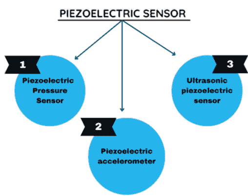

图 10.2 压电传感器。

压力传感器用于测量发动机燃烧以及炸弹的冲击和爆炸。因此，产生的电信号用于产生等效机械响应，以适应压力变化。

#### 10.5.9.2 压电加速度计

它将振动、加速度或冲击的变化转换为可测量的电信号输出。压电加速度计产生的电信号输出与施加的力成正比。

#### 10.5.9.3 超声压电传感器

超声压电传感器将电脉冲转换为机械振动，机械振动反过来转换为电能，用于超声检测。它基于压电效应，该效应将电能转换为超声能，反之亦然。压电换能器用作超声牙科洁治器以去除牙菌斑。它比传统方法更高效。它通常在24至32千赫兹的非常低频范围内运行。它们用于检测两个物体之间的距离、液位和液体流量。超声压电传感器由两个元件组成：发射器和接收器；这统称为压电换能器。传感器的发射部分发射超声脉冲，这些脉冲由传感器接收并转换为电信号。

### 10.5.10 应变片传感器

可使用应变片传感器确定精确的机械应变。在医疗领域，应变片传感器用于保持精度。在医院中，应变片传感器用于乳腺X线摄影机；该机器用于检测乳腺肿瘤及其他相关情况。该机器确定机器对患者施加的物理力，拍摄准确图像，因此该应变片传感器植入该机器中。它用于医院的患者升降系统。监测胰岛素泵中的流体流动需要轻量应变片传感器来监测泵出的胰岛素流动。它进一步根据非接触式传感器[8,9]进行划分。

#### 10.5.10.1 非接触式传感器

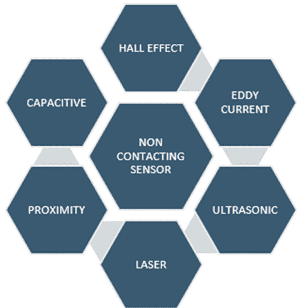

图 10.3 非接触式传感器。

## 10.6 非接触式传感器与生物传感器

它是一个集成设备，提供关于待测分析物的质量信息，该分析物与生物元件处于空间接触状态，生物响应由换能器元件转换为电信号。生物传感器由两个组件组成：

- 生物
- 电子


图 10.4 生物传感器元件。

### 10.6.1 生物传感器元件

- 探测器
- 换能器
- 放大器
- 处理器
- 显示单元（图 10.4）。

#### 10.6.1.1 探测器

它是传感器的第一部分，与分析物发生物理接触。它是生化受体。它与生物体内的分析物相互作用。探测器检测生物体内分析物的浓度[10]。

#### 10.6.1.2 换能器

分析物与生化受体之间的相互作用产生化学变化，由换能器检测。根据分析物的成分生成电信号。换能器将生化事件转换为电信号。电信号传递到传感器的下一部分。生物换能器由两部分组成，两者协同作用，将生化信号转换为电子或光学信号：

- 生物识别层
- 理化换能器。

#### 10.6.1.3 换能器类型

- 电换能器
- 光学换能器
- 热换能器
- 磁换能器
- 化学换能器。

#### 10.6.1.4 放大器

接收到的电信号由放大器放大。它将放大后的信号发送到处理器。

#### 10.6.1.5 处理器

将电信号转换为溶液中存在的分析物浓度。它过滤并解释电信号，转换为临床上有意义的存在值。

#### 10.6.1.6 显示单元

显示单元以数字读数形式显示数值。

### 10.6.2 生物传感器工作原理

生物受体或生物敏感元件与生物体内的分析物相互作用。生物化学物质的浓度由换能器转换为信号形式的电响应。当分析物与固定化生物材料相互作用时，会产生生化反应，最终系统组件将生化变化转换为数字输出[11,12]。

#### 10.6.2.1 生物元件类型

包括酶和抗体的蛋白质

- 1. 核酸
- 2. 抗体基础生物传感器，通常称为免疫传感器
- 3. 植物蛋白或凝集素
- 4. 组织切片
- 5. 微生物和细胞器。

- 换能器的输出可以是电流或电压。
- 如果换能器的输出是电压，则在进一步进行该过程之前，使用运算放大器基于电流电压转换器将其转换为电流。
- 传感器中的放大器用于放大电压；如果电压幅度非常低，则由放大器将其叠加到更高幅度。
- 信号处理单元将过滤和处理放大后的信号，并将其传递到传感器的下一部分。
- 输出将在显示器上显示。

### 10.6.3 生物传感器分类

#### 10.6.3.1 电化学生物传感器

电化学生物传感器是研究电阻、电容、电流、电压与化学/生物变化之间关系的学科。它是酶催化剂产生电子或消耗电子的反应。电化学生物传感器由三个电极组成：

- 对电极
- 参比电极
- 工作电极。

参比电极与反应保持一定距离以维持稳定电位，并由银和氯化银制成。工作电极在生化反应中充当换能器元件。计数电极/触发电极中发生化学反应并产生电流，该电流与分析物浓度成正比[13]。

##### 10.6.3.1.1 电量法生物传感器

葡萄糖电量法生物传感器（血糖仪）使用葡萄糖氧化酶作为酶，将葡萄糖转换为H2O2并将其氧化。葡萄糖氧化酶将与血糖仪内的工作电极反应。一旦样品中含有葡萄糖，葡萄糖氧化酶就会将葡萄糖转换为葡萄糖酸和H2O2。H2O2氧化产生的电流与葡萄糖浓度成正比。如果葡萄糖更多，则会有更多的过氧化氢，从而增加电子数量。血液中的葡萄糖水平将由血糖仪中的电子流动指示。这就是血糖仪的工作原理[14]。

##### 10.6.3.1.2 电位法生物传感器

在日常生活中，几种液体是必需的，包括水、饮料和药品。某些液体的化学性质决定其质量，这有助于各种测量原理，如pH值测量。生物反应根据电位法概念，利用电极中的离子转换为电响应。固态电极和pH计玻璃电极都是常用的电极。参考系统与被测系统之间的可能差异用于计算pH值。如果两侧氢离子浓度相同，则无电位差，测试溶液的pH值为7，则为中性。如果电位差较大，则测量系统被描述为酸性，其pH值小于7；反之，如果较小，则测量溶液被描述为碱性，其pH值较高[15]。

##### 10.6.3.1.3 电导法生物传感器

它也称为热检测生物传感器。它测量分析物溶液的温度变化，酶作用在此过程中发生，从而解释溶液中的分析物浓度。然后，将分析物溶液导入含有固定化酶的容器中。现在，当溶液进入和离开容器时，使用单独的热敏电阻测量溶液的温度。

##### 10.6.3.1.4 阻抗法生物传感器

阻抗法生物传感器基于施加正弦电压时测量阻抗差异的原理工作。阻抗的差异或变化通过测量安培中的电流变化来测量。阻抗可以通过电路中的电压除以电流来计算。

##### 10.6.3.1.5 伏安法生物传感器

伏安法生物传感器通过测量我们施加的电压对应的电流变化来检测分析物。它们既测量电流也测量电位。它们分为三种类型

- 阳极溶出伏安法（ASV）
- 阴极溶出伏安法（CSV）
- 吸附溶出伏安法（AdSV）。

#### 10.6.3.2 光学生物传感器

光学生物传感器是一种利用光学测量原理（如荧光、化学发光和吸光度）的设备。它们利用


光电换能器和光纤。optical和electrode两个词组合形成probe一词。作为光学生物传感器的主要转换组分，使用酶和抗体 [16]。使用光学生物传感器对材料进行远程感应是安全且非电气的。它们不需要参考传感器，这是另一个好处。与采样传感器相同的光源可以产生比较信号。

基于分子氧含量波动的光纤乳酸生物传感器是关键的光学生物传感器之一。通过测量氧对荧光染料的猝灭影响，可以看出当反应中乳酸浓度升高时，氧被消耗且猝灭效应按比例减少。这增加了可测量的发光输出。葡萄糖的评估对糖尿病管理至关重要。为此，采用了一种利用试纸和试剂的简单方法。可使用便携式反射率计来测试染色后颜色的强度。荧光法可用于确定感染本身。

#### 10.6.3.3 物理生物传感器 压电生物传感器

压电生物传感器的基础是声学（声音）。也称为声学生物传感器。

压电生物传感器基于压电晶体构建。正负电荷导致晶体在特定频率下振动。压电材料与表面基于压电效应原理的振荡产生的相互作用称为亲和相互作用。当特定分子吸附在晶体表面时，电气设备可以检测晶体的共振频率。由于晶体在粘性液体中无法完全振动，因此使用压电生物传感器评估溶液中的化学物质非常具有挑战性（图 10.6）。

当对物体施加压力时，由于物体变形而产生电压（图 10.7）。


图 10.6 对晶体施加压力。


图 10.7 晶体弛豫。

##### 10.6.3.3.1 温度生物传感器

温度生物传感器检测生化反应过程中吸收和释放的热量/能量。温度生物传感器用于检测和估算生物体内的胆固醇水平。当胆固醇由称为胆固醇氧化酶的酶氧化时，会释放热能，可由温度生物传感器测量 [17]。

##### 优点

- 持久稳定性 – 如果转换元件与化学样品之间没有物理接触，则热敏电阻不会受损。
- 成本效益高 – 它们成本低廉。
- 准确性 – 可以保持准确性。它不受变化的光学和化学样品特性的干扰。

##### 缺点

- 非常灵敏 – 它们包含一个非常灵敏的元件。
- 不推荐 – 由于非特异性加热效应。

#### 10.6.3.4 生物元件 DNA 基于生物传感器

DNA基于的生物传感器基本上是互补单链DNA之间的吸引。DNA基于的生物传感器主要用于食品工业。如果存在有害病原体，则会收集其遗传物质并将其分解。该传感器具有一种互补序列，可以轻易吸引病原体的遗传物质并予以识别。让我们考虑一种单链DNA的分析物，以及用作转换器的电极。电极上固定的单链DNA通过加入样品进一步处理；如果存在与现有固定单链DNA互补的DNA序列，则它们会结合在一起。转换器通过机械变化或振动得知这一点并发送信号 [18,19]。

##### 10.6.3.4.1 免疫生物传感器

免疫传感器，也称为免疫学生物传感器，基于免疫学特异性，并使用具有安培法或电位法响应的生物传感器进行测量。人体免疫系统的主要主题是为身体提供免疫力。免疫系统将生物实体中的每个细胞识别为有害或无害。如果我们的系统中存在任何抗原（外来物质），则我们的免疫系统会提供与抗原结合的免疫球蛋白。正如其名称所示，免疫生物传感器基于人体免疫系统的概念工作。它利用抗体作为生物受体来识别抗原并形成稳定的免疫复合物。免疫生物传感器，也称为免疫学生物传感器，通过基于免疫学特异性的安培法或电位法响应来测量生物传感器的反应。结合到免疫生物传感器上的酶的活性与标记和未标记酶的相对浓度相对应。免疫复合物的测定是通过将此反应与转换器耦合来完成的，转换器将化学信号转换为可在显示屏上作为输出查看的电信号 [20,21]。

##### 10.6.3.4.2 免疫生物传感器的特性

- 快速识别抗原
- 无需辅助产品即可创建免疫复合物
- 输出将更准确。

##### 10.6.3.4.3 压电免疫传感器因以下特性而被广泛应用于多个领域

- 高电阻率
- 特异性
- 反应迅速
- 产生免疫复合物无需辅助产品。

##### 10.6.3.4.4 温度免疫传感器

它用于确定抗体/抗原反应过程中热吸收和热释放的变化。温度的变化直接转换为电信号。然后，通过输出电信号，温度由温度免疫传感器确定。温度免疫生物传感器的优点是：

- 运行成本低。
- 它们不易波动，可应用于多种感应。

## 10.7 隐形眼镜中的生物传感器

据报道，糖尿病是由遗传因素引起的。糖尿病已成为现代社会的常见疾病。世界卫生组织将糖尿病列为全球医疗保健的关键挑战。糖尿病是一种无法治愈的疾病，需要终生管理。这就是为什么这款使糖尿病管理和治疗更加便捷的智能隐形眼镜将彻底改变糖尿病护理领域。如果人们能够通过移动设备监测血糖水平，而不是拿起试纸并使用血糖仪进行自我评估，他们将受益。与生物传感器隐形眼镜相比，通过血糖仪进行葡萄糖测试是一个更痛苦、更不舒服的过程。这是获取血糖水平的更便捷策略 [22]。

### 10.7.1 导管胰岛素泵

1型和2型糖尿病患者可以使用胰岛素泵来调节血糖水平。胰岛素泵是一种电池驱动的设备，通过导管将活性胰岛素输送到血液中，从而消除了常规注射的需求。该技术的组件包括电池驱动泵、一次性胰岛素储液器以及设置为精确给药以帮助并维持恒定血糖水平的微芯片。可以提前规划全天持续胰岛素给药。使用胰岛素泵可以快速调节血糖水平。为了在摄入碳水化合物时及时计算，您还可以设置泵在进食前给予胰岛素波量。胰岛素泵让您能够过上更具适应性的生活，并帮助您保持持续稳定的血糖水平。如果您需要使用血糖仪检查血糖，可以编程泵向体内输送适量胰岛素。胰岛素通过输注装置从泵输送，该装置包括一根连接到软塑料的柔性管，该软塑料插入皮肤下方。根据研究，保持稳定的血糖水平并定期检查可以帮助避免糖尿病的长期并发症，包括失明、肾脏疾病、心脏病和中风 [23,24]。

### 10.7.2 生物传感器隐形眼镜

生物传感器是一种可穿戴设备，是高度集成的电路，可替代导管胰岛素泵等传统设备来测量血糖水平。这是一项耗时的方法。在将胰岛素泵集成到隐形眼镜并在与兼容材料的透明基板上集成传感器的同时，进行胰岛素泵的扩展。尿酸被用作可测量泪液的生物标志物；这是测量是否患有肾脏疾病的方法。使用传感器的好处在于，由于它是透明的，因此在隐形眼镜上集成许多传感器很容易；它可以位于瞳孔将透过隐形眼镜向外观察的正中央，从而将更多内容集成到隐形眼镜中。使用了铟镓锌氧化物。潜在地，隐形眼镜的每平方毫米可使用2000个传感器。这将有助于许多疾病诊断。Google推出了一款智能生物传感器隐形眼镜，用于测定血糖水平。过去，集成电子元件的隐形眼镜较硬且可能对敏感的人眼有害。但在这里，组件全部柔性，最重要的是它们是透明的。葡萄糖传感器具有天线、LED显示屏、葡萄糖传感器和整流器，并嵌入在位于透气隐形眼镜顶部的硅混合基板上的软性隐形眼镜中。它利用泪液检测人体内的血糖水平。隐形眼镜可拉伸高达30%，透明度约为90%。隐形眼镜通过天线圆圈无线供电，瞳孔可防止视线受阻。如果血糖水平升高到预设量，LED像素将点亮 [25]。


### 10.7.3 生物传感器中的电气元件

- 无线通信器：用于通信信号的无线系统是可穿戴隐形眼镜增强的重要组成部分，而非采用传统方法。先进技术被应用于智能生物传感器中，以消除信号传输中不便的电缆使用。因此，实施了所谓的射频识别技术（RFID）。RFID是一种利用不同频率的无线电波传输数据的无线系统。RFID是物联网的基本组成部分之一。基本RFID系统包括RFID阅读器和RFID标签。RFID阅读器是由一个或多个天线组成的设备，用于发射无线电波并接收来自RFID标签的信号。RFID标签附着在资产上，将存储的数据传输到天线，天线从标签接收存储的数据并将数据传输到RFID阅读器，最后，最终数据被传输到RFID数据库中，在那里可以存储和评估 [26–28]（图 10.8）。

#### 10.7.3.1 RFID的应用

- 跟踪患者位置及其医疗记录
- 实时跟踪资产，包括检查医院中轮椅的位置和可用性
- 药品认证，涉及检查药品库存，并确保患者按时收到正确药物
- 对于患者跟踪，使用RFID腕带；这对于新生儿尤其有用，可避免混淆和绑架
- 用于外科手术器械的RFID传感器用于跟踪它们；这防止了手术过程中设备意外留在人体内的严重问题
- 嵌入RFID的医疗设备缩短了疾病诊断时间；这些设备包含预加载的症状文件，借助这些文件，设备执行各种测试并获取存储在云端以供进一步分析的数据


图 10.8 生物传感器中的电气元件。

- RFID数据可以在线存储、管理和共享，这有助于维护电子病历和资产管理应用程序。

用户可以通过将RFID阅读器连接到互联网来访问所需信息并实时查看患者的全球记录。微环天线是智能隐形眼镜的良好选择。对于无线通信，它确保特定的电磁波。它可以将电信号转换为功率信号，从而为数字隐形眼镜充电，因为它充当通信器。

- 电源：智能隐形眼镜需要电源来长时间监测生物标志物。电容器是一种用于存储电荷的器件。隐形眼镜中使用的电容器非常小，用于能量存储，但由于尺寸较小，其容量有限。延长传感器能量有两种方法：一种是尽量减少耗散功率，从而降低功耗并提高系统的运行效率。能量收集器从环境中收集电能，以延长传感器的能量自主性。在考虑拥有数千个传感器的无线通信网络时，所有传感器对环境的影响非常重要。只要设备需要电力，我们就可以供电。如果将两个线圈放在一起并向其中一个线圈发送交流电，设备可以使用此电力为电容器充电并在没有电池的情况下运行。这通过磁场耦合在另一个线圈中感应出电流。虽然这种电力不足以驱动电机，但足以从设备中读取一些信息，这就是RFID如此受欢迎的原因 [29]。此处使用无源RFID（图 10.9）。

RFID系统的阅读器可能位于左侧，标签或应答器位于右侧。标签包含一个低功耗芯片和线圈或天线，可以存储一些数据并在需要时将其传回给阅读器。通过协调三个组件，它成功地为设备提供了可靠的电源。为了产生高效的电流，人体本身会产生葡萄糖等化合物，这些化合物与隐形眼镜中的导电阳极或阴极反应。这项技术使得使用生物电池为智能隐形眼镜供电成为可能。虽然抗坏血酸在人体中含量丰富，但它对泪液葡萄糖没有影响，泪液葡萄糖需要校准，并可转换为电磁能为智能隐形眼镜供电。


图 10.9 电源。

## 10.8 葡萄糖传感器

葡萄糖传感器本质上测量体内葡萄糖的含量。葡萄糖传感器有两种类型：

- 血糖仪血糖计，也称为连续葡萄糖。血糖仪监测仪测量葡萄糖的瞬时值，在某一时刻给出一个固定数值。
- CGM定期测量葡萄糖水平，通常每五分钟一次，并显示当前水平。我们还可以识别葡萄糖变化的方向以及变化的速度。

它们如何工作？葡萄糖传感器本质上是生物传感器。生物传感器是利用生物体或生物分子来检测化学物质存在的设备。用于检测葡萄糖水平的生物传感器由几个组件组成。首先是被测物，即我们试图测量的物质；在我们的例子中，被测物是葡萄糖。第二是生物受体，这是一种专门识别被测物的分子，第三是转换器，它将一种形式的能量转换为另一种形式。现代设备使用电化学方法更具体地检测葡萄糖水平。它们使用安培型传感器，当生物系统与电极之间交换电子时监测电流。最后，电子系统处理转换器信号并为显示做准备，显示生成用户可理解的数字或曲线 [30]。

### 10.8.1 生物受体

基于酶的受体是最常见的类型。构成大多数葡萄糖生物传感器的两种酶家族是葡萄糖氧化酶（GOx）和葡萄糖脱氢酶（GDH）。这些酶决定了葡萄糖氧化还原电位的辅因子选择性。GOx酶的商业生产基于真菌反应序列，该酶催化葡萄糖被氧气氧化生成葡糖酸和过氧化氢，同时还需要氧化还原辅因子FAD。FAD作为第一个电子受体并被还原为FADH2，之后辅因子通过与氧气相互作用产生过氧化氢而得到恢复，过氧化氢随后在阳极处被氧化。电极快速识别电子转移的数量，这种电子流与血糖浓度呈负相关。

## 10.9 电子介质

由于氧气和葡萄糖浓度可能会变化，依赖氧气作为电子受体的基于酶的电子设备容易出现不准确。通过用GDH替代GOx，可以避免氧气需求问题。由于不需要氧气辅因子，我们还用一种可以将电子传输到电极的合成电子受体替换了氧气。

### 10.9.1 血糖与传感器葡萄糖

葡萄糖是一种碳水化合物，是我们细胞的主要能量来源，我们从食物中获取葡萄糖，葡萄糖随后从消化道进入血液，再进入间质液，即包围体内所有细胞的液体。从这种液体中，葡萄糖进入细胞。血糖仪使用一次性酶编码试纸测量指尖采血中的葡萄糖含量。虽然连续葡萄糖监测仪通常监测唾液、尿液和间质液中的葡萄糖。然而，泪膜提供了血液补充的有效例证。泪腺存在于所有哺乳动物的眼睛中，分泌泪液。脂质、蛋白质、酶和电解质都存在于基础泪液的多层结构中。基础泪液保护、清洁和润滑眼睛。血液和泪液流之间的成分差异是由血液和泪液的分离引起的。当血液代谢通过血脑屏障到达大脑时，会渗入泪液。由此，建立了血液和泪液之间的关系。可以利用眼睛中的生物受体长时间持续监测被测物，而无需使用任何试纸带来的痛苦。

### 10.9.2 阻抗生物传感器与场效应传感器

在泪液中测量的葡萄糖浓度较低；其数量级低于血液或间质液中测量的葡萄糖。通过使用胶体纳米球光刻法最小化半导体的尺寸（该方法可扩展），从而提高传感器的灵敏度。场效应传感用于测量表面附近电场的变化，而不是电化学方法，电场将改变隐形眼镜中半导体的导电性。在隐形眼镜中使用场效应的主要优势是，如果将其缩小，电流就会增加。更小的尺寸是制造隐形眼镜的一个非常重要的因素。如果阻抗生物传感器被越缩越小，电流就会减小。

## 10.10 通过智能隐形眼镜给药

用于诊断糖尿病的智能隐形眼镜由两个软隐形眼镜组成，通过电子电路连接在一起，其源代码位于体内。当血糖水平升高到指定阈值以上时，微处理器芯片接收


图 10.10 通过隐形眼镜给药。

来自传感器的测量值并发送信号以释放药物。一个微小的药物储存隔室位于芯片旁边。当芯片产生信号且电流流向隔室时，金属覆盖物溶解，药物被给予眼睛（图 10.10）。

## 10.11 智能隐形眼镜的未来

想象一下，无需使用外部设备，即可即时拍摄图像、录制视频并放大物体。想象一下，随时随地阅读新闻，使用一款能在老年时期长期提供 20/20 以上视力的镜片。具体来说，科学家们正是希望利用智能隐形眼镜来实现这一点。借助加州大学圣地亚哥分校研究人员开发的机器人隐形眼镜，佩戴镜片时只需眨两次眼，即可将放大倍数提高多达 32%。令人难以置信的是，镜片不需要电池，因为它从特定的眼球运动中获取能量。眨眼时，它们会受到机械运动和动能的作用，这些动能转化为电能。超越当前能力，智能隐形眼镜技术可能改善人类视力。研究人员已创造出一种生物电子镜片，可能能够永久矫正某人的视力。生物电子镜片所需的水量不到天然眼睛所需水量的 1%。这意味着你的眼睛不会因全天聚焦而疲劳。多年前，谷歌开发了谷歌眼镜，让我们可以通过语音命令拍摄周围环境的照片或视频。不幸的是，尽管技术很酷，但佩戴设备的人看起来并不酷。许多人就是无法接受这种美学。尽管如此，这个想法很棒，并以智能隐形眼镜的形式被重新构思。

索尼正在研发智能隐形眼镜，让你眨眼间即可拍摄照片或视频。用户可以管理设备，而无需担心它会拍摄任意照片，因为镜片中的传感器可以区分自主眨眼和不自主眨眼。智能隐形眼镜继续帮助我们观看和记录现实。三星已获得一种带有集成摄像头和眨眼激活传感器的智能隐形眼镜专利。他们专注于提供世界的增强现实视角。通过包含摄像头、运动传感器和发射器，传感器将能够将信息叠加到真实环境中。例如，一个外部菜单。智能隐形眼镜可以取代训练营，使安保和执法人员更安全。这些可以改善军事行动，包括为外科医生提供更好的视力和即时反馈。关于生命体征以及对患有慢性疾病的患者进行监测，以便观察症状，毫无疑问，随着所有这些创新的进行，智能隐形眼镜很快将被广泛使用。

### 10.11.1 应用

- 葡萄糖传感器对糖尿病患者非常有用；它让他们能够生活得更无忧无虑。
- 它使医生能够做出更好的治疗决策。
- 运动员也可以确定他们的饮食和运动如何影响葡萄糖水平和表现。

## 参考文献

1. Moreddu, R., Vigolo, D., Yetisen, A. K. (2019). 隐形眼镜技术：从基础到应用. Advanced Healthcare Materials, 8(15), 1900368.
2. Nicolson, P. C., Vogt, J. (2001). 软性隐形眼镜聚合物：一种演变. Biomaterials, 22(24), 3273–3283.
3. Donshik, P. C. (2003). 长期佩戴隐形眼镜. Ophthalmology Clinics of North America, 16(3), 305–309.
4. Barnett, M., Mannis, M. J. (2011). 隐形眼镜在圆锥角膜管理中的应用. Cornea, 30(12), 1510–1516.
5. Vishnu, S., Ramson, S. J., Jegan, R. (2020, March). 医疗物联网（IoMT）概述. In 2020 5th international conference on devices, circuits, and systems (ICDCS) (pp. 101–104). IEEE.
6. Shichiri, M., Yamasaki, Y., Kawamori, R., Hakui, N., Abe, H. (1982). 带针式葡萄糖传感器的可穿戴人工内分泌胰腺. The Lancet, 320(8308), 1129–1131.
7. Katz, J., Schein, O. D., Levy, B., Cruiscullo, T., Saw, S. M., Rajan, U., ...Chew, S. J. (2003). 使用硬性透气隐形眼镜减缓儿童近视进展的随机试验. American Journal of Ophthalmology, 136(1), 82–90.
8. Jain, S., Nehra, M., Kumar, R., Dilbaghi, N., Hu, T., Kumar, S., ...Li, C. Z. (2021). 用于传染病即时检测的医疗物联网（IoMT）集成生物传感器. Biosensors and Bioelectronics, 179, 113074.
9. Balusamy, B., et al. (2024). 基于人工智能的智能自主纳米机器人设计、控制与管理，用于血液相关疾病的预防和监测. Engineering Applications of Artificial Intelligence, 131, 107798.
10. Senapati, A., et al. (2024). 用于糖尿病视网膜病变检测的人工智能：一项系统综述. Informatics in Medicine Unlocked, 101445.
11. Sharma, V., et al. (2023). 基于 fMRI 图像和临床特征融合的脑卒中期间脑血流变化状况预测. 2023 年第 14 届计算通信与网络技术国际会议（ICCCNT）. IEEE.
12. Raj, A., Kumar, A., Sharma, V., Rani, S., Shanu A. K. and Bhardwaj H. K (2023). 医疗保健中人工智能的可解性：一篇综述. 2023 年第 4 届智能工程与管理国际会议（ICIEM），英国伦敦，第 1–6 页，doi: 10.1109/ICIEM59379.2023.10165690
13. Davis, J., Vaughan, D. H., Cardosi, M. F. (1995). 生物传感器构建要素. Enzyme and Microbial Technology, 17(12), 1030–1035.
14. Singh, A., Dhanaraj, R. K., Ali, M. A., Balusamy, B., Sharma, V. (2022). 生物特征数据库系统中的区块链技术. 2022 年第 3 届计算、自动化与知识管理国际会议（ICCAKM），阿联酋迪拜，第 1–6 页，doi: 10.1109/ICCAKM54721.2022.9990133.
15. Davis, G. (1985). 发展安培型生物传感器的电化学技术. Biosensors, 1(2), 161–178.
16. Trivedi, U. B., Lakshminarayana, D., Kothari, I. L., Patel, N. G., Kapse, H. N., Makhija, K. K., ...Panchal, C. J. (2009). 用于牛奶中尿素测定的电位生物传感器. Sensors and Actuators B: Chemical, 140(1), 260–266.
17. Kim, S., Baek, D., Kim, J. Y., Choi, S. J., Seol, M. L., Choi, Y. K. (2012). 用于从生物分子中提取物理性质的晶体管生物传感器. Applied Physics Letters, 101(7), 073703.
18. Karmakar, N. C., Amin, E. M., Saha, J. K. (2016). 无芯片 RFID 传感器.
19. Pfeiffer, E. F. (1990). 葡萄糖传感器：糖尿病治疗中的缺失环节. Hormone and metabolic research. Supplement Series, 24, 154–164.
20. Paladhi, A. G., Pal, K., Vallinayagam, S., Packirisamy, A. S. B., Bashireer, V. A., Nandhini, R. S., Ukhurebor, K. E. (2022). 新型电化学生物传感器在 COVID-19 病毒控制管理中智能物联网（IoMT IIoT）的关键意义. Process Biochemistry.
21. Yang, Z., Mansouri, K., Moghimi, S., Weinreb, R. N. (2021). 隐形眼镜传感器监测的夜间眼压波动与青光眼视野丢失相关. Journal of Glaucoma, 30(3), e56.
22. Ma, X., Ahadian, S., Liu, S., Zhang, J., Liu, S., Cao, T., ...Khademhosseini, A. (2021). 用于生物传感应用的智能隐形眼镜. Advanced Intelligent Systems, 3(5), 2000263.
23. Bambotje, D., Christoulakis, I., Smanis, I., Chavan, G., Shah, R., Malekzadeh, M., ...Tzallas, A. (2021). 通过隐形眼镜进行连续无创葡萄糖监测：当前方法与未来展望. Biosensors, 11(6), 189.
24. Kim, J., Cha, E., Park, J. U. (2020). 智能隐形眼镜的最新进展. Advanced Materials Technologies, 5(1), 1900728.
25. Mirzajani, H., Mirlou, F., Istif, E., Singh, R., Beker, L. (2022). 为持续健康监测供电的智能隐形眼镜：最新进展与未来挑战. Biosensors and Bioelectronics, 197, 113761.


- 26. Jihad, A. J., Mathew, S. S., Paul, S., Pushpalatha, D. P. (2016年11月). 使用智能手机进行持续健康监测——阿联酋糖尿病患者监测案例研究. 在2016年第12届信息技术创新国际会议（IIT）上（第1–5页）. IEEE.

- 27. Kim, J. (2019). 用于无线眼部诊断的可穿戴透明智能隐形眼镜的开发.

- 28. Park, J., Kim, J., Kim, S. Y., Cheong, W. H., Jang, J., Park, Y. G., ...Park, J. U. (2018). 集成无线电路、葡萄糖传感器和显示屏的柔性智能隐形眼镜. Science Advances, 4(1), eaap9841.

- 29. Basheer, S., Singh, K. U., Sharma, V., Bhatia, S., Pande, N., & Kumar, A. (2023). 一个用于确保可靠安全诊断的强健NIFTI图像认证框架. PeerJ Computer Science, 9, e1323.

- 30. Ajmani, P., Sharma, V., Samuel, P., Somasundaram, K., Vidhya, V. (2022). 通过IoMT进行患者行为分析和社会健康预测. 2022年第10届可靠性、信息通信技术与优化国际会议（趋势与未来方向）（ICRITO），第1–6页，doi: 10.1109/ICRITO56286.2022.9964846.

# 11 6G/5G蜂窝网络赋能无线技术

M. Aathira, P. Riashree, M. Saumiya, G. Ananthi, 和 A. Malini

蒂亚加拉贾尔工程学院，马杜赖，泰米尔纳德邦，印度

## 11.1 引言

我们的社会正在迅速迈向一个以全面自动化和远程管理系统为特征的未来。包括人工智能（AI）、虚拟现实（VR）、三维（3D）媒体和万物互联（IoE）在内的各种新兴技术的快速发展，导致数据流量出现前所未有的激增 [1]。为了更直观地理解，2010年全球移动数据流量为每月7.462艾字节，预测表明到2030年将达到惊人的每月5016艾字节 [2]。这些数字凸显了改进我们通信系统的迫切需求。

自主系统在社会各个领域日益突出，包括工业、医疗保健、交通、海运甚至太空探索。为了实现更智能、更自动化的生活方式，数百万个传感器将集成到城市基础设施、车辆、住宅、工厂、农业流程、消费品、玩具以及无数其他环境中。

5G网络虽然相较于现有系统有显著进步，但可能无法满足完全自动化和智能网络的需求，该网络将一切作为服务提供并提供完全沉浸式体验 [3]。尽管即将到来的5G通信系统将带来显著改进，但它们可能无法充分满足未来十年以外新兴智能和自动化系统的需求 [4]。

5G技术将引入各种改进，包括毫米波（mmWave）等新频段、光谱利用、先进的频谱管理以及许可和非许可频段的集成 [4]。这些改进无疑将带来比第四代（4G）通信更好的服务质量（QoS）[5–8]。

然而，以数据为中心和自动化系统的快速增长可能会超越5G无线系统的能力。某些设备，如虚拟现实（VR）设备，将需要超过5G所能提供的数据速率，因此需要开发能够提供最低10Gbps数据速率的超越5G（B5G）技术 [1]。因此，随着5G在2030年接近其极限，关于其继任者设计目标的研究在科学文献中已经开展。

为了解决5G的局限性并应对不断变化的挑战，开发第六代（6G）无线系统势在必行，它将提供一系列新功能。6G将建立在前几代的基础之上，将网络密集化、高吞吐量、高可靠性、低能耗和广泛连接集成到一个连贯的框架中。

除了这些核心要素外，6G将通过引入新服务和新技术，延续前几代的发展轨迹。这些新服务包括人工智能（AI）、智能可穿戴设备、植入式设备、自动驾驶汽车、沉浸式计算现实设备、先进感知能力和三维映射 [9]。也许6G无线网络最关键的要求是其能够高效处理海量数据，并为每个设备提供极高数据速率的连接 [1]。这将是满足未来新兴应用和技术需求的核心。即将到来的6G系统有望带来性能的重大飞跃，将用户服务质量（QoS）提升到比5G可实现的水平高出数倍的程度，并将引入一系列令人兴奋的功能。6G的首要关注点将是对系统完整性和用户数据安全性的强力保护，确保安全舒适的用户体验 [10]。

6G被设想成为全球通信基础设施，预计在许多场景中，每用户数据速率将达到惊人的每秒1太比特（Tb/s）[1,11]。与5G相比，这代表了显著的增加。此外，6G预计将提供比5G强一千倍的同时无线连接。

除了这些进步之外，6G旨在实现延迟低至1毫秒（ms）的超长距离通信 [12]，为实时应用和服务开辟新的可能性。本章介绍了可重构全息表面表示的系统模型，并实现了容量分析。

## 11.2 6G通信架构

在本节中，我们展示了一个面向6G的前瞻性架构框架，如图11.1所示，涵盖了未来大规模MIMO系统将通过结合其他创新技术、架构和策略来实现和增强的概念，例如

- 智能全表面
- 智能反射表面
- 人工智能
- THz通信
- 无小区架构
- 物联网


图11.1 6G架构。

- 增强现实
- 虚拟现实
- 自动驾驶
- 实现更高数据速率
- 提供更广覆盖
- 提供更高能源效率
- 提供更低延迟

### 11.2.1 6G无线通信

无线通信系统中的物理层（PHY）面临着诸多挑战，包括放大器失真、本地振荡器泄漏等硬件问题，以及衰落和干扰等信道相关的复杂问题。在存在这些硬件和信道缺陷的情况下，实现可靠高效的通信需要对众多设计参数进行协调优化。历史上，所涉及的复杂性使得无线系统中全面的端到端优化不切实际。因此，传统方法将整个系统分解为多个独立模块，每个模块都依赖于无法捕捉现实系统复杂性的简化模型。

AI技术为实现从发送端到接收端的整个物理层的全面优化带来了令人兴奋的可能性。我们预见在6G背景下将出现“智能物理层”范式，其中整个系统可以自主学习并提升其性能。这一愿景通过应用先进的感知技术、数据收集方法论、AI技术


和针对特定领域定制的专用信号处理方法。值得注意的是，最近的研究已经证明，采用深度神经网络（DNNs）来训练发射机、信道和接收器作为集成自编码器系统是可行的，从而促进了发射机和接收器功能的联合优化。

### 11.2.2 6G 硬件设置

新型无线接入技术的兴起以及物联网设备日益普及，将对 6G 网络的设计产生重大影响，硬件限制在塑造这一演进过程中将发挥关键作用。一方面，随着无线通信进入毫米波（mmWave）和太赫兹频段，硬件组件相关的高昂成本和功耗将对收发机架构和算法开发产生深远影响。另一方面，物联网设备的特点是存储容量有限、能源资源有限和计算能力受限等约束。这些资源受限的平台需要一种涵盖通信、感知和推理的整体方法，以有效应对其独特挑战。

#### 11.2.2.1 案例研究

以毫米波混合波束成形为例进行说明。这种方法是实现显著波束成形增益的一种经济高效手段。它通过减少对大量射频（RF）链的需求来实现这一目标，从而大幅降低硬件成本和功耗。然而，在当前的硬件设置中，仍然需要相当数量的相位移相器。在毫米波频率下运行的相位移相器通常价格昂贵，这凸显了尽量减少其数量的必要性。图 11.2 所示的一种新型硬件高效混合结构为这一挑战提供了解决方案。该结构只需要有限数量的相位移相器，每个都设置为固定相位。因此，硬件修改仅限于模拟网络，使得混合波束成形的基本设计原则仍然适用。这种创新方法可以实现接近全数字波束成形的性能水平，同时使用的相位移相器远少于其他现有的混合波束成形配置。


图 11.2 混合波束成形结构。

### 11.2.3 5G/6G 网络的简化结构

为赋能无线技术的 5G/6G 网络创建系统模型，需要概述定义这些先进网络代际的关键组件、原则和能力。以下是此类网络的简化系统模型：

### 无线基础设施：

- 基站：
  配备先进天线的集中式和分布式基站，包括大规模 MIMO（多输入多输出）阵列。

- 小区：
  分布式小区节点，用于改善覆盖，尤其是在人口稠密地区。

- 卫星集成（6G）：
  集成低地球轨道（LEO）卫星，以实现全球覆盖和低延迟通信。

### 网络架构：

- 核心网：
  5G 的演进分组核心网（EPC），以及 6G 更灵活、更动态的核心架构。

- 网络切片：
  能够创建针对特定应用和服务定制的虚拟网络。

- 边缘计算（6G）：
  集成边缘计算资源，以实现超低延迟和实时处理。

### 频谱频段：

- 5G：
  利用 sub-6 GHz 和毫米波频段。

- 6G（预计）：
  利用太赫兹（THz）及更高频率频段以实现极高数据率。

### 关键技术：

- 大规模 MIMO：
  利用大量天线来提高频谱效率和覆盖范围。

- 波束成形：
  对信号方向进行精确控制，以实现高效通信。

- 网络功能虚拟化（NFV）：
  虚拟化网络功能，以实现灵活性和可扩展性。

- 软件定义网络（SDN）：
  集中式网络控制，以优化资源分配。

- AI/ML 集成：
  用于网络优化、安全性和预测性维护的智能算法。

### 无线设备：

- 智能手机、物联网设备：
  兼容 5G 和 6G 标准，能够进行高速数据传输和低延迟通信。

- 6G 设备（预计）：
  支持太赫兹频段、先进的 AI 集成以及全息通信功能。

### 应用和用例：

- 增强移动宽带（eMBB）：
  高速互联网接入、4K/8K 视频流以及增强现实/虚拟现实（AR/VR）。

- 超可靠低延迟通信（URLLC）：
  自动驾驶汽车、远程手术和工业自动化等关键应用。

- 大规模机器类型通信（mMTC）：
  前所未有的规模的物联网部署。

- 全息通信（6G）：
  身临其境且逼真的 3D 通信体验。

- 全球连接（6G）：
  通过卫星集成实现全球数据和服务访问。

### 安全与隐私：

- 端到端加密：
  确保传输过程中的数据安全。

- AI 驱动的威胁检测：
  对安全威胁进行实时监控和响应。

- 隐私保护技术：
  保护用户数据和身份。

### 法规与政策：

- 频谱分配：
  政府和监管机构为 5G 和 6G 使用分配频谱频段。

- 隐私和数据保护：
  制定法规以保护用户数据和隐私。

- 全球标准：
  合作制定国际标准，以确保互操作性。

### 研究与开发：

- 持续创新：
  持续的研究与开发，以推进 6G 技术和应用。

- 测试平台和原型开发：
  在实际场景中测试和验证新概念。

该系统模型对支撑 5G 和预期 6G 网络的组件和原则提供了高层次概述，突出了它们在为广泛的应用和行业赋能无线技术方面的能力。它是理解无线通信技术不断演变的格局的基础。

### 法规与政策：

### 频谱分配：
- 监管机构根据拍卖机制和干扰考虑，为 5G 和 6G 使用分配特定频率频段。

### 容量和吞吐量：

### 频谱效率：
- 数据速率与带宽之比，通常以每秒每赫兹比特（bps/Hz）为单位进行衡量。

### 传播延迟和时延：

### 传播时间：
- 基于传播速度计算信号从发送方到接收方所需的时间。

### 端到端时延：
- 网络中各种延迟的总和，包括传播延迟、处理延迟和排队延迟。

### 网络切片：

### 排队论：
- 用于分析网络切片中队列行为的数学模型。

### 资源分配算法：
- 用于在网络切片之间分配资源（例如带宽、处理能力）的优化技术。

### 波束成形和天线阵列：

### 阵列因子：
- 天线阵列辐射模式的数学表示。

### 波束成形算法：
- 用于将波束导向特定用户或方向的优化方程。

### 干扰管理：

### 干扰协调：
- 用于管理密集网络中干扰的数学模型，包括干扰消除技术。

### 干扰对齐：
- 用于多用户场景中对齐干扰的技术。

### 边缘计算：

### 排队模型：
- 使用排队论分析边缘服务器的性能。

### 优化模型：
- 用于优化网络边缘资源分配的数学框架。

### 安全与隐私：
- 密码学：
  用于加密和解密的数学算法，例如 RSA 或 AES。


- 概率与统计：
  用于建模安全威胁和评估风险的工具。
- 博弈论：
  对网络中安全参与者之间战略交互的建模。

## 资源管理与优化

- 线性与非线性规划：
  用于优化网络资源分配的技术，例如带宽或功率。
- 凸优化：
  针对无线资源分配中常见的凸优化问题的专门数学框架。

## 人工智能与机器学习

- 回归与分类模型：
  用于网络优化和预测性维护的预测建模。
- 强化学习：
  用于自主网络管理和控制的算法。

## 全息通信（6G）

- 全息方程：
  描述全息图像生成和重建的数学方程。

该框架为建模和分析5G及预期的6G网络的各个方面提供了基础，涵盖信号传播、容量、时延、资源管理、安全以及太赫兹通信和全息通信等新兴技术。研究人员和工程师可以使用这些数学工具来设计、优化和分析无线网络，以满足未来无线应用和服务的多样化要求。

## 11.3 建议

在本节中，我们提出了可操作的建议，以应对6G领域中出现的挑战和障碍，利用机器学习技术的力量，如图11.3所示。当两条主要路径汇聚时，一种新一代网络正在形成：1）一条将尖端技术推向成熟状态的技术路径，以及2）一条促进现有技术难以高效提供的创新服务采用的社会路径。我们的旅程始于


图11.3 动机类别。

先驱服务的引入，随后是实现这些服务所必需的关键驱动因素的详细阐述。

### 11.3.1 全息通信

结合全息通信，预计将出现整合所有人类感官信息（视觉、听觉、触觉、嗅觉和味觉）的5D通信与服务，从而带来完全沉浸式体验[13]。为了使用多视角摄像机实现全息通信，将需要每秒太比特量级的数据速率[14]，这将不足以满足5G的需求。

### 11.3.2 实现精密制造

在工业4.0框架内，一个基本目标是通过实施自动化控制系统和先进通信技术来减少工业过程中的人工干预。在高精度制造领域，这一追求意味着实现极高的可靠性，通常在1到10^9之间，以及极低的时延，往返时间在0.1到1毫秒之间[15]。此外，在工业控制网络领域，对具有卓越确定性的实时数据传输有着迫切需求。这意味着极低的时延抖动，通常在1纳秒量级。

### 11.3.3 无线智能环境中的可持续性

信息与通信技术（ICT），涵盖无线通信、云计算和物联网（IoT），有望在推动全球可持续发展努力和提高整体生活质量方面发挥关键作用。这些技术有潜力做出重大贡献，特别是在医疗保健改善和智慧城市发展等领域。智慧城市的概念涵盖建立智能交通和能源分配基础设施。为了实现这些目标，部署无处不在的感知框架和分布式决策与执行系统变得至关重要。

预计6G将在该领域产生重大影响，依赖于能够实现近乎即时的分布式边缘云功能（包括分布式决策过程）的3D通信平台。在自动驾驶等关键场景中，优先考虑安全措施对于最大限度地降低事故风险至关重要。这需要极高的通信可靠性，超过99.9999%，以及低于1毫秒的极低端到端时延。此外，促进车辆之间以及车辆与路边设备之间的无缝通信对于降低碰撞风险至关重要，需要高速数据连接。

### 11.3.4 提高能源效率

可持续进步无疑需要高度关注能源消耗。因此，6G必须开发不仅能提供有效性而且还能优先考虑能源效率的通信策略。总体目标是尽可能实现不耗尽电池的通信，旨在实现每比特1皮焦耳（1 pJ/b）范围内的通信效率。值得注意的是，特定关键绩效指标（KPI），如时延抖动和每比特能量，在5G的语境下并未受到重视，但在6G的语境下，它们将作为主要KPI获得至关重要的地位。

### 11.3.5 量子通信与计算

为了应对比当前技术更高的安全需求，6G有望在更大程度上采用量子通信。量子通信利用量子不可克隆定理和不确定性原理的原理，通过使用量子密钥提供强大的安全性[16]。在量子通信中，窃听者任何试图观察、测量或复制数据的行为都会导致量子态受到干扰，从而使窃听活动易于被检测到。理论上，量子通信提供了完全安全的潜力。

虽然实现每秒太比特（Tb/s）数据传输和全面应用/场景的挑战为6G中的无线计算带来了障碍，但它们也带来了令人兴奋的机会[17]。与基于二进制0-1操作的传统计算不同，量子计算利用量子叠加和纠缠的力量，通过使用量子比特和单位变换显著增强计算能力。

### 11.3.6 分子通信与纳米物联网

先进的纳米技术有望实现纳米级设备的开发，包括纳米机器人、可植入芯片和生物传感器，这些设备在纳米级传感和生物医学等领域具有重要应用[17]。纳米技术的采用，特别是在生物医学领域，引起了广泛关注，因为它有潜力执行诸如血管内精确药物分布和身体器官持续监测等任务。这些能力有潜力大大改善个人的医疗保健结果。通过将这些纳米设备连接到互联网或建立网络，可以实现有效的通信和信息传输，这通常被称为纳米物联网（IoNT）。关于星际通信的类似工作见[18–21]。

## 11.4 系统模型

从图11.4的系统模型可以观察到，从发射器发送的信号通过RHS元件发送到相应的用户[4]。由于环境中的各种障碍物，在这个无线环境中输入信号受到衰落的严重影响，信号强度倾向于波动。因此，使用RHS元件，输入信号被定向到具有最大信号强度的相应接收天线。


图11.4 基于RHS的多用户通信系统。


## 11.5 多用户容量分析

在发送信号之前，我们首先对信号进行预编码。预编码是为了确保信号在不出现不匹配的情况下到达正确的接收者。预编码也称为波束成形。它由数字波束成形器、RF 链路和馈源组成。这些是构成 RHS 元素阵列的内置结构。这些结构有助于提高整体定向性，进而对信道容量产生更大的影响。因此，这种基于 RHS 的多用户通信系统能有效利用信道带宽，从而具有更高的信道容量。

设基站发射的信号为，

x = W \wedge S (11.1)

其中，S 是 k 个值的发射信号向量。

该信号及其共轭转置矩阵的期望值为，

E[SS^H] = \frac{P}{k} I_k (11.2)

这里，P 是发射功率。

此外，在基站处，假设信号在归一化功率分配矩阵 \wedge 下传输，该矩阵满足 Tr [\wedge \wedge^H] = 1

归一化预编码矩阵 W 由以下给出，

W \in C^{M \times K} (11.3)

由于基于 RHS 的传输中的零强制，接收信号可写为，

y = GW \wedge S + n (11.4)

其中，G 是每个辐射元件的辐射幅度

G = \frac{Re \{ \varphi_{inf} (r_{m,n}^*, \theta_o, \varphi_o) \} + 1}{2} (11.5)

对于零强制预编码，W 的第 k 列可写为，

W_k = \frac{V_k}{\| V_k \|_F} (11.6)

其中，\( V_k \) 是矩阵 \( V \) 的第 k\(^\text{th}\) 列

\( V = G^H (GG^H)^{-1} \) (11.7)

因此，采用零强制预编码时，用户 k 的信噪比可表示为，

\( r_k = \frac{P \Lambda_K}{k \sigma^2} (g_k w_k)(g_k w_k)^H \) (11.8)

其中，\( g_k \) 是 \( G \) 的第 k\(^\text{th}\) 行，且

\( \Lambda_K = [\Lambda \wedge^H]_{k,k} \) (11.9)

这里，我们假设信道状态信息由基站完美获取，因此在以下内容中 \( \Lambda \) 被假设为常数，可通过水填充算法获得。

使用上述符号，我们可以表示用户 k 的数据速率为，

\( r_k = E [log_2 (1 + r_k)] \) (11.10)

多用户容量可通过以下方式实现，

\( C = E \sum_k log_2 \left( 1 + \frac{P \Lambda_K}{k \sigma^2} [GG^H]_{k,k} \right) \) (11.11)

## 11.6 结果与讨论

已绘制 RHS 元素数量与总信道容量的理论曲线和实际曲线。该图针对 10 dB、20 dB 和 30 dB 三个 SNR 值绘制，可以清楚地看到，随着信噪比的增加，信道容量也随之增加。沿水平轴，RHS 元素数量按 10 的 4 次幂数量级增加。从曲线特征可以推断，随着 RHS 元素数量的增加，信道容量也以比特/秒（也表示为赫兹）为单位增加。该图还从理论和实际两方面进行了仿真，从图中可以推断，理论曲线和实际曲线相互重合。

从图 11.5 可以清楚地看出，在 6G 无线信道中用作反射面的 RHS 元素数量增加将大大提高信道容量，整体多用户通信通过使用这些反射面得到增强。

图 11.6 显示，发射信号可表示为符号索引的函数。接收信号表示为符号索引的函数（包含噪声）。

图 11.7 显示吞吐量和时延随时间变化的图表。


图 11.5 容量与 RHS 元素数量的关系。


图 11.6 作为符号索引函数的发射-接收信号。


图 11.7 作为时间函数的吞吐量和时延。

## 11.7 结论

在 RHS 元素的帮助下，多用户通信得到改进。通信变得更加高效，因为它以最大可实现功率将信号精确反射到各自的接收者。此外，随着 SNR 的增加和 RHS 元素数量的增加，信道容量大大提高，帮助我们在发射器和接收器之间实现所需的通信。全息技术在可重构表面的实现中找到了巨大的应用场景，有助于实现更高的定向性。反过来，这些 RHS 元素在 6G 手机的无线通信中找到了应用，可用于提供具有更高信道容量的高可靠性多用户通信。

## 参考文献

- 1. S. Mumtaz 等人，“面向车载网络的太赫兹通信，”IEEE Transactions on Vehicular Technology, vol. 66, no. 7, pp. 5617–5625, 2017 年 7 月。
- 2. ITU-R M.2370-0, 2020 年至 2030 年 IMT 流量估计，2015 年 7 月。
- 3. S. J. Nawaz, S. K. Sharma, S. Wyne, M. N. Patwary, 和 M. Asaduzzaman，“6G 通信网络的量子机器学习：现状与未来展望，”IEEE Access, vol. 7, pp. 46317–46350, 2019。
- 4. Giordani 等人，“迈向 6G 网络：用例与技术。”
- 5. M. Shafi 等人，“5G：标准、试验、挑战、部署与实践的教程概述，”IEEE Journal on Selected Areas in Communications, vol. 35, no. 6, pp. 1201–1221, 2017 年 6 月。
- 6. D. Zhang, Z. Zhou, S. Mumtaz, J. Rodriguez, 和 T. Sato，“面向 5G IoT 通信的一种综合能效提案，”IEEE Internet of Things Journal, vol. 3, no. 6, pp. 1346–1354, 2016 年 12 月。
- 7. M. Jaber, M. A. Imran, R. Tafazolli, 和 A. Tukmanov，“5G 回传挑战与新兴研究方向：一项调查，”IEEE Access, vol. 4, pp. 1743–1766, 2016 年 4 月。
- 8. J. G. Andrews, S. Buzzi, W. Choi, S. V. Hanly, A. Lozano, A. C. K. Soong, 和 J. C. Zhang，“5G 将会是什么？，”IEEE Journal on Selected Areas in Communications, vol. 32, no. 6, pp. 1065–1082, 2014 年 6 月。
- 9. W. Saad, M. Bennis, 和 M. Chen，“6G 无线系统愿景：应用、趋势、技术与开放研究问题。”
- 10. 123 Seminars Only. (2019). 6G 移动技术。[在线]。可用：http://www.123seminarsonly.com/CS/6G-Mobile-Technology.html。
- 11. K. David 和 H. Berndt，“6G 愿景与需求：是否有超越 5G 的必要？，”IEEE Vehicular Technology Magazine, vol. 13, no. 3, pp. 72–80, 2018 年 9 月。
- 12. F. Tariq 等人，“关于 6G 的推测性研究，”arXiv:1902.06700。
- 13. K. David 和 H. Berndt，“6G 愿景与需求：是否有超越 5G 的必要？，”IEEE Veh. Technol. Mag. vol. 13, pp. 72–80, 2018。
- 14. R. Li，“迈向 2030 年及以后的新互联网，”载于第 3 届年度 ITU IMT-2020/5G 研讨会演示日论文集，瑞士日内瓦，2018 年 7 月 18 日；pp. 1–21。
- 15. G. Berardinelli, N. H. Mahmood, I. Rodriguez, 和 P. Mogensen，“面向工业 4.0 的超越 5G 无线 IRT：设计原则与频谱方面，”载于 2018 年 IEEE Globecom 研讨会（GC Wkshps）论文集，阿拉伯联合酋长国阿布扎比，2018 年 12 月 9–13 日；pp. 1–6。
- 16. P. Botsinis, D. Alanis, Z. Babar, H. V. Nguyen, D. Chandra, S. X. Ng, 和 L. Hanzo，“无线通信的量子搜索算法，”IEEE Commun. Surv. Tutor, vol. 21, pp. 1209–1242, 2018。
- 17. O. B. Akan, H. Ramezani, T. Khan, N. A. Abbasi, 和 M. Kuscu，“分子信息与通信科学基础，”Proc. IEEE, vol. 105, pp. 306–318, 2016。
- 18. V. Juyal 等人，“关于在延迟容忍网络中利用动态可信路由方案，”Wireless Personal Communications, vol. 112, pp. 1705–1718, 2020。
- 19. V. Juyal 等人，“延迟容忍网络路由解剖，”2016 年 IEEE 计算智能与计算研究国际会议（ICCIC），钦奈，2016 年，pp. 1–4。doi: 10.1109/ICCIC.2016.7919724
- 20. V. Juyal 等人，“基于自组织簇的 DTN 机会消息转发，”2017 年 Infocom 技术与无人系统国际会议（趋势与未来方向）（ICTUS），IEEE，2017 年。
- 21. V. Juyal 等人，“DTN 组播路由算法性能比较——机遇与挑战，”2017 年智能可持续系统国际会议（ICISS）。IEEE，2017 年。


# 12 基于软件定义网络的人工智能赋能医疗物联网（SDN-AI-IoMT）以预测COVID-19演变与挑战

S. Kavi Priya  
计算机科学与工程系，  
Meppco Schlenk 工程学院，Sivakasi，  
泰米尔纳德邦，印度  

N. Saranya  
计算机科学与工程系，  
Sri Krishna 技术学院，Coimbatore，  
泰米尔纳德邦，印度  

## 12.1 引言

随着岁月流逝，世界与我们沟通的方式不断改进。物联网（IoTs）在过去几年中在医疗领域蓬勃发展，因此，低功耗网络系统和医疗设备取得了技术进步 [1]。IoT 技术已发展成为一项具有广泛应用的关键进步。它描述了任何一组无需用户干预即可通过 Wi-Fi 获取和共享信息的机器 [2]。医疗行业正在经历重大转变，数字化正在改变从业者与患者沟通的方式。患者现在能够查看其关键症状并立即协助医生。正如其名称所暗示的那样，IoT 是事物或设备的互联。IoT 中的事物可以是任何类型，从能够有效与其他事物交互的具有大量人工智能的智能设备，到不交互的“哑”设备，针对医疗应用，开发了医疗物联网（IoMT，Internet of Medical Things）。


### 图 12.1 IoMT 架构 [7]。

IoMT 由医疗设备或传感器组成，这些设备或传感器可以在无需个人与个人或个人与机器通信的网络上分发信息 [3]。基于 IoMT 的医疗系统包含多个阶段。最初，通过附着在患者身上的传感器从患者身体获取医疗数据。然后，这些数据被发送到下一阶段，使用基于 AI 的技术进行分析或预测。分析结果随后被发送回患者的智能手机，或在严重情况下发送给医生。图 12.1 描绘了一个 IoMT 实例，其中患者的生理参数通过各种设备收集，并通过网络定向至 IoMT 应用。

因为 IoMT 设备是分布式的，网络控制也是分布式的；在传统网络上执行时，这会带来风险。在这种情况下，SDN 已成为一个可行的选择，因为它提供了对网络的集中视角，从而隐藏了管理挑战并提供了网络控制。软件定义网络（SDN）框架最近受到最多关注，因为它提供了一个更一致、多功能且安全的网络环境 [4]。SDN 包含数据平面、控制平面和应用平面等平面。SDN 通过隔离数据平面和控制平面，试图将网络智能整合到单个连接设备中 [5]。

在医疗领域，早期疾病预测将提高患者的生存期。人工智能技术帮助医生尽早预测疾病。机器学习（ML）是机器通过大规模观察获取和整合知识，并通过获取新信息自动改进和扩展的能力，而不是使用该数据进行训练 [6]。

用于疾病诊断的在线和基于智能手机的应用程序，为医院健康监测能力有限的偏远地区提供了帮助。学习始于发现或数据，这些数据包含示例、真实观察或训练，以搜索信息中的趋势，并随后完全基于我们提供的实例创建更精细的发现。

本文的主要贡献如下：

- 1. 本文建立了一个单一框架，用于设备到设备的交互，以解决医疗领域 COVID-19 大流行的缺点。
- 2. 文章讨论了使用多个控制器的 SDN，以最大限度地减少数据包丢失、网络碎片化，并主要处理负载均衡。
- 3. 作者还使用了 AI-SDN-IoT 框架来安全有效地传输医疗应用数据，确保 COVID-19 期间系统的可靠性。

第 2 节描述相关工作。第 3 节描述所提工作中使用的方法。第 4 节描述结果和讨论，第 5 节总结工作。

## 12.2 相关工作

本节探讨了 SDN、IoMT 和 AI 的研究。各种研究人员使用了不同的人工智能模型，如机器学习、深度学习和集成建模，以预测不同类型的疾病。在 IoMT 中，部署了各种传感器，并不断收集数据并将其发送到后续层进行处理。在 SDN 中，网络安全是主要关注点，大多数研究都集中在负载均衡和隐私上。

### 12.2.1 人工智能

下表解释了与疾病预测中人工智能相关的已发表研究论文（表 12.1）。

### 12.2.2 医疗物联网

下表详细介绍了与疾病预测中医疗物联网（IoMT）相关的工作（表 12.2）。

### 12.2.3 软件定义网络（SDN）

下表详细介绍了与软件定义网络（SDN）相关的工作（表 12.3）。

### 表 12.1 人工智能文献研究

| 序号 | 作者 | 标题 | 方法 | 优点 | 缺点 |
|---|---|---|---|---|---|
| 1 | Tommi et al [8] | 使用人工智能工具检测芬兰奥卢初级保健环境中无显著发现的胸部 X 光片 | Chestlink – 一种用于分析 X 光片的软件 | 通过减少数据集中的错误来最大化灵敏度 | 与基准真值进行比较，且无法完全访问患者的人口统计信息 |
| 2 | Chiu et al [9] | 针对新兴传染病现场响应的机器学习 | 使用机器学习技术预测医疗资源有限的医院中冠状病毒病例 | 与深度神经网络和逻辑回归相比，决策树（DT）技术非常适合此问题 | 对未经实验室检测确认的病例确认了流感诊断，且仅使用一个数据库进行预测。 |
| 3 | Bhargava et al [10] | 基于机器学习的新型冠状病毒（COVID-19）疾病自动检测 | 使用模糊 c-means 聚类进行分割，并使用机器学习算法提取和分类各种特征 | SVM 实现了 99.14% 的更高准确率 | 计算时间和成本较高 |
| 4 | Pyros et al [11] | 验证一种基于深度学习、价值导向的护理模型，以从 COVID-19 胸部 X 光片中预测死亡率和合并症 | 使用 CNN 预测 COVID-19 患者的死亡率 | CNN 实现了更高的准确率 | 由于数据集中存在高噪声，标记困难 |
| 5 | Kogilavani et al [12] | 基于深度学习技术的肺部 CT 扫描 COVID-19 检测 | 从深度编码器模型中提取特征，并使用 SVM 技术进行分类 | 多项式 SVM 优于线性 SVM 和高斯 SVM。 | 该模型无法正确识别图像中的受影响区域 |

### 表 12.2 医疗物联网文献研究

| 序号 | 作者 | 标题 | 方法 | 优点 | 缺点 |
|---|---|---|---|---|---|
| 1 | Jiang et al [13] | 迈向用于数据驱动冠状病毒临床严重程度预测的人工智能框架 | 构建人工智能结构和机器学习模型以预测冠状病毒的严重程度 | 有效检测轻度病例 | 数据集大小较小，模型准确率仅为 70-80%。 |
| 2 | Dwivedy et al [14] | LMNet：用于 IoMT 环境中 COVID-19 检测的轻量级多尺度卷积神经网络架构 | 使用 LMNet 模型在 CXR 图像中检测 COVID-19 | 使用 LMNet 模型将使 IoMT 设备的集成更加容易 | 专注于单标签分类器，而非多标签分类 |
| 3 | Yildrim et al [15] | 用于 COVID-19 早期检测的实时医疗物联网框架 | IoMT 结构已被用于减轻 COVID-19 的影响 | 梯度提升树（GBT）实现了 100% 的精确率、92% 的召回率和 95% 的 F1 得分 | 未解决隐私和安全问题。 |
| 4 | Singh et al [16] | 使用 IoMT 进行疾病数据传输的安全节能路由协议 | 使用 OptiGeA 协议检测可传染传染病 | OptiGeA 协议通过采用移动沉降点方法减少传输距离，超越了最先进的方法 | 大量指令无法得到专业管理 |
| 5 | Hossen et al [17] | 用于皮肤病检测和增强医疗物联网（IoMT）安全的联邦机器学习 | 采用联邦学习技术的新型 CNN 以解决隐私问题 | 提出的模型对痤疮、湿疹和银屑病分别显示出 86%、43% 和 60% 的更高精确率 | 如果训练数据和类别标签增加，模型将更高效地工作 |


### 表 12.3 SDN相关文献作品

| 序号 | 作者 | 标题 | 方法论 | 优点 | 缺点 |
|---|---|---|---|---|---|
| 1 | Troscia 等人 [18] | 可扩展的OneM2M IoT开源平台在SDN光网络控制器场景中的评估 | 本工作验证并讨论了OneM2M兼容服务器的功能 | OneM2M框架的可扩展性更好且灵活 | 该研究未考虑大型网络中的可靠性和安全性方面 |
| 2 | Ke 等人 [19] | 基于SDN的智慧医疗雾节点隐私与功能认证方案 | 在雾节点中建立SDN网关以降低IoT节点的计算能力 | 与其他现有方法相比，存储成本最低 | 未关注雾节点与IoT节点之间的认证 |
| 3 | Babbar 等人 [20] | 面向智慧医疗的SDN-IIoT智能边缘负载迁移 | 用于将负载重的控制器迁移到负载轻的控制器的SDN-IIoT技术 | 高效负载均衡并防止攻击 | 未关注负载迁移，且未考虑恶意活动 |
| 4 | Aslam 等人 [21] | 面向SDN支持IoT的自适应机器学习基础分布式拒绝服务攻击检测与缓解系统 | 用于缓解DDoS攻击的自适应机器学习基础SDN支持分布式拒绝服务攻击检测与缓解（AMLSDM）框架 | 更高的准确率和更低的误报率 | DDoS和钓鱼攻击的缓解需要更深入探讨 |
| 5 | Paliwal 等人 [22] | 混合SDN网络中基于策略路由的流表空间有效管理 | 本工作提出了一种SDN与传统交换功能的混合网络场景 | IP与SDN的混合使成本降低 | 控制器限制为三个且子网固定 |

## 12.3 方法论

本工作专注于预测患者的慢性疾病。自COVID-19首次出现以来，全球共有200个国家受到影响。在这场令人困惑的战斗中，科学和技术发挥了重要作用。各类专家，包括强调通过开发X射线和CT扫描等诊断图像来发现有吸引力患者的技术专家，利用AI来发现新药和疗法。

### 12.3.1 医疗物联网（IoMT）

大多数传统医院使用人工/个体管理和更新患者统计信息，如既往病史、化验检查、治疗、账务和药品维护，这进一步导致人为失误，并对受害者产生不利影响。基于物联网（IoT）构建的智慧医疗避免了人为错误，并通过将网络中不同传感器追踪的所有关键特征与分析辅助系统相结合，帮助临床医生及时准确地识别疾病。医疗物联网（IoMT）涵盖可以在无需任何交互的情况下通过互联网发送数据的医疗设备。

它被应用于医疗领域，例如追踪老年患者的健康状况、智慧医院、疾病诊断、紧急预警等。在COVID-19期间，由于社交距离规则要求临床医生通过IoMT设备远程监测患者，远程患者监测策略有所增加 [23]。这些设备专注于诊断冠状病毒严重程度、追踪感染者和易感患者位置等服务。

互联网融入我们生活的周边环境为IoMT应用奠定了基础，并已成为我们日常生活的一部分。大多数IoMT系统组织为四层，例如传感层、网关层、云层和可视化层 [24]。这些层包含通过有线或无线链路连接的各种技术、设备、传感器和计算机。

传感层旨在从患者处收集生命体征参数，如心率、体温、血压等。这些参数获取患者的生命体征值并将这些值传输到下一阶段。利用各种传感器获取患者的生命体征参数。网络层为患者和医生提供个性化界面，包含收集健康史及其他信息的模块，随后将其存储在基于IoT的安全云数据库中。参见图12.2。

对于可靠的实时医疗框架，它作为IoMT架构的核心。应用层专注于智慧医疗管理，具有用于疾病预测的个性化界面。该组件管理患者咨询管理、准确诊断及其他补充分析。


图12.2 IoMT不同类型的层 [24]。

### 12.3.2 软件定义网络（SDN）

IoT系统的主要功能是从环境中收集信息，并在需要时使该数据可用且有用。提到的IoT特性，如隐私、网络连接以及海量数据和设备，在开发快速、稳定且便捷的网络基础设施方面带来了挑战。解决这些问题需要将SDN技术应用于数据中心和核心网络之外的新领域。

SDN似乎是许多领域广泛使用的最成功且最具潜力的技术。在SDN架构中，有三个阶段，例如应用平面、控制平面和数据平面。随着网络的可编程性，SDN模型将网络管理简化为无客户端框架 [25]（图12.3）。

随着控制平面和数据平面的分离，SDN作为一种新的网络概念框架出现。由于其原创且可靠的结构，整个控制逻辑已路由到集中式控制平面。其韧性和前景建立在其集中式架构和智能能力之上。为了从连接节点收集数据，SDN控制器使用南向协议。使用的最重要协议是南向协议，它负责控制器与连接节点之间的数据传输。最突出的南向协议之一是OpenFlow，这是由开放网络基金会（ONF）开发的广泛使用的网络连接。该接口使交换机和路由器等节点能够传输或获取数据。

SDN最初旨在用于基本网络和数据中心，其中使用高技能的路由器或交换机来优化各种资源的消耗。IoT网络比移动网络更加多样化和广泛，随着设备和应用数量的增加，控制和跟踪服务器及网络变得更加具有挑战性，这为SDN可能发挥作用开辟了新领域。

由于SDN控制器集成在集中式节点，因此适合配置和控制传感器节点或链接节点。此外，根据其全面感知，控制器根据应用规范优化路由。如果一个实例具有各种符合应用标准的传感器，SDN控制器可以选择它想要触发的传感器。这使得模块可以被多个服务使用而无需重建，从而创造一个更可持续且不断增长的监控环境。


图12.3 SDN基本架构 [26]。

### 12.3.3 基于人工智能的医疗

软件以我们与人类大脑相关联的方式完成活动或理解的能力被称为AI [27]。AI及相关技术在商业和管理中变得越来越普遍，并开始在医学领域得到应用。大量研究已经发现，AI在疾病诊断等医疗领域的功能比人类更有效。医生或研究人员现在可以通过在疾病突变前识别疾病，并利用基于AI的系统推断遗传疾病，比以往任何时候都更快、更早地诊断癌症。

与早期依赖专业收集临床经验和规则综合的AI技术时代不同，最新的AI研究已使用机器学习技术来识别数据中可促成复杂交互的模式 [28]。人工智能对医生和患者都有益。近年来，电子健康及其软件解决方案受到越来越多的关注。它们采用各种算法，其中一些从健身追踪器等感知设备收集数据。

AI技术主要分为两类。第一类包含机器学习技术，用于检查数值等结构化数据


图 12.4 通过检测趋势并利用可用信息推断结论，展示了人类的人工智能系统工作原理 [29]。

数据、影像数据等。第二种分类采用自然语言处理（NLP）技术来检查非结构化数据，如化验结果、医生笔记等。

医疗数据具有高维特性，每次推理所记录的属性数量众多，甚至可能超过实例的总量。大多数数据都带有噪声且在统计上效果不佳。因此，可以利用机器学习方法来处理大规模数据集的问题。机器学习是人工智能（AI）的一个组成部分，旨在模拟人类行为（图 12.4）。

机器学习中数据的重要性无论如何强调都不为过。在医疗、教育、交通等各个领域都有大量数据可用。这些数据提供了洞察，可帮助人们进行决策。机器学习比传统统计学象征着更高级的算术特征，并能通过一组多样化的实例来确定结果，从而提升预测性能。

机器学习算法通常分为三类：无监督学习、监督学习和强化学习。监督机器学习是一种从信息中进行训练的决策技术。无监督机器学习要求决策者分析未标记数据中未检测到的趋势。强化机器学习是一种鼓励适当行为并惩罚不当行为的策略。

### 12.3.4 医疗保健面临的挑战

医疗行业的突然自动化导致产生了海量医疗数据。这批数据包括病历、检测结果、MRI 扫描、传感器数据、生物信息学以及各种其他类型的信息。尽管信息系统在应对日益增长的海量人工支持方面已有所作为，但对能够管理这些数据的系统的需求也在不断增长。该信息的隐私在医疗领域变得具有挑战性，仅防范外部威胁是不够的，还需防止组织内部人员滥用职权。

随着更多智能技术进入市场，我们需要适当的规则和监控技术，以在将此类设备或小工具融入智慧医疗的同时确保系统安全和数据安全。实施此类技术的一个更大限制是数据过载。我们需要开发方法，将海量受害者数据转换为适当的信息，以便医生能够通过分析这些信息并采取及时行动来做出反应。

考虑到这些挑战，该工作专注于整合 AI、SDN 和 IoMT。使用这些技术，分析将高效、准确且及时。图 12.1 描绘了 AI-SDN-IoMT 的工作流程。在此工作中，部署了感知各种症状的传感器。这些传感器检测并传输数据到 SDN 交换机，然后由交换机将其传输到健康控制器。如果根据感知数据预测后用户状况危急，则将所需指标传达给用户。该工作的主要目标是通过分析关键特征来预测 COVID-19 的存在。因此，为假设情境确定最佳 ML 算法至关重要。我们使用 COVID 数据集来调查个人的健康反应，并利用 ML 算法预测该人是否感染 COVID（图 12.5）。

所提模型包含三层：应用层、控制层和数据层。在数据层中，存在通信设备和传感器以从患者处收集信息。在控制层中，存在 SDN 交换机和控制器，以通过提升传感器性能来高效利用传感器。在应用层中，存在一个智能系统，可使用 ML 算法准确诊断疾病。


图 12.5 所提系统的流程图。

## 12.4 结果与讨论

### 12.4.1 数据集描述

该工作的信息数据库来源于 Kaggle 网站 [30]。它包含十个属性和 5434 个实例。其中，4383 名患者感染了冠状病毒，1051 名未感染。这些属性描述了 COVID-19 受影响患者经历的症状。该数据集中存在的属性包括呼吸问题、发烧、喉咙痛、干咳、高血压、出国旅行、与 COVID-19 患者接触、参加大量活动、前往公开可访问区域以及在易受攻击地点工作的亲属。

### 12.4.2 评估参数

准确率、精确率、召回率、F1 分数和 ROC-AUC 是本文采用的评估指标。参数值使用以下符号计算：真阳性（tp）、假阳性（fp）、真阴性（tn）和假阴性（fn）。

### 12.4.2.1 准确率

它统计有多少正例和负例观测被正确分类。

```
Accuracy = \frac{tp + tn}{tp + tn + fp + fn} (12.1)
```

### 12.4.2.2 精确率

精确率通过将所有类别的真阳性总数除以真阳性和假阳性之和来确定。

```
Precision = TP/(TP + FP) (12.2)
```

### 12.4.2.3 召回率

召回率是通过计算所有类别的真阳性总数与真阳性和假阴性之和的比率来得出的。

```
Recall = \frac{tp}{tp + fn} (12.3)
```

### 12.4.2.4 F1 分数

通过计算两者的平均值，将精确率和召回率合并为单一指标。

```
F1 score = 2 \times \frac{Precision \times Recall}{Precision + Recall} (12.4)
```

多种机器学习技术，如 XGBoost、随机森林（RF）、决策树（DT）、支持向量机（SVM）、朴素贝叶斯（NB）、逻辑回归（LR）等，被用于预测受害者中的冠状病毒。

### 12.4.2.4.1 逻辑回归

尽管名为回归，逻辑回归是一种分类技术，而非回归模型 [30,31]。它是一种更直接且有效的方法。在独立的不同类别中，它易于设置并能产生出色的结果。它是商业世界中流行的分类方法。它是一种基于统计的技术，用于对二进制数据进行分类，并可扩展到多类分类。

### 12.4.2.4.2 朴素贝叶斯

贝叶斯假设是朴素贝叶斯分类器的基础。它们建立在概率分类器的基础上 [32,33]。由于这些分类器易于开发，因此在机器学习分类中被广泛使用。以下等式表达了贝叶斯定理。

P(A | B) = P(B | A)*P(A)/P(B)

### 12.4.2.4.3 支持向量机

支持向量机是一种用于回归和分类的监督机器学习方法。SVM 的基本原理是利用支持向量确定适当超平面的概念，即位于边缘的每个类别的坐标 [34,35]。最接近边界的点称为支持向量。SVM 的目标是最大化超平面与支持向量之间的距离。

### 12.4.2.4.4 决策树

决策树是一种监督技术，可在决策过程中使用指定标准对信息文件进行分类。它是一种广为人知的高效方法，广泛应用于图像处理、机器学习、数据挖掘和模式识别等多种不同类型的应用中。DT 结构由分支和节点组成，每个节点都携带一组数值，用于指示可比节点中每条记录的感兴趣类别 [36,37]。

### 12.4.2.4.5 随机森林

随机森林（RF）是一种流行的集成方法，受随机子结构和随机分割选择的影响。传统的 RF 依赖于自助数据集，并使用 CART 算法进行划分 [38,39]。由于其出色的效率和快速的训练过程，RF 已广泛应用于图像处理和文本挖掘等多个领域。

### 12.4.2.4.6 XGBoost

2001 年，Friedman 开发了梯度提升决策树技术。梯度下降方法用于生成基于所有先前树木的树。


### 性能度量


图 12.6 各种模型的性能度量。

在尽可能保持目标函数最小的同时 [40,41]。极端梯度提升决策树，即 XGBoost，是一个分类和回归树集成模型。为了预测输出，XGBoost 模型 [42,43] 从一组基学习器 xi = f1, f2, f3, fK 开始，其中 fK 是一个不同的树结构，K 是加法项的数量。在迭代 t 时，通过研究所有基学习器/函数并选择一个能减少损失的，可以降低目标函数。

数据集主要使用十倍交叉验证测试划分为测试集和训练集。数据集经过 ML 方法处理，并计算性能度量。

性能度量比较如图 12.6 所示。从图中可以推断，XGBoost 比其他模型更准确。XGBoost 的准确率最高，为 99%。SVM 和 NB 紧随其后，准确率均为 98%。然后 LR 为 97%，RF 为 96%，最后 DT 达到 94% 的准确率。

从这些结果可以推断，在其他五个模型中，XGBoost 表现良好。表 12.4 显示了模型执行所需的总时间。结果表明，XGBoost 的执行速度比其他模型快，耗时 0.010 秒。

表 12.4 执行时间比较

| 序号 | 算法 | 计算时间（秒） |
|---|---|---|
| 1 | XGBoost | 0.010 |
| 2 | LR | 0.064 |
| 3 | RF | 0.533 |
| 4 | DT | 0.354 |
| 5 | SVM | 0.328 |
| 6 | NB | 0.024 |

随机森林执行较慢，紧随随机森林之后，决策树执行时间为 0.354 秒[44]。

## 12.5 结论

本文提出了一种集成的 AI-SDN-IoMT 架构，用于预测患者中的 COVID-19。IoMT 设备中的传感器通过 SDN 网络与智能系统通信。为了预测疾病，构建了一个基于机器学习的预测模型。实现了不同的机器学习模型，XGBoost 在准确率、精确率、召回率、F1 分数和 ROC-AUC 分数等性能度量方面表现突出。此外，它的执行速度比其他技术更快。

未来我们将添加更多机器学习模型，并使用多准则决策来选择最佳模型。此外，我们还将探讨隐私和安全问题。

## 参考文献

- 1. J. G. Ko, C. Lu, M. B. Srivastava, J. A. Stankovic, A. Terzis, and M. Welsh, “医疗保健中的无线传感器网络,” IEEE 学报, Vol. 98, No. 11, 2010 年 11 月, 10.1109/JPROC.2010.2065210.
- 2. M. M. Khan, S. Mehnaz, A. Saha, M. Nayem, and S. Bourouis, “基于 IoT 的 COVID-19 患者智能健康监测系统”, 计算与数学医学方法, Vol. 2021, 1–11, 2021, 10.1155/2021/8591036.
- 3. S. Vishnu, S. R. Jino Ramson, R. Jegan, “医疗物联网（IoMT）概述,” 2020 年第 5 届器件、电路与系统国际会议 (ICDCS), 2020.
- 4. M. W. Nadeem, H. G. Goh, V. Ponnusamy and Y. Aun, “使用机器学习技术的 SDN 中 DDoS 检测,” 计算机、材料与继续, Tech Science Press, Vol. 71, No. 1, 2022, DOI: 10.32604/cmc.2022.021669.
- 5. V. Juyal et al. “关于在延迟容忍网络中利用动态可信路由方案,” 无线个人通信, vol. 112, 1705–1718, 2020.
- 6. M. Pal, S. Parija, R. K. Mohapatra, S. Mishra, A. A. Rabaan, A. A. Mutair, S. Alhumaid, J. A. Al-Tawfiq, and K. Dhama, “基于 AI 的 IoT 中的基于症状的 COVID-19 预后：生物信息学方法”, 生物医学研究国际, Vol. 2022, 1–12, 2022, 10.1155/2022/3113119.
- 7. A. Raj, V. Sharma, and A. K. Shanu, “基于 IoT 的设备中联邦学习的安全和隐私技术比较分析,” 2022 年第 3 届计算、自动化与知识管理国际会议 (ICCAKM), 阿联酋迪拜, 2022, pp. 1–5, doi: 10.1109/ICCAKM54721.2022.9990152.
- 8. Jyval, V. et al., “延迟容忍网络路由解剖,” 2016 年 IEEE 计算智能与计算研究国际会议 (ICCIC), 金奈, 2016, pp. 1–4. doi: 10.1109/ICCIC.2016.7919724
- 9. M. Y. Shaheen, “医疗保健中的 AI：医学社会经济效益与挑战,” ScienceOpen 预印本, 2021, 10.14293/S2199-1006.1.SOR-.PPRQNI.v1.
- 10. R. C. Deo, “医学中的机器学习,” 循环, vol. 132, 1920–1930, 2015.
- 11. A. Agha, 人工智能的医学应用, 第 1 版. Taylor & Francis Group, 巴吞鲁日.
- 12. T. Keski-Filppula, M. Nikki, M. Haapea, N. Ramanauskas, O. Tervonen, “在芬兰奥卢初级保健环境中使用人工智能检测无显著发现的胸部 X 光,” arXiv, 2022, 10.48550/arXiv.2205.08123.
- 13. M. N. R. D. S. Murali and V. Sharma, “使用人工神经网络的 DGA 驱动僵尸网络性能分析,” 2022 年第 10 届可靠性、信息通信技术与优化国际会议 (趋势与未来方向) (ICRITO), 2022, pp. 1–6, doi: 10.1109/ICRITO56286.2022.9965044.
- 14. A. Maurya and V. Sharma, “使用 Keras 和 CNN 的面部情绪识别,” 2022 年第 2 届先进计算与工程创新技术国际会议 (ICACITE), 2022, pp. 2539–2543, doi: 10.1109/ICACITE53722.2022.9823480.
- 15. H. Y. R. Chiu, C. K. Hwang, S. Y. Chen et al., “新兴传染病领域响应的机器学习,” Sci Rep, vol. 12, 328, 2022. 10.1038/s41598-021-03687-w.
- 16. A. Bhargava, A. Bansal and V. Goyal, “基于机器学习的新型冠状病毒（COVID-19）疾病自动检测,” Multimed Tools Appl, vol. 81, 13731–13750, 2022, 10.1007/s11042-022-12508-9.
- 17. A. Pyrros, J. Rodriguez Fernandez, S. M. Borstelmamn, A. Flanders, D. Wenzke, et al., “用于从 COVID-19 胸部 X 光片中预测死亡率和合并症的深度学习、基于价值的护理模型验证,” PLOS 数字健康, vol. 1, no. 8, e0000057, 2022. 10.1371/journal.pdig.0000057.
- 18. S. V. Kogilavani, J. Prabhu, R. Sandhiya, M. S. Kumar, U. S. Subramaniam, A. Karthick, M. Muhibbullah, and S. B. S. Imam, “基于深度学习技术的肺 CT 扫描 COVID-19 检测”, 计算与数学医学方法, Vol. 2022, 1748-670X, 2022, 10.1155/2022/7672196.
- 19. V. Dwivedy, H. D. Shukla, and P. K. Roy, “LMNet: 用于 IoMT 环境中 COVID-19 检测的轻量多尺度卷积神经网络架构”, 计算机与电气工程, 2022, 108325, 10.1016/j.compeleceng.2022.108325.
- 20. E. Yildirim, M. Cicioğlu and A. Çalhan, “用于早期检测 COVID-19 的实时医疗物联网框架,” Neural Comput & Applic, 2022. 10.1007/s00521-022-07582-x.
- 21. X. Jiang, M. Coffee, A. Bari, J. Wang, X. Jiang et al., “面向数据驱动的冠状病毒临床严重程度预测的人工智能框架,” 计算机、材料与继续, vol. 63, no. 1, 537–551, 2020.
- 22. S. Singh, A. S. Nandan, G. Sikka, A. Malik, and A. Vidyarthi, “使用 IoMT 的疾病数据传输安全节能路由协议,” 计算机与电气工程, Vol. 101, 108113, 2022, 10.1016/j.compeleceng.2022.108113.
- 23. Beverly Park Woolf, 第 7 章 - 机器学习, 编辑: Beverly Park Woolf, 构建智能交互式导师, Morgan Kaufmann, 2009, pp. 221–297.
- 24. B. Ramasubramanian and G. Anitha, “糖尿病视网膜图像中新血管检测的高效方法,” Int. J. Eng. Innov. Technol, vol. 2, no. 3, pp. 240–244, 2012.
- 25. L. M. Koonin et al., “COVID-19 大流行期间远程医疗使用趋势 — 美国，2020 年 1 月 – 3 月”, Morb. Mortal. Wkly. Rep., Vol. 69, pp. 1595–1599, 2020.
- 26. A. A. Toor, M. Usman, F. M. Younas, A. C. Fong, S. A. Khan, S. Fong, “面向 IoMT 启用医疗系统的大规模电子健康数据流挖掘,” Sensors, vol. 20, no. 7, 2131, 2020. 10.3390/s20072131.


- 27. P. Ajmani, V. Sharma, P. Samuel, K. Somasundaram 和 V. Vidhya, “通过 IoMT 进行患者行为分析和社会健康预测,” 2022 年第 10 届可靠性、信息通信技术与优化国际会议（趋势与未来方向）（ICRITO）, 2022, pp. 1–6, doi: 10.1109/ICRITO56286.2022.9964846.
- 28. A. Ghubaish, T. Salman, D. Ünal, A. Al-Ali, 和 R. Jain, “医疗物联网（IoMT）系统安全的最新进展,” IEEE 物联网杂志. PP. 10.1109/JIOT.2020.3045653.
- 29. W. Bekri, R. Jmal, 和 L. Chaari Fourati, “基于软件定义网络的物联网管理：一项综述,” Int J Wireless Inf Networks, vol. 27, 385–410, 2020. 10.1007/s10776-020-00488-2.
- 30. M. N. Hossen, V. Panneerselvam, D. Koundal, K. Ahmed, F. M. Bui, 和 S. M. Ibrahim, “用于皮肤病检测和医疗物联网（IoMT）安全增强的联邦机器学习,” IEEE 生物医学与健康信息学杂志, doi: 10.1109/JBHI.2022.3149288.
- 31. M. Troscia, A. Sgambelluri, F. Paolucci, P. Castoldi, P. Pagano, 和 F. Cugini, “在 SDN 光网络控制器场景中评估的可扩展 OneM2M IoT 开源平台,” Sensors, vol. 22, no. 2, 431, 2022. 10.3390/s22020431.
- 32. C. Ke, Z. Zhu, F. Xiao, Z. Huang, 和 Y. Meng, “面向智慧医疗雾节点的基于 SDN 的隐私与功能认证方案,” IEEE 物联网杂志, doi: 10.1109/JIOT.2022.3161935.
- 33. H. Babb, S. Rani, 和 S. A. Alqahtani, “面向智慧医疗的 SDN-IIoT 中的智能边缘负载迁移,” IEEE 工业信息学交易, doi: 10.1109/TII.2022.3172489.
- 34. M. Aslam, Y. Dengpan, A. Tariq, M. Asad, M. Hanif, D. Ndzi, S. A. Chelloug, M. A. Elaziz, M. A. Al-Qaness, 和 S. F. Jilani. “面向 SDN 支持 IoT 的基于自适应机器学习的分布式拒绝服务攻击检测与缓解系统,” Sensors, vol. 22, no. 7, 2697, 2022. 10.3390/s22072697.
- 35. M. Paliwal 和 K. K. Nagwanshi, “混合 SDN 网络中基于策略路由的有效流表空间管理,” IEEE Access, vol. 10, pp. 59806–59820, 2022, doi: 10.1109/ACCESS.2022.3180333.
- 36. S. Abdulhamit, “医疗保健的分类示例,” 使用 Python 进行数据分析的实用机器学习, Academic Press, 2020, pp. 203–322.
- 37. P. Suresh, K. Logeswaran, P. Keerthika, R. Manjula Devi, K. Sentamilselvan, G. K. Kamalam, H. Muthukrishnan, “网络安全中机器学习和深度学习技术有效性的当代综述,” 可持续计算中的认知数据科学，生物特征识别的机器学习, Academic Press, 2022, pp. 177–200.
- 38. A. Rani, N. Kumar, J. Kumar, J. Kumar, 和 N. K. Sinha, “土壤湿度评估的机器学习,” 可持续计算中的认知数据科学，可持续农业的深度学习, Academic Press, 2022, pp. 143–168.
- 39. C. S. Lee, P. Y. S. Cheang, 和 M. Moslehpour, “商业分析中的预测分析：决策树,” 决策科学进展, Vol. 26, Iss. 1, 1–29, 2022 年 3 月.
- 40. P. Shaowei, Z. Zheng, Z. Guo, 和 H. Luo, “使用岩性测井数据预测储层孔隙率的优化 XGBoost 方法,” 石油科学与工程杂志, Vol. 208, Part C, 109520, 2022.
- 41. N.-H. Nguyen, J. Abellán-García, S. Lee, E. Garcia-Castano, 和 T. P. Vo, “使用 XGBoost 模型高效估算超高性能混凝土抗压强度,” 建筑工程杂志, Vol. 52, 104302, 2022.
- 42. J. Bai, Y. Li, J. Li, X. Yang, Y. Jiang, 和 S.-T. Xia, “多项式随机森林,” 模式识别, Vol. 122, 108331, 2022.
- 43. V. Juyal 等, “基于自组织簇的 DTN 中的机会消息转发,” 2017 年信息通信技术与无人系统国际会议（趋势与未来方向）（ICTUS）, IEEE, 2017.
- 44. V. Juyal 等, “DTN 多播路由算法性能比较：机遇与挑战.” 2017 年智能可持续系统国际会议（ICISS）. IEEE, 2017.

# 13 使用遗传算法探索蜂窝网状网络中的环形链路

Neetu Faujdar 和 Reeya Agrawal
计算机工程与应用系，
GLA 大学，马图拉，北方邦，印度

Akash Punhani
计算机科学与工程系，SRM 科学技术学院，德里 NCR 校区，莫迪纳加尔，加济阿巴德，北方邦，印度

## 13.1 引言

### 13.1.1 网状网络拓扑

在此网状拓扑中，所有节点（计算机）都连接在一个网络中，其中每个节点都通过网络（电缆/导线）与其他每个节点相连。换句话说，在网状拓扑中，每个设备都与其他每个设备相连 [1]。连接的设备之间存在点对点链路。我们可以使用公式 n(n-1)/2 计算链路数量，其中 n 等于设备数量。使用网状拓扑有一些优势。最重要的优势是，由于两个通信设备之间存在点对点或直接链路，因此没有流量问题。因此，它是一个可靠且安全的网络系统。此外，在网状拓扑中检测网络中的任何故障都更容易。你也可能会发现使用网状拓扑的一些劣势。例如，所需的电线数量更多，因此有时会变得繁琐。网状拓扑中的可扩展性问题更为常见 [2]。

网状拓扑可分为两种类型：全连接网状拓扑和部分连接网状拓扑。在全连接网状拓扑中，系统中的每个节点或计算机都与该网络中的每个不同节点或计算机相关联 [3]。该拓扑中的关联数量可以使用公式确定，其中 n 是网络中的计算机或节点数量。在部分连接网状拓扑中，(n)/2n – 1 网络中的任何两个节点或计算机都与网络中的多个其他计算机或节点相关联；这是在系统中执行冗余的一种适度方式 [4]。

### 13.1.2 网状网络拓扑的特征

#### 13.1.2.1 物理参数

与我们用于识别互连的直接互连网络相关的参数有多种：[5]。

- 直径
- 双切宽度
- 节点度
- 边长

#### 13.1.2.2 功能参数

互连网络可以根据这里列出的不同 QoS 约束进行检查。

- 吞吐量
- 延迟
- 负载因子
- 流量模式
  - 位补码流量
  - 均匀分布流量
  - 龙卷风流量模式
  - 邻居流量

## 13.2 拟议方法论

### 13.2.1 六边形网络

#### 13.2.1.1 蜂窝 2D 网状网络

蜂窝网状网络是一种网状网络，其中网状网络连接以六边形连接在一起形成蜂窝网状拓扑的形式存在 [6]。蜂窝网状图表示可以在图 13.1 中看到：

#### 13.2.1.2 蜂窝 3D 网状网络

蜂窝 3D 网状网络是通过将两侧垂直边上的极端节点相互连接而形成的。同样，对水平轴上的极端节点重复相同的过程 [7]。这样，可以获得一种类似环面的结构，即蜂窝 3D 网状互连网络 [8]。图 13.2 显示了获得的结构：


如前所述，已使用 Omnet++ 软件。它是一个基于 C++ 的仿真工具 [9]。我们用 C++ 实现了所有代码。最初根据我们的需求和要求对路由部分的库进行了一些更改。当仿真器准备好进行测试时，我们设计了拓扑并开始实现我们的代码 [10]。

### 13.2.2 达尔文的自然选择理论

根据达尔文的自然选择理论，生物随时间随着其他外部环境变化而改变。为了适应环境而改变。换句话说，自然选择所有能够在最恶劣条件下生存的最适合的生物 [11]。因此，如果一个生物能够忍受不利条件，它就能产生更多后代，显然这些后代会具有亲本的特征，因此它们也能在最恶劣的条件下生存。所以后代也会像亲本一样最适合，随着时间的推移，这些后代可能能够也可能不能在不利条件下生存，但只有最适合的才能延续生存链条 [12]。这种生存方式被称为自然选择进化。达尔文通过提供来自不同科学领域和学科的证据，证明了自然选择理论。到目前为止，我们知道自然选择最好的，生物进化以适应生存的环境需求 [13]。因此，自然选择使生物发生变化，生物进化。生物的进化可能表现为颜色变化、行为变化、体型变化以及许多其他微小变化。这些微小变化在一段时间内导致任何生物而非整个物种的进化。一些生物会发生突变或在身体的遗传构成中出现缺陷 [14]。如我们所知，遗传构成以物种的整体行为或外观而闻名，因此所有最适合的生物都有不同的遗传构成，这有助于它们生存 [15]。我们能够将达尔文自然选择理论的概念应用于网络，这进一步得出结论：如果只有最适合的流量模式能给出最佳可能结果，就可以实现低延迟和高吞吐量。因此，我们能够在 2D 六边形网状拓扑上实现这一理论，并获得了一组优化结果 [16]。

### 13.2.3 作为优化算法的遗传算法

遗传算法是一种基于搜索的优化技术。它基于遗传学和自然选择的原理工作。其原理源自上文讨论的达尔文自然选择理论。基本上，它是一种我们用于优化数据集、引入能给出最佳结果的新链路的优化技术 [17]。这些事物被称为环形链路。因此，在我们的章节中，我们优化了六边形 2D 网络和六边形 3D 网络，以形成新的 2D 和 3D 环形网络。在优化中，我们有一组输入，经过处理以给出一组输出 [18]。通过变化输入可以获得最佳输出。遗传算法是进化计算的一部分。在此算法中，存在一组可能的解决方案，它们


进一步突变以形成重组。进一步的重组发生突变以产生新的后代。并且此过程重复进行，直到获得最佳可能的解 [19]。适应度值基于目标函数分配。更适合的个体有机会产生更适合的个体。这一现象得到达尔文“适者生存”理论的支持。此时进化发生。并且进化过程持续进行，直到达到停止标准。遗传算法本质上是随机的 [20]。它利用历史信息。因此，以下是遗传算法的优点：

- 1. 不需要导数信息。
- 2. 它是一种更快且非常高效的优化手段。
- 3. 遗传算法以表现出良好的并行能力而闻名。
- 4. 它给出解列表，而不仅仅是单个解。
- 5. 当搜索空间很大且涉及许多参数时，它效果良好。
- 6. 优化基于连续函数、离散函数或多目标函数。

除了优点，它也有一些局限性。这些局限性包括：

- 1. 它完全不适合像导数这样的简单问题。
- 2. 适应度值被反复计算，因此是一个昂贵的过程。
- 3. 不保证获得优化解。
- 4. 它需要正确实现。

### 13.2.4 邻接矩阵

#### 邻接矩阵表示

#### 优点

- 1. 易于实现。
- 2. 易于遵循。
- 3. 删除边需要 O(1) 时间。
- 4. 查询效率高，可在 O(1) 时间内执行。

#### 缺点

- 1. 空间复杂度更高 - O(V^2)。
- 2. 即使在稀疏图中，也会消耗相同的空间。
- 3. 添加单个顶点需要 O(V^2) 时间

此矩阵作为参数传递给遗传算法，以获取要放置的链接的所需数量和位置 [21]。

```
Arr1[3D][] =
[ [0, 1, 0, 1, 1, 0, 0, 0, 0, 0, 0, 0, 0, 0, 1, 0, 0, 0, 0, 0, 0, 0],
[1, 0, 1, 1, 0, 0, 0, 0, 0, 0, 0, 0, 0, 0, 0, 0, 0, 0, 0, 0, 0, 0, 0],
[0, 1, 0, 0, 1, 1, 0, 0, 1, 0, 0, 0, 0, 0, 0, 0, 0, 0, 0, 0, 0, 0, 0],
[1, 1, 0, 0, 0, 1, 0, 0, 0, 0, 0, 0, 0, 0, 0, 0, 1, 0, 0, 0, 0, 0, 0],
[1, 0, 1, 0, 0, 1, 1, 0, 0, 0, 0, 0, 0, 1, 0, 0, 0, 0, 0, 0, 0, 0, 0],
[0, 0, 1, 1, 1, 0, 0, 0, 0, 0, 1, 0, 1, 0, 1, 0, 0, 0, 0, 0, 0, 0, 0],
[0, 0, 0, 0, 1, 0, 0, 1, 0, 1, 1, 1, 0, 0, 1, 0, 0, 0, 0, 0, 0, 0, 0],
[0, 0, 1, 0, 0, 0, 1, 0, 1, 0, 1, 1, 0, 0, 0, 0, 1, 0, 0, 0, 0, 0, 0],
[0, 0, 0, 0, 0, 0, 1, 0, 1, 0, 0, 1, 0, 0, 0, 1, 0, 0, 0, 0, 0, 0, 0],
[0, 0, 0, 0, 0, 1, 1, 0, 0, 0, 0, 1, 0, 1, 0, 0, 0, 0, 0, 0, 1, 0, 0],
[0, 0, 0, 0, 0, 0, 0, 0, 0, 1, 1, 0, 0, 0, 0, 0, 1, 0, 0, 0, 1, 0, 0],
[0, 0, 0, 0, 1, 1, 0, 0, 0, 0, 0, 0, 0, 1, 1, 0, 0, 1, 0, 0, 0, 1, 1],
[0, 0, 0, 0, 0, 1, 0, 0, 0, 0, 1, 0, 1, 0, 0, 1, 0, 0, 0, 1, 0, 0, 1],
[1, 0, 0, 1, 0, 0, 0, 0, 0, 0, 0, 0, 0, 1, 0, 0, 1, 0, 0, 0, 0, 0, 0],
[0, 0, 0, 0, 0, 0, 0, 0, 0, 1, 0, 1, 0, 1, 0, 0, 0, 0, 0, 1, 0, 0, 0],
[0, 0, 0, 1, 0, 0, 0, 0, 0, 0, 0, 0, 0, 1, 0, 0, 0, 1, 0, 0, 1, 0, 1],
[0, 0, 0, 0, 0, 1, 0, 0, 0, 0, 0, 0, 0, 1, 0, 0, 0, 1, 1, 0, 1, 0, 1],
[0, 0, 0, 0, 0, 0, 0, 0, 0, 0, 1, 0, 0, 1, 0, 0, 0, 1, 0, 1, 0, 0, 1],
[0, 0, 0, 0, 0, 0, 0, 0, 0, 0, 0, 1, 0, 0, 0, 1, 0, 0, 1, 0, 0, 0, 1],
[0, 0, 0, 0, 0, 0, 0, 0, 0, 0, 0, 0, 1, 0, 0, 0, 1, 1, 0, 0, 0, 1, 0],
[0, 0, 0, 0, 0, 0, 0, 0, 0, 0, 0, 0, 0, 0, 0, 0, 0, 1, 1, 1, 0]
]
```

此数组作为参数传递，用于获得2D环面结构。

```
Arr2[2D][] =
[ [0,  1,  0,  1,  0,  0,  0,  0,  0,  0,  0,  0,  0,  0,  0,  0,  0,  0,  0,  0,  0,  0],
  [1,  0,  1,  0,  0,  0,  0,  0,  0,  0,  0,  0,  0,  0,  0,  0,  0,  0,  0,  0,  0,  0,  0],
  [0,  1,  0,  0,  0,  1,  0,  0,  0,  0,  0,  0,  0,  0,  0,  0,  0,  0,  0,  0,  0,  0,  0],
  [1,  0,  0,  0,  0,  0,  1,  0,  0,  0,  0,  0,  0,  0,  0,  0,  0,  1,  0,  0,  0,  0,  0],
  [0,  0,  1,  0,  0,  0,  1,  1,  0,  0,  0,  0,  0,  0,  0,  0,  0,  0,  0,  0,  0,  0,  0],
  [0,  0,  0,  1,  1,  1,  0,  0,  0,  0,  0,  0,  0,  0,  1,  0,  0,  0,  0,  0,  0,  0,  0],
  [0,  0,  0,  1,  0,  0,  0,  0,  1,  0,  0,  1,  0,  0,  0,  0,  0,  0,  0,  0,  0,  0,  0],
  [0,  0,  0,  0,  0,  0,  0,  1,  0,  1,  0,  0,  0,  0,  0,  0,  0,  0,  0,  0,  0,  0,  0],
  [0,  0,  0,  0,  0,  0,  0,  0,  1,  0,  1,  0,  0,  0,  0,  0,  0,  0,  0,  0,  0,  0,  0],
  [0,  0,  0,  0,  0,  0,  0,  0,  0,  1,  0,  0,  1,  0,  0,  0,  0,  0,  0,  0,  0,  0,  0],
  [0,  0,  0,  0,  0,  0,  1,  0,  0,  0,  0,  0,  0,  1,  0,  1,  0,  0,  0,  0,  0,  0,  0],
  [0,  0,  0,  0,  0,  0,  0,  0,  0,  0,  1,  0,  0,  1,  0,  0,  0,  0,  0,  0,  0,  0,  0],
  [0,  0,  0,  0,  0,  1,  0,  0,  0,  0,  0,  0,  0,  0,  1,  0,  0,  0,  1,  0,  0,  0,  0],
  [0,  0,  0,  0,  0,  0,  0,  0,  0,  0,  0,  0,  1,  0,  1,  0,  0,  0,  0,  1,  0,  0,  0],
  [0,  0,  0,  1,  0,  0,  0,  0,  0,  0,  0,  0,  0,  0,  0,  0,  0,  0,  1,  0,  0,  0,  0],
  [0,  0,  0,  0,  0,  0,  0,  0,  0,  0,  0,  0,  0,  0,  0,  0,  0,  0,  0,  0,  1,  0,  0],
  [0,  0,  0,  0,  0,  0,  0,  0,  0,  0,  0,  0,  0,  0,  0,  1,  0,  0,  1,  0,  0,  0,  0],
  [0,  0,  0,  0,  0,  0,  0,  0,  0,  0,  0,  0,  0,  0,  1,  0,  0,  0,  1,  0,  0,  0,  0],
  [0,  0,  0,  0,  0,  0,  0,  0,  0,  0,  0,  0,  0,  0,  0,  1,  0,  0,  0,  1,  0,  0,  1],
  [0,  0,  0,  0,  0,  0,  0,  0,  0,  0,  0,  0,  0,  0,  0,  0,  1,  0,  1,  0,  0,  0,  0],
  [0,  0,  0,  0,  0,  0,  0,  0,  0,  0,  0,  0,  0,  0,  0,  0,  0,  1,  0,  0,  0,  0,  1],
  [0,  0,  0,  0,  0,  0,  0,  0,  0,  0,  0,  0,  0,  0,  0,  0,  0,  0,  1,  0,  1,  0,  0] ]
```


**图 13.3 蜂窝 3D 环面结构。**

### 13.2.5 蜂窝环面结构

环面结构是一种特殊的结构形式，其中根据遗传算法的结果引入额外链接 [22]。已知能提供更好效率的链接被添加到原始结构或拓扑中，从而反过来导致更好的结果 [23]。以下图表是通过引入新链接来优化先前结构并产生更好效率而获得的 [24]。第一个图表描绘了2D环面结构，第二个图表描绘了应用遗传算法后获得的3D环面结构 [25]（图 13.3 和 13.4）。

## 13.3 结果与分析

Omnet++已被用于模拟设计的拓扑。基于不同的流量模式进行了进一步模拟。结果也针对不同的流量模式进行了分析。通过使用不同算法并在后续设计中进行一些优化，结果有所改善。通过向不同的网格解释引入新链接，这些使我们得出了完全不同的结论。因此，效率得到了提高，这使我们得出观察结果，证明了环面网络优于简单网格和六角网格网络。


**图 13.4 蜂窝 2D 环面结构。**

### 13.3.1 蜂窝 2D 与蜂窝 3D

在所有方面，已观察到蜂窝 3D 互连网络相比蜂窝 2D 互连网络证明了具有更好的效率。

#### 13.3.1.1 均匀流量模式

##### 13.3.1.1.1 延迟

已发现蜂窝 3D 互连网络中的延迟有所改善，这是通过分析不同分组到达延迟下的读数得出的 [26]。这在图 13.5 中所示。表 13.1 是在给定的分组到达延迟下，即更简单地说在均匀流量模式中的时间间隔，两种不同设计模式所观察到的延迟的比较。因此，最大延迟改善在 20.50µs 时观察到，百分比改善为 27.47%，最小改善在 5.12µs 时观察到，百分比改善为 14.90%。

##### 13.3.1.1.2 吞吐量

已发现蜂窝 3D 互连网络中的吞吐量有所改善，这是通过分析不同分组到达延迟下的读数得出的 [27]。这在图 13.6 中所示。表 13.2 是在给定的分组到达延迟下，即更简单地说在均匀流量模式中的时间间隔，两种不同设计模式所观察到的吞吐量的比较。


数据包到达间隔延迟（微秒）与延迟（秒）对比

均匀流量模式


图 13.5 延迟（蜂窝 2D 对比蜂窝 3D）-均匀流量模式。

表 13.1 蜂窝 2D 和蜂窝 3D 延迟（秒）

延迟（秒）

| 数据包到达间隔延迟（微秒） | 蜂窝 2D | 蜂窝 3D | 改进 |
| :--- | :--- | :--- | :--- |
| 163.84 | 0.000312 | 0.000227 | 27.24% |
| 81.90 | 0.000313 | 0.000231 | 26.20% |
| 54.60 | 0.000310 | 0.000233 | 24.84% |
| 41.00 | 0.000306 | 0.000225 | 26.47% |
| 32.80 | 0.000317 | 0.000233 | 26.50% |
| 27.30 | 0.000298 | 0.000220 | 26.17% |
| 23.40 | 0.000309 | 0.000235 | 23.95% |
| 20.50 | 0.000324 | 0.000235 | 27.47% |
| 18.20 | 0.000311 | 0.000229 | 26.37% |
| 16.40 | 0.000314 | 0.000229 | 27.07% |
| 13.70 | 0.000304 | 0.000236 | 22.37% |
| 11.70 | 0.000313 | 0.000234 | 25.24% |
| 10.20 | 0.000317 | 0.000248 | 21.77% |
| 9.10 | 0.000318 | 0.000242 | 23.90% |
| 8.19 | 0.000315 | 0.000247 | 21.59% |
| 6.83 | 0.000319 | 0.000247 | 22.57% |
| 5.85 | 0.000308 | 0.000252 | 18.18% |
| 5.12 | 0.000302 | 0.000257 | 14.90% |
| 4.55 | 0.000312 | 0.000260 | 16.67% |

数据包到达间隔延迟（微秒）与吞吐量（Kbps）对比

均匀流量模式


图 13.6 吞吐量（蜂窝 2D 对比蜂窝 3D）-均匀流量模式。

表 13.2 蜂窝 2D 和蜂窝 3D 吞吐量（Kbps）

| 数据包到达间隔延迟（微秒） | 蜂窝 2D | 蜂窝 3D | 改进 |
| :--- | :--- | :--- | :--- |
| 163.84 | 3,570.00 | 4,090.00 | 14.57% |
| 81.90 | 7,130.00 | 8,630.00 | 21.04% |
| 54.60 | 10,700.00 | 13,000.00 | 21.50% |
| 41.00 | 15,200.00 | 17,900.00 | 17.76% |
| 32.80 | 18,800.00 | 22,200.00 | 18.09% |
| 27.30 | 22,500.00 | 26,700.00 | 18.67% |
| 23.40 | 25,600.00 | 31,000.00 | 21.09% |
| 20.50 | 28,700.00 | 35,400.00 | 23.34% |
| 18.20 | 32,200.00 | 40,300.00 | 25.16% |
| 16.40 | 34,700.00 | 44,600.00 | 28.53% |
| 13.70 | 38,400.00 | 53,300.00 | 38.80% |
| 11.70 | 42,500.00 | 62,100.00 | 46.12% |
| 10.20 | 43,500.00 | 68,500.00 | 57.47% |
| 9.10 | 48,100.00 | 74,800.00 | 55.51% |
| 8.19 | 51,600.00 | 81,700.00 | 58.33% |
| 6.83 | 54,500.00 | 91,700.00 | 68.26% |
| 5.85 | 58,600.00 | 104,000.00 | 77.47% |
| 5.12 | 61,600.00 | 111,000.00 | 80.19% |
| 4.55 | 63,200.00 | 121,000.00 | 91.46% |

数据包到达间隔延迟（微秒）与网络功率对比

均匀流量模式


图 13.7 功率（蜂窝 2D 对比蜂窝 3D）-均匀流量模式。

模式。因此，吞吐量的最大改进在 4.55µs 时观察到，百分比改进为 91.46%，最小改进在 163.84µs 时观察到，百分比改进为 14.57%。

##### 13.3.1.1.3 网络功率

研究发现，蜂窝 3D 互连网络的网络功率有所改进，这是通过分析不同数据包到达间隔的读数得出的 [28]。图 13.7 显示了这一点。表 13.3 比较了在给定数据包到达间隔（即更简单地说的时间间隔）下，两种不同设计模式在均匀流量模式中观察到的网络功率。因此，网络功率的最大改进在 4.55µs 时观察到，百分比改进为 129.75%，最小改进在 163.84µs 时观察到，百分比改进为 57.46%。

表 13.3 网络功率 蜂窝 2D 和蜂窝 3D

网络功率

| 数据包到达间隔延迟（微秒） | 蜂窝 2D | 蜂窝 3D | 改进 |
| :--- | :--- | :--- | :--- |
| 163.84 | 11,442,307.69 | 18,017,621.15 | 57.46% |
| 81.90 | 22,779,552.72 | 37,359,307.36 | 64.00% |
| 54.60 | 34,516,129.03 | 55,793,991.42 | 61.65% |
| 41.00 | 49,673,202.61 | 79,555,555.56 | 60.16% |
| 32.80 | 59,305,993.69 | 95,278,969.96 | 60.66% |
| 27.30 | 75,503,355.70 | 121,363,636.36 | 60.74% |
| 23.40 | 82,847,896.44 | 131,914,893.62 | 59.23% |
| 20.50 | 88,580,246.91 | 150,638,297.87 | 70.06% |
| 18.20 | 103,536,977.49 | 175,982,532.75 | 69.97% |
| 16.40 | 110,509,554.14 | 194,759,825.33 | 76.24% |
| 13.70 | 126,315,789.47 | 225,847,457.63 | 78.80% |
| 11.70 | 135,782,747.60 | 265,384,615.38 | 95.45% |
| 10.20 | 137,223,974.76 | 276,209,677.42 | 101.28% |
| 9.10 | 151,257,861.64 | 309,090,909.09 | 104.35% |
| 8.19 | 163,809,523.81 | 330,769,230.77 | 101.92% |
| 6.83 | 170,846,394.98 | 371,255,060.73 | 117.30% |
| 5.85 | 190,259,740.26 | 412,698,412.70 | 116.91% |
| 5.12 | 203,973,509.93 | 431,906,614.79 | 111.75% |
| 4.55 | 202,564,102.56 | 465,384,615.38 | 129.75% |

#### 13.3.1.2 位补码流量模式

##### 13.3.1.2.1 延迟

研究发现，蜂窝 3D 互连网络的延迟有所改进，这是通过分析不同数据包到达间隔的读数得出的 [29]。图 13.8 显示了这一点。表 13.4 比较了在给定数据包到达间隔（即更简单地说的时间间隔）下，两种不同设计模式在位补码流量模式中观察到的延迟。因此，延迟的最大改进在 16.40µs 时观察到，百分比改进为 42.57%，最小改进在 4.55µs 时观察到，百分比改进为 15.70%。

数据包到达间隔延迟（微秒）与延迟（秒）对比

位补码流量模式


图 13.8 延迟（蜂窝 2D 对比蜂窝 3D）-位补码流量模式。

表 13.4 延迟 蜂窝 2D 和蜂窝 3D

| 数据包到达间隔延迟（微秒） | 蜂窝 2D | 蜂窝 3D | 改进 |
| :--- | :--- | :--- | :--- |
| 163.84 | 0.000447 | 0.000306 | 31.54% |
| 81.90 | 0.000447 | 0.000306 | 31.54% |
| 54.60 | 0.000454 | 0.000308 | 32.16% |
| 41.00 | 0.000448 | 0.000306 | 31.70% |
| 32.80 | 0.000464 | 0.000306 | 34.05% |
| 27.30 | 0.000484 | 0.000308 | 36.36% |
| 23.40 | 0.000500 | 0.000308 | 38.40% |
| 20.50 | 0.000521 | 0.000312 | 40.12% |
| 18.20 | 0.000537 | 0.000316 | 41.15% |
| 16.40 | 0.000552 | 0.000317 | 42.57% |
| 13.70 | 0.000581 | 0.000357 | 38.55% |
| 11.70 | 0.000606 | 0.000386 | 36.30% |
| 10.20 | 0.000624 | 0.000407 | 34.78% |
| 9.10 | 0.000601 | 0.000424 | 29.45% |
| 8.19 | 0.000620 | 0.000436 | 29.68% |
| 6.83 | 0.000624 | 0.000480 | 23.08% |
| 5.85 | 0.000665 | 0.000513 | 22.86% |
| 5.12 | 0.000663 | 0.000541 | 18.40% |
| 4.55 | 6.66E-04 | 5.65E-04 | 15.17% |

##### 13.3.1.2.2 吞吐量

研究发现，蜂窝 3D 互连网络的吞吐量有所改进，这是通过分析不同数据包到达间隔的读数得出的 [30,31]。图 13.9 显示了这一点。表 13.5 比较了在给定数据包到达间隔（即更简单地说的时间间隔）下，两种不同设计模式在位补码流量模式中观察到的吞吐量。因此，吞吐量的最大改进在 8.19µs 时观察到，百分比改进为 141.75%，最小改进在 163.84µs 时观察到，百分比改进为 21.38%。

##### 13.3.1.2.3 网络功率

研究发现，蜂窝 3D 互连网络的网络功率有所改进，这是通过分析不同数据包到达间隔的读数得出的。图 4.1.2.3 显示了这一点。表 4.1.2.3 比较了在给定数据包到达间隔（即更简单地说的时间间隔）下，两种不同设计模式在位补码流量模式中观察到的网络功率。因此，网络功率的最大改进在 10.20µs 时观察到，百分比改进为 253.4%，最小改进在 163.84µs 时观察到，百分比改进为 77.31%。类似工作在 [32–35]（图 13.10）（表 13.6）中有所提及。


##### 间隔包到达延迟（微秒）与吞吐量（Kbps）
位补码流量模式


图 13.9 吞吐量（蜂窝 2d 与蜂窝 3d）-位补码流量模式。

表 13.5 吞吐量（蜂窝 2d 与蜂窝 3d）-位补码流量模式

| 间隔包到达延迟（微秒） | 蜂窝 2d | 蜂窝 3d | 改进 |
| :--- | :--- | :--- | :--- |
| 163.84 | 3,040.00 | 3,690.00 | 21.38% |
| 81.90 | 6,220.00 | 7,860.00 | 26.37% |
| 54.60 | 9,590.00 | 12,300.00 | 28.26% |
| 41.00 | 12,900.00 | 16,400.00 | 27.13% |
| 32.80 | 15,200.00 | 20,600.00 | 35.53% |
| 27.30 | 16,400.00 | 24,600.00 | 50.00% |
| 23.40 | 17,800.00 | 29,000.00 | 62.92% |
| 20.50 | 18,400.00 | 32,600.00 | 77.17% |
| 18.20 | 18,900.00 | 36,600.00 | 93.65% |
| 16.40 | 19,500.00 | 40,200.00 | 106.15% |
| 13.70 | 19,600.00 | 42,400.00 | 116.33% |
| 11.70 | 19,800.00 | 44,300.00 | 123.74% |

#### 13.3.1.3 龙卷风流量模式

##### 13.3.1.3.1 延迟

在蜂窝 3d 互连网络中，通过分析不同间隔包处的读数，发现延迟有所改善。

##### 间隔包到达延迟（微秒）与网络功率
位补码流量模式


**图 13.10** 功率（蜂窝 2d 与蜂窝 3d）-位补码流量模式。

表 13.6 功率（蜂窝 2d 与蜂窝 3d）-位补码流量模式

| 间隔包到达延迟（微秒） | 蜂窝 2d | 蜂窝 3d | 改进 |
|---|---|---|---|
| 163.84 | 6,800,894.85 | 12,058,823.53 | 77.31% |
| 81.90 | 13,914,988.81 | 25,686,274.51 | 84.59% |
| 54.60 | 21,123,348.02 | 39,935,064.94 | 89.06% |
| 41.00 | 28,794,642.86 | 53,594,771.24 | 86.13% |
| 32.80 | 32,758,620.69 | 67,320,261.44 | 105.50% |
| 27.30 | 33,884,297.52 | 79,870,129.87 | 135.71% |
| 23.40 | 35,600,000.00 | 94,155,844.16 | 164.48% |
| 20.50 | 35,316,698.66 | 104,487,179.49 | 195.86% |
| 18.20 | 35,195,530.73 | 115,822,784.81 | 229.08% |
| 16.40 | 35,326,086.96 | 126,813,880.13 | 258.98% |
| 13.70 | 33,734,939.76 | 118,767,507.00 | 252.06% |
| 11.70 | 32,673,267.33 | 114,766,839.38 | 251.26% |
| 10.20 | 32,051,282.05 | 113,267,813.27 | 253.40% |
| 9.10 | 33,610,648.92 | 113,443,396.23 | 237.52% |
| 8.19 | 33,225,806.45 | 114,220,183.49 | 243.77% |
| 6.83 | 32,852,564.10 | 102,500,000.00 | 212.00% |
| 5.85 | 30,676,691.73 | 94,541,910.33 | 208.19% |
| 5.12 | 30,769,230.77 | 88,909,426.99 | 188.96% |
| 4.55 | 30,180,180.18 | 84,778,761.06 | 180.91% |

##### 间隔包到达延迟（微秒）与延迟（秒）

龙卷风流量模式


图 13.11 延迟（蜂窝 2d 与蜂窝 3d）-龙卷风流量模式。

到达延迟。图 13.11 显示了这一点。表 13.7 比较了在给定间隔包到达延迟（即更简单地说的时间间隔）下，龙卷风流量模式中两种不同设计模式观察到的延迟。因此，在 16.40µs 时观察到的延迟最大改善，百分比改善为 38.15%，而最小改善出现在 4.55µs 时，百分比改善为 12.31%。

##### 13.3.1.3.2 吞吐量

在蜂窝 3d 互连网络中，通过分析不同间隔包到达延迟的读数，发现吞吐量有所改善。图 13.12 显示了这一点。表 13.8 比较了在给定间隔包到达延迟（即更简单地说的时间间隔）下，龙卷风流量模式中两种不同设计模式观察到的吞吐量。因此，在 4.55µs 时观察到的吞吐量最大改善，百分比改善为 170.86%，而最小改善出现在 41.00µs 时，百分比改善为 30.40%。

##### 13.3.1.3.3 网络功率

在蜂窝 3d 互连网络中，通过分析不同间隔包到达延迟的读数，发现网络功率有所改善。相关工作见 [36–38]。图 13.13 显示了这一点。表 13.9 比较了在给定间隔包到达延迟（即更简单地说的时间间隔）下，龙卷风流量模式中两种不同设计模式观察到的网络功率。因此，在 8.19µs 时观察到的网络功率最大改善，百分比改善为

表 13.7 延迟（蜂窝 2d 与蜂窝 3d）-龙卷风流量模式

| 间隔包到达延迟（微秒） | 蜂窝 2d | 蜂窝 3d | 改进 |
|---|---|---|---|
| 163.84 | 0.000465 | 0.000310 | 33.33% |
| 81.90 | 0.000465 | 0.000310 | 33.33% |
| 54.60 | 0.000473 | 0.000314 | 33.62% |
| 41.00 | 0.000466 | 0.000310 | 33.48% |
| 32.80 | 0.000473 | 0.000311 | 34.25% |
| 27.30 | 0.000493 | 0.000320 | 35.09% |
| 23.40 | 0.000507 | 0.000325 | 35.90% |
| 20.50 | 0.000530 | 0.000334 | 36.98% |
| 18.20 | 0.000545 | 0.000342 | 37.25% |
| 16.40 | 0.000561 | 0.000347 | 38.15% |
| 13.70 | 0.000576 | 0.000376 | 34.72% |
| 11.70 | 0.000591 | 0.000399 | 32.49% |
| 10.20 | 0.000613 | 0.000415 | 32.30% |
| 9.10 | 0.000634 | 0.000427 | 32.65% |
| 8.19 | 0.000636 | 0.000438 | 31.13% |
| 6.83 | 0.000664 | 0.000489 | 26.36% |
| 5.85 | 0.000686 | 0.000528 | 23.03% |
| 5.12 | 0.000633 | 0.000542 | 14.38% |
| 4.55 | 0.000650 | 0.000570 | 12.31% |

##### 间隔包到达延迟（微秒）与吞吐量（Kbps）

龙卷风流量模式


图 13.12 吞吐量（蜂窝 2d 与蜂窝 3d）-龙卷风流量模式。

表 13.8 吞吐量（蜂窝 2d 与蜂窝 3d）-龙卷风流量模式

| 间隔包到达延迟（微秒） | 蜂窝 2d | 蜂窝 3d | 改进 |
| :--- | :--- | :--- | :--- |
| 163.84 | 2,770.00 | 3,690.00 | 33.21% |
| 81.90 | 5,990.00 | 7,860.00 | 31.22% |
| 54.60 | 9,220.00 | 12,200.00 | 32.32% |
| 41.00 | 12,500.00 | 16,300.00 | 30.40% |
| 32.80 | 15,200.00 | 20,400.00 | 34.21% |
| 27.30 | 16,900.00 | 23,900.00 | 41.42% |
| 23.40 | 18,600.00 | 27,400.00 | 47.31% |
| 20.50 | 19,300.00 | 30,400.00 | 57.51% |
| 18.20 | 19,800.00 | 33,600.00 | 69.70% |
| 16.40 | 20,700.00 | 36,600.00 | 76.81% |
| 13.70 | 20,500.00 | 39,100.00 | 90.73% |
| 11.70 | 20,300.00 | 41,900.00 | 106.40% |
| 10.20 | 20,200.00 | 44,400.00 | 119.80% |
| 9.10 | 20,000.00 | 47,200.00 | 136.00% |
| 8.19 | 19,500.00 | 49,600.00 | 154.36% |
| 6.83 | 18,700.00 | 49,000.00 | 162.03% |
| 5.85 | 18,000.00 | 48,300.00 | 168.33% |
| 5.12 | 17,700.00 | 47,900.00 | 170.62% |
| 4.55 | 17,500.00 | 47,400.00 | 170.86% |

##### 间隔包到达延迟（微秒）与网络功率

龙卷风流量模式


图 13.13 功率（蜂窝 2d 与蜂窝 3d）-龙卷风流量模式。

表 13.9 功率（蜂窝 2d 与蜂窝 3d）-龙卷风流量模式

| 间隔包到达延迟（微秒） | 蜂窝 2d | 蜂窝 3d | 改进 |
|---|---|---|---|
| 163.84 | 5,956,989.25 | 11,903,225.81 | 99.82% |
| 81.90 | 12,881,720.43 | 25,354,838.71 | 96.83% |
| 54.60 | 19,492,600.42 | 38,853,503.18 | 99.32% |
| 41.00 | 26,824,034.33 | 52,580,645.16 | 96.02% |
| 32.80 | 32,135,306.55 | 65,594,855.31 | 104.12% |
| 27.30 | 34,279,918.86 | 74,687,500.00 | 117.88% |
| 23.40 | 36,686,390.53 | 84,307,692.31 | 129.81% |
| 20.50 | 36,415,094.34 | 91,017,964.07 | 149.95% |
| 18.20 | 36,330,275.23 | 98,245,614.04 | 170.42% |
| 16.40 | 36,898,395.72 | 105,475,504.32 | 185.85% |
| 13.70 | 35,590,277.78 | 103,989,361.70 | 192.18% |
| 11.70 | 34,348,561.76 | 105,012,531.33 | 205.73% |
| 10.20 | 32,952,691.68 | 106,987,951.81 | 224.67% |
| 9.10 | 31,545,741.32 | 110,538,641.69 | 250.41% |
| 8.19 | 30,660,377.36 | 113,242,009.13 | 269.34% |
| 6.83 | 28,162,650.60 | 100,204,498.98 | 255.81% |
| 5.85 | 26,239,067.06 | 91,477,272.73 | 248.63% |
| 5.12 | 27,962,085.31 | 88,376,383.76 | 216.06% |
| 4.55 | 26,923,076.92 | 83,157,894.74 | 208.87% |

百分比改善为 269.34%，而最小改善出现在 41µs 时，百分比改善为 96.02%。

#### 13.3.1.4 邻居流量模式

##### 13.3.1.4.1 延迟

在蜂窝 3d 互连网络中，通过分析不同间隔包到达延迟的读数 [39,40]，发现延迟有所改善。图 13.14 显示了这一点。表 13.10 比较了在给定间隔包到达延迟（即更简单地说的时间间隔）下，邻居流量模式中两种不同设计模式观察到的延迟。因此，在 18.20µs 时观察到的延迟最大改善，百分比改善为 33.57%，而最小改善出现在 4.55µs 时，百分比改善为 7.14%。

##### 13.3.1.4.2 吞吐量

在蜂窝 3d 互连网络中，通过分析不同间隔包到达延迟的读数，发现吞吐量有所改善。图 13.15 显示了这一点。表 13.11 是一


包间到达延迟(微秒) vs. 延迟(秒)
邻居流量模式


图 13.14 延迟（蜂窝2D versus 蜂窝3D）-邻居流量模式。

##### 表 13.10
延迟（蜂窝2D versus 蜂窝3D）-邻居流量模式

| 包间到达延迟(µs) | 蜂窝2D | 蜂窝3D | 改进 |
|---|---|---|---|
| 163.84 | 0.000257 | 0.000187 | 27.24% |
| 81.90 | 0.000257 | 0.000187 | 27.24% |
| 54.60 | 0.000259 | 0.000188 | 27.41% |
| 41.00 | 0.000257 | 0.000187 | 27.24% |
| 32.80 | 0.000257 | 0.000187 | 27.24% |
| 27.30 | 0.000262 | 0.000188 | 28.24% |
| 23.40 | 0.000266 | 0.000187 | 29.70% |
| 20.50 | 0.000275 | 0.000187 | 32.00% |
| 18.20 | 0.000283 | 0.000188 | 33.57% |
| 16.40 | 0.000288 | 0.000187 | 35.07% |
| 13.70 | 0.000303 | 0.000203 | 33.00% |
| 11.70 | 0.000314 | 0.000213 | 32.17% |
| 10.20 | 0.000321 | 0.000221 | 31.15% |
| 9.10 | 0.000327 | 0.000227 | 30.58% |
| 8.19 | 0.000333 | 0.000231 | 30.63% |
| 6.83 | 0.000330 | 0.000293 | 11.21% |
| 5.85 | 0.000374 | 0.000339 | 9.36% |
| 5.12 | 0.000408 | 0.000375 | 8.09% |
| 4.55 | 0.000434 | 0.000403 | 7.14% |

包间到达延迟(微秒) vs. 吞吐量(Kbps)
邻居流量模式


图 13.15 吞吐量（蜂窝2D versus 蜂窝3D）-邻居流量模式。

##### 表 13.11
吞吐量（蜂窝2D versus 蜂窝3D）-邻居流量模式

| 包间到达延迟(µs) | 蜂窝2D | 蜂窝3D | 改进 |
|---|---|---|---|
| 163.84 | 4,010.00 | 4,300.00 | 7.23% |
| 81.90 | 8,380.00 | 9,130.00 | 8.95% |
| 54.60 | 13,200.00 | 14,100.00 | 6.82% |
| 41.00 | 17,500.00 | 19,200.00 | 9.71% |
| 32.80 | 22,200.00 | 24,300.00 | 9.46% |
| 27.30 | 26,200.00 | 28,900.00 | 10.31% |
| 23.40 | 30,400.00 | 34,400.00 | 13.16% |
| 20.50 | 33,500.00 | 39,200.00 | 17.01% |
| 18.20 | 37,400.00 | 44,500.00 | 18.98% |
| 16.40 | 40,600.00 | 49,000.00 | 20.69% |
| 13.70 | 46,500.00 | 56,600.00 | 21.72% |
| 11.70 | 52,500.00 | 64,000.00 | 21.90% |
| 10.20 | 58,300.00 | 71,500.00 | 22.64% |
| 9.10 | 64,300.00 | 79,200.00 | 23.17% |
| 8.19 | 69,700.00 | 85,900.00 | 23.24% |
| 6.83 | 70,400.00 | 86,200.00 | 22.44% |
| 5.85 | 70,700.00 | 86,200.00 | 21.92% |
| 5.12 | 70,800.00 | 86,200.00 | 21.75% |
| 4.55 | 70,800.00 | 86,100.00 | 21.61% |

包间到达延迟(微秒) vs. 网络功率

邻居流量模式


图 13.16 功率（蜂窝2D versus 蜂窝3D）-邻居流量模式。

在给定的包间到达延迟（即更简单地说，邻居流量模式中的时间间隔）下，两种不同设计模式所观察到的吞吐量对比。因此，吞吐量的最大改进在8.19µs处观察到，百分比改进为23.24%，最小改进在163.84µs处观察到，百分比改进为7.23%。

##### 13.3.1.4.3 网络功率

通过分析不同包间到达延迟下的读数，发现蜂窝3D互连网络的网络功率有所提升。这在图 13.16 中有所示。表 13.12 是在给定的包间到达延迟（即更简单地说，邻居流量模式中的时间间隔）下，两种不同设计模式所观察到的网络功率对比。因此，网络功率的最大改进在16.40µs处观察到，百分比改进为85.87%，最小改进在4.55µs处观察到，百分比改进为30.96%。

### 13.3.2 蜂窝3D versus 蜂窝3D环形

在所有方面，观察到蜂窝3D环形互连网络相比蜂窝3D互连网络证明了具有更好的效率。

### 13.3.2.1 均匀流量模式

#### 13.3.2.1.1 延迟

通过分析不同包间到达延迟下的读数，发现蜂窝3D环形互连网络的延迟有所提升。这在图 13.17 中有所示。最大

#### 表 13.12 功率（蜂窝2D versus 蜂窝3D）-邻居流量模式

| 包间到达延迟(µs) | 蜂窝2D | 蜂窝3D | 改进 |
|---|---|---|---|
| 163.84 | 15,603,112.84 | 22,994,652.41 | 47.37% |
| 81.90 | 32,607,003.89 | 48,823,529.41 | 49.73% |
| 54.60 | 50,965,250.97 | 75,000,000.00 | 47.16% |
| 41.00 | 68,093,385.21 | 102,673,796.79 | 50.78% |
| 32.80 | 86,381,322.96 | 129,946,524.06 | 50.43% |
| 27.30 | 100,000,000.00 | 153,723,404.26 | 53.72% |
| 23.40 | 114,285,714.29 | 183,957,219.25 | 60.96% |
| 20.50 | 121,818,181.82 | 209,625,668.45 | 72.08% |
| 18.20 | 132,155,477.03 | 236,702,127.66 | 79.11% |
| 16.40 | 140,972,222.22 | 262,032,085.56 | 85.87% |
| 13.70 | 153,465,346.53 | 278,817,733.99 | 81.68% |
| 11.70 | 167,197,452.23 | 300,469,483.57 | 79.71% |
| 10.20 | 181,619,937.69 | 323,529,411.76 | 78.14% |
| 9.10 | 196,636,085.63 | 348,898,678.41 | 77.43% |
| 8.19 | 209,309,309.31 | 371,861,471.86 | 77.66% |
| 6.83 | 213,333,333.33 | 294,197,952.22 | 37.91% |
| 5.85 | 189,037,433.16 | 254,277,286.14 | 34.51% |
| 5.12 | 173,529,411.76 | 229,866,666.67 | 32.47% |
| 4.55 | 163,133,640.55 | 213,647,642.68 | 30.96% |

包间到达延迟(微秒) vs. 延迟(秒)

均匀流量模式


图 13.17 延迟（蜂窝3D versus 蜂窝3D环形）-均匀流量模式。

包间到达延迟(微秒) vs. 吞吐量(Kbps)
均匀流量模式


图 13.18 吞吐量（蜂窝3D versus 蜂窝3D环形）-均匀流量模式。

延迟的改进在10.20µs处观察到，百分比改进为11.69%，最小改进在4.55µs处观察到，百分比改进为5.77%。

#### 13.3.2.1.2 吞吐量

通过分析不同包间到达延迟下的读数，发现蜂窝3D环形互连网络的吞吐量有所提升。这在图 13.18 中有所示。吞吐量的最大改进在6.83µs处观察到，百分比改进为13.41%，最小改进在81.90µs处观察到，百分比改进为3.36%。

#### 13.3.2.1.3 网络功率

通过分析不同包间到达延迟下的读数，发现蜂窝3D环形互连网络的网络功率有所提升。这在图 13.19 中有所示。网络功率的最大改进在8.19µs处观察到，百分比改进为24.46%，最小改进在81.90µs处观察到，百分比改进为11.05%。

### 13.3.2.2 位补码流量模式

#### 13.3.2.2.1 延迟

通过分析不同包间到达延迟下的读数，发现蜂窝3D环形互连网络的延迟有所提升。这在图 13.20 中有所示。延迟的最大改进在54.60µs处观察到，百分比改进为9.74%，最小改进在5.12µs处观察到，百分比改进为6.28%。

包间到达延迟(微秒) vs. 网络功率

均匀流量模式


图 13.19 功率（蜂窝3D versus 蜂窝3D环形）-均匀流量模式。

包间到达延迟(微秒) vs. 延迟(秒)

位补码流量模式


图 13.20 延迟（蜂窝3D versus 蜂窝3D环形）-位补码流量模式。


##### 数据包间到达延迟（微秒）与吞吐量（Kbps）对比

#### 比特补码流量模式


**图 13.21** 吞吐量（蜂窝 3D 与蜂窝 3D 环形）-比特补码流量模式。

#### 13.3.2.2.2 吞吐量

在蜂窝 3D 环形互连网络中，通过分析不同数据包间到达延迟下的读数，发现吞吐量有所提升。如图 13.21 所示。吞吐量的最大提升出现在 5.12微秒，百分比提升为 12.27%；最小提升出现在 16.40微秒，百分比提升为 2.49%。

#### 13.3.2.2.3 网络功率

在蜂窝 3D 环形互连网络中，通过分析不同数据包间到达延迟下的读数，发现网络功率有所提升。如图 13.22 所示。网络功率的最大提升出现在 8.19微秒，百分比提升为 20.74%；最小提升出现在 16.40微秒，百分比提升为 10.13%。

### 13.3.2.3 龙卷风流量模式

#### 13.3.2.3.1 延迟

在蜂窝 3D 环形互连网络中，通过分析不同数据包间到达延迟下的读数，发现延迟有所提升。如图 13.23 所示。延迟的最大提升出现在 13.70微秒，百分比提升为 11.97%；最小提升出现在 5.12微秒，百分比提升为 7.93%。

#### 数据包间到达延迟（微秒）与网络功率对比

比特补码流量模式


**图 13.22** 网络功率（蜂窝 3D 与蜂窝 3D 环形）-比特补码流量模式。

#### 数据包间到达延迟（微秒）与延迟（秒）对比

龙卷风流量模式


**图 13.23** 延迟（蜂窝 3D 与蜂窝 3D 环形）-龙卷风流量模式。

#### 13.3.2.3.2 吞吐量

在蜂窝 3D 环形互连网络中，通过分析不同数据包间到达延迟下的读数，发现吞吐量有所提升。如图 13.24 所示。吞吐量的最大提升出现在 4.55微秒，百分比提升为 19.62%；最小提升出现在 32.80微秒，百分比提升为 3.92%。

#### 数据包间到达延迟（微秒）与吞吐量（Kbps）对比

龙卷风流量模式


**图 13.24** 吞吐量（蜂窝 3D 与蜂窝 3D 环形）-龙卷风流量模式。

#### 13.3.2.3.3 网络功率

在蜂窝 3D 环形互连网络中，通过分析不同数据包间到达延迟下的读数，发现网络功率有所提升。如图 13.25 所示。网络功率的最大提升出现在 5.85微秒，百分比提升为 33.45%；最小提升出现在 132.80微秒，百分比提升为 14.61%。

#### 数据包间到达延迟（微秒）与网络功率对比

龙卷风流量模式


**图 13.25** 网络功率（蜂窝 3D 与蜂窝 3D 环形）-龙卷风流量模式。

### 13.3.2.4 邻居流量模式

#### 13.3.2.4.1 延迟

在蜂窝 3D 环形互连网络中，通过分析不同数据包间到达延迟下的读数，发现延迟有所提升。如图 13.26 所示。延迟的最大提升出现在 8.19微秒，百分比提升为 23.81%；最小提升出现在 4.55微秒，百分比提升为 11.66%。

#### 13.3.2.4.2 吞吐量

在蜂窝 3D 环形互连网络中，通过分析不同数据包间到达延迟下的读数，发现吞吐量有所提升。如图 13.27 所示。吞吐量的最大提升出现在 4.55微秒，百分比提升为 14.52%；最小提升出现在 54.60微秒，百分比提升为 2.84%。

#### 13.3.2.4.3 网络功率

在蜂窝 3D 环形互连网络中，通过分析不同数据包间到达延迟下的读数，发现网络功率有所提升。如图 13.28 所示。网络功率的最大提升出现在 8.19微秒，百分比提升为 49.28%；最小提升出现在 54.60微秒，百分比提升为 18.61%。

#### 数据包间到达延迟（微秒）与延迟（秒）对比


**图 13.26** 延迟（蜂窝 3D 与蜂窝 3D 环形）-邻居流量模式。

#### 数据包间到达延迟（微秒）与吞吐量（Kbps）对比

邻居流量模式


**图 13.27** 吞吐量（蜂窝 3D 与蜂窝 3D 环形）-邻居流量模式。

#### 数据包间到达延迟（微秒）与网络功率对比

邻居流量模式


**图 13.28** 网络功率（蜂窝 3D 与蜂窝 3D 环形）-邻居流量模式。

## 13.4 蜂窝 2D 环形与蜂窝 3D 环形

在所有方面，观察到蜂窝 3D 环形互连网络的效率优于蜂窝 2D 环形互连网络。

### 13.4.1 均匀流量模式

#### 13.4.1.1 延迟

在蜂窝 3D 环形互连网络中，通过分析不同数据包间到达延迟下的读数，发现延迟有所提升。如图 13.29 所示。延迟的最大提升出现在 9.10微秒，百分比提升为 26.85%；最小提升出现在 4.55微秒，百分比提升为 19.67%。

#### 13.4.1.2 吞吐量

在蜂窝 3D 环形互连网络中，通过分析不同数据包间到达延迟下的读数，发现吞吐量有所提升。如图 13.30 所示。吞吐量的最大提升出现在 4.55微秒，百分比提升为 65.26%；最小提升出现在 163.84微秒，百分比提升为 8.48%。


**图 13.29** 延迟（蜂窝 2D 环形与蜂窝 3D 环形）-均匀流量模式。

#### 数据包间到达延迟（微秒）与吞吐量（Kbps）对比

均匀流量模式


**图 13.30** 吞吐量（蜂窝 2D 环形与蜂窝 3D 环形）-均匀流量模式。

#### 13.4.1.3 网络功率

在蜂窝 3D 环形互连网络中，通过分析不同数据包间到达延迟下的读数，发现网络功率有所提升。如图 13.31 所示。网络功率的最大提升出现在 5.12微秒，百分比提升为 113.26%；最小提升出现在 23.40微秒，百分比提升为 40.14%。

#### 数据包间到达延迟（微秒）与网络功率对比

均匀流量模式


**图 13.31** 网络功率（蜂窝 2D 环形与蜂窝 3D 环形）-均匀流量模式。

### 13.4.2 比特补码流量模式

#### 13.4.2.1 延迟

在蜂窝 3D 环形互连网络中，通过分析不同数据包间到达延迟下的读数，发现延迟有所提升。如图 13.32 所示。延迟的最大提升出现在 18.20微秒，百分比提升为 27.43%；最小提升出现在 4.55微秒，百分比提升为 10.51%。

#### 13.4.2.2 吞吐量

在蜂窝 3D 环形互连网络中，通过分析不同数据包间到达延迟下的读数，发现吞吐量有所提升。如图 13.33 所示。吞吐量的最大提升出现在 8.19微秒，百分比提升为 43.26%；最小提升出现在 41微秒，百分比提升为 12.50%。

#### 13.4.2.3 网络功率

在蜂窝 3D 环形互连网络中，通过分析不同数据包间到达延迟下的读数，发现网络功率有所提升，该发现基于在


**图 13.32** 延迟（蜂窝 2D 环形与蜂窝 3D 环形）-比特补码流量模式。


分组间到达延迟（微秒）与吞吐量（Kbps）对比
位补码流量模式


图 13.33 吞吐量（蜂窝2D环形对比蜂窝3D环形）-位补码流量模式。

分组间到达延迟（微秒）与网络功率对比
位补码流量模式


图 13.34 网络功率（蜂窝2D环形对比蜂窝3D环形）-位补码流量模式。

不同分组间到达延迟。如图 13.34 所示。网络功率的最大改进出现在 8.19µs，百分比改进为 82.92%，最小改进出现在 41µs，百分比改进为 44.99%。

### 13.4.3 龙卷风流量模式

#### 13.4.3.1 延迟

通过分析不同分组间到达延迟下的读数，发现蜂窝3D环形互连网络的延迟有所改善。图 13.35 比较了在给定分组间到达延迟（即更简单地说的时间间隔）下两种不同设计模式观察到的延迟。在龙卷风流量模式中，延迟的最大改进出现在 16.40µs，百分比改进为 27.71%，最小改进出现在 4.55µs，百分比改进为 15.45%。

#### 13.4.3.2 吞吐量

通过分析不同分组间到达延迟下的读数，发现蜂窝3D环形互连网络的吞吐量有所改善。如图 13.36 所示。吞吐量的最大改进出现在 4.55µs，百分比改进为 101.78%，最小改进出现在 32.80µs，百分比改进为 10.99%。

#### 13.4.3.3 网络功率

通过分析不同分组间到达延迟下的读数，发现蜂窝3D环形互连网络的网络功率有所改善。如图 13.37 所示。网络功率的最大改进出现在 8.19µs，百分比改进为 147.05%，最小改进出现在 32.80µs，百分比改进为 40.51%。

分组间到达延迟（微秒）与延迟（秒）对比
龙卷风流量模式


图 13.35 延迟（蜂窝2D环形对比蜂窝3D环形）-龙卷风流量模式。

分组间到达延迟（微秒）与吞吐量（Kbps）对比
龙卷风流量模式


图 13.36 吞吐量（蜂窝2D环形对比蜂窝3D环形）-龙卷风流量模式。

分组间到达延迟（微秒）与网络功率对比
龙卷风流量模式


图 13.37 网络功率（蜂窝2D环形对比蜂窝3D环形）-龙卷风流量模式。

### 13.4.4 邻居流量模式

#### 13.4.4.1 延迟

通过分析不同分组间到达延迟下的读数，发现蜂窝3D环形互连网络的延迟有所改善。如图 13.38 所示。延迟的最大改进出现在 8.19µs，百分比改进为 38.46%，最小改进出现在 4.55µs，百分比改进为 14.22%。


图 13.38 延迟（蜂窝2D环形对比蜂窝3D环形）-邻居流量模式。

#### 13.4.4.2 吞吐量

通过分析不同分组间到达延迟下的读数，发现蜂窝3D环形互连网络的吞吐量有所改善。如图 13.39 所示。吞吐量的最大改进出现在 5.12µs，百分比改进为 27.10%，最小改进出现在 54.60µs，百分比改进为 3.57%。

#### 13.4.4.3 网络功率

通过分析不同分组间到达延迟下的读数，发现蜂窝3D环形互连网络的网络功率有所改善。如图 13.40 所示。网络功率的最大改进出现在 8.19µs，百分比改进为 105.92%，最小改进出现在 54.60µs，百分比改进为 38.52%。

分组间到达延迟（微秒）与吞吐量（Kbps）对比
邻居流量模式


图 13.39 吞吐量（蜂窝2D环形对比蜂窝3D环形）-邻居流量模式。

分组间到达延迟（微秒）与网络功率对比
邻居流量模式


图 13.40 网络功率（蜂窝2D环形对比蜂窝3D环形）-邻居流量模式。

## 13.5 结论

在获得完整结果后，我们发现蜂窝3D环形网络效果最佳。已知其能提供最佳效率和高容错能力。此外，我们还基于流量模式得出了一些结果。这已知能提供更广泛的讨论范围。

从仿真获得的结果可以清楚看出，所提拓扑结构蜂窝3D网格优于所提拓扑结构蜂窝2D网格。

我们的方法旨在提高蜂窝网格的吞吐量并降低延迟，因此我们研究了4种流量模式：位补码流量、均匀分布流量、龙卷风流量和邻居流量。在所有流量模式中，蜂窝3D网格的吞吐量均高于蜂窝2D网格，且蜂窝3D网格的延迟均低于蜂窝2D网格。我们还在蜂窝3D网格中引入了更多容错链路，因为此前蜂窝2D网格中的容错链路非常少，这是一个缺点，导致其不具备容错能力。因此，凭借更高的吞吐量和容错能力以及更低的延迟，蜂窝3D网格远优于蜂窝2D网格。

随着物联网的兴起，连接设备数量的大幅增加呼唤自组织和动态网络。最先进的无线 mesh 网络协议提供自组织网络，但未能满足 5G 网络对低延迟和高可靠性的需求。在本演示中，我们展示了如何从混乱且动态的 mesh 网络构建可靠的低延迟网络。我们结合机会路由和网络编码的原理来实现这一目标。我们让观众与无线 mesh 网络的节点进行交互，即导致节点故障、链路变化等。我们展示了尽管存在这些交互和节点故障，我们的 mesh 网络如何保持所有流量完整且不中断服务。

## 参考文献

- 1. A. Punhani, Nitin 和 P. Kumar，“一种修正的对角网格互连网络”，2014 年 IEEE 印度年会 (INDICON)，浦那，2014 年，第 1–6 页。
- 2. W. J. Dally 和 B. Towles，《互连网络原理与实践》，旧金山，CA，美国：Morgan Kaufmann，2004。
- 3. Y.-g. Wanga, H.-m. Dub 和 X.-b. Shena，“半对称环形网络的拓扑特性与路由算法”，《中国邮电大学学报》，第 18 卷，第 5 期，第 64–70 页。2011 年 10 月。
- 4. C. D. Thompson，“面积-时间复杂度”，载于《第 11 届年度 ACM 计算理论研讨会论文集》，1979 年 4 月，第 81–88 页。
- 5. B. Grot, J. Hestness, S. W. Keckler 和 O. Mutlu，“用于片上互连的快速立方体拓扑”，2009 年 IEEE 第 15 届高性能计算机体系结构国际研讨会，北卡罗来纳州罗利，2009 年，第 163–174 页。
- 6. A. Punhani 和 P. Kumar Nitin，“对角连接 T 网格”，《印度科学技术杂志》，第 9.32 卷，第 1–7 页，2016 年。
- 7. C. Decayeux 和 D. Seme，“3D 蜂窝网络：建模、拓扑特性、寻址方案与最优路由算法”，载于《IEEE 并行与分布式系统事务》，第 16 卷，第 9 期，第 875–884 页，2005 年 9 月。
- 8. A. Punhani, P. Kumar 和 Nitin，“一种水平胖网格互连网络”，2017 年第十届当代计算国际会议 (IC3)，诺伊达，2017 年，第 1–5 页。
- 9. A. Varga 和 R. Hornig，“OMNeT++ 仿真环境概述”，60，2008 年。10.1145/1416222.1416290。
- 10. S. Yadav 和 C. R. Krishna，“CCTorus：一种用于互连网络的新型环形拓扑”，载于《先进计算技术与创意媒体国际会议 (ICACTCM’2014) 论文集》，芭提雅（泰国），2014 年 8 月 14-15 日，第 8–14 页。


- 11. Nitin 和 D. S. Chauhan，“基于 Burton 正规形式的自适应算法在 k-ary n-tree 上的流量模式比较分析，”The Journal of Supercomputing，第 59 卷，第 2 期，第 569–588 页，2012。

- 12. K. W. Tang 和 S. A. Padubidri，“对角和环形网状网络”，IEEE Transactions on Computers，第 43 卷，第 7 期，第 815–826 页，1994。

- 13. K. W. Tang 和 S. A. Padubidri，“对角网状网络的路由与直径分析”，载于：Int. Conf. Parallel Processing 论文集，St. Charles, IL，1992 年 8 月 17-21 日，第 143–150 页。

- 14. J. Duato, S. Yalamanchili, 和 L. Ni，“互连网络——工程方法”，Morgan Kaufmann，2002。

- 15. K. Feng, Y. Ye, 和 J. Xu，“基于网格和环形光片上网络的拓扑与平面特性正式研究”，Elsevier Journal of Microprocessors and Microsystems，2012。DOI:10.1016/j.micpro.2012.06.010

- 16. L. K. Arora 和 R. Kumar，“网格 XY 路由的替代方案”，载于：International Journal of Computer Application ICNICT 特刊，2012，第 6–8 页。

- 17. Y. Wang, H. Du, 和 X. Shen，“半对角环形网络的拓扑特性与路由算法”，J. China Univ. Posts Telecommunication，第 18 卷，第 5 期，第 64–70 页，2011。

- 18. J. Carle 和 J. F. Myoupo，“三维六边形网络的拓扑特性与最优路由算法”，Proc. Int’l Conf. High-Performance Computing in the Asia-Pacific Region (HPC-Asia 2000)，2000，第 116–121 页。

- 19. M. S. Chen, K. G. Shin, 和 D. D. Kandlur，“六边形网格多处理器中的寻址、路由与广播”，IEEE Trans. Computers，第 39 卷，第 1 期，第 10–18 页，1990 年 1 月。

- 20. J.-F. Myoupo, H. Ndamas, 和 D. Seme，“六边形网格：一种新的寻址方案与最优路由算法”，Proc. Int’l Symp. Parallel and Distributed Computing and Networks, PDCN ’02，2002。

- 21. I. Stojmenovic，“蜂窝网络：拓扑特性与通信算法”，IEEE Trans. Parallel and Distributed Systems，第 8 卷，第 10 期，第 1036–1042 页，1997 年 10 月。

- 22. P. Gratz, B. Grot, 和 S. W. Keckler，“片上网络中负载均衡的区域拥塞感知”，载于：International Symposium on High-Performance Computer Architecture，2008 年 2 月，第 203–214 页。

- 23. H.-S. Wang, X. Zhu, L.-S. Peh, 和 S. Malik，Orion：互连网络的功耗-性能仿真器。International Symposium on Microarchitecture，2002 年 11 月，第 294–305 页。

- 24. R. Mullins, A. West, 和 S. Moore，“片上网络低延迟虚拟信道路由器”，载于：International Symposium on Computer Architecture，2004 年 6 月，第 188–197 页。

- 25. J. Duato, S. Yalamanchili, 和 L. M. Ni，Interconnection networks: An engineering approach，Morgan Kaufmann，2003。

- 26. A. Punhani, P. Kumar, 和 Nitin，“中心集中式网格的路由”，International Journal of Intelligent Engineering and Systems，第 10 卷，第 1 期，第 86–94 页，2017 年 2 月。

- 27. T. W. James, Dally; Brian Patrick，互连网络的原理与实践，Elsevier，2004。

- 28. C. Sun, C.-H. Chen, G. Kurian 等，“DSENT——一种用于光电子片上网络建模的连接新兴光子学与电子学的工具”，2012 IEEE/ACM 第六届 Int. Symp. on Networks-on-Chip，IEEE，2012，第 201–210 页。

- 29. R. M. Francis，FPGA 的片上网络探索。哲学博士论文，剑桥大学，2009。

- 30. Z. Zhang, A. Greiner, 和 S. Taktak，“面向容错二维网格片上网络的可重构路由算法”，Proc. Des. Autom. Conf.，2008，第 441–446 页。

- 31. V. Juyal 等，“关于在延迟容忍网络中利用动态可信路由方案”，Wireless Personal Communications，第 112 卷，第 1705–1718 页，2020。

- 32. M. N. R. D. S. Murali 和 V. Sharma，“基于人工神经网络的 DGA 驱动僵尸网络性能分析”，2022 第 10 届 Reliability, Infocom Technologies and Optimization (Trends and Future Directions) (ICRITO) 国际会议，2022，第 1–6 页，doi: 10.1109/ICRITO56286.2022.9965044。

- 33. V. Juyal 等，“基于自组织簇的 DTN 中的机会消息转发”，2017 International Conference on Infocom Technologies and Unmanned Systems (Trends and Future Directions) (ICTUS)。IEEE，2017。

- 34. V. Juyal 等，“DTN 组播路由算法性能比较——机遇与挑战”，2017 International Conference on Intelligent Sustainable Systems (ICISS)。IEEE，2017。

- 35. V. Juyal, A. V. Singh, 和 R. Saggar，“延迟/中断容忍网络中近实时路由的消息组播”，2015 IEEE International Conference on Computational Intelligence & Communication Technology，Ghaziabad, India，2015，第 385–390 页，doi: 10.1109/CICT.2015.79。

- 36. V. Juyal, N. Pandey, 和 R. Saggar，“延迟容忍网络中路由协议缓冲区空间变化的影响”，2016 International Conference on Communication and Signal Processing (ICCSP)，Melmaruvathur, India，2016，第 2152–2156 页，doi: 10.1109/ICCSP.2016.7754562。

- 37. V. Juyal, N. Pandey, 和 R. Saggar，“面向资源受限 DTN 路由的启发式轻量级安全算法”，2016 IEEE International Conference on Computational Intelligence and Computing Research (ICCIC)，Chennai, India，2016，第 1–4 页，doi: 10.1109/ICCIC.2016.7919695。

- 38. A. Raj, V. Sharma 和 A. K. Shanu，“基于 IoT 设备的联邦学习安全与隐私技术比较分析”，2022 第 3 届 Computation, Automation and Knowledge Management (ICCAKM) 国际会议，Dubai, United Arab Emirates，2022，第 1–5 页，doi: 10.1109/ICCAKM54721.2022.9990152。

- 39. P. Ajmani, V. Sharma, P. Samuel, K. Somasundaram, 和 V. Vidhya，“通过 IoMT 进行患者行为分析与社会健康预测”，2022 第 10 届 Reliability, Infocom Technologies and Optimization (Trends and Future Directions) (ICRITO) 国际会议，2022，第 1–6 页，doi: 10.1109/ICRITO56286.2022.9964846。

- 40. M. A. Ali, B. Balamurugan, R. K. Dhanaraj, 和 V. Sharma，“基于 IoT 和区块链的智慧农业监测与智能安全系统”，2022 第 3 届 Computation, Automation and Knowledge Management (ICCAKM) 国际会议，Dubai, United Arab Emirates，2022，第 1–7 页，doi: 10.1109/ICCAKM54721.2022.9990243。

# 14 无线技术案例研究中的开放研究挑战

M. Yogeshwari
信息技术系，计算机科学学院，Vels University, VISTAS, Chennai, Tamil Nadu, India

A. Prasanth
电子与通信工程系，Sri Venkateswara College of Engineering, Sriperumbudur, Tamil Nadu, India

## 14.1 引言

无线网络在 20 世纪 70 年代末开始蓬勃发展。移动和手持通信设备数量的不断增加成为无线网络发展的支柱。这些网络提供了无处不在的计算和信息共享设施，无论用户身处何地。无线网络大致分为“基础设施”和“无基础设施”网络。基础设施无线网络拥有通过有线连接的固定接入点。移动用户通过无线通信介质连接到这些接入点。蜂窝网络就是此类网络的示例。无基础设施无线网络的通信路径没有固定网关。这些网络被称为“无线自组织网络 (WANET)”。它们可以随时更改位置并自行配置，也称为“移动自组织网络 (MANET)”。

### 14.1.1 无线自组织网络

无线自组织网络没有固定基础设施。自组织网络是一组自主设备，在没有任何中央机构和固定基础设施的帮助下相互通信 [1,2]。图 14.1 展示了一个无线自组织网络。

在这些网络中，每个节点都充当终端，路由器将数据转发到可能相隔多个跳跃的每个其他节点 [3]。而且节点本身可能具有移动性，使得网络拓扑看起来非常动态地变化 [4]。


图 14.1 “无线自组网”。

#### 14.1.1.1 历史回顾

WANETs 分为四代。第一代始于 1972 年。DARPA（“国防高级研究计划局”）开始探索和分析将“分组交换无线”通信技术应用于产生一致计算机通信的可行性 [5]。分组无线网络（PRNET）与“ALOHA（危险大气介质位置）”和“CSMA（载波侦听多路接入）”相结合，经过多年（1973–1987）的发展，成为一个可靠、强健且可运行的实验网络 [6]。

自组网的第二代在 20 世纪 80 年代末期发展起来。“可生存自适应无线网络（SURAN）”计划推动了自组网的发展。这些增强和改进为战场上的移动节点提供了相当大的环境 [7]。这使得移动节点即使在没有固定基础设施的情况下也能生存。第二代自组网通过将无线电缩小为更小、更便宜的网络，并使其对攻击具有高度鲁棒性，从而实现了无线电性能的指数级增长。

在 20 世纪 90 年代末和 21 世纪初，第三代无线自组网随着移动技术的快速提升，带来了自组网商业化的概念 [8]。与此同时，在多个研究会议和研讨会上，提出了移动节点分组的革命性想法。移动自组网作为计算机通信领域的一项潜在技术重获新生。并且，考虑到该技术的可能增长和广泛适应性，“互联网工程任务组（IETF）”在 20 世纪 90 年代中期组织了“移动自组网”工作委员会，以标准化最近被接受的无线技术的网络协议 [9,10]。

2010 年出现的第四代通信网络实际上是一个“集成全球网络”，基本上基于开放系统的方法。这种集成网络是一个智能概念，使所有无线网络与有线骨干网络汇集，并将所有多媒体、数据流量和语音汇聚到一个基于单一 IP 的核心网络中。

#### 14.1.1.2 特性

- **自治功能：** 在无线自组网中，每个节点都是自治的。每个节点既充当主机也充当路由器。缺乏固定基础设施和中央机构，迫使节点在执行主机基本操作的同时，还要承担路由功能。

- **分布式操作：** 这些网络本质上是自组织的。在这些网络中，中央机构也不存在，因此网络的管理分布在各个节点之间，节点之间相互协作，在网络中实现路由和安全等功能。

- **多跳路由：** 无线节点的传输范围是固定的。不在目标节点直接传输范围内的节点必须将数据包转发给中间节点以进行通信。

- **动态拓扑：** 节点可以改变位置，因此它们以不同的速度和方向在网络中移动。因此，网络拓扑动态且随机地变化。所以节点的连接性可能随时间而变化。节点的移动模式在网络的路由和其他管理活动中被考虑。

- **介质参数不一致：** 无线介质具有高比特错误率。节点通信的介质容易受到噪声、干扰和信号衰减的影响，与有线网络相比带宽有限。在少数车站中，用户之间的物理链路有许多连接链路，此外，可用链路通常是多样化的。

#### 14.1.1.3 应用

无线自组网在各个领域的适用性不断增加，因为这些网络可以在任何时间、任何地点部署，且所需通信基础设施有限或无需基础设施。以下是其一些重要应用。

- **战术网络：** 无线自组网最初是为军事应用开发的。军事应用需要“机动中”通信。WANETs 由于其无基础设施架构和快速部署，符合“机动中”条件 [11,12]。MANETs 用于军队“跳跃”地雷、排级单位，以及部队在陌生领土进行通信的任何地方，以在战场上为他们提供优势。战术 MANETs 在任务过程中经常自动成型，因此当任务完成或停用时，网络“消失”。通常，它被称为“即时”无线战术网络。

- **紧急服务：** 自组网的另一个重要应用领域是紧急服务，例如在灾难恢复过程中的搜索和救援行动 [13,14]。例如，假设一架飞机因某些机械故障在某个无法到达的地方（如森林或水中）紧急降落，而航空公司已在每个座位下的救生衣上提供了无线设备。那么搜索和救援团队更容易定位受害者的准确位置。同样，在地震、洪水等自然灾害的情况下，灾难可能会破坏现有的通信基础设施，紧急响应小组将创建自组网来替代被破坏的基础设施，并使各小组能够更好地同步他们的努力。无线传感器网络在医疗保健系统中的应用极其重要。患者健康可以通过传感器设备 24 x 7 监测，以实现高效诊断。它展示了无线自组网在医疗服务中的应用。

- **商业和民用环境：** 自组网在商业和民用环境中也有广泛用途。在商业领域，远程数据库访问、移动办公、电子支付、虚拟会议以及更多概念因这些网络而成为可能。在这些网络中，还有许多其他应用示例，例如与运输和车辆服务相关的应用，如道路、交通或事故支持的传输，以及天气状况预测应用 [15]。

同样，一种不同的商业网络可以随时随地建立，例如机场访客网络、出租车网络、体育场馆内的网络、虚拟教室、会议、会议或讲座期间的自组通信等。

#### 14.1.1.4 无线自组网分类

WANETs 是无基础设施的；它们可以是完全或部分移动的，并可根据要求灵活设计。因此，自组网根据其应用有不同类型 [16]。

##### 14.1.1.4.1 移动自组网（MANET）

一种称为移动自组网的无线自组网可以改变其位置并即时自行设置 [17,18]。MANET 是一组配备无线通信设备的移动主机。节点之间的通信是广播或多播性质的。移动主机可以随机移动，并且在不通知其他主机的情况下可能开启或关闭。移动性和自治性导致网络内部拓扑动态化 [19,20]。

##### 14.1.1.4.2 无线网状网络（WMN）

WMN 是一种以网状拓扑结构组织节点的通信网络。它也是一种 WANET。网状意味着设备或节点之间具有丰富的互连。无线网状网络通常包括“网状路由器、客户端和网关”。节点的移动性不太频繁。网络内的客户端通常是笔记本电脑、手机和不同的无线设备。网状网络向无线设备传输数据并从中接收数据，这些设备可以，但不一定，连接到互联网。

##### 14.1.1.4.3 无线传感器网络（WSN）

无线传感器网络意味着它们依赖无线连接和网络的自发发展，以便传感器信息通过无线介质传输。WSN 是空间分布的传感器，用于分析环境参数，如“温度、声音、压力等”，并同步收集信息到中心位置。其用途包括监测环境和栖息地、水下感应（地震/石油泄漏）、战场监视以及企业主导网络中的无线传感器。

##### 14.1.1.4.4 车载自组网（VANET）

VANET 意味着一种以自组方式构建的网络，其中不同的移动车辆和其他联合设备可通过无线介质连接并相互通信有用数据。一个微型网络在车辆和其他设备中同时创建，这些设备充当网络中的节点。车载自组网允许车辆之间以及车辆与“路边基站”之间进行信息交换，目的是管理高效且安全的交通。

#### 14.1.1.5 无线自组网的挑战

##### 14.1.1.5.1 自治和无基础设施

WANET 独立于传统结构。没有固定基础设施。所有设备通过无线介质连接，并充当独立路由器，因为它以分散的 P2P 方式运行，因此生成独立数据。所有节点本质上都是自治的。由于需要将网络管理分散到各个节点，故障识别和管理变得具有挑战性。

##### 14.1.1.5.2 动态拓扑

无线自组网中的节点可以在任何间隔随机移动。因此，MANET 的网络拓扑可能在不确定的时间随机且快速地修改。这使得路由变得困难，因为拓扑始终是动态的，并且不能假设节点具有确定的数据存储。在最坏的情况下，节点是否能保持是不可预测的，因为它可能随时离开网络。

##### 14.1.1.5.3 物理层限制

碰撞、隐藏终端、干扰、单向链路以及由于节点移动导致路径不断中断而造成的较高数据包丢失，是无线自组网面临的一些物理层限制。


##### 14.1.1.5.4 带宽受限与质量

这些网络的链路带宽有限，其质量相比有线网络也较低。无线链路的容量低于有线网络。这些网络具有非常高的衰落水平、大量接入和干扰条件，导致吞吐量受限。

##### 14.1.1.5.5 链路与节点能力的差异性

无线自组网中的所有节点都是自治的，并具有不同的能力和链路容量。节点的异构无线能力会创建不规则链路。节点可能具有额外接口，这些接口具有可变的发送或接收功率，并可能在不同频段运行。

此外，由于不同的软件/硬件配置，节点的处理能力可能各不相同。为如此多样化的网络设计协议和算法可能会很复杂。在为这些网络构建方案时，应牢记“功耗”、“流量负载”、“信道条件”、“拥塞”、“流量分布”等方面的差异。

##### 14.1.1.5.6 能量受限操作

无线网络中的全部或部分节点也可能由电池供电。由于电池电量有限，节点的处理能力受到限制，这进而减少了每个节点将支持的应用程序和服务。在这种情况下，优化的最重要系统标准可能是节能。

##### 14.1.1.5.7 网络鲁棒性与可靠性

由于无线介质、动态拓扑和受能量限制的设备，无线自组网不如有线网络鲁棒。这限制了网络的可靠性。有限的无线传输被认为是导致无线自组网可靠性较低的原因。由于无线介质的广播特性，会出现数据包丢失、隐藏节点和暴露节点等错误。无线链路的特性本质上是时间相关的。会出现传输障碍，如“信号路径损耗”、“衰落”、“阻塞”和“干扰”。因此，无线传输的可靠性受到多种因素的影响。

##### 14.1.1.5.8 网络安全

与有线网络相比，无线自组网更容易受到安全问题的影响。因此，安全是这些网络的关键挑战之一。一个设备到不同设备的数据应安全、可靠地传输，且不丢失任何一位数据。由于无基础设施组织和缺乏集中监控控制，这些网络容易受到各种攻击的影响。

##### 14.1.1.5.9 服务质量

在移动无线自组网中，环境不断变化，因此提供不同服务质量级别非常具有挑战性 [21–23]。MANET中质量通信的随机性使得服务器难以为设备提供良好的服务。为了实现多媒体系统服务，自适应服务质量经常被强加于传统资源。

#### 14.1.1.6 WANET的漏洞

无线自组网与有线网络相比具有内在的多样化特征。无线介质、移动节点、动态拓扑和详尽的电源供应为这些网络创造了不同的安全漏洞。WANET面临来自网络外部未经授权参与网络的节点以及来自网络内部拥有授权凭证并在网络中活跃的节点的威胁。如图14.2所示，威胁可根据位置来源分为外部威胁和内部威胁，并根据行为分为主动威胁或攻击和被动威胁或攻击。类似攻击及其相关路由算法在图14.2 [24–26]中有所提及。

外部威胁可能从“被动窃听”（恶意节点仅监听传输信号）到“主动干扰”（敌人通过发送误导或损坏的信号或数据中断网络）。在被动窃听中，对手仅拦截网络中传输的消息而不干扰传输。其目的是对手能够分析有价值的信息，如网络拓扑和更频繁使用节点的身份，以进行进一步攻击。窃听也是维护位置隐私的一个问题。类似工作及其应用在 [27–29] 中有所提及。

主动干扰的主要威胁可能是拒绝服务攻击。该攻击会导致无线通信介质停止或通信中断。攻击持续的时间和使用的路由协议决定了此类攻击的实际影响。响应式路由协议将服务不可接受解释为链路断开，而主动式路由协议不会立即响应未送达的信息。

参与节点构成的内部威胁影响更大，因为内部节点拥有参与网络管理操作所需的基本数据。行为不当的内部节点分为四类：“失败节点”、“严重失败节点”、“自私节点”和“恶意节点”。“失败”和“自私”节点是指那些根据协议规定的强制要求限制自身执行任何绑定操作的节点。

失败节点这样做是由于某些不可预见的故障，如电源故障和环境事件。而自私节点这样做的主要原因仅仅是为了节省电力。它们可能执行不准确的操作，从而传递错误和误导性的信息。恶意节点可能通过采用多种攻击来破坏网络，如“泛洪攻击、黑洞攻击、数据包修改攻击、灰洞攻击、基于能量的攻击、数据包延迟攻击、女巫攻击”等是网络安全面临的一些威胁。各种应用的其他相关措施在 [30,31] 中有所定义。

这些攻击渗透到协议的所有层级。表14.1列出了不同层级的各种攻击。扩频方法、跳频、交织或其他安全措施用于较低层级，而密码学是阻止较高层级这些威胁的最佳解决方案之一。

| TCP/IP 协议栈层 | 安全攻击 |
|---|---|
| 应用层 | “恶意编码、数据损坏、病毒和蠕虫” |
| 传输层 | “会话劫持、SYN 泛洪攻击” |
| 网络层 | “黑洞、蠕洞、水洞、链路欺骗、冲击攻击、重放攻击、链路保留（滥用）、资源消耗和女巫攻击” |
| 数据链路层 | “自私行为不端、流量分析、不诚实行为” |
| 物理层 | “被动干扰-窃听、主动干扰” |


图 14.2 安全威胁分类。

### 14.1.2 WSN的应用

WSN应用分为两类：

- 类别 1：基于网状的WSN，支持多跳传输和动态路由
- 类别 2：点对点，支持单跳传输和单跳路由

在数据采集、环境监测、结构监测、军事监控和医疗遥测等典型应用中部署的传感器将能耗水平视为重要标准，这可能会阻碍系统寿命。

SHM应用（用于监测桥梁和多层建筑等民用结构）也受到应有的重视。SHM的目标是开发能够自行诊断问题并在结构出现任何损坏时发出警报的智能结构。例如，在地震多发区，日常的轻微震动会产生隐藏的裂缝，这些裂缝可能不会对建筑物的结构状况造成可见损坏。


通常，有线地震加速度计用于测量结构中的运动，但它们价格昂贵，安装和维护也很麻烦。这限制了可部署的传感器数量，进而影响使用有线传感器网络的建筑结构完整性。如果有低成本的无线传感器可用，可以部署大量传感器来监测这些关键结构。

由UC Berkeley工程师开发的智能尘埃Motes可以使用表下测量来测量真实的结构状况。微型Mote是一种电池供电的WN。它是一种低成本的Mote，可以感知光、温度和土木工程动态响应等多种因素。UC Berkeley智能尘埃Motes有助于更准确的有限元分析，这是一种计算机建模方法，用于表示结构在给定条件下的行为。

### 14.1.3 无线传感器节点位置的重要性

要监测环境，WNs会分布在整个区域。但是WNs的随机分布有许多缺点，例如：

- WNs追踪困难
- 缺乏安全性
- 管理和监控WSN困难。

在SHM等应用中，WN应部署在信息内容丰富的位置。在易裂位置部署WNs有助于有效监测结构，而不是随机部署。

本文详细分析了寻找这些最优信息丰富位置的几种算法，并提出了一种新的高效算法。仅在这些最优位置固定WN有助于从给定结构中获得更高的信息质量。

### 14.1.4 研究问题

本研究的目的是加深对SHM应用中传感器节点位置和能量优化技术的理解。为实现这一目的，解决了以下研究问题。

- 部署WSN时传感器节点位置的重要性是什么？
- 如何优化每个WN的能量消耗？
- 这些优化技术是否有助于提高整体系统寿命和信息质量？

### 14.1.5 研究的必要性

优先考虑信息质量的传感器节点定位在SHM行业尚未成为一种流行技术。如果WN的部署位置选择得当，则有助于减少传感器数量，进而降低系统的成本和重量。此外，为了延长已部署WN的寿命，应设计节能路由协议。因此，在此过程中，详细探讨了传感器节点定位和能量优化技术。

### 14.1.6 问题陈述

WSN广泛用于SHM应用，以检测轻微裂缝，如果不加以处理，可能会对人类生命和经济造成巨大损害。

通常，WNs会随机部署以监测特定环境。这种随机部署方法不合适，因为需要更多数量的WNs来监测整个结构，进而增加监测系统的成本和重量。因此，为了减少WNs的数量，应识别结构中的信息丰富位置，仅在这些位置部署WNs。

WNs部署在九层建筑的每一层。假设每层的高度为3.33 m。考虑到每层之间的距离，在每层部署一个WN。这有助于获得每层的准确信息。与在每层放置九个WN（每层一个）不同，通过仅在信息丰富位置部署WNs，可以用六七个WN监测整个结构。每层之间的混凝土楼板可能会影响无线传输和网络拓扑设计。然而，本文未考虑此类限制。未来，在使用必要硬件在现实世界中部署WSN时，应考虑这些限制。

Fisher信息矩阵（FIM）用作评估指标，以识别结构中的信息丰富位置。仅从结构中所有可用位置中，借助FIM选择信息质量较高的位置。

文献中有许多可用算法，如SPEM和GA，它们使用FIM矩阵来寻找最优信息丰富传感器位置。但它们通常花费更多时间或信息质量较低来选择最优传感器位置。因此，本文尝试设计一种高效算法HIOGA，可以快速找到这些最优传感器位置并具有更高的信息质量。一旦找到这些最优传感器位置，WNs将仅部署在这些位置，而不是随机部署。

#### 14.1.6.1 案例研究I

这里的目标是在可用WNs中仅选择六七个最优WNs来监测一栋9层建筑。如果即使使用七个WNs也能以所需的信息质量监测整个结构，那么在成本和重量方面都将是高效的。因此，提出了一种新的HIOGA算法来找出这个最优WN数量。

这些WNs需要一些能量来将可用信息传输到汇聚节点。如果信息传输重复发生，部署在这些最优信息丰富位置的WNs很快就会耗尽电量，因为它们是电池供电的。

因此，需要设计一种节能算法，在选择WN位置时，除了信息质量外，还要考虑WN中剩余可用能量、能量到达速率、WN传输信息所消耗的能量、WN到汇聚节点的距离等额外参数。

在调查该领域现有文献后，发现有LEACH、ICSHS等声称能提供更好能量优化的算法。通过设计具有高效聚类技术的系统，可以进一步改进所有这些算法的结果。因此，本文在第4章中提出了一种名为CHRIGEON的节能算法，其性能使用案例研究II进行分析。

#### 14.1.6.2 案例研究II

这里的目标是从可用的100个WNs中选择CHs，这些WNs被随机部署以监测给定的200 × 200 m²区域。CHs的职责是聚合其关联成员WN的可用信息，并将其传输到远程汇聚节点。

所提出的CHRIGEON算法优化能量。第3章中提出的HIOGA算法选择WNs的最优位置和相关信息质量。第6章中提出的新HIEOGA算法将CHRIGEON算法应用于HIOGA算法的结果，从而同时优化能量和信息质量。

- WN由以下组件组成：
- 1. 电源单元
- 2. 处理单元
- 3. 感知与驱动单元
- 4. 通信单元和其他特定于应用的单元

##### 14.1.6.2.1 电源单元

为了使WNs能够运行多年，应使用高效的能源供应。通常，WNs是电池供电的，这使得功耗成为一项重要挑战。一旦部署在偏远环境中，这些节点就不容易再次到达以进行充电或更换。WN的电池要么使用两节AA碱性电池，要么使用一节Li-AA电池。WN的电源有限，低于500mAh，1.2 V。

为了管理WNs可用的电力并节约可用电力，应设计节能协议。WN的耗电功能包括检测异常事件、处理数据，然后将其传输到远程汇聚节点。在将可用数据传输到远程汇聚节点时，WN要么收集信息并对其进行处理，要么中继可用数据。将从其他节点收集的信息中继到远程汇聚节点也需要额外的电力。本文提出了一种节能优化算法，用于将可用数据路由到远程汇聚节点。能量优化有助于延长系统的网络寿命。

##### 14.1.6.2.2 处理单元

WNs通常是嵌入式系统，其处理器性能范围从8位微控制器到64位微处理器。它存储的信息范围从0.01到100 GB。


##### 14.1.6.2.3 感知与执行单元

环境中发生的事件可以由该单元感知，并根据感知值做出反应。可用于感知环境的传感器包括湿度、声音、加速度、温度和压力传感器。

##### 14.1.6.2.4 通信单元

在将感知信息传输到远程沉节点时，调制技术、网络拓扑、传输范围和路由技术是需要关注的重要领域。传输距离从几米到几千米不等。吞吐量从 10 到 256 kbps 不等。

WN 网络构成 WSN。WN 分布在称为传感场的特殊区域中，以收集信息、处理并将其路由到远程沉节点。在本论文中，一组非 CH WN 将其感知数据转发给 CH 节点。每个 CH 节点以多跳方式将其自身信息以及关联节点收集的信息转发到远程沉节点。为每个 WN 集群选择 CH 节点的技术称为聚类。

##### 14.1.6.2.5 多跳路由

为最大化网络寿命，从 CH 到远程沉节点选择最短路径至关重要。每个 CH 节点识别其邻居 CH 节点并将数据传输给它。邻居节点将其与自身数据聚合，并将其传输到靠近沉节点的 CH 或直接传输到沉节点，以较近者为准。

单个 WN 收集的信息多次跳转以到达远程沉节点，从而建立一条路径。应尽量降低此路径成本，以帮助 WN 的信息以更低能耗到达远程沉节点。使用类似 Dijkstra 的最短路径算法来查找每个 CH 与远程沉节点之间的最短路径。路径成本不仅取决于 CH 之间的距离，还取决于每个 CH 节点可用的剩余能量以及 CH 节点传输其聚合数据到远程沉节点所消耗的能量。

## 14.2 聚类

考虑到网络的功率和资源限制，为 WSN 设计节能路由协议有助于提高系统寿命。聚类是一种路由协议，其中 WN 根据其位置分组，然后从组中选择具有更多可用剩余能量的 WN 作为 CH 节点。使用此技术，网络中的总能耗大大降低，从而延长了系统寿命。CH 节点聚合的数据随后通常以单跳或多跳方式传输到远程沉节点。

聚类技术用作路由协议。能量到达率较高且更靠近沉节点的 WN 被选为 CH 节点。与 CH 关联的节点预留部分收集的能量。当这些节点在未来任何一轮中被选为 CH 时，将使用此保存的能量。在本论文中，使用多跳路由技术将聚合数据传输到远程沉节点。

### 14.2.1 优化技术

从信息角度定义传感器网络，即由集合 {Ve,Li} 组成的 WSN 图 GWSN，其中 Ve (1 ≤ e ≤ n)，n 为 WN 的数量。Ve 指定 WSN 中的 WN，Li (1 ≤ i ≤ n²) 表示两个顶点之间及其关联成本的链接。

图 GWSN 的顶点为 Ve，它们之间的链接为 Li。链接在两个相邻顶点上均有关联。边有两种类型：

- 平行：具有相同顶点的两个链接
- 环：端点相同的链接

没有平行边或环的图称为简单图。完全图是每对顶点之间都存在路径的简单图。每个节点的链路成本可能因可用剩余能量、到沉节点的距离以及每个 WN 的能耗而异。最终目标是找到由一组节点链接形成的、总成本最小的最优路径。要找到此最优路径，文献中有许多可用的优化技术。

以下是可用于优化路径的一些技术：

#### 14.2.1.1 最小生成树

它是连通无向图中不含任何环、连接所有顶点且总边权最小的边集合。

一家电信公司计划在新区域铺设电缆。这里的约束是仅沿路边铺设电缆。在那里，建立了一个包含所有房屋的无向图。某些路径可能比其他路径更昂贵，这取决于建立连接所需的电缆长度。这些昂贵的连接被赋予比更便宜连接更大的权重。在这种情况下，最小生成树是这些路径的一个子集，它以最低总成本且无环连接每个房屋。

#### 14.2.1.2 最短路径算法

图 GWSN 中的路由 R 是序列 V1, L1, V2, ... Lm, Vm，其中每个 Ve 是顶点，每个链接是 Li（1<e<m），Li 的两端是 Ve-1 和 Ve。本论文的目标之一是找到每个节点向远程沉节点传输信息的路由，以实现最小能耗。为实现该目标，使用有向图。例如，如果有人希望制作一张城市街道地图表，显示从城市某个地点到每个其他街角的最小驾驶距离，并遵守单向方向，那么有多种方法可以做到这一点。这可以被视为有向图，因为也需要考虑单向通行。

有向图 Gr 具有不相交的 Ve、Li 集合以及与每个链接相关的头和尾等函数。这意味着每个链接 Li 都有两个带有关联方向的顶点。在上述示例中，城市街道图是一个有向图，其顶点代表街角。每条连接街角的街道段以及沿其合法行驶的每个方向都有一条弧。以下是有向图与无向图相比的一些区别。

- 平行：如果有向图的链接具有相同的头和尾
- 简单：没有环或平行弧的有向图

所有链接均为正向的路由称为有向路径。顶点 c 可以通过遍历不同路径从每个顶点到达。此遍历成本可能因位置和其他因素而异。在本论文中，通过使用有向图实现了通过可用最短路径到达沉节点的目标。最短路径的计算考虑了每个节点到沉节点的距离、可用剩余能量和传输能耗作为影响链路成本的因素。基于总路径成本，对每条路由进行比较，并选择给出最小值的路由作为最优解。本论文使用 Dijkstra 最短路径算法来评估从每个顶点到达沉节点的最短路径。

#### 14.2.1.3 Dijkstra 最短路径算法

该算法查找 CH 节点到网络中所有其他 CH 节点或沉节点（以较近者为准）的最短路径。

##### 14.2.1.3.1 步骤

- 1. 形成未访问的 CH 节点集合。
  将初始 CH 节点保留为当前节点，然后分配临时成本，初始节点为零，其余节点为无穷大。
- 2. 考虑所有未访问的邻居，计算当前节点相对于邻居节点的临时成本，并用较小者更新它。
- 3. 考虑完所有未访问节点后，将其标记为已访问。
- 4. 当目标节点被标记为已访问时停止算法。
- 5. 否则选择未访问节点并将其设为当前节点，转至步骤 3。
  该算法有助于找到从每个 CH 节点到远程沉节点的最优路径。
  将初始 CH 节点保留为当前节点，然后分配临时成本，初始节点为零，其余节点为无穷大。
- 6. 考虑所有未访问的邻居，计算当前节点相对于邻居节点的临时成本，并用较小者更新它。
- 7. 考虑完所有未访问节点后，将其标记为已访问。
- 8. 当目标节点被标记为已访问时停止算法。
- 9. 否则选择未访问节点并将其设为当前节点，转至步骤 3。


该算法有助于从每个CH节点到远程汇聚节点寻找最优路径。

## 14.3 结论

本文简要讨论了无线传感器网络的基础及其在结构健康监测（SHM）应用中的使用，涉及WSN中的硬件组件，以及如何使用聚类技术和WSN中使用的优化技术将感知数据路由到远程汇聚节点。综述了WSN能量优化和SHM应用中传感器节点位置优化技术领域的现有文献。提出了基于高信息导向遗传算法（HIOGA）的传感器节点位置优化，并将其结果与现有的穷举搜索、遗传算法、SPEM算法进行比较。提出了基于地理能量优化网络（CHRIGEON）协议的簇头路由的传感器节点能量优化，并将其结果与现有的LEACH和基于布谷鸟的聚类算法进行比较。上述工作的结论基于其在传感器节点位置和能量优化方面的性能。

## 参考文献

- 1. N. Mast, S. Khan, M. I. Uddin, Y. Y. Ghadi, H. K. Alkahatani, S. M. Mostafa, “面向增强无线自组织网络中TCP性能的竞争控制跨层解决方案”, IEEE, Volume 11, 2023.
- 2. M. Girmay, V. Maglogiannis, D. Naudts, M. Aslam, A. Shahid, I. Moerman, “ITS频段无线技术的技术识别与流量特征分析”, ELSEVIER, Vehicular Communications, Volume 39, 2023.
- 3. S. G. Rahul, N. K. Kumar, R. Kushwaha, “7 - 基于IoT和无线技术的智能结构健康监测系统”, Elsevier, Recent Advancement of IoT Devices in Pollution Control and Health Applications, Pages 85–108, 2023.
- 4. N. Temene, C. Sergiou, C. Georgiou, V. Vassiliou, “无线传感器网络中移动性综述”, ELSEVIER, Volume 125, 2022.
- 5. G. Kirubasri, G. Kirubasri, D. Pandey, B. K. Pandey, V. K. Nassa, P. Dadheech, “基于软件定义网络的自组织网络路由协议”, Springer, Software Defined Networking for Ad Hoc Networks, Pp. 95–123, 2022.
- 6. V. Kumar, J. Yu, F. Li, J. Zhang, F. Ye, S. Karri, G. Subramanyam, “面向物联网应用的无缝无线通信平台”, IEEE Xplore, 2022.
- 7. A. S. Parihar, S. K. Chakraborty, “自组织网络分布式互斥算法横断面研究”, Springer, Pattern Recognition and Data Analysis with Applications, pp. 29–38, 2022.
- 8. M. Ali Jamshed, K. Ali, Q. H. Abbasi, M. Ali Imran, M. Ur-Rehman Challenges, “物联网中无线传感器的应用与未来：综述”, IEEE Xplore, Volume 22, Issue 6, 2022.
- 9. K. Gulati, R. S. K. Boddu, D. Kapila, S. L. Bangare, N. Chandnani, G. Saravanan, “物联网（IoT）中无线传感器网络技术综述论文”, ELSEVIER, Volume 51, Pp. 161–165, 2022.
- 10. U. Srilakshmi, S. A. Alghamdi, V. A. Vuyyuru, N. Veeraiah, A. Youseef, “移动自组织网络安全优化路由算法”, IEEE, Volume 10, 2022.
- 11. F. A. Butt, J. N. Chattha, J. Ahmad, M. U. Zia, M. Rizwan, I. Haide, “下一代连接与自动驾驶汽车中使能无线技术与传感器融合的集成研究”, IEEE, Volume 10, 2022.
- 12. A. Prasanth, “水下无线传感器网络中节能故障检测与恢复管理的若干研究”, Journal of Circuits, Systems, and Computers, Vol. 30, 2150137:1–18, 2021.
- 13. O. S. Puleo, O. Vlasenko, V. Chumakvych, “用于研究飞行自组织网络（FANET）中无线连接特性的软件模型”, Journal of Physics, 2020.
- 14. A. Bahaa, I. Alyani, Aduwati, “无线体域网络中的电纺织可穿戴天线：材料、天线设计、制造技术及人体因素——综述”, Textile Research Journal, 1–18, 2020.
- 15. D. N. Bradley, S. K. Saili, W. Yvonne, G. O. Keat, August 16, 无线技术, 2020.
- 16. S. J. Prasanth, “一种用于增强IoT支持WSN应用服务质量的新型多目标优化策略”, Peer-to-Peer Networking and Applications, Vol. 13, 2020.
- 17. A. Prasanth, S. Pavalarajan, “无线传感器网络中高效区域内及区域间路由的实现以扩展网络一致性”, Journal of Circuits, Systems, and Computers, Vol. 29, 2020.
- 18. M. Yogeshwari, G. Thailambal, “基于改进快速模糊C均值聚类和自适应Otsu阈值（IFFCM-AO）算法的植物叶片病害自动分割”, European Journal of Molecular & Clinical Medicine, volume 7, issue 3, pp 5447–5462, 2020.
- 19. Dr. M. Yogeshwari, Dr. R. Varalakshmi, “植物叶片病害识别与分类图像综述”, JARDCS, volume 11, issue 8, pp 1463–1475, 2019.
- 20. P. Paruthi Ilam Vazhuthi, A. Prasanth, S. P. Manikandan, K. K. Devi Sowndarya, “面向物联网支持无线传感器网络中节能集群间路由的混合ANFIS爬行动物优化算法”, Peer-to-Peer Networking and Applications, 1–29, 2023.
- 21. P. Vazhuthi, S. P. Manikandan, A. Prasanth, “基于模糊逻辑系统的物联网支持无线传感器网络节能自动聚类框架以扩展服务质量”, Concurrency and Computation: Practice and Experience, volume 34, 1–28, 2022.
- 22. V. Juyal et al., “自组织集群基础DTN中的机会消息转发”, 2017 International Conference on Infocom Technologies and Unmanned Systems (Trends and Future Directions)(ICTUS). IEEE, 2017.
- 23. V. Juyal et al., “DTN多播路由算法性能比较——机遇与挑战”, 2017 International Conference on Intelligent Sustainable Systems (ICISS). IEEE, 2017.
- 24. V. Juyal et al., “关于在延迟容忍网络中利用动态可信路由方案”, Wireless Personal Communications, volume 112, 1705–1718, 2020.
- 25. V. Juyal et al., “延迟容忍网络路由解剖”, 2016 IEEE International Conference on Computational Intelligence and Computing Research (ICCIC), Chennai, 2016, pp. 1–4. doi: 10.1109/ICCIC.2016.7917724
- 26. A. Maurya, V. Sharma, “基于Keras和CNN的面部情绪识别”, 2022 2nd International Conference on Advance Computing and Innovative Technologies in Engineering (ICACITE), 2022, pp. 2539–2543, doi: 10.1109/ICACITE53722.2022.9823480.
- 27. D. Banerjee, V. Kukreja, S. Hariharan, V. Sharma, “基于深度学习方法的猕猴桃叶片病害快速准确多分类”, 2023 International Conference on Innovative Data Communication Technologies and Application (ICIDCA), Uttarakhand, India, 2023, pp. 131–137, doi: 10.1109/ICIDCA56705.2023.10099755.
- 28. M. N. R. D. S. Murali, V. Sharma, “基于人工神经网络的DGA驱动僵尸网络性能分析”, 2022 10th International Conference on Reliability, Infocom Technologies and Optimization (Trends and Future Directions) (ICRITO), 2022, pp. 1–6, doi: 10.1109/ICRITO56286.2022.9965044.
- 29. A. Raj, V. Sharma, A. K. Shanu, “基于物联网设备的联邦学习安全与隐私技术比较分析”, 2022 3rd International Conference on Computation, Automation and Knowledge Management (ICCAKM), Dubai, United Arab Emirates, 2022, pp. 1–5, doi: 10.1109/ICCAKM54721.2022.9990152.
- 30. P. Ajmani, V. Sharma, P. Samuel, K. Somasundaram, V. Vidhya, “通过医疗物联网进行患者行为分析与社会健康预测”, 2022 10th International Conference on Reliability, Infocom Technologies and Optimization (Trends and Future Directions) (ICRITO), 2022, pp. 1–6, doi: 10.1109/ICRITO56286.2022.9964846.
- 31. M. A. Ali, B. Balamurugan, R. K. Dhanaraj, V. Sharma, “基于物联网和区块链的智能农业监测与智能安全系统”, 2022 3rd International Conference on Computation, Automation and Knowledge Management (ICCAKM), Dubai, United Arab Emirates, 2022, pp. 1–7, doi: 10.1109/ICCAKM54721.2022.9990243.


# Index

- 临时网络, 24, 26, 27, 29, 316
- 邻接矩阵, 44, 263
- AI-SDN-IoT, 243
- 幅度调制, 146
- 物联网应用领域, 188
- 人工智能, 241, 242, 245, 249
- 人工物联网 (AIoT), 183
- 增强现实, 2
- 自治系统, 224
- 后门, 191, 193, 196
- 带宽, 13
- 波束成形算法, 231
- 生物传感器接触, 197, 215
- BLE, 70
- 蓝牙, 102, 109, 110, 111, 117
- 容量, 225, 227, 230, 232, 236, 238
- 蜂窝网络, 102, 109, 111, 112, 117
- 慢性疾病, 247
- 云计算, 84, 85, 86
- CNN, 142, 150, 151, 152, 153, 154, 155
- 避碰系统, 20, 22, 30, 34
- 通信, 1
- 人工智能融合, 181, 183, 187, 194
- 凸优化, 232
- COVID-19, 239, 244, 245, 247, 249, 251, 252, 253
- 达尔文自然选择理论, 262
- 数据网格, 94
- 数据编排, 95
- 数据所有权, 97
- 去中心化应用, 125, 127, 129, 130, 133
- 去中心化无线网络, 131, 132
- 专用短程通信 (DSRC), 24, 26
- 支配度, 41
- 部署模型, 2
- 露点计算, 85
- 糖尿病, 197, 198, 212, 214, 215, 219, 221, 222
- 迪杰斯特拉最短路径算法, 314
- 边缘计算, 182, 186
- 电气元件, 216
- AIoT系统元素, 182
- 加密, 89, 91
- 电子废物, 137, 138, 139
- 制造, 82, 83
- FDM, 146
- 网状网络拓扑特征, 260
- 联邦学习方法, 91
- 力传感器, 204
- 模糊图支配, 36
- 模糊隶属度, 41
- 遗传算法, 262
- GPS, 73, 74
- 医疗保健, 70, 241, 244, 246
- 六边形网络, 260
- 全息通信, 233
- 蜂窝环面结构, 266
- HTTP, 68
- 湿度传感器, 69
- 混合策略, 62, 175
- 身份混合器, 193, 194
- 首次代币发行, 131
- 物联网, 67
- IPv6, 71
- IoMT, 241, 245, 247
- IoT, 241, 247
- 物联网架构, 183, 184, 186
- IP协议, 308
- 逻辑回归, 244, 253
- LoRa, 66, 68
- 低功耗广域网, 108, 109, 112, 117
- LPWAN, 102, 103, 108, 109, 111, 112, 116, 117
- 大规模机器类型通信 (mMTC), 8, 229
- 用药, 219, 220
- 网状, 109, 110, 118
- 网状网络拓扑, 259, 260
- 消息完整性, 29
- 毫米波 (mmWave), 224, 227
- 多输入多输出 (MIMO), 158, 228
- 移动边缘计算, 1, 2, 6, 7, 9, 11, 12
- 分子通信, 235
- MQTT, 68
- 多跳路由, 312
- 多用户通信, 235, 236, 239
- 朴素贝叶斯 (NB), 253
- NB-IoT, 71
- 网络韧性, 62
- 神经网络, 152, 165
- 光学, 199, 203, 205, 208, 211, 212
- 优化, 36
- 点对点交易, 123, 125, 127, 130
- 物理层 (PHY), 226
- 压电, 202, 205, 206, 212, 214
- 平光隐形眼镜, 198
- 电源, 217
- 压力传感器, 202, 203, 205, 206
- 权益证明 (PoS), 137
- 工作量证明 (PoW), 137
- 义眼镜片, 198
- 服务质量 (QoS), 224, 225
- 射频 (RF), 145, 147, 227
- 随机森林, 253
- 结果与分析, 266
- RFID, 216, 217, 222
- 右侧元素, 235, 236, 237, 238, 239
- RNN, 142, 149, 153, 154, 156, 158
- SDN可扩展性问题, 26
- SDN架构, 84
- 最短路径算法, 312, 313
- 信号传播, 145, 146, 147, 148
- 智能合约, 123, 125, 127, 128, 130
- 智能家居, 181, 187, 188, 195
- 软性隐形眼镜, 198, 199, 200, 215, 221
- 频谱效率, 229, 230
- 强支配, 46, 47
- 结构健康监测, 72
- 供应链管理, 122, 123, 125
- 支持向量机, 149, 151, 153, 154, 155, 158, 165, 168
- 可持续智慧城市, 189
- 任务划分, 96
- 时分复用 (TDM), 4, 146
- 全支配, 46
- 透明计算 (TC), 86
- 普适计算, 180, 185
- 超可靠低时延通信 (URLLC), 229
- 车辆到万物 (V2X), 23, 24
- 车辆到行人 (V2P), 20, 21, 24, 31, 33, 35
- 车辆到车辆 (V2V), 21, 23, 173
- 车载自组织网络, 19, 20, 21, 33, 34, 35
- 弱支配, 46, 47, 48
- 可穿戴设备, 73
- 广域网, 101, 146
- 无线入侵检测, 136
- 无线协议, 146, 147, 149, 168
- 无线安全, 143, 146, 147, 152, 154
- 无线传感器网络, 36, 304, 315, 316
- 零强制预编码, 236, 237
- Zigbee, 71


# Taylor & Francis

Taylor & Francis Group

http://taylorandfrancis.com

