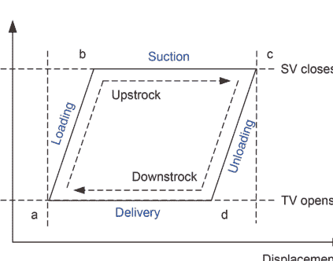
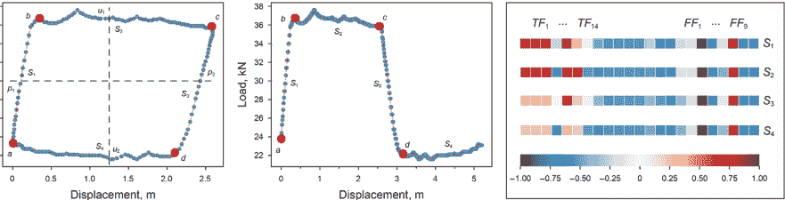
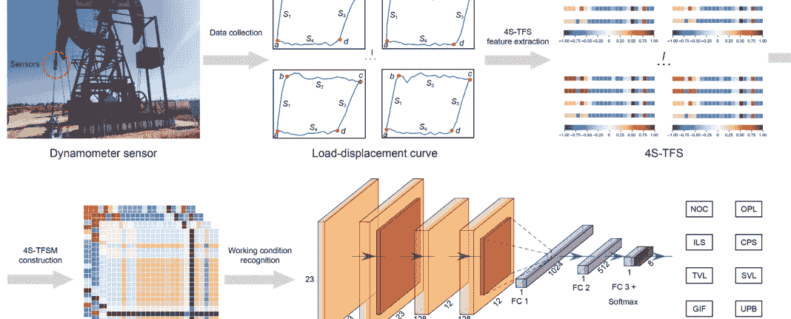
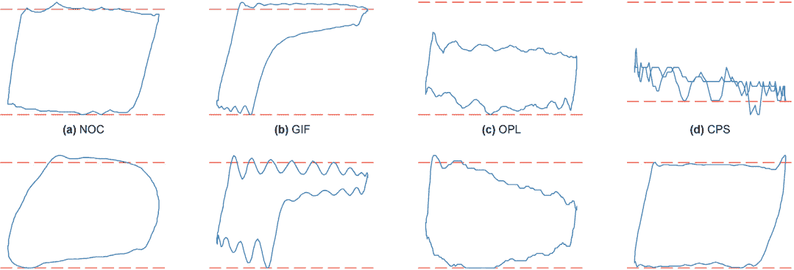
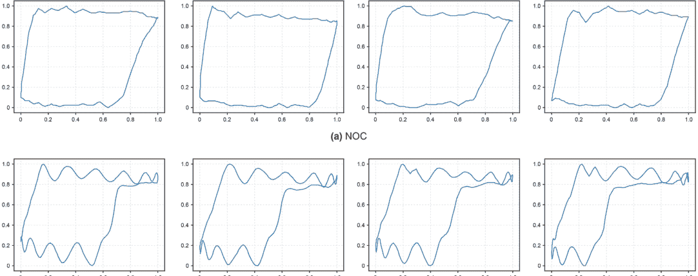
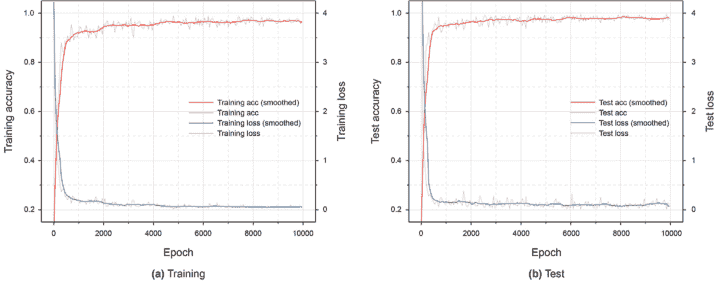
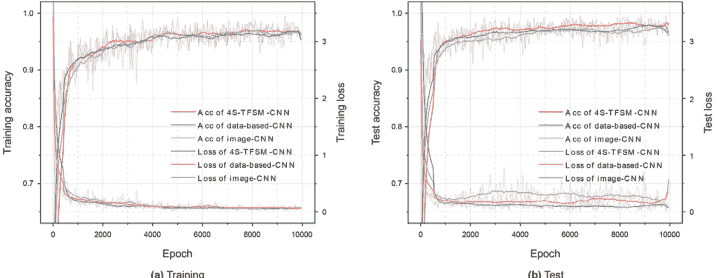
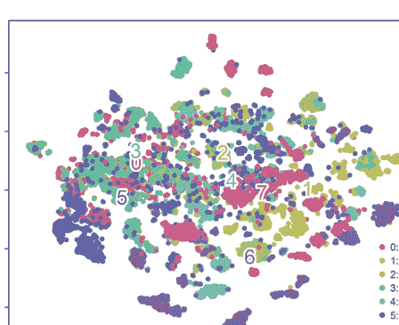
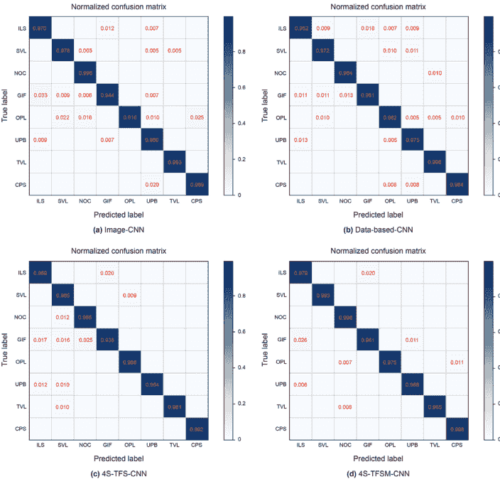

# 基于4段时频特征矩阵和深度学习的抽油杆泵抽油系统工况识别

## 摘要

高精度和实时诊断抽油杆泵系统（SRPS）对于快速掌握油井作业至关重要。基于深度学习的油井示功图（DC）分类方法是一种高效的诊断方法。然而，将 DC 作为二维图像输入深度学习框架会遭受低特征利用率和高计算量的困扰。此外，油田中不同的 SRPS 具有不同的系统参数，同一 SRPS 在不同时刻产生的 DC 也不同。因此，现场数据存在异质性，这会严重损害诊断准确性。为解决上述问题，本文提出了一种基于四段时频特征矩阵（4S-TFSM）和深度学习的工况识别方法。首先，提出了可降低计算能力需求的四段时频特征（4S-TFS）方法用于 DC 数据的特征提取。随后，通过相对归一化和矩阵计算构建 4S-TFSM，以综合多数据的特征并解决数据异质性问题。最后，采用深度学习框架之一的卷积神经网络（CNN）基于 4S-TFSM 确定运行工况。现场数据的实验验证了所提出的基于 4S-TFSM 和 CNN（4S-TFSM-CNN）的诊断方法可以在较低计算成本下显著提高工况识别的准确性。据我们所知，这是首次讨论数据异质性对 SRPS 工况识别性能影响的工作。

## 1. 引言

抽油杆泵送（SRP）是最广泛且可靠的人工举升方法之一，在石油采收工程中占主导地位。在生产实践中，由于恶劣的工作环境，抽油杆泵系统（SRPS）在运行过程中容易发生故障，这不仅影响油田的正常勘探，降低井产量，还会增加石油采收成本（Li et al., 2018; Zhang et al., 2022）。示功图（DC）的形状可以反映 SRP 的井下情况。因此，SRPS 的分析和诊断大多基于 DC（Han et al., 2022; Lv et al., 2021b; Zheng et al., 2020）。

最近，自组织竞争网络（Xu et al., 2007）、径向基函数（RBF）神经网络（Zhou et al., 2019）、谱聚类（Li et al., 2015）、指定成分分析理论（Han et al., 2019; Li et al., 2013b）、隐马尔可夫模型（Zheng et al., 2019a）和支持向量机（SVMs）（Cheng et al., 2020; Liu et al., 2021）等智能识别技术得到了快速发展，特别是基于深度学习的井况识别方法（Abdalla et al., 2020; Sun et al., 2022; Tian et al., 2021）。这些方法显著提高了井况识别的准确性。Li et al.（2013a）使用矩曲线方法获得 DC 特征，随后使用改进的 SVM 进行工况识别。Zheng and Gao（2017）使用曲率和重心分解方法提取七个几何特征，并使用连续隐马尔可夫模型作为分类器来诊断井运行工况。Zhou et al.（2019）提出了一种基于近似多边形的傅里叶描述符，并采用改进的 RBF 神经网络构建诊断模型。Wang et al.（2021）提出了一种基于卷积神经网络（CNN）的智能识别模型，该模型通过卷积和池化操作隐式提取图像特征并完成井故障诊断。Zhou et al.（2018）基于机理分析、专家知识和先验信息提取了 12 个 DC 特征和 7 个电功率信号特征，使用 SVM 进行多视图协同训练和 Hessian 正则化以实现抽油井工作状态识别。Pan et al.（2021）提出了一种基于在线贝叶斯技术和贝叶斯概率公式的决策融合方法，用于油泵单元的无监督故障检测。上述研究侧重于提高特征的表征能力和模型的分类性能以改善诊断结果。

然而，在实际抽油杆泵系统中遇到了两个挑战。（i）基于深度学习的井况识别方法通常将 DC 作为图像进行特征提取和分类（Song et al., 2023; Yin et al., 2023; Zhao et al., 2017）。与包含复杂信息的普通图像不同，示功图由仅包含载荷和位移数据的闭合曲线组成。DC 作为图像输入深度神经网络进行模型训练，进一步增加了计算量。（ii）油田中不同的 SRPS 具有不同的系统参数，同一 SRPS 在不同时刻产生的 DC 不同，因此数据具有一定程度的异质性，这可能会在一定程度上影响诊断准确性。目前基于 DC 的 SRPS 工况识别要么依赖于从 DC 中提取特征然后使用分类器自动对特征进行分类（Lv et al., 2021c; Ye et al., 2020; Zhou et al., 2019），要么将 DC 作为图像输入深度神经网络进行工况诊断（Song et al., 2023; Yin et al., 2023; Zhao et al., 2017）。此外，基于字典的迁移学习（Zhang and Gao, 2019）、元学习（He et al., 2023a）和元迁移学习（Zhang et al., 2022）等方法已被用于解决油田中不同 SRPS 具有不同系统参数导致训练数据分布不相似的问题，并在工况识别中取得了良好效果。然而，以上所有方法都使用单个 DC 数据进行分析，而油井的 DC 形状随时间缓慢变化，井数据的异质性通常被忽略。目前，很少有研究提到油井数据的异质性。

因此，高效的特征提取以降低深度模型的输入维度和抑制井数据的异质性值得研究。基于上述分析，本文提出了一种基于 4S-TFSM-CNN 的故障诊断方法。4S-TFSM-CNN 包括两个步骤：特征提取和工况检测。在该方法中，提出了一种 4S-TFS 特征来提取 DC 的图形特征，与图像方法相比可显著降低计算能力需求。然而，井数据的异质性问题仍然被忽略。引入了一种新的数据融合方法 4S-TFSM 来解决数据异质性问题。具体而言，通过对多个 4S-TFS 进行相对归一化和矩阵计算，通过增强不同类型样本之间的特征差异来抑制数据异质性。最后，引入专门设计的 CNN 从 4S-TFSM 中提取关键特征用于油井工况检测。

总之，本文做出了以下贡献。

- 1. 为解决将 DC 作为图像输入神经网络导致的高计算复杂性问题，提出了一种四段时频特征（4S-TFS）提取技术，在压缩数据的同时进行特征提取。
- 2. 考虑到井数据的异质性问题，提出了一种 4S-TFSM 方法，通过相对归一化和矩阵计算增强不同类型样本之间的特征差异。
- 3. 对于特征选择，深度学习算法自动选择对工况类别敏感的特征。

本工作的其余部分安排如下。第 2 节回顾了与我们研究相关的研究。第 3 节介绍了建议的工况识别方法。第 4 节详细报告了实验比较。第 5 节总结了论文的结论和未来研究。

## 2. 相关工作

SRPS 的工况识别是一个典型的分类问题，存在许多泵机工况识别方法。特征提取和分类器选择是泵机工况识别方法的两个主要依赖。Liu et al.（2021）使用改进的傅里叶描述符进行特征提取，并使用 SVM 进行抽油井故障诊断。Chen et al.（2021a）结合抽油泵的工作机理提取了 16 个特征，并使用具有高泛化能力的 XGBoost 算法识别抽油泵的运行状态。Han et al.（2022）使用 Freeman 链码提取了五个特征向量，并采用优化的密度峰值聚类（DPC）方法和改进的头脑风暴优化（BSO）算法实现在线诊断。

特征提取步骤在缺陷诊断过程中至关重要。高质量的特征可以确保高效准确的工况识别。尽管傅里叶描述符（Zhou et al., 2019）、曲线矩（Li et al., 2013a）、小波变换（Tagirova et al., 2021）、统计特征（Zheng et al., 2019b）等技术已被用于提取 DC 特征，但这些方法仍存在计算复杂性高、对噪声敏感和特征维度高等问题。因此，需要研究具有高计算效率和低特征维度的强大特征提取方法（Han et al., 2022）。

近年来，以 CNN 为代表的基于深度学习的故障诊断方法已被提出用于 SRPS 的工况识别。与随机森林（RF）、k 近邻（k-NN）、谱聚类（Li et al., 2015）和密度峰值聚类（DPC）（Wang et al., 2019）等方法相比，深度学习技术在特征数量多、数据类型复杂且低敏感的环境中表现出极强的模式挖掘能力，并广泛应用于目标检测（Yang et al., 2022）、图像识别（He et al., 2023b）、行为预测（He et al., 2022a）、3D 重建（Lee et al., 2021）、视觉重定位（Chen et al., 2021b）等领域。此外，基于深度学习的方法还可以使用深度神经网络自动从 DC 中提取图像特征。Zhao et al.（2017）开发了基于图像的 CNN 和基于数据的 CNN 方法，实验表明基于 CNN 的方法的识别准确率高于机器

用 RF 和 k-NN 表示的学习算法。Song et al. (2023) 改进了用于油井工况识别的 GoogLeNet 框架，并将其性能与 VGG-16、ResNet-18、DarkNet-19 和 DenseNet-201 等九种模型进行了比较，结果表明更深的神经网络层并不总是对应更高的精度。如 (He et al., 2022b; Sharaf, 2018; Tian et al., 2021; Yin et al., 2023) 等研究也验证了基于图像的 CNN 在井故障分类中的有效性。

然而，油田中不同 SRPS 的系统参数不同，同一 SRPS 在不同时刻产生的 DC 也不同，因此数据具有一定的异质性，这在一定程度上可能影响诊断的准确性。针对油井间异质数据问题，Lv et al. (2021a) 提出了一种自适应诊断方法，该方法使用在目标工作点附近生成的模拟示意功率卡作为训练数据，并使用额外的 DC 位置特征通过增加不同样本间的距离来改善 DC 特征。Zhang and Gao (2019) 使用基于字典的迁移子空间学习构建变换矩阵，使训练数据和目标数据移动到共享的低维子空间。Lv et al. (2021c) 提出了静态表观刚度特征算法以保留 DC 的故障信息，并提出了一种增量算法和生成的 DC 以提高支持向量机诊断模型的泛化能力。He et al. (2023a) 和 Zhang et al. (2022) 采用元学习框架，利用现有井数据解决新油井工况的少样本问题。尽管上述方法解决了不同井的数据分布不相似的问题，但它们都使用单个示功图数据进行分析。虽然某口井的 DC 形状随时间缓慢变化，但同一口井数据的异质性通常被忽略。目前，关于油井数据异质性的研究很少被提及。此外，尽管 CNN 具有强大的特征提取和分类能力，但将 DC 直接作为图像输入深度神经网络进行模型训练，进一步增加了计算工作量。因此，更准确高效的自动井工况识别方法将是促进智能油田建设的重要进步。

## 3. Methodology

### 3.1. 4S-TFS feature extraction

理论 DC 是在某些理想条件下绘制的。目标是使用理论 DC 和实际 DC 进行比较；从图表中的差异可以判断井下泵的工作状况。悬点处静载荷的变化规律如图 1 所示，图形为平行四边形 abcd，也称为理论静载荷 DC。在这种情况下，abc 过程是上冲程中静载荷变化的线，其中 ab 为加载线。加载操作期间，游动阀 (TV) 关闭，但固定阀 (SV) 尚未打开，因此泵不泵油。只有当悬点的向上位移达到点 b 时，SV 才打开并开始吸油。因此，bc 是泵吸油过程。cda 过程是下冲程静载荷变化线，其中 cd 为卸载线。同样，在此过程中，尽管悬点向下移动，此时 SV 和 TV 处于关闭状态。直到卸载结束于点 d，柱塞与泵筒之间存在相对位移，TV 打开，泵开始输送。

如图 1 所示，井的初始 DC 数据是由载荷-位移形成的二维闭合曲线图。

Fig. 1. The theoretical static load dynamometer card.

通常，二维图像比一维信号包含更多信息，但在参数学习过程中计算成本过大。Lanczos 算法 (Cheng et al., 2020; He et al., 2022b) 是压缩图像的常用方法。然而，由于示功图数据的特殊性，需要对数据进行预处理和提取以获得全面的 DC 信息。因此，本工作提出了一种具有时域和频域特征的 4S-TFS 特征提取方法。4S-TFS 的主要目的是通过获取从每个域中提取的各种特征所涉及的工作情况的丰富知识来提高特征提取能力，同时最小化特征提取计算成本。

图 2 描述了 4S-TFS 特征提取流程图。(a) 显示了根据示功图的理论分析确定的四个点：a、b、c 和 d；即载荷-位移曲线被划分为四个段 (S1、S2、S3 和 S4)。准确提取泵阀的开启和关闭点是提取 4S-TFS 特征的关键步骤之一。根据开启和关闭点的物理意义，通过分析载荷斜率和时间关系曲线的变化模式来识别泵阀的开启和关闭点 (Zhang et al., 2021)。载荷斜率 K_L 的方程为
K_L = ΔL_t / Δt = [L_t(t + 1) - L_t(t)] / Δt   (1)
其中 L_t(t) 是时间 t 时 DC 的载荷点，Δt 是 DC 相邻两点之间的时间间隔。由于采集时相对时间间隔相等，Δt 可设为 1 (Zhang et al., 2021)。具体而言，点 b 位于 p1 - u1 区域，点 d 位于 p2 - u2 区域。点 p1 和 p2 是中位载荷与 DC 曲线的交点，点 u1 和 u2 是中位位移与 DC 曲线的交点。根据式 (1)，在每个区域获得载荷斜率变化的最大点，从而可确定点 b 和 d。此时，四个点 a、b、c 和 d 的载荷和位移 (L_t^a, D_t^a)、(L_t^b, D_t^b)、(L_t^c, D_t^c)、(L_t^d, D_t^d) 分别被获取。这里，L_t 和 D_t 表示用时间采样获得的原始载荷和位移。

之后，使用一维最近邻插值技术对上冲程载荷和下冲程载荷进行采样，以生成新的载荷-位移曲线，如图 2(b) 所示。这里，以位移 D 为自变量，载荷 L_D 为因变量，通过一维最近邻插值获得与时间无关的新载荷-位移曲线。它可以表示如下。

**Fig. 2.** Flowchart of 4S-TFS feature extraction.

$L_D^{\mathrm{up}}=\operatorname{interp1d}(L_t^{\mathrm{up}},D_t^{\mathrm{up}},D^{\mathrm{up}})$ \hfill (2)

$L_D^{\mathrm{down}}=\operatorname{interp1d}(L_t^{\mathrm{down}},D_t^{\mathrm{down}},D^{\mathrm{down}})$ \hfill (3)

$D^{\mathrm{up}}=[d_a,d_a+0.01,d_a+0.02,\ldots,d_c]$ \hfill (4)

$D^{\mathrm{down}}=[d_c,d_c-0.01,d_c-0.02,\ldots,d_a]$ \hfill (5)

$d_a=\operatorname{round}(D_t^a,2)$ \hfill (6)

$d_c=\operatorname{round}(D_t^c,2)$ \hfill (7)

其中 $L_D^{\mathrm{up}}$ 和 $L_D^{\mathrm{down}}$ 分别表示上冲程和下冲程插值后的载荷，interp1d 表示一维最近邻插值，round $(D_t^a,2)$ 表示在位移点 $D_t^a$ 处保留 2 位小数，$L_t^{\mathrm{up}}$ 和 $D_t^{\mathrm{up}}$ 分别表示上冲程的原始载荷和位移，$D^{\mathrm{up}}$ 表示上冲程过程的插值位移点。根据实际 DC 位移数据的特点，将位移 $D^{\mathrm{up}}$ 和 $D^{\mathrm{down}}$ 的插值间隔设为 0.01。此时，获得载荷 $L_D$ 随位移 $D$ 变化的新载荷数据 $L_D=[L_D^{\mathrm{up}},L_D^{\mathrm{down}}]$，$D=[d_a,d_a+0.01,d_a+0.02,\ldots,2(d_c-d_a)+0.01]$。

最后，选择位移载荷数据的频域特征 $FF$ 和时域特征 $TF$ 构成特征集 $F$，其中 $S_i$ 是第 $i$ 段 $TF$，$FF_j^i$ 是第 $i$ 个特征的第 $j$ 个元素，$J$ 是特征集的时间-频率特征数 (He et al., 2023a)，如图 2(c) 和式 (8) 所示。

$F=\begin{bmatrix}S_1\\S_2\\S_3\\S_4\end{bmatrix}=\begin{bmatrix}f_1^1&f_1^2&\cdots&f_1^J\\f_2^1&f_2^2&\cdots&f_2^J\\f_3^1&f_3^2&\cdots&f_3^J\\f_4^1&f_4^2&\cdots&f_4^J\end{bmatrix}$ \hfill (8)

$J$ 表示本文选择的 23 个时域和频域特征。为了在考虑随位移变化的载荷数据的非负性的同时获得 DC 的全面信息，从每条曲线的 4 个段中提取了由快速傅里叶变换 (FFT) (Cooley and Tukey, 1965) 转换的 9 个频域统计特征 $FF_1\sim FF_9$ 和 14 个时域统计特征 $TF_1\sim TF_{14}$。FFT 基于基-2 蝶形块，载荷 $L_D(n)$ 的快速傅里叶变换 $y(k)$ 为

$y(k)=\sum_{n=1}^{N}L_D(n)\cdot W_N^{kn}$ \hfill (9)

$W_N=e^{-j\frac{2\pi}{N}}$ \hfill (10)

其中 $W_N$ 是第 $N$ 个 twiddle 因子，$N$ 是 FFT 中的点数，$j$ 是虚数单位 (Ferreira et al., 2021; He et al., 2023a)。$TF_1\sim TF_8$、$TF_{15}$、$TF_{16}$ 被引用为量纲统计，而 $TF_9\sim TF_{14}$ 被引用为无量纲统计，如表 1 所示。表 1 显示了序列 $L_D(n)$，$n=1,2,3,\ldots,N$，其中 $N$ 是插值后的点数。考虑到插值后载荷-位移数据的非负性，即 $L_D(n)>0$，本文选择了前 14 个时域特征。

表 2 显示了特征的频域表达式。特征 $FF_1$ 表示频域中的振动能量幅度，特征 $FF_2\sim FF_5$、$FF_9$、$FF_{11}\sim FF_{13}$ 表示频谱分散，特征 $FF_6\sim FF_8$、$FF_{10}$ 表示主要频带位置偏移。表 2 中载荷数据 $L_D(n)$ 的 FFT 频谱由 $y(k)$ 给出，$k=1,2,\ldots,K$，其中 $K$ 是频谱线的数量，$f_k$ 是第 $k$ 条频谱线的频率值 (He et al., 2023a; Yu et al., 2021)。本文考虑了前 9 个频域特征，因为某些 $FF\to0$ 或 $\infty$。

### 3.2. 4S-TFSM construction

一旦提取了单个 DC 的 4S-TFS 特征，就可构建油井 DC 数据的 4S-TFSM。传感器在某一时间采集数据，根据柱塞泵的生产周期生成 $l$ 个 DC 是常见做法，如图 3(a) 所示。我们使用的方法是用 $l$ 个 DC 形成 4S-TFSM。如图 3(d) 所示，第 $i$ 段 $F$ 的特征矩阵 $M_i$ 由 $l$ 个 DC 生成，具体而言，通过 $F$ 的 $l$ 个特征向量对之间的内积表示。它可以表示为

$M_i=S_i^1\cdot S_i^2\cdot S_i^3\cdot\ldots\cdot S_i^l$ \hfill (11)

$l=2,4,6,8,\ldots$ \hfill (12)

$M_i$ 的维度为 $J\times J$，本文为 $23\times23$。显然，每个段的 TFSM $M_i$ 关于主对角线对称

与 4S-TFS 和 4S-TFSM 的构建类似，图 3(a) 和 (b) 中的示功图曲线也可以被分割成 1、2 和 8 段，以创建图 3(c) 中的 1S-TFS、2S-TFS 和 8S-TFS，进而分别形成图 3(e) 中的 1S-TFSM、2S-TFSM 和 8S-TFSM。实验部分第 4.2 节包含了相关的实验结果。

### 3.3. SRPS 的工况识别框架

在提取了 4S-TFSM 特征后，可使用 CNN 对 SRPS 进行工况识别。本文提出的 4S-TFSM-CNN 方法的框架如图 4 所示，其总体步骤总结如下。

- 1) 数据采集。数据由安装在抽油杆上的示功传感器测量并通过无线网络发送到数据中心。位移数据通过加速度传感器经二次积分获得。基于收集到的位移和载荷数据，可生成 DC。示功图反映了抽油杆的运行过程。
- 2) 4S-TFS 特征提取。提出的 4S-TFS 特征提取方法用于提取每个示功图的时频域特征，并在特征提取的同时进行数据压缩，有效降低了数据维度，解决了将 DC 作为二维图像输入神经网络时导致的高计算复杂度问题。
- 3) 4S-TFSM 构建。利用多个 DC 生成的采集到的 4S-TFS 数据，通过相对归一化和矩阵计算构建 4S-TFSM，可增强不同工况间特征差异并解决训练样本的异质性问题。
- 4) 工况识别。通过专门设计的 CNN 模型实现特征的最优选择，以自动选择对工况类别敏感的 4S-TFSM 特征。具体而言，数据集按一定比例分为训练集和测试集。CNN 模型利用训练集获得对任务变化敏感的最优参数，测试集用于工况识别。

Fig. 4. 用于工况识别的 4S-TFSM-CNN 方法框架。

## 4. 实验评估

在本部分中，第 4.1 节描述了数据采集和处理过程。第 4.2 节介绍了本文提出的 4S-TFSM-CNN 方法的超参数选择和性能评估。第 4.3 节将提出的 4S-TFSM-CNN 和 4S-TFS-CNN 与传统方法 image-CNN 在分类精度、模型参数数量、算法复杂度和训练时间四个方面进行比较，以验证本文提出的创新点的有效性。第 4.4 节讨论了训练样本异质性对实际工况识别的负面影响，并通过将 4S-TFSM-CNN 与一些传统机器学习和深度学习方法进行比较，解释了创新点的合理性。

### 4.1. 数据采集与处理

为证明所提诊断方法的有效性和性能，从中国北方的一个油田收集了超过 100,000 张 DC。每张示功图的载荷和位移数据由 200 对点组成。通常，在单口井中难以获得多种工况。因此，我们在超过 90 天的时间内从近 1300 口井收集了数据。这些数据包含十多种故障类型。为了最大化数据的通用性，我们从多口井的传感器数据中筛选出 8 种常见工况，分别为液体供应不足 (ILS)、游动阀泄漏 (TVL)、固定阀泄漏 (SVL)、正常运行工况 (NOC)、气体干扰 (GIF)、连续泵送喷射 (CPS)、油管泄漏 (OPL) 和上冲程泵卡 (UPB)；相应的 DC 如图 5 所示。

**Fig. 5.** 8 种不同工况的示功图形状。纵轴为载荷，横轴为位移。

对于每种工况，从多口井中选取 3500 个样本用于实验。然后，数据按 6:1 的比例分为训练和测试数据集，即每种工况 3000 个训练样本和 500 个测试样本。

由于不同井的 DC 具有不同的载荷和位移范围，对收集到的数据采用 Min-Max 归一化方法进行处理 (Zhang and Gao, 2019)。

$$D_t^*(i)=\frac{D_t(i)-\min(D_t)}{\max(D_t)-\min(D_t)}$$
(14)

$$L_t^*(i)=\frac{L_t(i)-\min(L_t)}{\max(L_t)-\min(L_t)}$$
(15)

$$i=1,2,3,\cdots,200$$
(16)

其中 $D_t^*(i)$ 和 $L_t^*(i)$ 为归一化后的位移和载荷数据，$i$ 为随时间采样的点，min($D_t$)、max($D_t$)、min($L_t$) 和 max($L_t$) 分别为最小位移、最大位移、最小载荷和最大载荷 (Cheng et al., 2020)。

**Fig. 6** 显示了同一口井在不同时间在相同坐标区间内的示功图形状。可以看出，在相同工况下，同一口井在不同时间下的示功图形状不同。数据的异质性无疑会降低工况识别的准确性。

所有实验均在配备 Intel Core i7-10700K 3.8 GHz CPU、64 GB RAM、GeForce RTX 3090 GPU 和 Ubuntu 18.04 操作系统的台式工作站上完成。

**Fig. 6.** 不同时间下某口井的示功图形状。图示了两种常见工况，横轴表示归一化位移，纵轴表示归一化载荷。清楚可见，同一口井在不同时刻采集的 DC 不同，数据的异质性可能会降低工况识别的性能。

### 4.2. 基于 4S-TFSM 的 CNN

神经网络解决机器学习中的多类分类问题。特别是，CNN 在网络的多个阶段允许权重共享和下采样，减少了参数数量，从而形成了适用于大规模分类的有效架构。

4S-TFSM-CNN 网络的结构和参数见表 3。在训练过程中，使用随机梯度下降根据交叉熵损失函数最小化损失。隐藏层采用修正线性单元 (ReLU) 激活函数，输出层应用 softmax 以获得每个类别概率之和为 1，并将预测类别作为概率最高的类别使用。

**Table 3**
4S-TFSM-CNN 的架构。

| 层 | 类型 | 特征图 | 滤波器大小 | Dropout |
| --- | --- | --- | --- | --- |
| 0 | 输入 | 23 × 23 × 4 | — | — |
| 1 | 卷积 1 | 23 × 23 × 32 | 3 × 3 | — |
| 2 | 卷积 2 | 23 × 23 × 64 | 3 × 3 | — |
| 3 | 池化 1 | 12 × 12 × 64 | 2 × 2 | — |
| 4 | 卷积 3 | 12 × 12 × 128 | 3 × 3 | — |
| 5 | 卷积 4 | 12 × 12 × 128 | 3 × 3 | — |
| 6 | 池化 2 | 6 × 6 × 128 | 2 × 2 | — |
| 7 | 全连接 1 | 1 × 1 × 1024 | — | 0.1 |
| 8 | 全连接 2 | 1 × 1 × 512 | — | 0.1 |
| 9 | 全连接 3 | 1 × 1 × 8 | — | 0.1 |

训练集在模型训练过程中用于生成 320,000 个训练子任务，批量大小设为 32，训练步长设为 10,000，学习率设为 0.001。为防止偶然性和特异性，在测试集中选取 300 个任务数据并获得所有任务的平均测试精度和标准差。

使用构成 4S-TFSM 的不同数量 DC 的油井工况识别准确率如表 4 所示。可以看出，经 4S-TFS 对 DC 数据进行特征提取后，使用 4 个 DC 组合时获得了 98.48% 的最高识别准确率和 0.72% 的最低标准差。该场景的 10,000 次训练和测试过程如图 7 所示。

如图 7 所示，仅需大约 3000 个训练 epoch 即可在测试数据集上实现近 98% 的工况识别准确率，损失值下降到较低水平后在该值附近稳定，这表明训练好的 CNN 具有良好的稳定性，也表明使用 3000 个样本训练 CNN 模型是可行的。

如第 3.2 节所述，基于 4 个 DC 的 4S-TFSM，我们还使用 4 个 DC 形成 1S-TFSM、2S-TFSM 和 8S-TFSM。表 5 显示了在不同 TFSM 下使用 4 个 DC 的工况识别准确率。

显然，用所有插值载荷-位移数据构建的 1S-TFSM 无法提取足够的特征信息，从而降低了识别准确率。同样，由于示功曲线仅由 200 个点组成且特征简单，将示功曲线分割成 8 段形成 8S-TFSM 的识别准确率也相对较低，样本点过少无法提取有效的时间频率特征，从而降低了 8S-TFSM 的识别准确率。值得一提的是，2S-TFSM 和 4S-TFSM 达到了几乎相同的结果，这是由于图 3 中 S₁ 和 S₃ 的曲线组成简单，且两部分分别属于上冲程载荷和下冲程载荷，导致提取的时间频率特征差异不明显。

### 4.3. 性能比较

将示功图作为图像进行分类的方法已成功应用于 SRPS 的工况识别。受此结果启发，我们对 image-CNN 和本文提出的 4S-TFSM-CNN 进行了比较研究。我们首先根据传感器数据绘制 DC 并生成 640 × 480 图像。随后进行二值化处理。最后，将二值化图像压缩至 64 × 64 并用作 image-CNN 的输入。

与 4S-TFSM-CNN 不同，image-CNN 的输入大小为 64 × 64 × 1，因此我们在第一和第二卷积层之间添加了 1 个最大池化层。此外，我们还尝试将载荷-位移数据输入神经网络以生成基于数据的数据-CNN，并将单个 DC 提取的 4S-TFS 特征输入神经网络以生成 4S-TFS-CNN。三种神经网络的结构和参数如图表 6 所示。

四种方法工况识别的准确率如表 7 所示。显然，4S-TFS-CNN 的识别准确率为 97.53%，显著高于 image-CNN 和 data-based-CNN 方法的 96.83% 和 97.39%。同时，4S-TFS-CNN 的标准差为 0.91%，也低于 image-CNN 和 data-based-CNN 的 1.08% 和 0.99%，这表明单个 DC 的 4S-TFS 特征提取方法可以提取出有效的 CNN 分类特征。此外，在四种方法中，4S-TFSM-CNN 具有最高的识别准确率 98.48% 和最低的标准差 0.72%，这表明通过组合多个 DC 构建 4S-TFSM 可以解决异质性问题并提高工况识别准确率。

图 8 显示了 image-CNN、data-based-CNN 和 4S-TFSM-CNN 在不同训练步长下的工况识别准确率。图 8(a) 表明，在整个训练阶段，4S-TFSM-CNN 的准确率和损失与 image-CNN 和 data-based-CNN 相似。在图 8(b) 的测试集上，4S-TFSM-CNN 的准确率总体上高于 image-CNN 和 data-based-CNN，这与表 7 中的发现一致。这也说明通过 4S-TFSM 可以从多个 DC 中提取足够的特征信息用于 CNN 工况识别，证实了 4S-TFSM-CNN 的有效性。

此外，表 8 展示了四种方法对 CNN 性能的影响。显然，所提出的 4S-TFS-CNN 方法具有最小的算法复杂度、时间复杂度和训练时间，且识别准确率高于 Image-CNN 和 Data-based-CNN。与 data-based-CNN 相比，所提出的 4S-TFSM-CNN 方法在算法复杂度、时间复杂度和训练时间上有所增加，但识别准确率最高。表 7 和表 8 的分析验证了所提出的 4S-TFSM 可以降低模型复杂度和计算成本，并提高识别准确率。

### 4.4. 讨论

我们在同一数据集上使用 RF、k-NN 和 SVM 等经典机器学习方法进行预测，结果见表 9。可以看出，以图像为输入特征、RF 算法为分类器的 image-RF 具有最低的期望准确率 92.59%，而 4S-TFSM-CNN 获得了最高的准确率 98.48%。与 RNN、LSTM 和 GRU 等其他基于深度学习的方法相比，image-RNN 的准确率最低为 87.40%，而基于 LSTM 和 GRU 的方法性能优于 RNN，但准确率也低于所提出的

**表4**

不同DC数量下4S-TFSM-CNN的工况识别准确率。

| DC数量 | *l* = 2 | *l* = 4 | *l* = 6 | *l* = 8 | *l* = 10 |
|---|---:|---:|---:|---:|---:|
| 准确率 | 98.12% ± 0.81% | 98.48% ± 0.72% | 97.71% ± 0.89% | 98.07% ± 0.78% | 97.83% ± 0.91% |

**图7.** 使用4个DC时4S-TFSM-CNN的训练和测试准确率。

**表5**

使用4个DC时不同TFSM的工况识别准确率。

| 方法 | 1S-TFSM-CNN | 2S-TFSM-CNN | 4S-TFSM-CNN | 8S-TFSM-CNN |
|---|---:|---:|---:|---:|
| 准确率 | 95.65% ± 1.29% | 98.39% ± 0.76% | 98.48% ± 0.72% | 97.01% ± 1.04% |

4S-TFSM-CNN方法。此外，以4S-TFS作为输入数据的RF、SVM、RNN、LSTM、GRU和CNN的分类准确率均优于基于图像和基于数据的分类结果，这说明针对单个DC的4S-TFS特征提取有助于提升工况识别性能。另外，当使用SVM、RNN、LSTM和CNN作为分类器时，以4S-TFSM作为输入数据的分类结果也优于其他三种输入数据，表明多个DC的特征融合可以降低数据异质性并提高油井工况识别准确率。

**表6**

图像-CNN、基于数据的CNN和4S-TFS-CNN的网络结构。

| 层 | 类型 | Dropout | 图像-CNN：特征图 | 图像-CNN：滤波器尺寸 | 基于数据的CNN：特征图 | 基于数据的CNN：滤波器尺寸 | 4S-TFS-CNN：特征图 | 4S-TFS-CNN：滤波器尺寸 |
|---:|---|---:|---|---|---|---|---|---|
| 0 | 输入 | – | 64 × 64 × 1 | – | 2 × 200 × 1 | – | 4 × 23 × 1 | – |
| 1 | 卷积1 | – | 64 × 64 × 32 | 3 × 3 | 2 × 200 × 32 | 1 × 3 | 4 × 23 × 32 | 1 × 3 |
| 2 | 池化1 | – | 32 × 32 × 32 | 2 × 2 | 2 × 100 × 32 | 1 × 2 | – | – |
| 3 | 卷积2 | – | 32 × 32 × 64 | 3 × 3 | 2 × 100 × 64 | 1 × 3 | 4 × 23 × 64 | 1 × 3 |
| 4 | 池化2 | – | 16 × 16 × 64 | 2 × 2 | 2 × 50 × 64 | 1 × 2 | 4 × 12 × 64 | 1 × 2 |
| 5 | 卷积3 | – | 16 × 16 × 128 | 3 × 3 | 2 × 50 × 128 | 1 × 3 | 4 × 12 × 128 | 1 × 3 |
| 6 | 池化3 | – | – | – | 2 × 25 × 128 | 1 × 2 | – | – |
| 7 | 卷积4 | – | 16 × 16 × 128 | 3 × 3 | 2 × 25 × 128 | 1 × 3 | 4 × 12 × 128 | 1 × 3 |
| 8 | 池化4 | – | 8 × 8 × 128 | 2 × 2 | 2 × 13 × 128 | 1 × 2 | 4 × 6 × 128 | 1 × 2 |
| 9 | 全连接1 | 0.1 | 1 × 1 × 1024 | – | 1 × 1 × 1024 | – | 1 × 1 × 1024 | – |
| 10 | 全连接2 | 0.1 | 1 × 1 × 512 | – | 1 × 1 × 512 | – | 1 × 1 × 512 | – |
| 11 | 全连接3 | 0.1 | 1 × 1 × 8 | – | 1 × 1 × 8 | – | 1 × 1 × 8 | – |

**图8.** 不同训练步数下图像-CNN、基于数据的CNN和4S-TFSM-CNN的训练与测试准确率。

表7
基于不同方法的工况识别准确率。

| 方法 | Image-CNN | Data-based-CNN | 4S-TFS-CNN | 4S-TFSM-CNN |
|---|---|---|---|---|
| 准确率 | 96.83% ± 1.08% | 97.39% ± 0.99% | 97.53% ± 0.91% | 98.48% ± 0.72% |

表8
CNN算法指标。

| 方法 | Image-CNN | Data-based-CNN | 4S-TFS-CNN | 4S-TFSM-CNN |
|---|---|---|---|---|
| 特征图大小 | 64 × 64 × 1 | 2 × 200 × 1 | 4 × 23 × 1 | 23 × 23 × 4 |
| 参数，MB | 10.21 | 4.12 | 3.78 | 6.03 |
| FLOPs，GB | 43.97 | 5.21 | 4.00 | 24.35 |
| 训练时间，min | 162.15 | 21.83 | 7.32 | 99.02 |

表9
各方法的整体预测准确率。

| 特征 | RF | k-NN | SVM | RNN | LSTM | GRU | CNN |
|---|---|---|---|---|---|---|---|
| 图像 | 92.59% | 96.89% | 93.79% | 87.40% | 95.17% | 94.59% | 96.83% |
| 基于数据 | 96.02% | 96.99% | 97.70% | 93.31% | 96.67% | 96.69% | 97.39% |
| 4S-TFS | 97.94% | 96.99% | 97.74% | 96.89% | 97.87% | 98.07% | 97.53% |
| 4S-TFSM | 96.57% | 96.02% | 97.90% | 97.27% | 98.00% | 97.57% | 98.48% |

识别准确率差异的真正原因是什么？哪些类型的工况更难区分？为了更深入地理解数据结构，我们对数据集进行了可视化。t分布随机邻域嵌入（t-SNE）方法是一种近年发展的降维方法，常用于数据可视化。t-SNE能够将高维数据整合到二维或三维空间中，使高维空间中相关的对象在低维空间中彼此靠近（Zhao等，2017）。图9展示了样本数据嵌入二维空间后的散点图。

在图9中，类别1（SVL）、2（NOC）和6（TVL）的数据被描绘为相对独立的簇，这意味着这些类别可能相对容易识别和分类。其他类型的样本则纠缠混合在一起，无法区分。例如，类别0（ILS）和类别3（GIF）几乎无法区分

图9. t-SNE在二维空间中的嵌入。

在图中，因为其对应的DC高度相似，而类别5（UPB）则分散在整个图中。

图10展示了使用四种数据处理方法（图像-CNN、基于数据的CNN、4S-TFS-CNN和4S-TFSM-CNN）在测试数据集上得到的混淆矩阵。我们可以清楚地观察到，绝大多数样本位于对角线上。从四个混淆矩阵的对角线可以直观地看出，类别0（ILS）、类别3（GIF）、类别4（OPL）和类别5（UPB）是彼此之间最难区分的四个类别，因为这四种工况的分类准确率最低。这与图9中讨论的t-SNE可视化结果一致。在这四个最难区分的类别中，4S-TFSM-CNN的识别准确率也高于其余三种方案，表明4S-TFSM特征提取方法可以削弱数据的异质性，并显著影响诊断性能。

如图10所示，不同类别之间数据分布差异引起的异质性是限制我们模型识别准确率的重要因素。这里，我们不使用单个数据集作为直接输入，而是采用一种简单的合成特征提取方法，即一种综合多个数据集的特征提取技术。

其思想是从真实样本中“合成”更适合深度学习完成分类任务的训练样本，方法是从原始数据集的特征空间中提取时频特征，进行归一化和矩阵运算。此外，尽管准确率高达98.48%，我们还是从概率角度评估错误分类的样本，以评估4S-TFSM-CNN的性能。我们推断某些误分类（如图10中的类别5（UPB））可归因于标签模糊。对于这些样本，即使是人类专家也可能难以识别明确的故障类型，或者样本可能同时包含多种故障类型，从而在整个数据集中引入一些标签噪声。

在训练效率方面，由于CNN需要学习特征，其训练时间可能比典型的机器学习方法（如RF、k-NN和SVM）更长。然而，传统机器学习方法在处理大量数据时并不友好。幸运的是，网络一旦训练完成，就可以恢复并多次用于模型预测，而且我们提出的4S-TFSM-CNN技术的训练时间比图像-CNN明显更快。因此，基于4S-TFSM-CNN的方法在实际油井工况识别中是高效且可行的。

**图10.** 不同方法下预测结果的混淆矩阵。对角线上的数字表示正确分类样本的概率，非对角线上的数字表示错误分类样本的概率。为清晰起见，我们保留三位小数，且混淆矩阵中未显示低于0.005的误分类概率。

考虑到神经网络的计算复杂度，本文使用了一个4层CNN，尽管增加神经网络层数可能会提高工况识别准确率。DC数据是按时间序列生成的，在未来的工作中，我们还将考虑时间卷积网络（TCN），它可以在考虑时间信息的同时利用卷积特征。

## 5. 结论

本文提出了一种基于4S-TFSM的油井DC特征提取技术，并采用专门设计的CNN实现油井工况识别。该技术使用4S-TFS提取DC特征，能够在降低计算成本的同时有效提高油井工况的识别准确率。随后，通过相对归一化和矩阵计算构建4S-TFSM，以增强不同类型工况之间的特征差异，抑制数据异质性问题。最后，设计了一种特殊的CNN来自动选择对工况类别敏感的4S-TFSM特征，以实现油井工况的高精度识别。基于现场大量真实油井数据的实验结果表明了所提方法的有效性。

考虑到神经网络的计算复杂度，本文使用了一个4层CNN，尽管增加神经网络层数可能会提高工况识别准确率。DC数据是按时间序列生成的，在未来的工作中，我们还将考虑时间卷积网络（TCN），它可以在考虑时间信息的同时利用卷积特征

## 利益冲突声明

作者声明，本文所报告的工作不存在已知的竞争性经济利益或个人关系影响。

## 致谢

我们感谢副主编和审稿人的建设性意见。本工作部分得到国家自然科学基金（批准号：62203234）资助；部分得到中国机器人国家重点实验室（批准号：2023-Z03）资助；部分得到辽宁省自然科学基金（批准号：2023-BS-025）资助；部分得到辽宁辽河实验室研究计划（批准号：LLL23ZZ-02-02）资助。

## 附录A

### 1.1. RF的参数设置

我们主要考虑n_estimators、min_samples_split、max_depth、max_features和min_samples_leaf对RF分类性能的影响，并使用GridSearchCV自动搜索上述参数。参数设置如表A1所示。

- Yu, C., Ning, Y., Qin, Y., 等, 2021. 基于元学习的滚动轴承多标签故障诊断. 神经计算与应用 33 (10), 5393–5407. https://doi.org/10.1007/s00521-020-05345-0.
- Zhang, A., Gao, X., 2019. 基于监督字典的迁移子空间学习及其在抽油杆泵送系统故障诊断中的应用. 神经计算 338, 293–306. https://doi.org/10.1016/j.neucom.2019.02.013.
- Zhang, K., Wang, Q., Wang, L., 等, 2022. 基于元迁移学习的少样本抽油杆井故障诊断方法. 石油科学与工程杂志 212. https://doi.org/10.1016/j.petrol.2022.110295.
- Zhang, R., Yin, Y., Xiao, L., 等, 2021. 基于多数据组合分析的抽油杆泵井储层-井筒-地面条件实时诊断方法. 石油科学与工程杂志 198, 108254. https://doi.org/10.1016/j.petrol.2020.108254.
- Zhao, H., Jian, W., Peng, G., 2017. 一种基于深度学习的抽油杆泵系统状态监测与故障诊断方法. 物联网服务汇刊 1 (1), 32–42. https://doi.org/10.29268/stiot.2017.1.1.3.
- Zheng, B., Gao, X., 2017. 利用阀门工作位置和参数优化连续隐马尔可夫模型的抽油杆泵诊断. 过程控制杂志 59, 1–12. https://doi.org/10.1016/j.jprocont.2017.09.007.
- Zheng, B., Gao, X., Li, X., 2019a. 基于动力仪卡片生成的抽油杆泵诊断. 过程控制杂志 77, 76–88. https://doi.org/10.1016/j.jprocont.2019.02.008.
- Zheng, B., Gao, X., Li, X., 2019b. 基于电机功率的抽油杆泵故障检测. 控制工程实践 86, 37–47. https://doi.org/10.1016/j.conengprac.2019.02.001.
- Zheng, B., Gao, X., Pan, R., 2020. 利用电机数据和隐条件随机场的抽油杆泵工作状态诊断. IEEE工业电子学汇刊 67 (9), 7919–7928. https://doi.org/10.1109/TIE.2019.2944081.
- Zhou, B., Wang, Y., Liu, W., 等, 2018. 基于多视图协同训练和SVM海森正则化的抽油杆泵井工况识别. 见：2018年第14届IEEE国际信号处理会议(ICSP), pp. 969–973. https://doi.org/10.1109/ICSP.2018.8652454.
- Zhou, W., Li, X., Yi, J., 等, 2019. 一种基于自适应噪声因子的新型UKF-RBF抽油机故障诊断方法. IEEE工业信息学汇刊 15 (3), 1415–1424. https://doi.org/10.1109/TII.2018.2839062.
