# Wright的比特币、区块链与加密货币简快乐指南

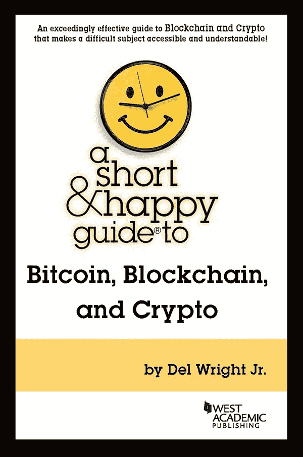

---

**Jesse H. Choper**

法律教授及退休院长

加州大学伯克利分校

**Joshua Dressler**

特誉大学退休教授

俄亥俄州立大学迈克尔·E·道德法学院

**Renée McDonald Hutchins**

院长及 Joseph L. Rauh, Jr. 公益法教授

哥伦比亚特区大学 David A. Clarke 法学院

**Yale Kamisar**

圣地亚哥大学退休法律教授

密歇根大学退休法律教授

**Mary Kay Kane**

法律教授、退休校长及院长

加州大学哈斯廷斯法学院

**Larry D. Kramer**

威廉 and Flora Hewlett 基金会主席

**Jonathan R. Macey**

耶鲁大学法学院法律教授

**Deborah Jones Merritt**

特誉大学教授，John Deaver Drinko/Baker & Hostetler 法律教授

**Arthur R. Miller**

纽约大学大学教授

曾任哈佛大学 Bruce Bromley 法律教授

**Grant S. Nelson**

佩珀代因大学退休法律教授

加州大学洛杉矶分校退休法律教授

**A. Benjamin Spencer**

院长及校长级法律教授

威廉与玛丽法学院

**James J. White**

Robert A. Sullivan 退休法律教授

密歇根大学


**Del Wright Jr.**

教授

密苏里大学堪萨斯市法学院


## 前言

### 为什么我们需要加密货币？

对于寻找该问题答案的读者，我找到最好的答案是人权基金会首席战略官 Alex Gladstein 写的文章《没有比特币的世界》（A World Without Bitcoin）。该文章出现在 2020 年 2 月 11 日的《Unchained》播客节目，由 Laura Shin 主持，可在 [`www.unchainedpodcast.com/alex-gladstein-on-a-world-without-bitcoin/`](http://www.unchainedpodcast.com/alex-gladstein-on-a-world-without-bitcoin/) 获取并阅读转录。

这本书并不是为了回答那个问题。相反，它旨在为读者提供三点：

1. 区块链概述：它们如何运作、如何控制，以及它们面临的技术和政策挑战；
2. 对区块链技术和加密资产（`crypto`）价值主张的解释；
3. 对加密货币法律分析。

尽管围绕区块链有很多炒作，但许多技术仍处于起步阶段。尽管如此，因为区块链作为信任机器，可以限制对第三方中介的需求和成本，该技术的可能用途是无限的。因此，创业者、律师、政策制定者和监管人员理解这项技术及其应用至关重要。这本书提供了一个入口。

> 有瑕疵的钻石胜过无瑕疵的石子。
>
> —孔子

这是一个快速发展的技术和法律领域，这本书的目标是提供一个介绍和概述。为此，在尝试以易于理解的方式解释大部分技术领域时，通常需要简化概念以使读者理解。这在“过于简单”和“过于详尽”之间划定界限带来了挑战。正如生活中的大多数事情一样，“完美是完善的敌人”，我希望这本书能取得恰当的平衡。

Del Wright Jr.

2020 年 4 月 12 日

## 致谢

首先，我要感谢 Cheryl 担任主编、逻辑批判者、任务执行者和首席激励者。正如我做的大部分工作一样，没有你我无法完成这一切。

接下来，我要感谢 Nancy 推动了这一切。我还要感谢以下人士，无论是有意还是无意，让项目最终完成：

**学生们**

Ryan, Jazmine, Austin, Dan, Madeline, Nate, 和 Kristen

**我的学术同事**

Hinkes, Sarah, Vince, Dara, Megan, Imani, 和 Jason

**加密及其他专业人士**

Matthew Beck, Marissa Arnold, Ilya Tabakh, Jesus Rodriguez, Caitlin Long, Tinianow, Caty, Matt Odell, David Kintu, Shekhar Gupta, 和 Dale Werts

**学术与专业机构**

UMKC 法学院及法律评论杂志、东南法学院协会 (SEALS)、阿肯色州大学鲍恩法学院及法律评论、哈佛肯尼迪学院、哈佛法学院公司治理论坛以及实务法律学院 (PLI)。

最后，特别感谢 Noel Myricks 教授的推动，感谢 Richard Boldt 教授的指引，以及感谢 Bibi、Chaun 和 Dels 一家人设定了高标准。

下一个目标。

—Jay Z

## 关于作者

我对这个主题的兴趣早于区块链，奇怪的是，这始于我在看《星际迷航》时问的问题：“他们用什么当钱？”在比特币出现之前，我还没有满意的答案。

在《星际迷航》宇宙中，不存在我们所熟知的“钱”，因为有一种被称为“复制器”的设备，可以复制任何非生物物品，包括货币。尽管有复制器，《星际迷航》宇宙中的人仍然需要服务（如理发、吉他课等），这意味着必须有一种方式来激励人们提供这些服务。《星际迷航》百科的答案是液态金，

> “一种稀有的银色液体，被许多世界用货币，最著名的是费奇联盟。液态金无法复制，其稀有原因未知。”

对我来说，这似乎是剧作家们为了解释一个逻辑漏洞而编造出来的。

后来，我了解了比特币——一种不可复制的数字资产，作为价值存储手段、交换媒介和会计单位。比特币成为并仍然是关于先进社会将使用什么当钱的问题的最强有力的答案。

随着更先进的 3D 打印机和量子计算机的出现，复制器可能很快变成现实。事实上，来自麻省理工和耶鲁大学校友的科技初创公司 Mattershift 正在开发使用碳纳米管膜的复制器型 3D 打印技术。这种技术是否以及何时可行，无人能预知。然而，这种技术可能的首批用途之一可能是复制作为价值存储的物品，如黄金、钻石或现金。

这些现实引发了我对比特币和区块链技术的兴趣，我的教育背景和职业经历也是如此。我在哈佛大学肯尼迪学院获得了公共政策硕士学位，侧重点是金融政策，并在芝加哥大学获得了法学学位。然而，我获得这些学位的道路绝非传统。

在法学院读完第一年后，我离开了学校，因为我意识到自己的教育中缺失了某些东西。在第一年里，我们经常要处理一些本质上是金融和经济政策问题的法律问题，而这些是我本科阶段所忽略的领域。

幸运的是，法学院的一位教授建议并鼓励我冒风险离开法学院去填补这些空白（要感谢 `Prof. Boldt`）。他的建议非常中肯：肯尼迪学院的金融政策课程正是我所需要的（幸运的是，数学并不是我本科阶段忽略的领域之一）。我在芝加哥大学完成了法学业，因为那里侧重于法律的经济分析，并由此开启了涉及金融、法律、公共政策以及这三者交汇点——税收的职业。

在职业生涯期间，我曾构建衍生品结构（在金融危机加剧之前），作为商业、税务和银行律师为客户提供建议，在美国司法部担任白领犯罪检察官代表我的国家（追捕那些偷窃穷人钱的富人），并在过去的十年里，一直担任法学教授。然而，直到我发现了比特币和区块链，这一切才汇聚在一起：金融、经济、法律、公共政策和博弈论，被整齐地封装在一个包中——这就是加密货币。

# 第一部分：区块链技术

## 区块链创新

区块链技术的创新在于，它们减少或消除了经济关系中对信任和可信中间节点的需求。区块链本质上是信任机器。在一个联系日益紧密又日益疏离的世界里，这种创新非常有价值，媒体对区块链技术的关注和投资就证明了这一点。本书深入探讨了区块链如何作为信任机器发挥作用，探索了区块链技术如何提高信任效率，解释了区块链的一些用例，并描述了区块链应用的法律现状。

从技术角度来看，区块链是数字账本，维护在计算机网络上，该网络对某一方拥有的独特信息（`digital information`）进行诚实、永久的记录，并防止所有者以外的任何人复制或使用这些数字信息。当交易在某个特定的有限时期内发生时，这些交易会被分组并记录在区块中。然后，这些区块被添加到所有早期区块的账本中，形成一条区块链。

许多区块链的一个重要特性是它们在很大程度上是不可篡改的。一旦数据被输入区块并记录在区块链上，任何人都无法更改这些数据。当新区块添加到区块链时，它必须与之前所有的区块保持一致。简单来说，这意味着如果一个用户在区块链上记录有 10 个比特币（通常情况下，`Bitcoin` 指网络，而 `bitcoin` 或 `BTC` 指加密货币）：

1. 没有人可以操纵该用户拥有的比特币数量；
2. 系统将防止用户花费超过 10 个比特币，因为这种交易将与所有之前的区块不一致。

此外，通过追溯用户的交易，可以查看每一笔交易，以准确确定用户是如何积累了这 10 个比特币的。不可篡改性允许用户进行交易，并确保对方能够履行其交易义务。

在本书中，将通过示例来解释并简化区块链交易的机制。在这些许多示例中，`Bibi` 将作为交易的一方（通常是买家），而 `Chaun`（读音类似于 Shawn）将作为交易对手（通常是卖家）。第一个示例将展示信任是如何成为大多数日常交易中重要但往往常被忽视的部分。

### 购买一磅有机肯尼亚深烘焙咖啡

假设 `Bibi` 想买一磅有机肯尼亚深烘焙咖啡。她前往当地的星巴克买咖啡，但在到达那里之前，她遇到了 `Chaun`。这是一个陌生人，碰巧的是，她经营着一个路边摊位，出售标有“有机肯尼亚深烘焙咖啡”标签的一磅装咖啡，价格只有星巴克的一半。

### Bibi 会怎么做？

这取决于 `Bibi` 是否信任 `Chaun` 卖的真的是正宗有机肯尼亚深烘焙咖啡。在 `Bibi` 看来，`Chaun` 可能在卖低等级的咖啡，更糟的可能是脱咖啡因咖啡。如果缺乏对咖啡正宗（有机、肯尼亚产地、深烘焙）的信任，`Bibi` 可能会绕过 `Chaun` 的摊位，去星巴克买咖啡。

`Bibi` 如何知道 `Chaun` 标记为“有机肯尼亚深烘焙”的咖啡确实如所示？

如果没有区块链信任机器，她无法做到。对于 `Chaun` 来说，如果她想卖咖啡，就必须给潜在客户信任她产品的理由，例如提供免费样品，并每周坚持出现以赢得客户的信任。换句话说，`Chaun` 必须像星巴克建立产品信任一样，对自己的产品建立信任。这种信任类似于商誉，解释了品牌名称的价值，并允许企业对其产品收取更高的价格。

### 如果 Chaun 有办法向 Bibi 证明咖啡是有机肯尼亚深烘焙的呢？

如果 `Bibi` 信任咖啡是正宗的，她就会以更低的价格从 `Chaun` 那里购买。假设 `Chaun` 能证明咖啡的来源，包括豆子的来源、是哪座肯尼亚农场种的豆、农场的“有机”认证、咖啡豆在多长时间以及什么温度下烘焙的（“深”烘焙的决定因素），以及从农民购买、种植、收获咖啡豆直到 `Chaun` 获取它们之间的每笔交易和移动。

如果这些信息可以被快速方便地验证，`Bibi` 就会从 `Chaun` 那里买咖啡。这凸显了区块链的潜力：如果 `Bibi` 可以扫描袋子上的二维码在区块链上查看咖啡的来源，只要 `Bibi` 信任这些信息，`Bibi` 就不需要信任 `Chaun`。那时，`Bibi` 会买 `Chaun` 的咖啡，因为它比星巴克的咖啡便宜。

`Bibi` 可能还会去星巴克，但不是去买袋装有机肯尼亚深烘焙咖啡。如果 `Chaun` 足够成功，星巴克可能会停止销售那种咖啡，因为考虑到实体店的所有开销，星巴克在有机肯尼亚深烘焙咖啡豆的价格上可能无法与 `Chaun` 竞争。虽然星巴克提供了许多其他受欢迎的东西（免费 Wi-Fi、公共厕所、现制饮料以及在等待饮料时为自己塑造新形象的能力等），但它可能会在 `Chaun` 开摊位的地方缩小其有机肯尼亚深烘焙咖啡业务的规模。

交易的 `Chaun` 方也涉及信任。如果 `Chaun` 想卖咖啡，她就必须给潜在客户信任她产品的理由，例如提供免费样品，并每周坚持出现以赢得客户的信任。换句话说，`Chaun` 必须像星巴克建立产品信任一样，对自己的产品建立信任。这种信任类似于商誉，解释了品牌名称的价值，并允许企业对其产品收取更高的价格。

假设信用卡交易手续费最低（1.5%），对于典型交易而言，使用比特币支付的成本将比使用 `Visa` 便宜约六百倍。有了更低的价格，`Bibi` 和 `Chaun` 都更愿意让 `Bibi` 使用比特币支付，并共享成本降低带来的收益。此外，如果 `Bibi` 之后去星巴克，星巴克也会更希望 `Bibi` 使用比特币支付。事实上，早在 2016 年，星巴克就已经允许客户通过移动应用程序 `IPayYou` 使用比特币支付。

### 所以 . . . 为什么大家都不使用它？

此时一个逻辑问题是，如果区块链如此廉价且高效，为什么大多数交易没有在区块链上发生呢？简单的答案是，区块链网络尚未准备好。目前还没有。

### 可扩展性

区块链技术在广泛采用之前必须克服的一个障碍是可扩展性。目前，尽管 `Visa` 网络上的交易费用是 `Bitcoin` 网络的约六百倍，但 `Visa` 每秒可以处理约两万四千到六万五千次交易，而最老的区块链网络 `Bitcoin` 每秒处理的交易不到十次。

### 价格波动

另一个障碍，至少在对比比特币方面，是价格波动。在过去的几年里，一个比特币 (`1 BTC`) 的价格波动剧烈，特别是在 2017 年。2017 年 1 月，`BTC` 价格徘徊在 1000 美元左右，但到 2017 年 12 月，价格已达到 20,000 美元。由于这种波动，许多人理解地不愿使用比特币进行支付（一种交换媒介），而是获取并持有比特币作为投机性投资资产（价值存储手段）。在加密社区中，持有加密货币而不售卖的俚语被称为“Hodl”，这基于 2013 年 12 月比特币论坛留言板上一个相当出名的拼写错误。一些用户根据某些加密货币的价格波动，将 `Hodl` 视为“Hold On for Dear Life”（死守护）的缩写。

下面的框展示了使用比特币支付风险的一个极端例子。

| 两个价值 500 万美元的披萨 | 2010 年 5 月 22 日，被称为“比特币披萨日”，来自佛罗里达州的程序员 Laszlo Hanyecz 想让人送两个披萨送到家里，费用大约是 25 美元。Hanyecz 进入一个比特币论坛，询问是否有人为他订购披萨以换比特币。一位英国人同意并使用信用卡向披萨店付了款，Hanyecz 向他发送了 1,000 BTC，当时价值约 25 美元。 | 按照 2020 年 1 月 `1 BTC = $10,000` 的价格，那些披萨每个价值 500 万美元。尽管遭受了显而易见的损失，但 Hanyecz 对这笔交易并不困扰，他告诉《纽约时报》：“那时候比特币并没有什么价值，所以用它们换一个披萨的想法简直酷极了。” |

### 不仅仅是钱

尽管货币是区块链技术最清晰且最受接受的应用，但该领域的兴奋点不仅限于作为货币的使用。诞生于金融危机的区块链技术具有更广泛的目标。根据以太坊（第二大著名的区块链）创始人 Vitalik Buterin 的说法：

> 这个主意是构建一个涵盖从支付、银行到医疗保健和身份识别一切事务的新系统，这个系统既可以是旧系统的替代品，或者至少是它的替代方案，一个无国界、独立于国家控制且不受大科技剥削的系统 . . . 加密货币领域成功让国际经济的某些方面变得更加开放，而政治正朝着完全相反的方向发展 . . . [以及]这对世界是一个有意义的贡献。

`Ethereum` 是世界上领先的可编程区块链，它允许开发者构建利用区块链技术的应用程序（称为去中心化应用或“ĐApps”），而无需为每个应用程序创建一个新的区块链。`Ethereum` 有一种原生加密货币 `Ether` (`ETH`)，它像 `BTC` 一样可以作为数字货币使用。然而，由于以太坊网络上的每次交易或操作都需要一定数量的 `ETH`（读作“eeth”，通常被称为 `gas`），`ETH` 也作为执行以太坊网络上操作所需的计算成本的测量单位。

截至 2019 年底，`Ethereum` 是领先的 `ĐApp` 平台，尽管它不是唯一的。`Tron` 和 `EOS` 是以太坊最主要的竞争对手，这三个平台合计占了总 `ĐApp` 交易量的 98%以上。

`ĐApps` 是物联网 (`IoT`) 演进的关键组成部分，物联网包含了嵌入软件、传感器、执行器和互联网连接的设备网络，这些设备能够连接并交换数据，从而为物理世界更直接地整合到计算机系统中提供了机会。物联网的承诺在于它将使我们使用的设备更智能、更高效、更廉价、更快速，并作为连接数字宇宙和物理世界的桥梁。

估计显示，到 2020 年底，将有超过 300 亿个 `IoT` 设备。然而今天，大多数 `IoT` 设备依赖于中心化的通信模型，这种模型具有高维护和基础设施成本、单点故障，并且是黑客极具吸引的目标（蜜罐）。区块链可以减少或消除许多此类问题，并允许 `IoT` 设备扩展以满足需求。

## 区块链技术：基础指南

本书提供了区块链技术和应用的概述，但并非为程序员和开发者提供详细的技术规范而编写。然而，由于主题涉及许多技术内容，本章将为读者概述某些技术概念，以便更好地理解区块链的应用。

### 什么是区块链？

关于区块链的定义有很多，虽然相似，但很少有人认同同一个定义。以下是几种：

*   区块链 . . . 是一个通过加密链接的增长记录列表，被称为“区块”。 — Wikipedia
*   区块链是一种以几乎无法伪造的方式存储数据的数学结构。它可以用于任何数据。 — MIT Technology Review (2018)
*   区块链是一个不可篡改的经济交易数字账本，可以记录不仅是金融交易的几乎一切价值 — Don and Alex Tapscott，《区块链革命》(2016)
*   从简单来说，区块链是一个时间标记的不可篡改数据记录系列，由不属于单一实体的计算机集群管理。这些数据块（即区块）通过加密原理（即链）安全地连接在一起。 — Blockgeeks.com

该定义可能并不完美，但它适用于大多数公共区块链。为了详细解释这个定义，下面解释了其中一些术语。

### 关键术语


# 区块链核心概念

## 安全的、时间戳的、不可篡改的记录

区块链上的每条历史记录都包含了交易执行的确切日期和时间，在没有特殊情况下，这些历史数字记录无法更改。记录是不可篡改的，因为网络上的所有计算机（`nodes`）都有所有历史交易（`blocks`）的副本，任何人都可以实时查看，并且在向区块链添加另一个区块之前，必须对历史状态达成共识。由于这些历史区块分布在整个计算机网络中，伪造即使一条历史记录也意味着伪造整个区块链。

## 去中心化的点对点网络

区块链的数字历史包含所有之前交易的记录）在所有节点之间共享。这使得网络能够去中心化，因为没有任何一方或中央权威有权控制区块链。

## 矿工

特殊用途软件、强力硬件以及用户的结合，这些用户只有在解决了复杂的密码谜题后，才会向工作量区块链（下文描述）添加区块。

## 节点

连接到区块链网络的设备，如计算机（或手机或打印机，只要它有 IP 地址并连接到互联网），通过以下方式支持网络：(1) 维护区块链副本，(2) 验证交易，有时是 (3) 处理交易。然而，并非所有节点都是相同的。通常有两种类型的节点：

*   **全节点** 存储整个区块链的副本，包括所有过去的交易。全节点需要大量专门用于区块链的存储和内存。
*   **轻量节点** 仅存储区块链的一部分，通常是用户需要的区块部分。为了确保轻量节点上的信息准确，轻量节点通常会定期查询全节点以验证其信息的准确性。

## 协议

治理区块链上行为的一系列规则。这些规则定义了使用什么软件、区块链将如何运行，以及节点将如何通信。

## 共识

在分布式参与者网络中达成共识的问题长期以来是一个未解决的计算机科学问题，在某些方面，比特币解决了它。这个问题通常被表示为“拜占庭将军问题”，下文描述。

# 拜占庭将军问题

这种情况可以抽象地表述为拜占庭军队的一组将军率领营在一个敌城周围。将军们仅通过信使通信，必须就共同的战斗计划达成一致。然而，他们中的一个或多个可能是叛徒，他们试图迷惑其他人，导致攻击不协调和失败。该问题在于找到一种算法，以确保忠诚的将军能够达成一致。

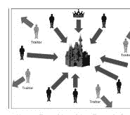

图示来源：[https://medium.com/@paul_12056/byzantine-generals-problem-ff4bdc340e56](https://medium.com/@paul_12056/byzantine-generals-problem-ff4bdc340e56)

比特币白书为拜占庭将军问题提供了第一个解决方案：它的工作量共识机制，下文将更详细地描述。

# 共识机制

共识机制（有时称为共识协议）是决定分布式节点如何在验证交易和向区块链添加新区块方面达成共识的特定规则。共识机制试图解决以太坊创始人维塔林（Vitalik Buterin）所说的“可扩展性三难困境”，即一个安全、可扩展且去中心化的协议。

*   **安全：** 区块链的不可篡改性和抗攻击能力有多强。
*   **可扩展：** 网络可以处理多少交易，以及处理这些交易的速度有多快。
*   **去中心化：** 对区块链的控制集中程度有多高。去中心化是区块链技术的核心原则，使其具有抗审查性，并减少或消除单点故障。

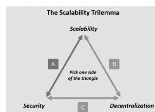

（图片来自 [https://medium.com/logos-network/everything-you-know-about-the-scalability-trilemma-is-probably-wrong-bc4f4b7a7ef](https://medium.com/logos-network/everything-you-know-about-the-scalability-trilemma-is-probably-wrong-bc4f4b7a7ef)）

可扩展性三难困境中任何一个方面的增加通常以另外两个方面为代价。在许多方面，可扩展性三难困境与需要装修承包商的人面临的问题相似。这些承包商在很大程度上面临类似的三难困境：工作可以做得快、便宜或质量好。任何两点的增加都会以第三点为代价。

## 主要共识协议

目前在使用三种主要的共识协议：工作量证明（PoW）、权益证明（PoS）和委托权益证明（DPoS）。

### 工作量证明（PoW）

通常，在 PoW 中，矿工寻找在网络上广播的交易并将这些交易组织成区块。然后矿工之间相互竞争将他们的区块添加到区块链中。获胜的矿工将获得区块奖励，这是网络代币的固定金额。

PoW 系统涉及的竞争在于，区块奖励只授予给第一个解决了复杂问题（称为密码哈希函数）的矿工。在不涉及计算机科学和数学的深奥领域的情况下，解决哈希函数的唯一方法是投入大量的计算力。在对所有可能的组合进行数万次尝试（称为暴力破解计算）之后，一个或多个矿工将解决哈希函数。此时，第一个解决哈希函数的矿工将被选定添加下一个区块。

#### 为什么矿工要花费这么多计算力？

好问题。他们这样做是为了区块奖励。按照 2020 年 1 月每个 BTC 10,000 美元的价格，比特币区块奖励为 12.5 BTC，所以每个区块奖励价值 125,000 美元。因为每天大约添加 144 个区块，当 BTC 价格为 10,000 美元时，区块奖励每天产生约 1440 万美元的价值。比特币价格越高，矿工尝试解决哈希函数的激励就越大。比特币网络有一种机制，称为难度调整，根据根据努力解决哈希的活跃矿工的计算能力（称为网络算力）来更改其哈希函数的难度。难度调整被程序设定为每 2016 个区块调整一次，大约每两周一次，以确保网络继续每 10 分钟创建一个新区块。

#### PoW 中的密码学原理

在不深入探讨博弈论和密码学的情况下，哈希函数通常接受任何大小的输入字符串，对该字符串进行操作，并输出固定大小的唯一字符串。哈希函数的一个重要属性是，输入字符串的任何变化都将产生完全不同的输出字符串。

哈希函数（`hash function`）一个经常使用的例子是网站密码：你设置一个密码并输入，网站会对你的密码进行哈希处理并存储该哈希函数的输出。哈希函数并不忽略你的密码有多长，因为无论长度如何，它都会根据你的密码创建一个唯一的、固定长度的输出，并存储该输出。然后，当你下次尝试登录并输入密码时，网站会运行相同的哈希函数，并将输出与它存储的内容进行比较。如果输出匹配，你就可以登录。

> 这听起来很简单，不是吗？但非常聪明。
>
> —Erik B. & Rakim, Move the Crowd (1987)

### 比特币矿与哈希

在比特币矿中，哈希函数被称为`安全哈希算法 256`（`SHA-256`）。`SHA-256`的输入包括：

*   包含组合在一起的新的、尚未确认的交易的数据；
*   与之前的区块相关的数据；
*   当前的时间和日期信息。

输出的哈希是基于这些输入的唯一 256 位数据字符串。出于安全考虑，协议通常要求双重哈希，以确保攻击者无法通过不同的输入产生相同的哈希。为了确保哈希足够安全，比特币网络会添加一些数据（`NONCE`——“只能使用一次的数字”的缩写），以确保区块的哈希将包含一系列前导零。这就是矿工们开始工作的时候。

矿工必须生成一个带有关于新区块正确信息和`NONCE`的哈希，使其与网络产生的内容相匹配。第一个找到该哈希并被网络验证和接受的矿工将能够添加下一个区块并获得区块奖励。

#### 矿工是如何找到正确的 NONCE 的？

**暴力破解（Brute force）**：他们编写计算机程序，将不同的`NONCEs`与正确的区块数据相结合，直到找到一个具有正确数量前导零的组合。2020 年年初，比特币需要一个大约有 18 个前导零的字符串，找到正确结果的难度大约是六万分之一。一旦找到解决方案，矿工就会将解决方案广播给其他节点，这些节点必须对其进行验证。在其他节点验证了解决方案（达成共识）后，该矿工将权获得区块奖励。

#### 这种安全性如何？

非常高。目前是如此。要“破解”比特币哈希（注：使用“破解”一词是因为详细解释黑客攻击比特币意味着需要额外的章节），算法必须使用原始数据并运行 `2⁵⁶` 次计算（这是一个 78 位的数字，大约是 115 亿 quattuorvigintillion，略有误差）。有人推测，一台试图破解哈希的超级计算机如果每秒执行 1500 万亿次计算，大约需要 0.65 亿（是的，是亿亿万亿）年才能破解它。

更现实的威胁是量子计算机。目前的估计是，破解比特币哈希“仅”需要`128 / 3`（大约 1350 万次）基本量子操作。虽然量子计算机目前大多仍属于科幻小说，但目前的估计是，到 2027 年，量子计算机就能在创建新区块所需的十分钟窗口内破解比特币。

量子计算机是否对比特币构成真实威胁尚存疑虑。原因之一是：

*   开发者和研究人员已经在研究抗量子解决方案；以及
*   当量子计算机进步到破解比特币成为可能时，量子加密术可能会紧随其后消除这种威胁。

怀疑这种威胁的更实际理由是，如果量子计算机可以破解比特币，它也可以破解所有其他依赖加密的程序和机构，包括几乎所有的政府和银行。对这些机构的攻击在财务上将比攻击比特币更具吸引力。

### 工作量证明（PoW）的优缺点

工作量证明（PoW）最常被提到的优点是：

*   **去中心化**。PoW 系统是去中心化的。
*   **安全性**。PoW 被认为是安全的。
*   **激励机制**。在 PoW 中，只有矿工被直接激励去维护网络。

工作量证明（PoW）最常被提到的成本是：

*   **能源消耗**。许多人声称计算机计算哈希函数浪费能量并对环境有害。
*   **扩展性**。因为全节点需要达成共识才能添加新区块，这需要十分钟，与 Visa 相比速度很慢。
*   **激励机制**。在 PoW 中，只有矿工被激励去维护网络，将其他利益相关者（如用户和开发者）排除在外。

## 权益证明（PoS）

权益证明（PoS）是验证区块链交易的首种被广泛采用的替代方案。在 PoS 中，新区块的创建者（验证者或造矿者）是通过算法在一组能够质押（`stake`）其部分代币的人中选出的，类似于彩票。验证者通过添加新区块获得手续费，质押代币越多，被选中的机会就越大。

攻击 PoS 系统是可能的，但情况与 PoW 不同。某些理论认为，黑客只需要流通中 1%的代币即可发动攻击。然而，实际上，在成熟的区块链上完成这种攻击极其困难。此外，在 PoS 系统中，验证者发动攻击的动力较小，因为他们会（1）失去质押的代币（2）如果网络价值下降，会导致他们持有的代币贬值。

### PoS 的优缺点

PoS 最常提到的优点是：

*   **扩展性和速度**。验证交易不需要整个网络，只需要几个验证者。这使得网络处理交易更快。
*   **能源消耗和成本**。由于不需要挖矿，因此不需要购买和更新运行挖矿软件的高昂计算机和芯片。此外，运行网络不需要大量的能源。
*   **激励机制**。在 PoS 中，任何愿意质押代币的人都可以获得手续费，这扩大了受激励维护网络的群体。

### 中心化与富豪者政治

黄金法则依然适用：金钱最多的人制定规则，而通常情况下，这些规则会帮助他们变得更富有。在 `PoS` 中，拥有代币最多的验证者对网络拥有最大的权力，决定验证哪些交易。这使得系统变得更加中心化、健壮性降低，并且倾向于做出有利于那些持有最多代币者的决策。

### 权益无质押问题 (Nothing-at-Stake Problem)

在 `PoS` 中，如果区块链发生了分叉（稍后会详细讨论分叉，但目前可以将其视为区块链在某一时刻临时分裂，当时尚不清楚分裂的哪侧是“正确”的），验证者在分裂链的两侧同时工作不会受到任何惩罚，即使其中一个分叉是由于攻击造成的。可以想象这将允许验证者在分叉解决之前，在分叉的两侧花费相同的代币（双重花费）。从经济学角度来看，验证者的最优策略是验证分叉的两侧，这样无论最终哪一侧获胜，他们都能赚取费用。尽管如此，虽然这种策略对验证者来说可能是最优的，但它会导致网络产生更多不稳定性，因为它可能会推迟或复杂共识，并可能增加攻击的成本。

目前使用 `PoS` 的区块链包括 `Peercoin` 和 `Reddcoin`。`Ethereum` 已表示计划在近期切换到 `PoS` 系统。下表由 `Blockgeeks` 提供，比较了 `PoW` 和 `PoS`。

来源：[`blockgeeks.com/`](https://blockgeeks.com/)。

## 委托权益证明 (DPoS)

意料之中，`DPoS` 与 `PoS` 。然而在 `DPoS` 中，用户不是使用代币进行质押，而是通过代币投票来决定哪些节点（主节点）将维护网络。投票是持续的，基于“一代币一票”（1t1v）的系统，因此用户拥有的代币越多，对网络的投票权和影响力就越大。被选出的被称为代表或见证者，他们因运行主节点和维护网络获得报。

`DPoS` 用户根据寻求代表候选人的声誉进行投票。如果代表人在任何时候工作不力或声誉变差，用户可以通过撤回投票立即“取消选举”该代表。由于用户拥有移除表现不佳代表的权力，代表们有动力保持良好工作，这种激励结构是 `DPoS` 的核心。

*   **激励**。由于用户根据代表的工作和声誉选择并保留代表，因此代表们被激励去做对用户最有利的事。
*   **实时投票**。由于区块链是透明的，用户可以立即检测到代表的不良行为并将其投票出系统。收入损失（以及声誉损失）的风险提供了一种动力。

### `DPoS` 最常被提到的成本是：

*   **中心化风险**。负责的人越少，越容易协调特定群体之间的活动。这种风险的一个例子发生在 2018 年 6 月，当时仅有 21 个代表的 `DPoS` 区块链 `EOS` 冻结了名怀疑携带盗窃资金的 `EOS` 用户账户。冻结这些账户的决定违反了 `EOS` 自身宪法规定的规则。这一决定无论是否合理，都凸显了将整个区块链的权力交给一小群人的风险。
*   **投票者冷漠**。`DPoS` 依赖关注的投票者。如果投票者冷漠，代表的恶意行为可能会逃避检测。
*   **中心化与富豪者政治**。由于与 `PoS` 类似的 `1t1v` 系统，拥有更多代币的人对网络有更大的影响力。因此，他们更有可能奖励并激励代表牺牲他人利益来为他们办事。

# 区块链治理

区块链治理描述了参与者就一组参数，用于更改区块链协议、解决争议、制裁违规者以及执行惩罚的过程。对于许多公共区块链，其用户和开发者的目标不仅仅是为了盈利，而是像整个互联网一样，创造公共利益。这产生产生治理问题。

然而，大多数治理机制并不适合同时处理经济和社会问题，而且通常将它们视为相互独立且不同的部分。治理在处理经济和社会问题方面失败的一个典型例子是“公地悲剧”，在这种情况下，个体用户根据自己的私利独立行动，通过集体行动耗尽或破坏共享资源，违背了所有用户的共同利益。

2008 年金融危机是商业治理机制未能考虑社会福利的典型例子。在危机期间，金融机构、抵押贷款经纪人、房地产经纪人以及一些房主在内的其他人参与了允许他们以牺牲他人为代价将财富转移自己的交易，其中包括最终买单的美国纳税人。当时存在的治理机制本应致力于对抗这种道德风险行为，但最终它们惨惨地失败了。

2008 年金融危机可能是创建 `Bitcoin` 的动力因素。`Bitcoin` 的开发者（或开发者们）`Satoshi Nakamoto` 在挖出的第一个比特币区块（“创世区块”）上仅添加了一条消息，内容如下：

```
The Times 03/Jan/2009 Chancellor on brink of second bailout for banks
```

许多人认为，2008 年金融危机是 `Nakamoto` 努力的动力，至少产生了影响。

## 链下治理机制

链下治理类似于大多数私有机构的治理结构。在链下结构中，受社区托付的个人聚集在一起，形成一个负责区块链治理和福祉的群体。该小组的任务是修复漏洞和安全风险、添加新功能和提高可扩展性、在公共讨论中代表区块链，并在用户、开发者、矿工和其他利益相关者之间维持权力的正确平衡。

链下治理的一个优势是信息方面的。只要由负责任且知识渊博的权威主导，他们可能处于最佳位置，能够做出符合社区利益的明智决策。另一个优势是减少了错误的概率，因为人类可以在代码实施到区块链之前努力纠正任何基于代码的错误。然而，任何链下治理过程都涉及某种程度的中心化，这与区块链的理念背道而驰。

虽然存在许多链下治理机制，但一个实用的模型是比特币改进提案（`BIP`），即便没有其他理由，仅仅是因为它的存在时间比任何其他机制都长。`BIP` 流程被比作美国政府的制衡体系，开发者类似于美国国会提交提案（类似于起草法律），但其他人（包括核心开发者、矿工和节点运营商，不分先后地类似于行政、司法和人民）在决定这些提案的价值和正当性方面发挥作用。然而，最终的用户（类似于选民）才是最终的决策者，因为如果他们对任何更改不满，他们可以反抗、切换协议或出售他们的代币。

### 比特币治理

`BIP` 流程通常从开发者提交改进提案开始。如果被认为有价值，该提案将：

1.  成为草案；
2.  发送到比特币核心开发者进行审查；以及
3.  被添加到 `GitHub` 的 `BIPs` 仓库中，并在更广泛的社区中进行讨论。

一旦作为草案接受，提案可以由作者推迟或撤回，也可以由节点运营商社区拒绝或接受。一旦一个 `BIP` 进入“接受”阶段，除非矿工对其表现出 95% 的支持，否则它无法定稿。最后，一旦定稿，节点运营商必须升级到协议的新版本，这包含了在 `BIP` 完全集成到比特币区块链之前之前的该 `BIP`。2020 年初，大约有 322 个 `BIPs`。下表描述了该过程：

`BIP` 集成过程（来自比特币 Wiki）

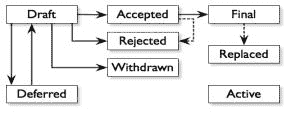

虽然比特币矿工、核心开发者和节点运营商都有改进网络的激励，但这些激励往往并不一致：

*   矿工受到的激励是获得区块奖励，奖励的价值与 `bitcoin` 的价格挂钩。许多人将矿工的激励结构视为比特币最重要的创新，它通过向将军（这里指矿工）支付薪水（区块奖励）只要他们诚实行动，从而解决了拜占庭将军问题；如果被发现试图欺骗，则扣除那部分薪水。
*   比特币开发者对 `bitcoin` 的价格没有直接的财务激励。相反，作为一个开源项目，比特币依赖于那些在哲学上与其密码客精神（cypherpunk ethos）理念相合、相信网络并在业余时间为网络工作的开发者。尽管比特币开发者可能无法获得直接的财务报酬，但他们确实获得了可以货币化的经验和资历，特别是在区块链开发人员需求呈指数级增长的情况下。


*   比特币节点运营商也受到网络效用和 `bitcoin` 价格增长的间接激励。节点运营商的作用是“利用日常计算机的力量运行一种叠加的安全协议，对区块链进行监管。随着越来越多的节点进入系统，治理层就会变得更加安全，从而提高效率”。由于网络安全性和 `bitcoin` 价格增加，节点运营商并没有获得矿工奖励的任何部分，也没有获得核心开发者改进的信用。他们唯一的处是增加了网络安全性以及对投资的保护。如果没有他们的参与，网络将陷入停滞。

不同利益相关者的激励有助于解释为什么实施的 `BIPs` 较少（截至 2020 年，322 个 `BIPs` 中只有约 40 个实施），且许多提案引发了激烈争议。

# 链上治理机制

链上治理是一种对区块链本身更改的正式系统。大多数链上治理机制将决策权分配给原生代币持有者。这些机制通常基于投票或其变体，或者是“基于权益的治理”系统，在这种系统中，代币持有者必须承担某些代币风险才能参与治理。无论何种情况，被批准的决定会自动编码到协议中。

Tezos 是使用链上治理的较成熟区块链之一。其治理过程简述如下：

## Tezos

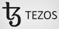

Tezos 将自己描述为一个“无法被第三方审查或关闭的智能合约和去中心化应用平台”。在 Tezos 中，所有利益相关者都被允许参与治理，协议提供了一个利益相关者就提议修订达成共识的正式且系统的程序。Tezos 还将显式的改进机制纳入区块链，为开发者提供清晰的奖励框架，并让代币持有者能够评估提案的价值并决定是否改进协议。

链上治理存在许多问题。对这些问题的深入探讨超出了本书的范围，但一些经常讨论的问题如下：

*   **富人政治与勾结**。富人政治是由富人统治。在链上系统中，富人政治意味着持有大量比例代币的个人或实体控制控制，这允许他们勾结并主要维护自身利益，从而损害资源较少者的利益。
*   **可变性**。区块链技术最重要的特征之一是无法更改记录在所谓的永久账本上的交易。在链上治理系统中，可以通过投票来“撤销”某交易或一系列交易，并回滚或编辑账本的历史。
*   **被排除的利益相关者**。在许多链上治理系统中，非代币持有者被排除在治理之外。然而，通过排斥他们，他们的参与消除了对代币持有者权力平衡的重要制衡，特别是在不需要用户持有代币的区块链应用中。

名为 Decred 的区块链同时使用了链上和链下治理，其治理过程简述如下：


Decred 自称为一种“开放、进取且自我资金支持的加密货币，其区块链中集成了一套基于社区的治理系统”。在 Decred 中，代币持有者可以将其代币锁定（质押）以换取门票，持票者可以通过两种链上治理机制和一种链下治理机制参与治理。链上部分允许投票来：（1）以 75% 的通过率批准或拒绝对协议共识规则的提议更改；（2）批准矿工的工作，从而允许矿工获得其区块奖励。

# 智能合约与去中心化应用

## 智能合约

智能合约是区块链应用程序，包含一组规则，双方可以通过这些规则达成交易协议。一旦满足这些协议的条件，协议条款将自动在区块链上或通过依赖于区块链的链下应用执行。

智能合约的目标是用计算机代码设定协议条款和其执行规则，从而消除对可信中间机构的需求。非区块链智能合约的一个简单例子是自动售货机：交易规则被程序接到机器中。一旦买家向机器中投入正确的金额，机器就会确认金额正确并提供商品。

尽管被称为智能合约，但大多数并不是法律合同。相反，它们是一组设定了执行规则的条件指令。如果程序编写正确，智能合约是自验证、自执行、防篡改的，并且在大多数情况下可以通过减少或消除对可信中间机构的需求来降低交易成本。以太坊（Ethereum）是第一个专为智能合约开发而设计的区块链，其目的是创建一个：

一个不仅能够支持货币或交换媒介的用例的平台，还能为货币增加可编程性，在方程中引入条件逻辑，这将为去中心化金融应用、产品以及额外的去中心化应用开启一个可能的世界。

| 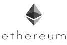以太坊：一个智能合约平台 2013 年 11 月，维塔里克·布特林（Vitalik Buterin）发布了以太坊白皮书，提出以太坊作为一种开源分布式计算平台，在该平台上可以构建和维护智能合约以及其他货币和应用。运行该平台的燃料被称为“以太坊（ether）”，它是以太坊系统运行程序和存储数据所需的加密资产。以太坊由位于瑞士楚格（Zug）的非营利组织以太坊基金支持，其使命包括向公众改进有关以太坊平台进展和发展的沟通。 |

| --- |

下面的示例解释了智能合约是如何工作的。

### 区块链智能合约：对 NCAA 冠军赛下注

假设这是未来（202X 年）某场 NCAA 篮球锦标赛的决赛，互不认识的 Bibi 和 Chaun 想对结果下注。每个人都想对 NCAA 冠军赛下注 100 美元。Bibi 想下注马里兰大学地鼠队（Terps）获胜，而 Chaun 出于某种原因（搬到卡罗来纳州 NC 了？）想下注杜克大学获胜。他们都认为如果赢了，他们的赌注应该翻倍（2 比 1 的赔率——“平手”投注）。如果马里兰大学胜，Bibi 将获得 200 美元（原始的 100 美元赌注和额外的 100 美元），如果杜克大学胜，Chaun 将获得 200 美元。由于决赛中没有平局，除非发生某些灾难性事件，否则只有两种结果：地鼠队胜或杜克大学胜。

由于 Bibi 和 Chaun 互相陌生，他们需要一个可信的中间机构来下注。该中间机构将提供两个重要功能：（1）让他们获赔率；（2）保证支付。在现实世界中，这种可信中间机构是博彩（bookie），它向所有潜在下注者广播赔率。在 Bibi 和 Chaun 对冲（offsetting positions）的情况下，博彩会收取一笔费用。这种费用在博彩术语中被称为“水”（vig）通常是投注金额的 10%。

一旦比赛结束且地鼠队获胜（作者注权），Bibi 将想要获得她的获胜收益。博彩将给 Bibi 90 美元（100 美元减去 10% 的水费）。这正是智能合约可以增加价值的地方。在相同的条件下，Bibi 和 Chaun 最好通过一个不收取“水”的智能合约直接相互下注。

该合约结构将：

*   向想对 NCAA 冠军赛下注的人广播信息；
*   匹配像 Bibi 和 Chaun 这样对冲部位的人；
*   为这些下注者提供进入智能合约的机制；
*   收集每个下注者的押金并持有直到比赛结束；
*   将智能合约中持有的所有资金支付给赢者，扣除极微的（几分）区块链交易成本。

智能合约执行了博彩曾做的所有任务，但成本低得多。但这引发了一个实际问题：

智能合约如何知道谁赢了？

就像《矩阵》中的墨菲斯和尼奥一样，智能合约需要看到预言机（Oracle）。

## 预言机

预言机是程序、设备或实体，为智能合约提供外部数据，以判断条件是否已满足，而不违反区块链的完整性。在智能合约中，预言机发现并验证现实事件，然后将这些信息发送到区块链供智能合约使用，或直接发送给智能合约。

### 为什么要信任预言机？

由于区块链系统被设计为无需信任，预言机向系统重新引入了某种程度的信任。然而，一套演进的预言机集合通过财务、声誉和治理协议减少了使用预言机相关的风险。此外，许多智能合约依赖多个预言机来进一步降低这些风险。

Jesus Rodrigues 在 Hacker Noon 的一文中（12）

*   **人类预言机**：访问并向区块链输入外部数据的个人或群体。
*   **应用预言机**：直接从互联网或在线应用程序接口（API）获取数据并将其传输到区块链应用程序的软件应用。应用预言机有三种基本类型：
    1.  **中心化预言机**：依赖来自 API 或其他中心化应用程序的信息；
    2.  **联邦预言机**：依赖少数节点来验证外部信息，以与主数据提供者相关；
    3.  **去中心化预言机**：去中心化预言机收集外部数据，但在提供给区块链之前，会通过一个或多个去中心化共识协议对数据进行验证。
*   **硬件预言机**：捕捉外部数据并将其提供区块链的电子设备。

任何预言机的挑战在于确保其提供的信息是可靠的。虽然预言机确实为区块链的去信任特性引入了漏洞，但已经有很多应用程序上线来解决预言机问题。是一些顶级预言机应用及其网站摘录：

-  **Augur** (`augur.net`) 依靠个人报告与特定预测相关的外部事件，并采用验证争议协议和声誉代币来维护预言机的行为记录。
-  **Chainlink** (`chain.link`) 维护一个去中心化预言机网络，作为智能合约本身提供安全保障。通过允许多个 `Chainlinks` 数据，`Chainlink` 应用旨在消除单点故障并维护智能合约的整体价值。
-  **Provable** (`provable.xyz`) 提供了一个允许将多个数据源集成作为预言机的平台，采用称为“真实性证明”的机制为其过程提供透明度，并为提供给智能合约的外部数据提供完整的审计追踪。
-  **Witnet** (`witnet.io`) 是连接智能合约到外部世界的去中心化预言机网络。它旨在允许任何软件检索位于任何网络地址发布的内容，并提供完整且可验证的完整性证明，而不盲目信任任何第三方。

在我们的示例中，假设预言机通过检查美国每份主要报纸的比赛最终得分以及全球前五十个体育相关网站来运行。它还会联系 20 位受信任的个人来确认信息的准确性。如果所有双方都确认了得分，预言机会将信息提供给智能合约，告诉智能合约马里兰州赢了，杜克州输了。智能合约将向 `Bibi` 进行支付。

智能合约图 13

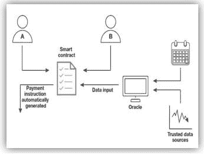

## 智能合约面临的挑战

智能合约的吸引力在于对于简单的交易，它们消除了对信任中间介的需求，特别是当协议条款相当简单且易于验证时。然而，对于更复杂的协议，智能合约未能解决许多关键问题，包括：

*   **管辖权**。法律合同根据特定法律或行政机构的法律进行管辖，这些机构有权解决由这些合同引发的争议。此外，由于词汇在不同语境下具有不同含义，许多司法管辖区提供了关于合同中所用词汇含义的信息。相比之下，智能合约通常只是简单列出交易协议的条款，而对管辖权或特定术语的含义保持沉默。
*   **匿名性**。在法律合同中，双方通常知道交易另一方的身份。然而，在区块链上，数字资产的所有权通常是伪名的，这意味着所有者的身份通常是伪装或隐藏的。智能合约只会验证进入合同所需的条件，而对某方如何满足这些条件不加区分。例如，如果 `Chaun` 通过从儿童慈善机构或其他其他不当计划中误导资金而获取了 `$100` 来对 `Duke` 押注，智能合约并不会在乎。
*   **争议的执行**。如果法律合同发生争议，合同双方可以根据合同语言和管理合同的管辖区规则解决争议。一旦争议解决，有权获得救济的一方可以根据合同以及管辖区的法律或规则执行该救济。在智能合约中，如果智能合约在执行后发生争议，可能没有方法识别智能合约的其他方。即使可以识别出这些对方，由于智能合约中没有设定争议解决机制，将不清楚哪个管辖区 (i) 有权解决此类争议，或 (ii) 可以执行救济。

有人理论化了智能合约有一天将取代律师。这不太可能。虽然智能合约可能会减少对某些法律实践领域的需求，但它们将增加对能够与代码人员配合起草更复杂、更稳健智能合约的律师的需求，特别是随着更多 `IoT` 产品的上线。

## 去中心化应用 (DApps)

DApps 是运行在计算机点对点 (`P2P`) 网络上的上的应用程序，通常允许数据传输。区块链 DApps 使用区块链允许数据传输。非区块链 DApps 的示例包括 `Napster`、`BitTorrent` 和 `Tor` 浏览器，它们都是 DApps。`Bitcoin` 和 `Ethereum` 都是 DApps 的示例。

使用智能合约的区块链 DApps 通常符合以下标准：

1.  **开源**。DApp 协议的源代码对任何人可用并自主运行。
2.  **去中心化**。DApps 运行在 `P2P` 网络上，该网络利用加密技术存储数据并避免中心点故障。
3.  **代币运行**。DApps 使用 DApp 运行所需的代币。通常，对 DApp 的任何价值贡献（例如根据共识机制验证交易）都会获得该 DApp 代币的奖励。
4.  **代币生成**。它们使用 `PoW` 或 `PoS` 共识机制，或两者的结合。随着 DApps 的演进，共识机制可能会随之变化。

通常，DApps 分为三种运营类别：

*   **第一类类型**：拥有自己的区块链的 DApps，例如 `Bitcoin` 或 `Ethereum`。
*   **第二类类型**：使用第一类 DApps 区块链并需要代币运行的 DApps。
*   **第三类 DApps**：使用第二类 DApps，但通常也发行并需要自己的代币。

一种思考不同 DApps 类型（不考虑代币的使用）的方法是：

*   第一类 DApps 类似于操作系统，如 `Microsoft Windows`、`Android` 或苹果的 `IOS`。
*   第二类 DApps 类似于运行在操作系统中的软件程序，如 `Microsoft Word` 或 `Adobe Photoshop`。
*   第三类 DApps 类似于运行在其他软件内部的专用软件，如 `Microsoft Word` 中的拼写检查器。

## DApp 和智能合约平台

DApps 和智能合约都需要区块链来运行，不同的区块链作为 DApp 或智能合约平台具有不同的优缺点。通常，主要问题是可扩展性——DApp 或智能合约快速执行交易的能力。

“以太坊是一个运行智能合约的去中心化平台：这些应用程序完全按照程序运行，不存在任何停机、审查、欺诈或第三方干预的可能性，”而其代币以太（`ETH`）“是运行分布式应用平台以太坊的必要元素——燃料。它是平台客户向执行请求操作的机器支付的一种支付形式。”

以太坊的设计是为了让开发者和创业者能够更容易构建智能合约和 ĐApps。在 2017–18 年间，91% 的初始代币发行（ICO，一种智能合约的形式）在以太坊上发布。2019 年底，以太坊、EOS 和波场（Tron）占据了总 ĐApp 交易 98% 以上的份额，报告的交易量分别为 128 亿美元、61 亿美元和 44 亿美元。

所有网络都面临着许多挑战者，这些他们声称自己的网络对于 ĐApps 和智能合约来说“更好”，这通常意味着这些网络速度更快、可扩展性更高，并且能够处理更多的交易。以太坊的可扩展性问题在 2017 年基于一个基于以太坊的 ĐApp 游戏 `Cryptokitties` 变得明显。

### Cryptokitties

Cryptokitties 是一个虚拟收藏品应用，允许用户领养、饲养和交易虚拟猫。Cryptokitties 依赖遗传算法来产生新猫，考虑了父母选择、基因突变以及每个父母基因的交叉，使得每只新猫都拥有独特的基因组。在游戏中，每只 `cryptokitty` 都有 256 位的基因组，这意味着每只猫大约有四十亿可能的基因变异。此外，每只猫都是独一无二的数字资产，因为每只猫都由一个非同质化令牌（称为 `ERC-721` 令牌）代表，这意味着每个令牌都是唯一的。

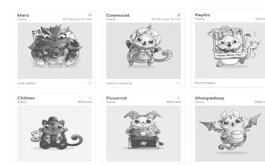

致谢：Cryptokitties.co。

在 Cryptokitties 中，智能合约被用于执行繁殖、饲养、喂养、装饰、购买和出售猫的任务。每当执行新任务时（例如繁殖一只新猫），就会执行一个新的智能合约，该合约继承其他相关智能合约的信息（例如每个父母的基因组）。然后，当需要执行其他任务时（例如饲养新猫），会根据较早的智能合约执行另一个新的智能合约。作为一个区块链应用，每只 `cryptokitty` 的整个智能合约历史都会被记录并供所有人查看。

下表了记录的一些信息以及使用的智能合约编程语言：

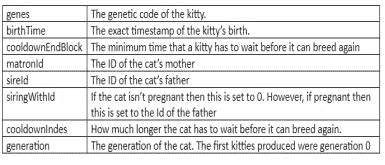

来源：[`blockgeeks.com/guides/cryptokitties/`](https://blockgeeks.com/guides/cryptokitties/)。

Cryptokitties 是以太坊上最流行的应用程序——事实上，它流行到几乎关闭了整个网络。

#### Cryptokitties 是如何几乎关闭以太坊的？

因为繁殖、饲养、喂养、装饰、购买和出售 Cryptokitties 都是独立的智能合约，在巅峰时期，这些活动消耗了以太坊网络流量 20% 以上。结果是交易处理时间从几秒钟增加到十分分钟或更长时间，许多交易从未被执行。

Cryptokitties 和比特币的吸引力基于同样的原理：稀缺性。对于比特币，永远只会产生 2100 万个 `BTC`，这种稀缺性驱动了需求。对于 Cryptokitties 来说，能够获得一种独特的、因此稀缺的收藏品资产。Cryptokitties 的开发者发现，通过创建几乎无限数量的特征，市场会不断对某些特征产生需求，用户会沉迷于繁殖、交易和收集具有这些特征的猫。Cryptokitties 的网络问题凸显了广泛采用区块链的一个主要障碍：可扩展性。

### 可扩展性

为了让区块链应用能够触及主流用户，它的性能必须像主流应用程序一样。在一个拥有有互联网和 5G 的世界里，这意味着快速。但大多数主流区块链由于“可扩展性三困境”，无法在不损害安全和去中心化的情况下快速执行交易。对于 PoW（工作量证明）区块链，速度由两个主要因素决定：将交易添加到区块的时间以及达到共识的时间。


# 区块链可扩展性与身份解决方案

`PoW` 区块链的可扩展性问题带来了一项艰巨的技术挑战。目前，许多区块链节点存储区块链的完整历史，在某些情况下还处理交易。两个流行的 `PoW` 区块链比特币和以太坊每秒分别只能处理三到七笔和七到十五笔交易。[14] 远低于 Visa 每秒二十四笔交易的速度。这种无法扩展的能力带来了一个挑战。限制比特币扩展能力（交易吞吐量）的一个因素是每个区块中的数据量。目前，比特币有一个 `1 MB` 的区块大小限制。[15]

一个被广泛讨论的比特币可扩展性解决方案是增加基础区块大小。在那场辩论中，增加区块大小的主要论点是，这样做可以在每个区块中包含更多数据，允许更大的交易吞吐量。反对增加区块大小的主要论点是，这将扩展成本直接转嫁给节点运营商，他们必须升级设备。由于更多节点运营商无法或不愿升级，网络将不可避免地变得更加中心化。关于增加区块大小的首次比特币辩论发生在 2015 年。比特币社区最终决定不增加区块大小，这导致了硬叉。

有些已经实施或即将实施的扩展解决方案允许部分节点验证交易。到目前为止，最受讨论的解决方案是比特币的 `SegWit` 和 `Lightning`，以及以太坊的 `Sharding`（分片）和 `Plasma`。

不同的解决方案在不同的链上演变，是因为广义地说，每条链都有不同的目标：比特币的价值主张是作为“数字黄金”，一种主要作为价值存储手段的加密货币，也可以作为交易媒介和记账单位（如第二部分所讨论）。以太坊的价值主张是作为各种智能合约和 ĐApps 的操作系统，并可能是物联网（IoT）的主操作系统。

## 比特币扩展——SegWit 和 Lightning

### SegWit

#### SegWit 如何工作？

区块链交易既包含签名数据（用于验证发送者是否有资金进行支付，称为“见证”信息），也包含交易数据（详细列出拟议交易的内容）。SegWit（分离签名）将这些签名数据（见证信息）与交易数据分离。由于签名数据约占典型交易中数据的 65%，SegWit 大幅度减少了完成一笔交易所需的数据量，使得每个区块能够容纳更多交易，从而提高了区块链的交易处理能力。广而言之，SegWit 允许一个 `1 MB` 的比特币区块运行得像一个更安全的 `4 MB` 区块。

尽管 SegWit 似乎缓解了比特币的可扩展性问题，但它的实施并非没有争议。在不深究技术细节的情况下，从区块中移除见证数据可能会使证明交易确实发生过变得更加困难。关于 SegWit 的分歧是导致首次极具争议的比特币链分叉以及比特币现金（`BCH`）产生的因素之一。

如上所述，在 SegWit 集成前后，比特币社区的一些人认为解决扩展问题的更佳方案是增加区块大小。然而，在经过一场非常公开的辩论后，比特币社区决定不增加区块大小，仅实施 SegWit。这一决定导致一群矿工、开发者和活动人士分叉了比特币区块链，并在 SegWit 实施之前的某个点进行了分叉。新链被称为比特币现金，拥有与比特币相同的 SegWit 之前的历史，但允许高达 `8 MB` 的区块大小（相比之下，比特币为 `1 MB`）。硬叉之后，任何拥有 `BTC` 的人也拥有相同数量的 `BCH`。


闪电网络是一种第二层协议，为比特币的可扩展性问题提供了另一种解决方案。闪电网络通过以下方式工作：

* 从区块链识别部分相关数据；
* 将这些数据移出区块链（链下）；
* 使用这些链下数据执行交易；
* 对所有链下交易进行结算；以及
* 将结算后的交易整合回区块链。

使用闪电网络的个人交易（闪电交易）不记录在区块链上（链上），这释放了区块链以执行其他任务的资源。相反，这些闪电交易在链下进行验证和记录，并在之后的某个时间点，这些闪电交易的净结果在链上进行结算。

闪电网络的工作原理允许用户打开第二层支付通道，然后使用这些通道在链下执行交易。一旦特定通道的所有交易完成，这些支付将进行汇总和结算，然后关闭通道。一旦关闭，该通道在开启期间所有交易的记录将在链上进行结算并记录。

### 闪电网络交易的范例

假设 Bibi 和 Chaun 定期互相买卖商品。为了避免在区块链上记录每笔交易，他们可以各自从区块链移动 `$100` 到他们的支付通道中，从而建立一个支付通道。此时，他们可以使用他们的支付通道相互之间进行买卖，而无需在区块链上记录每笔交易。

运行方式如下，假设他们都在周日打开了一个为期四天的支付通道，并各自向通道转入了 `$100`：

* 周一，Bibi 向 Chaun 发送了 `$40`。
* 周二，Chaun 向 Bibi 发送了 `$50`。
* 周三，他们关闭了通道。

一旦通道关闭，支付将进行汇总：

* Bibi：`$100 − $40 + $50 = $110`。
* Chaun：`$100 + $40 − $50 = $90`。

来自关闭通道的信息将发送回区块链，并带有指令向 Bibi 的账户发送 `$110`，向 Chaun 的账户发送 `$90`。闪电网络的优势在于，它消除了网络需要记录和验证底层周一和周二交易的需求。

许多人将闪电网络视为让比特币用于日常交易的一种方式。优点包括更低的交易成本（因为整个网络不需要处理每笔交易）以及更大的网络容量（因为这些链下交易不会阻塞网络，并允许处理更多交易）。这种容量对于微交易和物联网（IoT）用途最有益，在这些场景中，可以将指令发送到连接的设备以执行特定任务。

根据闪电网络搜索和分析引擎 `1ML` 的数据，截至 2019 年底，闪电网络的网络容量约为 `850 BTC`，拥有一万一千个节点、三万五千个支付通道，中位基础费用为 `1 Satoshi`（比特币的亿分之一）。然而，正如生活中的大多数事情一样，细节决定成败。闪电网络中发现的几个问题如下：

* **资金锁定**：如之前的示例所示，闪电网络用户需要在通道中存入资金，这意味着资金在通道关闭之前会被锁定在通道中。通道开启越久、执行的交易越多，它将交易移出区块链并提高网络效率的效果就越高。然而，这也增加了价格波动的风险。例如，如果一个用户的通道开启了一周，并且由于某种原因 `BTC` 价格崩溃而想要出售，该用户将被锁定直到通道关闭。
* **中心化**：闪电网络是否会增加中心化，从而使网络整体变得不安全且更容易受到攻击，这是一个非常有争议的问题。中心化论点部分基于这样观点：演变产生的是一种星纽型中心化（图 A）。

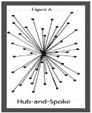

简而言之，这种观点主张，为了连接具有不同通道的不同用户，将会出现一个枢纽系统，许多用户连接到同一个枢纽以便他们相互交易。因此，这些枢纽更容易受到攻击，而控制运行这些枢纽的支付通道方对网络拥有过大的控制权。

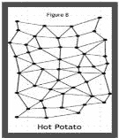

其他人则认为，星纽型中心化的风险被放大了，可能会出现的将是热土豆式分布式网络（图 B）。简而言之，在热土豆式分布式网络中，每个节点都将交易传递给下一个愿意将交易带向目的地的节点，并使用所谓的源路由和洋葱路由。源路由意味着支付发送者构建支付路径。洋葱路由意味着对于多跳交易（热土豆），路径中的中间节点只知道两个当事方的身份：转入支付的方和下一个接收支付的方。最终目的地将是唯一知道支付将在那里停止的节点。源路由和洋葱路由允许支付的源和最终目的地追踪支付，同时保护它们的身份，从而增强了隐私性和抗审查能力。

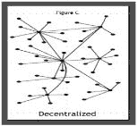

答案正如生活中的许多事情一样，可能处于中间。可能会出现一种去中心化网络（图 C），它兼具图 A 中星纽型中心化和图 B 中热土豆式分布式网络的属性。

以太坊在尝试扩展方面表现得更加激进，因为它在保持其去中心化应用（DApps）和智能合约主导地位的道路上面临着更大的竞争，从而成为物联网的主导操作系统。夺取以太坊地位的潜在收益引起了投资者和开发者的兴趣，并让他们通过规避以太坊的一些局限性，提供了具有更大扩展潜力和更广泛采用的平台。两个此类以太坊竞争对手 `EOS` 和 `Tron` 声称具有更快的交易吞吐量和更低的费用。但以太坊并没有放弃战斗，并采取了重大步骤来改进。

以太坊最受讨论的扩展改进包括 `Raiden Network`、`Plasma`、`Sharding`（分片）、计划中的叉（包括 `Constantinople`、`Istanbul` 和 `Berlin`）以及 `Casper`——以太坊提出的向权益证明（PoS）共识机制的变更。`Casper` 和 `Sharding` 完全集成被称为“Serenity”，它将创建一个所谓的“以太坊 2.0”。下面将简要讨论每一项。

### Raiden Network 和 Plasma

`Raiden Network` 基本上是以太坊版本的 `Lightning Network`，并于 2018 年 12 月在以太坊主网上上线。像 `Lightning` 一样，`Plasma` 将交易发送到链外，同时依赖以太坊网络提供底层安全。然而，`Plasma` 的架构结构更像棵树，从以太坊主区块链派出的分支可以生成其他分支。`Plasma` 的工作原理是将计算复杂的交易移动到侧分支，仅将完成的智能合约广播到以太坊区块链。

### Sharding

`Sharding` 是一个广泛用于数据库的概念，以提高其效率。一个 `shard`（分片）是数据库的水平部分或切片。`Sharding` 的原理是将大型数据库划分为较小的数据库，使得执行数据库操作更易于管理。

对于区块链而言，`sharding` 通过将现有区块链分成更小的部分（`shards`），使得每个节点只需要存储区块链数据的一个 `shard`，但允许分片以某种方式进行通信，使链保持安全和去中心化。根据某些估计，如果以太坊有一百个分片，该链每秒能够处理约一万次交易。然而，在 `Casper` 实现之前，以太坊无法使用 `sharding`，因为 PoW 网络中的 `sharding` 更困难，并且会让网络更容易受到攻击。

尽管 `sharding` 提供了许多潜在益处，它也暴露了许多潜在的攻击向量。通常情况下，这些向量与数据的有效性和可用性有关：

* **有效性 (Validity)**：在与 `shard` 交互时，可能无法验证该 `shard` 的历史，这使得该分片声称代表的整个链的有效性受到怀疑。
* **可用性 (Availability)**：数据可用性问题的解释超出了本书的范围。简单来说，问题在于确保分片中有足够的数据来检测攻击和欺诈，允许交易被 (i) 视为已验证并处理，或 (ii) 视为无效并惩罚，从而抑制未来的攻击和欺诈活动。

### 计划中的以太坊叉

以太坊的许多改进是通过计划中的软件升级实现的，称为“叉”（forks）。下面描述了一些较重要的计划叉：

* **Constantinople**：`Constantinople` 是 2019 年 2 月对以太坊的升级，其设计目的包括其他方面使在链上开发项目变得更容易，允许未来实现扩展解决方案，并作为向以太坊向 PoS 链（`Casper`）过渡的一步。`Constantinople` 需要以太坊区块链的硬叉，并将区块奖励从 `3 ETH` 减少到 `2 ETH`（上一次主要的硬叉升级 `Byzantium` 将区块奖励从 `5 ETH` 减少到 `3 ETH`）。
* **Istanbul**：`Istanbul` 是 2019 年 12 月的一次硬叉，引入了额外的隐私和扩展能力，重新平衡了某些 `ETH` 定价机制，允许以太坊和 `Zcash`（一种提供完全隐私交易且可通过以太坊上的智能合约验证的加密货币）更好地协同工作，并允许智能合约拥有更多功能。
* **Berlin**：`Berlin` 硬叉预计初步于 2020 年 6 月进行，并将引入一种被称为“渐进式工作证明”（`ProgPoW`）的算法。正如 `CoinDesk` 所解释，`ProgPoW` 是以太坊变为 PoS 系统之前所需的过渡步骤。此外，`Berlin` 将减少昂贵的 `ASIC` 芯片的挖矿能力（`ASIC` 芯片是“专用集成电路”，是专门为挖矿设计的计算机芯片，因此效率高出数千倍），并增加大多数个人电脑使用的非 `ASIC` 芯片的能力，例如 `CPUs` 和 `GPUs`（`GPUs` 是“图形处理器”，常见于许多标准电脑并允许显示图像）。放弃 `ASIC` 芯片的一个原因是，随着 `ASIC` 芯片进行的挖矿越来越多，将越来越少的矿工能够竞争区块奖励，矿池将变得更加集中。
* **Casper**：以太坊最深远的变化将是 `Casper`，它将以太坊转换为 PoS 链。这样做将消除以太坊挖矿，并通过转向 PoS 实现更快的交易吞吐量。

### Serenity——以太坊 2.0

`Serenity` 是以太坊 2.0 的最后一步，是 `Casper` 和 `Sharding` 的结合，在两者都运行之前无法实现。`Serenity` 预计最早要到 2020 年底才会实现。根据以太坊核心开发者的说法，`Serenity` 将完成向 PoS 共识机制的切换，并带来扩展性的千倍增长，同时使链更安全、更节能。

## 叉与链分裂

> 并不是所有面对的事都能改变，但在面对之前，什么也无法改变。
>
> — 詹姆斯·鲍德温 (James Baldwin)

总会有那么时刻，由于这样或其他原因，事情发生了变化。在区块链上，这些变化由“叉”表示。区块链叉是对区块链软件的修改，而分叉区块链是指修改实施后的区块链。

关于比特币和以太坊中一些引起争议的叉有很多记载，但叉有时是无害的。在某些情况下，当两个或多个节点同时发现区块时就会发生叉。这些叉是暂时的并在区块链上解决。在其他情况下，叉用于实施升级，或在向公众推出之前在区块链上测试功能和流程。

叉有两种类型：硬叉（hard forks）和软叉（soft forks）。两者之间的主要区别在于向后兼容性，即区块链的新版本理解并运行在旧版本创建的数据上的能力。下面将简要讨论每一项。

### 软叉

软叉是一种收紧或限制协议规则的软件升级。软叉是向后兼容的，这意味着旧的叉前区块可以接受并与新的叉后区块一起。然而，如果旧的叉前区块违反了由软叉建立的规则，新的叉后区块将拒绝这些旧区块。

软叉的一个例子是比特币引入区块大小限制。最初比特币对区块大小没有限制，但在 2010 年执行了一个软叉，为所有新区块设置了 `1 MB` 的区块大小限制。新限制意味着新的 `1 MB` 叉后区块不会被没有限制的叉前区块拒绝，但如果矿工尝试添加一个 `2 MB` 的区块（这在叉前是可以接受的），那么该区块在 2010 年软叉之后将被拒绝，因为它违反了软叉设置的 `1 MB` 限制。

在软叉之后，矿工必须升级到新的分叉软件。否则，旧软件可能会创建违反软叉规则的区块，并被分叉软件拒绝，导致对算力的昂贵浪费且无法获得区块奖励。

### 硬叉

硬叉不是向后兼容的，这意味着在旧链上无法发生的操作可以在新链上发生。例如，假设一个链的最大区块为 `1 MB`，该链执行了硬叉将区块大小增加到 `4 MB`。分叉后，`2 MB` 的区块会被新的分叉链接受，但 `2 MB` 的区块会被旧链拒绝，因为超过了 `1 MB` 的区块大小。

### 分叉

> 对于人们来说，什么是好的分叉？——钦努瓦·阿切贝，《分崩离析》

当出现两个或多个竞争版本的区块链时，就会发生分叉。分叉可以由硬叉或软叉引起。下图描述了分叉。

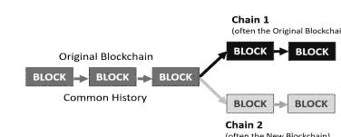

如所示，两个链将拥有分叉前的历史，但会有新的分叉链。要导致分叉，双方必须拥有足够的经济实力和算力来运行其首选的区块链版本。通常，分叉围绕着有争议的技术提案展开，双方都相信随着时间的推移，“正确”一方将获胜，而“错误”一方将失败。

已经有很多与比特币相关的硬叉，但最重要的两个是 2017 年 8 月创建 `BCH` 的硬叉，以及 2018 年 11 月创建 `ABC` 和 `SV` 的分叉，如下：

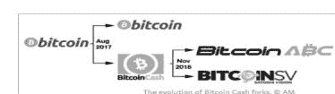

#### 比特币叉

2018 年 11 月，在经过激烈的公开辩论后，执行硬叉导致了两个新币的产生：`ABC` 和 `SV`。在决定哪种币将成为“真实”比特币的战斗中，双方 (i) 都声称是合法的比特币，(ii) 都寻求符号，这指示了分叉的“胜利者”。

这场战斗演变成了公开，当时有许多关于媒体威胁、跨链破坏和报复的报道。为了参与战斗，矿工池将大量的算力转向了各自一方。估计，`ABC` 和 `SV` 双方为了争夺统治花费了超过 700,000 美元。

导致分裂的一个原因是区块大小：`ABC`（为了“可调整区块大小”）想要维持 `32 MB` 的区块大小，而 `SV`（为了中本聪的愿景）想要将区块大小增加到 `128 MB`。由于双方无法达成共识，双方都使用了硬叉来实现所需的区块大小。

在硬叉之前，许多加密交易所停止了交易，不仅是因为分叉的不确定性，还因为不清楚哪一个分叉链将被允许继续。随着时间的推移，`ABC` 似乎胜出了。许多交易所现在将 `ABC` 称为比特币现金（`BCH`），但 `SV` 仍然是一个选择。根据 `coinmarketcap.com`，截至 2019 年底按市值，`ABC` (`BCH`) 的市值约为 49 亿美元，而 `SV` 的市值约为 29 亿美元。

## 区块链上的身份

拥有并证明身份在现代社会中至关重要。根据《联合国儿童权利公约》第 8 条，每个人都有身份权。然而，全球范围内有 11 亿人无法声称自己的身份，因为他们没有证明身份的必要文件。缺乏这种证明，他们参与社会、拥有财产、投票、获得政府服务、开设银行账户或寻找全职工作的能力将受到限制或不存在。

个人的身份证明通常由国家提供的身份手段组成。在美国，这些包括出生证、社会安全号码、驾照和护照。所有这些都要求持有和保留包含各种形式身份数据的物理文件。在许多情况下，当人们需要证明身份时，提交这些文件之一意味着提供了比对方所需的更多的信息，这有危及个人隐私和安全的风险。一个安全地维护在公共区块链上的数字 ID 可以帮助消除这种风险。然而，仍有大量工作要做。

例如，想象 Bibi 刚满 21 岁，想在当地的小酒吧买一瓶冰的“老普林尼”（这是一种非常出色的啤酒，遗憾的是在美国西部以外地区买不到）。当她走进去时，酒保要求查看她的身份证以确保她达到了饮酒年龄。酒保只需要一个信息，她的出生日期。但实际上，他甚至不需要；他只需要一个关于她是否超过 21 岁的二元答案。

然而，当她递交身份证时，她不仅证明了自己超过了 21 岁，还给了酒保一大堆其他个人信息，包括她的全名、地址、生日和驾照号码。一个受信任的区块链身份（`blockchain ID`）可以让 Bibi 向酒保证明她已满 21 岁，并保持其他信息的私密，从而保护她的个人数据和安全。


`blockchain ID` 还将提供额外收益，包括：

*   赋予个人对其隐私数据的控制权，从而消除包括信用卡公司、社交媒体公司和大型搜索引擎公司在他人从个人隐私数据中获利的能力；
*   使大规模数据窃取变得困难，因为大公司不再持有用户数据，使它们对黑客来说不再是具有吸引力的“蜜罐”。

### 2) 人拥有的东西：物理物品，如卡片或钥匙

通常，这类数据会与其它类型的数据结合。例如，借记卡和 `PIN` 码就是“人拥有的东西”与“人所知的”的组合。这种数据的一个明显问题是它可能会丢失或被盗。

### 3) 人所特有的：生物识别信息

如指纹、人脸识别、视网膜扫描等。这种数据的一个问题是，它要求至少一方拥有可以读取和验证数据的设备。

### ID 如何进行维护？

`blockchain ID` 可能会维护在手机上，而手机可能会丢失、被盗或被黑客攻击。或者，`blockchain ID` 可以是一种不会丢失的东西，这意味着它需要是上述的某种“人所特有的”。某些形式已经存在（指纹、视网膜扫描、生物识别数据），而其他形式如植入式芯片则是科幻小说的素材（尽管目前在某些地方已经投入使用）。

### 由谁来维护数据？

身份数据的发行和存储通常由政府控制。今天，身份证是由政府颁发和验证的实体文件。如果由政府创建了 `blockchain ID`，那么该政府就有权删除该 ID，特别是对于那些让政府感到麻烦的公民。在声称保护公民自由的国家，这种风险可能并不特别高，但在威权国家或公开镇压异见的国家，情况并非如此。

### 数据在全球范围内如何进行协调？

世界上所有的政府不太可能对一种 `blockchain ID` 系统达成共识。因此，需要一套协调系统，并需要某个组织来维护该系统。

尽管关于 `blockchain ID` 许多许多待解决的问题，但爱沙尼亚为实施和运营此类系统提供了一个实用的模型。

### 爱沙尼亚的电子身份（eID）计划

爱沙尼亚拥有世界上最先进的数字身份识别系统，并为 `blockchain ID` 的实现提供了模型。`Wired` 杂志根据其 `eID` 计划将爱沙尼亚称为“世界上最先进的数字社会”。

`eID` 计划允许爱沙尼亚人纳税、在线投票，以及访问公共、金融和医疗服务。在 `eID` 计划下，所有公民都会获得一张安全的数字身份卡，该卡由类似于区块链的基础设施驱动，利用了 `2,048-bit` 公钥和私钥加密。所有的 `eID` 操作都受 `PIN` 保护，在过去的几年里，`eID` 计划增加了 `QR codes` 和 `Smart-ID` 移动应用程序以提供更高的安全性。`eID` 计划像公共区块链一样，运行在开源软件上。

支持政府 `eID` 服务的数据库分布在全国的九百多个数据库中，这一措施使得网络攻击变得更加困难，并在攻击成功的情况下使纠正成本更低。该措施的采取是基于过去俄罗斯成功的网络攻击，这些攻击曾关闭了一家爱沙尼亚银行并中断了爱沙尼亚政府服务一个多月。`eID` 计划以及爱沙尼亚政府对网络安全的关注，使得俄罗斯干预爱沙尼亚选举变得更加困难，因为俄罗斯在支持英国（UK）脱欧以及帮助选出美国总统巴拉克·奥巴马的继任者方面都曾这样做。

[1] 数据来自 Visa 2019 财年第四季度财务摘要和 2018 年报。

[2] 本书全文采用 2020 年 1 月的价格 `1 BTC = $10,000`，因为它是一个很整的数字，而且无法预测当你读到这本书时比特币的价格会是多少。此外，如果我能预测比特币的价格，这本书的名字将是《比特币亿万富翁的比特币、区块链和加密货币简与快乐指南》。

[3] 私有区块链与公共区块链类似，区别在于它们通常不是去中心化的。相反，它们通常是由中心化实体或一组实体治理的仅邀请网络。它们允许实体利用区块链技术，但保持数据的私密性。

[4] 此处使用 `Miners` 一词是因为是因为它们被用于最流行的区块链（如比特币和以太坊），这些区块链使用了工作量共识机制（将在章节后部分描述）。其他区块链使用不同的共识机制，不依赖矿工，而是依赖“验证者”或“铸造者”向区块链中添加区块。

[5] 见 Lamport, Shostak, and Pease, The Byzantine Generals Problem, ACM (1982)。

[6] 见 Satoshi Nakamoto, 《Bitcoin: A Peer-to-Peer Electronic Cash System》(2008)，可访问 `https://bitcoin.org/bitcoin.pdf`。

[7] 数据可访问 `https://digiconomist.net/bitcoin-energy-consumption`。

[8] Rob Viglione（`ZenCash` 联合创始人），《The Benefits of Incentizing Node Operators in Public Blockchains》，Bitcoin Magazine (2018 年 5 月 25 日)。

[9] “智能合约”一词由计算机科学家、法律学者和密码学家尼克·萨博（Nick Szabo）于 1993 年提出的，当时他正在研究语言的歧义性，试图设计一种允许将合同语言转换为计算机代码的系统。

[10] 见 EthHub, History and Network Upgrades，可访问 `https://docs.ethhub.io/ethereum-basics/history-and-forks/`。

[11] 该词源于俄语单词 `выигрыш`，罗马化为 `výigryš`，意为收益或奖金。

[12] Jesus Rodrigues，《The Middleman of Trust: The Oracle Paradox and Five Protocols that can Bring External Data into》，Hacker Noon (2018 年 7 月 31 日)。

[13] Clifford Chance，《Smart Contracts: Legal Framework and Proposed Guidelines for Lawmakers》(2018 年 10 月)。

[14] 这些 2019 年底的交易吞吐量估计是基于平均交易的。

[15] 最初，比特币没有区块大小限制。然而，在 2010 年 3 月，中本聪明确地将区块大小限制在 `1 MB`。

[16] 通常，二层协议被构建并运行在现有区块链“之上”，在主链上使用第二层智能合约。

[17] 2018 年 5 月，比特币现金通过硬叉将其区块大小从 `8 MB` 增加到 `32 MB`。这次硬叉还允许开发者在比特币现金网络之上构建智能合约。

## 第二部分：加密货币价值主张

### 作为货币

比特币和其他加密货币的价值源于它们提供的效用。这种效用通常填补了未满足的需求、提高了效率或降低了交易成本，解释了为什么在短短十多年里，出现了数千种加密货币，总市值超过 2000 亿美元。

识别所有类型加密项目的价值主张显然超出了本书或任何其他书籍的范围。然而，到目前为止，加密货币最有前景的应用场景是作为一种新货币形式。本章通过分析比特币和稳定币（使用最广泛且最有价值的货币类加密项目），研究这一价值主张。

为了解释加密货币作为货币的价值主张，首先提供以下内容：

1.  货币作为一种技术形式的简史；
2.  黄金作为货币形式和货币抵押品的历史描述；以及
3.  上个世纪政府在货币监管中作用的审查。

这些背景为理解加密货币的价值主张奠定了基础。

货币是文明最早且最重要的技术发明之一，具有三个用途：交换媒介、价值储媒介和计价单位。

### 交换媒介


货币消除了对仅基于物物交换体系交易的需求，物物交换需要双方意愿的契合。下方的图表和示例解释了货币如何改进并简化交易。

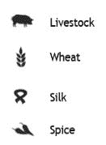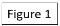

上面的图 1 显示了一个由四个参与者的纯物物交换体系：一个小麦农、一个牲畜生产者、一个丝绸商和一个香料商人，他们每个人都想在市场上出售物品。这种物物交换体系是无效的，因为参与者的意愿可能并不契合。牲畜生产者者可能愿意用小麦来饲养牲畜，但小麦农可能对牲畜没有直接、即时的用途。此外，由于市场知识不足或交易伙伴渠道有限，小麦农可能不知道或不重视牲畜的真实价值。结果，小麦农和牲畜生产者者可能不愿进行交易，尽管如果他们能获得各自资产的真实价值，双方都会过得更好。

货币解决了这个问题。

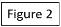

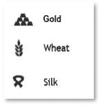

在上面的图 2 中，参与者使用货币（在此例中为黄金）进行交易。图 2 展示了使用黄金等货币形式交易如何通过消除交易低效性来改进物物交换体系。随着货币的引入，小麦农可以将小麦卖给牲畜生产者换取黄金，可以用黄金购买她想要的任何东西，包括丝绸和香料。随着货币的引入，所有参与者都过得更好，因为货币允许他们轻松地将货物转换为通用的交换媒介。

### 价值储媒介

为了作为交换媒介，货币必须随着时间的推移提供稳定的价值，或者预期价值会增长。货币的稳定性允许买卖双方在交易时以及不久的未来估算涉及多少价值。货币的价值越稳定，用户就越愿意将其作为交换媒介。稳定的货币为交易中交换或将交换的价值量提供了安全性。相反，预计随时间推移而增值的货币作为交换媒介的可能性较低，因为人们倾向于持有它以获取预期的未来价值。

### 计价单位

作为交换媒介和价值储媒介，货币为交换商品和服务的价值提供了标准化衡量。在上面的图 2 中，金条作为小麦和丝绸的计价单位，也可以为香料和牲畜充相同的角色。作为计价单位，货币通过一致且被广泛接受的标准为用户提供有关不同资产相对价值的信息。

### 什么是“好”货币？

虽然任何被视为货币的东西都可以作为交换媒介、价值储媒介和计价单位，但这些最低要求并没有解决特定类型货币的有效性。要保持有效，货币形式通常必须具备：

*   **稀缺性**：供应需要以某种方式受到限制，以维持其价值。
*   **可验证性**：必须有办法测试货币以确保其合法性。
*   **耐用性**：货币不应损耗、腐烂或易被破坏。
*   **便携性**：货币应该容易携带或运输。
*   **可分性**：货币应该可以分为不同尺寸的单位。
*   **同质性**：每个特定的货币单位（例如美元钞）应该与其他相同类型的单位互换。
*   **可识别性**：货币应该易于识别和验证。

除了上述这些，“好”货币应该能够抵抗伪造和其他可能使其贬值的计划，例如下方方框中描述的那种。

> **使用硬币的货币方案**
>
> 第一批硬币是用金、银等贵金属铸造的，并设计成均匀的重量。然而，在引入后不久，人们开始从硬币边缘刮下小块碎片，并将这些碎片熔在一起以制造新的伪造硬币。随着越来越多的人刮掉边缘，硬币变得越来越小，价值越来越低。为了停止这种做法，世界各造币厂开始在硬币边缘添加名为“压纹”（reeds）的垂直槽。这些压纹让任何查看硬币的人都能看到边缘是否被削过。在硬币上添加压纹的做法持续至今，美国的二角币和一角币都有压纹。

不符合所有这些标准的货币类型可能仍然有价值。例如，黄金具备所有三种货币用途，但通常难以运输，不易分割（不熔化它的话），而且对于未经训练的眼睛来说很难验证。尽管有这些缺点，黄金几千年来一直一直是世界主要的货币形式。

### 黄金货币

黄金几个世纪一直作为货币和其他货币形式的抵押品。黄金的价值源于其独特的物理特性和相对稀缺性。

作为一种元素，黄金不会腐烂，是良好的导体，耐腐蚀和氧化，并且作为一种熔点相对较低的金属，可以被制成各种形状。除了这些物理特性，黄金的年产量相对于全球供应很小。这些属性驱动了历史上对黄金的需求，并导致国家和个人为了获取它而做出残忍的行为。

### 存流量比

目前地表大约有 19 万吨黄金。然而，在历史上，平均每年只有 1%到 3%的现有黄金供应被开采。这种低产量加上强劲的需求解释了黄金价值主张的一部分。

作为一种经济衡量，黄金的年产量相对于其现有供应通过一个被称为“存流量比”（stock-to-flow ratio）的指标反映，其定义为储备中的资产量（存量）除以每产量（流量）。存流量比表明资产的总供应不会逐年显著增加，因此供应的增加相对于总存量来说是很小的。

如果将人类历史上开采的所有黄金都集中在一个地方，它们可以放入一个边长为 68 英尺（21 米）的立方体中，大约能填满四个奥运标准游泳池。按照目前的估值，这些黄金的价值约为 7.8 万亿美元。

## 黄金：世界货币

在过去的几千年里，在纸币出现之前，黄金一直是世界上主要的货币。早在 `公元前 4000 年`，人们就在 `努比亚`（现今的苏丹和埃及）开采黄金。起初，黄金按重量进行交易，并作为支付的记账单位。

`公元前 550 年` 左右，第一批金币使用电金（`electrum`）铸造，这是一种发现于现土耳其西部的金银天然合金。在过去的几个世纪里，黄金继续被用作货币，而对黄金的渴望导致许多欧洲人掠夺非洲和美洲，完全不顾其行为所造成的人道代价。历史记录表明，葡萄牙人早在 `1470 年` 就开始奴役非洲人开采黄金，欧洲奴隶主一直到 19 世纪仍继续使用非洲奴隶来开采黄金。

到了 17 世纪末，欧洲银行和政府开始引入可以兑换黄金的纸币。由于黄金支撑着全球许多形式的货币，它成为了事实上的世界储备货币。

> **78 纸币**
>
> 纸币最早由中国在 `唐朝` 创造，远早于纸币在欧洲的使用。在 `1200 年代` 末，为蒙古汗王 `忽必烈` 服务的期间，`马可·波罗` 注意到纸币在整个中原地区（即现今的中国地区）被广泛使用。

黄金作为储备货币的使用一直持续到 20 世纪后半叶，当时大多数政府开始发行除政府的全部信用和信誉外、无任何实物支撑的法定货币。

如今，`美元` 已取代黄金，成为世界上主要的储备货币。截至 `2019 年` 底，美元约占所有已知中央银行外汇储备的 62%，全球支付额的 47%，以及外汇交易的 88%。要理解美元如何取代黄金成为世界储备货币，需要了解 `1944 年布雷顿森林协议`。

## 布雷顿森林：简明版

在 `1944 年布雷顿森林协议` 之前，大多数世界货币都实行金本位制，这意味着这些货币可以根据要求兑换黄金。实际上，这些当地货币是发行政府开具的借据（`IOUs`），以在要求时交付黄金的承诺作为担保。这种承诺意味着从理论上讲，政府不能随心地打印更多纸币；它只能打印与其持有的黄金储备等额的货币。

> 我没有透支；我还有支票呢！
>
> —老笑话

然而，对印钞的限制就像对开支票的限制一样：虽然开具超过银行账户余额金额的支票是不明智的，但人们经常在这样做。政府的情况也是如此。

在 `第一次世界大战` 期间，许多国家意识到，他们进行战争所需的资金多于其拥有的黄金储备，因此通过打印超过其黄金储备数量的货币而放弃了金本位。这些行为增加了货币供应量。然而，货币供应量的增加导致了通货膨胀。

`布雷顿森林体系` 的目标是提供经济稳定。该框架由 `国际货币基金组织` 和 `世界银行` 建立。

`布雷顿森林体系` 于 `1971 年 8 月 15 日` 正式结束，当时美国单方面放弃了金本位制。

### 美国为什么放弃了金本位制？

完整的答案是历史事实与糟糕的财政和货币政策复杂交织的结果，但简单的解释是：美国没有足够的黄金储备来满足其日益增长的交付黄金义务。这种黄金储备的匮乏导致尼克松总统违背了美国以黄金背书美元的承诺。以下按时间顺序排列的事实有助于解释美国是如何陷入那种境地的：

*   在 1960 年，美国拥有 194 亿美元的黄金储备，而美国境外持有的美元约有 187 亿美元。
*   在 20 世纪 60 年代和 20 世纪 70 年代初，美国公民使用美元购买了日益增多的进口商品，但没有将足够的国内产产品售卖到海外，以将这些美元带回美国。这导致了与外国政府的收支赤字。
*   同样在 20 世纪 60 年代和 20 世纪 70 年代初，苏联开始生产大量的石油并以美元出售这些石油，从而积累了美元。由于冷战局势的紧张，苏联人将美元存放在欧洲银行，形成了所谓的“欧元美元”。现在，“欧元美元”一词通常指所有持有在海外的美元存款。
*   随着海外持有的欧元美元增加，收支赤字扩大，外国政府对美国布雷顿森林体系以黄金兑换美元的承诺失去了信心。
*   到 1970 年，欧元美元持有量超过了 450 亿美元，而美国的黄金储备价值仅约为 145 亿美元。
*   到 20 世纪 70 年代初，尼克松政府正处于与越南的一场昂贵战争的后期。这些开支包括战争成本以及对西贡政权的经济援助。大多数估计表明，那场战争耗资 1,680 亿美元（按今天的价值计算约合 1 万亿美元）。
*   1971 年初，美国的通货膨胀率已升 5%，失业率上升到 6% 以上。高通胀伴随经济增长停滞和高失业率被称为“滞胀”。美国的滞胀导致了许多其他国内问题，还导致海外和欧元美元存款贬值。

根据上述事实，许多世界性银行和政府开始将其持有的美元兑换为黄金。为了应对滞胀和不断增加的美元兑换黄金的请求，尼克松于 1971 年 8 月 15 日发布了一项行政命令，（1）冻结所有价格和工资 90 天，以及（2）停止联邦储备将美元兑换为黄金。价格控制暂时降低了通胀，但在三年内通胀飙升至双位数水平，并持续了整个 20 世纪 70 年代。

当尼克松放弃金本制时，标志着现代历史上首次纸币不再至少在名义上由某种资产背书，并向世界引入了法币——即仅由政府信任背书的货币。从理论上讲，所有法币相对于其他法币都有价值，但这些价值并没有直接或间接地与任何特定资产挂钩。然而，现实略有不同。

### 石油美元的诞生

#### 加强美元的秘密协议

随着布雷顿森林体系和金本制的结束，美国需要一个新的体系来维持美元作为世界储备货币的地位。石油美元应运生。

1971 年美国放弃金本制后不久，金价飙升，美元价值大幅贬值。结果，许多以美元计价的现有石油买卖合同变得价值大减。随后在 1973 年 10 月，石油出口国组织（OPEC）的阿拉伯成员将石油价格上调 70% 以上，并对美国及以色列的其他盟友实施出口禁运。

OPEC 提高油价是对美国在“赎罪日战争”或“斋月大战争”中站在以色列一方的回应。此前由埃及和叙利亚领导的阿拉伯国家联盟在赎罪日（犹太教圣日）和斋月期间（伊斯兰教的禁戒月份）对以色列阵地发起了进攻。


随之发生的战争持续了不到三周，但禁运在过去的六个月内使美国油价上涨了约 400%，导致了美国股市崩溃，并引发了 1973 年石油危机，迫使美国司机不得不排长队等加油。这次禁运加上越南战争的成本和美国政府的政策（包括工资和价格控制），是 20 世纪 70 年代经济衰退的重要因素。

禁运一直持续到 1974 年，当时尼克松政府与控制沙特的阿拉伯家族签署了一系列秘密军事和经济协议，以以美元将石油合同标准化。这些协议的效果是迫使全球石油买家以美元计价购买石油，这使得石油取代黄金成为美元的实际支撑资产。作为回报，沙特人同意将这些美元重新投资到美国债务中，允许美国更容易地为其支出提供融资。这一系统被称为石油美元。

到 1975 年，所有 OPEC 国家同意完全以美元石油石油，这主要是为了换取武器和保护。由于石油是世界上最重要的商品，石油美元有助于加强美元，并巩固其作为世界储备货币的地位。

### 石油美元的经济与财政政策

石油美元体系对美国和产油国都有利。对于美国来说，它增加了全球对美元的需求，因为购买石油需要美元。这种增加的需求加强了美元，并为产油国产生了大量的剩余美元，而这些国家大多由王室或其他专制制、不民主的政权统治。

从石油美元中受益的产油国通常将这些剩余美元投资于美国政府债券，增加了对美元债务的需求。这种增加的需求有助于保持美国利率的低位，通常情况下，这些低利率鼓励了美国的支出和投资。

尽管石油美元体系惠及美国和 OPEC 国家，但这些利益并未延伸到货币和财政政策无法利用石油美元的国家。

#### 货币政策

货币政策指的是中央银行如何管理国家的货币供应，通常有四个主要目标：

1. 管理通胀；
2. 减少失业；
3. 维持低且可持续的利率；
4. 促进增长。

政府通过发行和发放当地货币或将其收回流通来控制货币供应。创造过多货币会导致失控的恶性通膨胀并破坏经济。如果创造不足，根据英国经济学家约翰·梅纳德·凯恩斯的理论，会扼杀增长。但通过增加或减少“适中”的货币量——不多不少——凯恩斯主义认为央银行既可以刺激经济又能维护稳定。

#### 财政政策

财政政策与货币政策相关，是指利用政府支出和税收政策来影响经济状况。许多现代财政政策在很大程度上基于凯恩斯的理论，即政府可以通过调整货币政策来稳定经济周期并调节经济产出。主要的财政政策工具包括：

* 加税（总是不受欢迎）；
* 削减支出（同样不受欢迎）；
* `borrowing money`（短期有效，但如果没有经济增长，最终将需要加税或削减支出来偿还债务）；或
* `printing money`（这可能导致通货膨胀，损害所有公民的利益，因为流通中的货币丧失了购买力）。

石油美元体系为美国和产油国实施财政政策提供了灵活性，因为简单来说，他们有更多的可用资金来解决问题。对于美国来说，石油美元让美国政府比其他国家拥有多得多的灵活性，能够在维持持续赤字和不断增加的国家债务的情况下，而不会产生负面的财政和货币后果。

产油的石油美元国家既受益于它们从自然资源中获得的稳定美元，也受益于美国政府保护这些资源以及控制这些资源的政府的意愿。一些人认为，美国愿意（i）为像沙特阿拉伯和科威特等“友好”的欧佩组织（OPEC）国家提供军事支持，以及（ii）惩罚像入侵入侵前的伊拉克和伊朗等“不友好”的产油国，至少在部分是基于美国保护美元主权的利益。

为了强调第二个断言，许多人指向了 21 世纪 20 年代初伊拉克的状况：

* 2000 年，在伊拉克威胁要停止所有石油出口（当时占全球供应量的约 5%）后，联合国（UN）允许由其当时的领导人萨达姆·侯赛因领导的伊拉克以欧元而非美元出售石油。
* 在接下来的两年半里，欧元对美元升值。2000 年 10 月，当联合国批准伊拉克的请求时，欧元/美元的汇率约为 `1 US$` 兑 `0.84 EUR`。到 2003 年 3 月初（入侵前夕），欧元已升值超过 43%，达到约 `1.07 EUR = 1 US$`。
* 2003 年，美国入侵了伊拉克。乔治·W·布什总统政府声称入侵是合理的，因为侯赛因获得了一个秘密的大规模杀伤性武器（`WMDs`）。在入侵后的 17 年里，那批秘密的 `WMDs` 尚未被发现。
* 在美军盟友重新控制伊拉克油田后，伊拉克石油合同再次以美元进行交易。

## 美元的武器化

石油美元体系使美国在全球金融政策中具有了非凡的意义。美国政客有能力利用美元的力量将美国法律和政策的影响力延伸到其他国家。在奥巴马政府之后，据报道曾多次多次将美元力量武器化的尝试，包括 2018 年禁止伊朗使用 `SWIFT`（见下框）。

伊朗最早于 2012 年被奥巴马政府禁止使用 `SWIFT`，导致伊朗石油出口量从 2011 年的约 250 万桶减少到 2014 年的约 100 万桶。然而，在美、伊朗以及世界政府联盟和联合国安理会五个常任成员国同意 2015 年的《全面行动计划》（伊朗核协议）后，`SWIFT` 禁令被解除，伊朗石油出口有所增加。

|  | `SWIFT` 是总部位于比利时的国际银行金融电信协会。`SWIFT` 作为一个全球集体运营，连接了全球 200 多个国家和地区的 11,000 多家银行、金融机构和公司。`SWIFT` 允许参与者安全地发送、接收和跟踪有关金融交易的信息。不参与或被禁止使用 `SWIFT` 的国家在进行或接收国际支付方面的手段非常有限。 |

2018 年 5 月 8 日，美国单方面废弃了伊朗核协议。不久后，美国政府开始施压 `SWIFT` 禁止伊朗银行。2018 年 11 月 5 日，`SWIFT` 屈服了，并评论说该禁令是“遗憾的”，但为了避免美国制裁和维持国际银行业系统的稳定性是必要的。

世界对美国单方面行动的挫败感显而易见，中国、欧洲和俄罗斯采取了措施来应对美国的行动，包括：

* 中国直接与伊朗签署了为期 25 年的石油供应协议，允许中国使用人民币支付油款，从而完全绕过了石油美元体系。

（注：原文在后续部分存在大量重复内容，译文已根据要求进行去重并保留核心逻辑。）

2014 年，委内瑞拉的通胀率为 69%，当时位居全球最高。到 2016 年，通胀率已升至 800%到 4,000%之间。

2018 年，马杜鲁应对委内瑞拉通货性膨胀的措施之一是实施了 1000:1 的货币重估，将该国的官方货币从“强玻利瓦尔”（Bolívar fuerte，旧玻利瓦尔）改为“主权玻利瓦尔”（Bolívar soberano，新玻利瓦尔），并规定 1000 单位旧强玻利瓦尔等于 1 单位新主权玻利瓦尔。以美元计算，这相当于美国政府强制所有公民交出他们所有的百美元钞票，并将其兑换成新铸的 1 分币。

2018 年的货币重估是一场灾难。到 2019 年 5 月，委内瑞拉的年化通胀率已超过 815,000%（这不是笔误）。委内瑞拉的经济危机导致超过三百万人离开该国前往邻国哥伦比亚等地。留下来的人中，许多停止了接受和使用新玻利瓦尔，转而寻求将玻利瓦尔兑换成美元，后者是更好的储值手段。

委内瑞拉长期的财政政策之一也加剧了危机。自 2003 年以来，委内瑞拉实施了严格的货币管制，限制了公民将玻利瓦尔兑换其他货币的能力。政府还设定了一个官方汇率，与美元相比，玻利瓦尔被严重高估。市场对这些货币管制和汇率政策的反应是导致了非法美元市场的增长，因为委内瑞拉人试图从政府那里购买美元，然后在非法市场上卖出以获利。

该政策对缓解通货性膨胀的影响几乎微乎其微，但它创造了一个让政府损失了数十亿美元的新兴行业：货币旅游（见下表）。

### 货币游客与优待汇率

| 尽管对委内瑞拉公民将玻利瓦尔兑换成美元有严格限制，但对于购买了机票的国际旅行公民却有一个例外。这些公民可以按照 6.3 玻利瓦尔兑换 1 美元的官方汇率进行兑换，限额为 3000 美元。然而，当时的（非法）市场汇率为 45 玻利瓦尔兑换 1 美元。许多公民的做法是将 18 玻利瓦尔兑换成美元，这是一种更好的储值手段。 |

尽管黄金的存流量比（stock-to-flow ratio）在历史上一直相对恒定，但比特币的存流量比被设定为不断增加。比特币的区块奖励每隔 `210,000` 个区块减少一半——大约每四年一次。这种区块奖励的减半被称为“减半”（halving）。

2020 年 5 月发生了一次减半，将区块奖励从每块 `12.5` 比特币降低到 `6.25` 比特币，从而将每年挖出的比特币数量减少到约 `328,500` 个。2020 年 5 月的这次减半将比特币的存流量比翻倍到 `55` 左右，略低于黄金 `62` 的存流量比。到 2025 年（下一次减半的预计日期），存流量比将再次翻倍。届那时，除非金矿停止寻找黄金进行开采，否则比特币将拥有所有商品类资产中最高的存流量比。

目前已经建立了多种通过存流量比来关联比特币价格的模型。这些模型在很大程度上显示，比特币的价格与使用存流量比模型所预期的高度相关。最受讨论的模型之一是由 PlanB 在 Medium 上发布的，它显示出 `99.7%` 的相关系数（一种衡量模型与实际数据拟合程度的统计指标），并预测比特币价格在 2024 年期间或之前的某个时候将达到 `$288,000`。PlanB 模型的一个较早且不简单的版本预测比特币价格在 2024 年期间或之前的某个时候将达到 `$55,000`。

## 比特币真正的价值主张是什么？

这谁无法预知。许多人通过比特币的存流量比以及与黄金的各种对比和改进来解释比特币的价值主张。一些人则更进一步，声称比特币的特性最终使其能够取代黄金，成为一种价值存储资产。做出这种主张的人通常引用这样一个事实：黄金作为价值存储资产的作用，其核心无非仅仅是基于人们对其价值的信仰。根据这种论点，随着越来越多的人相信比特币，它将与黄金竞争，并可能取代黄金成为一种价值存储资产。

显然，比特币的最终价值是一个投机性命题。然而，存在可以预测未来比特币可能价值多少的指标。由于我们处于投机领域，其中一种指标假设在未来的某个时刻，比特币和黄金将具有相同的价值。按照 2020 年 1 月的估值（`1 BTC` = `$10,000`），比特币的市值约为 `$1810 亿`，而那四个奥林匹游泳池的黄金价值 `$7.8 万亿`，两者总计约为 `$8 万亿`。在保持这 `$8 万亿` 不变的情况下，如果我们假设未来某个时刻 `$8 万亿` 被平分给比特币和黄金，那么所有 `2100 万` 个`比特币` 的总价值将是 `$4 万亿`，即每枚比特币 `$380,952`。大致如此。

## 比特币的波动性

在其短暂的历史中，比特币的价格一直波动。下方由 Coinbase 提供的图表显示了 2013 年到 2020 年 1 月的比特币价格，最高曾超过 `$20,000`，最低曾低于 `$100`。

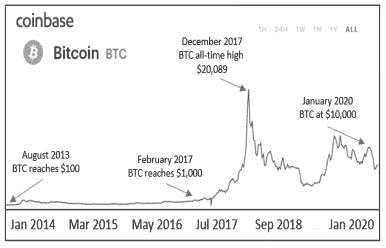

比特币的波动性使其对于商家或消费者来说，无法作为交易媒介，因为其价值每天、每周都在波动。尽管如此，这种波动性以及价值的长期增长导致许多人将比特币视为一种投资或投机性的价值存储资产。

下表显示了从下表列出的日期开始，投资 `$100` 比特币随时间产生的回报，直到 2019 年 12 月 31 日（当时比特币价值为 `$7,199.53`）。

| 99 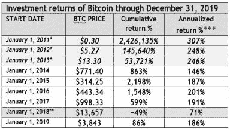 | *比特币 直到 2013 年，比特币才开始在交易所上进行常规交易，2014 年之前的价格数据基于 CoinDesk 比特币价格指数等来源。\*\*比特币在 2017 年 12 月达到最高价，略超过 20,000 美元。\*\*年化总收益是指如果收益进行复合计算将产生相同累计收益的收益，是投资在给定时间范围内每年赚得金额的几何平均值。 |

## 比特币与政府

比特币和其他加密货币的另一个重要价值因素是，它们在很大程度上免受政府干预。尽管政府可以制定法律，使其公民持有或使用比特币变得更加困难，但政府要实施完全的比特币令是非常困难的。即使被禁止，执行这种禁令也很困难。

作为一个去中心化、无国界且世界上任何拥有互联网连接的人都可以访问的伪匿名系统，即使是最专政的政府在阻止其公民使用比特币方面的权力也非常有限。有些人将试图禁止或限制比特币的尝试与美国失败的禁毒战争相提。这场所谓的战争始于 20 世纪 70 年代，当时尼松宣布滥用药物是“头号公敌”，但对改变毒品使用几乎没有作用；事实上，从 1973 年到 1977 年，美国的毒品使用量增加了一倍。遗憾的是，禁毒战争对美国和全球其他国家都产生了深远的负面影响：它增加了监狱人口，尽管少数裔和非少数裔人口之间的毒品使用没有显著差异，它却不成比例地将黑人和棕色人犯罪化，并导致了全球范围内数万起与毒品交易相关的谋杀，特别是在哥伦比亚和墨西哥。

政府试图禁止比特币将明确两点：

* 政府有兴趣限制其公民的自由；以及
* 比特币必须是有价值的，否则政府为什么要禁止它？

任何寻求禁止比特币的政府还将面临与禁止其他“刑法禁止性”（malum prohibitum）物品时面临的许多相同挑战，正如美国禁酒令期间的情况，以及目前在联邦和州级的娱乐性大麻法律方面面临的情况。

截至 2019 年底，以下国家对比特币实施了某种形式的禁令：

* 阿富汗
* 阿尔及利亚
* 玻利维亚
* 孟加拉
* 厄瓜多尔
* 伊朗
* 尼泊尔
* 巴基斯坦
* 沙特阿拉伯

这些由少数人认为是热爱自由的政府统治的国家，其禁令缺乏一致性。有些国家完全禁止拥有比特币，而另一些国家禁止将比特币作为支付手段，对其公民拥有和交易的权利持开放或至少不作为。

## 作为比特币货币：隐私与伪匿名

加密交易是伪匿名的，这意味着它们与公开数字地址相关，但没有直接关联到身份。那些公开地址是公钥的哈希版本，公钥是标识区块链地址的长数字字符串。要进行交易，用户既需要`公钥`也需要只有用户知道的`私钥`。`公/私钥`系统允许个人在不暴露身份的情况下进行交易，尽管个人的公钥在区块链上是可见的。


图表由 bitira.com 提供

尽管加密交易的设计旨在伪匿名，但由于所有交易都会留下数字足迹，数字侦探已经创建了通过所谓的“链分析”来关联交易的方法，链分析将公开的交易与特定的账户、活动、钱包并最终与个人联系起来。链分析的一个益处是执法机构，他们利用链分析成功发现并指控了罪犯。例如，2019 年 10 月 16 日，司法部（DOJ）发布了以下新闻稿，摘录如下：

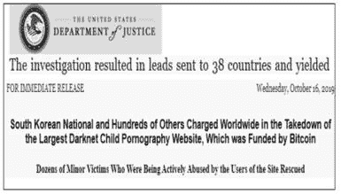

根据新闻稿，调查导致了全球范围内 337 名滥用该网站的成员被捕。为了寻找犯罪分子，`DOJ` 和 `IRS` 追踪了网站用户的公钥，并将这些公钥与使用 `bitcoin` 支付或接收儿童色情内容的个人联系起来。除了 `DOJ` 之外，其他执法机构如美国国土安全部、美国联邦调查局（`FBI`）也利用链分析来追踪恐怖组织、有组织犯罪和毒贩。

链分析公司 `CipherTrace` 在 2018 年 10 月宣布，其平台允许客户追踪超过 87% 的加密货币交易量。客户包括寻求遵守金融规则的金融机构，以及将链分析作为其业务模式的公司。

### 隐私与安全

由于链分析更容易降低加密货币的隐私，许多服务演变为对抗链分析的有效手段。这些服务使得交易与个人账户或用户的关联变得更加困难。这些服务暴露了加密货币中的隐私/安全权衡。

`Coinjoins`（有时被称为混币器或搅拌器）是对抗链分析的一种方法。`Coinjoins` 是允许用户与其他用户混合并交换代币的服务或应用程序。在代币于用户之间多次交换后，确定和追踪代币所有者变得更加困难。

隐私币提供了对抗链分析和维护财务隐私的另一种选择。大部分，这些代币隐藏了区块链上几乎所有的交易细节，使得交易与用户的关联变得困难或不可能。

确定最流行的隐私币很困难（毕竟它们是私密的），但大多数来源认为 `Monero` (`XMR`) 是最广泛使用的隐私币。`Monero` 最初使用名为 `CryptoNight` 的工作证明协议来模糊区块链的交易账本，使得识别任何交易细节变得困难或不可能。2019 年 10 月，`Monero` 切换到新的工作证明算法，以增加网络的安全去中心化。`Monero` 实施了共识机制的变更，以确保其网络挖矿不会被使用更先进且昂贵的 `ASIC` 芯片的矿工所主导。

它是 `AlphaBay` 交易最流行的加密货币。在 2017 年关闭之前，`AlphaBay` 是暗网（使用自定义软件确保隐私的互联网部分）上最大的市场，经常被用于便利从非法文件共享到勒索和儿童色情的各种犯罪活动。`Monero` 也被 `WannaCry` 黑客使用，根据 2018 年 9 月的 `DOJ` 起诉书，他们是一个北朝鲜黑客和勒索软件集团。根据 `DOJ` 和 `FBI`，`WannaCry` 黑客将犯罪收益转换成了 `Monero`。

一种对隐私采取较温和方法的隐私币是 `Zcash` (`ZEC`)，它为用户提供两种交易选项：公开和加密。根据 `Zcash`：

> 如果用户选择加密其资金，这些资金在区块链上将不再可见。一旦加密，资金就可以加密交易进行转账，从而保护了发送者和接收者的隐私。这有助于符合强制个人财务信息隐私的法规，例如美国的《格拉姆-利奇-布莱法案》和欧盟的《通用数据保护条例》（`GDPR`）。

2019 年底，宣布 `Zcash` 令牌将在 `Ethereum` 区块链上运行，可能允许智能合约具备 `Zcash` 的某些隐私功能。

一些监管机构已对隐私币采取了公开反对立场。2019 年春天，法国和日本的监管机构都建议禁止隐私币。法国国民议会财政委员会主席 `Eric Woerth` 引用对“欺诈、逃税和洗钱”的担忧，表示：

> “提议禁止传播和交易[为了从设计上防止任何识别程序以]完全匿名而构建的加密货币]也是恰当的。某些[加密货币]（`Monero`、`PIVX`、`DeepOnion`、`Zcash`... ）的情况如此。”

2018 年 4 月，日本金融监管机构也建议了类似的禁止。

#### 财务隐私重要吗？

许多人认为 `Coinjoins` 和隐私币对犯罪分子有用。其他人指出保护个人财务主权的许多合法理由。此外，随着企业和政府的监控变得无处不在，避免数字足迹的能力将变得更加重要。

> “在一个收集、分析和出售我们私人信息的时代，立法保护我们的隐私具有巨大的意义。”
>
> ——Arnold Spencer，`Coinsource` 法律顾问，前德克萨斯州助理检察官

该领域确实需要平衡。虽然匿名性可能帮助犯罪分子规避政府监管，但在财务事务上，隐私和匿名对于维护宪法保障的自由是必要的。

## 稳定币


稳定币是设计用于维持价值稳定的加密货币。稳定币和像`bitcoin`这样的其他加密货币代表了具有改变金融系统的破坏性技术。然而，与其他加密货币不同，稳定币提供了加密货币的优点——安全、透明、去中心化和快速支付，而没有价格波动。

由于价格波动，许多加密货币并不适合作为交换媒介。相反，它们像黄金一样被作为投机性价值投资进行持有（hodling）。

| Stacking Sats在比特币社区中形成了一个围绕持续积累聪聪（sats）的迷因，帮助持有者随着时间的推移获得更多的比特币。尚不清楚谁这个术语，但当它被加密货币播客 Matt Odell 采用并在推特标签 #stackingsats 中重新传播后，其流行程度增加了。 |

稳定币为移动支付提供了一种有效且成本效益高的手段。在美国，移动支付约占所有支付的 15%，移动支付市场由`PayPal`、`Square Cash`和`Venmo`等公司主导，这些公司通常收取 2.75% 或更高的交易手续费。直接从消费者传输到企业的稳定币可以消除这些费用。

稳定币还被用作加密货币交易者或企业的临时持有资产，消除了持有不稳定的加密货币的风险。这一用例之所以出现，是因为许多加密交易所出于洗钱和其他监管考虑，对其客户将加密货币兑换为法币的能力设置了限制或上限。因此，稳定币为加密所有者提供了一个避避动的避风港，并经常用于在不交易成法币的情况下锁定加密利润。

稳定币还可以产生社会效益，为无法获得金融服务的群体（通常被称为“无银行账户者”）提供金融科技。世界银行估计，全球约四分之三的贫人没有银行账户，在 17 亿到 20 亿成人之间。然而，根据联合国的数据，11 亿无银行账户的人可以使用手机手机。稳定币为无银行账户者提供了更大的参与金融体系的机会，让他们能够使用一种允许他们以易传输且安全的形式存储和积累财富的技术。

稳定币还为生活在货币不稳定地区的人们提供了一种稳定的货币形式。在这些情况下，个人可以选择放弃当地货币而选择稳定币，从而避免当地货币的任何不稳定或通货膨胀。例如，在委内瑞拉的恶性通胀期间，一些公民将他们的玻利瓦兑换成稳定币，保护了他们的财富和购买力，避免了政府引发的恶性通胀的影响。

虽然这种系统为公民带来了明显的利益，但对于货币不稳定的国家政府来说并非如此。如果这些国家的公民放弃当地货币并使用稳定币，对政府法币的需求将会减少。随着需求的下降，发行更多法币的效用也会随之降低。在这种情况下，政府将面临一系列缺乏吸引力的财政政策选择：加税、削减开支和借款。

## 稳定币是如何工作的？

大多数稳定币的工作原理类似于金本位制：它们的结构让用户确信，它们受到了特定类型抵押品的支持，并在某种程度上可以兑换成该抵押品。虽然对于大多数稳定币来说事实如此，但另一种类型的稳定币已经出现，它们没有抵押品，并利用供需原则来维持稳定价格。这种被称为`seigniorage`或`算法稳定 coins`的代币，虽然在理论上很有趣，但尚未大规模采用。

对于抵押型稳定币，出现了两种主要类型：

*   传统资产支持型稳定币，以法币（美元、欧元、日元）等实资产或黄金、石油等大宗商品作为抵押品；以及
*   加密货币支持型稳定币，以其他加密货币作为抵押品。

## 传统资产支持型稳定币

最流行的传统资产支持型稳定币是以硬资产抵押的并由中心化实体运营的。它们的价值取决于底层抵押品的价值，并且通常被设计为锚定美元等法币（`1 unit = $1.00`）。本节将以`Tether`为例，它是一种中心化的、资产支持的稳定币。`Tether`的所有者还运营加密货币交易所`Bitfinex`。

![Image_44.jpg]

一个`tether`(`USD₮`)的价格被设计为锚定美元，这意味着每个`1 USD₮`应该维持`$1.00`的价值。为了维持锚定，`Tether`必须让更广泛的市场相信它足够的抵押品来支持所有发行的`USD₮`。这意味着在任何时候，市场必须相信所有发行和流通的`USD₮`都可以`1:1`地兑换美元，或者至少是价值美元的抵押品。

在过去的五年里，`USD₮`的价格保持相对稳定，在 2017 年达到约`$1.015`的高点，在 2018 年底达到约`$0.9625`的低点，但通常保持与美元的`1:1`锚定。尽管 2019 年就关于其抵押品产生了疑问，`Tether`仍然维持了其稳定性：

### 事件 1：抵押品问题

在 2019 年 2 月之前，`Tether`的网站提供了以下关于其抵押品的信息：

每一个 tether 始终由我们储备中持有的传统货币 1 比 1 支持。因此，`1 USD₮`始终等同于`[$1 dollar]`。

2019 年 3 月，`Tether`的网站进行了更新，并指出：

每一个 tether 始终由我们的储备 100% 支持，我们的储备包括传统货币和现金等物，并可能随时包括`Tether`向第三方发放贷款产生的其他资产和应收账款。

这一更新的信息引发了对`Tether`未完全抵押的可能。此外，关于“其他资产”（字面上可以包括任何资产）的加入让许多加密社区质疑`Tether`抵押品的质量和充足性，并对所有流通的`USD₮`是否有抵押品表示怀疑。

### 事件 2：缺失的抵押品

2019 年 4 月，纽约总检察官指控`Bitfinex`（`Tether`的姐妹公司）使用了`Tether`的 8 亿美元作为抵押品来掩盖`Bitfinex`账户中“缺失”的 8 亿美元。`Bitfinex`声称这些资金并非丢失，而是被没收了。该案件在 2020 年 3 月在上诉法院进行了审理，预计将于 2020 年晚些时候裁决。

尽管发生了这两个事件，根据稳定币指数(`stablecoinindex.com`)，`Tether`继续维持与美元的锚定，并是市值最高的稳定币。`Tether`是否能保持其主导地位尚不可知。然而，一个新的竞争者计划进入稳定币市场。

## Facebook 加入

![Image_45.jpg)2019 年 6 月 18 日，`Facebook`宣布将推出一种名为`Libra`的法币支持稳定币。根据公告，`Libra`预计将于 2020 年上线，并将由一组相对稳定的货币作为抵押，可能包括美元、欧元和日元。

`Facebook`的公告具有重大意义，因为如果有足够的 17 亿活跃`Facebook`账户持有者决定使用`Libra`，它很容易成为全球领先的稳定币。`Libra`的未来成功以及长期影响显然尚未知。然而，`Facebook`的公告引发了一些重要问题，包括：

*   `Facebook`如何处理用户隐私？
*   `Facebook`账户会与`Libra`账户关联吗？
*   `Libra`会去中心化吗？如果不会，它真的是加密货币吗？
*   谁来为`Libra`做决策，这些决策将如何做出？
*   基于发达国家货币的货币是否意味着世界其他地区将受制于发达国家央银行并受其操纵？
*   货币政策是否应该由企业实体全部或部分控制（正如彭博的一篇评论文章所说，“技术独裁者和风险投资者的结团”）？

## 政府将有多大的权力强制 Libra 排除某些人，或排除某些国家的人使用它？例如，美国是否可以迫使 Libra 排除朝鲜人和伊朗人？

对 Libra 发布的反应参差不一。美国议员、国会区块链联盟联合主席达伦·索托（Darren Soto）表示：

> “我们对增加移动和数字支付的可能性感到鼓舞，这最终将造福我们的社会，并成为经济增长的驱动力。虽然目前还不清楚这项新技术将如何监管，但国会继续保护消费者和投资者的财务健康，同时促进这些虚拟货币的创新是至关重要的。”

国会的其他成员并没有那么热情。参议院银行委员会成员谢罗德·布朗（Sherrod Brown）推特写道：

> “Facebook 已经太大、太强大了，它利用这种力量剥削用户数据，而不保护他们的隐私 . . . . 我们不允许 Facebook 在没有监管的情况下，通过瑞士银行账户运行高风险的新加密货币。”

全球范围内的反应也参差不一：

*   2019 年 9 月 13 日，法国和德国发布了关于 Libra 的联合声明，指出：“我们认为，没有任何私人实体可以声称拥有货币权力，这是国家主权所固有的。”
*   法国财政部长布鲁诺·勒马尔（Bruno Le Maire）表示 Libra “不能且 . . . 不得发生”，而且加密货币“成为主权货币”是不可能的。
*   英格兰银行行长马克·卡尼（Mark Carney）表示他对 Libra 持开放态度，但警告说大规模采用将迫使它“接受最高标准的监管”。
*   澳大利亚央行行长菲普·洛威尔（Philip Lowe）表示，“有很多监管问题需要解决，他们必须确保有一个稳健的商业案例，因此在得出结论之前我们必须保持谨慎。”

星座稳定币：生活模仿占星术

关于 Libra 发布的其他有趣事实，可以在本·梅兹里奇（Ben Mezrich）所著的《比特币万富翁》一书中找到，他也是《偶然的亿万富翁：Facebook 的诞生》的作者，该书是 2010 年电影《社交网络》的蓝原型。在《比特币万富翁》中，梅兹里奇记录了第一对比特币万富翁双胞胎——温克莱沃斯兄弟（Winklevosses），他们与马克·祖克伯格（Mark Zuckerberg）一起参与了 Facebook 的创立。书中还描述了祖克伯格与温克莱沃斯兄弟之间的破裂，引用了温克莱沃斯兄弟指控祖克伯格盗取了他们许多 Facebook 的想法。有趣的是，这对双胞胎后来创建了 Gemini，这是最早的法币稳定币之一。在温克莱沃斯兄弟创建 Gemini 几年后，祖克伯格的 Facebook 创建了自己的稳定币，并以另一个星座命名。至于 Libra 这个名字是否是为了嘲讽温克莱沃斯兄弟，无人知。

## 加密抵押型稳定币

加密抵押型稳定币主要依靠其他类型的加密货币作为抵押，而不是法币或其他非数字资产。大多数加密抵押型稳定币也是去中心化的，这意味着不需要中心化的第三方（如控制 Tether 的人）来维持稳定币的锚定。

为了最大限度地减少波动的影响，稳定币项目使用多种机制来创造价格稳定性，但几乎所有项目都依靠超抵押作为维持稳定性的主要手段。

## 加密抵押型稳定币：工作原理

加密抵押型稳定币主要依靠其他类型的加密货币作为抵押，而不是法币或其他非数字资产。大多数加密抵押型稳定币也是去中心化的，这意味着不需要中心化的第三方（如控制 Tether 的人）来维持稳定币的锚定。

为了最大限度地减少波动的影响，稳定币项目使用多种机制来创造价格稳定性，但几乎所有项目都依靠超抵押作为维持稳定性的主要手段。

## 加密抵押型稳定币：一个示例

加密抵押型稳定币主要依靠其他类型的加密货币作为抵押，而不是法币或其他非数字资产。大多数加密抵押型稳定币也是去中心化的，这意味着不需要中心化的第三方（如控制 Tether 的人）来维持稳定币的锚定。

为了最大限度地减少波动的影响，稳定币项目使用多种机制来创造价格稳定性，但几乎所有项目都依靠超抵押作为维持稳定性的主要手段。

## 加密抵押型稳定币：超抵押

加密抵押型稳定币主要依靠其他类型的加密货币作为抵押，而不是法币或其他非数字资产。大多数加密抵押型稳定币也是去中心化的，这意味着不需要中心化的第三方（如控制 Tether 的人）来维持稳定币的锚定。

为了最大限度地减少波动的影响，稳定币项目使用多种机制来创造价格稳定性，但几乎所有项目都依靠超抵押作为维持稳定性的主要手段。

## 加密抵押型稳定币：超抵押的示例

（注：提供的文本包含重复章节；我已根据格式说明维持了其结构。）

加密抵押型稳定币主要依靠其他类型的加密货币作为抵押，而不是法币或其他非数字资产。大多数加密抵押型稳定币也是去中心化的，这意味着不需要中心化的第三方（如控制 Tether 的人）来维持稳定币的锚定。

为了最大限度地减少波动的影响，稳定币项目使用多种机制来创造价格稳定性，但几乎所有项目都依靠超抵押作为维持稳定性的主要手段。

## 加密抵押型稳定币：简化的示例

加密抵押型稳定币主要依靠其他类型的加密货币作为抵押，而不是法币或其他非数字资产。大多数加密抵押型稳定币也是去中心化的，这意味着不需要中心化的第三方（如控制 Tether 的人）来维持稳定币的锚定。

为了最大限度地减少波动的影响，稳定币项目使用多种机制来创造价格稳定性，但几乎所有项目都依靠超抵押作为维持稳定性的主要手段。

## 加密抵押型稳定币：为什么要使用杠杆？

加密抵押型稳定币主要依靠其他类型的加密货币作为抵押，而不是法币或其他非数字资产。大多数加密抵押型稳定币也是去中心化的，这意味着不需要中心化的第三方（如控制 Tether 的人）来维持稳定币的锚定。

为了最大限度地减少波动的影响，稳定币项目使用多种机制来创造价格稳定性，但几乎所有项目都依靠超抵押作为维持稳定性的主要手段。

## Maker 和 DAI


最活跃的加密货币稳定币之一是`DAI`，它是一种通过超抵押和另一种代币`Maker`(`MKR`)来维持与美元 1:1 挂钩的代。最初，`DAI`仅由`ETH`（以太坊代）抵押，但在 2019 年后期，`Maker/DAI`系统进行了扩展，允许其他类型的抵押品，从而创建了多抵押`DAI`。坦率地说，`Maker/DAI`系统的细节非常复杂，下面包含了一个简要版本。

### DAI 和 MKR 如何工作：极简版

如果 Bibi 想要创建`DAI`，她需要存入加密货币抵押品并创建一个抵押债务位置(`CDP`)，这是`Maker/DAI`系统中的一个智能合约。创建的`DAI`数量基于投入`CDP`的抵押品数量，并且必须大于要创建的`DAI`数量。例如，如果系统将抵押率设定为 150%，那么 Bibi 必须存入价值 150 美元的加密货币抵押品来铸造（创建）100 个`DAI`（价值 100 美元）。

为了确保`Maker/DAI`系统足够健壮以应对加密货币的波动，`Maker/DAI`开发人员增加了额外的机制，旨在维持`DAI`与美元之间的挂钩。这些机制包括：

1. 稳定性费用，在`CDP`关闭时支付（类似于上面 Stablebucks 例子中的借贷成本）；
2. 需要时清算`CDPs`的能力；
3. `Maker`代币(`MKR`)。

在`Maker/DAI`系统中，`CDPs`会收取费用（稳定性费用），该费用根据铸造的`DAI`总量相对于`CDP`中持有的抵押品计算。在上面的示例中，如果 Bibi 使用其 150 美元的加密货币抵押品铸造并提取了 100 个`DAI`，系统将根据提取的 100 个`DAI`向 Bibi 收取稳定性费用。

稳定性费用的旨在解决`DAI`供需平衡的风险以支持挂钩。例如，如果`DAI`持续高于 1 美元，表明`DAI`的需求大于供应。在这种情况下，可以降低稳定性费用（借贷成本），以激励人们创建`CDPs`并铸造`DAI`，从而增加供应以满足需求。

相反，如果`DAI`持续低于 1 美元，表明`DAI`的供应大于需求。在这种情况下，可以提高稳定性费用（借贷成本），这会增加铸造或持有`DAI`相关的成本，激励人们关闭他们的`CDPs`并减少供应。自`Maker/DAI`系统创建以来，稳定性费用经历了大幅波动。它最初设定为 0.5%，曾达到 2.5%的高位。

`Maker/DAI`系统维持挂钩最易解释的方式是，当抵押品价值跌至某些阈值时清算`CDPs`，从而降低加密货币抵押品价值低于基于该抵押品创建的`DAI`价值的风险。每个`CDP`都是根据当时的加密价格创建的，而`Maker/DAI`系统整体基于所有`CDPs`中持有的加密货币的加权平均值。根据上面的示例，如果`CDP`中持有的价值 150 美元的加密货币抵押品价值接近 100 美元，系统可以在价格低于 100 美元之前出售该`CDP`，以确保系统中的抵押品价值始终高于其创建的`DAI`。

虽然稳定性费用和`CDPs`的清算在大多数情况下能维持`DAI`挂钩美元，但在加密货币价格突然下降的情况下，两者都无法起作用。在这种情况下，可能无法在`CDPs`中的价值低于其创建的`DAI`数量之前清算`CDPs`，这将使维持挂钩变得困难或不可能。为了应对这一风险，`Maker/DAI`系统使用了`MKR`代币。

`MKR`代币是`Maker/DAI`系统的治理机制，通过发行`MKR`代币筹集的资金为`Maker/DAI`系统提供了额外的抵押品以维持挂钩。`MKR`代币持有者除了向系统提供抵押品外，还有权对影响`Maker/DAI`系统增长和稳定性的问题进行投票。该系统激励他们仔细监控系统，并作为回报为他们的工作赚费用。

其他稳定机制还包括对强制清算的 CDP（加密资产抵押）收取清算罚金，以及针对特定 DAI 储蓄合约存款支付的 DAI 储蓄利率（DSR）。

[稳定费用治理（Stability Fee）](https://mkr.tools/governance/stabilityfee)


# 第三部分：区块链与法律

## 监管区块链领域

没有任何一个政府可以声称对区块链技术和加密货币拥有独有的管辖权。然而，一旦人们开始将区块链作为货币（加密货币）使用，政府（i）开始为这种使用制定“规则”，并（ii）发现要监管一种存在于物理边界和身份之外的技术面临着困难。

广而言之，各国在监管加密货币方面了三种方法：

### 1. 鼓励

采取这种方法的政府颁布了支持和鼓励加密货币的规则，使其公民和企业更容易使用加密货币以及经营加密业务。一些对加密货币较友的国家包括马尔他、日本、百慕大、香港、瑞士和新加坡。

马尔他是一个拥有约 45 万人口的欧洲南方小国，一直是积极鼓励加密货币业务的国际领导者。2018 年 2 月，马尔他政府颁布了马尔他数字创新局（MDIA），为加密货币业务建立了全面的监管框架。随后在 2018 年，全球交易量最大的加密货币交易所之一币安（Binance）将其总部从香港迁至马尔他。

### 2. 许可

采取这种方法的政府允许区块链技术运行，但通常：

*   制定了难以执行或遵循成本高昂的规则；和/或


*   未能提供清晰的监管规定，导致公民和企业不确定现有规则是否以及在何种情况下适用于加密货币。

美国属于这一类。尽管美国的加密货币规则通常是许可性的，但围绕美国监管政策产生的不确定性是导致许多加密货币企业搬迁至非美国注册地的因素之一。

### 3. 严格

这些政府通常对加密货币持敌对态度，禁止使用或拥有加密货币、首次代币发行（`ICO`）和加密交易所。一些对加密货币较不友好的国家包括阿尔及利亚、玻利维亚、摩洛哥、尼泊尔、巴基斯坦和越南。

| 中国加密货币 | 中国对加密货币的方法在某些方面是许可的，而在另一方面是严格的。根据现行法律，中国禁止所有 `ICO`，禁止金融机构进行加密货币交易，不允许任何与加密货币相关的支付技术获得专利，直到最近还威胁要禁止加密挖矿。2019 年 4 月，中国政府将比特币挖矿列为计划随时间淘汰的行业之一。然而，2019 年 10 月，习近平主席发表了演讲，呼吁加大区块链开发的努力。演讲后，政府将加密挖矿从其想要淘汰的行业中移除。全球范围内，2019 年加密挖矿产生了超过 54 亿美元的收入，据估计，由于中国廉价的电力、劳动力和资源，该挖矿活动的 65-81% 发生在中国。下方的由《华尔街日报》提供的图表显示了最受欢迎的比特币矿池的市场份额。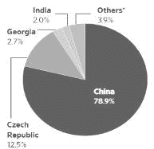2019 年 12 月，中国人民银行（`PBoC`）行长易纲宣布，中国将很快推出官方货币人民币的数字形式，试点项目正在进行中，预计于 2020 年推出。2019 年 7 月，中国人民银行研究局局长王信承认，Facebook 发布 `Libra` 稳定币是中国倾向于将数字人民币引入市场的重要因素之一。许多人推测，数字人民币有助于中国挑战美元的全球霸权地位。 |

---

尽管对加密货币的监管方法各不相同，但各国政府长期以来合作建立规则以保护国际金融体系的完整性。目前的努力于 1989 年正式开始，当时成立了金融行动特别工作组（`FATF`），旨在制定标准并促进法律、监管和操作性规则的有效实施，以防止洗钱（反洗钱或 `AML`）并打击其他形式的金融犯罪。在 2001 年 9 月 11 日袭击后，`FATF` 的授权扩大到包括打击恐怖主义融资（`CTF`）。

| 什么是金融行动特别工作组（FATF） `FATF` 制定标准并促进法律、监管和操作性措施的有效实施以打击洗钱、恐怖主义融资及其他相关威胁。根据 `FATF` 网站： |
| :--- |
| *   `FATF` 是一个政策制定机构，致力于产生立法和监管改革。 |
| *   `FATF` 与其他国际利益相关者合作，识别国家级漏洞，旨在保护国际金融体系免受滥用。 |
| *   监控成员在实施打击洗钱、恐怖主义融资及其他相关威胁的必要措施方面的进展。 |

`FATF` 有 39 个成员国，包括美国、中国和欧盟委员会（代表欧盟）。此外，以下宗旨通常为打击洗钱的政府间组织是 `FATF` 的附属成员：

*   亚太地区洗钱行动小组（`APG`）
*   加勒比地区金融行动工作组（`CFATF`）
*   欧洲委员会反洗钱措施评估小组（`MONEYVAL`）
*   欧亚小组（`EAG`）
*   东部和南部非洲反洗钱小组（`ESAAMLG`）
*   拉美金融行动工作组（`GAFILAT`）
*   西非反洗钱行动小组（`GIABA`）
*   中东和北非金融行动工作组（`MENAFATF`）
*   中非洗钱工作组（`GABAC`）

关注反洗钱的国际组织也与 `FATF` 合作并担任观察员，包括世界银行、联合国、国际刑警组织、经济合作与发展组织（`OECD`）和国际货币基金组织等。

---

2014 年，`FATF` 对加密货币的洗钱和恐怖主义融资风险进行了初步评估（加密货币在 `FATF` 中被称为“虚拟货币”）。随后在 2015 年，`FATF` 提供了帮助各国制定加密货币相关 `AML`/`CTF` 规则的指导。2015 年的指导要求各国评估加密货币代表的 `AML`/`CTF` 风险类型，并实施规则防止加密货币用于洗钱和恐怖主义融资。

*   虚拟资产服务提供商（`VASPs`）公司或个人应在其设立所在地获得许可或注册；
*   各国采取法律或监管措施，防止犯罪分子拥有或控制 `VASPs`；
*   `VASPs` 不得自律；
*   `VASPs` 应接受反洗钱/反恐怖主义（`AML`/`CTF`）的监管、监督和监控；
*   `VASPs` 向相关部门提供身份信息，并跟踪超过 1,000 美元（或 1,000 欧元）的加密转账交易对手，并在要求时：
    *   向适当部门共享这些信息，且
    *   如果交易存疑，应赋予监管机构采取适当行动的权力，包括禁止转账或冻结资产；
*   以及赋予监管机构检查、强制提交文件和对 `VASPs` 进行制裁的权力，这些制裁应包括行政、民事和/或刑事处罚。

## 政府必须遵守 FATF 建议吗？

`FATF` 建议并非法律。然而，它们确实充当某种“软法”，即作用类似于法律的规则，因为不合规的后果可能是高昂的。软法类似于提醒人们不要碰热炉灶。

尽管 `FATF` 建议不具备条约或国际习惯法的法律地位或执行力，但成员国政府仍有动力遵守它们，因为不合规的后果是巨大的。未能遵守 `FATF` 建议的国家可能会被列入不合作国家名单，从而引发 `FATF` 所称的“特别关注”。

`FATF` 的“特别关注”包括对不合作国国际业务交易的密切审查、对不合作国债务可能进行降级的风险，以及限制不合作国从国际货币基金组织或世界银行（两者均为 `FATF` 观察员）获得援助的能力。在某些情况下，不合作国可能被禁止参与 `SWIFT` 等全球金融安排和其他形式的全球清算与结算。如果违规行为足够严重，这种“特别关注”还可能包括经济制裁。

`FATF` 建议代表了一种多边监管方法，与大多数此类方法一样，成员国在实际执行这些方面具有很大的灵活性。

> “金融中心越重要，就越不可能将其监管机制的控制权交给像 `FATF` 这样的国际组织。”
>
> —Jake Chervinsky，`Compound Finance` 总法律顾问

一个国家的灵活性程度与其经济实力和重要性强相关，这并不意外。这在美国尤为如此，因为最负责执行 `FATF` 建议的美国机构 `FinCEN` 通常只采纳了它认同的 `FATF` 建议，而忽略了其他建议。

## 美国法律与法规

本节及后续章节探讨了美国对涉及加密货币交易的监管，包括：

*   货币法（Money Law）：针对金融机构、汇款商和金融服务企业的州和联邦规则；
*   金融产品法：证券交易委员会（`SEC`）和商品期货交易委员会（`CFTC`）关于加密货币的规则；以及
*   税法：由 `IRS` 发布的关于加密货币征税的规则。

尽管美国对加密货币的监管普遍采取较为宽松的态度，但监管的不确定性使美国与其他国家的竞争中处于劣势。这种不确定性的存在是因为，与大多数国家不同，美国有多个监管机构主张对加密货币拥有管辖权。

### 联邦监管

在美国，以下机构对加密货币主张了管辖权：

*   商品期货交易委员会（`CFTC`）
*   联邦存款保险公司（`FDIC`）
*   联邦储备委员会（`Fed`）
*   货币监理署（`OCC`）
*   证券交易委员会（`SEC`）
*   财政部（`Treasury`）
*   外国资产控制办公室（`OFAC`）
*   金融犯罪执法网络（`FinCEN`）
*   美国国税务局（`IRS`）
*   金融研究办公室（`OFR`）

在这些联邦监管机构中，对加密货币的定性缺乏一致性。例如：

*   `SEC` 将加密货币视为证券；
*   `CFTC` 将加密货币视为商品；
*   `FinCEN` 将加密货币视为货币；
*   `IRS` 将加密货币视为财产；
*   `OFAC` 将加密货币视为虚拟货币。

## 货币法

任何关于加密货币监管的讨论都从《银行秘密法》（`BSA`）开始。`BSA` 通过于 1970 年，并在 2001 年通过《爱国者法案》进行修订，是最全面的反洗钱/反恐怖主义法律。`BSA` 授权财政部长发布法规，要求银行和其他金融机构采取若干预防措施以防止金融犯罪，包括建立反洗钱计划以及提交被认为在刑事、税务和监管调查，以及某些情报和反恐事务中具有高度实用价值的报告。

`FinCEN` 是财政部下属的一个局级机构，其使命是保护金融系统免受非法滥用，打击洗钱，并通过金融情报促进国家安全。`FinCEN` 也是执行 `BSA` 的主要监管机构。财政部长已向 `FinCEN` 主管授予实施、管理和执行 `BSA` 及相关法规合规性的权力。

在一个标题包含“短小快乐”字样的书中，无法用简单的方法详尽解释对加密货币的处理。然而，书的其余部分提供了联邦和州级监管机构如何处理加密货币的案例和分析，并为读者提供了进一步调查的路线图。本书以对旨在提供更多清晰度的立法提案进行概述结束。

正如第二部分所述，这场辩论中经常被引用的事实是加密货币在犯罪活动中的使用日益增加。例如，2019 年 `CipherTrace` 报告称，76% 的“黑市”（见下表）和勒索软件交易使用 `bitcoin` 进行支付。

加密货币在犯罪活动中的应用似乎正在升级。根据《福布斯》杂志和 `CipherTrace` 的数据，在 2019 年的前六个月里，全球范围内的加密货币“盗窃、诈骗和欺诈”为犯罪分子带来了超过 42.5 亿美元（为了获得这些资金，犯罪分子必须进行洗钱），而 2018 年全年的总金额仅为 17 亿美元。

### 黑市

黑市（或称 `darknets`）是交易非法产品和服务的网站。通常情况下，黑市交易通过 `Tor` 网络进行，并经过匿名处理。许多黑市交易的货币通常是加密货币，无论是 `bitcoin` 还是隐私币。在许多黑市中，付款由网站运营者托管，以威慑诈骗者。`丝绸之路`（`Silk Road`）曾是最受欢迎的黑市，直到在 2013 年被 `FBI` 关闭。随后，`AlphaBay` 成为最受欢迎的暗网市场，直到在 2017 年作为美、加、泰三国联合行动的一部分被关闭。

加密货币社区的许多人反驳说，加密货币洗钱的金额与传统金融机构洗钱的金额相比是微不足道的，并引用了国际货币基金组织对年度洗钱金额的估计，认为为 6000 亿至 1.5 万亿美元。不言而喻，争议仍在继续。

## FinCEN 的规则

2019 年 5 月 9 日，`FinCEN` 发布了关于加密货币的指导意见（在其指南中被描述为“可转换虚拟货币”（`CVCs`））。在讨论 `FinCEN` 指南的轮廓之前，了解指导意见在美国监管中的作用至关重要。

### 监管指导

指导是监管机构发布的实质性文件，有助于澄清现有规则，通常代表了该机构对如何执行现有法律的立场。

*(注：原文此处存在大量机械重复段落，已按规范整理为单条表述)*

*   该协议将立即成为黑客的蜜罐，因为它包含一份全球范围内的详细财务信息列表；以及
*   如果它被关闭（例如由于分布式拒绝服务攻击），资金汇传输将被冻结，直到系统恢复在线。

尽管对实施“资金转移规则”存在担忧，但 2019 年 11 月，`FinCEN` 主任肯尼斯·布兰诺警告加密企业，如果他们声称其技术无法合规，将无法在美国开展业务。布兰诺还表示，美国政府将“严格执行”资金转移规则，并补充道：

> “[资金转移规则]适用于[加密货币]，我们预计你们将遵守，不此不言。这是我们的预期。你们会遵守的。我不明白有什么好惊讶的。这并不是新事。”

许多加密交易所开始根据 `FinCEN` 的指导意见实施 `AML`/`KYC` 政策。正如下方 `ShapeShift` 框中所讨论，这种实施并非没有争议。

### ShapeShift 案例

`ShapeShift` 是一家加密交易所，旨在允许用户在“无缝、安全且可靠环境中快速切换资产”。`ShapeShift` 由 Erik Voorhees 于 2014 年创立，直到 2018 年，它允许用户在点对点的基础上交换加密货币，而无需提供任何账户信息。`ShapeShift` 自称为其用户提供最高级别的消费者保护和效率，并为了规避美国的 `AML`/`KYC` 监管，在其平台上禁止了使用法币。然而，在《华尔街日报》报道有 900 万美元非法获取的资金通过其平台进行洗钱不久后，`ShapeShift` 为所有用户引入了强制性的 `AML`/`KYC` 政策。在讨论这一政策转变时，Voorhees 表示：“我个人以及我们公司都尊重个人拥有财务隐私的权利。强迫人们进行 `KYC` 侵犯了这一权利。所以我不支持这一点。我们之所以这样做，并不是因为我们支持它，而是因为我们本质上是被迫这么做的。”——`WhatBitcoinDid` 播客，2019 年 3 月 20 日

### 了解你的客户 (KYC)

除了 `AML` 政策外，`FinCEN` 的指导意见和《银行机密法》（`BSA`）还要求金融机构实施 `KYC` 政策，通过提高其监测和观察客户身份及业务关系的能力，帮助金融机构避免非法交易。`KYC` 规定：

1.  为金融机构的客户尽职调查（`CDD`）计划制定规则；
2.  要求金融机构在开设新账户时，验证所有客户（无论是个人还是实体）的法律身份和/或受益所有权（见下方框）；以及
3.  强制金融机构的 `CDD` 程序必须包含以下程序：
    *   (i) 监测和报告可疑活动，以及
    *   (ii) 维护和更新客户信息。

#### 谁是“受益所有人”

`FinCEN` 对受益所有者的定义范围很广。根据 `FinCEN` 的定义，受益所有人是指：

1.  任何个人（如果有），其直接或间接地通过任何合同、安排、理解、关系或其他方式，拥有法律实体客户 25% 或以上权益的个人。
2.  对控制、管理或指导法律实体客户具有重大责任的单一个人，包括：
    *   (i) 执行官或高级管理人员（例如：首席执行官、首席财务官、首席运营官、管理成员、普通合伙人、总裁、副总裁或财务主管）；或
    *   (ii) 任何定期执行类似职能的个人。
3.  如果信托直接或间接地通过任何合同、安排、理解、关系或其他方式，拥有法律实体客户 25% 或以上权益，则受益所有人指受托人。

除了收集受益所有信息外，`KYC` 规定要求金融机构通过美国海外资产控制办公室（`OFAC`）的“特别制裁人员和被冻结名单”（`SDN`）对受益所有姓名进行筛选，该名单识别了：

*   受拥有或控制的个人和公司；
*   受制裁国家拥有或代表制裁国家行动的个人、团体和实体。

### KYC 的意外后果

除了隐私问题外，一些人认为 `KYC` 要求阻止了某些群体（特别是贫困和没有银行关系的人）参与金融体系。例如，在 2011 年至 2013 年间，英国和美国的银行采取了关闭所有涉及索马里的账户的预防措施，理由是这些账户可能与青年党（`al-Shabaab`）等恐怖组织有关。

账户的关闭意味着居住在外的索马里离散社区无法通过英国或美国的银行汇回资金。当时，仅美国的汇款每年就达到约 2 亿美元，占索马里国内生产总值的 40%。

银行无论是否存在实际风险或非法活动证据，为了避免来自 `FinCEN` 或英国金融行为监管局（`FCA`）的罚款，关闭了这些账户。银行的行为不仅破坏了本就虚弱的经济，还加强了恐怖组织。


在 2015 年 4 月 11 日《纽约时报》的社论中，美国议员基思·利森（Keith Ellison）认为，向索马里等地区汇款实际上助长了恐怖组织。利森议员和其他国际组织认为，汇款为家庭提供了财务支持，并作为贸易的工具，从而限制了恐怖组织的吸引力。此外，通过关闭汇款业务，国际组织无法获得支持其人道主义任务的资金，进一步助长了恐怖组织。

然而，对许多银行而言，`FinCEN` 或 `FCA` 罚款的风险大于与索马里实体交易的收益。平均每笔汇款收取约 5% 的费用，每年处理 100 万至 200 万美元的索马里汇款，为平均银行产生约 5 万至 10 万美元的手续费收入。然而，与青年军邦等恐怖组织有关而面临的 `FinCEN` 或 `FCA` 罚款可能高达数千万甚至上亿美元。

### 资金转移规则、隐私币与混币

正如第二部分所述，隐私币和混币通过使交易参与方呈现匿名状态，阻碍了政府追踪加密交易的能力。`FinCEN` 的指导意见指出，使用匿名签名或接收金融机构无法解码的账户的汇款人或受益人并未遵守资金转移规则。此外，当金融中介明知接受匿名增强加密货币（如隐私币或经过匿名化的加密货币）时，金融中介不仅必须跨交易跟踪加密货币，还必须实施获取汇款人或受益人身份的程序。

资金转移规则（Funds Travel Rule）导致几家合规交易所开始下架隐私币，因为它们担心这可能违反反洗钱（AML）法规。例如，英国的 `Coinbase` 在 2019 年 8 月下架了 `Zcash`；韩国的 `OKEx` 和 `Upbit` 交易所宣布，将于 2019 年 9 月份下架至少包括 `Zcash` 和 `DASH` 在内的五种隐私币。`Coinbase` 的下架在某种程度上是由其新的银行合作伙伴 `ClearBank` 要求交易所下架 `Zcash` 驱动的。

`OKEx` 和 `Upbit` 的下架公告受 `FATF` 和对资金转移规则担忧的驱动，`OKEx` 在宣布其决定时引用了资金转移规则。`Upbit` 履行了其在 2019 年 9 月下架 `Zcash` 的公告。然而，在 2020 年 10 月，`OKEx` 宣布下架决定正在审查中，关于 `Zcash` 和 `DASH` 的最终决定将在审查后公布。截至 2020 年 5 月，`OKEx` 尚未从其平台上移除 `Zcash` 交易。

在 2019 年之前，尚不清楚 `FinCEN` 是否会将 `coinjoins` 和混器（`FinCEN` 称为匿名化服务）视为资金汇款者，从而受 AML 法规限制。但在 2019 年，`FinCEN` 发布了指南，明确了匿名化服务何时会受 `FinCEN` 监管。根据 `FinCEN` 的说明，匿名化服务有两种：

1. 服务提供者：接受 `[crypto]` 并以设计旨在重新传输它们，以防止他人将传输追溯到源头的人，以及
2. 软件提供者：传输者为实现相同目的将使用的软件供应商。

在 2019 年的指南中，`FinCEN` 表示，匿名服务提供者将被视为资金汇款者，因为此类业务“从事提供安全资金传输的业务”。然而，匿名软件提供者不会被视为资金汇款者，因为“在资金传输中可能使用的工具 144（通信、硬件或软件）的供应商，如匿名化软件，从事的是贸易而非资金传输。”[强调由原文提供]

这种区别非常重要，因为在指南发布之前，尚不清楚 `FinCEN` 是否会试图让软件平台和匿名化软件的开发者遵守 AML/KYC 法规。这样做将违背匿名化服务的目的，并实质上摧毁这些业务。

虽然这些服务在美国似乎是合法的，但全球范围内并非如此。2019 年 12 月，一位 `Binance` 客户推特说，`Binance` 新加坡交易所阻止了他提取加密货币，因为他使用了混器。所说的混器是 `Wasabi` 混合钱包，这是一种去中心化的 `coinjoin`，它不提供托管用户资金的第三方服务，因此根据 `FinCEN` 的规定，它是不受 AML 监管的匿名软件提供者。

`Binance` 的行动让加密行业的许多人感到困扰，因为交易所已经对客户执行了 KYC 规则，这意味着似乎仅仅是使用混器导致了 `Binance` 冻结客户的账户。在客户发推特后，加密货币推特（`#CryptoTwitter`、`#crypto`、`#bitcoin`）充满了对 `Binance` 行动原因的猜测。`Binance` 的 CEO `赵长鹏`（`CZ`）暗示 AML/CFT/KYC 法规是客户代币被冻结的原因。该客户最终被允许提取资金，但前提是承诺不再向混合钱包存款。

然而，`Binance` 的行动很可能是未来政府与 `coinjoins` 和混器斗争中的第一场实战冲突，尽管这场战斗已经酝酿多年。2017 年 1 月，来自 `Europol`（欧洲刑警组织）、`Interpol`（国际刑警组织）和 `Basel Institute` 的官员讨论了加密货币，特别是混器。会议结束后，`Basel Institute` 发布了如下警告：

> 建议各国对数字货币混器采取行动。此类服务专门设计用于匿名化交易，使执法机构无法检测和追踪。此类公司的存在不应继续被允许。

## 州法律与 UCC

在美国，商业交易法通常由州监管。每个州都颁立了规定其范围内商业交易规则的法律。为了提供州间的一致性，所有 50 个州都采用了由 `Uniform Law Commission` 起草的某种形式的统一商法（见下表）。

### 统一商法 (UCC)

| 统一商法 (UCC) |
| :--- |
| `UCC` 是一套规范商业或业务交易（房地产外）规则的模型法律集。`UCC` 由 `Uniform Law Commission` 于 1952 年首次发布，并在后进行了多次修订。尽管所有 50 个州都采用了 `UCC`，但存在管辖差异，通常与特定的州关注有关。`UCC` 涵盖了许多交易，包括销售、租赁、票据、银行存款和收款、资金转移、信用证、批量销售、权利证明、投资证券和担保交易。`UCC` 的主要目标是： |
| * 为商业交易提供简单、清晰的规则； |
| * 允许通过惯例、习惯和双方协议继续扩大商业实践； |
| * 使各州的商业交易法统一。 |

2017 年，`Uniform Law Commission` 起草了一个监管加密相关业务活动的框架，称为 `虚拟货币监管法案` (`URVCBA`)。2018 年，`Uniform Law Commission` 为 `URVCBA` 增加了一个`补充法案`（`URVCBA` 和 `补充法案` 统称为 `模型法案`），该法案“利用 `UCC` 中经过考验的客户义务和权利提供了商法规则。”`Uniform Law Commission` 在一份声明中表示：“为了满足这一主题日益增长的需求，`[Uniform Law Commission 和 American Law Institute]` 建立了一个研究委员会，以确定如何统一地修订 `[UCC]` 以应对新兴技术。敦促各州在委员会工作结果出来前避免立法。”

统一法委员会（Uniform Law Commission）的回答是，中介机构持有的加密货币将被视为传统证券，这意味着中介机构将被视为真正的法律所有者。根据《模型法案`，“通过银行、经纪人或其他中介机构间接持有”的加密货币被定义为“投资财产”，并将获得与 `UCC` 为间接持有证券提供的相同收益和保护。

统一法委员会将加密货币视为间接持有证券的决定并未获得加密社区的广泛支持。事实上，关于《模型法案》的辩论一直延续到 2019 年 3 月《福布斯》（Forbes）杂志的一系列文章。文章发表后不久，统一法委员会实际上撤回了《模型法案》，并公开宣布考虑采用该模型法案的州应克制采取，等待进一步研究。

## 《模型法案》的问题在哪里？

关于《模型法案》的主要冲突在于，商业法应当为谁提供最高级别的保护，这被称为“超级流通性”（super negotiability）。在 `UCC` 之下，超级流通性通常意味着持有人是真正的法律所有者，该所有者可以“自由且清晰”地出售资产，而不存在任何负担（通俗地说，就是没有附加限制），除非购买者知道这些负担并采取了欺诈带有该负担方的方的行为。《模型法案》的方法是将这种保护提供给中介机构。加密社区的许多人认为，这种保护属于客户。

## 为什么超级流通性如此重要？

超级流通性允许托管客户财产的中介机构借入和出借这些财产——并从中获利——可能在客户不知情或不同意的情况下进行。此外，通过赋予中介机构法律所有权，超级流通性意味着如果中介机构未能归还客户财产，客户仅剩下对中介机构的法律索赔。

加密货币超级流通性在实践中如何运作尚不清楚，但股票市场为这种比较提供了一个很好的起点。在美国，几乎所有通过经纪账户（如 `Schwab`、`eTrade` 或 `Robinhood`）持有的公开交易股票都是以“街名”（street name）形式持有的，这意味着客户并不真正拥有其经纪账户中的股票。相反，客户是“其”股票的“受益”所有者，而其他实体才是该股票的真正的法律所有者。

实施街名制度是因为它消除了在经纪人和客户之间不断转移实物股票的需要。对于投资者来说，街名制度允许更快的交易，同时让投资者拥有作为股东的所有权利和利益，而无需承担妥善实物股票证书免受丢失或盗窃的负担。

以街名形式持有的公开交易股票通常被经纪或其他中介机构借入或出借，并在 2018 年产生了近 100 亿美元的收入。零售投资者通常无法获得这些收入的任何部分。然而，这些收入是过去二十年交易费用大幅减少的因素之一。

加密社区的许多人认为，针对加密货币的商业法不应赋予中介机构超级流通性的这种监管优势，特别是当区块链技术基于去中介化时（即减少或消除对中介机构需求的能力）。此外，许多人指出，向中介机构授予这种监管优势将在加密市场中产生与股票市场相同的低效性，并以 `Dole` 案（见下框）作为主要例子。

### Dole 案

|  | 街名制度的问题在 2017 年的集体诉讼 `In re Dole Food Company`（`Dole`）中暴露无遗。在 `Dole` 案中，原告指控公司股份被管理层低估。诉讼最终达成和解，`Dole` 的股东有权获得每股 2.74 美元。这就是事情变得有趣的地方。在确定谁符合每股 2.74 美元时，法院首先确定有 3600 万股股份。随后，法院检查了经纪记录以确定这 3600 万股的所有者，经纪记录显示有 4900 万股明显的 `Dole` 股票。 |
| :--- | :--- |
| **额外的 1200 万股是如何产生的？** | 经纪人和其他中介机构对所有权的记录不精确，以至于无法确定真实的所有者。 |

`Dole` 案凸显了超级流通性的一个问题：它允许中介机构转移（买、卖、借、贷）“虚幻”证券，即中介机构并不拥有或控制的证券。在 `Dole` 案中，虚幻证券就是那 1200 万股股份。

针对统一法委员会决定赋予中介机构超级流通性的批评，委员会发布了一份声明，称《模型法案》并不要求加密货币所有者通过中介机构持有货币，而是这种使用完全是“自愿的”。然而，在《福布斯》中，Andrea Tinianow——一位领先的 `UCC` 和加密货币律师（被称为“区块链女皇”）指出，如果希望获得 `UCC` 的保护，加密货币所有者必须将其权利交给中介机构。此外，根据 Tinianow 的，在没有明确合同的情况下，《模型法案》会推断或创建客户与中介机构之间的合同。

为了支持她的观点，Tinianow 指出了以下内容：

> “在不存在符合[相关条款]的协议的情况下，执照人或注册人与用户之间的关系应确定为执照人或注册人与用户之间存在符合[相关条款]的协议，且该协议规定由州采纳的[UCC] 适用。”[补充强调]

## 到底发生了什么？

> 你所有问题的答案都是钱。
>
> —Don Ohlmeyer，NBC 执行官

准备金银行制度是一种银行惯例，银行仅保留其一小部分存款作为准备金，以供随时提取。剩余的存款则被借给借款人。简单来说，它是能够借出大部分存款而仅保留极小比例的能力，并希望大多数存款人不会在同一时间取回资金。借出的资金会产生利息，使金融机构能够盈利。下方的方框引用了 1946 年的弗兰克·卡普拉电影《奇幻人生》（It’s a Wonderful Life），为准备金银行制度提供了一个实际案例。

### 《奇幻人生》解释了准备金银行制度

| 《奇幻人生》解释了准备金银行制度  | 在电影最著名的场景之一，乔治·贝利（吉米·斯图特 饰）面对一群顾客，他们要求从他经营的“贝利建筑与贷款协会”社区银行取回存款，这一情节基于一个与大萧条极为相似的虚构情况。在电影中，贝利告诉人群，他无法立即给他们还钱，因为他们的存款已经投资了其他资产中，如他们和邻居的房屋以及当地业务。正如《大西洋月刊》所指出的：“电影的剧情还触及了一些仍具有现实意义的金融话题，包括银行的本质、贷款背后的哲学计算，以及美国家庭财务命运是如何交织在一起的。”——Bourree Lam 和 Gillian B. White，《奇幻人生》中的银行道德，《大西洋月刊》（2016 年 12 月 23 日）。 |
| :--- | :--- |

所有银行都使用准备金银行制度来赚取利润。然而，为了确保银行具有偿付能力，联邦银行业监管规定了一个要求的比例（通常为存款的 10%），必须作为准备金保留。这 10% 的准备金要求代表了银行根据存款可借出金额的硬性限制。

对于非银行加密货币中间机构，如果它们具有超强流动性，那么它们在借入或借出客户加密货币以盈利方面将没有法律（而非审慎性）限制。中间机构利用客户资产来获利（通常通过借入或借出这些资产）的做法被称为“再抵押”（rehypothecation）。

金融中介有时再抵押的资产超过其持有的资产，导致所谓的“无抵押头寸”（uncovered position）——即没有由实际资产完全支撑的头寸。下面的示例 1 和 2 展示了加密货币中再抵押和无抵押头寸的风险。

### 示例 1

假设一家加密金融中间机构（`Hazard Co.`）持有 100 个 `Bibi` 的比特币（且没有其他比特币持有），但决定借给 `Chaun` 140 个比特币。在此时，`Hazard Co.` 将拥有一个 40 个比特币的无抵押头寸。此例引发了两个明显的问题：

1. `Hazard Co.` 如何能借出比它持有的更多的加密货币？
   问得好。原因是，这 140 个比特币往往不需要真的离开 `Hazard Co.`。考虑普通的贷款：当贷款发生时，所做的只是银行记了一笔会计分目，说明借款人拥有额外资金。但资金并不一定离开了银行。此外，如果借款人用这些资金支付给银行的另一位客户，所发生的只是另一笔会计分目，从一个银行客户转移到另一个。
2. 为什么 `Hazard Co.` 想要创建一个无抵押头寸？
   投机。在我们的示例中，`Hazard Co.` 通过向 `Chaun` 借出 140 个比特币来赚利息，尽管它只有 `Bibi` 的 100 个比特币。只要这 140 个比特币不离开 `Hazard Co.`，这层纸牌屋就会一直屹立。

虽然创建无抵押头寸是有风险的，但它可以是非常有利可图的，因为允许金融机构对其并不拥有的资产赚取利息。然而，风险落在了客户身上，如果金融机构的风险没有回报，客户可能无法拿回资产。承担风险并将这些风险转嫁给他人被称为“道德风险”（moral hazard）。再抵押和道德风险都是 2008 年金融危机的导致因素。

* 允许证券以代币化形式发行，使任何业务（而不仅仅是加密业务）都能直接在区块链上发行证券。
* 允许设立特殊目的托管机构来服务区块链业务。
* 规定了基于控制的方法来完善数字资产的担保权益，并规定数字资产的受让在有偿地获得该资产两年后，在未收到不利索赔通知的情况下，该资产将不受任何担保权益的限制。
* 授权银行提供符合 `SEC` 合格托管人要求的数字资产托管服务。
* 为金融科技公司创建了一个监管安全空间（即金融科技沙盒）。

支持加强纽约要求的一个论点是，由于纽约是全球金融枢纽，它需要更严厉的监管制度来维护全球金融市场的完整性。`Weiss Cryptocurrency Ratings` 的创始人 Martin Weiss 简练地总结了纽约对 `BitLicense` 制度的立场：

> “加密货币本质上是无国界的。为了跟上，监管也必须是无国界的，不仅要跨越州界，还要跨越国界。纽约处于一个特殊的境地，因为它监管的是全球最大的主要金融中心。因此，只要这些公司都想留在纽约注册，奥尔巴尼的立法者确实拥有行之有效的管辖权。在世界大多数地方，如果你试图监管加密货币，它们只会移动到另一个管辖区。这对大多数加密机构都是必然发生的。但纽约并非如此。”

2019 年底，`NYDFS` 宣布打算在 2020 年初更新其 `BitLicense` 规定。作为公告的一部分，`NYDFS` 发布并就两种拟议的币种采用或上市方案征求意见：

1. 提供一份由 `NYDFS` 批准的清单，允许在无需获得机构事先批准的情况下进行虚拟货币业务活动；以及
2. 一个币种上市的模型框架，使许可证持有者能够对新币种的上市或采用进行自证。

## 证券法与 SEC

加密货币领域最具争议的问题之一是确定某些加密货币是否属于证券，从而受联邦证券监管。该问题的答案对加密货币在美国及境外的销售、可交易性以及最终效用具有深远的影响。

被指定为证券的加密货币受美国无数法律法规的约束，为投资者提供了一定程度的安全保障。然而，证券身份也增加了将此类加密货币推向市场的成本和风险，从而隐含地鼓励加密货币公司在对加密更友好的管辖区运营。如果美国不能在保护投资者和支持加密货币业务之间取得公平平衡，将面临向世界其他地区失去数代加密业务的风险。

### 证券法简介

对于不熟悉证券监管的读者，以下问答提供了一些重要的定义，以及美国证券法的简要历史。

#### 什么是证券？

通俗地说，证券是一种可交易的金融资产，其价值源于所有权或合同索赔。金融资产包括股票和其他股权工具、债务工具和银行存款。通常，土地、汽车、商品或赛马等有形资产不被视为金融资产；但基于这些有形资产价值的合同索赔会被视为金融资产。

#### 联邦证券法首次通过何时？


在美国，联邦证券法可以追溯到 20 世纪 30 年代初。总统富兰克林·罗斯福作为新政的一部分签署了《1933 年证券法》（`'33 Act` 或 `Securities Act`）。`'33 Act` 监管证券的发行，随后在一年通过了《1934 年证券交易法》（`'34 Act` 或 `Exchange Act`），该法监管证券的交易所和交易。

## 国会为何通过证券法？

1929 年的股市崩盘。在崩盘之前，证券市场由各州松散监管，而非联邦政府。那些州市场在 20 世纪 20 年代蓬勃发展，得益于广播、电影、推土机、冷冻食品、青霉素和电动剃须刀的新科技部门。

在 1925 年到 1929 年间，那个热门科技部门推动了整体股票价格上涨了 300%。但对于零售投资者来说，他们获得的大部分信息都是虚假的。诈骗者和像约瑟夫·P·肯尼迪（他的儿子后来当了总统）这样的犯罪分子利用拉高抛售和对倒交易等非法手段误导投资者。

崩盘后，国会发起了多项调查，揭露了：

* 操纵证券市场的广泛行为，包括向记者和政客行贿；
* 公司高管和董事猖獗的内幕交易；
* 公司内部人员的腐败行为，包括给自己支付高额薪水和提供无息贷款；以及
* 投资银行向政客和公司高管通报即将进行的交易，让他们在公众之前进行投资，并在证券开始交易后获利。

就职二十五天后，罗斯福总统敦促国会通过法律，将“陈述事实的责任”赋予证券销售者。两个月后，`'33 Act` 签署成为法律。

由谁来管理证券法？最初，`'33 Act` 由联邦贸易委员会管理，并仅限于监管新发行的证券。然而，国会和罗斯福政府很快意识到，需要更强大的法律。次年，国会和总统通过以下手段加强了国家的证券法：

* 颁布了 `'34 Act`，将证券法的涵盖范围扩大到不仅涵盖发行，还涵盖交易；
* 创建了证券交易委员会（`SEC`），作为一个独立机构来管理证券。

无论过去还是现在，联邦证券监管都有两个主要目标：

1. 鼓励公司向投资者披露准确的财务信息，以便投资者做出明智的决策；
2. 为市场中的欺诈和虚假陈述建立法律和惩罚。

`SEC` 执行证券法，以确保向公众出售证券的公司对其业务以及投资这些证券所涉及的风险提供准确的披露。此外，还规定了规则，确保出售和交易证券的人员（经纪人、交易商和交易所）公平、诚实地对待投资者。

`SEC` 武器库中最强大的武器之一是 `'34 Act` 中的 `Section 10(b)`，它禁止“违反委员会根据公共利益或保护投资者认为必要或适当的规则和法规的任何操纵性或欺骗性设备或手段”。该引用的后部分赋予了 `SEC` 发布关于执行 `Section 10(b)` 最佳方法的规则和法规，而 `Rule 10b–5` 使以下行为非法：

a) 采用任何设备、计划或手段进行欺诈；
b) 对实质性事实做出任何不真实的陈述，或遗漏为了使所作陈述在当时情况下变得具有误导性所需的实质性事实；
c) 与买卖任何证券有关，从事任何对任何人运作或可能运作为欺诈或欺骗的行为、做法或业务流程。

根据美国法律，证券的定义（在下文中完整重述）非常长，旨在涵盖许多不同类型的财务安排。然而，对于本书和加密货币而言，关键术语已下划线：

“证券”一词是指（除非上下文另有要求）任何票据、股票、库存股、证券期货、基于证券的互换、债券、债券、债务证明、任何利润分配协议的利益或参与证明、抵押信托证书、组织前证书或认购、可转让股份、投资合同、投票信托证书、证券的存款证明、石油、气体或其他矿产权的任何未分割份额权益、对任何证券、存款证明或证券组或指数的认跌、看涨、跨式、期权或特权，或证券组或指数的利益（包括其中的任何利益或基于其价值的利益），或在国家证券交易所达成的关于外汇的任何认跌、看涨、跨式、期权或特权，或通常来说，任何被称为“证券”的利益或工具，或对上述任何一项的临时或中期证书、收据、担保、或认购或购买的权利的利益或参与证明。

投资合同是一个兜底术语，是 `SEC` 对某些加密货币行使管辖权的依据。在 1946 年美国最高法院的案件 `SEC v. W.J. Howey Co.`（`Howey`）之前，该术语在很大程度上没有定义，该案创建了一个四要素测试法，以确定一项金融资产是否会被视为证券。

在 `Howey` 案中，法院将投资合同定义为：

> “一种合同、交易或计划，其中某人将其资金投入一项共同企业，并被引导仅从发起人或第三方的努力中利润。”

这种语言被称为 `Howey test`，根据目前的理解，只要满足以下条件，就将某项交易视为投资合同——即视为证券：

1. 资金或其他财产的投资；
2. 在一个“共同企业”中；
3. 预期从投资中获得利润；且
4. 利润的预期主要基于他人的努力。

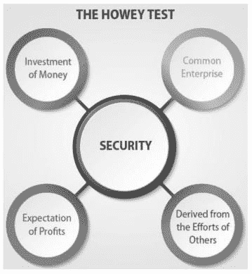

图表由国会研究服务提供

下文将讨论每一个要素。

### 1) 资金投资

这是 `Howey test` 最简单的要素。`Howey` 中的语言要求投资必须以“资金”的形式进行，但后来的法院裁决将定义扩大到包括其他类型的财产。为了评估这一要素，法院会观察投资者是否放弃了“某些有形且定义的财产”来换取证券。

### 2) 共同企业

在 `Howey` 案中，法院没有规定投资者应该与谁建立“共同”的企业（类似于共享的共同利益）。自 `Howey` 以来，美国最高法院避免了回答该问题。这把确定什么构成了“共同企业”的任务留给了下级法院。这些法院必须决定什么类型的共同利益可以满足最高法院的 `Howey` 标准。迄今为止，各法院之间不存在统一标准，但出现了三种不同的共同性测试：水平共同性、广义垂直共同性和狭义垂直共同性，将在下方分别解释。

#### 水平共同性 (Horizontal Commonality)

水平共同性关注投资者之间的水平关系，分析投资者是否汇集其投资并分担企业的利润和风险。这种测试通常被认为是最难满足的，因为它要求多个投资者将资金汇集到一项共同的风险事业中，并关注投资者之间的关系。一些法院还要求投资所得利润和亏损必须按比例分配。`第一`、`第二`、`第三`、`第四`、`第六`、`第七`、`第九` 和 `D.C.` 巡回上诉法院（巡回）接受水平共同性，且其中一些法院尚未裁定是否会接受其他类型的共同性。

#### 垂直共同性 (Vertical Commonality)

垂直共同性关注投资者与发起人之间的垂直关系，分析投资者对发起人的努力或技能的依赖程度。法院对于显示垂直共同性需要什么方面存在分歧：

##### 广义垂直共同性 (Broad Vertical Commonality)

一些法院要求投资者的命运与发起人的努力或技能相关。在这种情况下，只要投资者依赖于发起人的努力或技能，就会存在广义垂直共同性。这通常被认为是最容易满足的。`第五` 和 `第十一` 巡回法院要求广义垂直共同性。

##### 狭义垂直共同性 (Narrow Vertical Commonality)

其他法院要求投资者的财富必须与发行人的财富挂钩。在这种情况下，如果发行人在投资者获利时获利，则存在狭窄的垂直共同性。然而，如果发行人获得的是固定费用或不取决于企业盈利能力的佣金，法院不太可能认为存在狭窄的垂直共同性。只有第九巡回法院接受狭窄的垂直共同性，但在过去，第九巡回法院也接受过水平共同性。

正如本章后部分讨论的，`SEC` 对加密货币共同性的立场似乎是“任何共同性即可”。

### 3) 利润预期

这一要素关注对该投资是否具有利润的合理预期，以及该预期是否是投资的主要动力。在确定什么被视为“利润”时，法院主要关注资本增值或企业的收益。重要的是，最高法院认为，“当购买者的动机是由于想要使用或消费所购买的物品时 . . . . 证券法并不适用。”

这种被广泛描述为“实用性”的“使用或消费”例外经常被加密货币发行人利用，他们声称自己的代币不是证券。然而，`SEC` 强调，仅仅将代币标记为“实用性代币”并不能神奇地让该代币免受证券法的法律约束。截至目前，`SEC` 尚未对代币到底需要多少实用性才能避免被视为证券提供明确答案，但提供了指导意见（在本章后部分描述）以缩小调查范围。

### 4) 基于他人的努力

`Howey` 测试的第四个要素要求对投资利润的预期基于“他人的努力”。`Howey` 原文的表述是利润“完全”基于他人的努力，但“完全”这一要求已被大多数法院所放宽。今天，相关的调查是“除投资者以外的人所付出的努力是否是不可否认的重大努力，即那些影响企业成败的本质管理努力”。

根据美国法律，所有证券的要约和销售必须根据证券法进行注册，或者符合豁免注册的条件。要注册证券，发行人必须向潜在投资者披露有关投资的详细信息，包括业务及其管理层的描述、拟提供的证券以及经审计的财务报表。根据会计咨询公司普华道（`PWC`）的数据，首次公募（`IPO`）注册过程的（通常需要律师、会计师和银行家的参与）通常超过 100 万。

## SEC 与加密货币

在 2017 年之前，`SEC` 尚未对加密货币是否为证券采取公开立场。2017 年 7 月 25 日，在名为“The DAO”的加密货币对冲基金遭到攻击后，`SEC` 在发布的《The DAO 报告》（节选如下）中明确了其立场，宣布其观点：所有符合 `Howey` 测试的加密货币都是证券。

| 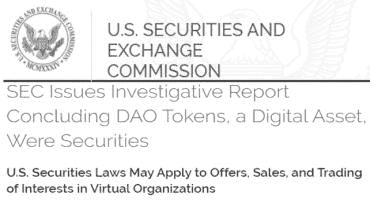 THE DAO REPORT（以下信息基于 The DAO 报告）The DAO 是去中心化自治组织（`DAO`）的一个示例，该术语用于描述一种由计算机代码体现、并在分布式账本或区块链上执行的“虚拟”组织。DAO 由一家名为 `Slock.it` 的公司及其联合创始人创建，目标是作为虚拟对冲基金运营。DAO 将通过向投资者出售 DAO 代币产生资产，然后这些资产将用于资助投资项目。DAO 代币持有者作为投资回报，将共享项目产生的收益。此外，DAO 代币持有者还可以转售其 DAO 代币。2016 年，The DAO 发布并通过出售 DAO 代币筹集了价值 1.5 亿美元以上的 ETH。然而，在 DAO 开始资助项目之前，攻击者利用 DAO 代码中的漏洞盗走了三分之一的 ETH。被盗的 ETH 价值在 5000 万至 6000 万美元之间。`SEC` 对 The DAO 发起了调查，并在调查中考虑了 (i) DAO 代币是否为证券这一边界问题 (ii) 证券法是否适用于 DAO 代币的销售。根据调查，`SEC` 发布了《The DAO 报告》，判定 DAO 代币为证券，且 DAO 代币的销售构成了证券发行。 |

`The DAO 报告` 于 2017 年发布，标志着加密社区与 `SEC` 之间战斗的正式开始。在随后的几年里，主要的争议点变成了 `SEC` 如何判断特定的加密货币是否为证券。加密社区敦促 `SEC` 发布明确规则，以确定加密货币的独特特征如何影响证券合同分析。

在 `The DAO 报告` 发布后，一些加密货币公司搬到了海外以规避美国证券监管。加密社区抱怨 `SEC` 缺乏清晰度是一个驱动因素。为了提供更多清晰度，`SEC` 在 2019 年 4 月发布了《数字资产投资合同分析框架》，以帮助市场参与者理解 `SEC` 如何判断加密是否是证券。尽管该指导受到欢迎，但带有一个重要的前提：它不具有约束力。框架包含了以下警告性语言：

```
本框架代表 SEC 员工的观点，并非规则、法规或委员会的声明。委员会既未批准也反对其内容。本框架与其他指导一样，对 SEC 各部门或委员会没有约束力。它不构成法律建议，您应咨询自己的律师。它不修改或替换任何现有法律法规。
```

尽管有警告性语言，该框架对于 `SEC` 如何判断标记为证券提供了实用的指导，并列出了 `SEC` 的三要素 `Howey` 测试：

1. 资金投资；
2. 共同体；以及
3. 源自他人努力的利润合理预期。

框架的分析如下。

### 1) 资金投资

框架规定，该要素“在数字资产的要约和销售中通常得到满足，因为数字资产是通过交换购买或获得的，无论是真实（或法币）货币、另一种数字资产或其他形式的”。然而，在脚注中，框架讨论了空投（`airdrops`），即向持有者免费发放加密代币，这通常用于促进空投加密货币的流通。

脚注指出，如果空投代币是为了“接收者为了推进发行人的经济利益并培养其证券交易市场而提供的服务”而发行的，那么资金投资要素很可能满足。`SEC` 对空投的立场与其对 20 世纪 90 年代运营的“免费股票”骗局的立场一致。根据当时的 `SEC` 执行主任 `Richard H. Walker` 的说法：

```
在这些案例中，免费股票实际上是一个误称。虽然没有发生现金交易，但发行股票的公司获得了宝贵的益处。在这种情况下，证券法赋予了投资者获得充分公平披露的权利，而他们在这些案例中并未获得这些权利。
```

### 2) 共同企业

该框架对共同企业的分析总结为一句话结论：

> “在评估数字资产时，我们（美国证券交易委员会 `SEC`）发现，通常存在‘共同企业’。”

这一结论性分析包含一个脚注（脚注 11），指出根据 `SEC` 的分析，“对数字资产的投资已构成了对共同企业的投资，因为数字资产购买者的财富彼此相关联，或者与推广者努力的成功相关联。”

换句话说，`SEC` 似乎采取了立场，认为存在哪种共同性并不重要。该结论是基于脚注 11 的描述，该脚注涵盖了：

* 通过使用“数字资产购买者的财富彼此相关联”这一表述进行的**水平测试**；以及
* 通过使用“数字资产购买者的财富已‘关联到’ . . . 推广者努力的成功”这一表述进行的**垂直测试**，这既能满足更难的狭义垂直测试，也能满足要求较宽松的宽义垂直测试。

`SEC` 的共同性立场遭到了加密行业许多人的批评，因为 `SEC` 似乎在表述的意思是：

> 只要代币满足任何共同性测试，我们通常就会将其视为符合我们的共同企业测试。

法院是否会同意这种松散的共同性定义尚有待定，且该问题是 `SEC v. Kik Interactive, Inc. (Kik)` 案中的争议焦点之一，该案在章节后部分有描述。`Kik` 案被广泛认为是加密货币证券监管最重要的测试案例。

### 3) 对他人努力产生利润的合理预期

在加入最后两个“豪威测试”（`Howey elements`）要素后，框架随后将它们拆分为：(i) 对他人努力的依赖，以及 (ii) 对利润的合理预期。与框架一样，这些内容在下文中以简要的形式进行了讨论。

#### (i) 对他人努力的依赖

在评估这一要素时，框架关注 `SEC` 所称的“活跃参与者”（`Active Participant, AP`）的角色，该角色被定义为推广者、赞助者或其他方：

> “负责网络的开发、改进（或增强）、运营或推广，特别是当数字资产的购买者预计 `AP` 正在执行或监督对于网络或数字资产实现或保留其预期目的或功能所必需的任务时。”

框架随后在对其“他人努力”的分析中确定了两个关键问题：

1. 购买者是否合理预期依赖 `AP` 的努力？
2. `AP` 的努力是否是不可否认的重大努力，即影响企业成败的关键管理努力，而非更具事务性（`ministerial`）的努力？

由于许多加密代币运行在去中心化区块链上，框架提供了该要素将得到满足的示例，包括以下情况：

* 关键管理任务或责任由 `AP` 执行，而非由无关联的、分散的网络用户社区执行；
* `AP` 创建或支持了数字资产的市场或价格；
* `AP` 在网络或数字资产的持续发展方向上起着主导或核心作用，包括治理问题、代码更新或交易如何验证；
* `AP` 在就网络、或数字资产所代表的特征或权利做出决策或行使判断方面发挥着持续的管理作用；以及
* 购买者会合理预期 `AP` 采取努力来促进其利益并提高网络或数字资产的价值。

根据框架，虽然这些特征没有一个是决定性的，但它们存在性越强，`SEC` 就越可能判定购买者正在依赖他人的努力。许多人抱怨说，框架对于 `SEC` 认为的最重要、甚至更重要的因素，提供的实际指导极少。

#### (ii) 对利润的合理预期

框架通常承认利润可以源于资本增值或收益，但补充说，仅由影响供需的外部力量（如经济通胀趋势）导致的价格上涨通常不应被视为利润。

框架随后列出了多项特征（由于篇幅限制在此不列出），这些特征使产生利润预期更有可能。框架还确定了反对数字资产购买者具有利润预期的因素，包括购买者是否是为了消费目的。

### 其他框架指南

框架还提供了关于加密货币在什么情况下不再被视为证券的指南。`SEC` 承认，作为证券出售的加密货币并不总是被视为证券，并在判定时将审查以下因素：

* 数字资产购买者不再合理预期 `AP` 的持续开发是决定其价值的关键因素；
* 数字资产价值与其可兑换的商品或服务显示出直接且稳定的相关性；
* 数字资产的交易量与其可兑换的商品或服务的需求相对应；
* 持有者是否能够为了其预期功能（如通过网络或平台获取商品和服务）而使用数字资产；
* 从数字资产增值中可能获得的经济利益是否是获得其预期功能的附带；
* 没有 `AP` 接触实质性非公开信息，或以其他方式被认为持有有关数字资产的内部信息。

### 新提案

在 2020 年 2 月的一次演讲中，`SEC` 委员海斯特·皮尔斯（`Hester Peirce`，在加密社区被称为“加密妈妈”）为寻求资金的加密项目提出了避风港建议。皮尔斯表示，该提案对于“为了实现证券法的投资者保护目标，同时也为了提供允许创新的监管灵活性”是必要的。

皮尔斯在其演讲附件中详细介绍了她的提案，她承认这是一个进行中的工作，该附件已在 `SEC` 网站公布。根据皮尔斯的提案：

> 该避风港旨在为初始开发团队提供为期三年的期限，在此期间他们可以参与并开发功能性或去中心化的网络，只要满足条件，即可豁免联邦证券法的注册规定。该避风港还旨在通过要求根据购买者需求定制披露并保留联邦证券法反欺诈条款的适用，保护代币购买者。

在三年结束后，初始开发团队必须确定代币交易是否涉及证券的发行出售。如果网络已成熟为功能性或去中心化的网络，则代币交易可能不构成证券交易。`网络成熟`（`Network Maturity`）的定义旨在明确何时代币交易不再应被视为证券交易，但一如既常，该分析需要对具体事实和情况进行评估。

`Peirce` 提出的避风港原则受到了加密社区的广泛认可。

# 证券法与代币发行

从历史上，大多数加密货币是通过首次代币发行（`ICOs`）向投资者提供的。`ICO` 是执行加密代币公售的智能合约。在大多数方面，`ICOs` 与 `IPOs` 相似，区别在于：

1. `ICOs` 在区块链上发行；
2. `ICOs` 通过智能合约发行；


* 3) `ICOs` 通常用于资金不足、需要资金推进至完成的开发项目；以及
* 4) `ICO` 发行的加密代币直接分发到投资者的账户（加密钱包），但通常无法立即在交易所进行交易。

`ICO` 市场在 2017 年和 2018 年非常庞大，每年有超过 3,000 个 `ICOs`，分别筹集了 62 亿美元和 78 亿美元。该市场在 2019 年开始降温，年底总额仅为 3.7 亿左右。

由于 `ICO` 代币存储在个人加密钱包中，`ICO` 之后通常没有易于访问的市场交易这些代币，导致许多投资者没有出售手段。为了给代币提供市场，许多 `ICO` 项目寻求让其代币在交易所上市。尽管付出了努力，仍有 182 个（约占 90%）`ICO` 项目从未在交易所上市。

针对 `ICO` 代币上市问题的一种市场反应是推出了首次交易所发行（`IEOs`），它们在除一点外均与 `ICOs` 相似：`IEO` 代币不是发行给个人加密钱包，而是在交易所上市并可立即交易。这使得投资者能够通过其现有的交易所账户购买 `IEO` 代币，并简化了发行人的融资细节。`IEO` 支持者宣扬的其他益处还包括：

## 投资者保护

由于交易所在上市 `IEO` 代币时押注了自身的声誉，因此交易所有动力确保只有良好的项目才能上市。因此，交易所可能被认为对其利益相关者有义务进行足够的尽职调查，以确保其上市的每个项目都是合法的。

## 可交易性与效率

由于投资者可以直接在交易所购买代币，投资者可以确保代币是可交易的。因此，开发者和应用平台可以更多地关注项目本身，而较少关注融资和上市细节。

## 价格透明度

许多 `IEOs` 的结构使得 `IEO` 代币的价格在代币上市之前公开公布，且该价格在 `IEO` 期间保持固定。这种透明度消除了经常伴 `ICOs` 的疯狂价格投机。

尽管 `IEOs` 为投资者提供了优于 `ICOs` 的优势，但根据 SEC 的规定，促进 `IEOs` 的交易所可能违反了美国证券法。在 2019 年 5 月于纽约行的共会议上，SEC 数字资产与创新高级顾问 Valerie Szczepanik 表示，向美国客户提供代币销售服务的加密交易所可能符合证券交易商的法律定义，这意味着它们必须遵守 SEC 的注册和许可要求。Szczepanik 补充道：

> “如果他们没有注册，一旦有美国发行人或美国买家，或者如果他们在美国市场运营，将在美国遇到麻烦。”

## SEC 执法

在《DAO 报告》发布后，SEC 开始对那些提供其认为的未注册证券的实体采取更激进的执法立场。自 2017 年以来，SEC 已针对提供未注册证券的 `ICO` 发行人发出了多次停止指令，许多加密项目已放弃了其在美国的发行，或对美国用户设置限制以规避 SEC 的审查。例如：

### Basis 稳定币


2018 年 12 月，Basis 稳定币项目的组织者放弃了该项目，并向包括 Google Ventures、Bain Capital Ventures 和 Andreessen Horowitz 在内的投资者退还了筹集的 1.33 亿美元。在与 SEC 进行长时间会谈后，组织者得出结论，在不违反证券法的情况下没有办法启动他们的 `ICO`。在他们的网站（`ww.basis.io`）上，组织者表示：

> 随着监管指导随着时间的推移开始流出，我们的律师达成共识，无法避免债券和股份代币的证券地位，并且必须将美国证券监管适用于该系统，这对我们的启动能力产生了严重的负面影响。

### Poloniex 交易所


2019 年 5 月，加密交易所 Poloniex 宣布将实施“地理围栏”（禁止特定管辖区客户的行为），由于对 SEC 是否会将这些代币视为证券存在监管不确定性。

### Kik 诉讼

有关 SEC 和加密货币行业各自立场的最全面探索，可以通过查看 SEC 对 Kik Interactive, Inc. 的诉讼——`SEC v. Kik Interactive` 来。Kin 是一家社交媒体消息公司，它与 Kin Ecosystem Foundation (Kin) 一起基于 Kik 的 App 发布了一种代币（Kin 代币）。2019 年 6 月，SEC 提起了诉讼，指控 Kik 进行了价值 1 亿美元的非法代币发行。

关于加密货币的立场，基于两个原因：

1) Kik 通过公开回复 SEC 的查询（称为 `Wells Response`）有效地邀请了 SEC 起诉；39 并且
2) Kik 发起了一项旨在为加密货币创建新的 `Howey test` 的活动，并组织了一个网站（`www.defendcrypto.org`），不仅为其针对 SEC 的诉讼进行众筹，还协助其他与 SEC 相抗衡的加密公司。

根据他们其中一名律师的说法，Kik 选择成为测试对象的原因之一是：

> 在 SEC 本身没有提供适当且清晰指导的情况下，这确实是唯一的选择……我们当然希望 SEC 能制定出清晰的指南，以及与其法定授权权限界限一致的指南。他们没有这样做，所以这确实是我们能看到的获得这种清晰度并获得正确结果的唯一途径，但这需要一些时间。

—Patrick Gibbs，Kik 律师，Unchained Podcast（2019 年 5 月 28 日）

以下是 Kik 案中重大事实和事件的概述：

* 2017 年 8 月，Kik 在一次 `ICO` 中筹集了超过 1 亿美元，在此之前的几周，SEC 发布了一份声明，警告“虚拟货币或代币可能是证券”，但未对如何做出此类判断提供实际指导。
* 2017 年 11 月，SEC 通知 Kik，正考虑就其在 `ICO` 中违反美国证券法对其起诉。
* 2018 年 12 月，Kik & Kin 公开了他们对 SEC 的 `Wells Response`，指称执法行动是不合理的。该提交除其他外还论证了：
    * (1) Kin 是一种货币，因此不应被视为证券；以及
    * (2) Kin 代币不是投资合同，因为：
        * i) Kik 与 Kin 购买者之间不存在“共同企业”；
        * ii) Kin 代币是基于其效用销售，因此没有利润预期；和/或
        * iii) 在购买者预期利润的范围内，这些预期并非基于 Kik 的创业努力或管理努力。
* 2019 年 5 月，Kik 和 Kin 启动了 [www.defendcrypto.org](http://www.defendcrypto.org)。
* 2019 年 6 月，SEC 起诉 Kik，指控其进行了金额为 1 亿美元的非法证券募资。
* 2019 年 8 月，Kik 提交了一份被广泛认为是对 SEC 诉状全面且具有战略性的答辩，理由如下：

#### 全面性 (Comprehensive)

Kik 并没有通过对 SEC 的指控进行一般性否认来正式回应诉状（这在证券诉讼中很常见），而是针对 SEC 诉状中所有有争议的事实和法律问题提供了详尽的反驳。

#### 战略性 (Strategic)

Kik 的答辩为迅速将诉讼移至上诉法院奠定了基础。通常在证券诉讼中，被告首先提交驳回诉讼的申请，这为被告留了更多准备时间，并可能迫使政府提供更多信息。Kik 放弃了驳回申请，通过对 SEC 诉状提供详尽的反驳，增加了该案件在不发生重大延误的情况下进入审判的可能性。无论初审法院发生什么，此案都可能被提起上诉。Kik 的答辩旨在尽可能快地将案件移至上诉法院，并可能移至美国最高法院。

该案的证据发现阶段预计将于 2020 年中期完成，为同年晚些时候的审判奠定基础。

### SEC 其他行动 (Other SEC Action)

在 SEC 发布《框架》（Framework）的同时左右，它还针对加密货币发布了其第一份“不采取行动函”（No Action Letter，见下表），认定 Turnkey Jet, Inc. (TKJ) 发行的 ICO 代币不被视为证券。TKJ 试图发行固定价格代币，允许代币持有者将 TKJ 的飞机作为包机和空中出租车使用。TKJ 代币将在 TKJ 控制的私有区块链上发行。

| 188 号 SEC 不采取行动函 | 不确定其行为是否会违反联邦证券法的个人或实体可以向 SEC 申请“不采取行动”函。大多数不采取行动函描述了请求，分析了涉及的事实和情况，并讨论了适用的法律法规。不采取行动函被认为类似于 SEC 的批准章。 |
| --- | --- |

SEC 费了近一年时间才发布了 TKJ 不采取行动函，考虑到某些不采取行动函在请求后不到一周内就发了。TKJ 不采取行动函提供了一个数字资产的示例，该资产可以提供和出售用于使用或消费，而不涉及证券法的注册要求。

然而，TKJ 不采取行动函的重要性有限，因为它只针对了一组狭窄的事实，即：一个许可性的、中心化的区块链，带有一种只能用于消费的固定价格代币。这些事实并不大多数加密项目。

2019 年 8 月，SEC 向 Pocketful of Quarters (PoQ) 发布了第二份（截至本文编写时最新）不采取行动函。PoQ 的代币称为 Quarters，旨在作为视频游戏中的通用货币。根据 PoQ 的说法，Quarters 将允许在某个游戏中获得奖励的玩家将这些游戏奖励转换为 Quarters，并在其他游戏和平台中使用这些 Quarters。

作为授予 PoQ 不采取行动函的条件，该公司必须向 SEC 保证，不允许玩家与其他玩家购买、出售或交易 Quarters，且开发者和影响者在开设 PoQ 账户之前必须通过 AML/KYC 检查。与 TKJ 代币一样，Quarters 将在一个许可性的、中心化的区块链上发行，使用仅用于消费的固定价格代币。PoQ 不采取行动函几乎没有开辟新地。

### 注册豁免 (Exemptions from Registration)

寻求提供或出售证券的公司（发行者）通常必须向 SEC 注册募资或寻求注册豁免。为了进行注册，发行者必须充分披露合理投资者在做出投资决策所需的所有信息。为了让寻求发行证券的公司更容易合规，SEC 提供了以下注册豁免：

* 向特定人数进行私人发行；
* 特定规模的发行；
* 州内发行；以及
* 政府证券。

所有证券交易无论是否豁免，都受联邦证券法反欺诈条款的约束。对于通过发行证券筹资金的公司，这一过程从 2012 年变得更容易，当时奥马政府和国会通过了《初创企业法案》（JOBS Act）。《初创企业法案》及其实施条例，结合现有法律，为寻求注册豁免的公司提供了三种极具吸引力的途径：A+ 法规 (`Reg A+`)、众筹法规 (`Reg CF`) 以及 D 类条例 (`Regulation D`) 中的 506(c) 条。D 类条例的 504 条和 506(b) 条也为加密公司提供了更多传统的注册豁免选择。

### 关键术语 (Key Terms)

#### 合格投资者 (Accredited Investor)

“合格投资者”包括符合以下条件的自然人：

* 在过去两年中每年收入超过 20 万美元（与配偶合计超过 30 万美元），并合理预计今年也将达到该水平；或
* 净资产超过 100 万美元（与配偶合计，不包括其主要住房的价值）。

“合格投资者”也可以是实体，如银行、合伙企业、公司、非营利组织或信托，前提是该实体符合某些标准。

2019 年 12 月，SEC 1983 年来首次提议扩大合格投资者的定义。根据该提议，定义将扩大到包括持有特定证券许可证（7、65 或 92 系列）的人、私募基金员工、注册投资顾问、管理资产超过 500 万美元的家族办公室（及其客户）以及有限责任公司等。该提议的意见征集期于 2020 年 4 月 24 日结束，预计将于 2020 年第三季度推出。

#### 通用募集 (General Solicitation)

“通用募集”包括刊登在报纸和杂志上的广告、公共网站、通过电视和广播传播的通信，以及通过通用募集或通用广告邀请参加的研讨会。此外，使用不受限制的、即公开可见的网站构成了通用募集。

#### 预先 (Preemption)

某些 SEC 豁免“预先”州证券法，这意味着募资不需要在州监管机构注册，也不需要遵守州蓝天法。

#### 受限证券 (Restricted Securities)

无法自由交易的证券。为了向公众出售受限证券，通常需要满足五个条件：

1. 持有期：通常需要持有 6 到 12 个月。
2. 最新公开信息：有关发行人业务性质、其高管和董事身份以及财务报表的信息必须是公开的。
3. 交易量公式：发行人关联方的任何出售行为均不得超过所售证券同类发行股总额的 1%；如果已在证券交易所上市，则应以 1% 或在出售通知提交前四周的平均每周报告交易量中的较高者为准。
4. 普通经纪人交易：发行人关联方的任何出售行为在各方面必须作为常规交易进行处理，且经纪人收取的佣金不得超过正常水平。卖方和经纪人均不得寻求招揽购买该证券的订单。
5. 备案要求：如果发行人关联方的拟议出售涉及超过 5,000 股，或在任何三个月内的总金额超过 `$50,000`，则必须向 `SEC` 提交备案通知。

## 免免条款

#### Reg A+

通过 `Reg A+`（有时被称为微型 IPO），美国或加拿大发行人可以在 12 个月内从无限数量非合格投资者（公众）处筹集高达 5000 万美元的资金，而无需作为公开发行进行注册。`Reg A+` 发行受 `SEC` 审查和资格认证，如果获得批准，则优先于州蓝天法。`Reg A+` 发行出售的证券不被视为限制证券。[40] 然而，根据 `Reg A+` 免购买的证券在未注册的情况下不能在交易所上市或报价。[41]

`Reg A+` 发行有两个层：

* `Tier 1`：适用于 12 个月内最高 2000 万美元的发行；193
* `Tier 2`：适用于 12 个月内最高 5000 万美元的发行。

对于最高 2000 万美元的发行，公司可以选择按照 `Tier 1` 或 `Tier 2` 的要求进行。

作为 `Reg A+` 审批流程的一部分，公司可以机密地向 `SEC` 提交其发股说明书，允许公司评估 `SEC` 对豁免的反应。此外，在承诺 `Reg A+` 发行之前，`SEC` 允许公司通过对其客户或公众就投资进行调查，“试水”（test the waters），从而在公司投入大量时间和资金进行 `SEC` 审批流程之前做出决定。

“试水”允许公司衡量 `Reg A+` 发行的潜在成功率，以便就是否继续做出明智决定。通常情况下，在“试水”活动期间，公司邀请潜在投资者（包括客户）表示对公司证券的兴趣。如果兴趣不足，公司可以避免进行发行所需的成本。

从理论上讲，`Reg A+` 流程应该让公司享受精简、快速的审查流程。但在实践中，`Reg A+` 流程并未为加密证券提供加速。从历史上看，寻求在 `Reg A+` 下发行证券的公司可以预期在三个月内获得批准。然而，尽管早期加密证券项目早在 2017 年中就提交了在 `Reg A+` 下发行证券的请求，但直到 2019 年 7 月 `Blockstack Reg. A+` 获得批准之前，没有任何“真正的”加密项目（见下表）获得批准。

| 194 StartEngine Reg A+ 合格批准 |  |
| :--- | :--- |
| 一家获得 `Reg A+` 发行证券初步批准的加密公司是 `StartEngine`，但该批准条件使得它通常不被视为“真正的”加密项目。`StartEngine` 成立于 2014 年，声称是美国最大的股权众筹平台，其使命是通过资本获取的民主化帮助创业者实现梦想。2018 年 6 月，`StartEngine` 在一次标准的（即非加密）`Reg A+` 发行中成功筹集了近 500 万美元。在首次 `Reg A+` 发行之后，`StartEngine` 寻求在 `Reg A+` 下发行代币化股权证券的批准。在其[代币化股权发行说明书](https://www.sec.gov/Archives/edgar/data/1661779/000114420418036457/tv497502_partiiandiii.htm)中，`StartEngine` 表示计划以“电子代币的形式”发行普通和优先股……“使用 `smart contract` 在 `Ethereum Blockchain` 上交付”。然而，在提交初始申请后，`StartEngine` 被要求修改六次其初步招股说明书。在其第六版招股说明书（日期为 2019 年 3 月 7 日）中，`StartEngine` 修改了章程，将其证券名称从 `Series Token` 优先股更改。实际上，`StartEngine` 的批准是基于 `SEC` 要求他们从发行中移除几乎所有与加密相关的内容。 | |

---


| 196 | 2019 年 4 月，纽约区块链软件提供商 `Blockstack` 宣布其已向 `SEC` 提交发行说明书寻求首创。根据 `Blockstack’s` 网站：我们的全资子公司 `Blockstack Token LLC` 今日宣布已向 `SEC` 提交发行说明书以进行 5000 万美元的代币发行。一旦批准，该发行将是首例。`Blockstack` 在 2019 年 7 月获得了 `Reg A+` 批准，并在 9 月在首次 `SEC` 的发行中筹集了超过 230 万美元。发行净收益将用于加速 `Blockstack` 去中心化计算网络和应用生态系统。尽管 `Blockstack` 的批准为 `SEC` `Reg A+` 要求提供了清晰度，但它引发了一系列其他问题，包括： |
| :--- | :--- |
| | * 如果购买 `Blockstack` 代币的人用其交换商品或其他服务，`SEC` 是否会将其视为证券出售？ |
| | * `Blockstack` 代币持有人可以向他人转售吗？ |
| | * 如果应用程序接受 `Blockstack` 代币作为支付或使用代币支付他人，该应用程序是否在招揽证券或作为证券交易商？ |
| | * 因为 `SEC` 批准了发行，`Blockstack` 是否免于纽约的蓝许可证制度？ |

另一个来自 Blockstack 发行的开放问题涉及挖矿。Blockstack 协议依赖矿工来挖掘“Stacks”代币 (`STX`)。如果矿工获得了超过 5000 万美元的 `STX` 代币（`Reg A+ Tier 2` 的限制），目前尚不清楚 (i) 如何根据证券法发行这些代币，以及 (ii) 向矿工发行 `STX` 代币是否被视为独立的发行。

#### Reg CF

通过 `Reg CF`（正式称为“众筹条例”），发行人可以通过 `SEC` 批准的经纪商或众筹平台（见下表）从非合格投资者处筹集高达 100 万美元（随通胀调整）的资金。`Reg CF` 为发行人提供了一个简单直接的选项，但根据 2020 年的规定，限制发行额不超过 107 万美元。

| 什么是众筹平台？ |
| :--- |
| 作为 JOBS 法的一部分，股权众筹平台的概念被创造让创业者、初创公司和非传统投资基金能够从公众募集资金。为了降低欺诈风险，`Reg CF` 禁止股权众筹平台： |
| * 向投资者提供投资建议或推荐。 |
| * 在其网站或门户网站上招募购买、销售或购买其提供或展示的证券的要约； |
| * 根据其网站或门户网站上展示或引用的证券销售或此类招募向员工、代理或其他人员支付报酬； |
| * 持有、管理、拥有或以其他方式处理投资者资金或证券；或 |
| * 参与美国证券交易委员会（SEC）根据规则认为不恰当的活动。 |

股权众筹平台与 `Kickstarter` 等捐赠型众筹平台有相似之处。然而，在股权众筹中，投资者购买的是公司股份而非产品或服务。

### Reg D

通过 `Reg D`，发行人可以通过出售受限证券募集不受限制的资金。作为 `Reg D` 发行的一部分，发行人向潜在投资者提供说明发行情况的文件以解释发行情况。三种基于规则的 `Reg D` 发行方案是 `Rule 504`、`Rule 506(b)` 和 `Rule 506(c)`。它们在可募集资金金额、合格投资者类型以及允许的招募类型方面有所不同。下面简要概述每个规则的规定。

### Rule 504

`Rule 504` 不优先于州法，允许发行人在任何 12 个月内募集 5,000,000 美元的受限证券。`Rule 504` 发行的投资者应被告知，除非发行人向 `SEC` 注册出售交易，否则他们可能在一年内无法出售这些证券。在某些情况下，`Rule 504` 发行禁止通用招募，但 `Rule 504` 中的一项规定允许根据州法进行通用招募。

### Rule 506(b) 和 (c)

根据 `Rules 506(b)` 和 `(c)`（两者均优先于州法），发行人可以通过出售受限证券募集不受限制的资金。其区别在于：

在 `Rule 506(b)` 下，发行人：

*   可以向无限数量的合格投资者出售受限证券，以及多达 35 名非合格投资者；
*   不能使用通用招募或广告来营销受限证券；且
*   必须随时准备回答潜在购买者的提问。

相反，在 `Rule 506(c)` 下，发行人：

*   只能向合格投资者出售受限证券；且
*   仅可以向合格投资者对发行行为进行招募和通用广告。

由于 `Rules 506(b)` 和 `(c)` 都要求发行人采取合理步骤验证投资者是否为合格投资者，这可能包括审查文件（如 `W-2s`、信用报告、纳税申报以及财务报表）。

### 一种新型金融产品：比特币 ETF

除了股票等传统证券外，`SEC` 还监管向公众提供的集合投资产品的销售，包括交易型基金（`ETFs`）。`ETFs` 是由不同证券、指数、大宗商品、债券或其他资产的组合组成的投资基金。截至 2019 年底，`ETFs` 的市值超过 3 万亿美元，前十大的 `ETFs` 持有的资产价值超过 9000 亿美元，每天交易量超过 6.5 亿股 `ETF` 股份。下方的框解释了 `ETFs` 的运作方式。

**ETF 股份代表 ETF 所持资产池的份额权益。** 每股 `ETF` 股份代表 `ETF` 资产价值（`NAV`）的固定百分比，因此底层资产的价格上涨，价格也随之上涨。`ETFs` 的结构为被动投资工具，与在 `NASDAQ` 等交易所交易的共同基金不同。由于 `ETFs` 没有活跃经理，它们的费用通常比共同基金小。`ETF` 股份的数量通过一种被称为“创建和回购”的机制进行监管。该创建和回购机制依赖于“授权参与者”的实体，这些实体负责收购和处置资产。该机制运作如下：

**创建：** 当 `ETF` 想创建新的 `ETF` 股份时，`ETF` 指示授权参与者首先购买更多底层资产，然后将这些资产卖给 `ETF` 以获得新的 `ETF` 股份。授权参与者然后在开放市场上出售新的 `ETF` 股份。

**回购：** 当 `ETF` 想减少 `ETF` 股份数量时，`ETF` 指示授权参与者首先在开放市场上购买 `ETF` 股份，然后将这些股份卖回给 `ETF` 以换取底层资产。授权参与者然后在开放市场上出售这些资产。

*   比特币没有统一的价格，不同的交易所报价各不相同；而且
*   比特币市场缺乏流动性。

# 比特币 ETF 提案的历史

首个比特币 ETF 提案是由 `Bats BZX` 交易所和 `Winklevoss` 双胞胎（Facebook 的早期投资者）于 2016 年 6 月提交的。证券交易委员会（SEC）最终于 2017 年 3 月拒绝了他们的提案，理由是比特币市场容易受到操纵、波动大且难以监管。在 `BZX/Winklevoss` 提案被拒绝两周后，SEC 再次拒绝了另一项提案，这次来自纽约证券交易所的子公司 `NYSE Arca`。

2018 年，SEC 拒绝了一份修订后的 `BZX/Winklevoss` 提案，但 SEC 委员 `Hester Peirce` 公开对该决定表示反对，并写道：

> “拒绝批准令关注的是比特币现货市场的特征，而不是 `BZX` 根据其自身规则对在 `BZX` 上列出和交易股票进行监管并震慑操纵的能力。”

当时，许多人认为 `Peirce` 的公开评论预示着 SEC 态度的转变。然而，仅在 2018 年 8 月 22 日就有九项提案被拒绝，截至本文撰写尚未有提案获得批准。

尽管没有提案通过，但在 2019 年 2 月出现了两丝希望，当时：

*   SEC 委员 `Robert J. Jackson Jr.` 公开思考：
    > “最终，我认为会有人满足我们所设定的标准吗？我希望如此，是的，我是这么想的，” 随后补充道：
    > “当市场达到那个阶段时，我完全相信我们将拥有一个准备好批准比特币 ETF 的 SEC。”

*   商品期货交易委员会 (`CFTC`) 委员 `Brian Quintenz` 批评 SEC 以潜在价格操纵为由拒绝了之前的 ETF，他表示：
    > “通过结算指数，有一种数学方法可以设计一种合约，即使所引用的某个交易所没有足够的流动性，指数本身也不容易受到操纵。”

在 2019 年 10 月做出的一份 112 页的决书中，SEC 拒绝了由 `Bitwise` 和 `NYSE Arca` 于 2019 年 1 月提交的修订比特币 ETF 提案。在决书中，SEC 表达了对市场操纵的关注，并引用了 `Bitwise` 的研究，该研究表明报告的比特币交易量中只有 5% 是“真实的”，另外 95% 是“虚假的”。`Bitwise` 的研究指出，虚假交易包括不受监管交易所账户持有者之间的人为交易，以及用于推高交易量的自交易（经常成对出现的买卖单，其中相互抵消）。在决书中，SEC 指出：

> `Bitwise` 尚未证明其实际上识别了“真实的”比特币市场，或者“真实的”比特币市场已与欺诈和操纵活动隔离开。

一些法律分析师认为，在现任 SEC 主席 `Jay Clayton` 任期结束之前，比特币 ETF 不会被批准。`Clayton` 长期以来一直是批评者，并在 2019 年 9 月表示：

> “我们如何确保那些交易不受操纵呢？”

其他人则没那么乐观。`Tom Pisani` 推测，SEC 对操纵的关注是一种拖延策略。`Pisani` 还指出：

> “SEC 正在试图找一个拒绝的理由，但他们还没有找到。问题是市场尚未受到监管。”

`SEC` 认为，监管市场对于保护投资者是必要的。然而，比特币 ETF 的支持者认为，ETF 将通过提供流动性和透明度来帮助市场自身。

一种流行的衍生品合约是期货合约，它是一种关于在未来某个时刻以预先价格买卖某种特定资产的法律协议。期货合约的买方承担了在合约结束（到期）时以指定价格购买标的资产的义务，而合约卖方则承担了在到期时按该价格将基础资产卖给买方的义务。与看涨期权不同，期货合约并没有赋予买方在未来购买基础资产的权利：期货买方必须获得该资产，无论到期时的实际价格如何。

在美国，`CFTC` 监督期货合约的监管，确保它们在质量和数量上实现标准化。由埃迪·墨菲、丹·阿克罗德和杰米·李·库蒂斯主演的 1983 年电影《交易场所》（*Trading Places*）在笑料之余相当不错地展示了期货市场的运作方式，使用了冷冻浓缩橙汁期货合约。电影还展示了期货市场存在操纵和获利的可能，并解释了为什么对这类市场进行监管如此重要。

与世界上大多数监管机构不同，`CFTC` 并不批准新的金融产品。相反，它允许获得许可的交易所对新产品进行自认证，只要交易所确保这些产品符合 `CFTC` 的核心指南和原则。作为自认证流程的一部分，`CFTC` 员工与交易所协调，确保新产品符合 `CEA` 和 `CFTC` 的规定。从 2000 年至 2019 年，交易所和其他市场参与者通过 `CFTC` 自认证了超过 12,000 种产品。

在 2015 年之前，尚不清楚 `CFTC` 是否具有管辖权。2015 年 9 月，`CFTC` 声称对比特币期货拥有管辖权，称其为大商品。`CFTC` 还对基于比特币的衍生品（如期货互换和期权）行使管辖权。

`CFTC` 还致力于保护消费者免受加密市场中的欺诈影响。`CFTC` 发布了关于投资加密货币风险的警告。`CFTC` 还对在加密领域进行欺诈的个人和组织发起了起诉。

`CFTC` 继续与其他监管机构合作，确保加密市场得到有效监管。`CFTC` 与 `SEC`、`DOJ`、`FBI` 以及其他国际机构合作，以确保加密市场的公平和有序。

2019 年，CFTC 征收了超过 13 亿美元的监管罚款，比 2018 年增长了 40%。CFTC 的执法行动中约有 65%是针对参与商品及其他衍生品欺诈计划的个人和实体的。而且，这些执法行动中越来越多地涉及加密货币。

仅在 2019 年，CFTC 就采取了以下加密货币相关的执法行动：

*   10 月 23 日，在一起由 CFTC 提诉的案件中，一名联邦法官裁定两个人和四家公司实体支付 425 万美元损害赔偿，以就一项涉及一种名为 `ATM Coin` 的无价值加密货币的二元期权诈骗行为进行负责。
*   9 月 30 日，CFTC 指控内华达州的一个人和一家公司涉及一项涉及 1100 万美元二元期权计划的欺诈。根据起诉书，被告 (i) 招募并接受了至少价值 1100 万美元的 `bitcoin` 和美元用于交易衍生品，且 (ii) 对其交易专业知识做出虚假陈述，并保证了高达 300% 的收益。被告并未按照承诺使用资金进行交易，而是通过 (i) 将参与者的资金保留在被告的个人加密钱包中，以及 (ii) 使用资金支付早期投资者的资金（庞氏骗局）来挪用资金。随后，被告向参与者撒谎以掩盖其挪用资金的行为。
*   同样在 9 月 30 日，CFTC 指控一名个人 `Jon Barry Thompson` 欺诈，指控他说服客户发送约 700 万美元以资助虚假的 `bitcoin` 购买。
*   6 月 18 日，CFTC 宣布其已指控位于英国的加密货币公司 `Control-Finance Limited` 及其 CEO 挪用了来自 1000 多名受害者的 22,858.822 枚 `bitcoins`（当时的价值为 1.47 亿美元）。

虽然普通欺诈占据了 CFTC 执法活动的大部分，但它对虽然不属于欺诈但属于其监管范围的活动行使了管辖权。其中两种活动是非受监管的交易和担保贷款。

## 未受监管的交易

根据美国法律，如果衍生品交易所或交易平台向美国客户招揽或接受订单，则必须向 CFTC 注册。自 2015 年以来，在确定某些加密货币为商品后，CFTC 坚持认为，如果加密衍生品交易所允许美国人进行交易，则必须注册。

2019 年 3 月 11 日，来自马绍尔群岛的在线交易平台 `1pool Ltd.` 及其 CEO 同意支付近 100 万美元以解决 CFTC 的指控。作为该和解的一部分，`1pool` 承认其 (i) 向美国客户提供了使用 `bitcoin` 作为抵押的合同，(ii) 未向 CFTC 注册，以及 (iii) 未实施适当的 AML/KYC 计划。

2019 年底的报告显示，CFTC 正在调查位于香港的 `BitMEX`（全球最大的交易平台之一），原因是其允许美国人在其平台上进行交易。行业内的许多人认为此案很重要，因为它有可能将美国监管的范围延伸到美国境外之外。

`BitMEX` 拥有相关的规则和政策禁止美国人使用其平台，并移除任何其发现的违反这些规则的美国人。事实上，在主网站 `bitmex.com` 上，用户会看到以下信息：

> **注意—重要通知**
>
> 如果您位于、注册或以其他方式建立我们的服务条款（以及该术语的定义）下的任何“受限管辖区”（包括美国），或是其公民或居民，则禁止访问或使用我们的服务（包括 `BitMEX` 交易平台）。
>
> `BitMEX` 保留立即关闭被认定违反我们服务条款的人员账户并将其未平仓头寸的权利。

然而，正如 `BitMEX` CEO `Arthur Hayes` 指出的，“客户可能通过使用虚拟专用网络为他们的计算机分配来自 `BitMEX` 许可国家的互联网协议地址，从而掩盖其位置并欺骗 [BitMEX] 设置的过滤器。”

尽管有禁止，美国投资者仍试图在 `BitMEX` 上进行交易，其一原因是 `BitMEX` 提供了美国客户通常无法获得的金融产品。其中一种金融产品是 `XBTUSD BTC/USD` 合同，它提供高达 100 倍的杠杆。使用 `XBTUSD` 合同，投资者可以质押 1 个 `BTC` 并允许使用杠杆（他人财产）购买 100 个 `BTC`。通常，`XBTUSD` 合同的运作如下：

*   如果 `BTC` 价格上涨，收益率比例为 100:1。
*   然而，如果 `BTC` 价格下跌 1%，由于 100:1 的杠杆，投资者将损失其全部的 1 个 `BTC` 投资。

如果 CFTC 能够在 `BitMEX` 阻止美国用户的努力的情况下对其维持执法行动，那么任何拥有美国用户的平台（无论该平台为禁止美国用户的努力如何）都可能受到美国执法行动的影响。此外，仅仅被 CFTC 调查就会产生影响。例如，在报道 CFTC 正在进行调查后不久，`BitMEX` 经历了约 5.3 亿美元的资金创纪录流出，是其之前任何月份金额五倍以上。尽管如此，到 2019 年底，`BitMEX` 仍是前三大加密衍生品交易所之一，次于韩国的 `OKEx` 和新加坡的 `Huobi`。

## 担保贷款

CFTC 监管的另一种非欺诈加密货币活动是担保贷款。担保贷款是借款人将某些资产（例如 `bitcoin`）作为贷款抵押的过程。一旦资产被抵押，它们就作为贷款人的财务损失的保护。一个例子是 `bitcoin` 的担保贷款，借款人质押 100 美元，贷款人借给借款人 900 美元，以便借款人购买 1000 美元的 `bitcoin`。为了持有比特币抵押，贷款人通常持有比特币的私钥。

加密货币担保贷款的问题最早出现在 2016 年针对加密货币交易所 `BitMEX` 的诉讼。在其平台上，`BitMEX` 允许零售用户进行以 `bitcoin` 为担保的贷款。`BitMEX` 的作用是匹配提供 `bitcoin` 融资的贷款人和希望杠杆购买 `bitcoin` 的借款人。此外，`BitMEX` 监控贷款协议并持有抵押品。CFTC 认定 `BitMEX` 的担保贷款服务等于“融资零售商品交易”，这是根据 CEA 监管的交易。


在 2010 年之前，`BitMEX`的`bitcoin`担保贷款不会产生任何问题（暂不考虑 2010 年还没有`bitcoin`市场的事实）。然而，2010 年，《多德-弗兰克金融改革与消费者保护法》（Dodd-Frank）修订了 CEA，改变了商品支持的零售担保贷款的监管方式，将`BitMEX`的担保贷款服务纳入了 CEA 的范围。在不涉及具体的法律细节的情况下，`BitMEX`极难满足各种基于 CEA 的法律和监管要求，使其能够向零售客户提供担保贷款服务。5253

## 为什么 CFTC 参与其中？

如果有人好奇监管大宗商品和衍生品的 `CFTC` 为何会对担保贷款行使管辖权，原因非常简单：从经济角度来看，担保贷款（如上述的贷款）的运作方式与期货合约几乎完全相同。218 两者都允许借款人/投资者通过杠杆获得资产的价格敞口，并且允许借款人/投资者从资产价格的上涨中获利。

# 加密货币税与 IRS

“税收无了我周围的一切，TREAM”

——安永信会计的 Ryan McNeil，引用 Wu Tang Clan 的话

加密货币的征税在某些领域已经非常明确，但在另一些领域仍不一致或缺乏连贯性。一个明确的领域是，加密货币在税务目的上被视为财产。IRS 通过 `Notice 2014–21`（`Notice`）及其随附的常见问题解答（`FAQs`，与 `Notice` 合称为 `2014 Guidance`）做出了这一裁定。`2014 Guidance` 广受欢迎，因为在它发布之前，尽管纳税人多次请求，美国纳税人倡导员 54 以及一系列商业和专业团体，IRS 尚未对加密货币的税务处理发布过官方指南。

五年后的 2019 年 10 月，IRS 发布了其第二份加密货币指南——`Revenue Ruling 2019–24`（`Rev. Rul. 2019–24` 或 `Ruling`）以及随附的 `FAQs`（合称为 `2019 Guidance`）。IRS 指出，`2019 Guidance` 旨在扩展 `2014 Guidance`。尽管 `2019 Guidance` 回答了许多关于加密货币税务处理的悬而未决的问题，但也引发了一系列新问题。

2019 年 12 月，八位国会议员致信给 `IRS` 局长 `Rettig`（`Congressional Letter`），要求对 `2019 Guidance` 进行澄清，并指出：

> [税法中的]模糊性阻碍了适当的税收合规，并不公平地针对了那些可能无法理解 `IRS` 在这些事项上所采取立场、但采取了合理立场的纳税人。55

2020 年 2 月 28 日，美国注册会计师协会（`AICPA`）也起草了一封给 `IRS` 的信件（`AICPA Letter`），指出了需要额外或更新指南的特定领域。`Congressional Letter` 和 `AICPA Letter` 都强调并解决了 `2019 Guidance` 的重大缺陷。

以下是对 `2014 Guidance` 和 `2019 Guidance` 的分析。

## 2014 Guidance

`Notice` 回答了关于加密货币税务处理的基石问题之一：纳税人应该如何处理涉及加密货币的交易？`IRS` 的回答是，加密货币（被 `IRS` 称为“虚拟货币”56）将根据美国税法（`Code`）被视为财产。这意味着任何加密货币的出售或交换，无论规模大小，都是应纳税交易，并且必须在税表上申报。

根据 `Code`，加密货币本可以被视为货币、大宗商品、证券或财产。通过选择将加密货币视为财产，`Code` 要求纳税人每当用加密货币交换任何财产时，纳税人必须报告与该交换相关的任何收益或亏损。这些收益或亏损通常通过从纳税人交换的加密货币的调整成本基础（见框）减去交换获得的任何财产的公平市场价值（`FMV`）算出。

这个答案提供了清晰度，但并不令人满意。将加密货币视为财产意味着几乎每一次加密货币交易（包括使用加密货币在星巴克买咖啡）都可能是必须在税表上申报的应纳税交易。

### 税务基准的基础

税务基准是税务目的下与财产相关的成本，用于计算出售、交换或其他处置财产时的收益或亏损。对于每一笔单独的加密货币购买，计算税务基准相对简单：加密货币的成本加上任何收购成本。然而，当涉及到出售或其他交换时，情况就会变得复杂一些，因为通常无法清楚具体是哪种加密货币被用于出售或交换。例如，假设 `Bibi` 从 2011 年到 2020 年每年 1 月 1 日购买一个比特币，现在拥有 10 个比特币。如第二部分所述，这些比特币的购买价格范围从每枚比特币 0.30 美元（2011 年 1 月的价格）到 13,657 美元（2018 年 1 月的价格）不等。这 10 个比特币中的每一个都根据其各自的购买价格拥有自己的税务基准。现在，如果 `Bibi` 在 2020 年 1 月 2 日从 `Chaun` 那处用 4.5 个比特币买了一辆车，尽管 `Notice` 指导 `Bibi` 报告用一种财产（4.5 个比特币）交换另一种财产（汽车），但它没有提供关于 `Bibi` 如何确定其 10 个比特币中哪 4.5 个被用于购买汽车的指导。

虽然 `Notice` 回答了一个基础性的税务问题，但它未能解决许多其他问题，让纳税人只能自行摸索。在 `2014 Guidance` 发布后的五年里，美国律师协会（`ABA`）和 `AICPA` 都针对其中许多悬而未决的问题向 `IRS` 请求了额外指南。其中一个问题是硬叉的税务处理，`ABA` 和 `AICPA` 都认为这是纳税人面临的最紧迫问题之一。

2019 年 5 月 16 日，`IRS` 局长 `Rettig` 承认了由于 `IRS` 未提供额外指南而产生的问题，并向国会致信，表示新的加密货币指南是优先事项。`Rettig` 局长的信是回复 21 位国会议员的请求，他们要求 `IRS` 对加密货币税务申报提供澄清，指出关于加密货币联邦税的重要问题存在“大量模糊性”。

在 `Rettig` 的回复中，他表示：“我赞同纳税人对加密货币交易基本问题的要求的看法，并已将其作为 `IRS` 的优先事项。”`Rettig` 补充说，`IRS` 正在研究的问题之一是“确定硬叉处理的可接受方法”。该指南于 2019 年 10 月发布。

## 2019 Guidance

`Rev. Rul. 2019–24` 处理了硬叉和空投的税务处理。在此过程中，它还处理了这两者的共同子问题：在硬叉或空投获得新加密货币后，在什么情况下纳税人需要报告有关新加密货币的收入。`Rev. Rul. 2019–24` 同期发布的 `FAQs` 为许多技术税务问题提供了指导，其中包括对纳税人最重要的问题之一：他们应该如何计算加密货币的税务基准。

### 硬叉的税务处理

`Rev. Rul. 2019–24` 将硬叉定义为“当[区块链]上[加密货币]发生协议更改，导致永久偏离旧或现有[区块链]时发生的情况。”在该 `Ruling` 中，`IRS` 明确了其立场：如果纳税人在硬叉后对新币具有“支配和控制权”，则当该新币记录在新区块链上时，纳税人将拥有相当于新币公平市场价值的应纳税收入。`IRS` 包含了“支配和控制权”这一说法，以便纳税人在通过交易所或其他中介持有加密货币，而该中介并未列出或支持该新加密货币的情况下不会被征税。58 在此类情况下，`Ruling` 指出由于此类纳税人无法立即消费或转账这些新的未列出/不支持的币，他们不需要确认与这些币相关的收入。

### 空投的税务处理

该裁定将空投（airdrop）定义为“一种将[加密货币]单位分配给多个纳税人[区块链]地址的手段”。裁定随后补充道，空投的[加密货币]“通常是在其记录在[区块链]上的日期和时间收到的”。正如硬分叉的情况一样，美国国税务局（IRS）指出，“如果纳税人无法对[加密货币]行使支配和控制，那么当空投记录在[区块链]上时，纳税人并未收到[加密货币]”。

裁定指出，“纳税人可能在空投记录在[区块链]上之前就推定性地收到[加密货币]”。然而，IRS 并未提供任何解释或示例来描述纳税人如何在加密货币记录到区块链之前对其进行推定性接收。即使空投的加密货币在记录到区块链之前以某种方式被推定性地接收，该裁定也未解释纳税人如何对此类加密货币行使“支配和控制”。

### 加密货币的税务基础

随裁定的常见问题解答（`FAQs`）涉及了加密货币的税收基础。美国律师协会（`ABA`）和美国会计师协会（`AICPA`）都提出了这一问题，指出在缺乏特定 IRS 指南的情况下，纳税人必须根据经验推测如何计算和追踪其加密货币的基础。在其他税收背景下，确定财产基础的许可方法包括先进先出（`FIFO`）、后进先出（`LIFO`）、对交易中使用的财产进行特定识别，以及平均成本法。

`AICPA` 建议 IRS 允许先进先出法，除非纳税人能够识别出交易中使用的特定加密货币单位。IRS 似乎采取了 `AICPA` 的建议。在`FAQ 40`中，IRS 宣布，除非纳税人识别出交易中使用的特定加密货币单位，否则这些单位被认为是按时间顺序出售、交换或其他方式处置的，从购买或获得的最早加密货币单位开始（即`FIFO`）。

# 2019 年指南的分析

尽管 2019 年指南对许多悬而未决的问题解答，但它引发了许多其他问题，包括：

1.  它未能解决小额交易的微量豁免（de minimis exception）；
2.  它含义不明、不精确，且在某些地方不公平；
3.  作为指南，它缺乏法律或法规的效力，容易受到质疑。

## 微量豁免

尽管包括 `AICPA` 和 `ABA` 在内的许多组织建议设立此类条款，但 2019 年指南未能解决小额加密货币交易的豁免问题。IRS 在 2018 年的演示中承认了这一问题，提及 `AICPA` 提出的对 200 美元以下交易建立豁免的建议，类似于个人外币交易的微量豁免。没有这种豁免，纳税人需要向 IRS 报告每一笔使用加密货币的交易，从使用比特币在星巴克购买咖啡，到用 1 美元的`BTC`兑换 1 美元的`ETH`。在 2020 年 2 月的 `AICPA` 信函中，`AICPA` 要求 IRS“行使其行政裁量权来执行税法，建立一个微量安全港”，以免除纳税人处理“行政成本超过非微小交易之任何可能税款的交易”的麻烦。

IRS 未对未包含微量豁免提供任何解释，但有两个可能的理由：

1.  IRS 人员认为此类规则将阻碍 IRS 让纳税人报告其加密货币交易的努力。许多人推测，微量规则可能导致先进的避税技术，例如将交易拆分为许多笔低于阈值的交易（这并不是什么先进技术，但却是创建此类技术的良好起点）。此外，监控微量规则对 IRS 来说可能需要更多时间，因为这不仅需要 IRS 检查所有交易，而且还需要(i) 首先过滤掉低于 200 美元阈值的交易，然后 (ii) 确定系列经过过滤的交易是否为了规避报告而进行了结构化处理。
2.  IRS 无法创建新法律。是国会而非 IRS 创建了个人外币交易的微量豁免。因此，在没有国会关于豁免加密货币的指令的情况下，IRS 不能仅仅因为这对纳税人方便就创建一个新法律。

2020 年 1 月，国会引入了一项法案以解决微量豁免问题。该法案名为《2020 年虚拟货币税收公平法案》，在美国众议院获得了两党支持并被引入。该法案将个人交易中处置虚拟货币所获得的最高 200 美元的收益从总收入中扣除。2017 年引入的法案之前的版本试图免除金额低于 600 美元的交易。此外，2018 和 2019 年的《代币分类法案》（均未通过）都包含了 600 美元的微量豁免。

## 拙劣的指南

2019 年 12 月的国会信函指出：

> “这份最新的指南就其试图解决的主题（即分叉和空投）产生了许多许多新问题。此外，[它]看起来并不公平。”

这些问题使得很难确定某些交易应如何被处理。在 2019 年指南中，IRS 使用以下语言定义硬分叉：

> “硬分叉发生于当[加密货币] . . . 经历协议更改，导致对旧有[区块链]的永久性偏离，从而导致在新的[区块链]上创建了新的[加密货币]。”

随后，IRS 使用以下语言定义空投：

> “空投是一种将[加密货币]单位分配给多个纳税人[区块链]地址的手段。硬分叉随后的空投会导致新[加密货币]单位分配到旧的[加密货币]中。”

这两个定义都不精确。与比特币现金（`BCH`）和以太坊经典（`ETC`）相关的硬分叉证明了下文所述的不精确性。

### 比特币现金硬分叉

2017 年 8 月 1 日，比特币现金（`BCH`）从比特币（`BTC`）区块链分叉出来（`BTC/BCH fork`），这种分叉可以说符合指南的定义，其中`BCH`是“新的”加密货币。然而，与 IRS 的定义相反，`BCH`并没有“空投”给现有的`BTC`持有者。空投通常是新启动的加密货币自动分配给代币或币持有者。相比之下，在硬分叉之后（特别是有争议的分叉），分叉前币（`BTC`）的所有者根据权利同时拥有新币（`BCH`）和旧币（`BTC`）。

在 2017 年`BTC/BCH fork`之后，`BCH`本身在次年分裂为两种币：比特币现金可调整区块大小（`ABC`）和比特币中本聪视觉（`SV`）（`ABC/SV fork`）。2019 年指南对于`ABC/SV fork`在税收目的上如何被处理产生了困惑，因为在分叉之后，两种币都合法地声称自己是“旧的”货币，而且都声称另一种币是“新的”货币。

在`ABC/SV fork`发生后，尚不清楚哪个区块链是主导性的，哪一个能够自称为“真正的”比特币现金（`BCH`）。某些交易所甚至停止了`ABC`和`SV`几天交易，直到明确谁是“获胜者”。最终，大多数交易所承认`ABC`为获胜者，并允许`ABC`使用比特币现金名称和代码`BCH`。

尽管对于哪个是“新”货币、哪个是“旧”货币存在不确定性，2019 年指南要求纳税人报告“新”货币的市场价值作为收益。目前尚不清楚纳税人在这种情况下如何确定哪一个是新货币。

### 以太坊硬分叉

2019 年指南的另一个问题通过 2016 年 7 月 The DAO 攻击事件后的以太坊/以太坊经典分叉（即 `ETH/ETC` 分叉）凸显出来。攻击发生后不久，以太坊社区决定分叉以太坊区块链以撤销攻击的影响。为了实施这次分叉，以太坊开发者识别出以太坊区块链中一个攻击前的区块，并从该区块开始分叉区块链。

`ETH/ETC` 分叉的效果是扭转了黑客攻击对以太坊区块链产生的大部分影响，并将被黑客占用的大部分 `ETH` 归还给原始所有者。然而，以太坊社区的一些成员拒绝了这次硬分叉，他们本质上认为“不可篡改”的区块链不应该具有“撤销”功能。他们的回应是忽略 `ETH` 分叉，并开始在原始的、未分叉以太坊版本上挖掘区块，从而创建了以太坊经典（`ETC`）。

从技术角度来看，`ETC` 似乎是遗留链。它代表了“未分叉”的原始以太坊链。在 `ETH/ETC` 分叉时，`ETH` 的价值是 `ETC` 的 1500%以上。在此期间，`ETC` 在 2016 年 7 月以约 0.75 美元的价格开市，而 `ETH` 的交易价格在 11.50 美元至 14.44 美元之间，且在分叉后的几天内没有发生明显变化。如果遵循 2019 年指南（该指南具有溯及力），纳税人将被要求按照 2016 年 7 月的价格报告其 `ETH` 持仓的全部价值作为收益，而他们在分叉前 `ETH` 的任何基数将对应 `ETC`。这种荒谬的结果在 2019 年指南下被认为是要求的。

### 哪种是“新”币重要吗？

重要。税法中的模糊性使得纳税人更难准确地报告其收入。此外，纳税人不合规的很大一部分归因于税法的复杂性和模糊性。62

### “新”币的公平市场价值（FMV）是多少？

2019 年指南常见问题集（`FAQs`）中的问答 23 指出：

> 你在收到新[加密货币]时将拥有等同于其市场价值的普通收入，即交易在[区块链]上记录的时刻，前提是你对该[加密货币]拥有支配权和控制权，以便你可以转移、出售、交换或以方式处置该[加密货币]。

> 230

这段语言并没有提供关于纳税人究竟何时产生收入的清晰指导。作为一个初步事项，正如 `AICPA`（美国注册会计师协会）来信中提到的：

> “链分裂币在分叉时具有零或接近零的可实现价值……[并且] 即使链分裂币被认为在分叉时具有非零价值，纳税人通常也无法在当时主张这些币，因为这些币没有钱包或分币服务的支持。虽然在理论上，纳税人可以通过出售纸钱包（让买方获得链分裂币的权利）来行使支配权和控制权，但现实中，纳税人不会进行此类交易，因为那种类型的市场缺乏流动性、不受监管且效率低下。”

`ABC/SV` 分叉的后果显示了美国国税局（IRS）方法的其他问题。分叉的前一天（2018 年 11 月 14 日），`BCH` 的收盘价为 439.31 美元。分叉后，新币 `ABC` 和 `SV` 的价格剧烈波动。下面的图表显示了分叉期间及之后 `ABC` 和 `SV` 的美元价格：

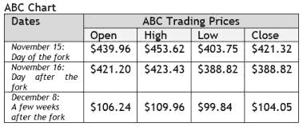

231

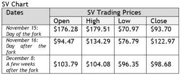

根据上述图表，尚不清楚纳税人在“新”币“收到”时如何确定其公平市场价值。由于税法的歧义，纳税人在币“收到”并“记录”在区块链上时如何确定“新”币的 FMV。


`ABC/SV` 分叉的后果显示了美国国税局（IRS）方法的其他问题。分叉的前一天（2018 年 11 月 14 日），`BCH` 的收价为 439.31 美元。分叉后，新币 `ABC` 和 `SV` 的价格剧烈波动。下面的图表显示了分叉期间及之后 `ABC` 和 `SV` 的美元价格：


231


根据上述图表，尚不清楚纳税人在“新”币“收到”时如何确定其公平市场价值。由于税法的歧义，纳税人在币“收到”并“记录”在区块链上时如何确定“新”币的 FMV。

[注]：由于提供的原文文本后半部分存在逻辑重复和错乱，译文已基于提供的核心内容进行了对齐处理。

自 2014 年以来，已经至少发生了 74 次被动的 `BTC` 硬分叉和空投，这意味着项目向现有的 `BTC` 持有人发放了代币，而这些个人并未参与其中。由于这些现有的 `BTC` 持有人“能够”对这些空投币行使支配和控制权，根据 2019 年指南，这些纳税人被要求将空投币的 `FMV` 作为普通收入进行申报，无论纳税人是否知晓这些空投的存在。另一个问题是，其中许多项目已经失败了，导致代币一文不值。因此，纳税人面临着对他们未要求、未使用、且以后可能变得毫无价值的财产纳税。

让纳税人的处境更加糟糕的是，`Revenue Ruling 2019–24` 具有溯及力，且没有提供任何安全港或过渡救济。因此，为了符合 2019 年指南，纳税人可能需要提交至少三年前（在某些情况下为六年前）的修正纳税申报。65 对于 `BTC` 持有人来说，这意味着他们必须提交申报表，其中包含那 74 次在空投时并非毫无价值的任何空投，无论这些空投币后来是否变得毫无价值。

`AICPA Letter` 还提了该 `Revenue Ruling` 的溯及力，指出：“财政部和美国国税务局（IRS）在发布具有溯及力的指南之前，应当先发布拟议的法规。”`AICPA` 建议为纳税人提供安全港，给予他们在 2019 年指南之前的纳税年度获得过渡救济。

## 税务指南的局限性

2019 年指南的一个核心问题在于它不具有法律或法规的效力，这意味着它所解决许多问题最终可能由法院或国会决定。此外，正如 `AICPA Letter` 所提到的，通过 `FAQs` 提供的指南是不可靠的，且“可能随时更改且不另通知”。此外，与 `FinCEN` 和 `SEC` 的指南不同，`IRS` 的指南更容易受到挑战，成本也远低得多。

尽管像 `Rev. Rul. 2019–24` 这样的收入裁决是 `IRS` 对 `Code` 的官方解释，但法院并不强制遵循它们。传统上，法院对收入裁决适用所谓的 `Skidmore deference`（斯基德莫尔尊重），这意味着法院在做出决定时会考虑收入裁决的说服力。相比之下，税务法规享有 `Chevron deference`（雪佛龙尊重）66，这意味着通常情况下，只要 `IRS` 的立场是合理的，无论法院是否认为另一个立场更好。

如果纳税人对 `IRS` 指南有异，纳税人可以报告与 `IRS` 指南不一致的交易，并观察 `IRS` 是否会挑战纳税人的申报方法。这反过来将负担置于 `IRS`，使其必须在处理的数百万份申报表中首先识别出不一致的处理方式，然后决定是否应该挑战纳税人。如果有数百或数千名纳税人提交不一致的报告，`IRS` 将面临如何为所有此类纳税人维护其立场的困境，并且通常会提供极低价格的和解方案，而不是对所有此类挑战进行诉讼。67

当 `IRS` 挑战纳税人的申报方法时，它必须投入资源确定事实并与每个此类纳税人进行谈判，这对于 `IRS` 来说也是一项昂贵的开支。此外，在缴纳税款之前，这些纳税人中的每一个人都可以通过向 `美国税务法院` 提起挑战任何最终的 `IRS` 裁定，而法院不受 `IRS` 裁定的约束。或者，在缴纳税款后，纳税人可以在联邦法院起诉退税，这些同样不受 `IRS` 裁定的约束。

在何种情况下，如果法院支持 `IRS`，纳税人的成本通常只有补税和挑战成本。只要纳税人的立场是合理的，就不可能被罚款。因此，纳税人通常将采取冒险性的税务立场视为一种博弈，最坏的结果是被 `IRS` 发现并在三到六年后缴纳税款。这加之被发现的概率相对较小（`IRS` 在 2018 年仅审计了约 0.59% 的个人纳税申报表），意味着许多纳税人至少会考虑采取这种博弈的打算。

`IRS` 指南的另一个局限性是，挑战它的成本与挑战 `SEC` 或 `FinCEN` 的成本相比微不足道。这两个机构都有权对其认为违反其指南的个人和实体罚款或提起刑事指控。因此，在法院上与 `SEC` 或 `FinCEN` 对质的成本往往远超挑战 `IRS` 的成本。例如，应对 `SEC` 的防御（如《证券法》章节所述）已耗资超过 500 万美元，并需要律师花费数千小时的时间来分析无数法律和事实问题。

`IRS` 发布模糊的指南来鼓励纳税人去挑战它是毫无意义的，这将导致 `IRS` 浪费宝贵的资源来处理自残的后果。希望 `IRS` 能采纳 `AICPA` 的建议，以拟议法规的形式发布指南，并留出意见征求期。68

## IRS 执法

虽然 `IRS` 在 2019 年之前没有通过指南的形式发布很多，但它仍确保加密货币法律的执行。例如，在 2016 年 11 月，`IRS` 向 `Coinbase` 发布了一份 `John Doe` 传票，寻求有关 `Coinbase` 客户加密交易的信息。

### 什么是 IRS John Doe 传票？

`John Doe` 传票是一种并非寻求特定可识别个人信息的命令，而是识别某项活动，并寻求参与该活动的个人或实体的信息。当 `IRS` 认为纳税人从事不当行为且能够识别交易类型，但无法识别个人纳税人时，通常会使用传票。根据 `Code` 第 7609(f) 条，为了获得 John Doe 传票，`IRS` 必须说服联邦法官：1）传票涉及对某一可确定群体或类别的调查；2）有合理理由相信该群体或类别可能未能遵守美国法律；3）传票寻求的信息无法从其他途径轻易获得。

美国国税务局（IRS）声称需要这些信息是因为他们发现了 Coinbase 客户违反了美国税法的证据，但如果没有 Coinbase 提供的信息，无法确定这些客户的身份。在收到传票后，Coinbase 拒绝配合并发表了以下声明：

> “尽管 Coinbase 的通常做法是配合针对明确的执法调查，但我们对政府请求的无差别范围深表担忧。我们客户的隐私权对我们至关重要，我们的法律团队正在审查政府的申请。在目前范围内，我们将在法庭反对政府的申请。我们将继续向客户通报此事的最新进展。”

Coinbase 最终在联邦法院对传票提出异议，认为该请求过于宽泛。

在随后的诉讼中，IRS 通过重点关注漏报问题来为传票辩护，并指出：

> “在短短几年内，比特币创造了数十亿美元的财富，其中很大一部分无疑归美国纳税人所有，但这些收入的增加几乎没有第三方向 IRS 进行过报告，”

而且某些加密货币用户：

> “已公开承认他们考虑使用比特币是为了规避税收报告要求。”

最终，法院缩小了传票的范围，要求 Coinbase 仅提供其加密客户的纳税人识别信息（社会安全或税务识别号码、出生日期、地址）以及账户活动记录。法院还告诉 IRS，如果它需要特定纳税人的更详细记录，IRS 可以向纳税人直接传票，或在通知纳税人的情况下向 Coinbase 发出传票。

IRS 在 2019 年还加强了执法力度。7 月，它根据收到的约翰·传票（John Doe summonses）回复，发送了三封与合规相关的信。这些信作为对纳税人报告其加密货币交易的警告，分为三个强度。每封信的相关语言如下所示：

### 6174 号信

> “我们获得的信息显示您拥有或曾拥有一个或多个虚拟货币的账户，但可能不知道涉及虚拟货币交易报告的要求。”

### 6174-A 号信

> “我们获得的信息显示您拥有或曾拥有一个或多个虚拟货币的账户，但可能没有正确报告您涉及虚拟货币的交易。”

### 6173 号信

> “我们获得的信息显示您拥有或曾拥有一个或多个虚拟货币的账户，并且可能没有满足涉及虚拟货币交易的美国税收申报和报告要求。”

`Letter 6173` 还要求纳税人提交回复，要么修改纳税表，要么提供支持其在税表中所采取报告立场的证明文件。

## 隐私问题

IRS 收集信息的努力不仅限于第三方的请求。在 2019 税务年度的 `Schedule 1` 中（`Schedule 1` 通常与标准纳税表 `Form 1040` 一起提交），IRS 包含了以下问题（加密货币问题）：

> “在 2019 年期间的任何时候，您是否收到、出售、发送、交换或以其他方式获得了任何虚拟货币的财务利益？”

由于 `Form 1040` 要求纳税人在承担伪证罪罚的前提下声明，纳税表及附表在纳税人所知范围内是“真实、准确且完整的”，因此加密货币问题等同于 IRS 的一项要求，即纳税人向政府披露他们在 2019 年是否获取了加密货币，无论他们是否欠任何加密货币相关的税。此外，回答不准确或未回答加密货币问题都可能被视为提交虚假税表，这是 `26 U.S.C. § 7206(1)` 下的犯罪行为。

AICPA 信函要求 IRS 对加密货币问题提出的某些问题提供必要的澄清说明，包括：

1. 如果个人将虚拟货币从一个钱包转移到另一个钱包，且没有其他虚拟货币的交易，他们应该选择什么答案（这种情况被视为交换吗）？
2. 纳税人应如何报告虚拟货币赠与？
3. 如果纳税人拥有合伙企业的权益，但不知道合伙企业是否收到、出售、发送、交换或以其他方式获取了任何虚拟货币，他们应如何披露交易？或者该问题是否专门针对个人 `Form 1040` 纳税人的所有权（而不考虑任何穿透实体活动）？
4. 为参与或可能参与游戏的人申领子女或抚养人抵税的纳税人是否应该回答“是”？
5. 某些礼品卡或公司在线账户何时可能构成新问题中的虚拟货币？
6. “财务利益”一词是什么意思？
7. 持有虚拟货币但在该期间未使用个人是否应该回答“是”？

纳税表上类似于加密货币问题的问题是，要求纳税人披露对外国银行账户的所有权或控制权。在随 `Form 1040` 的 `Schedule B` 中，问题 7a 问到：

> “在 2019 年期间的任何时候，您是否对位于国外的财务账户（如银行账户、证券账户或经纪账户）拥有财务利益或签字权限？”

该外国账户问题与加密货币问题一样，并不直接询问应税收入，而是仅询问所有权和控制权。IRS 询问外国银行问题的权限源于《银行保密法》（`Bank Secrecy Act`），该法要求美国人在符合以下情况下必须提交《外国银行和金融账户报告》（`FBAR`）：

1) 对国外的一个或多个账户（如银行账户、经纪账户和共同基金）拥有财务利益、签字权限或其他权限；以及
2) 在日历年内的任何时候，所有外国财务账户的总价值超过 10,000 美元。

需要填写 `FBAR` 的纳税人通常需要在 `Form 8938` 上报告其外国财务账户，并将其与 `Form 1040` 一起提交。

在美国，纳税人有法律义务向 IRS 提供足够计算其税款的信息。然而，如果纳税人报告了所有加密货币交易，很难发现该加密货币问题的合法理由，除了提醒纳税人 IRS 正在关注，并让他们在回答错误时面临罚款之外。

从 IRS 的角度来看，其在税表中加入加密货币问题的可能逻辑可以在 IRS 总法律顾问 Michael Desmond 在 2019 年 10 月于布鲁金斯学院发表的题为《加密货币与税务管理》的主演讲找到。在那场演讲中，Desmond 指出，估计 8% 的美国人持有某种形式的加密货币，据此，IRS 应该收到约 1200 万份报告加密交易的税表。然而，他表示 IRS 收到的数量“远低于这一数字”，“我们[IRS]认为存在很大程度的不合规。”

另一个相关的 IRS 披露问题是，在外国交易所持有加密货币的人员是否也需要在 `Form 8938` 上报告其持有情况。根据现有法律，尚不清楚外国加密交易所的账户是否被视为外国金融机构的账户。在第 `1471(d)(5)` 条中，法典将“外国金融机构”定义为：

> 一个实体满足以下条件：(a) 在银行或类似业务的范围内接受存款，(b) 作为其业务的大部分，为他人持有“金融资产”，或(c) 主要从事（或自称从事）投资、再投资或交易证券、合伙权益、大商品或此类证券、合伙权益或大商品的任何权益的业务。

`IRS` 尚未表明是否将外国加密货币交易所视为外国金融机构。如果他们决定这样做，美国纳税人将需要向 `IRS` 披露所有此类外国账户，无论是否涉及缴税。

要求公民在 `Schedule 1` 和 `Form 8938` 上报告其加密货币持量的问题涉及隐私问题。虽然很清楚 `IRS` 可以要求公民报告任何来自加密货币的收益，并可以要求第三方中间机构向 `IRS` 和纳税人报告此类收益，但政府并没有普遍权利强迫公民披露对任何合法资产的单纯所有权，无论是枪支、黄金还是加密货币。然而，通过在税表上包含有关加密货币所有权的问题，`IRS` 似乎在迫使美国公民向政府披露私人财务信息，忽视了公民保持此类信息私密的权利。

与加密货币问题相关的隐私和宪法问题，以及拒绝回答的影响令人困扰。在法律上，尚不清楚 `IRS` 在何种权限下可以强制回答加密货币问题。正如首席法官 `Roberts` 在 `Rumsfeld v. Forum for Academic and Institutional Rights` 一案中提到的：

> “本法院的一些领先的第一法修正判例建立了一项原则，即言论自由禁止政府告诉人们必须说什么。”

此外，在没有向法院证明对该信息有迫切需求的情况下，政府通常无法强迫个人披露某些私人信息，例如他们是否拥有任何加密货币。

## 国会行动

2020 年 3 月，国会引入了一项名为《2020 年加密货币法案》的法案，旨在阐明哪些联邦机构应该监管加密货币。该法案建立了一个三部分的监管分类体系：

1) 由 `CFTC` 监管的 `crypto-commodities`（加密大商品），
2) 由 `FinCEN` 监管的 `crypto-currencies`（加密货币），以及
3) 由 `SEC` 监管的 `crypto-securities`（加密证券）。

《加密货币法案》是在 2018 年和 2019 年的《代币分类法案》之后，提供国会清晰度的第二次尝试，这两项法案均未通过。《代币分类法案》本可以 (i) 将加密货币排除在证券法之外，并 (ii) 指导 `SEC`：

> “针对通过公钥加密保障的数字单位颁实施某些监管变化，调整个人退休账户中持有的虚拟货币的征税，为一种虚拟货币与另一种虚拟货币的交换创建税收豁免，为非现金出售或交换虚拟货币所实现的收益创建微额税收豁免，以及其他目的。”

2019 年的《代币分类法案》在大多数方面与 2018 年的《法案》相似，但增加了一个条款，允许其在法律或法规与《法案》重叠或冲突的州取代州法律。该条款可能针对的是纽约备受批评的 `BitLicense`（比特许可证）制度。然而，该条款也将取代更受好评的州法律，例如怀俄明州的法律。

2018 年的《代币分类法案》最初由 `Rep. Warren Davidson` (R-OH) 发起，有五位共同发起人，包括三位民主党人和两位共和党人。`Rep. Davidson` 是 `国会区块链党团` 的成员，截至 2020 年 4 月，该党团两派至少有 20 名成员。根据他们的网站，他们是：

> “一个由国会议员和工作人员组成的跨党团体，他们相信区块链技术的未来，并理解国会在其发展中发挥作用。作为一个党团，我们决定采取一种不干预的监管方法，相信这项技术将像互联网一样通过自身最好地进化。”

该 `党团` 经常对区块链和加密货币问题发声。

`Rep. Patrick McHenry` (R-NC) 提供的另一份法案提供了一种不同的加密货币监管方法。`Rep. McHenry` 的法案并非寻求通过通过设定加密货币规则的自上而下法律，而是名为《金融服务创新法案 (H.R. 4767)》将强制联邦监管机构在其机构内部创建 `金融服务创新办公室 (FSIOs)`。这些 `FSIOs` 将为 `McHenry` 描述的创造创造一种“永久 Beta 测试”机会，类似于英国 `金融行为监管局` 的监管沙箱方法。根据 `McHenry` 的说法，该《法案》将允许公司：

> 在替代合规计划下提供创新产品或服务，该计划将对过时或负担过重的现行法规提供豁免或修改。我认为这是创造一个与金融创新合作而非与其对立的监管流程的必要步骤。

`McHenry` 表示，这项立法是必要的，因为 `CFTC` 和 `SEC`，以及 `财政部` 和 `IRS` 需要提供某些确定性，以激励企业家不断提出有趣的创新的想法。

> 没有知识的生命等同于伪装的死亡。
>
> —Talib Kweli, K.O.S.

## 备注

1. “规则”在本节中将泛指美国和国外的法律、法规和其他指南。
2. 洗钱是试图伪装非法活动收益的过程，试图使这些收益看起来源于合法来源。要了解洗钱实践的虚构但准确的刻画，请看 Netflix 剧《奥兹克》(Ozarks)。
3. “资金旅行规则”可能在 2013 年被扩大适用于加密货币，但在缺乏关于其在加密货币领域特定指导的情况下，它一直被经常忽视。
4. 没有银行关系，交易所很难运营。`Coinbase UK` 需要一个新的银行，因为 `Barclays` 断了与 `Coinbase UK` 的关系，多个来源称 `Barclays` 的决定是因为对加密货币感到越来越不安。
5. 一个在全球工作的独立非营利能力中心，旨在加强治理并打击腐败和其他金融犯罪。参见 `baselgovernance.org`。
6. 《模型法案》本可以将加密货币视为“一般无形资产”，这是一个各种类型个人财产的统称。一般无形资产处理将使中间机构难以利用客户的加密货币获利，正如本节全文所述。
7. 在该公告发布时，有五个州的法案正在立法机构审议，寻求实施部分或全部《模型法案》。然而，其中一个州（怀俄明州）颁布了与《模型法案》直接相反的法律。
8. 一家名为 `Cede & Co.` 的公司是另一家公司 `托管信托公司 (Depository Trust Company)` 的代理，通常是客户股票的真实法律所有者，所有受益权益（如投票权和股利）首先流入代理持有者 `Cede`，然后传递，最终传递给受益所有人。

街名命名系统也通过两种方式提供了针对经纪人破产的保护：

1. 当一家公司面临清算时，包括 `SEC` 和 `FINRA` 在内的监管机构将努力确保客户的证券转移到另一家公司。以街名名义持有投资可能有助于这一过程，因为受益所有权信息是集中的。


## 作为街名命名系统的一部分，成立了“证券投资者保护公司”（`Securities Investor Protection Corporation`），以便在经纪人破产时为客户提供保险。

本节的大部分内容及提供的示例基于 Caitlin Long 的文章《Two Things That Don't Mix Well: Bitcoin Rehypothecation And Chain Forks》，发表于《福布斯》（2018 年 8 月 21 日）。

参阅 Sean Walters 的《One Lehman Lesson: The Perils of Rehypothecation》，发表于《华尔街日报》（2008 年 9 月 25 日）。

**“`FinTech sandbox`（金融科技沙盒）是指一种针对金融科技公司和产品的监管框架，该框架提供了一个促进创新金融产品和活动的监管环境，并允许在特殊的监管豁免、许可或其他有限的、有时限的例外情况下，对创新进行小规模现场测试。广而言，监管沙盒允许企业在监管机构的监督下测试非传统产品，且受惩罚风险较低。要在沙盒中运营，监管机构要求企业采取保护措施，以使客户和广泛的市场免受其非传统产品风险的影响。监管沙盒的概念于 2008 年金融危机后不久开发，旨在解决企业创新意愿与监管机构在批准创新产品时的谨慎态度之间的摩擦。**

Jesse Powell 的发言，`2018 Consensus conference`（2018 年 5 月 21 日）。

参阅 Kirill Bryanov 的《Blockchain and the City: New York State as a “Tough” Model of Crypto Regulation》，发表于《Cointelegraph》（2019 年 2 月 21 日）。

参阅 `SEC Historical Society`，《431 Days: Joseph P. Kennedy and the Creation of the SEC`（1934–35 年）。

参阅 `International Brotherhood of Teamsters v. Daniel`，`439 U.S. 551`（1979 年）。

参阅，例如 `Stenger v. R.H. Love Galleries, Inc.`，`741 F.2d 144, 146`（7th Cir. 1984 年）；`SEC v. Banner Fund Int’l`，`211 F.3d 602, 614`（D.C. Cir. 2000 年）。

参阅 `SEC & Exch. Comm’n v. SG Ltd.`，`265 F.3d 42`（1st Cir. 2001 年）。

参阅 `Revak v. Realty Corp.`，`18 F.3d 81, 87`（2d Cir. 1994 年）。

参阅 `Salcer v. Merrill Lynch`，`682 F.2d 459, 460`（3d Cir. 1982 年）（采纳水平共同性）。

参阅 `Teague v. Bakker`，`35 F.3d 978`（4th Cir. 1994 年）。

参阅 `Curran v. Merrill Lynch`，`622 F.2d 216, 222`（6th Cir. 1980 年）（放弃垂直共同性以转而水平共同性）。

参阅 `Milnarik v. M-S Commodities`，`457 F.2d at 274, 276–77`（7th Cir. 1972 年）。

参阅 `Hocking v. Dubois`，`885 F.2d 1449, 1459`（9th Cir. 1989 年）（全员庭审）。

参阅 `SEC v. Banner Fund Intern.`，`211 F.3d 602, 341`（D.C. Cir. 2000 年）。

参阅 `SEC v. Cont’l Commodities Corp.`，`497 F.2d 516, 516`（5th Cir. 1974 年）。

参阅 `Messer v. E.F. Hutton & Co.`，`833 F.2d 909, 915`（11th Cir. 1987 年）。尽管法院将其裁定重点放在 `Howey` 测试的第四标准下的推销身上，但法院仍引用了一个第五巡回法院的案件来辅助其决策。

但 `Hocking v. Dubois`，`839 F.2d 560, 567`（9th Cir. 1988 年）（规定第九巡回上诉法院已认同垂直共同性，但并未完全排除水平共同性）。

参阅 `Hocking v. Dubois`，`885 F.2d 1449, 1459`（9th Cir. 1989 年）（全员庭重审）。

`Howey` 第 300 页。

`SEC v. Glenn W. Turner, Inc.`，`474 F.2d 476, 482`（9th Cir. 1973 年）；`United Housing Foundation, Inc. v. Forman`，`421 U.S. 837`（1975 年）。

该 `Framework` 将最后两个要素合并为一个，但在其分析中再次将它们分开。

参阅 `Framework`，脚注 9。

参阅 `SEC Press Release 99–83`（1999 年 7 月 22 日）。

Hester M. Peirce，SEC 委员，《Running on Empty: A Proposal to Fill the Gap Between Regulation and Decentralization》，演讲于 `Blockchain Congress`（2020 年 2 月 6 日）。

参阅 `www.sec.gov/news/speech/peirce-remarks-20`。`ICO`数据来自 `icodata.io`。

`Securities and Exchange Commission v. Kik Interactive, No. 19-cv-5244`（S.D.Y., 2018 年 6 月 4 日）。

与`SEC`执法行动相关的程序被称为 `Wells Process`，对拟议`SEC`执法行动的回复被称为 `Wells Response`。

参阅 `Securities Act 144`。

根据 `Exchange Act`第 12(b)条注册。

Andrew Barry，《Only 3 of the Top 20 Mutual Funds Are Beating the Market. Here’s How They Do》，巴伦财经（2019 年 11 月 15 日）。

现代投资组合理论认为投资者通过持有不相关的资产的组合来最小化特异性风险。根据该理论，此类组合在给定风险水平下实现了收益最大化。

参阅 `Dissent of Commissioner Hester. Peirce to Release No. 34–8373`;`File No. SR-BatsZX–30`，SEC 声明（2018 年 7 月 26 日）。

Chris Marquette，《Crypto-based funds crawl toward mom and pop》，Roll Call（2019 年 2 月 6 日）。

Robert Jackson，SEC 委员，《2019 Future of Fintech conference`，CBInsights 主办（2019 年 6 月 13 日）。

Brian Quintenz，CFTC 委员，《The Year Ahead for Capital Markets》，Bipartisan Policy Center（2019 年 2 月 12 日）。

Jay Clayton，SEC 主席，《2019 Delivering Alpha conference`，由 CNBC 和`Institutional Investor`主办（2019 年 9 月 19 日）。

Kyle Torpey，《Analyst: 60% Chance Of Bitcoin ETF In 2020》，福布斯（2020 年 1 月 14 日）。

在电影中，交易是在期货交易所的地板上。今天，大多数期货交易在线进行。

参阅 `CFTC v. Patrick McDonnell et al.`，`332 F. Supp. 3d 641`（E. D. NY 2018 年 8 月 28 日），以及 `CFTC v. My Big Coin Pay, Inc.`，`334 F. Supp. 3d 492`（D. MA 2018 年 9 月 26 日）。

国会于 2010 年通过了修订`CEA`以回应 `CFTC v. Zelener`，`373 F. 3d 861`（7th Cir. 2004 年）。在该裁决中，第七巡回法院必须确定`CFTC`是否可以监管形式为现货合同但实质为期货合同的合同。法院裁定尊重合同的形式，因此不受`CFTC`管辖。为了扭转`Zelener`裁决的影响，国会修订了`CEA`，赋予`CFTC`对运作类似于期货合同的担保贷款型融资安排的管辖权。

基于 `CEA` 的要求确实存在例外，`Bitfinex` 辩称该例外适用于他们。通俗地说，如果一项担保贷款安排导致抵押品在 `28` 天内完成“实际交付”，则可以将其提供零售客户。`Bitfinex` 认为，由于它在账上将借款人记录为所有者，因此借款人是所有者，`Bitfinex` 已满足“实际交付”的例外。`CFTC` 持不同意见，认为实际交付要求 `Bitfinex` 向借款人“实际交付”私钥。显然，`Bitfinex` 无法转移私钥，因为如果这样做它将不再对抵押品拥有任何控制权，导致贷款变为无担保。

纳税人倡导员（Taxpayer Advocate）是 `IRS` 内部负责代表纳税人维护利益的组织，他们早在 `2008` 年就请求过此类指导。

可以通过 `https://coincenter.org/files/2019-12/letter-to-irs-dec-20.pdf` 获取该信。

该通知将虚拟货币定义为“一种作为交换媒介、记账单位和/或价值存储的数字价值表示”，并补充说虚拟货币可以“用于支付商品和服务，或持有用于投资”。

`IRS` 使用了“分布式账本”这一术语。

正如证券法章节中提到的，交易所通常不会列出新发的代币。如果纳税人想要获得未列出的代币，纳税人通常必须将代币从交易所提取到私人钱包或列出该代币的交易所。

演示稿指出，这种微小选择（de minimis election）的结构可以类似于国会于 `1997` 年通过的《法典》第 `988(e)(2)` 条下的。该条款免除了纳税人报告个人交易中不超过 `$200$` 的外币收益的义务，其通过的一个动力因素是免除为了度假目的而购买外币的纳税人报告与货币汇率变化相关的收益。

作为前任 `DOJ` 税务检诉官，我可以证明这种担忧并非空穴来。

`H.R.5635`

泛见《联邦税收系统的复杂性》（`Complexity in the Federal Tax System`），税务联合委员会（`Joint Committee on Taxation`）（`2015 年 3 月 6 日`）。

参阅《1992 年资本利得税法》第 52(4)条（`Section 52(4) Taxation of Capital Gains Act 1992`）（`英国`）。

指导意见承认，在不支持新创建空投代币的交易所持有加密货币的纳税人并不拥有所有权和控制权。

通常情况下税表的诉讼期为自申报日起三年，如果漏税金额巨大（即超过总收入的`25 percent`），则为`六年`。如果纳税人未提交报表或提交了虚假报表，则诉讼期持续有效。

在对 `IRS` 对税务法规的解释适用“雪弗龙尊重”（Chevron deference）之前，法院通常必须发现：(i) 基础税收法律具有模糊性，且 (ii) `IRS` 法规是对该模糊法律的合理解释。

例如，`Son of Boss` 是美国历史上最大的避税天堂，据估计，它让纳税人少缴了超过 `$60 billion$` 的税款。`IRS` 向 `Son of Boss` 的参与者提供了和解方案，根据前 `IRS` 局长 Mark Everson 的说法，`IRS` 从和解中收了约 `$3.2 billion$`。参阅税务行政监察长（`Treasury Inspector General for Tax Administration`）《尽管取得了成就，Son of Boss 和解对投资者申报和支付合规性的影响很小》（`Ref. No. 2009–30–018`）（`2018 年 12 月 30 日`）。

该政策声明指出，“允许公众在任何最终规则生效之前参与，并确保所有观点都得到充分考虑。它还让公众告知政府可能尚未掌握的相关信息，或提醒政府可能无法预见的后果。”参阅财政部《税收监管政策声明》（`Dept. of the Treasury`, `Policy Statement on the Tax Regulatory Process`）（`2019 年 3 月 5 日`）。

`547 U.S. 47`（`2006 年`）。

`Whalen v Roe`，`429 U.S. 589`（`1977 年`）。
