# Go 编写编译器

## 引言

这或许不是最礼貌的做法，但让我们从一个谎言开始：这本书的前作*用 Go 编写解释器*的成功程度远超我的想象。是的，这是个谎言。当然，我*想象*过它的成功。畅销书排行榜上名列前茅的名字，我沐浴在赞美和钦佩之中，受邀参加各种高级活动，陌生人在街上走向我，想要拿到我的签名书——在写一本关于一种名为 Monkey 的编程语言的书时，谁会没有这样的想象呢？不过，现在严肃地说，事实是：我确实没有*预期*到这本书会像它实际那样成功。

当然，我隐隐觉得有些人可能会喜欢它。主要是因为这本书是我自己想读却找不到的书。在我徒劳的寻找中，我看到了其他人在寻找完全一样的东西：一本关于解释器的书，容易理解，不偷工减料，并且把可运行且经过测试的代码放在核心位置。我想，如果我能写出这样一本书，也许别人也会喜欢它。

但关于我的想象就说到这里，来看看实际发生的事：读者们确实喜欢我写的内容。他们不仅购买并阅读了这本书，还发邮件感谢我写了它。他们写博客文章表达他们有多喜欢它。他们在社交网络上分享并点赞。他们摆弄这些代码，调整它，扩展它，并在 GitHub 上分享。他们甚至帮助修正了书中的错误。想想看！他们给我发来修正错误的内容，同时一直为发现了错误而道歉。显然，他们无法想象我对每一条建议和修正有多感激。

然后，在阅读了一封读者想要*更多*内容的邮件后，我的内心有什么被触动了。一个原本在我脑海中只是一个想法的东西，变成了一种义务：我必须写第二部。请注意，我写的不是“另一部”，而是“第二部”。这是因为第一本书诞生于一种妥协。

当我开始写*用 Go 编写解释器*时，我并没有打算写续集，而是只想写一本书。然而，当我意识到最终这本书会太长时，这个想法就变了。我从来不想写一本会用篇幅把人们吓跑的书。即使我想，完成这本书很可能会花费太长时间，以至于我很可能早就放弃了。

这让我做出了妥协。与其写构建一个树遍历解释器并将其转变为虚拟机，我*只*写树遍历部分。这变成了*用 Go 编写解释器*，而你正在读的正是我一直想写的续集。

但这里的续集到底意味着什么？到目前你已经知道，这本书并不是以“第一本书中事件发生几十年后，在另一个星系，Monkey 这个名字已经毫无意义……”开头。不，这本书意在与其前作无缝连接。同样的方法，同样的编程语言，同样的工具，以及我们在第一本书末尾留下的代码库。

想法很简单：我们接着上次的地方继续 Monkey 的开发。这不仅是一本前书的继任者，也是 Monkey 的续集，是其演化的下一步。但在我们能看到那是什么样子之前，我们需要回顾一下，以重新唤醒对 Monkey 的记忆。

### Monkey 的演进

#### 过去与现在

在*用 Go 编写解释器*中，我们为 Monkey 编程语言构建了一个解释器。Monkey 被发明出来只有一个目的：在*用 Go 编写解释器*中从零构建，并由它的读者从零构建。它唯一的官方实现包含在*用 Go 编写解释器*中，尽管许多由读者用各种语言构建的非官方实现也流传于互联网。

如果你忘了 Monkey 长什么样，这里有一个小片段，它试图把尽可能多的 Monkey 特性塞进尽可能少的行数里：

```go
let name = "Monkey";
let age = 1;
let inspirations = ["Scheme", "Lisp", "JavaScript", "Clojure"];
let book = {
    "title": "Writing A Compiler In Go",
    "author": "Thorsten Ball",
    "prequel": "Writing An Interpreter In Go"
};

let printBookName = fn(book) {
    let title = book["title"];
    let author = book["author"];
    puts(author + " - " + title);
};

printBookName(book);
// => prints: "Thorsten Ball - Writing A Compiler In Go"

let fibonacci = fn(x) {
    if (x == 0) {
        0
    } else {
        if (x == 1) {
            return 1;
        } else {
            fibonacci(x - 1) + fibonacci(x - 2);
        }
    }
};

let map = fn(arr, f) {
    let iter = fn(arr, accumulated) {
        if (len(arr) == 0) {
            accumulated
        } else {
            iter(rest(arr), push(accumulated, f(first(arr))));
        }
    };

    iter(arr, []);
};

let numbers = [1, 1 + 1, 4 - 1, 2 * 2, 2 + 3, 12 / 2];
map(numbers, fibonacci);
// => returns: [1, 1, 2, 3, 5, 8]
```

转换成特性列表，我们可以说 Monkey 支持：

- 整数
- 布尔值
- 字符串
- 数组
- 哈希
- 前缀、中缀和索引运算符
- 条件语句
- 全局和局部绑定
- 头等函数
- return 语句
- 闭包

这个列表不小吧？而且我们把这些全部构建到了自己的 Monkey 解释器中，最重要的是——我们是从零构建的，没有使用任何第三方工具或库。

我们从构建词法分析器开始，它将输入到 REPL 中的字符串转换为令牌。词法分析器定义在 lexer 包中，它生成的令牌可以在 token 包中找到。

之后，我们构建了解析器，一个自顶向下的递归下降解析器（通常称为 Pratt 解析器），它将令牌转换为抽象语法树，简称 AST。AST 的节点定义在 ast 包中，解析器本身可以在 parser 包中找到。

在通过解析器后，Monkey 程序在内存中表示为一棵树，下一步是求值它。为此，我们构建了一个求值器。它就是定义在 evaluator 包中的一个名为 Eval 的函数。Eval 递归地向下遍历 AST 并求值，使用定义在 object 包中的对象系统来产生值。例如，它会把表示 1 + 2 的 AST 节点转换成 object.Integer{Value: 3}。这样，Monkey 代码的生命周期就完成了，结果被打印到 REPL 中。

这一系列转换——从字符串到令牌，从令牌到树，从树到 object.Object——在我们构建的 Monkey REPL 的主循环中从头到尾可见：

```go
// repl/repl.go

package repl

func Start(in io.Reader, out io.Writer) {
    scanner := bufio.NewScanner(in)
    env := object.NewEnvironment()

    for {
        fmt.Printf(PROMPT)
        scanned := scanner.Scan()
        if !scanned {
            return
        }

        line := scanner.Text()
        l := lexer.New(line)
        p := parser.New(l)

        program := p.ParseProgram()
        if len(p.Errors()) != 0 {
            printParserErrors(out, p.Errors())
            continue
        }

        evaluated := evaluator.Eval(program, env)
        if evaluated != nil {
            io.WriteString(out, evaluated.Inspect())
            io.WriteString(out, "\n")
        }
    }
}
```

这就是我们在上一本书结束时离开 Monkey 的地方。

然后，半年之后，*遗失章节：为 Monkey 编写宏系统*重新浮出水面，告诉读者如何让 Monkey 用宏来编程自己。不过，在这本书中，《遗失章节》及其宏系统将不会出现。事实上，就好像《遗失章节》从未被找到，我们又回到了*用 Go 编写解释器*的结尾。不过，这很好，因为我们在实现解释器方面做得非常出色。


Monkey 的工作完全符合我们的预期，其实现也易于理解和扩展。因此，在这本第二本书的开头，自然会产生一个问题：为什么要改变任何东西？为什么不让 Monkey 保持原样？

因为我们来这里是为了学习，而 Monkey 仍有很多东西可以教给我们。《用 Go 写解释器》的一个目标就是更深入地了解我们日常使用的编程语言的实现方式。我们做到了。很多这些“真实世界”的语言最初的实现都与 Monkey 非常相似。而通过构建 Monkey 所学到的知识，有助于我们理解它们实现的基础和起源。

但语言会成长和成熟。面对生产环境的工作负载以及对性能和语言特性的需求增加，语言的实现和架构往往会发生变化。这些变化的一个副作用是，实现与 Monkey 的相似性降低，而 Monkey 根本不是为性能和生产使用而构建的。

我们 Monkey 实现最大的缺点之一就是这种差距：其架构与实际真实世界语言的架构相差甚远，就像板车与一级方程式赛车的区别。它有四个轮子和一个座位，当然，它可以帮助学习转向的基础知识，没错，但它缺少引擎这一事实很难被忽视。

在这本书中，我们将缩小 Monkey 与真实语言之间的差距。我们将在我们的 Monkey 板车下装上真正的东西。

## The Future

我们将把树遍历的、即时求值的解释器转变为字节码编译器和执行字节码的虚拟机。

这不仅极其有趣可构建，而且也是目前最常见的解释器架构之一。Ruby、Lua、Python、Perl、Guile、各种 JavaScript 实现以及许多其他编程语言都是这样构建的。甚至强大的 Java 虚拟机也解释字节码。字节码编译器和虚拟机无处不在——而且是有原因的。

除了提供一个新的抽象层——从编译器传递给虚拟机的字节码——使系统更模块化之外，这种架构的主要吸引力在于其性能。字节码解释器速度很快。

想要数字吗？在本书记载的最后，我们将拥有一个比第一本书的前身快三倍的 Monkey 实现：

```
$ ./monkey-fibonacci -engine=eval
engine=eval, result=9227465, duration=27.204277379s
$ ./monkey-fibonacci -engine=vm
engine=vm, result=9227465, duration=8.876222455s
```

是的，快三倍——无需底层微调或广泛的优化。听起来不错？准备写一些代码了吗？完美。让我们先把实际问题解决掉，然后就可以开始了。

## Use This Book

就像第一本一样，这本书只有很少的说明：你最好从头到尾阅读，如果你通过阅读、输入并尝试书中展示的代码来跟进，你将获得最大的收获。就这样。

这些书是*practical*的书。它们是关于编写代码和构建东西。如果你想沉浸在编程语言构造的理论中，你最好选择经典教材。那并不意味着你在这里学不到任何东西，不。我会尽力引导你并解释一切是什么以及各个部分如何契合。它不会像编译器教材那样学术化。但这正是我想要的。

这本书，就像它的前作一样，带有一个名为 code 的文件夹。如果你的书副本没有它，你可以从这里下载：

https://compilerbook.com/wacig_code_1.0.zip

在此文件夹中，你会为每个编写代码的章节找到子文件夹。每个文件夹都包含代码库在对应章节结束时的状态，如果你在跟进时遇到困难，这会很有帮助。

然而，子文件夹 00 是特殊的，也是这本书与第一本书不同的地方：我们不是从零开始，而是基于上一本书的代码库构建。它不对应*本*书的任何一章，但包含了我们在上一本书结束时留下的完整代码库。这也意味着它不包含宏系统 from *The Lost Chapter*，但如果你是宏的粉丝，保持宏展开步骤应该不会太难。

这些文件夹中的代码是本书的重点。我会尽量展示大部分内容，但有时我只会提到代码库中的某样东西，而不会实际展示它。为什么？大多数时候因为它是之前见过的重复内容，展示会占用太多空间。

关于 code 文件夹的内容就这么多。现在，让我们谈谈工具，因为我有个好消息：你不需要太多。事实上，一个文本编辑器和 Go 编程语言的安装就足够了。哪个版本的 Go？至少 **Go 1.10**，因为那是我写作时使用的版本，而且我们将使用少量在 Go 1.8 和 1.9 中才引入的功能。

我还建议使用 [direnv](direnv) 来处理 code 文件夹。*direnv* 可以根据一个 `.envrc` 文件更改 shell 的环境。每当你 `cd` 进入一个文件夹时，*direnv* 会检查该文件夹是否包含一个 `.envrc` 文件并执行它。code 中的每个子文件夹都包含这样一个 `.envrc` 文件，它会为该子文件夹正确设置 `GOPATH`。这使我们只需 `cd` 到子文件夹即可非常轻松地执行代码。

关于本书的实用性就说这么多。阅读它，跟随编码，最重要的是，享受乐趣。

# Compilers & Virtual Machines

对于大多数程序员来说，“编译器”这个词听起来令人望而生畏。即使你不被它吓倒，也无法否认编译器及其所做的事情笼罩着神秘和惊叹的气氛。它们产生似乎没有凡人能读或写的机器码。它们进行神奇的优化 somehow 使代码运行更快。它们的运行可能需要很长时间——几分钟甚至几十分钟。如果谣言属实，有时甚至需要几个小时。如果需要这么长时间，它们所做的事情一定非同寻常。

说到谣言：据说编译器极其庞大且极其复杂。事实上，它们经常被列为有史以来最复杂的软件项目之一——这些说法有数据支持。举个例子：LLVM & Clang 项目目前约由 300 万行代码组成。GNU 编译器集合 GCC 甚至更大。1500 万行代码。

并没有多少人在看到这些数字后，打开文本编辑器并说“你知道吗？让我们构建一个！”它们绝对不会让人觉得可以在一下午写出一个编译器。

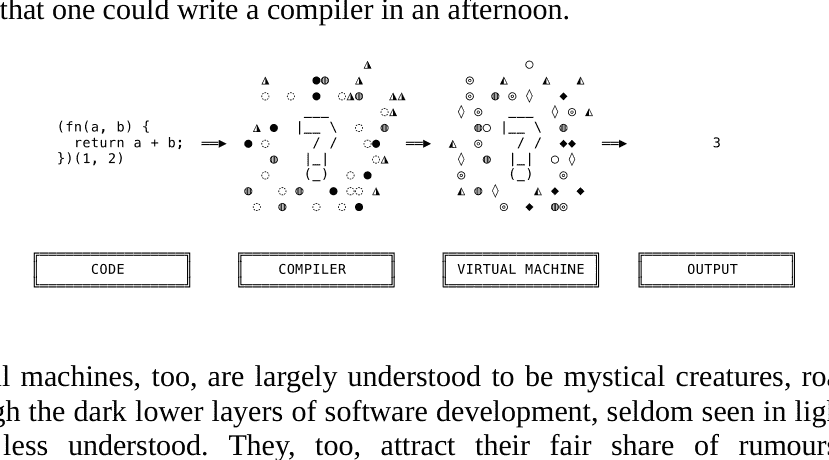

虚拟机也被普遍理解为神秘的生物，在软件开发的黑暗底层游荡，很少见光，更少被理解。它们也吸引了大量的谣言和猜测。有人说虚拟机与编译器有关。其他人坚持认为他们的编程语言实际上就是这样一个虚拟机。另一群人声称虚拟机允许他们在一个操作系统内部运行另一个操作系统。

这一切都是真的，这并没有帮助。

但事情是这样的。在核心，编译器和虚拟机是思想——模式——就像“解释器”或“Web 服务器”一样是思想，可以有从微小到庞大的多种实现。在看过 GCC 这样的项目后对它们感到畏惧，就像在看过 GitHub 后放弃建网站一样没有意义。

当然，为虚拟机构建编译器不是一个小任务。但它也没有传闻中那么不可逾越。一旦我们更好地理解这些核心思想，理解编译器和虚拟机本质上是什么，你就会看到，你实际上可以在一下午构建一个编译器。

朝着这个目标迈出的第一步是弄清楚“编译”意味着什么。


## 编译器

如果我请你说出一个编译器，你很可能毫不犹豫地给出像 GCC、或 Clang、或 Go 编译器这样的名字。无论如何，它肯定是一个用于编程语言的编译器。很可能它是一个生成可执行文件的编译器。我也会这么说，因为这正是我们与“compiler”这个词联系在一起的含义。

但编译器种类繁多，形态各异，编译的东西也五花八门，不仅仅是编程语言，包括正则表达式、数据库查询甚至 HTML 模板。我敢打赌你每天都在不知不觉中使用一两个编译器。这是因为“compiler”本身的定义其实相当宽松，比人们预期的要宽松得多。以下是维基百科的说法：

> 编译器是一种计算机软件，它将用一种编程语言编写的计算机代码（源语言）转换为另一种计算机语言（目标语言）。编译器是一种翻译器，主要用于数字设备，尤其是计算机。“compiler”这个名称主要用于将源代码从高级编程语言翻译成低级语言（例如汇编语言、目标代码或机器代码）的程序，以创建可执行程序。

编译器是翻译器。这很模糊。而且将高级语言翻译成可执行文件的编译器只是编译器的一种特殊类型？听起来违反直觉，不是吗？你会认为生成可执行文件就是编译器做的事：GCC 就是这么做的，Clang 就是这么做的，Go 编译器也是这么做的。难道这不应该是定义的第一行吗？这怎么会不是本质的呢？

解决这个谜题的办法是另一个问题：如果可执行文件不是计算机能够原生理解的语言中的源代码，那它是什么？因此，“编译成本地代码”与编译成机器代码是相同的。是的，真的，生成可执行文件只是“翻译源代码”的一种变体。

你看，编译器从根本上说就是关于翻译的，因为翻译是它们实现一种编程语言的方式。

让我们退一步来理解这句话。编程意味着给计算机下指令。我们程序员用计算机能理解的编程语言编写这些指令。用其他语言没有任何意义。现在，*实现*一种编程语言意味着让计算机理解它。有两种方法可以做到这一点：要么即时为计算机解释该语言，要么将其翻译成另一种计算机已经理解的语言。

这就像我们作为人类，可以帮助一个不懂某种语言的朋友理解它。我们可以要么听着，在脑中翻译然后重复给她听，要么把翻译写下来让她自己阅读和理解。我们可以充当解释器，也可以充当编译器。

这可能听起来解释器和编译器是相反的。但虽然它们的方法不同，但在构造上有很多共同之处。它们都有一个前端，读取用源语言编写的源代码并将其转换为数据结构。在编译器和解释器中，这个前端通常由词法分析器和解析器组成，它们共同生成语法树。所以在这里，在前端部分，它们有很多相似之处。之后，当它们都遍历 AST 时，它们的路径才分开。

由于我们已经构建了解释器，我们知道它在遍历 AST 时做什么：它会求值它。也就是说，它执行树中编码的指令。如果树中的一个节点表示源语言的语句 puts("Hello World!")，那么解释器在求值该节点时就会打印“Hello World!”。

编译器则不会打印任何东西。相反，它会生成另一种语言的源代码，称为目标语言。源代码将包含目标语言中源语言 puts("Hello World!") 的等价物。 resulting code 然后可以由计算机执行，“Hello World!”就会出现在屏幕上。

这里事情变得非常有趣。编译器生成源代码的目标语言是什么？计算机理解什么语言？编译器如何在这个语言中生成代码？是文本还是二进制格式？在文件中还是在内存中？但更重要的是：在这种目标语言中它到底生成什么？如果目标语言没有 puts 的等价物怎么办？编译器应该生成什么代替？

一般来说，我们必须对所有这些问题给出同样的答案。软件开发的头号答案，编程中唯一硬性的、大写 T 的真理：“it depends.”

抱歉让你失望，但这些问题的答案取决于众多变量和需求：源语言、执行目标语言的机器的架构、输出将如何使用（是直接执行？再次编译？解释执行？）、输出需要运行得多快、编译器本身需要运行得多快、生成的源代码可以有多大、编译器允许使用多少内存、 resulting 程序可以使用多少内存，以及……

编译器之间的差异如此之大，以至于我们无法对其架构做出太多普遍性陈述。话虽如此，我们现在可以忽略细节，勾勒出类似编译器原型的架构：

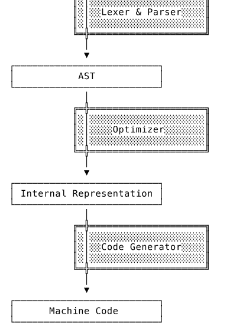

这显示了源代码被翻译成机器代码的生命周期。

## 这里发生了什么？

首先，源代码由词法分析器和解析器进行词法分析和解析。我们从解释器中熟悉这部分。它被称为前端。源代码从文本转换为 AST。

之后，一个名为“optimizer”的组件（有时也称为“compiler” – 我知道，我知道，...）可能会将 AST 翻译成另一种内部表示（IR）。这个额外的 IR 可能只是另一棵语法树，也可能是二进制格式，甚至是文本格式。将 AST 翻译成另一个 IR 的原因有很多，但主要的一个是 IR 可能比 AST 更适合优化和翻译成目标语言。

这个新的 IR 然后进入优化阶段：死代码被消除，简单算术被预先计算，不需要在循环体内的代码被移出循环，... 存在大量的可能优化。

最后，代码生成器，也称为后端，生成目标语言中的代码。这就是编译发生的地方。可以说，这里代码会接触到文件系统。之后，我们可以执行结果，看到计算机执行我们在原始源代码中指示的操作。

这就是最简单的编译器的工作方式。即使在这里也可能有成千上万种变化。例如，优化器可以在 IR 上进行多次“passes”，意思是它多次遍历 IR，每次做不同的优化：例如在一个 pass 中删除死代码，在另一个 pass 中内联函数调用。或者也许编译器根本不对 IR 进行优化，而只对目标语言中的源代码进行优化。或者只对 AST 进行，或对两者都进行。或者它永远不做任何优化。或者它甚至除了 AST 之外没有其他 IR。而且它可能不输出机器代码，而是汇编语言，或另一种高级语言。或者它有多个后端，可以为多种架构生成机器代码。一切都取决于具体的用例。

而且，再说一次，编译器甚至不必是你从命令行运行的工具，读取源代码并输出文件中的代码，像 gcc 或 go 那样。它完全可以只是一个接受 AST 并返回字符串的单个函数。那也是一个编译器。编译器可以用几百行写成

代码，或者拥有数百万行代码。

但在所有这些代码行的背后，是翻译这一基本思想。编译器接收一种语言的源代码，并生成另一种语言的源代码。其余的——再说一次——“取决于具体情况”，其中大部分取决于目标语言。目标语言能够做什么，以及它能被什么样的机器执行，这些因素对编译器设计的影响是无与伦比的。

那么，如果我们不必*选择*目标语言，而是可以自己发明一种呢？如果我们不就此打住，还进一步构思出执行这种语言的机器呢？

## 虚拟机与真实机器

你可能会把“虚拟机”与 VMware 或 VirtualBox 之类的软件联系起来。这些程序模拟一台计算机，包括磁盘驱动器、硬盘、显卡等。它们允许你，例如，在这台模拟计算机中运行一个不同的操作系统。没错，这些是虚拟机。但这不是我们在这里要讨论的。那是*另一种*类型的虚拟机。

我们要讨论的（以及稍后要构建的）是用于实现编程语言的虚拟机。有时它们只由几个函数组成，有时由几个模块构成，偶尔它们是一组类和对象。很难确定它们的具体形态。但这并不重要。重要的是：它们并不模拟现有的机器。它们*就是*机器。

“虚拟”是因为它们只存在于软件中，而不存在于硬件中，因此是纯粹的抽象构造。“机器”描述的是它们的行为。这些软件构造的行为像一台机器。而且不是随便什么机器，不。它们模仿的是硬件等价物——计算机——的行为。

这意味着，为了理解和构建虚拟机，我们需要学习真实机器是如何工作的。

### 真实机器

> “那么，计算机是如何工作的？”

这个听上去可能令人望而生畏的问题，实际上只需五分钟和一张纸就能回答。我不知道你阅读有多快，也确定无法向你展示我在一张废纸上画的东西，但无论如何让我试一试。

你生活中几乎每一台计算机都是根据[冯·诺依曼架构](https://en.wikipedia.org/wiki/Von_Neumann_architecture)构建的，该架构描述了一种用极少部件构建一台功能完备的计算机的方法。

在冯·诺依曼模型中，一台计算机有两个核心部分：一个处理单元，包含算术逻辑单元（ALU）和多个处理器寄存器；以及一个控制单元，包含指令寄存器和程序计数器。它们合在一起被称为中央处理单元，通常缩写为 CPU。除此之外，计算机还包含内存（RAM）、大容量存储（比如：硬盘）以及输入/输出设备（键盘和显示器）。

CPU、内存、大容量存储和 I/O。这样一台计算机的粗略示意图如下：

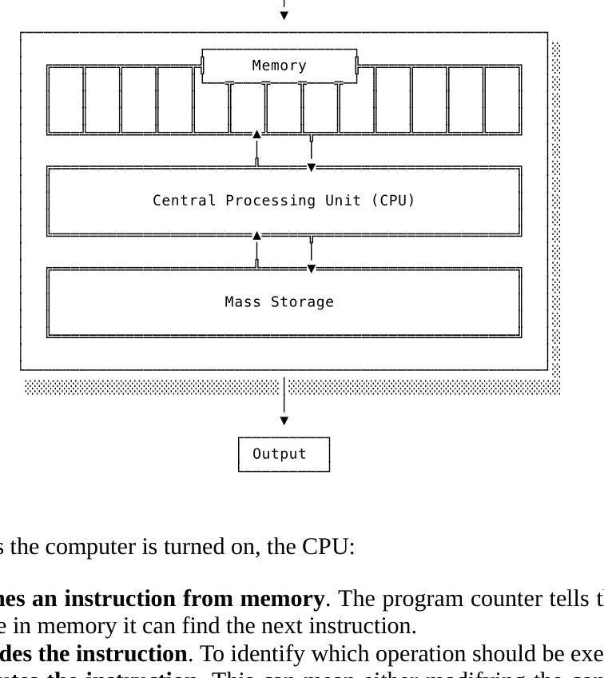

一旦计算机开机，CPU 就会：

1. **从内存中取指令**。程序计数器告诉 CPU 在内存中的哪个位置能找到下一条指令。
2. **对指令进行解码**。以确定应该执行哪个操作。
3. **执行指令**。这可能意味着修改其寄存器的内容，或者将数据从寄存器传输到内存，或者在内存中移动数据，或者产生输出，或者读取输入……

……然后再次回到第 1 步。

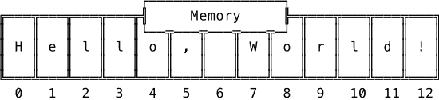

字母“H”的内存地址是 0，“e”是 1，第一个“l”是 2，“W”是 7，依此类推。我们可以通过使用内存地址 0 到 12 来访问字符串 `Hello, world!` 中的每一个字母。“嘿，CPU，抓取内存地址 4 处的字”会让 CPU 取到字母“o”。很直接，对吧？我知道你现在在想什么，是的，如果我们把一个这样的数字——一个内存地址——保存到内存中的另一个位置，我们就创建了一个指针。

这就是内存中数据寻址以及 CPU 如何知道在哪里取数和存储数据的*基本*思想。不过，一如既往，现实世界是一团乱麻。

正如我已经提到的，不同计算机的字长是不同的。有时是 8 位，有时是 16、24、32 或 64 位。有时 CPU 使用的字长与地址长度无关。如果这还不够应付：有些计算机的做法完全不同，使用[字节寻址](byte-addressing)而不是刚才描述的字寻址。

而且，如果你使用字寻址并想要寻址单个字节（这并不罕见），你不仅要处理不同的字长，还要处理偏移量。这反过来代价高昂，必须进行优化。

除此之外：我们可以简单地告诉 CPU 在内存中的哪里存储和检索数据，这种想法有点像童话。它在概念层面是正确的，对学习有帮助，但如今的内存访问已经被抽象化，位于一层又一层的安全性和性能优化之后。内存不再是狂野的西部——我们不能随便访问任何我们想要的内存位置。安全规则和一种名为虚拟内存的机制正在尽力阻止这种事情发生。

不过，让我先在此打住，以免我们绕了一个大弯，最后谈到了虚拟内存的内部工作原理。那不是我们来这里的目的。你从这段离题内容中可以学到的是，如今的内存访问比给 CPU 传递一个数字要复杂得多。不仅存在安全规则，而且还有备受推崇的“堆栈跟踪”。

那么，它是什么呢？它是内存中的一个区域，其中的数据以后进先出（LIFO）的方式管理。其中的数据会增长和收缩，你把元素压入栈中，之后再将它们弹出。就像栈数据结构一样。但与这种通用数据结构不同，这个栈专注于一个目的：它被用来实现调用栈。

是的，让我们先停在这里；这确实令人困惑。“栈”、“那个栈”、“栈数据结构”、“调用栈”——确实不太好理解，对吧？而这些名称经常被互换使用、随手乱扔、混在一起，这也没有帮助。不过，谢天谢地，如果我们对名称加以注意，并关注它们背后的“为什么”，事情就会变得清晰得多。所以让我们再试一次，一步一步来。

我们有一个内存区域，CPU 以 LIFO 方式访问和存储数据。它这样做是为了实现栈的一个专门版本，称为调用栈。

为什么它需要调用栈？因为 CPU（或者不妨说：希望 CPU 按预期工作的程序员）需要跟踪某些信息才能执行程序。调用栈在这方面有所帮助。什么信息？首先也是最重要的：当前正在执行哪个函数，以及一旦当前函数完全执行完毕，接下来要执行哪条指令。这条信息——在当前函数之后要取哪条指令——被称为返回地址。它是 CPU 执行完当前函数后返回的位置。如果没有它，CPU 只会递增程序计数器，并执行内存中下一个更高地址处的指令。而这很可能与应该发生的事截然相反。指令并不是按照执行顺序在内存中彼此相邻排列的。想象一下，如果你的 Go 代码中所有 return 语句都消失了会发生什么——这就是为什么 CPU 需要跟踪返回地址。调用栈还有助于保存函数局部的、与执行相关的数据：函数调用的参数以及仅在函数中使用的局部变量。

返回地址、参数和局部变量——理论上，我们可以把这些信息保存在内存中任何其他可访问的部分，以任何我们认为合适的方式。但事实证明，为此使用栈是完美的，因为函数调用通常是嵌套的。当进入一个函数时，数据被压入栈中。而且

执行当前函数时，无需访问外部调用函数的局部数据。说白了，只需访问栈的顶部部分即可。而一旦当前函数返回，其局部数据就会被简单地弹出——之后就不再需要它了。这样一来，外部函数的局部数据就留在栈顶了。漂亮吧？

所以我们需要 *调用栈*，并且它被实现为 *一个栈*。现在唯一的问题是：为什么会有这个臭名昭著的名字？为什么它是 *栈* 而不是“嗯，我想，是的，它就是一个栈，对吧”？因为使用这块内存区域来实现 *一个调用栈* 是一种根深蒂固且广泛流行的约定，以至于现在它已经被固化到硬件中了。某些 CPU 支持专门用于向栈推送和弹出数据的指令。在它们上运行的每个程序都 *以这种方式使用此内存区域* 来实现 *此机制*。无法绕开。这就是为什么它是栈，而不是随便哪个栈。

但请记住，*一个调用栈* 的概念就是概念。它并不绑定于特定的实现或特定的内存区域。你完全可以在内存的任何其他位置实现 *一个调用栈*——只是那样就不会有硬件或操作系统支持了。事实上，这正是我们要做的。我们将实现自己的调用栈，一个虚拟调用栈。但在我们这样做并从物理转向虚拟之前，我们还需要了解一个概念才能做好充分准备。

现在你知道了 *栈* 的工作原理，就能想象 CPU 在执行程序时需要多频繁地访问这块内存区域。非常频繁。这意味着 CPU 访问内存的速度限制了程序执行的速度。而内存访问 *是* 很快的（CPU 在你眨眼的时间内大约可以访问主内存一百万次），但它并非瞬间完成，仍然有成本。

这就是为什么计算机还有另一个可以存储数据的地方：处理器寄存器。寄存器是 CPU 的一部分，访问它们 *多* 快，比访问主内存快得多。自然地，人们可能会问，为什么不把所有东西都存放在寄存器中呢？因为它们数量很少，无法像主内存那样容纳大量数据，通常每个寄存器只能容纳一个字。例如，x86-64 架构的 CPU 有 16 个通用寄存器，每个寄存器保存 64 位数据。

寄存器用于存储体积小但频繁访问的数据。例如，指向 *栈* 顶部的内存地址通常存储在寄存器中——这里的“通常”已经是轻描淡写了。这种特定的寄存器用途如此普遍，以至于大多数 CPU 都有一个专门的寄存器来存储这个指针，所谓的 *栈指针*。某些 CPU 指令的操作数和结果也可能存储在寄存器中。如果 CPU 需要加两个数，这两个数都会存储在寄存器中，加法结果也会放在其中一个寄存器里。当然不止这些。寄存器还有很多其他用途。再举一个例子：如果程序中有一块频繁访问的大数据，将其地址存储到寄存器中是有意义的，这样 CPU 就可以非常快速地访问它。不过对我们来说最重要的是 *栈指针*。我们很快会再次见到它。

现在……深呼吸，靠 back 放松，因为：就这些了！现在我们已经提到了寄存器，并且知道栈指针是什么，我们已经掌握了了解真实机器工作原理所需的一切知识。是时候让我们抽象化，从物理走向虚拟了。

## 虚拟机是什么？

让我直截了当：虚拟机是用软件构建的计算机。它是一个软件实体，模仿计算机的工作方式。我承认，“软件实体”说得不多，但我故意使用这个词来强调一点：虚拟机可以是任何东西。一个函数、一个结构体、一个对象、一个模块，甚至一个完整的程序。重要的是它做什么。

虚拟机有一个运行循环，像计算机一样经历取指-译码-执行周期。它有程序计数器；它取指令；它译码并执行它们。它也有栈，就像真正的计算机一样。有时它有调用栈，有时甚至还有寄存器。全部由软件构建。

让我言出必行。下面是一个用 50 行 JavaScript 编写的虚拟机：

```javascript
let virtualMachine = function(program) {
    let programCounter = 0;
    let stack = [];
    let stackPointer = 0;

    while (programCounter < program.length) {
        let currentInstruction = program[programCounter];
```

如果你没看懂也没关系。你很快就能看懂了。一旦你习惯了在栈上做算术，这个程序就不难读了：首先 PUSH 3 和 4，然后 ADD 两个栈顶元素，通过将其弹出、相加并将结果压回栈；最后，PUSH 5 将 5 压入栈，然后用它与倒数第二个元素做 MINUS 并将结果留在栈上。

虚拟机运行循环结束后，其栈顶的结果会被打印出来：

```
$ node virtual_machine.js
stacktop:  2
```

爆了。

现在，虽然这是一个真正可工作的虚拟机，但它也相当简单。正如你所能想象的，它并不能展示虚拟机实现整个光谱的能力和外观。你可以用大约 50 行代码写一个虚拟机，就像我们刚才做的那样，但也可以用 5 万行或更多代码。从这里到那里意味着在功能和性能方面做出各种各样的选择。

最重要的设计决策之一是机器将是栈机还是寄存器机。它如此重要，以至于虚拟机根据这一架构选择进行分组，就像编程语言被归类为“编译型”或“解释型”一样。栈机和寄存器机的区别——用最简单的说法——是机器是否使用栈来执行计算（就像我们在上面的例子中所做的那样）还是使用寄存器（虚拟的！）。关于哪种选择更好（读作：更快）的争论仍然开放，因为这主要关乎权衡，以及你愿意做出哪些权衡。

据说栈机及其配套编译器更容易构建。机器需要的部件更少，执行的指令更简单，因为它们“仅”使用栈。问题在于你需要执行大量指令，因为你需要把所有东西都推入和弹出栈才能完成任何事情。这限制了性能优化的黄金法则能被应用到何种程度：与其试图做得更快，首先尝试做得更少。

构建寄存器机工作量更大，因为寄存器是 *一个附加项*；它仍然有栈。它不如栈机中那样突出，但实现调用栈仍然是必要的。寄存器机的优势在于其指令可以利用寄存器，因此与栈对应指令相比密度更高。不是把东西放到栈上，通过推入和弹出使它们处于正确顺序，指令可以直接引用寄存器。一般来说，寄存器机上的程序需要的指令比栈机上更少。这反过来带来了更好的性能。但话说回来，编写生成这种密集指令的编译器需要更多努力。正如我所说：这关乎权衡。

除了这个主要的架构选择之外，构建虚拟机还涉及无数其他决策。有关于如何使用内存以及如何在内部表示值的大问题（我们在为求值器构建 Monkey 对象系统时已经涉及过这个话题）。但随后还有一些看似微小的东西，最终却变成无尽的、曲折的兔子洞，让人迷失其中。让我们瞥一眼其中一个。

在上面的例子中，我们使用了一个 `switch` 语句在机器的运行循环中进行 *分发*。*分发* 在虚拟机中指的是在执行指令之前为其选择一个实现。在我们的 `switch` 语句中，这些指令的实现就在 case 旁边，内联。在 `MINUS` case 中我们减去两个值，在 `ADD` case 中我们相加，等等。这就是分发。而 `switch` 语句看起来像是显而易见且 *唯一* 的选择，但远非如此。

`switch` 语句只是兔子洞的入口。当你追求最大性能时，你必须一路深入到底。在那里，你会发现使用跳转表、计算的 GOTO 语句、间接和直接线程代码进行分发。因为，相信与否，当 case 分支数量足够多（几百个或更多）时，`switch` 可能是这些方案中最慢的。目标是将分发的开销降低到如此程度，以至于从性能角度来看，取指-译码-执行周期中的取指-译码部分消失了。这应该让你体会到这些兔子洞有多深。

我们现在对虚拟机是什么以及构建它需要什么有了粗略的概述。如果你仍然缺少一些细节，不用担心。既然我们要自己构建一个，我们将重新审视很多主题、想法，以及，是的，的

rabbit holes.

## 为什么要构建一个？

让我们把刚刚学到的内容放在合适的视角来看。*为什么*你要构建一台虚拟机来实现编程语言？我必须承认，这是我一直揣在心里最久的问题。即使在我构建了几个微小的虚拟机并阅读过更大虚拟机的源代码之后，我仍然会问自己：为什么？

当我们实现一门编程语言时，我们希望它具有通用性。它应该能够执行所有可能的程序，而不仅仅是——作为众多例子之一——我们内置的函数。通用计算是我们追求的目标，而计算机为此提供了一个坚实模型。如果我们基于该模型构建编程语言，它将具有与计算机相同的计算能力。这也是执行程序最快的方式之一。

但如果像计算机一样执行程序是最好的、最快的方式，那为什么不，就让计算机直接执行程序呢？可移植性。我们可以为我们的编程语言编写一个编译器，使翻译后的程序能够在计算机上原生执行。这些程序会非常快。但我们也必须为每一种想要运行程序的计算机架构编写新的编译器。那工作量太大了。相反，我们可以将程序翻译成虚拟机的指令。而虚拟机本身可以在与实现语言一样多的架构上运行。以 Go 编程语言为例，这就*相当*可移植。

还有一个用虚拟机实现编程语言的原因，我认为这是最迷人的一个。就是这样：虚拟机是领域特定的。这正是它们与非虚拟对应物不同的地方。计算机为我们所有的计算需求提供通用解决方案，而且显然*不是*领域特定的。这没问题，这正是我们希望计算机具备的能力，以便在上面运行各种程序。但如果我们不需要机器*那样*通用怎么办？如果我们只需要计算机为程序员提供的功能子集怎么办？

作为程序员，我们知道没有功能是不需要付出代价的。增加复杂性和性能下降只是我们经常为此支付的两项代价。今天的计算机拥有很多功能。x86-64 家族的 CPU 支持 900 到 4000 条指令，具体取决于计数方式。这包括对两个操作数进行按位异或的至少六种不同方式。这很方便，也是计算机如此多才多艺的原因。但它不是免费的。多才多艺是有代价的，就像每个其他功能一样。回想一下我们在微型 VM 中的 switch 语句，花点时间思考一下再添加 3997 个 case 分支的性能影响。如果你不确定它是否真的会变慢，就问问自己维护代码或为此 VM 编程有多容易。好消息是我们可以用另一种方式来看待它。如果我们去掉不需要的功能，我们就可以更快。更少的复杂性，更少的维护，更少的负担。这就是虚拟机发挥作用的地方。

虚拟机就像一台定制构建的计算机。它拥有定制的部件和定制的机器语言。它针对单一编程语言进行调优。所有不需要的功能都被剥离，剩下的高度专业化。由于你不需要像通用计算机那样通用，你可以专注。你可以将精力集中在让这台高度专业化、定制的机器尽可能好地工作并尽可能快地运行。这——专业化、领域特定性——与去掉不必要的负担一样重要。

为什么这一点如此重要，在我们查看虚拟机执行的指令时变得更加清晰，而这正是我们到目前为止一直避开的内容。还记得我们给微型虚拟机喂了什么吗？这里再次展示：

```
let program = [
  PUSH, 3,
  PUSH, 4,
  ADD,
  PUSH, 5,
  MINUS
];

virtualMachine(program);
```

现在，这是什么？PUSH 是什么，ADD 是什么，MINUS 是什么？以下是它们的定义：

```
const PUSH = 'PUSH';
const ADD = 'ADD';
const MINUS = 'MINUS';
```

PUSH、ADD 和 MINUS 只是引用字符串的常量。没有什么魔法。真让人失望。呜！这一发现的唯一好处是它们几乎同样可读。

意思是你不能像读文本文件一样读它。助记符，如 PUSH，并不会出现在实际的字节码中。它们被它们所引用的操作码取代，而那些只是数字——字节。具体是哪些数字取决于定义字节码的人。PUSH 助记符可能代表数字 0，而 POP 可能指的是数字 23。

操作数也被编码，并且同样取决于其值需要多少字节来准确表示。如果操作数需要多个字节才能准确表示，其编码顺序起着重要作用。有两种可能的顺序，称为 *little endian* 和 *big endian*。Little endian 意味着原始数据的 *最低有效字节* 先出现并存储在最低的内存地址。Big endian 则相反：*最高有效字节* 先出现。

如果我们作为字节码设计者声明 PUSH 指代 1，ADD 指代 2 且整数以 big endian 存储，我们可以将上面的示例编码并在内存中像这样布局：

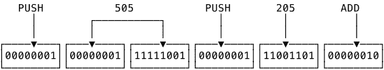

我们刚刚做的事情——将字节码的人类可读表示转换为二进制数据——是由称为汇编器的程序完成的。你可能在非虚拟机代码的上下文中听说过它们。这里也一样。汇编语言是字节码的可读版本，包含助记符和可读操作数，而汇编器将其转换为二进制字节码。反向操作，将二进制表示转换为可读表示，则由反汇编器完成。

好吧！就字节码的纯技术方面而言就到此为止。任何进一步的探索都会变得过于具体。字节码格式太多样化和专业化，以至于我们无法在此做出更一般的陈述。就像执行它的虚拟机一样，字节码也是为非常具体的目标而创建的。

字节码是为特定领域机器设计的领域特定语言。它是为定制构建的虚拟机量身定制的机器语言。它的力量就在于此。与其通用并支持所有可想象的用例，字节码可以被专门化。它只需要支持源语言所需的功能，即被编译为字节码的语言。

而且不仅如此。除了只允许一组狭窄的指令外，它还可以包含只有在特定领域的虚拟机上下文中才有意义的领域特定指令。例如，Java 虚拟机（JVM）的字节码包含这些指令：`invokeinterface` 用于调用接口方法，`getstatic` 用于获取类的静态字段，`new` 用于创建指定类的新对象。Ruby 的字节码有 `putself` 指令用于将 self 加载到栈上，`send` 用于向对象发送消息，`putobject` 用于将任意对象加载到栈上。而 Lua 的字节码有专门用于访问和操作表和元组的指令。你在通用 x86-64 CPU 的指令集中找不到任何这些内容。

使用自定义字节码格式进行专门化的能力是最初构建虚拟机的最大原因之一。不仅编译、维护和调试变得更容易，而且生成代码也更紧凑，因为表达某件事需要更少的指令。这反过来又使代码执行更快。

现在，如果所有关于定制虚拟机、量身定制的机器代码、手工构建编译器的讨论没有引起你的兴趣，这是你最后的机会回头。我们即将大干一场。


## 我们要做什么，或者说：虚拟机与编译器的二元性

构建虚拟机和配套的编译器，首先需要我们解决一个类似于“先有鸡还是先有蛋”的问题：我们先构建哪一个？是先构建编译器，让它为还不存在的机器输出字节码？还是先构建虚拟机，却没有任何人为它生成代码？

对于本书，我选择的答案是：我们同时构建两者——同步进行。

先完全构建其中一个（先构建哪个并不重要）会让人很受挫。很难理解正在发生什么，以及你所做的事情的目的。如果你先构建编译器并定义字节码，在不了解虚拟机之后将如何执行它的情况下，很难理解为什么事情会是现在这个样子。在编译器之前构建虚拟机也有其自身的挑战，因为需要先定义字节码。而如果不仔细研究字节码旨在表示的源语言结构，就很难做到这一点，这意味着你无论如何都得把编译器梳理清楚。

当然，如果你已经有过构建其中一种的经验，你就会知道自己的目标在哪里，从而可以选择其中任意一种方案。但对我们来说，目标是学习如何从零开始构建两者。

这就是为什么我们要从小处着手。我们要构建一个只支持极少数指令的小型虚拟机，以及一个配套的、只知道如何输出这些指令的小型编译器。这样我们就能立刻明白我们为什么要构建这些东西，以及所有部分是如何组合在一起的。我们也会从一开始就拥有一个可运行的系统。这能给我们快速的反馈循环，让我们能够调整、试验，并逐步构建我们的虚拟机和编译器。这也让整个旅程充满乐趣。

现在你知道了计划是什么。而且你对编译器和虚拟机的了解也足以让我们不会在中途迷失方向。让我们开始吧。

## 你好，字节码！

本章的目标是编译并执行这个 Monkey 表达式：

```
1 + 2
```

这听起来并不算一个雄心勃勃的目标，但为了实现它，我们将不得不学习许多新东西，并搭建大量在后续章节中会用到的基础设施。而通过选择简单的表达式 `1 + 2`，我们不会被 Monkey 代码本身及其工作方式所干扰。我们可以专注于我们的编译器和虚拟机。

在本章结束时，我们希望能够：
- 获取 Monkey 表达式 `1 + 2`
- 使用我们现有的词法分析器、令牌和解析器包对其进行词法分析和解析
- 获取生成的 AST，其节点定义在我们的 `ast` 包中
- 将其传递给新构建的编译器，编译器将其编译为字节码
- 获取字节码并将其交给同样新构建的虚拟机执行
- 确保虚拟机将其转换为 `3`。

`1 + 2` 表达式将流经我们新解释器的所有主要部分：

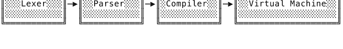

就数据结构而言，你可以看到，在我们最终得到 `3` 这个结果之前，会有相当多的转换：


由于我们将大量使用前一本书中构建的包，我们已经可以处理到 AST 为止的所有事情。之后我们就进入了未知领域。我们需要定义字节码指令，构建一个编译器，并构造一个虚拟机——仅仅是为了把 `1 + 2` 变成 `3`。听起来很吓人？别担心，我们一如既往地一步一步来，从零开始构建，就从字节码开始。

## 首批指令

正如我在前一章提到的，虚拟机的架构是影响字节码外观的最大单一因素。这意味着在开始指定字节码之前，我们需要决定我们要构建哪种类型的机器。

那么，事不宜迟，让我们揭开帷幕：我们将构建一个**栈机**！为什么？因为对于初学者来说，栈机比寄存器机更容易理解和构建。概念更少，活动部件更少。而且所有关于性能的考量——*寄存器机更快吗？*——对我们来说并不是那么重要。我们的重点是学习和理解。

稍后我们会看到这个决定带来的更多影响，但最直接、最实际的一点是，我们现在必须进行栈上算术运算。这意味着，为了达到我们声明编译并执行 Monkey 表达式 `1 + 2` 的目标，我们必须将其翻译成使用栈的字节码指令。栈就是栈机工作的地方——我们不能不利用栈就告诉它把两个数字相加。

幸运的是，我们之前见过类似的例子，并且已经知道如何使用栈进行算术运算。我们首先把操作数 `1` 和 `2` 放到栈上，然后告诉虚拟机：“把这两个加起来！”。这个“把这两个加起来！”指令应当会使虚拟机从栈上取出最顶部的两个元素，将它们相加，然后把结果压回栈上。这是指令执行前后栈的样子：

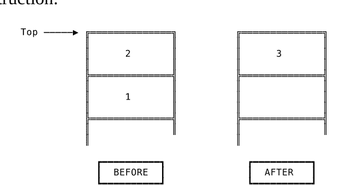

因此，为了完全实现这一点，我们需要告诉虚拟机：
- 将 `1` 压入栈
- 将 `2` 压入栈
- 将最顶部的两个元素相加

我们需要创建三条指令。但作为程序员，我们知道我们只需要定义两种不同的指令类型，因为将 `2` 压入栈与将 `1` 压入栈应该是相同的，只是“参数”不同。所以，总共两种指令类型：一种用于将某个东西压入栈，另一种用于将已经在栈上的东西相加。

我们将以相同的方式实现两者。首先定义它们的操作码以及它们在字节码中的编码方式。然后扩展编译器，使其能够生成这些指令。一旦编译器知道如何做到这一点，我们就可以创建解码并执行它们的虚拟机。我们从告诉虚拟机将某个东西压入栈的指令开始。

## 从字节开始

我们到了。我们需要定义我们的第一条字节码指令。我们该怎么做呢？嗯，因为在编程中创建定义无非就是把我们所知道的东西告诉计算机，让我们问问自己：我们对字节码知道些什么？

我们知道它由指令组成。我们还知道，指令本身是一系列字节，单个指令由一个操作码和可选数量的操作数组成。操作码恰好是一个字节宽，具有任意但唯一的值，并且是指令中的第一个字节。看起来我们知道得不少，而且最好的事情是，这已经足够精确，可以转化为代码——字面意义上的。

作为本书中我们编码的第一个正式实践行动，我们创建一个名为 `code` 的新包，在其中开始定义我们的 Monkey 字节码格式：

```go
// code/code.go

package code

type Instructions []byte

type Opcode byte
```

`Instructions` 是一个字节切片，`Opcode` 是一个字节。很完美，它们与我们的文字描述相当吻合。但这里缺少两个定义。

第一个是 `Instruction` —— 单数形式。为什么我们不在这里将其定义为 `[]byte`？因为传递和使用 `[]byte` 并*隐式地*将其视为一条指令，远比在 Go 的类型系统中编码这个定义要方便得多。你很快就会看到我们会多么频繁地使用 `[]byte`，以及使用 `Instruction` 类型进行类型断言和类型转换会有多么麻烦。

另一个缺失的定义是 `Bytecode`。至少应该有一些字节码的定义来告诉我们它是由指令组成的，对吧？它之所以缺席，是因为如果我们在这里、在 `code` 包中定义 `Bytecode`，会遇到一个讨厌的导入循环。但它不会缺席太久。等我们讲到编译器时，我们会在这里定义它——在编译器的包中。

现在我们已经有了 `Opcode` 和 `Instructions` 的定义，我们可以定义我们的第一个操作码，即告诉虚拟机将某个东西压入栈的那个。这里有个惊喜：这个操作码的名字里不会有“push”。事实上，它不仅仅是关于压入东西的。请允许我解释一下。

我们之前说过，当我们编译 Monkey 表达式 `1 + 2` 时，我们希望生成三条不同的指令；其中两条告诉虚拟机将 `1` 和 `2` 压入栈。第一反应可能会告诉我们可以通过定义一个“push”指令来实现，其操作数是一个整数，思路是虚拟机随后取出整数操作数并将其压入栈。对于整数来说这没问题，因为我们可以轻松地编码它们并将它们直接放入字节码中。但如果我们以后想压入 Monkey 代码中包含的其他东西呢？比如字符串字面量。把它们放入字节码也是可能的，没错，因为它毕竟只是由字节组成的，但这也会造成大量臃肿，并且迟早会变得笨重。

这就是 *常量* 思想的用武之地。在这里，“常量”是“常量表达式”的简称，指的是其值不变、是*恒定*的、并且可以在*编译时*确定的表达式：


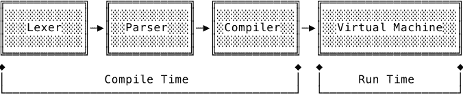

这意味着我们不需要运行程序就能知道这些表达式的求值结果。编译器可以在代码中找到它们并存储其求值结果。之后，它可以在生成的指令中引用这些常量，而不是直接将值嵌入其中。而“reference”听起来像是某种特殊的数据类型，实际上要简单得多。一个普通的整数就能很好地完成工作，可以作为指向存储所有常量的数据结构的索引，该数据结构通常称为常量池。

这正是我们的编译器将要做的事情。在编译过程中，当我们遇到整数字面量（常量表达式）时，我们会对其求值并通过将其存储在内存中并分配一个数字来跟踪由此产生的 *object.Integer*。在字节码指令中，我们将通过这个数字引用 *object.Integer*。编译完成后并将指令传递给 VM 执行时，我们还会将找到的所有常量一起传递过去，通过将它们放入一个数据结构——我们的常量池——其中分配给每个常量的数字可作为索引来检索它。

回到我们的第一个操作码。它叫做 OpConstant，并且有一个操作数：我们之前分配给常量的数字。当 VM 执行 OpConstant 时，它使用操作数作为索引检索常量并将其推入栈。下面是我们的第一个操作码定义：

```go
// code/code.go

// [...]

const (
    OpConstant Opcode = iota
)
```

虽然这看起来正好就是它们所拥有的那寥寥三行代码，但这一添加是所有未来操作码定义的基础。每个定义都将以 Op 为前缀，其值将由 iota 决定。我们让 iota 为我们生成递增的字节值，因为我们根本不在乎操作码实际代表的值。它们只需要彼此不同并且能放入一个字节中。`iota` 确保了这一点。

这个定义中缺少的部分是说明 `OpConstant` 有一个操作数。从技术上讲没有必要写下来，因为我们可以在编译器和 VM 之间隐式地共享这部分知识。然而，为了调试和测试目的，能够查找操作码有多少个操作数以及其人类可读名称非常方便。为了实现这一点，我们将在 code 包中添加适当的定义和一些工具：

```go
// code/code.go

import "fmt"

type Definition struct {
    Name            string
    OperandWidths []int
}

var definitions = map[Opcode]*Definition{
    OpConstant: {"OpConstant", []int{2}},
}

func Lookup(op byte) (*Definition, error) {
    def, ok := definitions[Opcode(op)]
    if !ok {
        return nil, fmt.Errorf("opcode %d undefined", op)
    }

    return def, nil
}
```

Opcode 的 Definition 有两个字段：Name 和 OperandWidths。Name 有助于使 Opcode 可读，而 OperandWidths 包含每个操作数占用的字节数。

`OpConstant` 的定义说明其唯一的操作数宽度为两个字节，这使其成为 `uint16`，并将最大值限制为 65535。如果包含 0，则可表示的值的数量为 65536。这对我们来说应该足够了，因为我认为在我们的 Monkey 程序中不会引用超过 65536 个常量。而使用 `uint16` 而不是例如 `uint32`，有助于保持生成的指令更小，因为未使用的字节更少。

有了这个定义，我们现在可以创建第一个字节码指令。如果不涉及操作数，那只需要在 `Instructions` 切片中添加一个操作码即可。但对于 `OpConstant` 来说，我们需要正确编码这个两字节的操作数。

为此，我们现在将创建一个函数，使我们能够轻松创建一个由 Opcode 和可选的操作数组成的单个字节码指令。我们将它命名为 Make，这在其他包中为我们提供了非常棒的标识符 `code.Make`。

下面就是我们一直在等待的，本书的第一个测试，展示了我们希望 Make 完成的工作：

```go
// code/code_test.go

package code

import "testing"

func TestMake(t *testing.T) {
    tests := []struct {
        op         Opcode
        operands   []int
        expected   []byte
    }{
        {OpConstant, []int{65534}, []byte{byte(OpConstant), 255, 254}},
    }

    for _, tt := range tests {
        instruction := Make(tt.op, tt.operands...)

        if len(instruction) != len(tt.expected) {
            t.Errorf("instruction has wrong length. want=%d, got=%d",
                len(tt.expected), len(instruction))
        }

        for i, b := range tt.expected {
            if instruction[i] != tt.expected[i] {
                t.Errorf("wrong byte at pos %d. want=%d, got=%d",
                    i, b, instruction[i])
            }
        }
    }
}
```

不要因为测试只包含一个测试用例而感到沮丧。当我们向代码词汇中添加更多 Opcodes 时，我们稍后会扩展它。

目前，我们只将 OpConstant 和操作数 65534 传递给 Make。然后我们期望返回一个包含三个字节的 []byte。这三个字节中，第一个必须是操作码 OpConstant，另外两个应该是 65534 的大端编码。这也是我们使用 65534 而不是最大值 65535 的原因：这样我们可以检查最高有效字节是否在前。65534 在大端中将被编码为字节序列 0xFF 0xFE，而 65535 将被编码为 0xFF 0xFF——很难识别顺序。

由于 Make 还不存在，测试不会失败，但会编译失败，所以这是 Make 的第一个版本：

```go
// code/code.go

import (
    "encoding/binary"
    "fmt"
)

func Make(op Opcode, operands ...int) []byte {
    def, ok := definitions[op]
    if !ok {
        return []byte{}
    }

    instructionLen := 1
    for _, w := range def.OperandWidths {
        instructionLen += w
    }

    instruction := make([]byte, instructionLen)
    instruction[0] = byte(op)

    offset := 1
    for i, o := range operands {
        width := def.OperandWidths[i]
        switch width {
        case 2:
            binary.BigEndian.PutUint16(instruction[offset:], uint16(o))
        }
        offset += width
    }

    return instruction
}
```

这就是创建字节码的方式。

我们在这里做的第一件事是找出生成的指令将有多长。这使我们能够分配具有适当长度的字节切片。请注意，我们没有使用 Lookup 函数来获取定义，这为稍后测试中的 Make 提供了一个更易用的函数签名。通过绕过 Lookup 并且不需要返回可能的错误，我们可以使用 Make 轻松构建字节码指令，而无需在每次调用后检查错误。使用未知操作码产生空字节切片的风险是我们愿意承担的，因为我们在这里处于生成方，并且在创建指令时知道自己在做什么。

一旦我们有了 instructionLen 的最终值，我们就分配 instruction []byte 并将 Opcode 作为其第一个字节添加——通过将其转换为一个字节。然后是棘手的部分：我们遍历定义的 OperandWidths，取出 operands 中的匹配元素并将其放入指令中。我们通过使用 switch 语句来完成此操作，具体方法取决于操作数的宽度。

当我们定义额外的 Opcodes 时，我们很快就需要扩展这个 switch 语句。目前，我们只确保两字节操作数以大端编码。虽然手动完成并不困难，但我们为此使用了标准库中的 binary.BigEndian.PutUint16，其好处是编码的名称立即可见。

编码操作数后，我们将 offset 增加其宽度并进入循环的下一次迭代。由于我们测试用例中的 OpConstant 操作码只有一个操作数，循环在 Make 返回 instruction 之前只执行一次迭代。

看吧，我们的第一个测试正在编译并通过：

```bash
$ go test ./code
ok      monkey/code 0.007s
```

我们成功地将 OpConstant 和操作数 65534 转换为三个字节。这意味着我们创建了第一个字节码指令！

## 最小的编译器

现在我们有了名为 code 的工具箱，我们可以开始着手编译器的工作。由于我们希望系统尽快实现端到端工作，而不是一个只有在功能完整后才能启动的系统，本节的目标是构建尽可能小的编译器。目前它应该只做一件事：生成两个 OpConstant 指令，后续会导致 VM 正确地将整数 1 和 2 加载到栈上。

为了实现这一点，这个最小的编译器必须执行以下操作：遍历我们传入的 AST，找到 *ast.IntegerLiteral 节点，通过将其转换为 *object.Integer 对象来求值，将对象添加到常量池中，最后发出引用该池中常量的 OpConstant 指令。


听起来不错？完美！让我们开始在新的 compiler 包中定义 Compiler 及其接口：

```go
// compiler/compiler.go

package compiler

import (
    "monkey/ast"
    "monkey/code"
    "monkey/object"
)

type Compiler struct {
    instructions code.Instructions
    constants    []object.Object
}

func New() *Compiler {
    return &Compiler{
        instructions: code.Instructions{},
        constants:    []object.Object{},
    }
}

func (c *Compiler) Compile(node ast.Node) error {
    return nil
}

func (c *Compiler) Bytecode() *Bytecode {
    return &Bytecode{
        Instructions: c.instructions,
        Constants:    c.constants,
    }
}

type Bytecode struct {
    Instructions code.Instructions
    Constants    []object.Object
}
```

真的很简约，对吧？Compiler 是一个很小的结构体，只包含两个字段：instructions 和 constants。两者都是内部字段，将在之后由 Compile 方法修改。instructions 将保存生成的字节码，而 constants 是一个切片，作为我们的常量池。

但我敢打赌立刻吸引你注意的是我们在 code 包中之前一直在寻找的定义：Bytecode！它就在这里，而且不需要太多解释。它包含编译器生成的 Instructions 和编译器求值的 Constants。

Bytecode 是我们将传递给 VM 并在编译器测试中对其进行断言的东西。说到这个，Compile 方法是空的，我们现在要编写第一个编译器测试，告诉它应该做什么。

```go
// compiler/compiler_test.go

package compiler

import (
    "monkey/code"
    "testing"
)

type compilerTestCase struct {
    input               string
    expectedConstants   []interface{}
    expectedInstructions []code.Instructions
}

func TestIntegerArithmetic(t *testing.T) {
    tests := []compilerTestCase{
        {
            input:          "1 + 2",
            expectedConstants: []interface{}{1, 2},
            expectedInstructions: []code.Instructions{
                code.Make(code.OpConstant, 0),
                code.Make(code.OpConstant, 1),
            },
        },
    }

    runCompilerTests(t, tests)
}

func runCompilerTests(t *testing.T, tests []compilerTestCase) {
    t.Helper()

    for _, tt := range tests {
        program := parse(tt.input)

        compiler := New()
        err := compiler.Compile(program)
        if err != nil {
            t.Fatalf("compiler error: %s", err)
        }

        bytecode := compiler.Bytecode()

        err = testInstructions(tt.expectedInstructions, bytecode.Instructions)
        if err != nil {
            t.Fatalf("testInstructions failed: %s", err)
        }

        err = testConstants(t, tt.expectedConstants, bytecode.Constants)
        if err != nil {
            t.Fatalf("testConstants failed: %s", err)
        }
    }
}
```

这里发生的事情解释起来并不费时：我们以 Monkey 代码作为输入，对其进行解析，生成 AST，交给编译器，然后对编译器生成的字节码进行断言。

我们通过构造一个 `compilerTestCase` 来实现，其中定义了输入、我们期望在常量池中的常量以及我们期望编译器生成的指令。然后我们将包含 `compilerTestCases` 的 tests 切片交给 `runCompilerTests` 来运行它们。

这与第一本书中构建测试的方法略有不同。原因在于 Go 1.9，它引入了美妙的 `t.Helper` 方法。我们在 `runCompilerTests` 中调用的 `t.Helper` 允许我们通过定义测试辅助函数来消除测试函数中的重复逻辑。可以把它想象成将 `runCompilerTests` 内联到 `TestIntegerArithmetic` 中。这样一来，我们就可以抽象出我们将要编写的每个编译器测试共有的行为，从而大大减少每个测试函数中的噪音以及本书的页数。

现在，让我们谈谈 `runCompilerTests` 中使用的辅助函数。

`parse` 函数包含我们在第一本书中构建的一些内容：词法分析器和解析器。我们向它传递一个 `string`，并返回一个 AST：

```go
// compiler/compiler_test.go

import (
    "monkey/ast"
    "monkey/code"
    "monkey/lexer"
    "monkey/parser"
    "testing"
)

func parse(input string) *ast.Program {
    l := lexer.New(input)
    p := parser.New(l)
    return p.ParseProgram()
}
```

这就是序幕。`runCompilerTests` 的主要部分围绕着编译器生成的 Bytecode 的两个字段展开。首先，我们希望确保 `bytecode.Instructions` 正确。为此我们有 `testInstructions` 辅助函数：

```go
// compiler/compiler_test.go

import (
    "fmt"
    // [...]
)

func testInstructions(
    expected []code.Instructions,
    actual code.Instructions,
) error {
    concatenated := concatInstructions(expected)

    if len(actual) != len(concatenated) {
        return fmt.Errorf("wrong instructions length.\nwant=%q\ngot =%q",
            concatenated, actual)
    }

    for i, ins := range concatenated {
        if actual[i] != ins {
            return fmt.Errorf("wrong instruction at %d.\nwant=%q\ngot =%q",
                i, concatenated, actual)
        }
    }

    return nil
}
```

正如你所见，它使用了另一个名为 `concatInstructions` 的辅助函数：

```go
// compiler/compiler_test.go

func concatInstructions(s []code.Instructions) code.Instructions {
    out := code.Instructions{}

    for _, ins := range s {
        out = append(out, ins...)
    }

    return out
}
```

我们需要 `concatInstructions`，因为 `compilerTestCase` 中的 `expectedInstructions` 字段不仅仅是一个字节切片，而是一个*切片的切片*。这是因为我们使用 `code.Make` 生成 `expectedInstructions`，它会产生一个 `[]byte`。因此，为了将 `expectedInstructions` 与实际指令进行比较，我们需要通过连接指令将切片的切片转换为扁平化的切片。

`runCompilerTests` 使用的另一个辅助函数是 `testConstants`，它与我们在第一本书中 evaluator 包中使用的测试辅助函数非常相似：

```go
// compiler/compiler_test.go

import (
    // [...]
    "monkey/object"
    // [...]
)

func testConstants(
    t *testing.T,
    expected []interface{},
    actual []object.Object,
) error {
    if len(expected) != len(actual) {
        return fmt.Errorf("wrong number of constants. got=%d, want=%d", len(actual), len(expected))
    }

    for i, constant := range expected {
        switch constant := constant.(type) {
        case int:
            err := testIntegerObject(int64(constant), actual[i])
            if err != nil {
                return fmt.Errorf("constant %d - testIntegerObject failed: %s", i, err)
            }
        }
    }

    return nil
}
```

这里有很多噪音，但发生的事情并不复杂。`testConstants` 会遍历期望的常量，并将其与编译器生成的实际常量进行比较。switch 语句预示着即将到来的内容。一旦我们期望常量池中出现除整数之外的更多内容，我们就会用新的 case 分支扩展它。目前它只使用另一个辅助函数 `testIntegerObject`，它几乎是我们 evaluator 测试中使用的 `testIntegerObject` 的复制品：

```go
// compiler/compiler_test.go

func testIntegerObject(expected int64, actual object.Object) error {
    result, ok := actual.(*object.Integer)
    if !ok {
        return fmt.Errorf("object is not Integer. got=%T (%+v)", actual, actual)
    }

    if result.Value != expected {
        return fmt.Errorf("object has wrong value. got=%d, want=%d",
            result.Value, expected)
    }
    return nil
}
```

这就是 TestIntegerArithmetic 的全部内容。测试本身并不复杂，但通过带来大量不同的测试辅助函数，建立了我们未来编写编译器测试的方式。对于这样一个小的测试来说，这看起来像是很多代码，但我向你保证，我们将从这个测试设置中获得很多收益。

现在，这个测试本身表现如何呢？嗯，不太好：

```text
$ go test ./compiler
--- FAIL: TestIntegerArithmetic (0.00s)
    compiler_test.go:31: testInstructions failed: wrong instructions length.
        want="\x00\x00\x00\x00\x00\x01"
        got =""
FAIL
FAIL    monkey/compiler 0.008s
```

但考虑到我们还没有为编译器编写任何代码，除了定义其接口，这并不算太糟糕，对吧？不过糟糕的是输出：

```text
want="\x00\x00\x00\x00\x00\x01"
```

没有人看到它会说“啊，我明白了…”我知道你迫不及待地想让编译器运行起来，但我不能让这种无法阅读的乱码存在。我的意思是，它是正确的，那些是我们想要的字节，以十六进制打印，但它真的没有帮助。相信我，很快这种输出就会让我们发疯。所以在开始填充编译器的 Compile() 方法之前，我们将投资于开发者的幸福感，并教导我们的 code.Instructions 如何正确地打印自己。

## 字节码，拆解！

你可以通过为它们提供 `String()` 方法来教 Go 中的类型如何自行打印。这对于字节码指令也同样适用。实际上做起来很容易，但正如你所知，我们不会在没有为其编写测试的情况下打印任何东西，对吧？

```go
// code/code_test.go
func TestInstructionsString(t *testing.T) {
```


```
instructions := []Instructions{
    Make(OpConstant, 1),
    Make(OpConstant, 2),
    Make(OpConstant, 65535),
}

expected := `0000 OpConstant 1
0003 OpConstant 2
0006 OpConstant 65535
`

concatted := Instructions{}
for _, ins := range instructions {
    concatted = append(concatted, ins...)
}

if concatted.String() != expected {
    t.Errorf("instructions wrongly formatted.\nwant=%q\ngot=%q",
        expected, concatted.String())
}
}
```

这就是我们对尚未实现的 Instructions.String 方法的期望：美观的多行输出，告诉我们所需的一切信息。每一行的开头都有一个计数器，告诉我们正在查看哪些字节，接着是可读形式的 opcode，然后是解码后的操作数。比起 \x00\x00\x00\x00\x00\x01 这样的内容要好得多，对吧？我们也可以把这个方法命名为 MiniDisassembler 而不是 String，因为它本质上就是这样。

测试无法编译，因为 String 方法未定义。所以这是我们需要添加的第一段代码：

// code/code.go

func (ins Instructions) String() string {
    return ""
}
```

没错，我们返回一个空字符串。为什么？因为这样可以让编译器有东西处理，同时让我们能够再次运行测试：
```
$ go test ./code
--- FAIL: TestInstructionsString (0.00s)
    code_test.go:49: instructions wrongly formatted.
        want="0000 OpConstant 1\n0003 OpConstant 2\n0006 OpConstant 65535\n"
        got=""
FAIL
FAIL    monkey/code 0.008s
```

完美，它失败了。这比一个阻止我们运行测试的 undefined: String 编译器错误有用得多，因为现在我们需要编写另一个测试并运行它。

这个其他测试是为 Instructions.String 的核心函数准备的。它的名字是 ReadOperands，下面是我们希望它实现的功能：
// code/code_test.go

func TestReadOperands(t *testing.T) {
    tests := []struct {
        op           Opcode
        operands     []int
        bytesRead int
    }{
        {OpConstant, []int{65535}, 2},
    }

    for _, tt := range tests {
        instruction := Make(tt.op, tt.operands...)

        def, err := Lookup(byte(tt.op))
        if err != nil {
            t.Fatalf("definition not found: %q\n", err)
        }

        operandsRead, n := ReadOperands(def, instruction[1:])
        if n != tt.bytesRead {
            t.Fatalf("n wrong. want=%d, got=%d", tt.bytesRead, n)
        }

        for i, want := range tt.operands {
            if operandsRead[i] != want {
                t.Errorf("operand wrong. want=%d, got=%d", want, operandsRead[i])
            }
        }
    }
}
```

正如你所见，ReadOperands 应该是 Make 的对应函数。Make 对字节码指令的操作数进行编码，而 ReadOperands 的任务则是解码它们。

在 TestReadOperands 中，我们使用 Make 创建一个完全编码的指令，并将其定义连同包含操作数的指令子切片一起传递给 ReadOperands。ReadOperands 然后应该返回解码后的操作数，并告诉我们为此读取了多少字节。正如你现在可以想象的，一旦我们有了更多 opcode 和不同类型的指令，我们就会扩展测试表。

测试失败是因为 ReadOperands 未定义：
```
$ go test ./code
# monkey/code
code/code_test.go:71:22: undefined: ReadOperands
FAIL    monkey/code [build failed]
```

为了让测试通过，我们必须实现一个 ReadOperands 函数，它逆转 Make 所做的一切：
// code/code.go

func ReadOperands(def *Definition, ins Instructions) ([]int, int) {
    operands := make([]int, len(def.OperandWidths))
    offset := 0

    for i, width := range def.OperandWidths {
        switch width {
        case 2:
            operands[i] = int(ReadUint16(ins[offset:]))
        }

        offset += width
    }

    return operands, offset
}

func ReadUint16(ins Instructions) uint16 {
    return binary.BigEndian.Uint16(ins)
}
```

就像在 Make 中一样，我们使用 opcode 的 *Definition 来确定操作数的宽度，并分配足够空间的切片来容纳它们。然后我们遍历 Instructions 切片，并根据定义读取并转换相应数量的字节。同样：switch 语句很快就会被扩展。

让我解释一下为什么 ReadUint16 是一个单独的公共函数。在 Make 中，我们内联完成了操作数到字节的编码。然而在这里，我们希望公开该函数，以便 VM 可以直接使用它，从而跳过 ReadOperands 所需的定义查找。

现在我们少了一个失败的测试，可以开始回溯并回到导致我们来到这里的失败测试。第一个是 TestInstructionString，它仍然在处理那个空字符串：
```
$ go test ./code
--- FAIL: TestInstructionsString (0.00s)
code_test.go:49: instructions wrongly formatted.
want="0000 OpConstant 1\n0003 OpConstant 2\n0006 OpConstant 65535\n"
got=""
FAIL
FAIL    monkey/code 0.008s
```

现在我们有了 ReadOperands，可以去掉空字符串并正确打印指令：
// code/code.go

import (
    "bytes"
    // [...] 
)

func (ins Instructions) String() string {
    var out bytes.Buffer

    i := 0
    for i < len(ins) {
        def, err := Lookup(ins[i])
        if err != nil {
            fmt.Fprintf(&out, "ERROR: %s\n", err)
            continue
        }

        operands, read := ReadOperands(def, ins[i+1:])

        fmt.Fprintf(&out, "%04d %s\n", i, ins.fmtInstruction(def, operands))

        i += 1 + read
    }

    return out.String()
}

func (ins Instructions) fmtInstruction(def *Definition, operands []int) string {
    operandCount := len(def.OperandWidths)

    if len(operands) != operandCount {
        return fmt.Sprintf("ERROR: operand len %d does not match defined %d\n", len(operands), operandCount)
    }

    switch operandCount {
    case 1:
        return fmt.Sprintf("%s %d", def.Name, operands[0])
    }

    return fmt.Sprintf("ERROR: unhandled operandCount for %s\n", def.Name)
}
```

我想我不需要向你解释它是如何工作的，因为我们已经多次见过这种遍历字节切片的机制变体。其余部分只是字符串格式化。但这里有一个值得一看的内容：
```
$ go test ./code
ok      monkey/code 0.008s
```

code 包中的测试现在通过了。我们的迷你反汇编器工作正常。我们可以进一步回溯并重新运行导致我们进入 code 包的失败编译器测试：
```
$ go test ./compiler
--- FAIL: TestIntegerArithmetic (0.00s)
    compiler_test.go:31: testInstructions failed: wrong instructions length.
        want="0000 OpConstant 0\n0003 OpConstant 1\n"
        got =""
FAIL
FAIL    monkey/compiler 0.008s
```

这不是很美吗？好吧，承认吧，‘美’可能有点过分，但它绝对不是像 want="\x00\x00\x00\x00\x00\x01" 那样的碍眼。

我们刚刚升级了。有了如此可调试的输出，我们的编译器开发工作从“在黑暗中摸索”变成了“让我来帮你搞定”。

## 回到手头的任务

让我们盘点一下。我们有一个词法分析器、一个解析器、编译器的轮廓以及一个失败的测试，它告诉我们需要生成两条字节码指令。在我们的工具箱中，有 opcode 及其操作数的定义、用于创建字节码指令的 Make 函数、用于在 Monkey 值之间传递的 object 系统，以及可读且精美的 Instructions。

这里有一个提醒，关于我们的编译器需要做什么：递归遍历 AST，找到 *ast.IntegerLiterals，评估它们并将其转换为 *object.Integers，将它们添加到 constants 字段中，并将 OpConstant 指令添加到其内部的 instructions 切片中。

可以说“轻而易举”吗？

让我们从遍历 AST 开始。这是我们之前在上一本书中编写的 Eval 函数中已经做过的事情，没有理由改变方法。以下是我们如何到达 *ast.IntegerLiterals 的：
// compiler/compiler.go


```go
func (c *Compiler) Compile(node ast.Node) error {
	switch node := node.(type) {
	case *ast.Program:
		for _, s := range node.Statements {
			err := c.Compile(s)
			if err != nil {
				return err
			}
		}

	case *ast.ExpressionStatement:
		err := c.Compile(node.Expression)
		if err != nil {
			return err
		}

	case *ast.InfixExpression:
		err := c.Compile(node.Left)
		if err != nil {
			return err
		}

		err = c.Compile(node.Right)
		if err != nil {
			return err
		}

	case *ast.IntegerLiteral:
		// TODO: What now?!
	}

	return nil
}
```

我们首先遍历我们 *ast.Program 中的所有 node.Statements，并对每个语句调用 c.Compile。这让我们在 AST 中深入一层，在那里我们找到一个 *ast.ExpressionStatement。这就是我们在测试中表示的 1 + 2。我们然后编译该 *ast.ExpressionStatement 的 node.Expression，并得到一个 *ast.InfixExpression，我们需要编译其 node.Left 和 node.Right 两侧。

到目前为止，这么递归。但 TODO 说得对，我们对 *ast.IntegerLiterals 该怎么办？

我们需要对它们求值。这是可以安全做的，记住，因为字面量是常量表达式，它们的数值不会改变。2 总是会求值为 2。尽管“evaluate”听起来很复杂，但它意味着创建一个 *object.Integer：

```go
func (c *Compiler) Compile(node ast.Node) error {
    switch node := node.(type) {
    // [...] 

    case *ast.IntegerLiteral:
        integer := &object.Integer{Value: node.Value}

    // [...] 
    }

    // [...] 
}
```

好的，现在我们手头有了求值的结果 – integer – 并且可以将其添加到我们的常量池中。为此，我们将在编译器中添加另一个辅助函数，名为 addConstant：

```go
// compiler/compiler.go

func (c *Compiler) addConstant(obj object.Object) int {
    c.constants = append(c.constants, obj)
    return len(c.constants) - 1
}
```

我们将 obj 追加到编译器的 constants 切片末尾，并通过返回其在 constants 切片中的索引来为其分配一个专属标识符。此标识符现在将被用作 OpConstant 指令的操作数，该指令应导致 VM 从常量池加载此常量到栈上。

我们现在能够添加常量并记住其标识符；是时候发出第一条指令了。不要被这个术语吓到：“emit”是编译器术语，意为“生成”和“输出”。它的意思是：生成一条指令并将其添加到结果中，要么通过打印，要么写入文件，要么添加到内存中的集合。我们将采用最后一种方式：

```go
// compiler/compiler.go

func (c *Compiler) emit(op code.Opcode, operands ...int) int {
    ins := code.Make(op, operands...)
    pos := c.addInstruction(ins)
    return pos
}

func (c *Compiler) addInstruction(ins []byte) int {
    posNewInstruction := len(c.instructions)
    c.instructions = append(c.instructions, ins...)
    return posNewInstruction
}
```

我相信你已经理解了所有内容，但我想让你记住 emit 返回的是刚刚发出指令的起始位置。再补充一点，我们稍后在需要回溯 c.instructions 并修改它时，会使用这个返回值...

在 Compile 方法中，我们现在可以使用 addConstant 和 emit 来做一个细微的改动：

```go
// compiler/compiler.go

func (c *Compiler) Compile(node ast.Node) error {
    switch node := node.(type) {
    // [...] 
    case *ast.IntegerLiteral:
        integer := &object.Integer{Value: node.Value}
        c.emit(code.OpConstant, c.addConstant(integer))
    // [...] 
    }
    // [...] 
}
```

新增一行，发出 OpConstant 指令。足够了：

```
$ go test ./compiler
ok      monkey/compiler 0.008s
```

这里说 ok 有点奇怪，因为我们刚刚将第一个编译器测试的状态从 FAIL 变成了 woah-what-?-we-did-it-!-we-have-a-compiler-!。

## 启动机器

让我们再做一次盘点检查。我们目前的状况如下。我们定义了一个操作码 OpConstant。我们有一个微小的编译器，它知道如何遍历 AST 并发出这样的 OpConstant 指令。我们的微小编译器也知道如何求值常量整数字面量表达式并将其添加到其常量池中。而且编译器的接口允许我们传递编译结果，包括发出的指令和常量池。

虽然我们的字节码指令集目前可能只能表达“将此常量推入栈”，而不能“对它做些什么”，但这足以让我们开始着手构建 VM。是的，真的，是时候构建我们的机器了。

本节的目标是构建一个 VM，我们可以用编译器生成的 Bytecode 初始化它，启动它并让它获取、解码并执行 OpConstant 指令。所有这些的结果应该是数字被推入 VM 的栈上。

听起来像是一个测试？嗯，把它变成一个测试并不难。但在我们能做到之前，我们需要通过做一些不寻常的事情来准备。我们现在将 parse 和 testIntegerObject 测试辅助函数从编译器测试复制并粘贴到新的 vm_test.go 文件中：

```go
// vm/vm_test.go

package vm

import (
    "fmt"
    "monkey/ast"
    "monkey/lexer"
    "monkey/object"
    "monkey/parser"
)

func parse(input string) *ast.Program {
    l := lexer.New(input)
    p := parser.New(l)
    return p.ParseProgram()
}

func testIntegerObject(expected int64, actual object.Object) error {
    result, ok := actual.(*object.Integer)
    if !ok {
        return fmt.Errorf("object is not Integer. got=%T (%+v)",
            actual, actual)
    }

    if result.Value != expected {
        return fmt.Errorf("object has wrong value. got=%d, want=%d",
            result.Value, expected)
    }

    return nil
}
```

是的，是的，我听到了，重复是坏事，你说得对。但就目前而言，重复是最经济的解决方案，同时也易于理解。它也不会让我们陷入困境——相信我，我以前读过这本书。

然后我们通过复制编译器测试的方法为所有未来的 VM 测试奠定基础，并借助 t.Helper 使定义和运行新的测试用例变得容易：

```go
// vm/vm_test.go

import (
    // [...] 
    "monkey/compiler"
    // [...] 
    "testing"
)

type vmTestCase struct {
    input      string
    expected interface{}
}

func runVmTests(t *testing.T, tests []vmTestCase) {
    t.Helper()

    for _, tt := range tests {
        program := parse(tt.input)

        comp := compiler.New()
        err := comp.Compile(program)
        if err != nil {
            t.Fatalf("compiler error: %s", err)
        }

        vm := New(comp.Bytecode())
        err = vm.Run()
        if err != nil {
            t.Fatalf("vm error: %s", err)
        }

        stackElem := vm.StackTop()

        testExpectedObject(t, tt.expected, stackElem)
    }
}

func testExpectedObject(
    t *testing.T,
    expected interface{},
    actual object.Object,
) {
    t.Helper()

    switch expected := expected.(type) {
    case int:
        err := testIntegerObject(int64(expected), actual)
        if err != nil {
            t.Errorf("testIntegerObject failed: %s", err)
        }
    }
}
```

runVmTests 函数负责设置和运行每个 vmTestCase：

词法分析和解析输入，获取 AST，将其传递给编译器，检查编译器是否有错误，然后将 *compiler.Bytecode 交给 New 函数。

New 函数应返回虚拟机的一个新实例，分配给 vm。这就是每个测试用例的核心所在。我们通过调用 vm.Run 启动 vm，并在确保其无错误运行后，使用名为 StackTop 的方法获取留在 VM 栈顶的对象。然后我们将其传递给 testExpectedObject，以确保该对象与 vmTestCase.expected 字段中我们期望的内容匹配。

呼！准备和设置工作相当多。但相信我，这将使未来编写 VM 测试变得非常容易。我的意思是，看看这个，我们的第一个测试：

```go
// vm/vm_test.go
func TestIntegerArithmetic(t *testing.T) {
    tests := []vmTestCase{
        {"1", 1},
        {"2", 2},
        {"1 + 2", 2}, // FIXME
    }

    runVmTests(t, tests)
}
```

这不是很棒吗？没有噪音，没有样板代码。我们只需写下 Monkey 代码以及 VM 执行它时我们期望栈上出现的结果。

请注意，在编译并执行 1 + 2 之后，我们期望栈顶上的是 2 而不是 3。听起来不对，对吧？嗯，它确实不对。在本章结束时，执行 1 + 2 当然应该得到 3。但现在我们只定义了 OpConstant，这使得我们唯一可以测试和实现的就是将常量推入栈。而在这个测试用例中，2 是第二个被推入的整数，所以这就是我们要测试的。

另外两个测试用例，仅以整数 1 和 2 作为输入，是健全性检查。它们不测试单独的功能。将单个整数推入栈，本质上就是推入两个整数的一部分。但这些测试用例成本不大，也不占太多空间，所以我添加了它们，以明确确保表达式语句中的单个整数字面量最终会将整数推入栈。

不过，目前还没有任何东西被推入，因为我们还没有定义 VM。但我们

现在就可以做到这一点，因为我们已经知道 VM 需要包含哪些部分：指令、常量和一个栈。

```go
// vm/vm.go

package vm

import (
    "monkey/code"
    "monkey/compiler"
    "monkey/object"
)

const StackSize = 2048

type VM struct {
    constants    []object.Object
    instructions code.Instructions

    stack []object.Object
    sp    int // Always points to the next value. Top of stack is stack[sp-1]
}

func New(bytecode *compiler.Bytecode) *VM {
    return &VM{
        instructions: bytecode.Instructions,
        constants:    bytecode.Constants,

        stack: make([]object.Object, StackSize),
        sp:    0,
    }
}
```

我们的虚拟机是一个包含四个字段的结构体。它保存编译器生成的常量和指令，并拥有一个栈。对于一个名字如此宏大的东西来说，相当简单，不是吗？

栈预先分配了 StackSize 个元素，这对我们来说应该足够了。sp 是栈指针，我们会通过递增或递减它来扩展或缩小栈，而不是修改栈切片本身。

这是我们将对栈和 sp 使用的约定：sp 将始终指向栈中下一个空闲槽。如果栈中有一个元素，位于索引 0，sp 的值将为 1，并且我们通过 stack[sp-1] 来访问该元素。新的元素将存储在 stack[sp] 中，然后再递增 sp。

知道这一点后，我们定义了在 VM 测试中使用的 StackTop 方法：

```go
// vm/vm.go

func (vm *VM) StackTop() object.Object {
    if vm.sp == 0 {
        return nil
    }
    return vm.stack[vm.sp-1]
}
```

现在唯一阻止我们运行测试的事情就是 VM 缺失的 Run 方法：

```text
$ go test ./vm
# monkey/vm
vm/vm_test.go:41:11: vm.Run undefined (type *VM has no field or method Run)
FAIL    monkey/vm [build failed]
```

Run 方法是将 VM 变为虚拟机的关键。它包含了其心跳、主循环、取指-解码-执行循环：

```go
// vm/vm.go

func (vm *VM) Run() error {
    for ip := 0; ip < len(vm.instructions); ip++ {
        op := code.Opcode(vm.instructions[ip])

        switch op {
        }
    }

    return nil
}
```

这就是循环的第一部分，“取指”。我们通过递增指令指针 ip 来遍历 vm.instructions，并通过直接访问 vm.instructions 获取当前指令。然后我们将字节转换为操作码。重要的是，我们在这里不要使用 code.Lookup 来从字节获取操作码。那样会太慢。它花费时间移动字节、查找操作码的定义、返回它并拆解它。

我知道这听起来不像我通常的口号“我们在这里是为了学习，而不是为了打造有史以来最快的产品”，但我们现在处于 *热路径* 中；我们能去掉的一切，都应该扔掉。在这里使用 code.Lookup 就像在循环中放置一个 sleep 语句一样。而且与想要查找操作码的通用方法（比如我们在 Instructions.String 中的迷你反汇编器）不同，我们必须将我们对指令的了解编码到 VM 的 Run 方法中。我们不能简单地将执行委托出去并把每个指令都同等对待。

不幸的是，即使速度很快，仅“取指”部分是不够的：

```text
$ go test ./vm
--- FAIL: TestIntegerArithmetic (0.00s)
vm_test.go:20: testIntegerObject failed:\
    object is not Integer. got=<nil> (<nil>)
vm_test.go:20: testIntegerObject failed:\
    object is not Integer. got=<nil> (<nil>)
vm_test.go:20: testIntegerObject failed:\
    object is not Integer. got=<nil> (<nil>)
FAIL
FAIL    monkey/vm   0.006s
```

是时候“解码”和“执行”了。解码意味着添加一个新的 case 分支并解码指令的操作数：

```go
// vm/vm.go

func (vm *VM) Run() error {
    // [...]
        switch op {
        case code.OpConstant:
            constIndex := code.ReadUint16(vm.instructions[ip+1:])
            ip += 2
        }
    // [...]
}
```

使用 code.ReadUint16 函数，我们从紧跟在操作码之后的字节（位于 ip+1）开始解码字节码中的操作数。我们使用 code.ReadUint16 而不是 code.ReadOperands，原因与我们在取指指令时不使用 code.Lookup 相同：速度。

解码操作数后，我们必须小心地按正确的量递增 ip —— 即我们为解码操作数而读取的字节数。其结果是，循环的下一次迭代开始时 ip 指向操作码而不是操作数。

我们仍然无法运行测试，因为编译器现在告诉我们 constIndex 已声明但未使用。我们最好通过添加 VM 循环的“执行”部分来使用它：

```go
// vm/vm.go

import (
    "fmt"
)

func (vm *VM) Run() error {
    // [...] 
    switch op {
    case code.OpConstant:
        constIndex := code.ReadUint16(vm.instructions[ip+1:])
        ip += 2

        err := vm.push(vm.constants[constIndex])
        if err != nil {
            return err
        }
    }
    // [...] 
}

func (vm *VM) push(o object.Object) error {
    if vm.sp >= StackSize {
        return fmt.Errorf("stack overflow")
    }

    vm.stack[vm.sp] = o
    vm.sp++

    return nil
}
```

我们使用 constIndex 来访问 vm.constants 中的常量，然后将其推入栈。简洁命名的 vm.push 方法负责检查栈大小、添加对象并递增栈指针 sp。

我们的虚拟机已经活了过来：

```text
$ go test ./vm
ok      monkey/vm   0.007s
```

这意味着我们已成功定义了自己的字节码格式，构建了一个将 Monkey 的子集翻译成此字节码格式的编译器，并创建了一个执行字节码的虚拟机。再说一次，ok 相当沉闷 —— itstimetodance 会更合适。

我们还构建了大量用于编译和执行这两个 OpConstant 指令的基础设施和工具。此时这可能感觉有些过分，但相信我，它会得到回报。当我们现在添加另一个操作码时，我们已经可以看到好处了。

## Adding on the Stack

在本章开始时，我们的目标是编译并执行 Monkey 表达式 1 + 2。现在我们几乎完成了。剩下的唯一工作就是实际将我们推入栈的整数相加。为此，我们需要一个新的操作码。

新的操作码称为 OpAdd，它告诉 VM 从栈中弹出两个最顶部的元素，将它们相加并将结果推回栈。与 OpConstant 不同，它没有任何操作数。它只是一个字节，一个单一的操作码：

```go
// code/code.go

const (
    OpConstant Opcode = iota
    OpAdd
)

var definitions = map[Opcode]*Definition{
    OpConstant: {"OpConstant", []int{2}},
    OpAdd:      {"OpAdd", []int{}},
}
```

我们在 OpConstant 旁边添加了 OpAdd 的新定义。这里没有什么特别的，除了 *Definition 中的 OperandWidths 字段保存一个空切片，以表示 OpAdd 没有任何操作数。而这唯一特别之处在于它有多么不特别。但我们仍然需要确保我们的工具可以处理没有操作数的操作码。名单上的第一个是 Make：

```go
// code/code_test.go

func TestMake(t *testing.T) {
    tests := []struct {
        op         Opcode
        operands   []int
        expected   []byte
    }{
        // [...]
        {OpAdd, []int{}, []byte{byte(OpAdd)}},
    }

    // [...]
}
```

一个新测试用例，以确保 Make 知道如何将单个 Opcode 编码为字节切片。猜猜怎么着？它已经可以了：

```text
$ go test ./code
ok      monkey/code 0.006s
```

这意味着我们现在可以使用 Make 来测试 Instructions.String 方法是否也能处理 OpAdd。我们更改测试输入和期望以包含它：

```go
// code/code_test.go

func TestInstructionsString(t *testing.T) {
    instructions := []Instructions{
        Make(OpAdd),
        Make(OpConstant, 2),
        Make(OpConstant, 65535),
    }

    expected := `0000 OpAdd
0001 OpConstant 2
0004 OpConstant 65535`

    // [...]
}
```

但是，这次我们运气没那么好，测试失败了：

```text
$ go test ./code
--- FAIL: TestInstructionsString (0.00s)
    code_test.go:51: instructions wrongly formatted.
    want="0000 OpAdd\n0001 OpConstant 2\n0004 OpConstant 65535\n"
    got="0000 ERROR: unhandled operandCount for OpAdd\n\n    0001 OpConstant 2\n0004 OpConstant 65535\n"
FAIL
FAIL    monkey/code 0.007s
```

错误信息指出了正确的方向。我们需要扩展 Instructions.fmtInstruction 方法中的 switch 语句，以处理没有操作数的操作码：

```go
// code/code.go

func (ins Instructions) fmtInstruction(def *Definition, operands []int) string {
    // [...]

    switch operandCount {
    case 0:
        return def.Name
    case 1:
        return fmt.Sprintf("%s %d", def.Name, operands[0])
    }

    return fmt.Sprintf("ERROR: unhandled operandCount for %s\n", def.Name)
}
```

这再次让我们的测试从红色变为绿色：

```
$ go test ./code
ok      monkey/code 0.006s
```

而且由于 OpAdd 没有任何操作数，我们不需要更改 ReadOperands，这意味着我们已经完成了工具的更新。OpAdd 现在已完全定义，可以在编译器中使用了。

现在，回想一下我们第一个编译器测试 TestIntegerArithmetic。我们断言 Monkey 表达式 1 + 2 应该产生两个 OpConstant 指令。当时这是错误的，现在仍然是错误的。但我们最初的目标是构建一个尽可能小的编译器，只做一件事——将整数压入栈，所以那样是可以的。现在我们想要对这些数字进行加法运算，这意味着是时候通过添加缺失的 OpAdd 指令来修复测试了：

```go
// compiler/compiler_test.go

func TestIntegerArithmetic(t *testing.T) {
    tests := []compilerTestCase{
        {
            input:                "1 + 2",
            expectedConstants:    []interface{}{1, 2},
            expectedInstructions: []code.Instructions{
                code.Make(code.OpConstant, 0),
                code.Make(code.OpConstant, 1),
                code.Make(code.OpAdd),
            },
        },
    }
    // [...]
}
```

expectedInstructions 现在是正确的。两个 OpConstant 指令用于将两个常量压入栈，然后是一个 OpAdd 指令，应该会导致 VM 将它们相加。

由于我们只更新了工具而尚未更新编译器，测试现在告诉我们我们没有发出哪条指令：

```
$ go test ./compiler
--- FAIL: TestIntegerArithmetic (0.00s)
    compiler_test.go:26: testInstructions failed: wrong instructions length.
        want="0000 OpConstant 0\n0003 OpConstant 1\n0006 OpAdd\n"
        got ="0000 OpConstant 0\n0003 OpConstant 1\n"
FAIL
FAIL    monkey/compiler 0.007s
```

我坚定地认为 `Instructions.String` 方法物有所值，价值千金。

这个失败的测试现在清晰地、易读地告诉我们——我们需要发出一条 `OpAdd` 指令。而且由于我们在编译器的 `Compile` 方法中已经遇到了 `*ast.InfixExpression`，我们知道该在哪里实现：

```go
// compiler/compiler.go

import (
    "fmt"
    // [...]
)

func (c *Compiler) Compile(node ast.Node) error {
    switch node := node.(type) {
    // [...]

    case *ast.InfixExpression:
        err := c.Compile(node.Left)
        if err != nil {
            return err
        }

        err = c.Compile(node.Right)
        if err != nil {
            return err
        }

        switch node.Operator {
        case "+":
            c.emit(code.OpAdd)
        default:
            return fmt.Errorf("unknown operator %s", node.Operator)
        }

    // [...]
    }

    // [...]
}
```

就这样了。我们的编译器现在能够发出 OpAdd 指令：

```
$ go test ./compiler
ok      monkey/compiler 0.006s
```

这开始感觉像是一波连胜。现在，我们不走任何弯路，直接进入 VM 并在那里也实现 OpAdd。

最好的部分是，我们不需要编写新的测试——只需要修复旧的测试。因为在 vm 包中，我们之前也写了一个“错误”的测试。还记得我们关于 1 + 2 留下 2 在栈上的断言吗？我们需要更改它：

```go
// vm/vm_test.go

func TestIntegerArithmetic(t *testing.T) {
    tests := []vmTestCase{
        // [...]
        {"1 + 2", 3},
    }

    runVmTests(t, tests)
}
```

现在我们期望得到 3 而不是 2。但仅此一项就导致测试失败：

```
$ go test ./vm
--- FAIL: TestIntegerArithmetic (0.00s)
    vm_test.go:20: testIntegerObject failed: object has wrong value. got=2, want=3
FAIL
FAIL    monkey/vm    0.007s
```

我们现在必须对压入栈的整数做点什么，这意味着我们终于进入了栈算术。那么，要把两个数字相加，第一步需要做什么？没错，从栈中弹出操作数。为此，我们在 vm 中添加另一个辅助函数：

```go
// vm/vm.go

func (vm *VM) pop() object.Object {
    o := vm.stack[vm.sp-1]
    vm.sp--
    return o
}
```

我们首先取出位于 vm.sp-1 的栈顶元素并暂时保存。然后递减 vm.sp，使得刚刚弹出的元素位置最终可以被覆盖。

为了使用这个新的 pop 方法，我们首先需要为新的 OpAdd 指令添加“解码”部分。但这单独提及并不值得，所以这里连同“执行”的第一部分一起给出：

```go
// vm/vm.go

func (vm *VM) Run() error {
    // [...]
    switch op {
    // [...]

    case code.OpAdd:
        right := vm.pop()
        left := vm.pop()
        leftValue := left.(*object.Integer).Value
        rightValue := right.(*object.Integer).Value

    }
    // [...]
}
```

看起来足够无害，但这里正是细微 bug 可能潜入的地方。我们隐式假设中缀运算符的右操作数是最后压入栈的。对于 + 来说，操作数的顺序无关紧要，所以这种隐式性不是立即的问题。但还有其他运算符，操作数顺序错误会导致错误结果。而且我说的不是什么冷门运算符——减法也需要操作数按正确顺序排列。

这只是 OpAdd 实现的开始，VM 测试仍然失败，所以让我们用一个优雅的加法来完成它：

```go
// vm/vm.go

func (vm *VM) Run() error {
    // [...]
    switch op {
    // [...]

    case code.OpAdd:
```

## 连接 REPL

在继续之前，我们可以将编译器和 VM 连接到我们的 REPL。这样在我们想尝试 Monkey 时就能获得即时反馈。只需从 REPL 的 Start 函数中移除求值器和环境设置，并用我们测试中已知的编译器和 VM 调用替换即可：

```go
// repl/repl.go

import (
    "bufio"
    "fmt"
    "io"
    "monkey/compiler"
    "monkey/lexer"
    "monkey/parser"
    "monkey/vm"
)

func Start(in io.Reader, out io.Writer) {
    scanner := bufio.NewScanner(in)

    for {
        fmt.Printf(PROMPT)
        scanned := scanner.Scan()
        if !scanned {
            return
        }

        line := scanner.Text()
        l := lexer.New(line)
        p := parser.New(l)

        program := p.ParseProgram()
        if len(p.Errors()) != 0 {
            printParserErrors(out, p.Errors())
            continue
        }

        comp := compiler.New()
        err := comp.Compile(program)
        if err != nil {
            fmt.Fprintf(out, "Woops! Compilation failed:\n %s\n", err)
            continue
        }

        machine := vm.New(comp.Bytecode())
        err = machine.Run()
        if err != nil {
            fmt.Fprintf(out, "Woops! Executing bytecode failed:\n %s\n", err)
            continue
        }

        stackTop := machine.StackTop()
        io.WriteString(out, stackTop.Inspect())
        io.WriteString(out, "\n")
    }
}
```

首先我们对输入进行词法分析，然后解析它，然后编译并执行程序。我们还用打印 VM 栈顶的对象替换了之前打印 Eval 返回值的操作。

现在我们可以启动 REPL，看到编译器和 VM 在幕后工作：

```
$ go build -o monkey . && ./monkey
Hello mrnugget! This is the Monkey programming language!
Feel free to type in commands
>> 1
1
>> 1 + 2
3
>> 1 + 2 + 3
6
>> 1000 + 555
1555
```

很漂亮。但当然，一旦我们想要做的不止是加两个数字，情况就会崩溃：

```
>> 99 - 1
Woops! Compilation failed:
  unknown operator -
>> 80 / 2
Woops! Compilation failed:
  unknown operator /
```

我们还有工作要做。让我们开始吧。


## 编译表达式

在之前的两章中，我们学习了很多新奇且奇怪的东西，构建了一个微型编译器、一个虚拟机并定义了字节码指令。在这一章中，我们将利用我们对字节码编译和执行的全新认识，并结合第一本书中的知识，为 Monkey 支持的所有中缀和前缀运算符添加支持。

这不仅使我们能够熟悉代码库并进一步扩展其基础设施，还能让我们喘口气。况且，在继续之前我们还有一些清理工作要做。最需要打扫的东西？我们的栈。

### 清理栈

在当前状态下，我们的编译器和 VM 唯一能做的就是加两个数字。给它们表达式 1 + 2，我们的 VM 会正确地将 3 放在其栈上。这正是我们想要的，但暗中潜伏着一个问题：3 会一直留在栈上，如果我们不采取措施，它将永远留在那里。

问题不在于表达式 1 + 2 本身，而在于它出现的位置。它是表达式语句的一部分。快速回顾一下，Monkey 中有三种语句类型：let 语句、return 语句和表达式语句。前两种显式地重用其子表达式节点产生的值，而表达式语句只是包装表达式，使其可以独立出现。根据定义，它们产生的值不会被重用。但现在我们的問題是我們確實重用了它，因為我們無意中把它保留在栈上。

看看下面的 Monkey 程序：

```
1;
2;
3;
```

那是三个独立的表达式语句。你知道栈上最终会有什么吗？不仅仅是最后产生的值 3，而是全部：1、2 和 3。如果我们有一个由大量表达式语句组成的 Monkey 程序，我们可能会不小心填满栈。这不好。

为了修复这个问题，我们需要做两件事。首先，我们需要定义一个新的操作码，告诉 VM 从栈顶弹出元素。其次，我们需要在每个表达式语句之后发出这个操作码。

我们从操作码的定义开始，恰如其名 OpPop：

// code/code.go
const (
    // [ ... ]

    OpPop
)
```
```
var definitions = map[Opcode]*Definition{
    // [...] 
    OpPop:    {"OpPop", []int{}},
}
```

OpPop 没有任何操作数，就像 OpAdd 一样。它的唯一工作是告诉 VM 弹出栈顶元素，为此它不需要操作数。

现在我们需要使用这个新的操作码在每个表达式语句之后清理栈。幸运的是，在我们的测试套件中断言这种新行为很容易，因为我们目前还没有很多编译器测试，这也是我认为现在引入 OpPop 而不是两章之后引入是明智的原因。我们只需要更改 TestIntegerArithmetic 中的单个测试用例：

// compiler/compiler_test.go

func TestIntegerArithmetic(t *testing.T) {
    tests := []compilerTestCase{
        {
            input:            "1 + 2",
            expectedConstants: []interface{}{1, 2},
            expectedInstructions: []code.Instructions{
                code.Make(code.OpConstant, 0),
                code.Make(code.OpConstant, 1),
                code.Make(code.OpAdd),
                code.Make(code.OpPop),
            },
        },
    }

    runCompilerTests(t, tests)
}
```

这里唯一的更改是包含 code.Make(code.OpPop) 调用的新行。我们断言编译后的表达式语句后面应该跟随一个 OpPop 指令。可以通过添加另一个包含多个表达式语句的测试使期望的行为更加清晰：

// compiler/compiler_test.go

func TestIntegerArithmetic(t *testing.T) {
    tests := []compilerTestCase{
        // [...] 
        {
            input:            "1; 2",
            expectedConstants: []interface{}{1, 2},
            expectedInstructions: []code.Instructions{
                code.Make(code.OpConstant, 0),
                code.Make(code.OpPop),
                code.Make(code.OpConstant, 1),
                code.Make(code.OpPop),
            },
        },
    }

    runCompilerTests(t, tests)
}
```

请注意分隔 `1` 和 `2` 的 `;`。这两个整数字面量是独立的表达式语句，在每个语句之后都应发出 `OpPop` 指令。这不是当前发生的情况。相反，我们告诉 VM 通过将常量加载到栈上来填满其栈：

```text
$ go test ./compiler
        --- FAIL: TestIntegerArithmetic (0.00s)
compiler_test.go:37: testInstructions failed: wrong instructions length.
  want="0000 OpConstant 0\n0003 OpConstant 1\n0006 OpAdd\n0007 OpPop\n"
  got ="0000 OpConstant 0\n0003 OpConstant 1\n0006 OpAdd\n"
FAIL
FAIL    monkey/compiler  0.007s
```

但好消息来了。为了修复这个问题并正确清理栈，我们所需要做的只是在编译器中添加一次对 `c.emit` 的调用：

```go
// compiler/compiler.go

func (c *Compiler) Compile(node ast.Node) error {
    switch node := node.(type) {
    // [...]

    case *ast.ExpressionStatement:
        err := c.Compile(node.Expression)
        if err != nil {
            return err
        }
        c.emit(code.OpPop)

    // [...]
    }

    // [...]
}
```

在编译 `*ast.ExpressionStatement` 的 `node.Expression` 之后，我们发出一个 `OpPop`。就这么简单：

```text
$ go test ./compiler
ok      monkey/compiler  0.006s
```

好吧，这并不 *全部* 是它所需要的。我们仍然有一些工作要做，因为现在我们需要告诉我们的 VM 如何处理这个 `OpPop` 指令，如果不是因为我们的测试，这也只是一个微小的补充。

在我们的 VM 测试中，我们使用 `vm.StackTop` 来确保我们的 VM 将正确的内容放到其栈上，但有了 `OpPop` 之后我们就不能再这样做了。现在，我们想要断言的是“在你弹出它之前，亲爱的 VM，栈上应该是这个”。为了做到这一点，我们向我们的 VM 添加一个仅用于测试的方法，并去掉 `StackTop`：

```go
// vm/vm.go

func (vm *VM) LastPoppedStackElem() object.Object {
    return vm.stack[vm.sp]
}
```

根据我们的约定，`vm.sp` 总是指向 `vm.stack` 中 *下一个空闲* 槽。这是一个新元素将被推送的位置。但由于我们只通过递减 `vm.sp`（而不显式地将其设置为 `nil`）来弹出栈元素，这也是我们可以在其中找到之前栈顶元素的位置。有了 `LastPoppedStackElem`，我们可以更改我们的 VM 测试以确保 `OpPop` 确实被正确处理：

```go
// vm/vm_test.go

func runVmTests(t *testing.T, tests []vmTestCase) {
    t.Helper()

    for _, tt := range tests {
        // [...]

        stackElem := vm.LastPoppedStackElem()

        testExpectedObject(t, tt.expected, stackElem)
    }
}
```

我们将调用从 `vm.StackTop` 改为 `vm.LastPoppedStackElem`。这足以破坏我们的测试：

```text
$ go test ./vm
--- FAIL: TestIntegerArithmetic (0.00s)
vm_test.go:20: testIntegerObject failed:\
    object is not Integer. got=<nil> (<nil>)
vm_test.go:20: testIntegerObject failed:\
    object is not Integer. got=<nil> (<nil>)
vm_test.go:20: testIntegerObject failed:\
    object has wrong value. got=2, want=3
FAIL
FAIL    monkey/vm    0.007s
```

为了让它们再次通过，我们需要告诉我们的 VM 保持其栈干净整洁：

// vm/vm.go

func (vm *VM) Run() error {
    // [...] 
    switch op {
    // [...] 
    case code.OpPop:
        vm.pop()
    }
    // [...] 
}
```

这样，栈的卫生就恢复了：

```
$ go test ./vm
ok      monkey/vm   0.006s
```

但我们也需要修复我们的 REPL，在那里我们仍然使用 StackTop，通过将其替换为 LastPoppedStackElem：

// repl/repl.go

func Start(in io.Reader, out io.Writer) {
    // [...] 
    for {
        // [...] 
        lastPopped := machine.LastPoppedStackElem()
        io.WriteString(out, lastPopped.Inspect())
        io.WriteString(out, "\n")
    }
}
```

完美！这意味着我们可以继续前进，并在栈上安全地进行更多算术运算，而不必担心栈在我们面前慢慢爆炸。


## 中缀表达式

Monkey 支持八个中缀运算符，其中四个用于算术运算：+、-、* 和 /。我们已经使用 OpAdd 操作码添加了对 + 的支持。现在我们需要再添加三个。并且由于这三个运算符在操作数和使用栈方面的工作方式相同，我们将一起添加它们。

第一步是在 code 包中添加 Opcode 定义：

```go
// code/code.go

const (
    // [...] 
    OpSub
    OpMul
    OpDiv
)

var definitions = map[Opcode]*Definition{
    // [...] 
    OpSub: {"OpSub", []int{}},
    OpMul: {"OpMul", []int{}},
    OpDiv: {"OpDiv", []int{}},
}
```

OpSub 代表 -，OpMul 代表 *，OpDiv 代表 / 中缀运算符。定义了这些操作码后，我们可以在编译器测试中使用它们，以确保编译器知道如何输出它们：

```go
// compiler/compiler_test.go

func TestIntegerArithmetic(t *testing.T) {
    tests := []compilerTestCase{
        // [...] 
        {
            input:          "1 - 2",
            expectedConstants: []interface{}{1, 2},
            expectedInstructions: []code.Instructions{
                code.Make(code.OpConstant, 0),
                code.Make(code.OpConstant, 1),
                code.Make(code.OpSub),
                code.Make(code.OpPop),
            },
        },
        {
            input:          "1 * 2",
            expectedConstants: []interface{}{1, 2},
            expectedInstructions: []code.Instructions{
                code.Make(code.OpConstant, 0),
                code.Make(code.OpConstant, 1),
                code.Make(code.OpMul),
                code.Make(code.OpPop),
            },
        },
        {
            input:              "2 / 1",
            expectedConstants: []interface{}{2, 1},
            expectedInstructions: []code.Instructions{
                code.Make(code.OpConstant, 0),
                code.Make(code.OpConstant, 1),
                code.Make(code.OpDiv),
                code.Make(code.OpPop),
            },
        },
    }

    runCompilerTests(t, tests)
}
```

希望这里唯一让你犹豫的是最后一个测试用例，我在其中更改了操作数的顺序。除此之外，这些与我们之前对 1 + 2 的测试用例相比乏味地相似，除了运算符本身和预期的操作码之外。但是，唉，相似性并不是编译器天生就理解的东西：

```text
$ go test ./compiler
--- FAIL: TestIntegerArithmetic (0.00s)
compiler_test.go:67: compiler error: unknown operator -
FAIL
FAIL    monkey/compiler  0.006s
```

我们需要更改的是编译器 Compile 方法中检查 node.operator 的 switch 语句：

```go
// compiler/compiler.go

func (c *Compiler) Compile(node ast.Node) error {
    switch node := node.(type) {
        // [...]

    case *ast.InfixExpression:
        // [...]

        switch node.Operator {
        case "+":
            c.emit(code.OpAdd)
        case "-":
            c.emit(code.OpSub)
        case "*":
            c.emit(code.OpMul)
        case "/":
            c.emit(code.OpDiv)
        default:
            return fmt.Errorf("unknown operator %s", node.Operator)
        }

        // [...] 
    }

    // [...] 
}
```

这段代码中只有六行是新的：针对 "-"、"*" 和 "/" 的 case 分支。它们使测试通过：

```text
$ go test ./compiler
ok      monkey/compiler 0.006s
```

好吧，编译器现在输出了另外三个操作码。我们的 VM 现在必须迎接这一挑战。在这里，同样首先要做的是添加测试用例：

```go
// vm/vm_test.go

func TestIntegerArithmetic(t *testing.T) {
    tests := []vmTestCase{
        // [...] 
        {"1 - 2", -1},
        {"1 * 2", 2},
        {"4 / 2", 2},
        {"50 / 2 * 2 + 10 - 5", 55},
        {"5 * (2 + 10)", 60},
        {"5 + 5 + 5 + 5 - 10", 10},
        {"2 * 2 * 2 * 2 * 2", 32},
        {"5 * 2 + 10", 20},
        {"5 + 2 * 10", 25},
        {"5 * (2 + 10)", 60},
    }

    runVmTests(t, tests)
}
```

有人可能会说这太过分了，过了头。但我想在这里展示的是栈算术的威力。我们不仅有三个必要的测试用例来确保 VM 能识别 OpSub、OpMul 和 OpDiv 操作码，还有一系列混合中缀运算符的测试用例，玩弄它们不同的优先级并通过手动添加括号来操作它们。目前，它们全部失败，这并不是我想表达的重点：

```text
$ go test ./vm
--- FAIL: TestIntegerArithmetic (0.00s)
vm_test.go:30: testIntegerObject failed: object has wrong value.
got=2, want=-1
vm_test.go:30: testIntegerObject failed: object has wrong value.
got=5, want=55
vm_test.go:30: testIntegerObject failed: object has wrong value.
got=12, want=60
vm_test.go:30: testIntegerObject failed: object has wrong value.
got=2, want=32
vm_test.go:30: testIntegerObject failed: object has wrong value.
got=12, want=20
vm_test.go:30: testIntegerObject failed: object has wrong value.
got=12, want=25
vm_test.go:30: testIntegerObject failed: object has wrong value.
got=12, want=60
FAIL
FAIL    monkey/vm    0.007s
```

我的观点是使它们全部通过所需的更改有多么最小化。首先，我们用以下内容替换 VM 中现有的 case code.OpAdd：

```go
// vm/vm.go

func (vm *VM) Run() error {
    // [...] 
    switch op {
    // [...] 

    case code.OpAdd, code.OpSub, code.OpMul, code.OpDiv:
        err := vm.executeBinaryOperation(op)
        if err != nil {
            return err
        }

    }
    // [...] 
}
```

所有与二元操作相关的内容现在都整齐地隐藏在 executeBinaryOperation 方法之后：

```go
// vm/vm.go

func (vm *VM) executeBinaryOperation(op code.Opcode) error {
    right := vm.pop()
    left := vm.pop()

    leftType := left.Type()
    rightType := right.Type()

    if leftType == object.INTEGER_OBJ && rightType == object.INTEGER_OBJ {
        return vm.executeBinaryIntegerOperation(op, left, right)
    }

    return fmt.Errorf("unsupported types for binary operation: %s %s",
        leftType, rightType)
}
```

## 布尔值

我们添加的这四个运算符只是 Monkey 中可用运算符的一个子集。还有比较运算符 ==、!=、>、< 以及两个前缀运算符 ! 和 -。我们的下一个目标是实现所有这些运算符，这包括向我们的 Monkey VM 教授另一种 Monkey 数据类型：布尔值。如果没有布尔值，我们就无法表示这些运算符的结果（好吧，除了 - 前缀），但布尔值在 Monkey 中也作为字面量表达式存在：

```
true;
false;
```

我们将从为这两个字面量添加支持开始。这样在添加运算符时，我们的布尔数据类型已经就位。

那么布尔字面量有什么作用呢？好吧，在我们的求值器中，布尔字面量求值为它指定的布尔值：true 或 false。现在我们正在使用编译器和 VM，所以我们必须稍微调整一下期望。不是让布尔字面量求值为布尔值，我们现在希望它们导致 VM 将布尔值加载到栈上。

这与整数字面量的做法非常接近，而整数字面量被编译为 OpConstant 指令。我们也可以将 true 和 false 视为常量，但那样会浪费，不仅浪费字节码，还浪费编译器和 VM 资源。相反，我们现在将定义两个新的操作码，直接告诉 VM 将 *object.Boolean 推到栈上：

```go
// code/code.go

const (
    // [...] 
    
    OpTrue
    OpFalse
)

var definitions = map[Opcode]*Definition{
    // [...] 
    
    OpTrue:  {"OpTrue", []int{}},
    OpFalse: {"OpFalse", []int{}},
}
```

Granted，我在这两个名称上并没有浪费太多创造力。但它们的作用应该仍然很清楚。两个操作码都没有操作数，只是简单地告诉 VM“将 true 或 false 推到栈上”。

我们现在可以用它来创建一个编译器测试，确保布尔字面量 true 和 false 被翻译为 OpTrue 和 OpFalse 指令：

```go
// compiler/compiler_test.go

func TestBooleanExpressions(t *testing.T) {
    tests := []compilerTestCase{
        {
            input: "true",
            expectedConstants: []interface{}{},
            expectedInstructions: []code.Instructions{
                code.Make(code.OpTrue),
                code.Make(code.OpPop),
            },
        },
        {
            input: "false",
            expectedConstants: []interface{}{},
            expectedInstructions: []code.Instructions{
                code.Make(code.OpFalse),
                code.Make(code.OpPop),
            },
        },
    }

    runCompilerTests(t, tests)
}
```

这是我们的第二个编译器测试，其结构与第一个相同。tests 切片将在实现比较运算符后被扩展。

两个测试用例都失败，因为编译器只知道在表达式语句后应该发出 OpPop：

```text
$ go test ./compiler
--- FAIL: TestBooleanExpressions (0.00s)
    compiler_test.go:90: testInstructions failed: wrong instructions length.
        want="0000 OpTrue\n0001 OpPop\n"
        got ="0000 OpPop\n"
FAIL
FAIL    monkey/compiler 0.009s
```

为了发出 OpTrue 或 OpFalse 指令，我们需要在编译器的 Compile 方法中为 *ast.Boolean 添加一个新的 case 分支：

// compiler/compiler.go

func (c *Compiler) Compile(node ast.Node) error {
    switch node := node.(type) {
        // [...] 
        case *ast.Boolean:
            if node.Value {
                c.emit(code.OpTrue)
            } else {
                c.emit(code.OpFalse)
            }
        // [...] 
    }
    // [...] 
}
```

是的，这就对了，好吧：

```
$ go test ./compiler
ok      monkey/compiler 0.008s
```

下一步是让 VM 知道 true 和 false。就像在 compiler 包中一样，我们现在创建第二个测试函数：

// vm/vm_test.go

func TestBooleanExpressions(t *testing.T) {
    tests := []vmTestCase{
        {"true", true},
        {"false", false},
    }
    
    runVmTests(t, tests)
}
```

这个测试函数与第一个 TestIntegerArithmetic 非常相似。但由于我们现在期望值是一个 bool，因此需要更新 runVmTests 使用的 testExpectedObject 函数，并为其提供一个名为 testBooleanObject 的新辅助函数：

// vm/vm_test.go

func testExpectedObject(
    t *testing.T,
    expected interface{},
    actual object.Object,
) {
    t.Helper()
```

```
switch expected := expected.(type) {
    // [...] 
    case bool:
        err := testBooleanObject(bool(expected), actual)
        if err != nil {
            t.Errorf("testBooleanObject failed: %s", err)
        }
    }
}
```

```
func testBooleanObject(expected bool, actual object.Object) error {
    result, ok := actual.(*object.Boolean)
    if !ok {
        return fmt.Errorf("object is not Boolean. got=%T (%v)",
            actual, actual)
    }

    if result.Value != expected {
        return fmt.Errorf("object has wrong value. got=%t, want=%t",
            result.Value, expected)
    }

    return nil
}
```

testBooleanObject 是 testIntegerObject 的对应物，并不是最引人注目的函数，但我们肯定会大量使用它。值得注意的是，我们的 VM 测试现在崩溃了：

```
$ go test ./vm
--- FAIL: TestBooleanExpressions (0.00s)
panic: runtime error: index out of range [recovered]
panic: runtime error: index out of range

goroutine 19 [running]:
testing.tRunner.func1(0xc4200ba1e0)
/usr/local/go/src/testing/testing.go:742 +0x29d
panic(0x1116f20, 0x11eefc0)
/usr/local/go/src/runtime/panic.go:502 +0x229
monkey/vm.(*VM).pop(...)
/Users/mrnugget/code/02/src/monkey/vm/vm.go:74
monkey/vm.(*VM).Run(0xc42050ed8, 0x800, 0x800)
/Users/mrnugget/code/02/src/monkey/vm/vm.go:49 +0x16f
monkey/vm.runVmTests(0xc4200ba1e0, 0xc420079f58, 0x2, 0x2)
/Users/mrnugget/code/02/src/monkey/vm/vm_test.go:60 +0x35a
monkey/vm.TestBooleanExpressions(0xc4200ba1e0)
/Users/mrnugget/code/02/src/monkey/vm/vm_test.go:39 +0xa0
testing.tRunner(0xc4200ba1e0, 0x11476d0)
/usr/local/go/src/testing/testing.go:777 +0xd0
created by testing.(*T).Run
/usr/local/go/src/testing/testing.go:824 +0x2e0
FAIL    monkey/vm  0.011s
```

它崩溃是因为我们太讲究整洁了，在每个表达式语句后都会发出 OpPop 以保持栈干净。而当我们尝试在没有先将东西压入栈的情况下弹出栈顶元素时，就会得到一个 index out of range panic。

解决此问题的第一步是让我们的 VM 知道 true 和 false，并为它们定义全局 True 和 False 实例：

// vm/vm.go

var True = &object.Boolean{Value: true}
var False = &object.Boolean{Value: false}
```

重用全局 *object.Boolean 实例的原因与我们在 evaluator 包中的做法相同。首先，这些是不可变且唯一的数值。true 将永远是 true，false 将永远是 false。通过将它们定义为全局变量来如此对待它们，在性能方面绝对是显而易见的。为什么要创建具有相同值的新 *object.Boolean，而我们可以直接引用这两个？第二个原因是，这使得 Monkey 中的比较，例如 true == true，更容易实现和执行，因为我们可以直接比较两个指针，而无需解包它们指向的值。

当然，定义 True 和 False 并不会神奇地使测试通过。我们还需要在被指示时将它们压入栈。为此我们扩展 VM 的主循环：

// vm/vm.go

func (vm *VM) Run() error {
    // [...] 
    switch op {
    // [...] 
    case code.OpTrue:
        err := vm.push(True)
        if err != nil {
            return err
        }

    case code.OpFalse:
        err := vm.push(False)
        if err != nil {
            return err
        }

    }
    // [...] 
}
```

这里没什么好解释的：我们将全局 True 和 False 压入栈。这意味着我们在再次尝试清理之前*确实*将某些东西压入了栈，这意味着我们的测试不再崩溃了：

```
$ go test ./vm
ok      monkey/vm    0.007s
```

好了！布尔字面量可以工作了，我们的 VM 现在知道了 True 和 False。现在我们可以开始实现比较运算符了，因为现在我们可以将它们的结果压入栈。

## 比较运算符

Monkey 中的四个比较运算符是：==、!=、> 和 <。我们现在将通过添加三个 (!) 新的 opcode 定义并在编译器和 VM 中支持它们来为全部四个运算符添加支持。它们如下：

// code/code.go

const (
    // [...] 
    
    OpEqual
    OpNotEqual
    OpGreaterThan
)

var definitions = map[Opcode]*Definition{
    // [...] 
    
    OpEqual:      {"OpEqual", []int{}},
    OpNotEqual:   {"OpNotEqual", []int{}},
    OpGreaterThan: {"OpGreaterThan", []int{}},
}
```

它们没有操作数，而是通过比较栈顶的两个元素来工作。它们告诉 VM 将它们弹出并将结果压回。就像算术操作的 opcode 一样。

你可能会想知道为什么没有 < 的 opcode。如果我们有 OpGreaterThan，难道不应该也有 OpLessThan 吗？这是一个合理的问题，因为我们可以添加 OpLessThan，这也没问题，但我想展示一些只有编译可以做到而解释无法做到的事情：代码重排序。

表达式 3 < 5 可以重排序为 5 > 3 而不改变其结果。并且由于它可以被重排序，这正是我们的编译器将要做的。它会将每个小于表达式重排序，以便发出大于版本。这样我们就能保持指令集小，VM 的循环更紧凑，并学习编译可以做到的事情。

以下是表达这一点的现有 TestBooleanExpressions 函数的新测试用例：
// compiler/compiler_test.go

```go
func TestBooleanExpressions(t *testing.T) {
	tests := []compilerTestCase{
		// [...]
		{
			input:              "1 > 2",
			expectedConstants:  []interface{}{1, 2},
			expectedInstructions: []code.Instructions{
				code.Make(code.OpConstant, 0),
				code.Make(code.OpConstant, 1),
				code.Make(code.OpGreaterThan),
				code.Make(code.OpPop),
			},
		},
		{
			input:              "1 < 2",
			expectedConstants:  []interface{}{2, 1},
			expectedInstructions: []code.Instructions{
				code.Make(code.OpConstant, 0),
				code.Make(code.OpConstant, 1),
				code.Make(code.OpGreaterThan),
				code.Make(code.OpPop),
			},
		},
		{
			input:              "1 == 2",
			expectedConstants:  []interface{}{1, 2},
			expectedInstructions: []code.Instructions{
				code.Make(code.OpConstant, 0),
				code.Make(code.OpConstant, 1),
				code.Make(code.OpEqual),
				code.Make(code.OpPop),
			},
		},
		{
			input:              "1 != 2",
			expectedConstants:  []interface{}{1, 2},
			expectedInstructions: []code.Instructions{
				code.Make(code.OpConstant, 0),
				code.Make(code.OpConstant, 1),
				code.Make(code.OpNotEqual),
				code.Make(code.OpPop),
			},
		},
		{
			input:              "true == false",
			expectedConstants:  []interface{}{},
			expectedInstructions: []code.Instructions{
				code.Make(code.OpTrue),
				code.Make(code.OpFalse),
				code.Make(code.OpEqual),
				code.Make(code.OpPop),
			},
		},
		{
			input:              "true != false",
			expectedConstants:  []interface{}{},
			expectedInstructions: []code.Instructions{
				code.Make(code.OpTrue),


```go
code.Make(code.OpFalse),
code.Make(code.OpNotEqual),
code.Make(code.OpPop),
},
},
}

runCompilerTests(t, tests)
}
```

我们希望编译器发出两条指令，将中缀运算符的操作数压入栈中，然后用一条包含正确比较操作码的指令。注意 `1 < 2` 测试用例中的预期常量：它们的顺序是颠倒的，因为该操作码与之前的测试用例相同，即 `OpGreaterThan`。

```text
$ go test ./compiler
--- FAIL: TestBooleanExpressions (0.00s)
compiler_test.go:150: compiler error: unknown operator: >
FAIL
FAIL    monkey/compiler 0.007s
```

我们要做的是扩展 Compile 方法中的 `case *ast.InfixExpression` 分支，我们已经在其中发出了其他中缀运算符的操作码：

```go
// compiler/compiler.go

func (c *Compiler) Compile(node ast.Node) error {
    switch node := node.(type) {
    // [...]

    case *ast.InfixExpression:
        // [...]

        switch node.Operator {
        case "+":
            c.emit(code.OpAdd)
        case "-":
            c.emit(code.OpSub)
        case "*":
            c.emit(code.OpMul)
        case "/":
            c.emit(code.OpDiv)
        case ">":
            c.emit(code.OpGreaterThan)
        case "==":
            c.emit(code.OpEqual)
        case "!=":
            c.emit(code.OpNotEqual)
```

我们在这里做的是将 `<` 转换为一个特殊情况。我们调换顺序，在运算符是 `<` 的情况下先编译 `node.Right`，再编译 `node.Left`。之后我们发出 `OpGreaterThan` 操作码。在编译过程中，我们将小于比较转换成了大于比较。这样做是有效的：

```text
$ go test ./compiler
ok      monkey/compiler 0.007s
```

当然，我们的目标是让 VM 看起来好像不存在 `<` 运算符一样。VM 需要关心的只有 `OpGreaterThan` 指令。现在我们可以确信编译器只发出这些指令，于是我们转向 VM 测试：

```go
// vm/vm_test.go

func TestBooleanExpressions(t *testing.T) {
    tests := []vmTestCase{
        // [...] 
        {"1 < 2", true},
        {"1 > 2", false},
        {"1 < 1", false},
        {"1 > 1", false},
        {"1 == 1", true},
        {"1 != 1", false},
        {"1 == 2", false},
        {"1 != 2", true},
        {"true == true", true},
        {"false == false", true},
        {"true == false", false},
        {"true != false", true},
        {"false != true", true},
        {"(1 < 2) == true", true},
        {"(1 < 2) == false", false},
        {"(1 > 2) == true", false},
        {"(1 > 2) == false", true},
    }

    runVmTests(t, tests)
}
```

是的，我在这里完全放飞了。但这些测试用例不是很简洁吗？我想这就是优秀的工具和基础设施带给你的：降低添加新测试（以及新特性）的成本。无论如何，不管它们多么简洁，它们还是失败了：

```text
$ go test ./vm
--- FAIL: TestBooleanExpressions (0.00s)
    vm_test.go:57: testBooleanObject failed: object is not Boolean. got=*object.Integer (&{Value:1})
    vm_test.go:57: testBooleanObject failed: object is not Boolean. got=*object.Integer (&{Value:2})
    vm_test.go:57: testBooleanObject failed: object is not Boolean. got=*object.Integer (&{Value:1})
    vm_test.go:57: testBooleanObject failed: object is not Boolean. got=*object.Integer (&{Value:1})
    vm_test.go:57: testBooleanObject failed: object is not Boolean. got=*object.Integer (&{Value:1})
    vm_test.go:57: testBooleanObject failed: object is not Boolean. got=*object.Integer (&{Value:1})
    vm_test.go:57: testBooleanObject failed: object is not Boolean. got=*object.Integer (&{Value:2})
    vm_test.go:57: testBooleanObject failed: object is not Boolean. got=*object.Integer (&{Value:2})
    vm_test.go:57: testBooleanObject failed: object has wrong value. got=false, want=true
    vm_test.go:57: testBooleanObject failed: object has wrong value. got=false, want=true
    vm_test.go:57: testBooleanObject failed: object has wrong value. got=true, want=false
    vm_test.go:57: testBooleanObject failed: object has wrong value. got=false, want=true
FAIL
FAIL    monkey/vm    0.008s
```

你我都知道我们正在势头上，而且用不了多少功夫就能让所有这些错误消息消失。首先，我们给 VM 的 Run 方法添加一个新的 case 分支，让它处理新的比较操作码：

```go
// vm/vm.go

func (vm *VM) Run() error {
    // [...]
        switch op {
        // [...]

        case code.OpEqual, code.OpNotEqual, code.OpGreaterThan:
            err := vm.executeComparison(op)
            if err != nil {
                return err
            }

        // [...]
        }
    // [...]
}
```

`executeComparison` 方法与之前添加的 `executeBinaryOperation` 方法看起来非常相似：

```go
// vm/vm.go

func (vm *VM) executeComparison(op code.Opcode) error {
    right := vm.pop()
    left := vm.pop()

    if left.Type() == object.INTEGER_OBJ && right.Type() == object.INTEGER_OBJ {
        return vm.executeIntegerComparison(op, left, right)
    }

    switch op {
    case code.OpEqual:
        return vm.push(nativeBoolToBooleanObject(right == left))
    case code.OpNotEqual:
        return vm.push(nativeBoolToBooleanObject(right != left))
    default:
        return fmt.Errorf("unknown operator: %d (%s %s)",
            op, left.Type(), right.Type())
    }
}
```

首先我们从栈中弹出两个操作数并检查它们的类型。如果它们都是整数，我们将交由 `executeIntegerComparison` 处理。如果不是，我们使用 `nativeBoolToBooleanObject` 将 Go 的布尔值转换为 Monkey 的 `*object.Booleans`，并将结果压回栈中。

这个方法的配方很简单：从栈中弹出操作数，比较它们，将结果压回栈中。我们可以在 `executeIntegerComparison` 中再次看到后半部分：

```go
// vm/vm.go

func (vm *VM) executeIntegerComparison(
    op code.Opcode,
    left, right object.Object,
) error {
    leftValue := left.(*object.Integer).Value
    rightValue := right.(*object.Integer).Value

    switch op {
    case code.OpEqual:
        return vm.push(nativeBoolToBooleanObject(rightValue == leftValue))
    case code.OpNotEqual:
        return vm.push(nativeBoolToBooleanObject(rightValue != leftValue))
    case code.OpGreaterThan:
        return vm.push(nativeBoolToBooleanObject(leftValue > rightValue))
    default:
        return fmt.Errorf("unknown operator: %d", op)
    }
}
```

在这个方法中，我们不再需要弹出任何东西，可以直接解包 `left` 和 `right` 中包含的整数值。然后再次比较操作数，并将结果布尔值转换为 `True` 或 `False`。如果你很想了解*那*是怎么做到的，很抱歉，其实相当简单。下面是 `nativeBoolToBooleanObject`：

```go
// vm/vm.go

func nativeBoolToBooleanObject(input bool) *object.Boolean {
    if input {
        return True
    }
    return False
}
```

总共增加了三个新方法：`executeComparison`、`executeIntegerComparison` 和 `nativeBoolToBooleanObject`。而这就是让测试通过所需的全部：

```text
$ go test ./vm
ok      monkey/vm  0.008s
```

我告诉过你，我们正在势头上。

## 前缀表达式

Monkey 支持两个前缀运算符 `-` 和 `!`。前者对整数取反，后者对布尔值取反。在我们的编译器和 VM 中为它们添加支持，与之前的运算符几乎相同：定义必要的操作码，在编译器中发出它们，并在 VM 中处理它们。不同的是，这次我们需要做的甚至*更少*，因为前缀运算符在栈上只有*一个*操作数，而不是两个。

```go
// code/code.go

const (
    // [...]

    OpMinus
    OpBang
)

var definitions = map[Opcode]*Definition{
    // [...]

    OpMinus: {"OpMinus", []int{}},
    OpBang:  {"OpBang", []int{}},
}
```

我想我不需要告诉你哪个是哪个。

接下来，我们需要在编译器中发出它们，这意味着我们需要添加编译器测试。这里可以清楚地看到，`-` 是一个整数运算符，而 `!` 对布尔值取反，因为我们不会将它们放在各自的测试函数中。相反，我们将它们的测试用例添加到已有的相应测试函数中。下面是 `TestIntegerArithmetic` 中 `OpMinus` 的测试用例：

```go
// compiler/compiler_test.go

func TestIntegerArithmetic(t *testing.T) {
    tests := []compilerTestCase{
        // [...]
        {
            input: "-1",
            expectedConstants: []interface{}{1},
            expectedInstructions: []code.Instructions{
                code.Make(code.OpConstant, 0),
                code.Make(code.OpMinus),
                code.Make(code.OpPop),
```


```
    },
    }
}

runCompilerTests(t, tests)
}
```

以下是 TestBooleanExpressions 中 OpBang 的测试用例：

// compiler/compiler_test.go

func TestBooleanExpressions(t *testing.T) {
    tests := []compilerTestCase{
        // [...] 
        {
            input: "!true",
            expectedConstants: []interface{}{},
            expectedInstructions: []code.Instructions{
                code.Make(code.OpTrue),
                code.Make(code.OpBang),
                code.Make(code.OpPop),
            },
        },
    }

    runCompilerTests(t, tests)
}
```

现在我们有两个失败的测试函数：

```
$ go test ./compiler
--- FAIL: TestIntegerArithmetic (0.00s)
compiler_test.go:76: testInstructions failed: wrong instructions length.
    want="0000 OpConstant 0\n0003 OpMinus\n0004 OpPop\n"
    got ="0000 OpPop\n"
--- FAIL: TestBooleanExpressions (0.00s)
compiler_test.go:168: testInstructions failed: wrong instructions length.
    want="0000 OpTrue\n0001 OpBang\n0002 OpPop\n"
    got ="0000 OpPop\n"
FAIL
FAIL    monkey/compiler 0.008s
```

失败的断言告诉我们缺少两个指令。一个用于加载操作数（OpConstant 或 OpTrue），另一个用于前缀运算符（OpMinus 或 OpBang）。

既然我们已经知道如何将整数字面量转换为 OpConstant 指令，也知道如何发出 OpTrue（顺便说一下 OpFalse），令人恼火的是 TestIntegerArithmetic 测试中并没有发生这种情况。输出中没有 OpConstant，也没有 OpTrue。为什么？

不过，当我们仔细查看编译器时，原因很容易发现：在 Compile 方法中我们还没有处理 *ast.PrefixExpression 节点*，我们会跳过它们，这意味着我们永远不会编译整数和布尔字面量。以下是我们需要更改的内容：

```go
// compiler/compiler.go

func (c *Compiler) Compile(node ast.Node) error {
    switch node := node.(type) {
    // [...] 

    case *ast.PrefixExpression:
        err := c.Compile(node.Right)
        if err != nil {
            return err
        }

        switch node.Operator {
        case "!":
            c.emit(code.OpBang)
        case "-":
            c.emit(code.OpMinus)
        default:
            return fmt.Errorf("unknown operator %s", node.Operator)
        }

    // [...] 
    }

    // [...] 
}
```

这样我们就让 AST 再向下走一层，并首先编译 *ast.PrefixExpression 节点的 node.Right 分支。这导致表达式的操作数被编译为 OpTrue 或 OpConstant 指令。这就是两个缺失指令中的第一个。

我们还需要发出运算符本身的操作码。为此我们使用我们信赖的老朋友 switch 语句，根据 node.Operator 的情况生成 OpBang 或 OpMinus 指令。

现在测试通过了：

```bash
$ go test ./compiler
ok      monkey/compiler 0.008s
```

又一个里程碑达成！到现在你应该知道我们接下来要去哪里：VM 的测试。这里，就像在编译器测试中一样，我们向现有的 TestIntegerArithmetic 和 TestBooleanExpressions 函数添加测试用例：

```go
// vm/vm_test.go
func TestIntegerArithmetic(t *testing.T) {
    tests := []vmTestCase{
        // [...]
        {"-5", -5},
        {"-10", -10},
        {"-50 + 100 + -50", 0},
        {"(5 + 10 * 2 + 15 / 3) * 2 + -10", 50},
    }

    runVmTests(t, tests)
}
func TestBooleanExpressions(t *testing.T) {
    tests := []vmTestCase{
        // [...]
        {"!true", false},
        {"!false", true},
        {"!5", false},
        {"!!true", true},
        {"!!!false", false},
        {"!!15", true},
    }

    runVmTests(t, tests)
}
```

这对我们的 VM 来说是一大堆新的测试用例，从“微小”到“完全过度”，比如那个测试用例会用到我们所有的整数运算符。但这些测试用例很不错，它们很便宜，我喜欢它们，而且它们会 spectacularly 爆炸：

```
$ go test ./vm
--- FAIL: TestIntegerArithmetic (0.00s)
    vm_test.go:34: testIntegerObject failed: object has wrong value.\
        got=5, want=-5
    vm_test.go:34: testIntegerObject failed: object has wrong value.\
        got=10, want=-10
    vm_test.go:34: testIntegerObject failed: object has wrong value.\
        got=200, want=0
    vm_test.go:34: testIntegerObject failed: object has wrong value.\
        got=70, want=50
--- FAIL: TestBooleanExpressions (0.00s)
    vm_test.go:66: testBooleanObject failed: object has wrong value.\
        got=true, want=false
    vm_test.go:66: testBooleanObject failed: object has wrong value.\
        got=false, want=true
    vm_test.go:66: testBooleanObject failed: object is not Boolean.\
        got=*object.Integer (&{Value:5})
    vm_test.go:66: testBooleanObject failed: object is not Boolean.\
        got=*object.Integer (&{Value:5})
FAIL
FAIL	monkey/vm	0.009s
```

不过我们是专业的。 spectacular 的测试失败不会让我们停下来。我们不会眨眼就知道该怎么做。首先，我们处理 OpBang 指令，并在 VM 的主循环中添加缺失的 case 分支：

```go
// vm/vm.go

func (vm *VM) Run() error {
    // [...] 
    switch op {
    // [...] 
    case code.OpBang:
        err := vm.executeBangOperator()
        if err != nil {
            return err
        }
    // [...] 
    }
    // [...] 
}

func (vm *VM) executeBangOperator() error {
    operand := vm.pop()
    switch operand {
    case True:
        return vm.push(False)
    case False:
        return vm.push(True)
    default:
        return vm.push(False)
    }
}
```

在 executeBangOperator 中，我们将操作数从栈中弹出，并通过将除 False 之外的所有内容视为真值来否定其值。case True 分支在技术上并不是必要的——但我认为为了文档的目的保留它是有意义的，因为这个方法现在是我们 VM 对 Monkey 真值概念的实现。

这修复了四个测试用例，但 TestIntegerArithmetic 中仍有相同数量的测试失败：

```bash
$ go test ./vm
--- FAIL: TestIntegerArithmetic (0.00s)
    vm_test.go:34: testIntegerObject failed: object has wrong value.\
        got=5, want=-5
    vm_test.go:34: testIntegerObject failed: object has wrong value.\
        got=10, want=-10
    vm_test.go:34: testIntegerObject failed: object has wrong value.\
        got=200, want=0
```

```
vm_test.go:34: testIntegerObject failed: object has wrong value.\
got=70, want=50
FAIL
FAIL    monkey/vm    0.007s
```

现在我们必须镜像我们为 OpBang 和布尔值所做的工作，并在 VM 的 Run 方法中为 OpMinus 添加一个 case 分支：

// vm/vm.go
```
func (vm *VM) Run() error {
    // [...] 
    switch op {
    // [...] 

    case code.OpMinus:
        err := vm.executeMinusOperator()
        if err != nil {
            return err
        }

        // [...] 
    }
    // [...] 
}
```
```
func (vm *VM) executeMinusOperator() error {
    operand := vm.pop()

    if operand.Type() != object.INTEGER_OBJ {
        return fmt.Errorf("unsupported type for negation: %s", operand.Type())
    }

    value := operand.(*object.Integer).Value
    return vm.push(&object.Integer{Value: -value})
}
```

我就不解释了，直接展示给你：

```
$ go test ./vm
ok      monkey/vm    0.008s
```

这意味着我们完成了。我们成功添加了 Monkey 的所有前缀和中缀运算符！

```
$ go build -o monkey . && ./monkey
Hello mrnugget! This is the Monkey programming language!
Feel free to type in commands
>> (10 + 50 + -5 - 5 * 2 / 2) < (100 - 35)
true
>> !!true == false
false
```

到现在你对新操作码的定义以及编译器和 VM 之间的交互已经相当熟悉了。也许你甚至对我们发出的零操作数指令感到厌倦，急切地想看到好东西。好消息来了。

## 条件语句

上一章相当机械，因为一旦我们知道如何向 Monkey 实现中添加一个运算符，就可以用同样的配方处理其他运算符。不过在本章中，我们要更进一步。

我们需要回答一个非常具体的问题：如何让我们的 VM 根据条件执行不同的字节码指令？正如我们将看到的，这个问题背后隐藏着一些小谜题，解决它们非常有趣，尤其是在深入细节之后。不过在做这些之前，我们必须在不写任何代码的情况下回答这个问题。

所以让我们给这个问题一点上下文并框定它。Monkey 的条件语句看起来像这样：

```
if (5 > 3) {
    everythingsFine();
} else {
    lawsOfUniverseBroken();
}
```

如果条件 5 > 3 评估为真值，则执行第一个分支。也就是包含 everythingsFine() 的分支。如果条件不是真值，则执行包含 lawsOfUniverseBroken() 的 else 分支。第一个分支称为条件语句的“后果”，else 分支称为“替代”。

为了提供条件语句可能实现的一个蓝图并刷新你的记忆，让我快速回顾一下《Writing An Interpreter In Go》中条件语句的实现。

当我们在 evaluator 包的 Eval 函数中遇到 *ast.IfExpression 时，我们会评估其 Condition 并用 isTruthy 函数检查结果。如果值是真值，我们就 Eval *ast.IfExpression 的 Consequence。如果它不是真值并且 *ast.IfExpression 有一个 Alternative，我们就改为 Eval 它。但如果我们没有 Alternative，我们就返回一个 *object.Null。

总的来说，实现条件语句只用了大约 50 行代码。而且

实现起来如此容易的原因是我们手头上有 AST 节点。我们可以决定评估 *ast.IfExpression* 的哪一边，因为在求值器中我们同时拥有两者。

现在情况不再如此。不是在遍历 AST 的同时执行它，我们现在将 AST 转换为字节码并将其展平。“展平”是因为字节码是一系列指令，没有我们可以选择遍历或不遍历的子节点。这让我们回到了本章的隐藏主要问题，以及我们必须解决的另一个问题：在字节码中如何表示条件语句？

让我们假设我们有以下 Monkey 代码：

```
if (5 > 2) {
  30 + 20
} else {
  50 - 25
}
```

我们已经知道如何在字节码中表示条件 5 > 2，因为我们在上一章中实现了它：

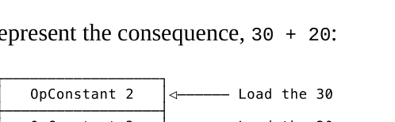

我们也知道如何表示结果，30 + 20：

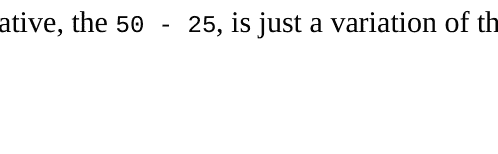

表示备选方案，50 - 25，只是其变体：

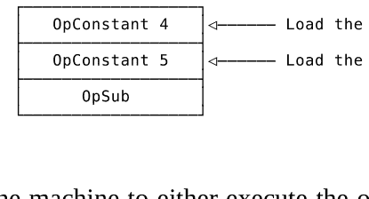

但我们如何告诉机器根据 *OpGreaterThan 指令的结果* 执行其中一部分或另一部分？

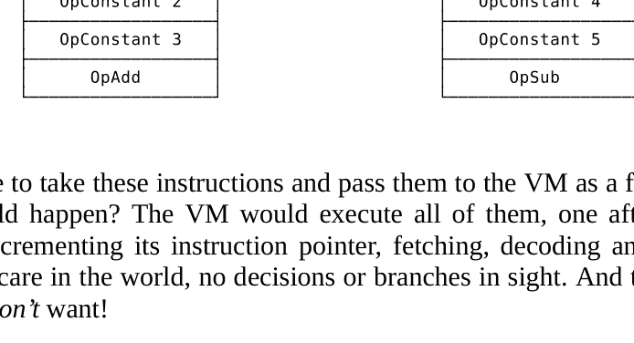

如果我们把这些指令作为扁平序列传递给 VM，会发生什么？VM 会一个接一个地执行它们，愉快地递增其指令指针，取指、解码和执行，毫不关心，视野中看不到任何决策或分支。而这正是我们 *不* 想要的！

我们希望 VM *要么* 执行 OpAdd 指令 *要么* 执行 OpSub 指令。但由于我们 *确实* 将字节码作为扁平的指令序列传递，那么我们该怎么做呢？好吧，如果我们重新排列指令图，使其表示扁平的指令序列，问题就变成：我们在这里填入什么？

|  |
|---|
| OpConstant 0 |
| OpConstant 1 |
| OpGreaterThan |

???

|  |
|---|
| OpConstant 2 |
| OpConstant 3 |
| OpAdd |

???

|  |
|---|
| OpConstant 4 |
| OpConstant 5 |
| OpSub |

我们需要在空白处填入 *某些东西*，以便根据 OpGreaterThan 指令的结果，VM 忽略结果部分的指令或构成备选方案的指令。它应该跳过它们。或者，与其说“跳过”，我们是否应该说“跳过”？

## Jumps

跳转是告诉机器跳转到其他指令的指令。它们用于在机器码中实现分支（条件语句），因此得名“分支指令”。而“机器码”我指的是计算机执行的代码，也包括字节码虚拟机运行的代码。翻译成我们 VM 的技术术语：跳转是告诉 VM 将其指令指针更改为特定值的指令。这就是它的工作原理。

假设——从假设的角度来说——我们有两个跳转操作码，并将它们命名为 JUMP_IF_NOT_TRUE 和 JUMP_NO_MATTER_WHAT。我们可以用它们来填补上面图中空白，如下所示：

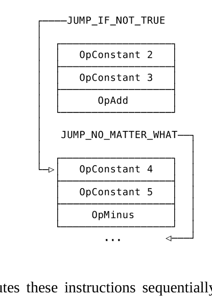

当 VM 按顺序执行这些指令时，从上到下，这里它首先会执行构成条件的指令，以 OpGreaterThan 指令结束。这会在栈上产生一个布尔值。正如我们在上一章中定义和实现的那样。

下一条指令 JUMP_IF_NOT_TRUE 会告诉 VM 跳转到 OpConstant 4 指令，但仅当栈上的布尔值不是 true 时。如果是这种情况，VM 将跳过结果部分，直接跳转到条件语句的“else”部分，即备选方案。而如果栈上的布尔值为 true，JUMP_IF_NOT_TRUE 将没有任何效果，VM 将错误地执行条件语句的结果部分。它将递增其指令指针并开始取指、解码和执行下一条指令——OpConstant 2，即结果的开始。

有趣的地方就在这里。在执行完条件语句的结果——以 OpAdd 结束的三个指令——后，VM 将遇到恰如其名地命名的 JUMP_NO_MATTER_WHAT。该指令没有附加条件，并告诉 VM 直接跳转到条件语句的备选方案之后的第一条指令，完全跳过它。

这结束了我们的小思想实验，并给出了一个明确的结果：如果我们有这样的两个操作码，我们就可以实现条件语句。但仍然有一个最后一个问题：我们如何表示箭头？我们如何告诉 VM 跳转到哪里？

好吧，为什么不使用数字呢？跳转是告诉 VM 更改其指令指针值的指令，而上图中箭头不过是指令指针的潜在值。它们可以用数字表示，作为跳转指令中的操作数，其值是 VM 应跳转到的指令的索引。该值称为偏移量。以这种方式使用时，跳转目标是指令的索引，这就是绝对偏移量。相对偏移量也存在：它们相对于跳转指令本身的位置，表示的不是确切跳转到哪里，而是跳转多远。

如果我们用偏移量替换箭头，并为每个指令分配一个与其字节大小无关的唯一索引（用于说明目的），图表如下所示：

| Address | Instruction |
|---|---|
|0000|OpConstant 0|
|0001|OpConstant 1|
|0002|OpGreaterThan|
|0003|JUMP_IF_NOT_TRUE 0008|
|0004|OpConstant 2|
|0005|OpConstant 3|
|0006|OpAdd|
|0007|JUMP_NO_MATTER_WHAT 0011|
|0008|OpConstant 4|
|0009|OpConstant 5|
|0010|OpSub|

JUMP_IF_NOT_TRUE 的操作数现在是 0008。那是 OpConstant 4 指令的索引，如果条件不为真，VM 应跳转到该指令。JUMP_NO_MATTER_WHAT 的操作数是 0011，即整个条件语句之后指令的索引。

这就是我们将实现条件语句的方式！我们将定义两个跳转操作码：一个带条件（“仅在为真时跳转”），一个不带条件（“直接跳转”）。它们都将有一个操作数，即 VM 应跳转到的指令的索引。

所以这就是我们的目标。问题是：我们如何到达那里？

## Compiling Conditionals

发出跳转指令的困难部分不是选择正确的操作码。而是操作数使之具有挑战性。

假设我们在编译器的递归 Compile 方法中，刚刚再次调用了 Compile，并传入了 *ast.IfExpression* 的 .Condition 字段。条件已成功编译，我们已发出转换后的指令。现在我们想要发出跳转指令，告诉 VM 如果栈上的值不是真值，则跳到条件语句的结果。

我们给这个跳转指令什么操作数？我们告诉 VM 跳转到哪里？我们还不知道。因为我们还没有编译结果或备选分支，所以我们不知道将发出多少条指令，这意味着我们不知道需要跳过多少条指令。这就是挑战。

我必须承认，解决这个问题很有趣。而乐趣的一大部分来自于这样一个事实：写一个测试并告诉编译器期望的确切内容很容易——因为我们对这部分相当确定——然后一步步实现它。

但我们只能在定义了新的操作码后才做出断言，所以我们现在就这样做。一个用于跳转，另一个用于条件跳转。

```
// code/code.go

const (
    // [...] 
    OpJumpNotTruthy
    OpJump
)

var definitions = map[Opcode]*Definition{
    // [...] 
    OpJumpNotTruthy: {"OpJumpNotTruthy", []int{2}},
    OpJump:          {"OpJump", []int{2}},
}
```

我相当确定你能分辨出哪个是哪个。OpJumpNotTruthy 将告诉 VM 仅当栈顶的值不是 Monkey 真值时才跳转，即不是


`false` 也不是 `null`。它的唯一操作数是一条指令的偏移量，VM 应跳转到该指令。`OpJump` 会告诉 VM“跳到那里”，而“那里”就是它的操作数，同样也是一条指令的偏移量。

这两个操作码的操作数都是 16 位宽。这与 `OpConstant` 的操作数宽度相同，这意味着我们无需扩展 `code` 包中的工具来支持它。

现在我们准备编写第一个测试。我们会从简单开始，只尝试处理没有 `else` 部分的条件语句。下面是我们希望编译器在输入一个单分支条件语句时生成的指令：

```
// compiler/compiler_test.go

func TestConditionals(t *testing.T) {
    tests := []compilerTestCase{
        {
            input: `
                if (true) { 10 }; 3333;
                `,
            expectedConstants: []interface{}{10, 3333},
            expectedInstructions: []code.Instructions{
                // 0000
                code.Make(code.OpTrue),
                // 0001
                code.Make(code.OpJumpNotTruthy, 7),
                // 0004
                code.Make(code.OpConstant, 0),
                // 0007
                code.Make(code.OpPop),
                // 0008
                code.Make(code.OpConstant, 1),
                // 0011
                code.Make(code.OpPop),
            },
        },
    }

    runCompilerTests(t, tests)
}
```

解析后，输入会变成一个 `*ast.IfExpression`，包含 `Condition` 和 `Consequence`。`Condition` 是布尔字面量 `true`，`Consequence` 是整数字面量 `10`。这两个都是特意选择的简单 Monkey 表达式，因为在这个测试用例中，我们并不关心表达式本身。我们关心的是编译器生成的跳转指令，以及这些指令是否带有正确的操作数。

这就是为什么我在 `expectedInstructions` 上添加了注释，这些注释显示了 `code.Make` 生成的指令的偏移量。我们以后不需要这些注释，但现在，它们帮助我们写出预期的跳转指令，尤其是因为我们要跳转到的指令的偏移量是基于每条指令占用的字节数。例如，一条 `opPop` 指令宽度为 1 字节，而一条 `opConstant` 指令占 3 字节。

我们期望编译器生成的第一条指令是 `opTrue`，告诉 VM 将 `vm.True` 压入栈。这就是 `Condition`。然后它应该生成一条 `opJumpNotTruthy` 指令，使 VM 跳过错 `Consequence`，而 `Consequence` 是将整数 `10` 加载到栈上的 `opConstant` 指令。

但是，第一条 `opPop` 指令（偏移量 `0007`）是从哪里来的？它不是 `Consequence` 的一部分，不是。它之所以存在，是因为 Monkey 中的条件语句是表达式——`if (true) { 10 }` 求值为 `10`——而值为未使用的独立表达式会被包装在 `*ast.ExpressionStatement` 中。我们编译这些表达式时会附加一条 `opPop` 指令来清理 VM 的栈。因此，第一个 `opPop` 是整个条件语句*之后*的第一条指令，这使得它的偏移量成为 `opJumpNotTruthy` 为了跳过 `Consequence` 而需要跳转到的位置。

所以现在你可能想知道 Monkey 代码中的 `3333;` 是干什么的。它作为一个参照点。并不是严格必需的，但为了确保跳转偏移量正确，在代码中有一个表达式能让我们轻松地在生成的指令中找到它，并作为路标告诉我们*不*应该跳转到哪里。当然，加载 `3333` 的 `opConstant 1` 指令后面也跟随着一条 `opPop` 指令，因为它是一个表达式语句。

对一个测试来说，这个解释已经相当长了。下面是编译器对其理解程度：

```
$ go test ./compiler
--- FAIL: TestConditionals (0.00s)
    compiler_test.go:195: testInstructions failed: wrong instructions length.
    want="0000 opTrue\n0001 opJumpNotTruthy 7\n0004 opConstant 0\n0007 opPop\
    \n0008 opConstant 1\n0011 opPop\n"
    got  ="0000 opPop\n0001 opConstant 0\n0004 opPop\n"
FAIL
FAIL    monkey/compiler 0.008s
```

条件的条件部分和结果部分都没有被编译。实际上，整个 `*ast.IfExpression` 都被编译器跳过了。我们可以通过扩展编译器的 `Compile` 方法来解决第一个问题（条件未被编译）：

```
// compiler/compiler.go

func (c *Compiler) Compile(node ast.Node) error {
    switch node := node.(type) {
    // [...] 

    case *ast.IfExpression:
        err := c.Compile(node.Condition)
        if err != nil {
            return err
        }

    // [...] 
    }

    // [...] 
}
```

经过这一改动，编译器现在认识了 `*ast.IfExpression`，并生成表示 `node.Condition` 的指令。尽管 `Consequence` 和跳过它的条件跳转指令仍然缺失，但我们已经正确生成了六个指令中的四个：

```
$ go test ./compiler
--- FAIL: TestConditionals (0.00s)
    compiler_test.go:195: testInstructions failed: wrong instructions length.
    want="0000 OpTrue\n0001 OpJumpNotTruthy 7\n0004 OpConstant 0\n0007 OpPop\n\n0008 OpConstant 1\n0011 OpPop\n"
    got ="0000 OpTrue\n0001 OpPop\n0002 OpConstant 0\n0005 OpPop\n"
FAIL
FAIL    monkey/compiler 0.009s
```

`OpTrue` 指令在那里，最后三条也在：`*ast.IfExpression` 后面的 `OpPop`、加载 `3333` 的 `OpConstant`，以及它后面的 `OpPop`，顺序都正确。现在剩下的就是生成 `OpJumpNotTruthy` 指令以及表示 `node.Consequence` 的指令。

当然，我说的“现在剩下的”意思是：“这里开始变得棘手了”。现在的挑战是生成一条 `OpJumpNotTruthy` 指令，其偏移量指向 `node.Consequence` 的指令之后——但在编译 `node.Consequence` 之前。

当我们还不知道需要跳多远时，该使用哪个偏移量？答案是一种相当务实的做法：“先随便放个值，之后再来修”。你可能会笑，但我是认真的。让我们用一个假偏移量，稍后再修复它：

```
// compiler/compiler.go

func (c *Compiler) Compile(node ast.Node) error {
    switch node := node.(type) {
    // [...] 
    
    case *ast.IfExpression:
        err := c.Compile(node.Condition)
        if err != nil {
            return err
        }
        
        // Emit an `OpJumpNotTruthy` with a bogus value
        c.emit(code.OpJumpNotTruthy, 9999)
        
        err = c.Compile(node.Consequence)
        if err != nil {
            return err
        }
        
        // [...] 
    }
    
    // [...] 
}
```

尽管大多数程序员看到代码中的 `9999` 时已经会眯起眼睛，本能地感觉到有什么不对劲，但此处的一行内联注释有助于明确意图。因为在这里，我们确实想要生成一条带垃圾偏移量的 `OpJumpNotTruthy` 指令，然后再编译 `node.Consequence`。同样，`9999` 不是最终会进入 VM 的内容，我们稍后会处理它。但目前，它应该能让我们的测试获得更多正确的指令。

但是，不，我们只多了一条正确的指令，那就是 `OpJumpNotTruthy` 本身：

```
$ go test ./compiler
--- FAIL: TestConditionals (0.00s)
compiler_test.go:195: testInstructions failed: wrong instructions length.
want="0000 OpTrue\n0001 OpJumpNotTruthy 7\n0004 OpConstant 0\n0007 OpPop\n\
0008 OpConstant 1\n0011 OpPop\n"
got ="0000 OpTrue\n0001 OpJumpNotTruthy 9999\n0004 OpPop\n\
0005 OpConstant 0\n0008 OpPop\n"
FAIL
```

```
FAIL    monkey/compiler 0.008s
```

虽然我们有了 `OpJumpNotTruthy 9999` 指令，但显然还没有编译 `Consequence`。

那是因为它是一个 `*ast.BlockStatement`，而我们的编译器还不知道它。为了编译它，我们需要给 `Compile` 方法再增加一个 case 分支：

```go
// compiler/compiler.go

func (c *Compiler) Compile(node ast.Node) error {
    switch node := node.(type) {
    // [...]

    case *ast.BlockStatement:
        for _, s := range node.Statements {
            err := c.Compile(s)
            if err != nil {
                return err
            }
        }

    // [...]
    }

    // [...]
}
```

这与我们在 `*ast.Program` 分支中已有的代码完全相同。而且它能工作：

```
$ go test ./compiler
--- FAIL: TestConditionals (0.00s)
compiler_test.go:195: testInstructions failed: wrong instructions length.
want="0000 OpTrue\n0001 OpJumpNotTruthy 7\n0004 OpConstant 0\n\
  0007 OpPop\n0008 OpConstant 1\n0011 OpPop\n"
got ="0000 OpTrue\n0001 OpJumpNotTruthy 9999\n0004 OpConstant 0\n\
  0007 OpPop\n0008 OpPop\n0009 OpConstant 1\n0012 OpPop\n"
FAIL
FAIL    monkey/compiler 0.010s
```

我们越来越接近了。但是，除了那个我们并不指望它会神奇消失的虚假 `9999` 偏移量之外，输出中还出现了一个新的问题，一个更微妙的问题。你可能已经忽略了它，所以让我指出来：编译器在位置 `0007` 生成了额外的 `OpPop` 指令。它的来源是 `node.Consequence` 的编译——它是一个表达式语句。

我们需要去掉这个 `OpPop`，因为我们希望 `Consequence` 和


作为条件表达式的替代方案，使其在栈上留下值。否则，我们就无法做到这一点：

```
let result = if (5 > 3) { 5 } else { 3 };
```

这是有效的 Monkey 代码，如果我们在 node.Consequence 中的最后一个表达式语句后发出 OpPop，就不会工作。由 consequence 产生的值会被从栈中弹出，表达式将不会计算出任何内容，而 let 语句最终会在其 = 的右侧没有值。

使修复变得棘手的原因是，我们只想去掉 node.Consequence 中的最后一个 OpPop 指令。假设我们有如下 Monkey 代码：

```
if (true) {
  3;
  2;
  1;
}
```

我们希望这里的 3 和 2 被从栈中弹出，但 1 应该保留下来，以便整个条件表达式求值为 1。因此，在我们着手解决为 OpJumpNotTruthy 提供真实偏移量的主要挑战之前，这里是去掉额外 OpPop 指令的计划。

我们首先修改编译器，使其跟踪最后两个已发出的指令，包括它们的 opcode 和发出位置。为此，我们需要一个新类型和编译器上的两个额外字段：

```go
// compiler/compiler.go

type EmittedInstruction struct {
    Opcode  code.Opcode
    Position int
}

type Compiler struct {
    // [...] 
    lastInstruction       EmittedInstruction
    previousInstruction   EmittedInstruction
}

func New() *Compiler {
    return &Compiler{
        // [...] 
        lastInstruction:      EmittedInstruction{},
        previousInstruction:  EmittedInstruction{},
    }
}
```

lastInstruction 是我们发出的最后一个指令，previousInstruction 是其前一个指令。我们稍后会看到为什么需要同时跟踪两者。现在，我们修改编译器的 emit 方法以填充这两个字段：

```go
// compiler/compiler.go

func (c *Compiler) emit(op code.Opcode, operands ...int) int {
    ins := code.Make(op, operands...)
    pos := c.addInstruction(ins)

    c.setLastInstruction(op, pos)

    return pos
}

func (c *Compiler) setLastInstruction(op code.Opcode, pos int) {
    previous := c.lastInstruction
    last := EmittedInstruction{Opcode: op, Position: pos}

    c.previousInstruction = previous
    c.lastInstruction = last
}
```

有了这个，我们就可以以类型安全的方式检查最后发出的指令的 opcode，而无需在字节之间进行转换。这正是我们要做的事情。在编译 *ast.IfExpression 的 node.Consequence 之后，我们检查最后发出的指令是否为 OpPop 指令，如果是，则将其移除：

```go
// compiler/compiler.go

func (c *Compiler) Compile(node ast.Node) error {
    switch node := node.(type) {
    // [...] 

    case *ast.IfExpression:
        // [...] 
        c.emit(code.OpJumpNotTruthy, 9999)

        err = c.Compile(node.Consequence)
        if err != nil {
            return err
        }

        if c.lastInstructionIsPop() {
            c.removeLastPop()
        }
        // [...] 
    }

    // [...] 
}
```

这使用了两个辅助函数，lastInstructionIsPop 和 removeLastPop。这两个辅助函数都很小：

```go
// compiler/compiler.go

func (c *Compiler) lastInstructionIsPop() bool {
    return c.lastInstruction.Opcode == code.OpPop
}

func (c *Compiler) removeLastPop() {
    c.instructions = c.instructions[:c.lastInstruction.Position]
    c.lastInstruction = c.previousInstruction
}
```

lastInstructionIsPop 检查最后指令的 opcode 是否为 OpPop，而 removeLastPop 则缩短 c.instructions 以截断最后一条指令。之后，它将 c.lastInstruction 设置为 c.previousInstruction。这就是为什么我们需要同时跟踪两者，以便在截断最后一个 OpPop 指令后，c.lastInstruction 不会不同步。

```text
$ go test ./compiler
--- FAIL: TestConditionals (0.00s)
    compiler_test.go:195: testInstructions failed: wrong instruction at 2.
        want="0000 OpTrue\n0001 OpJumpNotTruthy 7\n0004 OpConstant 0\n\
            0007 OpPop\n 0008 OpConstant 1\n0011 OpPop\n"
        got ="0000 OpTrue\n0001 OpJumpNotTruthy 9999\n0004 OpConstant 0\n\
            0007 OpPop\n 0008 OpConstant 1\n0011 OpPop\n"
FAIL
FAIL    monkey/compiler 0.008s
```

现在我们有正确数量的指令和正确的 opcode。唯一仍使测试失败的是那令人厌恶的 9999。是时候去掉它了。

我们处理多余 OpPop 指令的方式指引了正确的方向，因为它明确了一件事：我们发出的指令并非一成不变，我们可以更改它们。

我们不会移除 c.emit(code.OpJumpNotTruthy, 9999) 调用，而是会保持原样。我们甚至不会更改 9999。相反，我们将再次使用 c.lastInstruction 的 Position 字段。这使我们能够返回到已发出的 OpJumpNotTruthy 指令，并将 9999 改为真正的操作数。那什么时候做呢？这就是关键点，也是精妙之处。我们将在编译完 node.Consequence *之后* 修改 `OpJumpNotTruthy` 的操作数。此时，我们将知道 VM 需要跳转多远，并拥有用以替换 9999 的正确偏移量。

这被称为回填（back-patching），在像我们这样仅遍历一次 AST 的编译器中很常见，因此被称为单遍编译器。更高级的编译器可能会在知道需要跳转多远之前将跳转指令的目标留空，然后对 AST（或其他 IR）进行第二次遍历并填充目标。

总结：我们将继续发出 9999，同时记住它的位置。一旦我们知道需要跳转到哪里，就会返回 9999 并将其更改为正确的偏移量。你会惊讶于实现这一点所需的代码有多少。

我们首先需要一个微小的方法，用来在 instructions 切片的任意偏移处替换一条指令：

```go
// compiler/compiler.go

func (c *Compiler) replaceInstruction(pos int, newInstruction []byte) {
    for i := 0; i < len(newInstruction); i++ {
        c.instructions[pos+i] = newInstruction[i]
    }
}
```

我们将在另一个允许替换指令操作数的方法中使用 `replaceInstruction`：

```go
// compiler/compiler.go

func (c *Compiler) changeOperand(opPos int, operand int) {
    op := code.Opcode(c.instructions[opPos])
    newInstruction := code.Make(op, operand)

    c.replaceInstruction(opPos, newInstruction)
}
```

与其真正更改操作数本身（对于多字节操作数可能会变得混乱），`changeOperand` 方法会使用新的操作数重新创建指令，并使用 `replaceInstruction` 将旧指令替换为新指令——包括操作数。

这里的基本假设是我们只替换相同类型且长度不变的指令。如果该假设不再成立，我们就必须在这里更加谨慎地处理，并相应地更新 `c.lastInstruction` 和 `c.previousInstruction`。你可以看到，一旦编译器及其发出的指令变得更复杂，一个类型安全且与编码指令的字节大小无关的 IR 有多么有用。

不过，我们的解决方案仍然满足需求，而且总体上代码量并不多。两个微小的方法，`replaceInstruction` 和 `changeOperand`，剩下的就是使用它们，代码量也并不多：

```go
// compiler/compiler.go

func (c *Compiler) Compile(node ast.Node) error {
    switch node := node.(type) {
        // [...]

    case *ast.IfExpression:
        err := c.Compile(node.Condition)
        if err != nil {
            return err
        }

        // Emit an `OpJumpNotTruthy` with a bogus value
        jumpNotTruthyPos := c.emit(code.OpJumpNotTruthy, 9999)

        err = c.Compile(node.Consequence)
        if err != nil {
            return err
        }

        if c.lastInstructionIsPop() {
            c.removeLastPop()
        }

        afterConsequencePos := len(c.instructions)
        c.changeOperand(jumpNotTruthyPos, afterConsequencePos)

        // [...]
    }

    // [...]
}
```

第一个更改是将 `c.emit` 的返回值保存到 `jumpNotTruthyPos`。这就是我们稍后可以找到 `OpJumpNotTruthy` 指令的位置。“稍后”指的是在检查并可能移除 `OpPop` 指令之后。之后，`len(c.instructions)` 给出我们下一个要发出的指令的偏移量，这就是当我们不执行条件表达式的 Consequence 时想要跳转到的位置，因为栈顶的值

不是真值。因此我们将其保存到 afterConsequencePos，以赋予它一个有意义的名称。

之后，我们使用新的 changeOperand 方法去掉位于 jumpNotTruthyPos 的 OpJumpNotTruthy 指令的 9999 操作数，并将其替换为正确的 afterConsequencePos。

你有数吗？如果没有，我想让你知道必要的改动总共只有三行。一行被修改，两行被添加。就这些：

```
$ go test ./compiler
ok      monkey/compiler 0.008s
```

我们的编译器现在可以正确编译条件语句了！需要注意的是，它只知道如何编译 *后果*。它不知道如何编译同时包含后果 *和* 替代 else 分支的条件语句。

但我们知道，而且我们也知道如何编写测试：

```go
// compiler/compiler_test.go

func TestConditionals(t *testing.T) {
	tests := []compilerTestCase{
		// [ ... ]
		{
			input: `
			if (true) { 10 } else { 20 }; 3333;
			`,
			expectedConstants: []interface{}{10, 20, 3333},
			expectedInstructions: []code.Instructions{
				// 0000
				code.Make(code.OpTrue),
				// 0001
				code.Make(code.OpJumpNotTruthy, 10),
				// 0004
				code.Make(code.OpConstant, 0),
				// 0007
				code.Make(code.OpJump, 13),
				// 0010
				code.Make(code.OpConstant, 1),
				// 0013
				code.Make(code.OpPop),
				// 0014
				code.Make(code.OpConstant, 2),
				// 0017
				code.Make(code.OpPop),
			},
		},
	}

	runCompilerTests(t, tests)
}
```

这与 TestConditionals 中的前一个测试用例类似，只是输入现在不仅包含条件的后果，还包含替代分支：else { 20 }。

expectedInstructions 明确了我们希望字节码的样子，其中第一部分与之前的测试用例相同：条件被编译为 OpTrue，并且后面跟着 OpJumpNotTruthy 指令，该指令指示 VM *跳过* 编译后的后果。

然后，情况开始不同。我们期望下一个操作码是 OpJump，即无条件跳转指令的操作码。它必须存在，因为如果条件为真，VM 应该只执行后果而 *不* 执行替代分支。为了防止这种情况发生，OpJump 指令告诉 VM 跳过替代分支。

OpJump 之后应跟随构成替代分支的指令。在我们的测试用例中，那就是将 20 加载到栈上的 OpConstant 指令。

然后我们又回到了熟悉的领域。OpPop 用于将条件产生的值从栈中弹出，而加载虚假的 3333 为我们提供了指导。

我知道这些跳转很难理解，所以我希望这幅图能更清楚地说明哪个指令属于条件的哪一部分，以及跳转是如何将它们全部联系起来的：

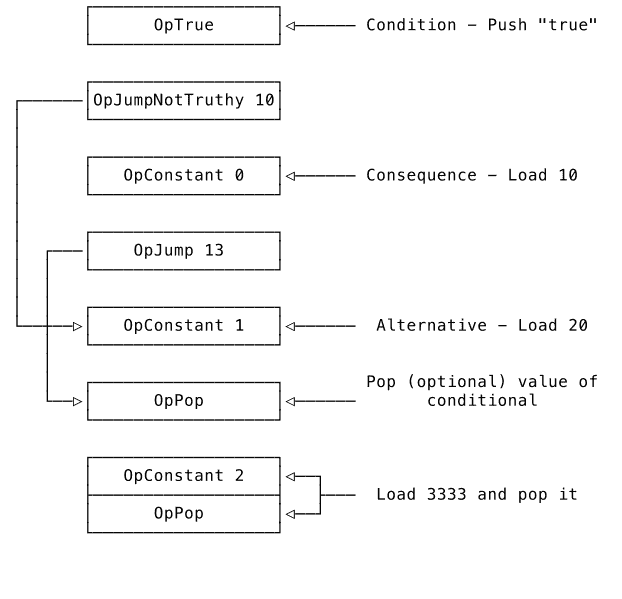

如果这没有帮助，我相信尝试运行并修复失败的测试会有所帮助，因为它的输出告诉我们我们仍然缺少什么：

```
$ go test ./compiler
--- FAIL: TestConditionals (0.00s)
    compiler_test.go:220: testInstructions failed: wrong instructions length.
    want="0000 OpTrue\n0001 OpJumpNotTruthy 10\n0004 OpConstant 0\n\
    0007 OpJump 13\n0008 OpConstant 1\n\
    0013 OpPop\n0014 OpConstant 2\n0017 OpPop\n"
    got ="0000 OpTrue\n0001 OpJumpNotTruthy 7\n0004 OpConstant 0\n\
    0007 OpPop\n0008 OpConstant 1\n0011 OpPop\n"
FAIL
FAIL    monkey/compiler 0.007s
```

我们这里有条件，然后是整个条件之后的 OpPop 以及 3333 的压栈和弹栈。缺少的是后果末尾的 OpJump 以及代表替代分支的指令。好消息是我们已经拥有了所有需要的工具。我们只需要稍微调整一下并编译替代分支即可。

不过，第一步是把对 OpJumpNotTruthy 指令的修补本身包裹在一个条件中：

// compiler/compiler.go

func (c *Compiler) Compile(node ast.Node) error {
```go
switch node := node.(type) {
    // [...] 
    
    case *ast.IfExpression:
        // [...] 
    
        if node.Alternative == nil {
            afterConsequencePos := len(c.instructions)
            c.changeOperand(jumpNotTruthyPos, afterConsequencePos)
        }
    
        // [...] 
    }
    
    // [...] 
}
```

在此 node.Alternative == nil 检查之前是 node.Consequence 的编译，而这段新增代码的含义是：只有当我们没有 node.Alternative 时，才能跳到这里，即 c.instructions 中的当前位置。

但如果我们确实有 node.Alternative，我们需要发出一个 OpJump，它成为后果的一部分，并且 OpJumpNotTruthy 也必须越过它：

```go
// compiler/compiler.go

func (c *Compiler) Compile(node ast.Node) error {
    switch node := node.(type) {
    // [...] 
    
    case *ast.IfExpression:
        // [...] 
    
        if node.Alternative == nil {
            afterConsequencePos := len(c.instructions)
            c.changeOperand(jumpNotTruthyPos, afterConsequencePos)
        } else {
            // Emit an `OpJump` with a bogus value
            c.emit(code.OpJump, 9999)
    
            afterConsequencePos := len(c.instructions)
            c.changeOperand(jumpNotTruthyPos, afterConsequencePos)
        }
    
        // [...] 
    }
    
    // [...] 
}
```

不要担心重复，我们稍后会处理。当前重要的是让意图尽可能清晰。

`OpJump` 指令也有一个占位符操作数。这意味着我们稍后必须修补它，但现在它允许我们将 `OpJumpNotTruthy` 指令的操作数更改为期望的值：后果 *和* `OpJump` 指令之后的那条指令的位置。

为什么这是正确的操作数现在应该很清楚了：`OpJump` 应该在条件为真时跳过条件的“else”分支。它是后果的一部分，可以这么说。而如果条件不为真并且我们需要执行“else”分支，我们需要使用 `OpJumpNotTruthy` 跳到 *后果之后*，也就是 `OpJump` 之后。

测试告诉我们我们走在正确的道路上：

```
$ go test ./compiler
--- FAIL: TestConditionals (0.00s)
    compiler_test.go:220: testInstructions failed: wrong instructions length.
    want="\u0000 OpTrue\n\u0001 OpJumpNotTruthy 10\n\u0004 OpConstant 0\n\
    \u0007 OpJump 13\n\u0010 OpConstant 1\n
    \u0013 OpPop\n\u0014 OpConstant 2\n\u0017 OpPop\n"
    got  ="\u0000 OpTrue\n\u0001 OpJumpNotTruthy 10\n\u0004 OpConstant 0\n\
    \u0007 OpJump 9999\n\
    \u0010 OpPop\n\u0011 OpConstant 1\n\u0014 OpPop\n"
```

`OpJumpNotTruthy` 的操作数是正确的，`OpJump` 位于正确的位置，只是它的操作数是错误的，而且整个替代分支都缺失了。我们现在必须重复之前为后果所做的工作：

```go
// compiler/compiler.go

func (c *Compiler) Compile(node ast.Node) error {
    switch node := node.(type) {
        // [...]

    case *ast.IfExpression:
        // [...]

        if node.Alternative == nil {
            afterConsequencePos := len(c.instructions)
            c.changeOperand(jumpNotTruthyPos, afterConsequencePos)
        } else {
            // Emit an `OpJump` with a bogus value
            jumpPos := c.emit(code.OpJump, 9999)

            afterConsequencePos := len(c.instructions)
            c.changeOperand(jumpNotTruthyPos, afterConsequencePos)

```
c.changeOperand(jumpNotTruthyPos, afterConsequencePos)

err := c.Compile(node.Alternative)
if err != nil {
    return err
}

if c.lastInstructionIsPop() {
    c.removeLastPop()
}

afterAlternativePos := len(c.instructions)
c.changeOperand(jumpPos, afterAlternativePos)
}

// [...]
}

// [...]
}
```

我们首先保存 OpJump 指令的位置到 jumpPos，以便稍后回来更改其操作数。然后我们修补之前发出的 OpJumpNotTruthy 指令的操作数，该指令位于 jumpNotTruthyPos，使其跳转到 *刚发出的 OpJump 之后*。

之后，我们编译 node.Alternative。这里同样，如果存在则需要 `c.removeLastPop()`。最后，我们将 OpJump 指令的操作数更改为下一个要发出的指令的偏移量，该指令将位于替代分支之后。

或者，用我们的测试套件的话来说：

```
$ go test ./compiler
ok      monkey/compiler  0.009s
```

再次提醒，不要太当真。它应该说：“是的！是的！是的！我们在将条件编译为跳转指令！”

我们现在已经过了难关。是时候教我们的 VM 如何执行跳转了，这比发出跳转指令容易得多。


## 执行跳转

在为条件语句编写编译器测试之前，我们确实需要仔细思考我们希望它们表达什么，以及希望编译器做什么。但现在为 VM 编写同样的测试时，情况就不是这样了。我们已经知道 Monkey 中的条件语句应该如何工作，并且可以在测试用例和断言中清晰地表达出来：

```
// vm/vm_test.go
```

```
func TestConditionals(t *testing.T) {
	tests := []vmTestCase{
		{"if (true) { 10 }", 10},
		{"if (true) { 10 } else { 20 }", 10},
		{"if (false) { 10 } else { 20 }", 20},
		{"if (1) { 10 }", 10},
		{"if (1 < 2) { 10 }", 10},
		{"if (1 < 2) { 10 } else { 20 }", 10},
		{"if (1 > 2) { 10 } else { 20 }", 20},
	}

	runVmTests(t, tests)
}
```

这些测试用例即使只写一半也足够了。但它们写起来容易、表达清晰、简洁，而且几乎不花什么成本！把我们的意图表达得极其清楚也没有什么坏处。

我们测试 VM 是否按照 Monkey 的“truthy”标准正确求值布尔表达式，以及是否执行了条件语句的正确分支。由于条件语句是产生值的表达式，因此可以通过测试整个条件语句产生的值来推断执行了哪个分支。

虽然测试本身很简洁，但它们产生的错误信息却很糟糕：

```
$ go test ./vm
--- FAIL: TestConditionals (0.00s)
panic: runtime error: index out of range [recovered]
    panic: runtime error: index out of range

goroutine 20 [running]:
testing.tRunner.func1(0xc4200bc2d0)
/usr/local/go/src/testing/testing.go:742 +0x29d
panic(0x11190e0, 0x11f1fd0)
/usr/local/go/src/runtime/panic.go:502 +0x229
```

```
/monkey/vm.(*VM).Run(0xc420050e38, 0x800, 0x800)
/Users/mrnugget/code/04/src/monkey/vm/vm.go:46 +0x39c
monkey/vm.runVmTests(0xc4200bc2d0, 0xc420079e88, 0x7, 0x7)
/Users/mrnugget/code/04/src/monkey/vm/vm_test.go:101 +0x35a
monkey/vm.TestConditionals(0xc4200bc2d0)
/Users/mrnugget/code/04/src/monkey/vm/vm_test.go:80 +0x114
testing.tRunner(0xc4200bc2d0, 0x1149b40)
/usr/local/go/src/testing/testing.go:777 +0xd0
created by testing.(*T).Run
/usr/local/go/src/testing/testing.go:824 +0x2e0
FAIL monkey/vm 0.011s
```

唉。这甚至算不上错误，而是 panic。

不过，在你深入代码并试图找出错误来源之前，让我解释一下：VM 在字节码上绊倒了，因为它包含 VM 不知道如何解码的操作码。这本身不应该是个问题，因为未知操作码会被跳过，但不一定会跳过它们的操作数。记住，操作数只是整数，它们可能与某个编码后的操作码具有相同的值，这可能会让 VM 将它们误认为操作码。这当然是错误的。是时候让我们的 VM 认识跳转指令了。

我们从 `OpJump` 开始，因为它使我们拥有的最直接的跳转指令。它有一个 16 位操作数，表示 VM 应该跳转到的指令的偏移量。这就是实现它所需的全部信息：

```go
// vm/vm.go

func (vm *VM) Run() error {
  // [ ... ]
  switch op {
    // [ ... ]

case code.OpJump:
  pos := int(code.ReadInt16(vm.instructions[ip+1:]))
  ip = pos - 1

// [ ... ]
}
// [ ... ]
```

我们使用 `code.ReadInt16` 来解码紧跟在操作码之后的操作数。这是第 1 步。第 2 步是将指令指针 `ip` 设置为跳转的目标位置。在这里我们遇到一个有趣的实现细节：由于我们处于一个每次迭代都会递增 `ip` 的循环中，我们需要将 `ip` 设置为我们想要的目标位置前一个偏移量。这样循环才能正常工作，并在下一个周期将 `ip` 设置为我们要的值。

不过，仅仅实现 `OpJump` 并不能给我们带来多大好处，因为 `OpJumpNotTruthy` 才是条件语句实现的核心。但为 `code.OpJumpNotTruthy` 添加一个 case 分支虽然会多写一点代码，却并不复杂多少：

```go
// vm/vm.go

func (vm *VM) Run() error {
    for ip := 0; ip < len(vm.instructions); ip++ {
        op := code.Opcode(vm.instructions[ip])

        switch op {
        // [...]

        case code.OpJumpNotTruthy:
            pos := int(code.ReadUint16(vm.instructions[ip+1:]))
            ip += 2

            condition := vm.pop()
            if !isTruthy(condition) {
                ip = pos - 1
            }

        // [...]
        }
    }
    // [...]
}

func isTruthy(obj object.Object) bool {
    switch obj := obj.(type) {

    case *object.Boolean:
        return obj.Value

    default:
        return true
    }
}
```

我们再次使用 `code.ReadUint16` 来读取并解码操作数。之后，我们手动将 `ip` 增加 2，以便在下一个循环中正确跳过操作数的两个字节。这并不新鲜——在执行 `OpConstant` 指令时我们已经这么做了。

新的是其余部分。我们弹出栈顶元素，并用辅助函数 `isTruthy` 检查它是否为真值。如果它不是真值，我们就跳转，这意味着将 `ip` 设置为目标指令前一条指令的索引，让 for 循环完成它的工作。

如果该值为真值，我们什么都不做，开始主循环的下一次迭代。

结果是，我们执行了条件语句的结果分支，该分支由紧跟在 `OpJumpNotTruthy` 指令之后的指令组成。

现在，在你最喜欢的音频播放器中打开你选的 `drumroll.wav`，倒上你最喜欢的饮料，点击播放，然后看看这个：

~~~text
$ go test ./vm
ok      monkey/vm   0.009s
~~~

我们做到了。是的，我们做到了！我们的字节码编译器和 VM 现在能够编译并执行 Monkey 的条件语句了！

~~~text
$ go build -o monkey . && ./monkey
Hello mrnugget! This is the Monkey programming language!
Feel free to type in commands
>> if (10 > 5) { 10; } else { 12; }
10
>> if (5 > 10) { 10; } else { 12; }
12
>>
~~~

就在这一刻，我们从“嗯，这不过是个玩具，不是吗？”变成了“哦，哇，我们有进展了！”。栈运算是一回事，跳转指令又是另一回事。我们现在可是进入大联盟了。只不过……

~~~text
>> if (false) { 10; }
panic: runtime error: index out of range

goroutine 1 [running]:
monkey/vm.(*VM).pop(...)
    /Users/mrnugget/code/04/src/monkey/vm/vm.go:117
monkey/vm.(*VM).Run(0xc42005be48, 0x800, 0x800)
    /Users/mrnugget/code/04/src/monkey/vm/vm.go:60 +0x40e
monkey/repl.Start(0x10f1080, 0xc42000e010, 0x10f10a0, 0xc42000e018)
    /Users/mrnugget/code/04/src/monkey/repl/repl.go:43 +0x47a
main.main()
    /Users/mrnugget/code/04/src/monkey/main.go:18 +0x107
~~~

我们忘了点什么。

## 欢迎回来，Null！

在本章开头，我们回顾了《用 Go 编写解释器》中条件语句的实现，现在我们已经实现了其中大部分行为。但还缺少一件事：当条件语句的条件不为真值，而条件语句本身又没有替代分支时，会发生什么？在上一本书中，这个问题的答案是 `*object.Null`，也就是 Monkey 的 null 值。

这说得通，因为条件语句是表达式，而表达式按定义会产生值。那么，一个没有产生任何值的表达式会求值为什么？Null。等等，让我再试一次，只不过这一次请想象背景中响起*巨大的管风琴声*，*乌鸦从头顶飞过，尖叫着，雷声隆隆*：它们……*闪电劈下……* 求值为……*警笛声*…… null。

听着，null 和我并不是最好的朋友。我不太确定该怎么看待它，它是好是坏。它是许多咒骂的根源，但我确实理解，有些语言中有些东西会求值为“无”，而“无”必须以某种方式表示。在 Monkey 中，条件为假且没有替代分支的条件语句就是其中之一，而“无”由 `*object.Null` 表示。长话短说：是时候将 `*object.Null` 引入我们的编译器和 VM，并让这类条件语句正常工作了。

我们需要做的第一件事是在 VM 中定义 `*object.Null`。由于它的值是常量，我们可以像之前全局定义 `vm.True` 和 `vm.False` 一样，把它定义为一个全局变量：

```
// vm/vm.go

var Null = &object.Null{}
```

这一点与 `vm.True` 和 `vm.False` 类似，它在比较 Monkey 对象时能为我们节省很多工作。我们可以简单地通过检查一个 `object.Object` 是否等于 `vm.Null` 来判断它是否为 `*object.Null`，而不必解包并查看它的值。

我们之所以在编写任何编译器测试之前（我们通常的做法）先定义 `vm.Null`，是因为这次我们想先编写一个 VM 测试。这是因为 VM 测试能让我们非常简洁地表达我们的需求：


```go
// vm/vm_test.go

func TestConditionals(t *testing.T) {
    tests := []vmTestCase{
        // [...] 
        {"if (1 > 2) { 10 }", Null},
        {"if (false) { 10 }", Null},
    }

    runVmTests(t, tests)
}

func testExpectedObject(
    t *testing.T,
    expected interface{},
    actual object.Object,
) {
    t.Helper()

    switch expected := expected.(type) {
    // [...] 
    case *object.Null:
        if actual != Null {
            t.Errorf("object is not Null: %T (%v)", actual, actual)
        }
    }
}
```

这里我们为现有的 `TestConditionals` 函数添加了两个新的测试用例，其中条件不是 Monkey 语言中的真值（truthy），以强制求值 else 分支。但由于不存在 else 分支，我们期望最终压入堆栈的是 `Null`。为了正确测试这一点，我们在 `testExpectedObject` 中扩展了一个针对 `*object.Null` 的新 case 分支。

表达得很简洁，不是吗？嗯，错误信息可不是：

```text
$ go test ./vm
--- FAIL: TestConditionals (0.00s)
panic: runtime error: index out of range [recovered]
panic: runtime error: index out of range

goroutine 7 [running]:
testing.tRunner.func1(0xc4200a82d0)
/usr/local/go/src/testing/testing.go:742 +0x29d
panic(0x11119420, 0x11f1fe0)
/usr/local/go/src/runtime/panic.go:502 +0x229
monkey/vm.(*VM).pop(...)
/Users/mrnugget/code/04/src/monkey/vm/vm.go:121
monkey/vm.(*VM).Run(0xc420054df8, 0x800, 0x800)
/Users/mrnugget/code/04/src/monkey/vm/vm.go:53 +0x418
monkey/vm.runVmTests(0xc4200a82d0, 0xc420073e78, 0x9, 0x9)
/Users/mrnugget/code/04/src/monkey/vm/vm_test.go:103 +0x35a
monkey/vm.TestConditionals(0xc4200a82d0)
/Users/mrnugget/code/04/src/monkey/vm/vm_test.go:82 +0x149
testing.tRunner(0xc4200a82d0, 0x1149f40)
/usr/local/go/src/testing/testing.go:777 +0xd0
created by testing.(*T).Run
/usr/local/go/src/testing/testing.go:824 +0x2e0
FAIL    monkey/vm    0.012s
```

导致此 panic 的原因是我们在条件语句后发出的 `OpPop` 指令。由于没有产生任何值，虚拟机在尝试从堆栈中弹出值时崩溃了。是时候改变这一点了，是时候将 `vm.Null` 压入堆栈了。

我们将采取两个措施来实现这一目标。首先，我们将定义一个操作码，指示虚拟机将 `vm.Null` 压入堆栈。然后，我们将修改编译器，当条件语句没有 else 分支时插入一个替代分支。这个替代分支将只包含一个新的操作码，用于将 `vm.Null` 压入堆栈。

我们先定义该操作码，以便在更新的编译器测试中使用它：

```go
// code/code.go

const (
    // [...]

    OpNull
)

var definitions = map[Opcode]*Definition{
    // [...]

    OpNull: {"OpNull", []int{}},
}
```

这也与布尔对应项 `OpTrue` 和 `OpFalse` 类似。`OpNull` 没有操作数，仅指示虚拟机向堆栈中压入一个值。

现在，我们不编写新的编译器测试，而是更新 `TestConditionals` 中的一个现有测试用例，并期望在生成的指令中找到 `OpNull`。请注意，我们需要更改第一个测试用例，即条件语句没有 else 分支的那个；另一个测试用例保持不变：

```go
// compiler/compiler_test.go

func TestConditionals(t *testing.T) {
    tests := []compilerTestCase{
        {
            input: `
                if (true) { 10 }; 3333;
            `,
            expectedConstants: []interface{}{10, 3333},
            expectedInstructions: []code.Instructions{
                // 0000
                code.Make(code.OpTrue),
                // 0001
                code.Make(code.OpJumpNotTruthy, 10),
                // 0004
                code.Make(code.OpConstant, 0),
                // 0007
                code.Make(code.OpJump, 11),
                // 0010
                code.Make(code.OpNull),
                // 0011
                code.Make(code.OpPop),
                // 0012
                code.Make(code.OpConstant, 1),
                // 0015
                code.Make(code.OpPop),
            },
        },
        // [...] 
    }

    runCompilerTests(t, tests)
}
```

中间新增的两条指令是 `OpJump` 和 `OpNull`。请记住，`OpJump` 的作用是跳过 else 分支，而现在 `OpNull` 就是这个 else 分支。由于添加这两条指令会改变现有指令的索引，因此 `OpJumpNotTruthy` 的操作数也必须从 7 更改为 10。其余部分保持不变。

运行更新后的测试表明，编译器尚未学会如何自动为条件语句插入人工的 else 分支：

```text
$ go test ./compiler
--- FAIL: TestConditionals (0.00s)
compiler_test.go:288: testInstructions failed: wrong instructions length.
want="0000 OpTrue\n0001 OpJumpNotTruthy 10\n0004 OpConstant 0\n\
    0007 OpJump 11\n0010 OpNull\n\
    0011 OpPop\n0012 OpConstant 1\n0015 OpPop\n"
got ="0000 OpTrue\n0001 OpJumpNotTruthy 7\n0004 OpConstant 0\n\
    0007 OpPop\n0008 OpConstant 1\n0011 OpPop\n"
FAIL
FAIL    monkey/compiler 0.008s
```

修复此问题的最棒之处在于，它使编译器中的代码更简洁、更易理解。我们不再需要检查是否要发出 `OpJump`，因为现在我们总是希望这样做。有时我们希望跳过“真实的” else 分支，有时则是跳过一条 `OpNull` 指令。因此，以下是 `Compile` 方法中更新后的 `*ast.IfExpression` 分支：

```go
// compiler/compiler.go

func (c *Compiler) Compile(node ast.Node) error {
    switch node := node.(type) {
    // [...] 

    case *ast.IfExpression:
        err := c.Compile(node.Condition)
        if err != nil {
            return err
        }

        // Emit an `OpJumpNotTruthy` with a bogus value
        jumpNotTruthyPos := c.emit(code.OpJumpNotTruthy, 9999)

        err = c.Compile(node.Consequence)
        if err != nil {
            return err
        }

        if c.lastInstructionIsPop() {
            c.removeLastPop()
        }

        // Emit an `OpJump` with a bogus value
        jumpPos := c.emit(code.OpJump, 9999)

        afterConsequencePos := len(c.instructions)
        c.changeOperand(jumpNotTruthyPos, afterConsequencePos)

        if node.Alternative == nil {
            c.emit(code.OpNull)
        } else {
            err := c.Compile(node.Alternative)
            if err != nil {
                return err
            }

            if c.lastInstructionIsPop() {
                c.removeLastPop()
            }
        }

        afterAlternativePos := len(c.instructions)
        c.changeOperand(jumpPos, afterAlternativePos)

    // [...] 
    }

    // [...] 
}
```

这是完整的分支，但只有后半部分被修改了：之前重复修补 `OpJumpNotTruthy` 指令的代码已移除，取而代之的是对可能的 `node.Alternative` 进行新的、可读性更强的编译。

我们首先发出一条 `OpJump` 指令并更新 `OpJumpNotTruthy` 指令的操作数。无论是否有 `node.Alternative`，这一步都会执行。然后，我们检查 `node.Alternative` 是否为 `nil`，如果是，则发出新的 `OpNull` 操作码。如果不为 nil，则像以前一样处理：编译 `node.Alternative`，然后尝试移除可能的 `OpPop` 指令。

之后，我们将 `OpJump` 指令的操作数更改为跳过刚编译好的 else 分支——无论该分支仅仅是一条 `OpNull` 指令还是更多。

这段代码不仅比我们之前的版本整洁得多，而且也能正常工作：

```text
$ go test ./compiler
ok      monkey/compiler 0.009s
```

现在我们可以转到虚拟机部分，那里的测试仍然失败，我们需要实现新的 `OpNull` 操作码：

```go
// vm/vm.go

func (vm *VM) Run() error {
    // [...]
    switch op {
        // [...]

        case code.OpNull:
            err := vm.push(Null)
            if err != nil {
                return err
            }

        // [...]
    }
    // [...]
}
```

至此，panic 消失了，我们的测试通过了：

```text
$ go test ./vm
ok      monkey/vm   0.009s
```

这意味着我们已成功让具有非真值条件的条件语句将 `Null` 压入堆栈。我们现在已实现了完整的……


如*《用Go写解释器》*中所描述的条件语句！

但是，很抱歉，我们还有一件事要做。随着最后一个测试通过，我们正式进入了一个新世界。既然条件语句是表达式，而表达式可以互换使用，那么任何表达式现在都可能在我们的VM中产生`Null`。是的，这是一个可怕的世界。

对我们来说，实际的影响是，我们现在必须在每个处理表达式产生值的地方处理`Null`。幸运的是，我们VM中的大多数地方——比如`vm.executeBinaryOperation`——如果遇到意外值就会抛出错误。但有些函数和方法现在*必须*显式处理`Null`。

第一个是`vm.executeBangOperator`。我们可以添加一个测试来确保它能处理`Null`而不崩溃：

```go
// vm/vm_test.go

func TestBooleanExpressions(t *testing.T) {
    tests := []vmTestCase{
        // [...]
        {"!(if (false) { 5; })", true},
    }

    runVmTests(t, tests)
}
```

通过这个测试用例，我们隐式地确保了一个条件为假且没有替代分支的条件语句会产生`Null`，并且通过`!`运算符对其取反会变成`True`。在底层，这涉及到`vm.executeBangOperator`，为了让测试通过，我们需要修改它：

```go
// vm/vm.go

func (vm *VM) executeBangOperator() error {
    operand := vm.pop()

    switch operand {
    case True:
        return vm.push(False)
    case False:
        return vm.push(True)
    case Null:
        return vm.push(True)
    default:
        return vm.push(False)
    }
}
```

`Null`的否定现在为`True`，与*用Go写解释器*中的行为完全一致。测试通过：

```
$ go test ./vm
ok      monkey/vm  0.009s
```

这里有个奇怪的部分。既然条件语句是表达式，其条件也是表达式，那么我们可以将一个条件语句用作另一个条件语句的条件。在这里，我也确信你和我都不会在我们写的代码中这么做，但即便如此，它也必须能在我们的VM中工作——即使内部条件语句产生`Null`：

```
// vm/vm_test.go

func TestConditionals(t *testing.T) {
    tests := []vmTestCase{
        // [...] 
        {"if ((if (false) { 10 })) { 10 } else { 20 }", 20},
    }

    runVmTests(t, tests)
}
```

这看起来可能很难修复，但由于我们的代码非常整洁且维护良好，只有一个地方需要修改；而且这个地方也很明显。我们需要告诉VM，*object.Null*不是真值：

```
// vm/vm.go

func isTruthy(obj object.Object) bool {
    switch obj := obj.(type) {

    case *object.Boolean:
        return obj.Value

    case *object.Null:
        return false

    default:
        return true
    }
}
```

这只是两行新代码，我们就完成了：

```
$ go test ./vm
ok      monkey/vm  0.011s
```

现在，完成就意味着*真正完成*。我们的条件语句实现现在功能完备，并且我们有了一个安全的VM：

```
$ go build -o monkey . && ./monkey
Hello mrnugget! This is the Monkey programming language!
Feel free to type in commands
>> if (false) { 10 }
null
```

是时候再次播放 drumroll.wav 了，只不过这次我们知道没有遗漏任何东西。

## 跟踪名字

到目前为止，我们在Monkey代码中通过布尔和整数常量来引用值。这种情况即将改变。在本章中，我们将通过添加对`let`语句和标识符表达式的支持来实现绑定。最终，我们将能够将任何值绑定到任何名字，并让这个名字解析为该值。

作为准备，这里简单回顾一下Monkey中的`let`语句是什么样子：

```
let x = 5 * 5;
```

正如你所看到的，Monkey中的`let`语句以`let`关键字开头，后面跟着一个标识符。标识符是我们想要绑定值的名字，在这个例子中是`x`。`=`右侧是一个表达式。它求值得到名字将绑定的值。而且由于这是一个`let`语句，它后面跟着一个分号。让名字等于表达式的值；就是这样。

引用`x`所绑定的值很容易，因为标识符（在我们的AST中，`x`就是标识符）是表达式，可以互换使用。我们可以在任何表达式合法的地方使用`x`：

```
x * 5 * x * 5;
if (x < 10) { x * 2 } else { x / 2 };
let y = x + 5;
```

`let`语句既可以作为顶层语句，也可以出现在块语句内部，比如条件语句的分支或函数体。在本章中，我们只添加对顶层和非函数体块语句变体的支持。当我们实现函数和闭包时，我们会处理局部变量，也就是函数内部`let`语句所产生的东西。

本章的目标是能够将以下代码编译成字节码并让我们的VM执行它：

```
let x = 5 * 5;

if (x > 10) {
let y = x * 2;
y;
}
```

并且，是的，它也应该*正确*执行并在这里产生50。

## 计划

那么我们如何实现这一点呢？显然，我们需要将`let`语句和标识符表达式编译成字节码指令，并在VM中支持这些指令。这一点是明确的。而且我认为对于我们需要多少个新操作码也没有争议。我们需要一个操作码来告诉VM将一个值绑定到一个标识符，还需要另一个操作码来检索之前绑定到标识符的值。但这些新指令长什么样？

实现绑定的主要任务是让标识符正确解析到它们之前绑定的值。如果可以在执行代码时传递标识符——就像我们在求值器中所做的那样——那并不难。例如，你可以将标识符作为存储和检索值的映射的键。但我们不能这样做。

我们已经不在求值器中了。我们现在处理的是字节码，我们不能在字节码中传递标识符——我们的操作码的操作数是整数。那么我们如何在这些新指令中表示标识符呢？以及，我们如何引用应该绑定到标识符的值？

第二个问题的答案由两个词组成，让我们从它开始。它就是：栈。是的，就是这样，我们不需要更多。我们不需要显式引用我们想要绑定的值——我们有一台栈机器！我们只需将值压入栈，然后告诉VM：“现在把栈顶元素绑定到这个标识符”。这与我们其他指令集完美融合。

回到第一个问题：当我们的操作数只能是数字时，如何在字节码中表示标识符？答案就藏在问题本身中：我们将用数字来表示标识符。让我用一点Monkey代码来解释：

```
let x = 33;
let y = 66;
let z = x + y;
```

在编译这段代码时，我们会为遇到的每个标识符分配一个新的唯一数字。如果我们之前见过这个标识符，就复用之前分配的数字。如何生成新数字？保持简单，只用从0开始的递增数字。在这个例子中，`x`会被分配0，`y`分配1，`z`会被分配2。

我们还要定义两个新的操作码，并称它们为`OpSetGlobal`和`OpGetGlobal`。两者都有一个16位宽的操作数，用来保存一个数字：我们之前分配给标识符的唯一数字。当我们编译一个`let`语句时，会发出一个`OpSetGlobal`指令来创建绑定；当我们编译一个标识符时，会发出一个`OpGetGlobal`指令来检索值。（16位操作数意味着我们最多可以有65536个全局绑定——这对我们和我们的Monkey程序来说应该足够了）。

上面三条Monkey的`let`语句在字节码中会变成这样：

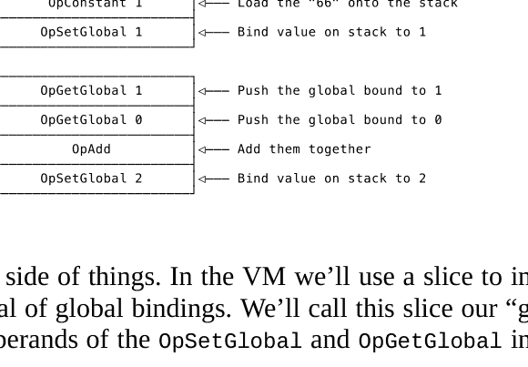

这就是编译器方面的情况。在VM中，我们将使用一个切片来实现全局绑定的创建和检索。我们称这个切片为“全局存储”（globals store），并将`OpSetGlobal`和`OpGetGlobal`指令的操作数作为它的索引。

当我们执行`OpSetGlobal`指令时，会读取操作数，从栈顶弹出一个值，并将其保存在全局存储中由操作数编码的索引位置。要执行`OpGetGlobal`指令，我们会使用操作数从全局存储中检索值并将其压入栈中。

两个名为`OpGetGlobal`和`OpSetGlobal`的新操作码，一个在编译时将标识符与数字关联的机制，以及VM中的全局存储。这样分解来看，听起来可行，对吧？


当然，一旦我们引入函数和局部变量，事情就会变得更复杂，但那是我们到时候再跨越的桥梁。现在，让我们转向我们的编译器。

```go
code.Make(code.OpGetGlobal, 0),
code.Make(code.OpPop),
},
},
{
    input: `
let one = 1;
let two = one;
two;
`,
expectedConstants: []interface{}{1},
expectedInstructions: []code.Instructions{
    code.Make(code.OpConstant, 0),
    code.Make(code.OpSetGlobal, 0),
    code.Make(code.OpSetGlobal, 0),
    code.Make(code.OpSetGlobal, 1),
    code.Make(code.OpGetGlobal, 1),
    code.Make(code.OpPop),
},
},
}

runCompilerTests(t, tests)
}
```

与之前相同的测试设置，所以让我们谈谈在这三个测试用例中我们测试的*内容*。第一个测试确保 let 语句能生成正确的 `OpSetGlobal` 指令。第二个测试期望标识符能解析到之前的绑定，通过测试 `OpGetGlobal` 指令来实现。这里需要注意的是，`OpSetGlobal` 和 `OpGetGlobal` 指令的操作数必须匹配。第三个测试用例断言组合设置和获取全局绑定也有效。这里同样重要的是指令的操作数必须匹配。

我们将一个接一个地修复这些测试用例，从第一个开始，它的表现并不理想：

```text
$ go test ./compiler
--- FAIL: TestGlobalLetStatements (0.00s)
compiler_test.go:361: testInstructions failed: wrong instructions length.
want="0000 OpConstant 0\n0003 OpSetGlobal 0\n0006 OpConstant 1\n0009 OpSetGlobal 1\n"
got=""
FAIL
FAIL    monkey/compiler 0.009s
```

看起来我们甚至还差得很远。但空结果的原因是 Monkey 代码仅由 let 语句组成，而我们的编译器目前会跳过它们。我们可以通过在编译器的 `Compile` 方法中添加一个新的 case 分支来获得更好的测试反馈：

```go
// compiler/compiler.go

func (c *Compiler) Compile(node ast.Node) error {
    switch node := node.(type) {
    // [...]

    case *ast.LetStatement:
        err := c.Compile(node.Value)
        if err != nil {
            return err
        }

    // [...]
    }

    // [...]
}
```

当我们遇到 let 语句时，我们做的第一件事就是编译等号右侧的表达式。这就是将被绑定到名称的 Value，编译此表达式意味着指示 VM 将值放到栈上：

```text
$ go test ./compiler
--- FAIL: TestGlobalLetStatements (0.00s)
compiler_test.go:361: testInstructions failed: wrong instructions length.
want="0000 OpConstant 0\n0003 OpSetGlobal 0\n0006 OpConstant 1\n\
    0009 OpSetGlobal 1\n"
got ="0000 OpConstant 0\n0003 OpConstant 1\n"
FAIL
FAIL    monkey/compiler  0.009s
```

现在我们可以将其绑定到一个名称。这意味着我们需要跟上一个 OpSetGlobal 指令来告诉 VM 创建绑定。但我们为标识符选择哪个数字呢？答案来自我们将添加到编译器中的一个新组件，即符号表。

## 介绍：符号表

[符号表] 是一种在解释器和编译器中用于将标识符与信息关联的数据结构。它可以在从词法分析到代码生成的每个阶段中使用，以存储和检索有关给定标识符（可以称为符号）的信息。信息例如其位置、其作用域、是否之前已声明、关联值的类型，以及在解释或编译时看起来有用的任何其他内容。

我们将使用符号表将标识符与作用域和唯一数字关联起来。现在，它应该做两件事：

1. 将全局作用域中的标识符与唯一数字关联
2. 获取给定标识符先前关联的数字

符号表上这两种方法的通用名称是“define”和“resolve”。你在一个给定的作用域中“define”一个标识符以与其关联一些信息。稍后你将“resolve”该标识符以获取此信息。我们将信息本身称为“symbol”——标识符与符号关联，而符号本身包含信息。

工作代码有助于解释这一点。以下是构成我们符号表的类型定义：

```go
// compiler/symbol_table.go

package compiler

type SymbolScope string

const (
    GlobalScope SymbolScope = "GLOBAL"
)

type Symbol struct {
    Name  string
    Scope SymbolScope
    Index int
}

type SymbolTable struct {
    store          map[string]Symbol
    numDefinitions int
}

func NewSymbolTable() *SymbolTable {
    s := make(map[string]Symbol)
    return &SymbolTable{store: s}
}
```

这里的第一个定义是 SymbolScope，它是 string 的类型别名。SymbolScope 本身的值并不重要。重要的是它必须是唯一的，因为我们需要区分不同的作用域。我们使用字符串作为别名类型（而不是整数，例如）以获得更好的调试体验。

更多。

下一个定义是 Symbol。Symbol 是一个结构体，保存我们在 Monkey 代码中遇到的符号所需的所有必要信息：Name、Scope 和 Index。这里没什么多余的解释。

SymbolTable 本身然后在它的 store 中将字符串与 Symbols 关联起来，并跟踪它拥有的 numDefinitions。字符串是我们遇到的 Monkey 代码中的标识符。

如果以前没有使用过符号表，类型和字段的名称可能会感觉不熟悉，但不用担心：我们正在构建一个将字符串与其信息关联起来的映射。你不需要理解任何隐藏的智慧或技巧。测试通过展示我们对 SymbolTable 缺失的 Define 和 Resolve 方法的期望，使这一点变得更加清晰：

```go
// compiler/symbol_table_test.go

package compiler

import "testing"

func TestDefine(t *testing.T) {
    expected := map[string]Symbol{
        "a": Symbol{Name: "a", Scope: GlobalScope, Index: 0},
        "b": Symbol{Name: "b", Scope: GlobalScope, Index: 1},
    }

    global := NewSymbolTable()

    a := global.Define("a")
    if a != expected["a"] {
        t.Errorf("expected a=%v, got=%v", expected["a"], a)
    }

    b := global.Define("b")
    if b != expected["b"] {
        t.Errorf("expected b=%v, got=%v", expected["b"], b)
    }
}

func TestResolveGlobal(t *testing.T) {
    global := NewSymbolTable()
    global.Define("a")
    global.Define("b")

    expected := []Symbol{
        Symbol{Name: "a", Scope: GlobalScope, Index: 0},
        Symbol{Name: "b", Scope: GlobalScope, Index: 1},
    }

    for _, sym := range expected {
        result, ok := global.Resolve(sym.Name)
        if !ok {
            t.Errorf("name %s not resolvable", sym.Name)
            continue
        }
        if result != sym {
            t.Errorf("expected %s to resolve to %v, got=%v",
                sym.Name, sym, result)
        }
    }
}
```

在 TestDefine 中，我们对 Define 方法做出断言。它应该以标识符作为参数，创建定义并返回 Symbol。注意，我们不需要说明要在哪个作用域中创建定义。跟踪这一点是符号表的工作。我们只需调用 Define("a")，符号表就会将标识符 "a" 与一个新 Symbol 关联，该 Symbol 包含 Name、Scope 和 Index。Index 就是我们想要的唯一数字。

在 TestResolveGlobal 中我们做相反的操作：我们向符号表提供一个之前已定义的标识符，并期望它返回关联的 Symbol。同样，唯一的 argument 是标识符：Resolve("a")。如果标识符未定义，Resolve 的第二个返回值必须为 false。

测试无法编译，因为两个方法都缺失了，我将免去你反复运行测试并逐步添加方法定义的结果阅读。相反，让我给出 Define 的完整版本：

```go
// compiler/symbol_table.go

func (s *SymbolTable) Define(name string) Symbol {
    symbol := Symbol{Name: name, Index: s.numDefinitions, Scope: GlobalScope}
    s.store[name] = symbol
    s.numDefinitions++
    return symbol
}
```

我告诉过你，没什么好担心的；我们正在构建一个带有一些额外功能的映射。证据就在这里。我们创建一个新的 Symbol，将其与 store 中的名称关联，增加 numDefinitions 计数器并返回新的 Symbol。已定义。完成。

Resolve 方法甚至更简单：


```go
// compiler/symbol_table.go

func (s *SymbolTable) Resolve(name string) (Symbol, bool) {
    obj, ok := s.store[name]
    return obj, ok
}
```

不幸的是，这个方法不会一直这么小。随着我们将来添加更多作用域，它会不断变大，但目前它的功能已经足够：两个测试都通过了。

```text
$ go test -run TestDefine ./compiler
ok      monkey/compiler 0.008s
$ go test -run TestResolveGlobal ./compiler
ok      monkey/compiler 0.011s
```

## 在编译器中利用符号

因为我们的编译器测试仍然失败，我们必须有选择地运行 `TestDefine` 和 `TestResolveGlobal` 函数才能得到一个 "ok"。但现在，有了符号表，我们可以让它通过！首先，我们需要把符号表添加到编译器中：

```go
// compiler/compiler.go

type Compiler struct {
    // [...]
    symbolTable *SymbolTable
}

func New() *Compiler {
    return &Compiler{
        // [...]
        symbolTable: NewSymbolTable(),
    }
}
```

这样我们就可以在 `*ast.LetStatement` 中定义标识符：

```go
// compiler/compiler.go

func (c *Compiler) Compile(node ast.Node) error {
    switch node := node.(type) {
    // [...]
    case *ast.LetStatement:
        err := c.Compile(node.Value)
        if err != nil {
            return err
        }

        symbol := c.symbolTable.Define(node.Name.Value)
        // [...]
    }
    // [...]
}
```

`node.Name` 是 let 语句等号左侧的 `*ast.Identifier`。`node.Name.Value` 保存了该标识符的字符串表示。我们把它传给符号表的 `Define` 方法，从而在 `GlobalScope` 中定义它。返回的符号现在有了 `Name`、`Scope`，最重要的是，有一个 `Index`。

现在我们可以把这个 `Index` 作为 `OpSetGlobal` 指令的操作数，并发出该指令：

```go
// compiler/compiler.go

func (c *Compiler) Compile(node ast.Node) error {
    switch node := node.(type) {
    // [...]

    case *ast.LetStatement:
        err := c.Compile(node.Value)
        if err != nil {
            return err
        }
        symbol := c.symbolTable.Define(node.Name.Value)
        c.emit(code.OpSetGlobal, symbol.Index)

    // [...]
    }

    // [...]
}
```

至此，我们向目标迈出了一大步：

```text
$ go test ./compiler
--- FAIL: TestGlobalLetStatements (0.00s)
    compiler_test.go:361: testInstructions failed: wrong instructions length.
        want="0000 OpConstant 0\n0003 OpSetGlobal 0\n0006 OpGetGlobal 0\n\
        0009 OpPop\n"
        got ="0000 OpConstant 0\n0003 OpSetGlobal 0\n0006 OpPop\n"
FAIL
FAIL    monkey/compiler 0.011s
```

这才像话——等等！测试还在失败？不，这是第二个测试用例。第一个已经通过了！现在失败的是确保全局绑定解析正确的测试用例。

现在我们需要反过来做，而不是定义标识符并发出 `OpSetGlobal` 指令。当我们遇到 `*ast.Identifier` 时，需要用符号表检查该标识符是否曾作为 `let` 语句的一部分使用过，如果是，就需要发出带有正确操作数的 `OpGetGlobal` 指令。这里的“正确”是指操作数包含之前发出的 `OpSetGlobal` 指令中所用的相同数字。我们能处理好，对吧？

首先，我们必须让编译器认识 `*ast.Identifier`。它应该尝试用符号表解析手头的标识符：

```go
// compiler/compiler.go

func (c *Compiler) Compile(node ast.Node) error {
    switch node := node.(type) {
    // [...]

    case *ast.Identifier:
        symbol, ok := c.symbolTable.Resolve(node.Value)
        if !ok {
            return fmt.Errorf("undefined variable %s", node.Value)
        }

    // [...]
    }

    // [...]
}
```

我们取 `*ast.Identifier` 的 `Value`，然后问符号表能否 `Resolve` 它。如果不能，就返回错误。这看起来就像 Go 里任何其他 map 访问，不是吗？但我要你注意，这是一个 *编译时错误*！以前，在我们的求值器中，我们只能在执行 Monkey 程序时的 *运行时* 判断变量是否已定义。现在，我们可以在把字节码传给 VM 之前就抛出错误。挺酷的，对吧？

如果标识符可以被解析，我们就得到了相应的符号，可以用它来发出 `OpGetGlobal` 指令：

```go
// compiler/compiler.go

func (c *Compiler) Compile(node ast.Node) error {
    switch node := node.(type) {
    // [...]

    case *ast.Identifier:
        symbol, ok := c.symbolTable.Resolve(node.Value)
        if !ok {
            return fmt.Errorf("undefined variable %s", node.Value)
        }

        c.emit(code.OpGetGlobal, symbol.Index)

        // [...]
    }

    // [...]
}
```

这个操作数与 `OpSetGlobal` 指令中使用的操作数相匹配，也就是与符号关联的 `Index`。我们的符号表已经处理好了这件事。这意味着 VM 完全不用操心标识符，只需要集中精力用这个 `Index` 来存储和检索值。换句话说：

```text
$ go test ./compiler
ok      monkey/compiler 0.008s
```

我们做到了！现在我们可以使用 let 语句将值绑定到标识符，然后在之后使用该标识符获取那个值——至少在我们的编译器中是这样。

这导致了这里的这个荒谬结果。

但在我们清理这个乱子，并正确解码和执行 `OpSetGlobal` 和 `OpGetGlobal` 指令之前，我们需要一个存储全局变量的地方。

由于两个操作码的操作数都是 16 位宽，因此我们的 VM 能够支持的全局绑定数量有一个上限。这很好，因为有了上限，我们就可以预先分配所需的所有内存：

```go
// vm/vm.go

const GlobalsSize = 65536

type VM struct {
    // [...]
    globals []object.Object
}

func New(bytecode *compiler.Bytecode) *VM {
    return &VM{
        // [...]
        globals: make([]object.Object, GlobalsSize),
    }
}
```

VM 的这个新的 `globals` 字段就是“全局存储区”。我们使用 slice 作为底层数据结构，因为它能让我们基于索引直接访问单个元素，而没有任何额外开销。

现在我们可以实现 `OpSetGlobal`：

```go
// vm/vm.go

func (vm *VM) Run() error {
    // [...]
    switch op {
    // [...]
    case code.OpSetGlobal:
        globalIndex := code.ReadUint16(vm.instructions[ip+1:])
        ip += 2

        vm.globals[globalIndex] = vm.pop()

    // [...]
    }
    // [...]
}
```

我们做的第一件事是解码操作数 `globalIndex`，并将 VM 的指令指针 `ip` 增加两个字节。然后从栈顶弹出一个元素，也就是应该绑定到名字上的值，并将其保存到新的全局存储区中指定的索引位置。当我们需要再次将它压入栈时，就可以很容易地取回它：

```go
// vm/vm.go
func (vm *VM) Run() error {
    // [...]
    switch op {
    // [...]
    case code.OpGetGlobal:
        globalIndex := code.ReadUint16(vm.instructions[ip+1:])
        ip += 2
        err := vm.push(vm.globals[globalIndex])
        if err != nil {
            return err
        }
    // [...]
    }
    // [...]
}
```

同样，我们解码操作数 `globalIndex`，并递增 `ip`。然后从 `vm.globals` 中取出值，再将它压回栈上。panic 消失了：

```text
$ go test ./vm
ok      monkey/vm       0.030s
```

相反，我们得到了一个热情的 "ok"，告诉我们已经成功教会了编译器和 VM 处理全局 let 语句。看看这个：

```text
$ go build -o monkey . && ./monkey
Hello mrnugget! This is the Monkey programming language!
Feel free to type in commands
>> let a = 1;
1
>> let b = 2;
2
>> let c = a + b;
Woops! Compilation failed:
    undefined variable a
>>
```

什么？这是已经测试过的行为，为什么在 REPL 中却不行呢？啊！当然！在我们的 REPL 中，我们在主循环的 *每次迭代* 中都创建了一个新的编译器和新的 VM。这意味着我们每输入一行新的代码，也会创建一个新的符号表和新的全局存储区。很容易修复。

我们只需要为编译器和 VM 添加新的构造函数，以便在 REPL 中保留全局状态：

```go
// compiler/compiler.go

func NewWithState(s *SymbolTable, constants []object.Object) *Compiler {
    compiler := New()
    compiler.symbolTable = s
    compiler.constants = constants
    return compiler
}
```

`Compiler` 的这个新构造函数现在接受一个 `*SymbolTable` 和一个 `[]object.Object` slice，其中包含之前编译产生的常量。为了摆脱当前的困境，我们只需要 `*SymbolTable`，但很快我们就会遇到这样的错误：刚好在 REPL 中输入的那一行需要访问之前输入的常量。这才是正确且面向未来的做法。

是的，我们会创建重复的分配。我们在这个新构造函数中首先调用 `New()`，然后通过覆盖操作丢弃它分配的符号表和常量切片。我认为这没问题。特别是对我们的用例来说，也就是 REPL。对 Go 的 GC 来说这不是问题，而且与不进行这些分配所需的实现工作量相比，这是最有效的方法。

下面是 VM 的新构造函数：

```go
// vm/vm.go

func NewWithGlobalsStore(bytecode *compiler.Bytecode, s []object.Object) *VM {
    vm := New(bytecode)
    vm.globals = s
    return vm
}
```

现在我们需要修改 REPL 的主循环，让它保留全局状态——全局存储区、符号表、常量——并将其传递给编译器和 VM 的新实例：

```go
// repl/repl.go

import (
```


```
// [...]
"monkey/object"
// [...]
)

func Start(in io.Reader, out io.Writer) {
    scanner := bufio.NewScanner(in)

    constants := []object.Object{}
    globals := make([]object.Object, vm.GlobalsSize)
    symbolTable := compiler.NewSymbolTable()

    for {
        // [...]

        comp := compiler.NewWithState(symbolTable, constants)
        err := comp.Compile(program)
        if err != nil {
            fmt.Fprintf(out, "woops! Compilation failed:\n %s\n", err)
            continue
        }

        code := comp.Bytecode()
        constants = code.Constants

        machine := vm.NewWithGlobalsStore(code, globals)
        // [...]
    }
}
```

我们分配了一个常量切片、一个全局变量存储和一个 symbolTable。然后，在循环的每次迭代中，我们把 symbolTable 和常量传给编译器，使它能够继续之前的工作，而不是从头开始。编译器完成之后，我们会更新 constants 引用。这是必要的，因为编译器在内部使用 append，而我们之前分配的常量切片并不是最终输出的结果。由于常量已经包含在字节码中，我们不需要显式地把它们传给 VM 的构造函数，只需要传入 globals。

现在，我们已经在 REPL 中拥有了全局状态，这让我们可以把输入的每一行都当作同一个程序的一部分，尽管我们每次按回车时都会重新开始编译和执行流程。问题解决了。现在我们可以在 REPL 中尽情体验全局绑定：

```
$ go build -o monkey . && ./monkey
Hello mrnugget! This is the Monkey programming language!
Feel free to type in commands
>> let a = 1;
1
>> let b = 2;
2
>> let c = a + b;
3
>> c
3
```

是时候后仰一下，深吸一口气了，因为在接下来的章节中，我们将在目前已完成的基础上继续构建，并把所有内容组合起来。那将会非常精彩。

## 字符串、数组与哈希

就目前的形式而言，我们的编译器和 VM 只支持 Monkey 的三种数据类型：整数、布尔值和 null。但还有另外三种：字符串、数组和哈希。我们在上一本书中已经把它们全部实现了，现在是把它们也加入我们这个新的 Monkey 实现的时候了。

这并不意味着我们需要把在《用 Go 编写解释器》中做过的所有事情重做一遍。这些数据类型在对象系统中的表示仍然存在——object.String、object.Array 和 object.Hash——我们可以直接复用它们，这意味着我们能够把精力集中在实现中那些新颖的部分。

本章的目标是把字符串、数组和哈希数据类型加入编译器和 VM，这样我们最终就能执行下面这段 Monkey 代码：

```
[1, 2, 3][1]
// => 2

{"one": 1, "two": 2, "three": 3}["o" + "ne"]
// => 1
```

如你所见，除了要支持字面量和数据类型本身，我们还需要实现字符串拼接，以及数组和哈希的下标运算符，才能让这段代码正常运行。

我们将从实现对 object.String 的支持开始。

### 字符串

由于字符串字面量的值在编译期和运行期之间不会改变，我们可以把它们当作常量表达式。与整数字面量的实现类似，我们可以在编译期把它们转换成 *object.String，并添加到 compiler.Bytecode 的常量池中。

从整数字面量的实现中我们也知道，这在编译器里只需要几行代码。那么何不增加些许挑战呢？除了实现字符串字面量之外，我们还要在本节中实现字符串拼接，也就是用 + 运算符把两个字符串连接起来。

本章的第一个编译器测试期望这两者都能正常工作：

```
// compiler/compiler_test.go

func TestStringExpressions(t *testing.T) {
    tests := []compilerTestCase{
        {
            input: `"monkey"`,
            expectedConstants: []interface{}{"monkey"},
            expectedInstructions: []code.Instructions{
                code.Make(code.OpConstant, 0),
                code.Make(code.OpPop),
            },
        },
        {
            input: `"mon" + "key"`,
            expectedConstants: []interface{}{"mon", "key"},
            expectedInstructions: []code.Instructions{
                code.Make(code.OpConstant, 0),
                code.Make(code.OpConstant, 1),
                code.Make(code.OpAdd),
                code.Make(code.OpPop),
            },
        },
    }

    runCompilerTests(t, tests)
}
```

这两个测试用例中的第一个确保编译器知道如何把字符串字面量视为常量；第二个测试则断言可以使用 + 中缀运算符对它们进行拼接。

值得注意的是，我们不需要任何新的操作码。我们已经有了所需的操作码：我们有将常量表达式加载到栈上的 OpConstant，也有将两个值相加的 OpAdd。

这两个操作码的用法也没有变化。OpConstant 的操作数仍然是常量在常量池中的索引，OpAdd 仍然期望它的两个操作数位于栈顶——无论它们是 *object.Integers 还是 *object.Strings。

新的地方在于，我们现在期望常量池中出现字符串。这意味着我们需要测试 bytecode.Constants 是否包含正确的 *object.Strings，而要完成这一点，我们需要在 testConstants 函数中再添加一个 case 分支：

```
// compiler/compiler_test.go

func testConstants(
    t *testing.T,
    expected []interface{},
    actual []object.Object,
) error {
    // [...] 

    for i, constant := range expected {
        switch constant := constant.(type) {
        // [...] 

        case string:
            err := testStringObject(constant, actual[i])
            if err != nil {
                return fmt.Errorf("constant %d - testStringObject failed: %s",
                    i, err)
            }
        }
    }

    return nil
}

func testStringObject(expected string, actual object.Object) error {
    result, ok := actual.(*object.String)
    if !ok {
        return fmt.Errorf("object is not String. got=%T (%v)",
            actual, actual)
    }

    if result.Value != expected {
        return fmt.Errorf("object has wrong value. got=%q, want=%q",
            result.Value, expected)
    }

    return nil
}
```

testConstants 中新增的 string case 分支伴随着新的 testStringObject 函数，后者与现有的 testIntegerObject 相呼应，确保常量是我们期望的字符串。

当我们现在运行测试时，可以看到期望的常量并不是问题所在（至少目前还不是），但指令却有问题：

```
$ go test ./compiler
--- FAIL: TestStringExpressions (0.00s)
    compiler_test.go:410: testInstructions failed: wrong instructions length.
    want="0000 OpConstant 0\n0003 OpPop\n"
    got ="0000 OpPop\n"
FAIL
FAIL    monkey/compiler 0.009s
```

我们并不是没有预料到这一点。我们需要在编译字符串字面量时发出 OpConstant 指令。为此，我们必须修改编译器的 Compile 方法，让它能够处理 *ast.StringLiterals，并从中创建 *object.String：

```
// compiler/compiler.go

func (c *Compiler) Compile(node ast.Node) error {
    switch node := node.(type) {
    // [...] 
    case *ast.StringLiteral:
        str := &object.String{Value: node.Value}
        c.emit(code.OpConstant, c.addConstant(str))
    // [...] 
    }
    // [...] 
}
```

除了一个变量名和一个标识符之外，这个分支就是 *ast.IntegerLiterals 对应分支的复制。我们从 AST 节点中取出值，创建一个对象，然后把它加入常量池。

### 向正确方向迈出的一步：

```
$ go test ./compiler
ok      monkey/compiler 0.009s
```

太棒了，两个测试都通过了。注意，我们并没有做什么特殊的事情来生成 OpAdd 指令，以实现字符串拼接。编译器通过编译 *ast.InfixExpressions 的 Left 和 Right 节点，已经处理好了这一切。


在测试用例中，这些是 *ast.StringLiterals，我们现在可以成功编译它们。

接下来，我们为 VM 编写一个测试，以确保相同的 Monkey 代码在编译为字节码指令后可以由 VM 执行：

// vm/vm_test.go
```go
func TestStringExpressions(t *testing.T) {
    tests := []vmTestCase{
        {`"monkey"`, "monkey"},
        {`"mon" + "key"`, "monkey"},
        {`"mon" + "key" + "banana"`, "monkeybanana"},
    }

    runVmTests(t, tests)
}
```

这些测试用例与编译器测试中的相同，只是额外断言将两个以上的字符串相加也应该有效——因为为什么不呢？

这里同样，我们需要一个新的 testStringObject 辅助函数来确保最终进入 VM 栈的是 *object.Strings。它也是其 testIntegerObject 对应的副本，并确保 VM 生成的字符串是我们期望的：

// vm/vm_test.go
```go
func testExpectedObject(
    t *testing.T,
    expected interface{},
    actual object.Object,
) {
    t.Helper()

    switch expected := expected.(type) {
    // [...] 

    case string:
        err := testStringObject(expected, actual)
        if err != nil {
            t.Errorf("testStringObject failed: %s", err)
        }
    }
}

func testStringObject(expected string, actual object.Object) error {
    result, ok := actual.(*object.String)
    if !ok {
```
```
```go
if op != code.OpAdd {
    return fmt.Errorf("unknown string operator: %d", op)
}

leftValue := left.(*object.String).Value
rightValue := right.(*object.String).Value

return vm.push(&object.String{Value: leftValue + rightValue})
}
```

在 executeBinaryOperation 中，条件判断已被更改为带有字符串新 case 分支的 switch 语句。在那里，我们将两个字符串的实际相加委托给 executeBinaryStringOperation，后者解包 *object.Strings，连接底层的 Go 字符串并将结果推回 VM 的栈。

就这样：
```text
$ go test ./vm
ok   	monkey/vm	0.028s
```

Monkey 字符串现已完全实现，包括字符串连接。接下来：数组。

## 数组

数组是我们添加到此 Monkey 实现中的第一个复合数据类型。也就是说，大致来说，数组是由 *组成* 其他数据类型组成的。对我们来说实际的后果是，我们不能将数组字面量视为常量表达式。

由于数组由多个元素组成，而数组字面量由产生这些元素的多个表达式组成，因此数组字面量本身的值可能在编译时和运行时之间发生变化。这里有一个例子：
```
[1 + 2, 3 + 4, 5 + 6]
```

不要被这些整数表达式分散注意力。它们非常简单，优化编译器可以预先计算它们，是的，但重点是这些可以是 *任何* 类型的表达式——整数字面量、字符串连接、函数字面量、函数调用等等。只有在运行时我们才能可靠地确定它们求值的结果。

从整数和字符串字面量来看，我们现在必须稍微改变一下方法。与其在编译时构建数组并将其作为常量池传递给 VM，不如告诉 VM 如何自行构建它。

为此，我们定义了一个新的操作码，称为 `OpArray`，它有一个操作数：数组字面量中元素的数量。然后当我们编译 `*ast.ArrayLiteral` 时，我们首先编译其所有元素。由于这些是 `ast.Expressions`，编译它们会产生使 VM 栈上留下 N 个值的指令，其中 N 是数组字面量中元素的数量。然后，我们将发出一个 `OpArray` 指令，其操作数为 N，即元素的数量。编译完成。

当 VM 执行 `OpArray` 指令时，它从栈中取出 N 个元素，从中构建一个 `*object.Array`，并将其推回栈。完成。我们告诉了 VM 如何构建数组。

让我们立即将此计划付诸实践。以下是 `OpArray` 的定义：

// code/code.go
```
const (
    // [...] 
    OpArray
)

var definitions = map[Opcode]*Definition{
    // [...] 
    OpArray: {"OpArray", []int{2}},
}
```

唯一的操作数宽度为两个字节。这使我们得到 65535 作为数组字面量中元素的最大可能数量。如果你有一个需要超过该数量的 Monkey 程序，请告诉我。

在我们将此新操作码的计划翻译成编译器代码之前，我们需要像往常一样编写一个测试：

// compiler/compiler_test.go
```go
func TestArrayLiterals(t *testing.T) {
    tests := []compilerTestCase{
        {
            input:           "[]",
            expectedConstants: []interface{}{},
            expectedInstructions: []code.Instructions{
                code.Make(code.OpArray, 0),
                code.Make(code.OpPop),
            },
        },
        {
            input:           "[1, 2, 3]",
            expectedConstants: []interface{}{1, 2, 3},
            expectedInstructions: []code.Instructions{
                code.Make(code.OpConstant, 0),
                code.Make(code.OpConstant, 1),
                code.Make(code.OpConstant, 2),
                code.Make(code.OpArray, 3),
                code.Make(code.OpPop),
            },
        },
        {
            input:           "[1 + 2, 3 - 4, 5 * 6]",
            expectedConstants: []interface{}{1, 2, 3, 4, 5, 6},
            expectedInstructions: []code.Instructions{
                code.Make(code.OpConstant, 0),
                code.Make(code.OpConstant, 1),
                code.Make(code.OpAdd),
                code.Make(code.OpConstant, 2),
                code.Make(code.OpConstant, 3),
                code.Make(code.OpSub),
                code.Make(code.OpConstant, 4),
                code.Make(code.OpConstant, 5),
                code.Make(code.OpMul),
                code.Make(code.OpArray, 3),
                code.Make(code.OpPop),
            },
        },
    }

    runCompilerTests(t, tests)
}
```

这也是我们计划的翻译，只是它以断言的形式表达，而非工作代码。我们期望编译器将数组字面量中的元素编译为使值留在栈上的指令，并且我们期望它发出一个 OpArray 指令，其操作数为数组字面量中元素的数量。

不出所料，这还没有发生：
```
$ go test ./compiler
--- FAIL: TestArrayLiterals (0.00s)
    compiler_test.go:477: testInstructions failed: wrong instructions length.
        want="0000 OpArray 0\n0003 OpPop\n"
        got ="0000 OpPop\n"
FAIL
FAIL    monkey/compiler 0.009s
```

幸运的是，修复此测试的代码并不比解释它所需的文字长：
// compiler/compiler.go
```go
func (c *Compiler) Compile(node ast.Node) error {
    switch node := node.(type) {
    // [...] 
    case *ast.ArrayLiteral:
        for _, el := range node.Elements {
            err := c.Compile(el)
            if err != nil {
                return err
            }
        }

        c.emit(code.OpArray, len(node.Elements))

    // [...] 
    }

    // [...] 
}
```

正如我们计划的那样：
```
$ go test ./compiler
ok      monkey/compiler 0.011s
```

我们计划的下一部分包括 VM，在那里我们也需要实现 OpArray。我们从一个测试开始：
```go
// vm/vm_test.go

func TestArrayLiterals(t *testing.T) {
    tests := []vmTestCase{
        {"[]", []int{}},
        {"[1, 2, 3]", []int{1, 2, 3}},
        {"[1 + 2, 3 * 4, 5 + 6]", []int{3, 12, 11}},
    }

    runVmTests(t, tests)
}

func testExpectedObject(
    t *testing.T,
    expected interface{},
    actual object.Object,
) {
    t.Helper()

    switch expected := expected.(type) {
    // [...] 
    case []int:
        array, ok := actual.(*object.Array)
        if !ok {
            t.Errorf("object not Array: %T (%v)", actual, actual)
            return
        }

        if len(array.Elements) != len(expected) {
            t.Errorf("wrong num of elements. want=%d, got=%d",
                len(expected), len(array.Elements))
            return
        }

        for i, expectedElem := range expected {
            err := testIntegerObject(int64(expectedElem), array.Elements[i])
            if err != nil {
                t.Errorf("testIntegerObject failed: %s", err)
            }
        }

    }
}
```

这些测试用例中的 Monkey 代码与编译器测试中的完全相同。不过，这里更重要的是确保空数组字面量能正常工作，因为在 VM 中遇到差一错误比在


编译器。

为了确保栈上最终留下的是一个 `*object.Array`，我们用一个新的 `[]int` 分支扩展了 `testExpectedObject`，将期望的 `[]int` 切片转换为对 `*object.Array` 的期望。

简洁又复用！我喜欢。坏消息是，如果我们运行测试，得到的不是有用的错误信息，而是一个 panic——我就不给你看堆栈跟踪了。VM panic 的原因在于它还不知道 `OpArray` 及其操作数，并把操作数当成了另一条指令。结果当然是乱七八糟。

但不管我们是得到 panic，还是从失败的测试中看到一个友好、可读的错误信息，很明显我们必须在 VM 中实现 `OpArray`。解码操作数，从栈中取出指定数量的元素，构造一个 `*object.Array`，再把它压回栈中。这些我们都可以用一个 case 分支和一个方法来完成：

```
// vm/vm.go

func (vm *VM) Run() error {
    // [...] 
    switch op {
    // [...] 
    case code.OpArray:
        numElements := int(code.ReadUint16(vm.instructions[ip+1:]))
        ip += 2

        array := vm.buildArray(vm.sp-numElements, vm.sp)
        vm.sp = vm.sp - numElements

        err := vm.push(array)
        if err != nil {
            return err
        }

        // [...] 
    }
    // [...] 
}

func (vm *VM) buildArray(startIndex, endIndex int) object.Object {
    elements := make([]object.Object, endIndex-startIndex)

    for i := startIndex; i < endIndex; i++ {
        elements[i-startIndex] = vm.stack[i]
    }

    return &object.Array{Elements: elements}
}
```

`code.OpArray` 的 case 分支负责解码操作数、递增 `ip`，并告诉新的 `buildArray` 方法在哪里可以找到栈上的数组元素。

然后 `buildArray` 遍历栈指定区域中的元素，将每个元素添加到新构建的 `*object.Array` 中。随后这个数组被压入栈中，但只有在元素被取出之后——这一点很重要。最终我们得到的是栈上一个 `*object.Array`，其中包含指定数量的元素：

```
$ go test ./vm
ok      monkey/vm  0.031s
```

太好了！又一个功能完成：我们已经完全实现了数组字面量！

## 哈希

为了实现 Monkey 的哈希数据结构，我们再次需要一个新的操作码。和数组一样，它的最终值在编译时也无法确定。实际上更是如此，因为哈希在 Monkey 中不是有 N 个元素，而是有 N 个键和 N 个值，而且它们全部由表达式创建：

```
{1 + 1: 2 * 2, 3 + 3: 4 * 4}
```

这等价于下面这个哈希字面量：

```
{2: 4, 6: 16}
```

你我都不会写第一个版本，我知道，但我们仍然需要让它工作。为此，我们沿用数组字面量时使用过的策略：教 VM 如何构建哈希字面量。

同样，第一步是定义一个新的操作码。这个操作码名为 `OpHash`，同样有一个操作数：

```go
// code/code.go

const (
	// [...]

	OpHash
)

var definitions = map[Opcode]*Definition{
	// [...]

	OpHash: {"OpHash", []int{2}},
}
```

这个操作数指定了栈上键*和*值的数量。使用键值对的数量也同样可行，但那样我们就得在 VM 中将它加倍才能得到栈上值的数量。如果能在编译器中预先计算好，何乐而不为呢？

有了操作数，VM 就能从栈中取出正确数量的元素，用它们创建 `object.HashPair`，并构建一个 `*object.Hash`，然后压入栈中。这又是我们实现 Monkey 数组时用过的 DIY 策略，只是构建 `*object.Hash` 要

稍微复杂一些。

不过，在此之前，我们首先需要写一个测试来确保编译器能输出 `OpHash` 指令：

```go
// compiler/compiler_test.go

func TestHashLiterals(t *testing.T) {
    tests := []compilerTestCase{
        {
            input: "{}",
            expectedConstants: []interface{}{},
            expectedInstructions: []code.Instructions{
                code.Make(code.OpHash, 0),
                code.Make(code.OpPop),
            },
        },
        {
            input: "{1: 2, 3: 4, 5: 6}",
            expectedConstants: []interface{}{1, 2, 3, 4, 5, 6},
            expectedInstructions: []code.Instructions{
                code.Make(code.OpConstant, 0),
                code.Make(code.OpConstant, 1),
                code.Make(code.OpConstant, 2),
                code.Make(code.OpConstant, 3),
                code.Make(code.OpConstant, 4),
                code.Make(code.OpConstant, 5),
                code.Make(code.OpHash, 6),
                code.Make(code.OpPop),
            },
        },
        {
            input: "{1: 2 + 3, 4: 5 * 6}",
            expectedConstants: []interface{}{1, 2, 3, 4, 5, 6},
            expectedInstructions: []code.Instructions{
                code.Make(code.OpConstant, 0),
                code.Make(code.OpConstant, 1),
                code.Make(code.OpConstant, 2),
                code.Make(code.OpAdd),
                code.Make(code.OpConstant, 3),
                code.Make(code.OpConstant, 4),
                code.Make(code.OpConstant, 5),
                code.Make(code.OpMul),
                code.Make(code.OpHash, 4),
                code.Make(code.OpPop),
            },
        },
    }

    runCompilerTests(t, tests)
}
```

看起来字节码很多，但这主要是由于哈希字面量中的表达式。我们要确保它们能被正确编译，并让生成的指令在栈上留下一个值。之后，我们期望看到一条 `OpHash` 指令，其操作数指定了栈上键和值的数量。

测试失败了，并告诉我们缺少 `OpHash` 指令：

```
$ go test ./compiler
--- FAIL: TestHashLiterals (0.00s)
    compiler_test.go:336: testInstructions failed: wrong instructions length.
        want="0000 OpHash 0\n0003 OpPop\n"
        got ="0000 OpPop\n"
FAIL
FAIL    monkey/compiler 0.009s
```

正如我所说，在 VM 中构建 `*object.Hash` 比构建 `*object.Array` 要花更多功夫。但编译它们也需要一点小技巧才能可靠工作：

// compiler/compiler.go

```
import (
    // [...] 
    "sort"
)

func (c *Compiler) Compile(node ast.Node) error {
    switch node := node.(type) {
    // [...] 

    case *ast.HashLiteral:
        keys := []ast.Expression{}
        for k := range node.Pairs {
            keys = append(keys, k)
        }
        sort.Slice(keys, func(i, j int) bool {
            return keys[i].String() < keys[j].String()
        })

        for _, k := range keys {
            err := c.Compile(k)
            if err != nil {
                return err
            }
            err = c.Compile(node.Pairs[k])
            if err != nil {
                return err
            }
        }

        c.emit(code.OpHash, len(node.Pairs)*2)

    // [...] 
    }
    // [...]
```

由于 `node.Pairs` 是一个 `map[ast.Expression]ast.Expression`，而 Go 在遍历 map 的键和值时并不保证顺序一致，我们需要在编译它们之前手动对键进行排序。如果不这样做，发出的指令就会是乱序的。

这本身并不是问题，事实上，即使不排序，我们的编译器和 VM 也能正常工作。但我们的测试会随机失败。测试对常量的顺序有断言。当然不是为了顺序而顺序，而是因为我们想确保得到的是正确的常量。

为了让测试的成功率不再取决于随机性的怜悯，我们需要通过对键进行排序来保证特定的元素排列。至于具体是哪种顺序，我们并不在意，只要有序即可，所以我们按照键的字符串表示来排序。

之后，我们遍历这些键，编译它们，再从 `node.Pairs` 中取出对应的值并编译它。键在前、值在后的顺序很重要，因为我们需要在 VM 中重建这个顺序。

作为该 case 分支的最后一步，我们发出一个 `OpHash` 指令，其操作数是键和值的数量。

当我们现在运行测试……

```
$ go test ./compiler
ok      monkey/compiler 0.009s
```

……可以看到该轮到 VM 了。

在 VM 中构建 `*object.Hash` 并不难，但我们需要做几件不同的事情才能让它工作，并且有测试可以依赖是件好事：

```
// vm/vm_test.go

func TestHashLiterals(t *testing.T) {
    tests := []vmTestCase{
        {
            "{}", map[object.HashKey]int64{},
        },
        {
            "{1: 2, 2: 3}",
            map[object.HashKey]int64{
                (&object.Integer{Value: 1}).HashKey(): 2,


```go
    (&object.Integer{Value: 2}).HashKey(): 3,
    },
    {
        "{1 + 1: 2 * 2, 3 + 3: 4 * 4}",
        map[object.HashKey]int64{
            (&object.Integer{Value: 2}).HashKey(): 4,
            (&object.Integer{Value: 6}).HashKey(): 16,
        },
    },
}

    runVmTests(t, tests)
}

func testExpectedObject(
    t *testing.T,
    expected interface{},
    actual object.Object,
) {
    t.Helper()

    switch expected := expected.(type) {
    // [...]

    case map[object.HashKey]int64:
        hash, ok := actual.(*object.Hash)
        if !ok {
            t.Errorf("object is not Hash. got=%T (%+v)", actual, actual)
            return
        }

        if len(hash.Pairs) != len(expected) {
            t.Errorf("hash has wrong number of Pairs. want=%d, got=%d",
            len(expected), len(hash.Pairs))
            return
        }

        for expectedKey, expectedValue := range expected {
            pair, ok := hash.Pairs[expectedKey]
            if !ok {
                t.Errorf("no pair for given key in Pairs")
            }

            err := testIntegerObject(expectedValue, pair.Value)
            if err != nil {
                t.Errorf("testIntegerObject failed: %s", err)
            }
        }
    }
}
```

这个测试以及 testExpectedObject 中新增的相应 case 分支不仅确保 VM 知道如何构建 *object.Hashes，还让我们重新回顾了 *object.Hash 的工作原理。

object.Hash 有一个 Pairs 字段，其中包含一个 map[HashKey]HashPair。可以通过调用 object.Hashable 的 HashKey 方法创建 HashKey，*object.String、*object.Boolean 和 *object.Integer 都实现了该接口。HashPair 则有一个 Key 和一个 Value 字段，两者都包含一个 object.Object。这里存储的是真正的键和值。但 HashKey 是确保 Monkey 对象哈希一致性的必要条件。请阅读 object 包中的 HashKey 方法，以更详细地回顾其工作原理。

我们期望 VM 在正确的 HashKey 下存储正确的 HashPair。我们并不真正关心存储了什么；我们主要关心的是如何存储，这就是为什么我们使用简单的整数，并且每个测试用例中的期望哈希都是 map[object.HashKey]int64。这样我们就可以专注于在正确的哈希键下找到正确的值。

当我们现在运行测试时，会遇到与之前首次运行数组测试时相同的问题：panic。我再次不向你展示这个难看的错误堆栈，但请放心，其原因同样是因为我们的 VM 还不知道 OpHash 及其操作数。让我们修复它。

```go
// vm/vm.go

func (vm *VM) Run() error {
    // [...] 
    switch op {
    // [...] 

    case code.OpHash:
        numElements := int(code.ReadUint16(vm.instructions[ip+1:]))
        ip += 2

        hash, err := vm.buildHash(vm.sp-numElements, vm.sp)
        if err != nil {
            return err
        }
        vm.sp = vm.sp - numElements

        err = vm.push(hash)
        if err != nil {
            return err
        }

        // [...] 
    }
    // [...] 
}
```

这也与 OpArray 的 case 分支非常接近，只不过现在

## 添加索引操作符

正如我们在本章开头所说的，我们的目标是让这段 Monkey 代码工作：

```monkey
[1, 2, 3][1]
{"one": 1, "two": 2, "three": 3}["o" + "ne"]
```

我们已经快要实现了：我们已经有数组字面量、哈希字面量以及字符串拼接。目前还缺少的是索引操作符，它允许我们从数组或哈希中检索单个元素。

索引操作符的有趣之处在于它相当通用。虽然我们只想将它用于数组和哈希，但它的语法形式允许更多用法：

```text
<expression>[<expression>]
```

被索引的数据结构和索引本身都可以由任何表达式产生。而且由于 Monkey 表达式可以产生任何 Monkey 对象，这意味着在语义层面上，索引操作符可以将任何 object.Object 作为索引或被索引的数据结构来工作。

这正是我们将要实现它的方式。我们不会将索引操作符与特定数据结构结合视为特殊情况，而是将在编译器和 VM 中构建一个通用的索引操作符。第一步，一如既往，是定义一个新的操作码。

它叫 OpIndex，没有操作数。相反，为了让 OpIndex 工作，栈顶需要有两个值：要被索引的对象，以及在它之上作为索引的对象。当 VM 执行 OpIndex 时，它应该将这两个值都弹出栈，执行索引操作，然后将结果放回栈上。

这足够通用，允许数组和哈希作为被索引的数据结构，同时由于使用栈，也易于实现。

这是 OpIndex 的定义：

```go
// code/code.go

const (
    // [...] 
    OpIndex
)

var definitions = map[Opcode]*Definition{
    // [...] 
    OpIndex: {"OpIndex", []int{}},
}
```

现在我们编写一个编译器测试，在其中期望出现 OpIndex 指令：

```go
// compiler/compiler_test.go

func TestIndexExpressions(t *testing.T) {
    tests := []compilerTestCase{
        {
            input:             "[1, 2, 3][1 + 1]",
            expectedConstants: []interface{}{1, 2, 3, 1, 1},
            expectedInstructions: []code.Instructions{
                code.Make(code.OpConstant, 0),
                code.Make(code.OpConstant, 1),
                code.Make(code.OpConstant, 2),
                code.Make(code.OpArray, 3),
                code.Make(code.OpConstant, 3),
                code.Make(code.OpConstant, 4),
                code.Make(code.OpAdd),
                code.Make(code.OpIndex),
                code.Make(code.OpPop),
            },
        },
        {
            input:             "{1: 2}[2 - 1]",
            expectedConstants: []interface{}{1, 2, 2, 1},
            expectedInstructions: []code.Instructions{
                code.Make(code.OpConstant, 0),
                code.Make(code.OpConstant, 1),
                code.Make(code.OpHash, 2),
                code.Make(code.OpConstant, 2),
                code.Make(code.OpConstant, 3),
                code.Make(code.OpSub),
                code.Make(code.OpIndex),
                code.Make(code.OpPop),
            },
        },
    }

    runCompilerTests(t, tests)
}
```

我们在这里要确保的是，我们可以将数组和哈希字面量编译为索引操作符表达式的一部分，并且索引本身可以是任何表达式。

重要的是要注意，编译器不必关心被索引的是什么、索引是什么，或者整个操作是否有效。这是 VM 的工作，也是我们这里没有任何针对空数组或不存在的索引的测试用例的原因。我们在编译器中所要做的就是编译两个表达式并发出一个 OpIndex 指令：

```go
// compiler/compiler.go

func (c *Compiler) Compile(node ast.Node) error {
    switch node := node.(type) {
    // [...] 
    case *ast.IndexExpression:
        err := c.Compile(node.Left)
        if err != nil {
            return err
        }
        
        err = c.Compile(node.Index)
        if err != nil {
            return err
        }
        
        c.emit(code.OpIndex)
    
    // [...] 
    }
    
    // [...] 
}
```

我们首先编译被索引的对象 node.Left，然后编译 node.Index。两者都是 ast.Expressions，这意味着我们不必担心它们具体是什么——Compile 的其他部分已经处理了这一点：

```
$ go test ./compiler
ok      monkey/compiler 0.009s
```

现在我们可以开始考虑边缘情况了，因为我们可以继续编写 VM 并在那里编写测试：

```go
// vm/vm_test.go

func TestIndexExpressions(t *testing.T) {
    tests := []vmTestCase{
        {"[1, 2, 3][1]", 2},
        {"[1, 2, 3][0 + 2]", 3},
        {"[[1, 1, 1]][0][0]", 1,
```


```
{"[] [0]", Null},
{"[1, 2, 3][99]", Null},
{"[1][-1]", Null},
{"{1: 1, 2: 2}[1]", 1},
{"{1: 1, 2: 2}[2]", 2},
{"{1: 1}[0]", Null},
{"{}[0]", Null},
}

runVmTests(t, tests)
}
```

在这里，我们可以找到所有在编译器测试中没有出现的情况：有效索引、无效索引、数组中的数组、空哈希、空数组——全部都在这里，而且全部都需要正常工作。

关键在于，对于有效的索引，我们期望对应的元素最终被压入栈中；而对于无效的索引，我们期望得到 `vm.Null`：

```
$ go test ./vm
--- FAIL: TestIndexExpressions (0.00s)
    vm_test.go:400: testIntegerObject failed: object has wrong value.\
        got=1, want=2
    vm_test.go:400: testIntegerObject failed: object has wrong value.\
        got=2, want=3
    vm_test.go:400: testIntegerObject failed: object has wrong value.\
        got=0, want=1
    vm_test.go:404: object is not Null: *object.Integer ({&{Value:0}})
    vm_test.go:404: object is not Null: *object.Integer ({&{Value:99}})
    vm_test.go:404: object is not Null: *object.Integer ({&{Value:-1}})
    vm_test.go:404: object is not Null: *object.Integer ({&{Value:0}})
    vm_test.go:404: object is not Null: *object.Integer ({&{Value:0}})
FAIL
FAIL    monkey/vm    0.036s
```

虽然这些错误信息看起来不错，但它们并不是我们真正想要的。我们想要的是让我们的虚拟机能够解码并执行 `OpIndex` 指令：

```
// vm/vm.go

func (vm *VM) Run() error {
    // [...] 
    switch op {
    // [...] 

    case code.OpIndex:
        index := vm.pop()
        left := vm.pop()

        err := vm.executeIndexExpression(left, index)
        if err != nil {
            return err
}
    // [...] 
}
 // [...] 
}
```

栈顶的元素应该是索引，所以我们先把它弹出。然后我们再弹出索引运算符左侧的对象，即被索引的对象。同样，顺序必须与编译器中使用的一致，这一点非常重要——你可以想象如果搞混了会发生什么。

一旦我们拿到了 `index` 和 `left`，准备好进行索引操作时，就委托给 `executeIndexExpression`：

```
// vm/vm.go

func (vm *VM) executeIndexExpression(left, index object.Object) error {
    switch {
    case left.Type() == object.ARRAY_OBJ && index.Type() == object.INTEGER_OBJ:
        return vm.executeArrayIndex(left, index)
    case left.Type() == object.HASH_OBJ:
        return vm.executeHashIndex(left, index)
    default:
        return fmt.Errorf("index operator not supported: %s", left.Type())
    }
}
```

这和我们已有的 `executeBinaryOperation` 方法很接近。它对左侧对象和索引进行类型检查，同时把实际的索引操作委托给其他方法。其中第一个是 `executeArrayIndex`，它做了它名字所承诺的事情：

```
// vm/vm.go

func (vm *VM) executeArrayIndex(array, index object.Object) error {
    arrayObject := array.(*object.Array)
    i := index.(*object.Integer).Value
    max := int64(len(arrayObject.Elements) - 1)

    if i < 0 || i > max {
        return vm.push(Null)
    }

    return vm.push(arrayObject.Elements[i])
}
```

如果不是因为边界检查，这个方法可以更短。但我们确实需要检查索引是否在被索引数组的边界之内——这正是我们在测试中所期望的。如果索引没有对应数组中的任何元素，我们就将 `Null` 压入栈中。如果对应上了，我们就压入该元素。

在 `executeHashIndex` 中，我们不需要进行边界检查，但需要检查给定的索引是否可以用作 `object.HashKey`：

```
// vm/vm.go

func (vm *VM) executeHashIndex(hash, index object.Object) error {
    hashObject := hash.(*object.Hash)

    key, ok := index.(object.Hashable)
    if !ok {
        return fmt.Errorf("unusable as hash key: %s", index.Type())
    }

    pair, ok := hashObject.Pairs[key.HashKey()]
    if !ok {
        return vm.push(Null)
    }

    return vm.push(pair.Value)
}
```

如果给定的索引可以被转换为 `object.Hashable`，我们就尝试从 `hashObject.Pairs` 中取出对应的元素。同样，如果成功就压入该元素，如果不成功就压入 `vm.Null`。这也符合我们的测试预期。

现在让我们来看看测试本身：

```
$ go test ./vm
ok      monkey/vm  0.036s
```

这意味着，我们成功了！我们达到了目标。现在我们可以成功执行我们最初想要实现的东西了：

```
$ go build -o monkey . && ./monkey
Hello mrnugget! This is the Monkey programming language!
Feel free to type in commands
>> [1, 2, 3][1]
2
>> {"one": 1, "two": 2, "three": 3}["o" + "ne"]
1
>>
```

我们已经到了本章的末尾。我们可以构造字符串、数组、哈希，拼接字符串，现在还可以访问复合数据类型中的元素——但遗憾的是，也仅此而已。

在《用 Go 语言编写解释器》一书中，我们还有额外的内置函数来对这些数据结构进行操作：访问第一个和最后一个元素、获取元素数量等等。它们非常有用，我们也会在新的 Monkey 编译器和虚拟机中实现它们。但在我们添加内置函数之前，我们需要先实现函数。

## 函数

这是本书中最具挑战性的章节之一。在本章结束时，我们将实现函数和函数调用，包括完整的局部绑定和函数调用参数。但要达到这个目标，我们需要进行大量思考，并做出许多看似无害但对我们 Monkey 实现影响巨大的微小改动。一路上我们会遇到不止一个挑战。因为，你看，实现函数的问题在于：它不仅仅是一个问题。

第一个问题是如何表示函数。天真的假设是函数是一系列指令。但在 Monkey 中，函数也是一等公民，可以被传递，也可以从其他函数中返回。我们如何表示一个可以传递的指令序列？

一旦我们回答了这个问题，接下来就是控制流的问题。我们如何让虚拟机执行一个函数的指令？而且，假设我们做到了这一点，我们又如何让它*返回到*之前正在执行的指令？同时，我们又如何向函数传递*参数*？

这些都是大问题——后面还跟着无数难以忽略的小问题。请放心，我们会一一回答。只不过不是一下子全部回答。相反，我们会通过深思熟虑的小步骤，把许多不同的部分编织成一个连贯的整体，这也是本章异常有趣的原因。

### 小试牛刀：一个简单的函数

我们这一节的目标“仅仅”是让下面这段看似简单的 Monkey 代码编译并执行：

```monkey
let fivePlusTen = fn() { 5 + 10 };
fivePlusTen();
```

这个函数没有参数。它不使用局部绑定。它调用时不带参数，也不访问全局绑定。虽然我敢打赌现存的 Monkey 程序中没有多少高度复杂的程序，但这个绝对是其中比较简单的一个。尽管如此，它仍然带来了多个挑战。

### 表示函数

在我们考虑编译或执行这个函数之前，我们先遇到了第一个挑战：我们如何表示函数？

我们知道函数由 Monkey 代码组成。我们也知道将 Monkey 代码编译为 Monkey 字节码。由此可知，我们的编译器应该将函数转换成*至少*一系列的 Monkey 字节码指令。那么问题是，我们把这一系列指令存储在哪里，又该如何把它交给虚拟机？

我们已经把主程序的指令传给了虚拟机，但我们不能把这些指令和函数的指令混在一起。如果我们那样做，就不得不在虚拟机中再次把它们分离开来，以便逐一执行。最好从一开始就把它们分开。

我们问题的答案在于这样一个事实：Monkey 函数是 Monkey 值。它们可以被绑定到名字上、从其他函数中返回、作为参数传递给其他函数，等等——就像任何其他 Monkey 值一样。和其他值一样，它们也是由表达式产生的。

这些表达式就是函数字面量，也就是函数在 Monkey 代码中的*字面*表示。在上面的例子中，函数字面量是这部分：

```monkey
fn() { 5 + 10 }
```


关于函数字面量，有一件奇怪的事情：它们产生的值不会改变。永远不会。它是常量。这就是我们需要的最后一条线索。

我们将像对待其他产生常量值的字面量一样对待函数字面量，并将它们作为——听好了——常量传递给虚拟机。我们将把它们编译成指令序列，并将这些指令序列添加到编译器的常量池中。然后，一条`OpConstant`指令负责将编译后的函数放到栈上——就像任何其他值一样。

现在，剩下的问题是如何精确表示这些指令序列，以便它们能够被添加到常量池中并加载到栈上。

在*《用Go编写解释器》*中，我们定义了`object.Function`，一个表示已求值函数字面量的Monkey对象，该对象本身可以被求值。现在我们需要一个更新版本：一个持有字节码而非AST节点的函数对象。

为此，我们打开object包，引入新的`object.CompiledFunction`：

```go
// object/object.go

import (
    // [...]
    "monkey/code"
    // [...]
)

const (
    // [...]

    COMPILED_FUNCTION_OBJ = "COMPILED_FUNCTION_OBJ"
)

type CompiledFunction struct {
    Instructions code.Instructions
}

func (cf *CompiledFunction) Type() ObjectType { return COMPILED_FUNCTION_OBJ }
func (cf *CompiledFunction) Inspect() string {
    return fmt.Sprintf("CompiledFunction[%p]", cf)
}
```

`object.CompiledFunction`正是我们所需的一切：它可以保存从函数字面量编译得到的`code.Instructions`，而且它是一个`object.Object`，这意味着我们可以将它作为常量添加到`compiler.Bytecode`中，并在虚拟机中加载它。

第一个问题解决了。让我们开始思考编译。

## 用于执行函数的操作码

我们必须问自己的第一个问题是：是否需要新的操作码来实现编译并执行上面那段Monkey代码的目标。

让我们从不需要的东西开始：函数字面量的操作码。由于我们决定将它们编译为`*object.CompiledFunction`，并将它们视为常量，因此可以使用现有的`OpConstant`指令将它们加载到虚拟机的栈上。

所以，就操作码而言，我们可以划掉代码片段的第一行：

```
let fivePlusTen = fn() { 5 + 10 };
fivePlusTen();
```

一旦我们将函数字面量编译为`*object.CompiledFunction`，我们就已经知道如何将它绑定到`fivePlusTen`这个名字。我们已经有了全局绑定，它们可以与任何`object.Object`一起工作。

但我们确实需要为第二行`fivePlusTen()`提供一个操作码。这是一个调用表达式，在我们的AST中由`*ast.CallExpression`表示，它必须被编译成一条指令，告诉虚拟机执行所讨论的函数。

由于我们没有满足这一需求的操作码，现在需要定义一个新的操作码。它叫做`OpCall`，没有任何操作数：

```go
// code/code.go
const (
    // [...] 
    OpCall
)

var definitions = map[Opcode]*Definition{
    // [...] 
    OpCall: {"OpCall", []int{}},
}
```

下面是它的使用方式。首先，我们将要调用的函数放到栈上。例如，使用`OpConstant`指令。然后，我们发出`OpCall`指令。这告诉虚拟机执行栈顶的函数，然后我们就开始了。

这份关于`OpCall`的小小指令手册就是所谓的调用约定。一旦我们添加对函数调用参数的支持，它就必须改变，但就目前而言，只需两步：将要调用的函数放到栈上，然后发出`OpCall`指令。

定义了`OpCall`之后，我们现在——理论上——能够将一个函数放到虚拟机的栈上并调用它。我们仍然需要的是一种告诉虚拟机从被调用的函数返回的方法。

更具体地说，我们需要区分虚拟机必须从函数返回的两种情况。第一种情况是函数实际返回了某个值，无论是隐式还是显式。第二种情况是函数执行结束时没有返回任何东西，例如函数体为空。

我们先讨论前一种情况，即显式和隐式返回值。Monkey两者都支持：

```
let explicitReturn = fn() { return 5 + 10; };
let implicitReturn = fn() { 5 + 10; };
```

显式return语句会停止函数其余部分的执行，并返回return关键字后面的表达式所产生的值。在上面的例子中，就是中缀表达式`5 + 10`。

如果没有return语句，函数调用会求值为函数内部产生的最后一个值。这就是所谓的隐式返回。

在*《用Go编写解释器》*中构建的求值器中，隐式返回值是默认情况。显式return语句是我们必须构建的额外功能。

不过，这一次，隐式返回将是显式返回的一个微小变体。或者换句话说，这两者将编译成相同的字节码：

```
fn() { 5 + 10 }
fn() { return 5 + 10 }
```

这意味着，一方面，隐式返回和显式返回在底层是相同的——这对我们程序员来说总是一件乐事。但这也意味着我们必须实现这两种机制，才能让上面的`fivePlusTen`函数编译并运行。即使我们只使用隐式返回，也没有捷径可走。但现在在编译器中的这些额外努力，会让以后在虚拟机中的工作轻松很多。

由于它们都被编译成相同的字节码，隐式返回和显式返回也将由同一个操作码表示。这个操作码叫做`OpReturnValue`，它告诉虚拟机带着一个返回值从函数返回：

```go
// code/code.go

const (
    // [...] 
    OpReturnValue
)

var definitions = map[Opcode]*Definition{
    // [...] 
    OpReturnValue: {"OpReturnValue", []int{}},
}
```

它没有任何参数。要返回的值必须位于栈顶。

在显式返回的情况下，何时以及如何发出这个操作码是很清楚的。首先，编译return语句，使返回值最终出现在栈上，然后发出`OpReturnValue`。这里没有谜题，正如我们所愿。

实现隐式返回值需要稍微多花些功夫，因为这也意味着要返回表达式语句所产生的值——如果它是函数体中最后执行的语句的话。但之前我们确保表达式语句不会留下值。我们显式地发出`OpPop`指令来丢弃它。如果我们现在想要返回这个值，就需要找到一种方法，将对干净栈的需求与对隐式返回的渴望结合起来。但我们会做到的，你等着瞧。不过现在，请把这个疑问先放在脑后。

让我们讨论从函数返回的第二种也是更罕见的情况：函数不返回任何东西。既不是显式也不是隐式。由于Monkey中几乎一切都是产生值的表达式，能想出这样的函数也算是一种成就，但它们确实存在。下面就是一个：

```
fn() { }
```

这是一个函数体为空的函数。编译它会产生一个有效的`*object.CompiledFunction`，可以被调用，但没有任何指令。另一个例子是下面这个，我们稍后在讨论局部绑定时会再次遇到：

```
fn() { let a = 1; }
```

诚然，不返回任何东西的函数是一个边界情况。我们在第一本书中甚至没有处理过它。但现在它摆在我们面前，旁边还有一个未回答的问题：这些函数应该产生什么？由于函数调用是一个表达式，而表达式产生值，为了保持一致，这些函数也应该产生一个值。

我们可以把整个问题丢进一个名为`undefined_behaviour.txt`的文件里，然后就此收工。我们可以这样做。或者，我们可以让这些函数返回`*object.Null`。由于在Monkey中，`*object.Null`表示没有值，那么一个没有产生值的函数返回它，确实是有道理的。

决定已做出，这意味着我们需要告诉虚拟机，如果函数末尾没有`OpReturnValue`指令，就从函数返回`vm.Null`。我们将通过引入另一个操作码来实现这一点。

之前定义的`OpReturnValue`告诉虚拟机返回栈顶的值。新的操作码，我们称之为`OpReturn`，也将告诉虚拟机从当前函数返回，只不过这一次，栈上什么都没有，没有返回值，什么都没有。只需回到调用这个函数之前正在做的事情。

下面是它的定义：

```go
// code/code.go
const (
  // [...]
```


```go
var definitions = map[Opcode]*Definition{
    // [...]

    OpReturn: {"OpReturn", []int{}},
}
```

这就新增了三个操作码——足以开始在编译器中进行开发。

## 编译函数字面量

在开始打开我们的 `compiler/compiler_test.go` 文件之前，先做一次小小的盘点检查。我们现在已经具备了：

- `object.CompiledFunction` 用于保存已编译函数的指令，并作为常量的一部分将它们从编译器传递给 VM。
- `code.OpCall` 用于告诉 VM 开始执行栈顶的 `*object.CompiledFunction`。
- `code.OpReturnValue` 用于告诉 VM 将栈顶的值返回给调用上下文并在那里恢复执行。
- `code.OpReturn`，与 `code.OpReturnValue` 类似，不同之处在于没有显式返回值而是隐式的 `vm.Null`。

这已经足够我们开始编译了。但同样，循序渐进。在开始编译函数 *调用* 之前，我们要确保能够编译被调用的函数。

这给出了一个明确的第一个任务：编译函数字面量。我们将以下面这段代码作为起点：

```go
fn() { return 5 + 10 }
```

一个没有参数的函数，函数体中有一个整数算术表达式，以及一个 *显式返回语句*。最后一点很重要。我们需要将函数字面量转换为 `*object.CompiledFunction`，其 `Instructions` 字段中包含以下指令：

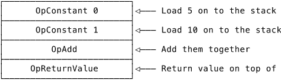

而在主程序中，位于 `Bytecode.Instructions` 里，我们需要一条 `OpConstant` 指令将此函数加载到栈上。当然随后需要一条 `OpPop`，因为返回值未被使用。

我们可以做到。让我们为它编写测试。

```go
// compiler/compiler_test.go

func TestFunctions(t *testing.T) {
	tests := []compilerTestCase{
		{
			input: `fn() { return 5 + 10 }`,
			expectedConstants: []interface{}{
				5,
				10,
				[]code.Instructions{
					code.Make(code.OpConstant, 0),
					code.Make(code.OpConstant, 1),
					code.Make(code.OpAdd),
					code.Make(code.OpReturnValue),
				},
			},
			expectedInstructions: []code.Instructions{
				code.Make(code.OpConstant, 2),
				code.Make(code.OpPop),
			},
		},
	}

	runCompilerTests(t, tests)
}
```

初看之下，这个测试似乎没有什么新东西，但 `expectedConstants` 现在也包含了 `[]code.Instructions`。

这些是我们希望在作为索引为 2 的常量传递的 `*object.CompiledFunction` 的 `Instructions` 字段中看到的指令。我们本可以直接把 `*object.CompiledFunction` 放入 `expectedConstants`，但由于我们只关心指令，不妨跳过外层，使测试更易读。

尽管如此，我们仍需要更新工具，使其现在能够对 `expectedConstants` 中的 `[]code.Instructions` 进行断言：

```go
// compiler/compiler_test.go

func testConstants(
    t *testing.T,
    expected []interface{},
    actual []object.Object,
) error {
    // [...] 

    for i, constant := range expected {
        switch constant := constant.(type) {
        // [...] 

        case []code.Instructions:
            fn, ok := actual[i].(*object.CompiledFunction)
            if !ok {
                return fmt.Errorf("constant %d - not a function: %T",
                    i, actual[i])
            }

            err := testInstructions(constant, fn.Instructions)
            if err != nil {
                return fmt.Errorf("constant %d - testInstructions failed: %s",
                    i, err)
            }
        }
    }

    return nil
}
```

在针对 `[]code.Instructions` 的新 case 分支中，我们使用 `testInstructions`（我们已经实现过），以确保常量池中的 `*object.CompiledFunction` 包含正确的指令。

就这样。这是我们第一个关于函数编译的测试。我们现在可以运行它并看到它失败：

```bash
$ go test ./compiler
--- FAIL: TestFunctions (0.00s)
    compiler_test.go:296: testInstructions failed: wrong instructions length.
        want="0000 OpConstant 2\n0003 OpPop\n"
        got ="0000 OpPop\n"
FAIL
FAIL    monkey/compiler 0.008s
```

测试甚至还没检查到已编译函数的指令，因为本应将函数加载到栈上的指令在主程序中缺失了。这是因为我们的编译器尚未编译 `*ast.FunctionLiteral`。是时候改变这一点。

` *ast.FunctionLiteral` 的主体是一个 `*ast.BlockStatement`，包含一系列 ast.Statements。由于我们已从编译 `*ast.IfExpression` 中学会如何编译 `*ast.BlockStatement`，编译函数体中的语句不应该有问题。

但如果我们简单地用手头的 `*ast.FunctionLiteral` 的 Body 调用编译器的 Compile 方法，就会一团糟：生成的指令会与主程序的指令纠缠在一起。解决方案？向我们的编译器引入作用域的概念。

## 添加作用域

这听起来相当复杂，但实际上是一个简单的改动。实际操作上，这意味着我们不再使用单个切片和两个独立字段 `lastInstruction` 和 `previousInstruction` 来跟踪已发出的指令，而是将它们捆绑在一个 *编译作用域* 中，并使用一个 *编译作用域栈*：

```go
// compiler/compiler.go

type CompilationScope struct {
    instructions        code.Instructions
    lastInstruction     EmittedInstruction
    previousInstruction EmittedInstruction
}

type Compiler struct {
    // [...]

    scopes    []CompilationScope
    scopeIndex int
}
```

在开始编译函数体之前，即 *进入* 新作用域时，我们将一个新的 `CompilationScope` 推入作用域栈。在此作用域内编译时，编译器的 `emit` 方法只会修改当前 `CompilationScope` 的字段。一旦完成函数的编译，我们通过将其从作用域栈中弹出并将指令放入新的 `*object.CompiledFunction` 来离开作用域。

我保证这听起来比实际复杂得多。下面是展示我们想要的效果的测试用例：

```go
// compiler/compiler_test.go

func TestCompilerScopes(t *testing.T) {
    compiler := New()
    if compiler.scopeIndex != 0 {
        t.Errorf("scopeIndex wrong. got=%d, want=%d", compiler.scopeIndex, 0)
    }

    compiler.emit(code.OpMul)

    compiler.enterScope()
    if compiler.scopeIndex != 1 {
        t.Errorf("scopeIndex wrong. got=%d, want=%d", compiler.scopeIndex, 1)
    }

    compiler.emit(code.OpSub)

    if len(compiler.scopes[compiler.scopeIndex].instructions) != 1 {
        t.Errorf("instructions length wrong. got=%d",
            len(compiler.scopes[compiler.scopeIndex].instructions))
    }

    last := compiler.scopes[compiler.scopeIndex].lastInstruction
    if last.Opcode != code.OpSub {
        t.Errorf("lastInstruction.Opcode wrong. got=%d, want=%d",
            last.Opcode, code.OpSub)
    }

    compiler.leaveScope()
    if compiler.scopeIndex != 0 {
        t.Errorf("scopeIndex wrong. got=%d, want=%d",
            compiler.scopeIndex, 0)
    }

    compiler.emit(code.OpAdd)

    if len(compiler.scopes[compiler.scopeIndex].instructions) != 2 {
        t.Errorf("instructions length wrong. got=%d",
            len(compiler.scopes[compiler.scopeIndex].instructions))
    }

    last = compiler.scopes[compiler.scopeIndex].lastInstruction
    if last.Opcode != code.OpAdd {
        t.Errorf("lastInstruction.Opcode wrong. got=%d, want=%d",
            last.Opcode, code.OpAdd)
    }

    previous := compiler.scopes[compiler.scopeIndex].previousInstruction
    if previous.Opcode != code.OpMul {
        t.Errorf("previousInstruction.Opcode wrong. got=%d, want=%d",
            previous.Opcode, code.OpMul)
    }
}
```


我们在此测试编译器上的两个新方法：enterScope 和 leaveScope。它们应当如其名称所承诺的那样，通过在新的作用域栈上压入和弹出 CompilationScopes 指令，来改变 emit 的行为。这个测试背后的主要想法是确保在一个作用域中发射的指令不会对另一个作用域中的指令产生影响。

由于这些方法尚不存在，测试会失败。我就不展示输出了。不过，让它们通过测试对我们来说很自然，因为这归结为使用某种栈，而我们现在已经非常擅长了。

首先，我们必须从 compiler 中移除 instructions、lastInstruction 和 previousInstruction 字段，并在初始化新的 *Compiler 时用一个 CompilationScope 来替换它们：

```
// compiler/compiler.go

type Compiler struct {
    constants []object.Object

    symbolTable *SymbolTable

    scopes      []CompilationScope
    scopeIndex int
}

func New() *Compiler {
    mainScope := CompilationScope{
        instructions:      code.Instructions{},
        lastInstruction:   EmittedInstruction{},
        previousInstruction: EmittedInstruction{},
    }

    return &Compiler{
        constants:  []object.Object{},
        symbolTable: NewSymbolTable(),
        scopes:     []CompilationScope{mainScope},
        scopeIndex: 0,
    }
}
```

现在我们需要更新对已移除字段的所有引用，改为使用当前作用域。为了帮助实现这一点，我们添加一个名为 currentInstructions 的新方法：

```
// compiler/compiler.go

func (c *Compiler) currentInstructions() code.Instructions {
    return c.scopes[c.scopeIndex].instructions
}
```

现在可以在 addInstruction 中使用它，emit 方法正是通过它来完成其工作：

```
// compiler/compiler.go

func (c *Compiler) addInstruction(ins []byte) int {
    posNewInstruction := len(c.currentInstructions())
    updatedInstructions := append(c.currentInstructions(), ins...)

    c.scopes[c.scopeIndex].instructions = updatedInstructions

    return posNewInstruction
}
```

这里我们首先使用 c.currentInstructions 获取当前的指令切片，然后为了修改它们，我们在栈上替换它们。

在编译器的其他辅助方法中，我们之前直接访问 instructions、lastInstruction 和 previousInstruction 字段，现在也必须通过栈来访问：

```
// compiler/compiler.go

func (c *Compiler) setLastInstruction(op code.Opcode, pos int) {
    previous := c.scopes[c.scopeIndex].lastInstruction
    last := EmittedInstruction{Opcode: op, Position: pos}

    c.scopes[c.scopeIndex].previousInstruction = previous
    c.scopes[c.scopeIndex].lastInstruction = last
}

func (c *Compiler) lastInstructionIsPop() bool {
    return c.scopes[c.scopeIndex].lastInstruction.Opcode == code.OpPop
}

func (c *Compiler) removeLastPop() {
    last := c.scopes[c.scopeIndex].lastInstruction
    previous := c.scopes[c.scopeIndex].previousInstruction

    old := c.currentInstructions()
    new := old[:last.Position]

    c.scopes[c.scopeIndex].instructions = new
    c.scopes[c.scopeIndex].lastInstruction = previous
}

func (c *Compiler) replaceInstruction(pos int, newInstruction []byte) {
    ins := c.currentInstructions()

    for i := 0; i < len(newInstruction); i++ {
        ins[pos+i] = newInstruction[i]
    }
}
```

```go
func (c *Compiler) changeOperand(opPos int, operand int) {
	op := code.OpCode(c.currentInstructions()[opPos])
	newInstruction := code.Make(op, operand)

	c.replaceInstruction(opPos, newInstruction)
}
```

然后，我们需要在 Compile 方法的核心处做一些更精细的修改：之前访问 `c.instructions` 的地方，现在需要切换为调用 `c.currentInstructions()`：

```go
// compiler/compiler.go

func (c *Compiler) Compile(node ast.Node) error {
	switch node := node.(type) {
	// [...]
	case *ast.IfExpression:
		// [...]

		afterConsequencePos := len(c.currentInstructions())
		c.changeOperand(jumpNotTruthyPos, afterConsequencePos)

		// [...]

		afterAlternativePos := len(c.currentInstructions())
		c.changeOperand(jumpPos, afterAlternativePos)

	// [...]
	}

	// [...]
}
```

当我们需要返回编译器产生的字节码时，也需要返回当前指令：

```go
// compiler/compiler.go

func (c *Compiler) Bytecode() *Bytecode {
	return &Bytecode{
		Instructions: c.currentInstructions(),
		Constants:    c.constants,
	}
}
```

最后，我们准备添加新的 `enterScope` 和 `leaveScope` 方法：

```go
// compiler/compiler.go

func (c *Compiler) enterScope() {
	scope := CompilationScope{
		instructions:        code.Instructions{},
		lastInstruction:     EmittedInstruction{},
```

```
c.enterScope()

err := c.Compile(node.Body)
if err != nil {
    return err
}

instructions := c.leaveScope()

compiledFn := &object.CompiledFunction{Instructions: instructions}
c.emit(code.OpConstant, c.addConstant(compiledFn))

// [...] 
}

// [...] 
}
```

这段代码片段围绕一个核心思想：在编译函数时改变所生成指令的存储位置。

因此，当我们遇到 *ast.FunctionLiteral 时，第一件事就是调用 c.enterScope 进入一个新的作用域。然后我们编译 node.Body，也就是构成函数体的 AST 节点。之后，我们通过调用 c.leaveScope 从 CompilationScopes 栈中取出刚填充的指令切片，创建一个持有这些指令的新的 *object.CompiledFunction，并将该函数添加到常量池。

## 完成，函数已编译：

```
$ go test ./compiler
--- FAIL: TestFunctions (0.00s)
compiler_test.go:654: testInstructions failed: wrong instruction at 2.
    want="0000 OpConstant 2\n0003 OpPop\n"
    got ="0000 OpConstant 0\n0003 OpPop\n"
FAIL
FAIL    monkey/compiler 0.008s
```

唉。事实证明，我们确实知道如何编译函数字面量，但不知道如何编译 *ast.ReturnStatements。而且由于测试中的函数体只不过是一个单独的 return 语句，我们并没有编译该函数的任何内容。我们只创建了一个没有指令的 *object.CompiledFunction 常量。

我们的测试基础设施还不够先进，无法用精确的错误信息指出问题的根源。不过，你可以相信我，我已经替我们俩做了深入排查。

```go
expectedConstants: []interface{}{
    5,
    10,
},
expectedInstructions: []code.Instructions{
    code.Make(code.OpConstant, 0),
    code.Make(code.OpConstant, 1),
    code.Make(code.OpAdd),
    code.Make(code.OpReturnValue),
},
},
},
expectedInstructions: []code.Instructions{
    code.Make(code.OpConstant, 2),
    code.Make(code.OpPop),
},
},
},
}

runCompilerTests(t, tests)
}
```

我们已经知道，解决这个问题涉及 OpPop 指令，因为在这个测试用例中，我们期望编译器去掉它在函数体最后一个表达式语句之后会发射的 OpPop。我们不希望任何东西将隐式返回值从栈中取出。不过，在其他情况下，我们仍然希望保留 OpPop 指令，而且在最终完全没有 OpPop 之前，让我们确保在需要它们的情况下它们能留在原处，并添加另一个测试用例：

```go
// compiler/compiler_test.go

func TestFunctions(t *testing.T) {
    tests := []compilerTestCase{
        // [...]
        {
            input: `fn() { 1; 2 }`,
            expectedConstants: []interface{}{
                1,
                2,
            },
            expectedInstructions: []code.Instructions{
                code.Make(code.OpConstant, 0),
                code.Make(code.OpPop),
                code.Make(code.OpConstant, 1),
                code.Make(code.OpReturnValue),
            },
        },
        expectedInstructions: []code.Instructions{
            code.Make(code.OpConstant, 2),
            code.Make(code.OpPop),
        },
    },
}

runCompilerTests(t, tests)
}
```


这个测试用例现在简洁地说明了我们未来想要对 OpPop 做什么。第一个表达式语句，即字面量 1，后面应该跟一个 OpPop 指令。一直如此。但第二个表达式语句，即 2，是隐式返回值，OpPop 指令必须被 OpReturnValue 指令替换。

现在我们有两个失败的测试用例需要修复，而测试输出实际上非常有帮助：

```
$ go test ./compiler
--- FAIL: TestFunctions (0.00s)
    compiler_test.go:693: testConstants failed: constant 2
        testInstructions failed: wrong instruction at 7.
    want="0000 OpConstant 0\n0003 OpConstant 1\n0006 OpAdd\n0007 OpReturnValue\n"
    got ="0000 OpConstant 0\n0003 OpConstant 1\n0006 OpAdd\n0007 OpPop\n"
FAIL
FAIL      monkey/compiler 0.009s
```

正如预期的那样，函数中的最后一个表达式语句并未被转换为隐式返回值，而是仍然跟随一个 OpPop 指令。

修复它的正确时机是在编译完函数体之后、在离开作用域之前。此时我们仍然可以访问刚刚发出的指令。我们可以检查最后一条指令是否为 OpPop 指令，如果需要的话将其转换为 OpReturnValue。

为了让必要的更改更容易，我们重构并将现有的 lastInstructionIsPop 方法改为更通用的 lastInstructionIs，并添加了一个防御性检查：

```go
// compiler/compiler.go

func (c *Compiler) lastInstructionIs(op code.Opcode) bool {
    if len(c.currentInstructions()) == 0 {
        return false
    }

    return c.scopes[c.scopeIndex].lastInstruction.Opcode == op
}
```

这需要更改之前调用 lastInstructionIsPop 的位置：

```go
// compiler/compiler.go

func (c *Compiler) Compile(node ast.Node) error {
    switch node := node.(type) {
    // [...] 
    case *ast.IfExpression:
        // [...] 

        if c.lastInstructionIs(code.OpPop) {
            c.removeLastPop()
        }

        // [...] 

        if node.Alternative == nil {
            // [...] 
        } else {
            // [...] 
            if c.lastInstructionIs(code.OpPop) {
                c.removeLastPop()
            }
            // [...] 
        }

        // [...] 
    }

    // [...] 
}
```

我们现在可以更改 Compile 方法中 case *ast.FunctionLiteral 分支，使用 c.lastInstructionIs：

```go
// compiler/compiler.go

func (c *Compiler) Compile(node ast.Node) error {
    switch node := node.(type) {
    // [...] 

    case *ast.FunctionLiteral:
        c.enterScope()

        err := c.Compile(node.Body)
        if err != nil {
            return err
        }

        if c.lastInstructionIs(code.OpPop) {
            c.replaceLastPopWithReturn()
        }

        instructions := c.leaveScope()

        compiledFn := &object.CompiledFunction{Instructions: instructions}
        c.emit(code.OpConstant, c.addConstant(compiledFn))

    // [...] 
    }
}
```

```go
// [...]
}

func (c *Compiler) replaceLastPopWithReturn() {
    lastPos := c.scopes[c.scopeIndex].lastInstruction.Position
    c.replaceInstruction(lastPos, code.Make(code.OpReturnValue))

    c.scopes[c.scopeIndex].lastInstruction.Opcode = code.OpReturnValue
}
```

在编译完函数体后，我们检查最后发出的指令是否为 `OpPop`，如果是，就将其替换为 `OpReturnValue`。这是一个直接的更改，两个新的测试用例现在通过了：

```text
$ go test ./compiler
ok      monkey/compiler 0.008s
```

但是为什么我们在只再次检查 `OpPop` 的情况下还要重构 `lastInstructionIsPop` 为 `lastInstructionIs` 并添加额外的安全检查呢？嗯，因为我们还没做完。仍然存在这个令人困扰的边缘情况：一个没有体的函数。我保证，不过我们已经接近终点了。

我们希望编译器将空的函数体转换为单个 `OpReturn` 指令：

```go
// compiler/compiler_test.go

func TestFunctionsWithoutReturnValue(t *testing.T) {
    tests := []compilerTestCase{
        {
            input: `fn() { }`,
            expectedConstants: []interface{}{
                []code.Instructions{
                    code.Make(code.OpReturn),
                },
            },
            expectedInstructions: []code.Instructions{
                code.Make(code.OpConstant, 0),
                code.Make(code.OpPop),
            },
        },
    }

    runCompilerTests(t, tests)
}
```

这个失败，姑且可以说，是很漂亮的：

```text
$ go test ./compiler
--- FAIL: TestFunctionsWithoutReturnValue (0.00s)
compiler_test.go:772: testConstants failed: constant 0
testInstructions failed: wrong instructions length.
want="0000 OpReturn\n"
got =""
FAIL
FAIL	monkey/compiler 0.009s
```

我们想要一个 OpReturn 指令，但什么也没得到。不能再具体了，对吧？这个问题的修复也相当漂亮，有它自己的简洁方式：

```go
// compiler/compiler.go

func (c *Compiler) Compile(node ast.Node) error {
    switch node := node.(type) {
    // [...]

    case *ast.FunctionLiteral:
        // [...]

        if c.lastInstructionIs(code.OpPop) {
            c.replaceLastPopWithReturn()
        }
        if !c.lastInstructionIs(code.OpReturnValue) {
            c.emit(code.OpReturn)
        }
        // [...]

        // [...]
    }

    // [...]
}
```

首先检查是否需要将 OpPop 指令替换为 OpReturnValue。我们已经有了这个。它应该将函数体中的每个最后语句转换为 OpReturnValue。要么因为它本来就是显式的 *ast.ReturnStatement，要么因为我们现在将其更改了。

但如果不是这种情况——这是新的——这意味着我们要么在函数体中没有任何语句，要么只有无法转换为 OpReturnValue 指令的语句。目前我们关注的是前者，但很快我们会谈到后者。现在，我们在两种情况下都发出 OpReturn。

而现在，这个边缘情况也修复了，我们终于准备好庆祝了：

```
$ go test ./compiler
ok	monkey/compiler 0.009s
```

酷！我们现在可以正确编译函数字面量了！

这确实是一个值得庆祝的理由：我们将函数字面量转换为 `*object.CompiledFunction`，处理函数体中的隐式和显式返回，并在 VM 中发出 `OpConstant` 指令将函数加载到栈上。为此干杯！

在编译方面，我们已经到达了中点。剩下的路是函数 *calls* 的编译。

## 编译函数调用

在打开 `compiler_test.go` 并开始敲定测试用例之前，让我们退一步思考一下。我们想要实现函数调用。换句话说，我们需要发出指令来表示 Monkey 的字节码调用约定，因为这就是在 Monkey 字节码中调用函数的方式。

在本章开始时，我们决定调用约定的开始是将要调用的函数放到栈上。我们已经知道怎么做了。要么使用 `OpConstant` 指令，如果是正在调用的函数字面量，看起来像这样：

```
fn() { 1 + 2 }()
```

或者使用 `OpGetGlobal` 指令，如果函数之前已绑定到名称：

```
let onePlusTwo = fn() { 1 + 2 };
onePlusTwo();
```

这两种选项都会使我们想要调用的 `*object.CompiledFunction` 位于栈上。为了现在执行其指令，我们需要发出一个 `OpCall` 指令。

然后 VM 执行函数的指令，完成后，它会将函数本身从栈中弹出并用返回值替换。如果有返回值的话。如果没有，它只会将函数从栈中弹出，这也没问题。

调用约定的这一整部分——VM 在执行完函数后对其做什么——是隐式的：我们不需要发出 `OpPop` 指令来将函数从栈中弹出。它是约定的一部分，我们将直接将其构建到 VM 中。

在你开始抓头之前，请记住，一旦我们引入函数调用的参数，约定就会改变。这就是为什么目前没有提到它们的原因。

不过现在，我们对需要做什么相当确定。当编译器遇到 `*ast.CallExpression` 时，它应该这样做：

```go
// compiler/compiler_test.go

func TestFunctionCalls(t *testing.T) {
    tests := []compilerTestCase{
        {
            input: `fn() { 24 }()`,
            expectedConstants: []interface{}{
                24,
                []code.Instructions{
                    code.Make(code.OpConstant, 0), // The literal "24"
                    code.Make(code.OpReturnValue),
                },
            },
            expectedInstructions: []code.Instructions{
                code.Make(code.OpConstant, 1), // The compiled function
                code.Make(code.OpCall),
                code.Make(code.OpPop),
            },
        },
        {
            input: `
let noArg = fn() { 24 };
noArg();
`,
            expectedConstants: []interface{}{
                24,
                []code.Instructions{
                    code.Make(code.OpConstant, 0), // The literal "24"
                    code.Make(code.OpReturnValue),
                },
            },
            expectedInstructions: []code.Instructions{
                code.Make(code.OpConstant, 1), // The compiled function
                code.Make(code.OpSetGlobal, 0),
                code.Make(code.OpGetGlobal, 0),
                code.Make(code.OpCall),
                code.Make(code.OpPop),
            },
        },
    }

    runCompilerTests(t, tests)
}
```

两个测试用例中被调用的函数是有意保持简单的，因为这里的重点是 OpCall 指令，以及它前面是 OpGetGlobal 还是 OpConstant 指令。


测试失败是因为我们的编译器目前还不了解 *ast.CallExpression：

```
$ go test ./compiler
--- FAIL: TestFunctionCalls (0.00s)
    compiler_test.go:833: testInstructions failed: wrong instructions length.
    want="0000 OpConstant 1\n0003 OpCall\n0004 OpPop\n"
    got ="0000 OpPop\n"
FAIL
FAIL    monkey/compiler 0.008s
```

为这些测试实现修复的妙处在于：从编译器的角度看，被调用的函数是绑定到一个名字还是绑定到一个字面量并不重要——这两种做法我们都已掌握。

我们只需要告诉编译器：当遇到 *ast.CallExpression 时，先编译被调用的函数，然后发出一条 OpCall 指令：

```
// compiler/compiler.go

func (c *Compiler) Compile(node ast.Node) error {
    switch node := node.(type) {
    // [...] 
    
    case *ast.CallExpression:
        err := c.Compile(node.Function)
        if err != nil {
            return err
        }

        c.emit(code.OpCall)

    // [...] 
    }

    // [...] 
}
```

你看，当我说我们已经走完一半、剩余一半是实现函数调用时，我其实是撒了一点点小谎。我们早已远远越过了中点。而现在，在编译器这边我们已经冲过了终点线：

```
$ go test ./compiler
ok      monkey/compiler 0.009s
```

是的，这意味着我们正在正确地编译函数字面量和函数调用。我们现在才真正到了中点，因为接下来我们可以转向 VM，确保它知道如何处理函数、那两条 return 指令以及 OpCall。

## VM 中的函数

下面是我们目前的情况和任务，用我们 VM 的词汇来描述：

编译器移交过来的字节码，其常量字段中现在可以包含 *object.CompiledFunction。当我们遇到 OpCall 指令时，需要执行栈顶那个 *object.CompiledFunction 的指令。我们会一直执行，直到遇到 OpReturnValue 或 OpReturn 指令。如果是 OpReturnValue，我们需要保留栈顶的值，也就是返回值。然后，我们必须把刚刚执行完的 *object.CompiledFunction 从栈上移除，如果有保存的返回值，就用它来替换。

实现这一点是我们本节的目标。我们已经知道，从栈上弹出和压入数据不会成为问题。我们早就是这方面的专家了。真正引人入胜的问题是：我们如何执行一个函数的指令？

目前，执行指令意味着 VM 的主循环遍历 vm.instructions 切片：它递增自己的指令指针 ip，并以 ip 为索引从 vm.instructions 中获取下一个操作码。它还从同一个切片中读取操作数。当遇到像 OpJump 这样的分支指令时，它会手动改变 ip 的值。

在执行函数时，我们并不想改变这套机制。我们唯一想改变的，是它所使用的*数据*：指令和指令指针。如果能在 VM 运行时改变这两者，我们就能执行函数了。

“改一个切片和一个整数？这有什么难的！”我知道，但这还不止。我们还必须把它们*改回去*。当函数返回时，我们需要恢复原来的指令和原来的 ip。而且不是只恢复一次。我们还需要处理函数的嵌套执行。看这个例子：

```text
let one = fn() { 5 };
let two = fn() { one() };
let three = fn() { two() };
three();
```

当 three 被调用时，指令和指令指针需要被更换。然后 two 被调用，所以它们又需要更换一次。在 two 中调用了 one，所以又需要更换指令和指令指针。一旦 one 执行完毕，我们需要把指令和指令指针恢复到调用之前在 two 中的状态。然后，我们还需要对 three 做同样的事，而在 three 返回之后，还要对主程序做同样的事。

如果读完上一段，你脑海中响起了一声写着“栈”的小铃铛，那么你的方向是对的。

## 添加帧

这是我们已知的情况：函数调用是嵌套的，与执行相关的数据——指令和指令指针——以后进先出（LIFO）的方式被访问。我们是栈的大师，这正合我们心意，但同时摆弄两块分离的数据从来都不愉快。解决办法是把它们绑在一起，把这个组合称为“帧”（frame）。

frame 是 call frame（调用帧）或 stack frame（栈帧）的简称，是一种保存与执行相关信息的数据结构的名字。在编译器或解释器文献中，它有时也被称为活动记录（activation record）。

在真实机器（计算机）上，帧并不是与栈分离的东西，而是栈中一个指定的部分。返回地址、当前函数的参数以及它的局部变量都存储在帧中。而且，由于帧在栈上，函数执行完之后，帧很容易被弹出。正如我们在第一章看到的，使用栈来保存调用帧，正是它从“一个栈”变成“那个栈”的原因，更具体地说：调用栈（call stack）。

在虚拟机领域，我们不必使用栈。我们不受标准化调用约定以及其他过于“真实”的东西（如真实内存地址和位置）的约束。我们使用 Go 而不是汇编语言来构建虚拟机，因此相比真实机器的构建者和程序员，我们有更多的选择。我们可以把帧存放在任何喜欢的地方。实际上，任何与执行相关的数据都可以。

栈上保留什么、不保留什么，每个 VM 各有不同。有些 VM 把所有东西都放在栈上，有些只放返回地址，有些只放局部变量，有些放局部变量和函数调用的参数。这些决定没有最好的选择，也没有唯一的选择。具体实现取决于所实现的语言、对并发和性能的需求、宿主语言以及许多其他因素。

既然我们在这里是为了学习，我们就会选择最容易构建、最容易理解、最容易扩展，同时也能让我们看到它可能如何被修改或换种方式实现的方案。

我们已经部分地把 VM 的栈用作调用栈：我们把要调用的函数和它的返回值保存在上面。但我们不会把帧也放在那里。相反，帧会有自己的栈。

但在构建它之前，先来看看 Monkey VM 中 Frame 的构成：

```go
// vm/frame.go

package vm

import (
    "monkey/code"
    "monkey/object"
)

type Frame struct {
    fn *object.CompiledFunction
    ip int
}

func NewFrame(fn *object.CompiledFunction) *Frame {
    return &Frame{fn: fn, ip: -1}
}

func (f *Frame) Instructions() code.Instructions {
    return f.fn.Instructions
}
```

Frame 有两个字段：ip 和 fn。fn 指向该帧所引用的编译函数，ip 是该帧中这个函数的指令指针。有了这两个字段，VM 主循环使用的所有数据就都集中在一个地方了。当前正在执行的帧，就是位于调用栈顶部的那个。

这些代码非常少，所以我很有信心，不为 NewFrame 函数和 Instructions 方法编写测试是正确的选择。

Frame 定义好之后，我们发现自己站在一个十字路口。我们可以向左走，选择费尽周折地修改 VM，只在调用和执行函数时使用帧。或者，我们可以向右走，选择一种更加优雅、更加顺滑的方式：修改 VM，使它不仅为函数使用帧，还把主程序（即 bytecode.Instructions）也当作函数来对待。

是的，我们当然向右走。

比“我们将构建顺畅优雅的东西”更好的消息是，我们甚至不需要编写测试，因为这里是“实现细节”一词的又一个绝佳例子：当现在把 VM 改成使用帧时，它的可见行为不应有一丝改变。这只是内部改动。而为了确保 VM 能像现在这样继续工作，我们已经有测试套件了。

那么，让我们为帧构建一个栈：

```go
// vm/vm.go

type VM struct {
    // [...] 
    
    frames      []*Frame
    framesIndex int
}

func (vm *VM) currentFrame() *Frame {
    return vm.frames[vm.framesIndex-1]
}

func (vm *VM) pushFrame(f *Frame) {
    vm.frames[vm.framesIndex] = f
    vm.framesIndex++
}

func (vm *VM) popFrame() *Frame {
    vm.framesIndex--
    return vm.frames[vm.framesIndex]
}
```

这些改动是私有的，也还没有被用到——所有测试依然是绿色的，但我们现在已经就位了一个用于帧的栈。和我们的其他栈一样，我们使用切片作为底层数据结构，并使用一个整数作为索引。由于这里能获得一点性能是件好事，我们采用了与编译器中作用域栈略微不同的方法：不是追加和截断，而是预先分配 frames 切片。


现在我们只需要使用它。第一个任务是分配该切片并将最外层的“main frame”推入其中：

```go
// vm/vm.go

const MaxFrames = 1024

func New(bytecode *compiler.Bytecode) *VM {
    mainFn := &object.CompiledFunction{Instructions: bytecode.Instructions}
    mainFrame := NewFrame(mainFn)

    frames := make([]*Frame, MaxFrames)
    frames[0] = mainFrame

    return &VM{
        constants: bytecode.Constants,

        stack: make([]object.Object, StackSize),
        sp:    0,

        globals: make([]object.Object, GlobalsSize),

        frames:      frames,
        framesIndex: 1,
    }
}
```

这里是初始化新的 *虚拟机* 之前的序言。

首先，我们创建一个 `mainFn`。那是包含 `bytecode.Instructions` 的虚构主框架，这些指令构成了整个 Monkey 程序。然后我们使用最大 `MaxFrames` 个槽位分配 frames 栈。1024 的值是任意的，但只要我们不嵌套太多函数调用，应该就足够了。这个新 frames 栈上的第一个框架是 `mainFrame`。然后，遵循我们已知的字段，我们将 frames 和 `framesIndex` 为 1 放入新创建的 *虚拟机* 中。

同时，我们也在这个 New 函数中 **移除** 了 instructions 字段的初始化，现在也需要将其从 VM 的定义中移除：

```go
// vm/vm.go

type VM struct {
    constants []object.Object

    stack []object.Object
    sp    int
```

```
globals []object.Object

frames     []*Frame
framesIndex int
}
```

指令切片被移除后，我们现在需要改变在 VM 内部访问指令和指令指针的方式，并确保我们始终通过当前框架访问它们。

我们需要做的第一个更改是在 VM 的主循环中。由于 ip 不能再在循环中初始化，而只能在其中递增，我们需要从老式的 for 循环更改为 Go 的 while 循环版本，其中只有一个条件，并在其主体中手动递增 ip：

```
// vm/vm.go

func (vm *VM) Run() error {
    var ip int
    var ins code.Instructions
    var op code.Opcode

    for vm.currentFrame().ip < len(vm.currentFrame().Instructions())-1 {
        vm.currentFrame().ip++

        ip = vm.currentFrame().ip
        ins = vm.currentFrame().Instructions()
        op = code.Opcode(ins[ip])

        switch op {
        // [...] 
        }
    }

    return nil
}
```

我们在 Run 方法顶部添加了三个辅助变量 – ip、ins 和 op – 这样其余部分就不会因对 currentFrame() 的调用而过于拥挤。尤其是因为我们现在需要在 Run 中更新所有读取操作数或访问/修改指令指针的位置：

```
// vm/vm.go

func (vm *VM) Run() error {
    // [...] 
    switch op {
    case code.OpConstant:
        constIndex := code.ReadUint16(ins[ip+1:])
        vm.currentFrame().ip += 2
    // [...] 
}
```

```
case code.OpJump:
    pos := int(code.ReadUint16(ins[ip+1:]))
    vm.currentFrame().ip = pos - 1
// [...]

case code.OpJumpNotTruthy:
    pos := int(code.ReadUint16(ins[ip+1:]))
    vm.currentFrame().ip += 2

    condition := vm.pop()
    if !isTruthy(condition) {
        vm.currentFrame().ip = pos - 1
    }
// [...]

case code.OpSetGlobal:
    globalIndex := code.ReadUint16(ins[ip+1:])
    vm.currentFrame().ip += 2
// [...]

case code.OpGetGlobal:
    globalIndex := code.ReadUint16(ins[ip+1:])
    vm.currentFrame().ip += 2
// [...]

case code.OpArray:
    numElements := int(code.ReadUint16(ins[ip+1:]))
    vm.currentFrame().ip += 2
// [...]

case code.OpHash:
    numElements := int(code.ReadUint16(ins[ip+1:]))
    vm.currentFrame().ip += 2
// [...]

}
    // [...] 
}
```

就这样了：我们的 VM 现在已完全转换为 frames！而且最好的部分是所有测试仍然是绿色的：

```
$ go test ./vm
ok      monkey/vm  0.036s
```

是时候添加函数调用了。

## 执行函数调用

是时候了，我们确切地知道想要什么：

~~~go
// vm/vm_test.go

func TestCallingFunctionsWithoutArguments(t *testing.T) {
	tests := []vmTestCase{
		{
			input: `
let fivePlusTen = fn() { 5 + 10; };
fivePlusTen();
`,
			expected: 15,
		},
	}

	runVmTests(t, tests)
}
~~~

这就是我们想要的！还记得吗？这是本节的目标。问题是，我们现在就能让它工作吗？

~~~text
$ go test ./vm
--- FAIL: TestCallingFunctionsWithoutArguments (0.00s)
vm_test.go:443: testIntegerObject failed: object is not Integer.\
    got=*object.CompiledFunction (&{Instructions:\
0000 OpConstant 0
0003 OpConstant 1
0006 OpAdd
0007 OpReturnValue
})
FAIL
FAIL    monkey/vm  0.036s
~~~

好吧，我们总是这样做，对吧？

我们需要的东西大部分已经就位了。我们知道如何处理全局绑定，检查。我们知道如何处理整数表达式，检查。我们知道如何加载常量，即编译函数，检查。我们也知道如何执行 frames，所以这里也检查一下。我们尚未实现的是 OpCall 操作码。

但我们已经相当清楚当遇到 OpCall 时该怎么做：

~~~go
// vm/vm.go

func (vm *VM) Run() error {
	// [...]
	switch op {
	// [...]

	case code.OpCall:
		fn, ok := vm.stack[vm.sp-1].(*object.CompiledFunction)
		if !ok {
			return fmt.Errorf("calling non-function")
```

```
}
    frame := NewFrame(fn)
    vm.pushFrame(frame)

    // [...] 
}
    // [...] 
```
```

我们从栈中取出编译函数并检查它是否确实是 *object.CompiledFunction。如果不是，我们返回一个错误。如果是，我们创建一个包含对该函数的引用的新框架并将其推入 frames 栈。作为结果，VM 主循环的下一次迭代将从 *object.CompiledFunction 中获取下一条指令。

伸长手指并笨拙地尝试用它们输入 go test ./vm：

```
$ go test ./vm
--- FAIL: TestCallingFunctionsWithoutArguments (0.00s)
    vm_test.go:169: testIntegerObject failed: object has wrong value.\
    got=10, want=15
FAIL
FAIL    monkey/vm    0.034s
```

嗯。好吧。我们得到了 10，而我们希望返回 15。难道 10 不应该在我们遇到 OpAdd 指令时从栈中弹出吗？为什么它仍然在——啊！我们在测试中总是检查“最后弹出的元素”！而 15 还没有从栈中弹出。

说到这：我们为什么甚至期望这会工作？我们还没有告诉 VM 如何处理 OpReturnValue 指令！

// vm/vm.go
```

```go
func (vm *VM) Run() error {
    // [...] 
    switch op {
    // [...] 

    case code.OpReturnValue:
        returnValue := vm.pop()

        vm.popFrame()
        vm.pop()

        err := vm.push(returnValue)
        if err != nil {
            return err
        }
    }
```

```
// [...] 
    }
// [...] 
}
```

我们首先从栈中弹出返回值并将其放在一边。这是我们调用约定的第一部分：在 OpReturnValue 指令的情况下，返回值位于栈顶。然后我们将刚刚执行的框架从框架栈中弹出，以便 VM 主循环的下一次迭代在调用者上下文中继续执行。

然后还有另一个 vm.pop() 调用，用于将刚刚调用的 *object.CompiledFunction 从栈中取出。还记得我们说过 VM 的隐式任务是获取已执行的函数从栈中取出吗？这就是它。

## 看这个：

```
$ go test ./vm
ok      monkey/vm  0.035s
```

我们刚刚调用并执行了一个函数。记住这一刻！在开发字节码 VM 时，这是一个里程碑。我们的 VM 现在不仅仅在平稳运行，它正在咆哮。我们甚至可以执行多个函数——顺序执行或嵌套在彼此内部：

// vm/vm_test.go

func TestCallingFunctionsWithoutArguments(t *testing.T) {
    tests := []vmTestCase{
        // [...] 
        {
            input: `
let one = fn() { 1; };
let two = fn() { 2; };
one() + two()
`
            expected: 3,
        },
        {
            input: `
let a = fn() { 1 };
let b = fn() { a() + 1 };
let c = fn() { b() + 1 };
c();
`
            expected: 3,
        }
    }

runVmTests(t, tests)
```

}

这东西运行得像钟表一样精准：

```
$ go test ./vm
ok      monkey/vm   0.039s
```

我们甚至可以一丝不苟地为显式的 return 语句添加一个测试。我们已经知道这些会被编译成我们刚刚成功执行的相同指令，但添加它会在未来出现问题时为我们提供更好的反馈：

// vm/vm_test.go

func TestFunctionsWithReturnStatement(t *testing.T) {
    tests := []vmTestCase{
        {
            input: `
let earlyExit = fn() { return 99; 100; };
earlyExit();
`,
            expected: 99,
        },
        {
            input: `
let earlyExit = fn() { return 99; return 100; };
earlyExit();
`,
            expected: 99,
        }
    }

    runVmTests(t, tests)
}
```

即使这样运行也毫无问题：

```
$ go test ./vm
ok      monkey/vm   0.032s
```

神奇的 opcode！我们正在将函数调用编译为字节码，并在我们的字节码 VM 中拥有自己的调用栈，而且一切都正常工作！是时候好好表扬一下自己，坐下来深呼吸一下了。

但既然我们在这里…

## 它不是什么都不是，而是 Null

在继续之前，我们需要处理 OpReturn opcode。在编译器中，我们已经确保空函数会被编译成单个 opcode：OpReturn。我们还决定调用这些函数时应将 vm.Null 放入 VM 的栈中，现在是实现它的时机。

幸运的是，这段话是对期望行为的直接定义，可以改写成一个测试：

// vm/vm_test.go

func TestFunctionsWithoutReturnValue(t *testing.T) {
    tests := []vmTestCase{
        {
            input: `
let noReturn = fn() { };
noReturn();
`,
            expected: Null,
        },
        {
            input: `
let noReturn = fn() { };
let noReturnTwo = fn() { noReturn(); };
noReturn();
noReturnTwo();
`,
            expected: Null,
        },
    }

    runVmTests(t, tests)
}
```

我们的 VM 对 OpReturn 一无所知，它不会将 vm.Null 放在栈上：

```
$ go test ./vm
--- FAIL: TestFunctionsWithoutReturnValue (0.00s)
vm_test.go:546: object is not Null: <nil> (<nil>)
vm_test.go:546: object is not Null: <nil> (<nil>)
FAIL
FAIL    monkey/vm    0.037s
```

我们要如何修复这些测试用例？我们已经知道如何从函数返回，甚至知道如何返回值。现在我们要做得更少：

// vm/vm.go

func (vm *VM) Run() error {
    // [...] 
    switch op {
    // [...]
case code.OpReturn:
    vm.popFrame()
    vm.pop()

    err := vm.push(Null)
    if err != nil {
        return err
    }

    // [...]
}
// [...]
}
```

弹出帧，弹出被调用的函数，压入 Null。完成：

```
$ go test ./vm
ok      monkey/vm   0.038s
```

### 一个小奖励

这里有一个小惊喜。在本节中，我们不仅仅达到了编译和执行我们设法使其工作的代码片段的里程碑。我们还在没有将其作为目标甚至没有考虑的情况下——实现了自 REPL 和快速单元测试以来最好的东西： 一等函数。是的，编译器和 VM 已经能够编译和执行以下 Monkey 代码：

```
let returnsOne = fn() { 1; };
let returnsOneReturner = fn() { returnsOne; };
returnsOneReturner()();
```

不信吗？没必要，我愿意用一个测试用例打赌：

// vm/vm_test.go

func TestFirstClassFunctions(t *testing.T) {
    tests := []vmTestCase{
        {
            input:
                `let returnsOne = fn() { 1; };
let returnsOneReturner = fn() { returnsOne; };
returnsOneReturner()();
`,
            expected: 1,
        },
    }

    runVmTests(t, tests)
}
```

这就是我们无意中取得的成果：

```
$ go test ./vm
ok    monkey/vm    0.038s
```

如果不是我们毫不羞耻地拍自己的背，我会说那是结束一个章节时能达到的最高音。

## 局部绑定

我们当前对函数和函数调用的实现不支持局部绑定。我们确实支持绑定，但仅限于全局绑定。局部绑定在关键细节上有所不同，即它们是 *函数本地的*，意味着它们仅在函数的范围内可见和可访问。这个细节至关重要，因为它将局部绑定的实现与函数的实现联系在一起。既然我们在后者上做得很好，我们现在就可以着手前者了。

在本节结束时，我们希望以下这段 Monkey 代码能够正常工作：

```monkey
let globalSeed = 50;
let minusOne = fn() {
  let num = 1;
  globalSeed - num;
}
let minusTwo = fn() {
  let num = 2;
  globalSeed - num;
}
minusOne() + minusTwo()
```

这里我们有一个全局绑定和局部绑定的混合。`globalSeed` 是一个全局绑定，可以在嵌套作用域中访问，例如 `minusOne` 和 `minusTwo` 函数。然后我们还有局部绑定 `num`，在两个函数中都出现。关于 `num` 重要的是，它在这些函数之外不可访问，并且每个函数中 `num` 的两个绑定是唯一的，互不覆盖。

为了让这段代码被编译和执行，我们需要做几件事。

首先，我们需要定义 opcode 来告诉 VM 创建局部绑定并检索它们。我敢打赌你已经猜到了。

然后我们需要扩展编译器，使其能够正确输出这些新的 opcode。这意味着，它需要区分局部绑定和全局绑定，并且还要区分不同函数中同名的局部绑定。

最后一步是在 VM 中实现这些新指令和局部绑定。我们已经知道如何存储和访问全局绑定，这方面的知识不会浪费，因为绑定背后的主要机制不会改变。但对于局部绑定，我们需要一个新的存储。

一如既往，我们将分小步进行，从开头开始。

### 局部绑定的 Opcodes

我们已经有了两个用于绑定的 opcode：OpSetGlobal 和 OpGetGlobal。现在我们需要为局部绑定提供等价物。我们甚至不需要在这里发挥创造力，我们只需创建全局版本的“本地版本”并将它们命名为 OpSetLocal 和 OpGetLocal。它们也将像全局版本一样，每个都有一个操作数，即所讨论的局部绑定的唯一索引。

命名并不起太大作用，正如你所知，因为底层只是字节。重要的是这些 opcode 与全局的有所区别。它们应该告诉 VM 该绑定是当前正在执行的函数本地的，并且它对全局绑定绝对没有影响。绑定不应覆盖全局绑定，它本身也不应被全局绑定覆盖。

而且由于定义 opcode 是一项相当枯燥的任务，我们会给自己一点点装饰：与其给这些新 opcode 像其全局表亲那样使用两个字节的操作数，我们将使用一个字节，这是我们之前没有用过的。而且，除此之外，每个函数 256 个局部绑定对于平均的 Monkey 程序来说肯定足够了，对吧？

以下是定义：

// code/code.go

const (
    // [...] 
    OpGetLocal
    OpSetLocal
)

var definitions = map[Opcode]*Definition{
    // [...] 
    OpGetLocal: {"OpGetLocal", []int{1}},
    OpSetLocal: {"OpSetLocal", []int{1}},
}
```

这里没有什么令人惊讶的，只有单字节操作数是新的。这意味着我们需要确保现有的工具可以处理它们：

// code/code_test.go

func TestMake(t *testing.T) {
    tests := []struct {
        op         Opcode
        operands   []int
        expected   []byte
    }{
        // [...] 
        {OpGetLocal, []int{255}, []byte{byte(OpGetLocal), 255}},
    }

    // [...] 
}
```

理所当然地，Make 被这个一个字节难住了：

```
$ go test ./code
--- FAIL: TestMake (0.00s)
    code_test.go:26: wrong byte at pos 1. want=255, got=0
FAIL
FAIL    monkey/code 0.007s
```

让 Make 工作意味着扩展其 switch 语句，自从它被引入以来我就承诺要这样做：

// code/code.go

func Make(op Opcode, operands ...int) []byte {
    // [...] 

    offset := 1
    for i, o := range operands {
        width := def.OperandWidths[i]
        switch width {
        case 2:
            binary.BigEndian.PutUint16(instruction[offset:], uint16(o))
        case 1:
            instruction[offset] = byte(o)
        }
        offset += width
    }

    return instruction
}
```

添加的 case 1 分支足以使其工作，因为只有一个字节只有一种处理方式：


$ go test ./code
ok      monkey/code 0.007s

现在 `Make` 能够正常工作了，我们可以生成带一字节操作数的指令，但还无法解码它们。为此，我们需要更新 `ReadOperands` 函数以及 `Instructions` 上的 `String()` 调试方法：

```
// code/code_test.go

func TestReadOperands(t *testing.T) {
    tests := []struct {
        op           Opcode
        operands     []int
        bytesRead    int
    }{
        // [...] 
        {OpGetLocal, []int{255}, 1},
    }

    // [...] 
}

func TestInstructionsString(t *testing.T) {
    instructions := []Instructions{
        Make(OpAdd),
        Make(OpGetLocal, 1),
        Make(OpConstant, 2),
        Make(OpConstant, 65535),
    }

    expected := `0000 OpAdd
0001 OpGetLocal 1
0003 OpConstant 2
0006 OpConstant 65535`

    // [...] 
}
```

两个测试函数都会失败，因为它们的底层都依赖同一个函数：

```
$ go test ./code
--- FAIL: TestInstructionsString (0.00s)
code_test.go:53: instructions wrongly formatted.
    want="0000 OpAdd\n0001 OpGetLocal 1\n0003 OpConstant 2\n\
        0006 OpConstant 65535\n"
    got="0000 OpAdd\n0001 OpGetLocal 0\n0003 OpConstant 2\n\
        0006 OpConstant 65535\n"
--- FAIL: TestReadOperands (0.00s)
code_test.go:83: operand wrong. want=255, got=0
FAIL
FAIL    monkey/code 0.006s
```

为了修复这些测试，我们创建了一个 `ReadUint8` 函数，并在 `ReadOperands` 中使用它：

// code/code.go

```
```go
func ReadOperands(def *Definition, ins Instructions) ([]int, int) {
    operands := make([]int, len(def.OperandWidths))
    offset := 0

    for i, width := range def.OperandWidths {
        switch width {
        case 2:
            operands[i] = int(ReadUint16(ins[offset:]))
        case 1:
            operands[i] = int(ReadUint8(ins[offset:]))
        }

        offset += width
    }

    return operands, offset
}

func ReadUint8(ins Instructions) uint8 { return uint8(ins[0]) }
```
```

是的，读取一个字节并将其变成 `uint8`，本质上就是告诉编译器：从今往后把它当作 `uint8` 来对待。

```
```bash
$ go test ./code
ok      monkey/code 0.008s
```
```

好了，现在我们有了两个新的操作码 `SetLocal` 和 `GetLocal`，它们都带有一个一字节操作数，而且我们的基础设施已经支持这个操作数。接下来，我们来看编译器。

## 编译局部变量

关于如何以及在何处为绑定生成正确的指令，我们已经知道了，因为处理全局绑定的时候已经做过一遍。现在，“在何处”和“如何”不会改变，会改变的是“作用域”。这也是编译局部绑定时的主要挑战：决定该为全局绑定生成指令，还是为局部绑定生成指令。

不过，从外部来看，我们想要什么很清楚，也很容易在测试用例中表达：

// compiler/compiler_test.go

```
```go
func TestLetStatementScopes(t *testing.T) {
```
```

tests := []compilerTestCase{
    {
        input: `
let num = 55;
fn() { num }
`,
        expectedConstants: []interface{}{
            55,
            []code.Instructions{
                code.Make(code.OpGetGlobal, 0),
                code.Make(code.OpReturnValue),
            },
        },
        expectedInstructions: []code.Instructions{
            code.Make(code.OpConstant, 0),
            code.Make(code.OpSetGlobal, 0),
            code.Make(code.OpConstant, 1),
            code.Make(code.OpPop),
        },
    },
    {
        input: `
fn() {
    let num = 55;
    num
}
`,
        expectedConstants: []interface{}{
            55,
            []code.Instructions{
                code.Make(code.OpConstant, 0),
                code.Make(code.OpSetLocal, 0),
                code.Make(code.OpGetLocal, 0),
                code.Make(code.OpReturnValue),
            },
        },
        expectedInstructions: []code.Instructions{
            code.Make(code.OpConstant, 1),
            code.Make(code.OpPop),
        },
    },
    {
        input: `
fn() {
    let a = 55;
    let b = 77;
    a + b
}
`,
        expectedConstants: []interface{}{
            55,
            77,
            []code.Instructions{
                code.Make(code.OpConstant, 0),
                code.Make(code.OpSetLocal, 0),
                code.Make(code.OpConstant, 1),
                code.Make(code.OpSetLocal, 1),
                code.Make(code.OpGetLocal, 0),
                code.Make(code.OpGetLocal, 1),
                code.Make(code.OpAdd),
            },
        },
    }
```

```
```go
    code.Make(code.OpReturnValue),
    },
    },
    expectedInstructions: []code.Instructions{
        code.Make(code.OpConstant, 2),
        code.Make(code.OpPop),
    },
    },
}

    runCompilerTests(t, tests)
}
```
```

别被这里的行数吓到，这些大多只是围绕我们要测试的三个用例展开的“杂务”。在第一个测试用例中，我们断言从函数内部访问全局绑定会生成 `OpGetGlobal` 指令。在第二个测试用例中，我们期望创建并访问局部绑定会生成新的 `OpSetLocal` 和 `OpGetLocal` 操作码。在第三个测试用例中，我们要确保同一作用域内的多个局部绑定也能正常工作。

不出所料，测试失败了：

```
```bash
$ go test ./compiler
--- FAIL: TestLetStatementScopes (0.00s)
compiler_test.go:935: testConstants failed:\
    constant 1 - testInstructions failed: wrong instructions length.
    want="0000 OpConstant 0\n0003 OpSetLocal 0\n0005 OpGetLocal 0\n\
    0007 OpReturnValue\n"
    got="0000 OpConstant 0\n0003 OpSetGlobal 0\n0006 OpGetGlobal 0\n\
    0009 OpReturnValue\n"
FAIL
FAIL    monkey/compiler 0.009s
```
```

如你所见，编译器把每个用 `let` 语句创建的绑定都当作全局绑定。为了修复这个问题，我们必须扩展 `SymbolTable`。

## 扩展符号表

目前，我们的符号表只知道一个作用域，即全局作用域。我们现在需要扩展它，使它不仅能区分不同的作用域，还能知道给定的符号是在哪个作用域中定义的。

更具体地说，我们想要的是：在编译器中进入或离开某个作用域时，只需告诉符号表一声，它就能为我们记录当前所在的作用域，并将该作用域信息附加到我们在该作用域中定义的每个符号上。然后，当我们要求它解析某个符号时，它应该告诉我们该符号带有哪个唯一的 `Index`，以及它是在哪个作用域中被定义的。

实现这一点不需要大量代码——只要让 `SymbolTable` 变成递归结构即可。但在动手之前，这里是把需求转化为测试的清单：

```
// compiler/symbol_table_test.go

func TestResolveLocal(t *testing.T) {
    global := NewSymbolTable()
    global.Define("a")
    global.Define("b")

    local := NewEnclosedSymbolTable(global)
    local.Define("c")
    local.Define("d")

    expected := []Symbol{
        Symbol{Name: "a", Scope: GlobalScope, Index: 0},
        Symbol{Name: "b", Scope: GlobalScope, Index: 1},
        Symbol{Name: "c", Scope: LocalScope, Index: 0},
        Symbol{Name: "d", Scope: LocalScope, Index: 1},
    }

    for _, sym := range expected {
        result, ok := local.Resolve(sym.Name)
        if !ok {
            t.Errorf("name %s not resolvable", sym.Name)
            continue
        }
        if result != sym {
            t.Errorf("expected %s to resolve to %v, got=%v",
                sym.Name, sym, result)
        }
    }
}
```

在 `TestResolveLocal` 的第一行，我们用与之前调用 `NewSymbolTable` 相同的方式创建了一个新的符号表 `global`。然后，在这个全局符号表中定义两个符号：`a` 和 `b`。之后，我们使用一个名为 `NewEnclosedSymbolTable` 的新函数，创建另一个被封闭在 `global` 中的符号表 `local`。接着，我们在 `local` 中定义两个新符号：`c` 和 `d`。

这就是设置部分。我们的预期是，当随后在 `local` 上调用 `Resolve` 来尝试解析这四个符号时，返回的符号带有正确的 `Scope` 和 `Index` 字段。

这还不是全部。我们还要确保 `SymbolTable` 能够处理任意层级嵌套和封闭的符号表：


每个，c 和 d 在 firstLocal 中，e 和 f 在 secondLocal 中。

预期是，在一个局部表中定义符号不会干扰另一个表中的定义，并且在嵌套的局部表中解析全局符号时仍能解析到正确的符号。最后，我们还希望确保在 secondLocal 中定义的符号的 Index 值再次从零开始，这样我们就可以将它们用作操作数在 OpSetLocal 和 OpGetLocal 中，而不会受其他作用域的约束。

由于符号表的嵌套也必须对 SymbolTable 的 Define 方法产生影响，我们需要更新现有的 TestDefine 函数：

// compiler/symbol_table_test.go

func TestDefine(t *testing.T) {
    expected := map[string]Symbol{
        "a": Symbol{Name: "a", Scope: GlobalScope, Index: 0},
        "b": Symbol{Name: "b", Scope: GlobalScope, Index: 1},
        "c": Symbol{Name: "c", Scope: LocalScope, Index: 0},
        "d": Symbol{Name: "d", Scope: LocalScope, Index: 1},
        "e": Symbol{Name: "e", Scope: LocalScope, Index: 0},
        "f": Symbol{Name: "f", Scope: LocalScope, Index: 1},
    }

    global := NewSymbolTable()

    a := global.Define("a")
    if a != expected["a"] {
        t.Errorf("expected a=%v, got=%v", expected["a"], a)
    }

    b := global.Define("b")
    if b != expected["b"] {
        t.Errorf("expected b=%v, got=%v", expected["b"], b)
    }

    firstLocal := NewEnclosedSymbolTable(global)

    c := firstLocal.Define("c")
    if c != expected["c"] {
        t.Errorf("expected c=%v, got=%v", expected["c"], c)
    }

    d := firstLocal.Define("d")
    if d != expected["d"] {
        t.Errorf("expected d=%v, got=%v", expected["d"], d)
    }

    secondLocal := NewEnclosedSymbolTable(firstLocal)

    e := secondLocal.Define("e")
    if e != expected["e"] {
```
    t.Errorf("expected e=%v, got=%v", expected["e"], e)
}
    f := secondLocal.Define("f")
    if f != expected["f"] {
        t.Errorf("expected f=%v, got=%v", expected["f"], f)
    }
}
```

Okay，我们知道该怎么做了。我们需要让 Define 和 Resolve 与封闭的符号表一起工作。好消息是它们是同一实现的两个方面：SymbolTable 的递归定义，允许我们在其他符号表中嵌套符号表。

我们的测试目前还无法提供反馈，因为它们由于 NewEnclosedSymbolTable 和 LocalScope 未定义而无法编译。因此，让我们先让它们运行起来，并从给 SymbolTable 添加一个 Outer 字段开始：

// compiler/symbol_table.go

type SymbolTable struct {
    Outer *SymbolTable

    store           map[string]Symbol
    numDefinitions int
}
```

这使我们能够实现 NewEnclosedSymbolTable 函数，该函数创建一个 *SymbolTable 与一个 Outer 符号表：

// compiler/symbol_table.go

func NewEnclosedSymbolTable(outer *SymbolTable) *SymbolTable {
    s := NewSymbolTable()
    s.Outer = outer
    return s
}
```

我们刚刚在尝试编译测试时消除了其中一个未定义的错误。为了使另一个错误消失，我们必须定义 LocalScope 常量，就在现有的 GlobalScope 旁边：

// compiler/symbol_table.go

const (
    LocalScope  SymbolScope = "LOCAL"
    GlobalScope SymbolScope = "GLOBAL"
)
```

现在我们终于可以从 symbol_table_test.go 中的三个失败测试中获得反馈了：

```
$ go test ./compiler
--- FAIL: TestLetStatementScopes (0.00s)
compiler_test.go:935: testConstants failed:\
constant 1 - testInstructions failed: wrong instructions length.
want="0000 OpConstant 0\n0003 OpSetLocal 0\n0005 OpGetLocal 0\n\
0007 OpReturnValue\n"
got ="0000 OpConstant 0\n0003 OpSetGlobal 0\n0006 OpGetGlobal 0\n\
0009 OpReturnValue\n"

--- FAIL: TestDefine (0.00s)
symbol_table_test.go:31: expected c={Name:c Scope:LOCAL Index:0},\
got={Name:c Scope:GLOBAL Index:0}
symbol_table_test.go:36: expected d={Name:d Scope:LOCAL Index:1},\
got={Name:d Scope:GLOBAL Index:1}
symbol_table_test.go:43: expected e={Name:e Scope:LOCAL Index:0},\
got={Name:e Scope:GLOBAL Index:0}
symbol_table_test.go:48: expected f={Name:f Scope:LOCAL Index:1},\
got={Name:f Scope:GLOBAL Index:1}

--- FAIL: TestResolveLocal (0.00s)
symbol_table_test.go:94: name a not resolvable
symbol_table_test.go:94: name b not resolvable
symbol_table_test.go:98: expected c to resolve to\
{Name:c Scope:LOCAL Index:0}, got={Name:c Scope:GLOBAL Index:0}
symbol_table_test.go:98: expected d to resolve to\
{Name:d Scope:LOCAL Index:1}, got={Name:d Scope:GLOBAL Index:1}

--- FAIL: TestResolveNestedLocal (0.00s)
symbol_table_test.go:145: name a not resolvable
symbol_table_test.go:145: name b not resolvable
symbol_table_test.go:149: expected c to resolve to\
{Name:c Scope:LOCAL Index:0}, got={Name:c Scope:GLOBAL Index:0}
symbol_table_test.go:149: expected d to resolve to\
{Name:d Scope:LOCAL Index:1}, got={Name:d Scope:GLOBAL Index:1}
symbol_table_test.go:145: name a not resolvable
symbol_table_test.go:145: name b not resolvable
symbol_table_test.go:149: expected e to resolve to\
{Name:e Scope:LOCAL Index:0}, got={Name:e Scope:GLOBAL Index:0}
symbol_table_test.go:149: expected f to resolve to\
{Name:f Scope:LOCAL Index:1}, got={Name:f Scope:GLOBAL Index:1}
FAIL
FAIL    monkey/compiler 0.008s
```

除了与 SymbolTable 相关的三个测试函数之外，还有 TestLetStatementScopes 失败，提醒我们在完成 SymbolTable 的扩展后需要回到编译器。这不会花费太长时间——我们可以用很少的改动使所有其他测试通过。

现在 SymbolTable 上有了 Outer 字段，Resolve 和 Define

Resolve 的任务现在是要么在调用它的 SymbolTable 中查找符号，要么——如果存在——在外部符号表中查找。由于符号表可以任意深度嵌套，Resolve 不能直接访问外部符号表的 store，而是需要使用该表的 Resolve 方法。随后它检查自己的 store，如果那里找不到任何东西，就需要使用其自身的外部表的 Resolve 方法，该方法再次检查其 store 和 i… 你明白了。递归。

我们需要使 Resolve 递归，以便它沿着外部符号表向上攀爬，直到在链中的某个位置找到符号，或者告诉调用者它未被定义：

// compiler/symbol_table.go

func (s *SymbolTable) Resolve(name string) (Symbol, bool) {
	obj, ok := s.store[name]
	if !ok && s.Outer != nil {
		obj, ok = s.Outer.Resolve(name)
		return obj, ok
	}
	return obj, ok
}
```

检查给定符号名称是否可以在任何外部符号表中递归解析的三行新代码。三行！

```
$ go test ./compiler
--- FAIL: TestStatementScopes (0.00s)
compiler_test.go:935: testConstants failed:
    constant 1 - testInstructions failed: wrong instructions length.
    want="0000 OpConstant 0\n0003 OpSetLocal 0\n0005 OpGetLocal 0\n\\
    0007 OpReturnValue\n"
    got ="0000 OpConstant 0\n0003 OpSetGlobal 0\n0006 OpGetGlobal 0\n\\
    0009 OpReturnValue\n"
FAIL
FAIL    monkey/compiler 0.010s
```

剩下的只是失败的编译器测试，这意味着我们成功修复了 SymbolTable 的所有测试！是的！我们现在可以在全局和多个嵌套局部作用域中定义和解析符号！

但这虽然值得庆祝，我也知道你会提前思考，并可能想知道：“但是如果你在一个局部作用域中定义一个符号，然后在更深的作用域中解析它，该符号具有局部作用域，即使从最深作用域的角度来看，它是在外部作用域中定义的？” 你抓住了重点。我们将在实现闭包时讨论这个问题。

## 使用作用域编译

我们的编译器已经知道作用域。它的 `enterScope` 和 `leaveScope` 方法在编译函数字面量时被调用，并确保发出的指令到达它们需要的位置。我们现在需要扩展它们两者，使它们也能封闭和“取消封闭”符号表。

现有的 `TestCompilerScopes` 测试函数是测试这一点的完美位置：

// compiler/compiler_test.go

func TestCompilerScopes(t *testing.T) {
    compiler := New()
    if compiler.scopeIndex != 0 {
        t.Errorf("scopeIndex wrong. got=%d, want=%d", compiler.scopeIndex, 0)
    }
    globalSymbolTable := compiler.symbolTable

    compiler.emit(code.OpMul)

    compiler.enterScope()
    if compiler.scopeIndex != 1 {
        t.Errorf("scopeIndex wrong. got=%d, want=%d", compiler.scopeIndex, 1)
    }

    compiler.emit(code.OpSub)

    if len(compiler.scopes[compiler.scopeIndex].instructions) != 1 {
        t.Errorf("instructions length wrong. got=%d",
            len(compiler.scopes[compiler.scopeIndex].instructions))
    }

    last := compiler.scopes[compiler.scopeIndex].lastInstruction
    if last.Opcode != code.OpSub {
        t.Errorf("lastInstruction.Opcode wrong. got=%d, want=%d",
            last.Opcode, code.OpSub)
    }

    if compiler.symbolTable.Outer != globalSymbolTable {
        t.Errorf("compiler did not enclose symbolTable")
    }

    compiler.leaveScope()
    if compiler.scopeIndex != 0 {
        t.Errorf("scopeIndex wrong. got=%d, want=%d",
            compiler.scopeIndex, 0)
    }

    if compiler.symbolTable != globalSymbolTable {
        t.Errorf("compiler did not restore global symbol table")
    }


// compiler/compiler.go

func (c *Compiler) leaveScope() code.Instructions {
    // [...] 

    c.symbolTable = c.symbolTable.Outer

    return instructions
}
```
再次，它只是一行新代码，但足以修复此测试：

```
$ go test -run TestCompilerScopes ./compiler
ok      monkey/compiler 0.006s
```

然而，困扰我们一段时间的那项测试仍然失败：

```
$ go test ./compiler
--- FAIL: TestLetStatementScopes (0.00s)
compiler_test.go:947: testConstants failed:\
constant 1 - testInstructions failed: wrong instructions length.
want="0000 OpConstant 0\n0003 OpSetLocal 0\n0005 OpGetLocal 0\n\
0007 OpReturnValue\n"
got ="0000 OpConstant 0\n0003 OpSetGlobal 0\n0006 OpGetGlobal 0\n\
0009 OpReturnValue\n"
FAIL
FAIL    monkey/compiler 0.009s
```

但我们终于准备好修复它了。我们已经具备了所有必要的部分，现在只需要使用它们，并最终倾听符号表真正想说的话。

到目前为止，我们始终发出 OpSetGlobal 和 OpGetGlobal 指令——无论符号表对符号的作用域可能说什么。 granted，“可能”这个词在这里很重要。因为即使我们当时有在听，符号表也总是会回复 GlobalScope。这已经改变了，我们现在可以使用 Symbol 的作用域来发出正确的指令。

首先要做的是 *ast.LetStatements 的 case 分支：

```
// compiler/compiler.go

func (c *Compiler) Compile(node ast.Node) error {
    switch node := node.(type) {
    // [...] 

    case *ast.LetStatement:
        err := c.Compile(node.Value)
        if err != nil {
            return err
```
}
    symbol := c.symbolTable.Define(node.Name.Value)
    if symbol.Scope == GlobalScope {
        c.emit(code.OpSetGlobal, symbol.Index)
    } else {
        c.emit(code.OpSetLocal, symbol.Index)
    }

    // [...] 
}
    // [...] 
}
```
```
新的是对 symbol.Scope 的检查，根据其结果发出 OpSetGlobal 或 OpSetLocal 指令。如你所见，大部分工作由 SymbolTable 完成，我们只需听从它的指示：

```
```
$ go test ./compiler
--- FAIL: TestLetStatementScopes (0.00s)
compiler_test.go:947: testConstants failed:\
    constant 1 - testInstructions failed: wrong instructions length.
    want="0000 OpConstant 0\n0003 OpSetLocal 0\n0005 OpGetLocal 0\n\
    0007 OpReturnValue\n"
    got="0000 OpConstant 0\n0003 OpSetLocal 0\n0005 OpGetGlobal 0\n\
    0008 OpReturnValue\n"
FAIL
FAIL    monkey/compiler 0.007s
```
```

最后，OpSetLocal 指令出现了。本地绑定的创建现在被正确编译了。现在我们需要对另一侧，即名称的解析，做同样的处理：

```
```
// compiler/compiler.go

func (c *Compiler) Compile(node ast.Node) error {
    switch node := node.(type) {
    // [...] 

    case *ast.Identifier:
        symbol, ok := c.symbolTable.Resolve(node.Value)
        if !ok {
            return fmt.Errorf("undefined variable %s", node.Value)
        }

        if symbol.Scope == GlobalScope {
            c.emit(code.OpGetGlobal, symbol.Index)
        } else {
            c.emit(code.OpGetLocal, symbol.Index)
        }

    // [...] 
    }
}
```
```
{
    input: `
let oneAndTwo = fn() { let one = 1; let two = 2; one + two; };
let threeAndFour = fn() { let three = 3; let four = 4; three + four; };
oneAndTwo() + threeAndFour();
`,
    expected: 10,
},
{
    input: `
let firstFoobar = fn() { let foobar = 50; foobar; };
let secondFoobar = fn() { let foobar = 100; foobar; };
firstFoobar() + secondFoobar();
`,
    expected: 150,
},
{
    input: `
let globalSeed = 50;
let minusOne = fn() {
    let num = 1;
    globalSeed - num;
}
let minusTwo = fn() {
    let num = 2;
    globalSeed - num;
}
minusOne() + minusTwo();
`,
    expected: 97,
},
    runVmTests(t, tests)
}
```

所有这些测试用例都断言本地绑定有效，每个用例都集中在该功能的某个不同方面。

第一个测试用例确保本地绑定能够工作。第二个测试用例测试同一函数中的多个本地绑定。第三个测试用例测试不同函数中的多个本地绑定，而第四个测试用例在此基础上稍作变化，确保不同函数中同名本地绑定不会引起问题。

看看最后一个测试用例，就是那个带有 globalSeed 和 minusOne 的——还记得吗？那就是本节的主要目标！那是我们打算编译和执行的。但唉，测试输出证实我们完成了编译部分，但执行方面却没做多少：

```
$ go test ./vm
--- FAIL: TestCallingFunctionsWithBindings (0.00s)
```

```
panic: runtime error: index out of range [recovered]
    panic: runtime error: index out of range

goroutine 37 [running]:
testing.tRunner.func1(0xc4204e60f0)
/usr/local/go/src/testing/testing.go:742 +0x29d
panic(0x11211a0, 0x11fffe0)
/usr/local/go/src/runtime/panic.go:502 +0x229
monkey/vm.(*VM).Run(0xc420527e58, 0x10000, 0x10000)
/Users/mrnugget/code/07/src/monkey/vm/vm.go:78 +0xb54
monkey/vm.runVmTests(0xc4204e60f0, 0xc420527ef8, 0x5, 0x5)
/Users/mrnugget/code/07/src/monkey/vm/vm_test.go:266 +0x5d6
monkey/vm.TestCallingFunctionsWithBindings(0xc4204e60f0)
/Users/mrnugget/code/07/src/monkey/vm/vm_test.go:326 +0xe3
testing.tRunner(0xc4204e60f0, 0x1153b68)
/usr/local/go/src/testing/testing.go:777 +0xd0
created by testing.(*T).Run
    /usr/local/go/src/testing/testing.go:824 +0x2e0
FAIL    monkey/vm   0.041s
```

让我们仔细思考一下。如何实现本地绑定？我们知道本地绑定也有唯一的索引，就像它们的全局对应项一样。因此，在这里，我们也可以使用 OpSetLocal 指令的操作数，即唯一索引，作为索引到一个数据结构中，以存储和检索绑定到名称的值。

问题是：索引到哪个数据结构？这个数据结构位于何处？我们不能只使用 VM 上存储的 globals 切片，因为那样就违背了本地绑定的初衷。我们需要不同的东西。

有两个主要选项。第一个是动态分配本地绑定并将它们存储在自己的数据结构中。例如可以是一个切片。每当调用函数时，就会分配一个空切片，用于存储和检索局部变量。然后是第二个选项：重用我们已有的东西。因为我们在内存中确实有一个地方存储与当前被调用函数相关的数据。它被称为栈。

现在，将局部变量存储在栈上是一个复杂的选择，但实现起来很有趣。它还能教会我们很多东西，而不仅仅是关于我们的 VM 和编译器，还包括计算机和低级编程的一般知识，在那里像这样使用栈是常见做法。这就是我们选择它的原因，即使我们通常会选择最简单的选项，因为这次，额外的努力是值得的。

这是它的工作原理。当我们在 VM 中遇到 OpCall 指令并即将执行栈上的函数时，我们取出当前栈指针的值并将其搁置——以便稍后使用。然后我们将栈指针增加函数即将执行时使用的局部变量数量。结果是在栈上形成一个“空洞”：我们在不推送任何值的情况下增加了栈指针，在栈上创建了一个没有值的区域。空洞下方：函数调用之前推送到栈上的所有值。而空洞上方是函数的工作区，在那里它将推送和弹出执行工作所需的数值。

这个空洞本身就是我们要存储本地绑定的地方。我们不会将本地绑定的唯一索引用作另一个数据结构的键，而是作为栈上空洞的索引。

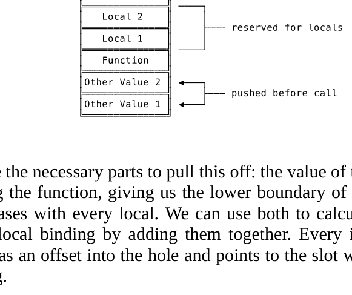

我们已经拥有实现这一点的必要部分：执行函数之前的栈指针值，给出了空洞的下边界，以及随着每个局部变量而增加的索引。我们可以将两者相加来计算每个本地绑定的栈槽索引。通过这种方式计算的每个索引都作为空洞的偏移量，并指向我们将存储本地绑定的槽位。

这种方法的美妙之处在于函数执行完毕后会发生什么。由于我们把栈指针的先前值搁置了，现在我们可以简单地恢复它，从而“重置”栈。这不仅移除了函数调用可能在栈上留下的所有内容，还移除了保存在空洞中的本地绑定——一切又变得干净如新！

“这都很好”，你说，“但我们怎么知道一个函数将使用多少个局部变量呢？”抓得好；你说中了。确实，我们不知道。至少在 VM 中不知道。另一方面，在编译器中，我们知道，而且它相当

将这些信息传递给 VM 对我们来说是微不足道的。

我们首先需要做的是为 `object.CompiledFunction` 扩展一个字段：

```go
// object/object.go

type CompiledFunction struct {
    Instructions code.Instructions
    NumLocals    int
}
```

`NumLocals` 稍后会告诉我们这个函数将要创建多少个局部绑定。在编译器中，我们现在可以询问符号表在编译函数时定义了多少个符号，并将该数字放入 `NumLocals` 中：

```go
// compiler/compiler.go

func (c *Compiler) Compile(node ast.Node) error {
    switch node := node.(type) {
    // [...]

    case *ast.FunctionLiteral:
        // [...]

        numLocals := c.symbolTable.numDefinitions
        instructions := c.leaveScope()

        compiledFn := &object.CompiledFunction{
            Instructions: instructions,
            NumLocals:    numLocals,
        }
        c.emit(code.OpConstant, c.addConstant(compiledFn))
    // [...]
    }
    // [...]
}
```

在调用 `c.leaveScope` 之前，我们取出当前符号表的 `numDefinitions`，将其暂存，并在离开作用域后将其保存到 `*object.CompiledFunction` 中。这就给了我们函数将在 VM 中创建和使用的局部绑定的数量。第一个迷你挑战完成！太棒了！

现在，根据我们的计划，我们需要做的另一件事是跟踪栈指针在 *执行函数之前* 的值，然后在 *执行之后* 将其恢复到该值。换句话说，我们需要一个在函数调用期间存在的临时存储。猜猜看？我们已经有了它，称之为 Frame。我们只需要再添加一个字段，即所谓的 basePointer：

```
// vm/frame.go

type Frame struct {
    fn          *object.CompiledFunction
    ip          int
    basePointer int
}

func NewFrame(fn *object.CompiledFunction, basePointer int) *Frame {
    f := &Frame{
        fn:          fn,
        ip:          -1,
        basePointer: basePointer,
    }

    return f
}
```

“base pointer” 这个名字不是我编造的。相反，给指向当前调用帧栈底部的指针起这个名字是常见做法。它是在执行函数时许多引用的基准。有时它也被称为“frame pointer”。在本书接下来的章节中我们会更多地使用它。现在，我们只需要 在推送新帧之前对其进行初始化：

```
// vm/vm.go

func New(bytecode *compiler.Bytecode) *VM {
    // [...] 

    mainFrame := NewFrame(mainFn, 0)

    // [...] 
}

func (vm *VM) Run() error {
    // [...] 
    switch op {
    // [...] 

    case code.OpCall:
        fn, ok := vm.stack[vm.sp-1].(*object.CompiledFunction)
        if !ok {
            return fmt.Errorf("calling non-function")
        }
        frame := NewFrame(fn, vm.sp)
        vm.pushFrame(frame)

    // [...] 
}
```

```
		}
		// [ ... ]
	}
```

在 vm.New 函数中，我们传入 0 作为栈指针的当前值，以便让我们的 mainFrame 正常工作，即使这个特定的帧永远不会从栈中弹出并且没有局部绑定。我们真正想要的是在 case code.OpCall 分支中新帧的设置。现在是调用 NewFrame 时的第二个参数，即 vm.sp 的当前值，它将作为新帧的 basePointer。

好了！我们现在有了 basePointer，并且知道函数将使用多少个局部变量。这给我们留下了两个任务：在执行函数之前为局部绑定在栈上分配空间。意思是：创建“空洞”。而且我们还需要实现 VM 中的 opSetLocal 和 opGetLocal 指令来使用它。

“在栈上分配空间”听起来很高级，但归结起来就是在不推送任何东西的情况下增加 vm.sp 的值。而且由于我们在执行函数之前已经将其值保存到一边，我们已经有一个完美的位置可以这样做：

```
// vm/vm.go

func (vm *VM) Run() error {
    // [ ... ]
    switch op {
        // [ ... ]

        case code.OpCall:
            fn, ok := vm.stack[vm.sp-1].(*object.CompiledFunction)
            if !ok {
                return fmt.Errorf("calling non-function")
            }
            frame := NewFrame(fn, vm.sp)
            vm.pushFrame(frame)
            vm.sp = frame.basePointer + fn.NumLocals

            // [ ... ]
        }
    // [ ... ]
}
```

我们将 vm.sp 设置为 frame.basePointer + fn.NumLocals，以明确起点是 basePointer，并且我们在栈上为 fn.NumLocals 预留槽位。这些槽位可能不包含值或包含旧值，在任何情况下我们都不关心。我们现在可以使用这个栈区域用于局部绑定，并且正常

```go
frame := vm.currentFrame()

err := vm.push(vm.stack[frame.basePointer+int(localIndex)])
if err != nil {
    return err
}

// [...] 
}
// [...] 
}
```

完成！让我们看看我们的测试会说什么：

```
$ go test ./vm
--- FAIL: TestCallingFunctionsWithBindings (0.00s)
    vm_test.go:444: vm error: unsupported types for binary operation:\
    COMPILED_FUNCTION_OBJ INTEGER
FAIL
FAIL    monkey/vm    0.031s
```

什么？在我们的任何测试用例中我们都没有尝试将函数加到整数上。只有在我们让函数留在栈上的情况下才会发生这种情况。啊！我们忘了清理栈！我们已经有了 basePointer，但我们在执行完函数后并没有用它来重置 vm.sp。

不过我们知道在哪里可以做到这一点：当我们遇到 OpReturnValue 或 OpReturn 指令时。目前，我们只将返回值和刚刚执行的函数从栈中取出。现在我们也需要摆脱局部绑定。最简单的方法是将栈指针设置为包含刚刚执行函数的帧的 basePointer：

// vm/vm.go

```go
func (vm *VM) Run() error {
    // [...] 
    switch op {
    // [...] 

    case code.OpReturnValue:
        returnValue := vm.pop()

        frame := vm.popFrame()
        vm.sp = frame.basePointer - 1

        err := vm.push(returnValue)
        if err != nil {
            return err
        }
    case code.OpReturn:
```

```
frame := vm.popFrame()
vm.sp = frame.basePointer - 1

err := vm.push(Null)
if err != nil {
    return err
}

// [...] 
}
// [...] 
}
```

当我们从函数返回时，我们首先将帧从帧栈中弹出。之前我们也这样做了，但没有保存弹出的帧。现在我们还将 vm.sp 设置为 frame.basePointer - 1。额外的 -1 从何而来？这是一个优化：将 vm.sp 设置为 frame.basePointer 会去掉局部绑定，但仍会将刚刚执行的函数留在栈上。因此，我们用进一步递减 vm.sp 来代替之前放置在那里的 vm.pop()。

这样就完成了。是的，真的。我们来到了一个旅程的终点，这个旅程始于 OpSetLocal 和 OpGetLocal 操作码的定义，带领我们从编译器测试经过符号表回到编译器，最后经过 object.CompiledFunction 的小小绕路来到了 VM。局部绑定可以工作了：

```
$ go test ./vm
ok      monkey/vm   0.039s
```

我们现在可以编译并执行这段 Monkey 代码：

```
let globalSeed = 50;
let minusOne = fn() {
    let num = 1;
    globalSeed - num;
}
let minusTwo = fn() {
    let num = 2;
    globalSeed - num;
}
minusOne() + minusOne()
```

而且还有更多。我们在没有明确打算这样做的情况下，又获得了对一等函数的升级。我们现在可以获取函数并将其分配给名称——在其他函数中：

// vm/vm_test.go

```go
func TestFirstClassFunctions(t *testing.T) {
	tests := []vmTestCase{
		// [...] 
		{
			input: `
			let returnsOneReturner = fn() {
			let returnsOne = fn() { 1; };
			returnsOne;
			};
			returnsOneReturner()();
			`,
			expected: 1,
		},
	}

	runVmTests(t, tests)
}
```

是的，这通过了：

```bash
$ go test ./vm
ok      monkey/vm    0.037s
```

现在我们已经达到了目标，下一步去哪里？函数调用的参数——它们比你想象的更接近我们现在的位置。


## 实参

让我们从简要回顾开始这一节。在 Monkey 中，我们可以定义带有参数的函数，如下所示：

```
let addThree = fn(a, b, c) {
  a + b + c;
}
```

这个函数有三个参数：a、b 和 c。当我们调用它时，可以在调用表达式中使用实参：

```
addThree(1, 2, 3);
```

在函数执行期间，这会将传入的实参值绑定到参数名上。现在，“绑定”这个词听起来应该很耳熟，但我不想拐弯抹角，所以直接说出来：函数调用的实参是局部绑定的一种特殊情况。

它们具有相同的生命周期、相同的作用域，并以相同的方式解析。唯一的区别在于它们的创建方式。局部绑定由用户通过 let 语句显式创建，编译器会为此生成 OpSetLocal 指令。另一方面，实参是隐式绑定到名称上的，这是由编译器和虚拟机在幕后完成的。这就引出了我们本节的任务列表。

我们本节的目标是完整实现函数参数和函数调用的实参。最后，我们要编译并执行这段 Monkey 代码：

```
let globalNum = 10;

let sum = fn(a, b) {
  let c = a + b;
  c + globalNum;
};

let outer = fn() {
  sum(1, 2) + sum(3, 4) + globalNum;
};

outer() + globalNum;
```

乍一看，这看起来相当混乱。这是有意为之。它混合了我们已实现的所有东西和我们将要构建的东西：全局和局部绑定、带参数和不带参数的函数、带实参和不带实参的函数调用。

那么我们的计划是什么？首先，我们需要重新思考我们的调用约定。目前的形态无法容纳实参。然后，作为第二步也是最后一步，我们需要实现这个更新后的调用约定。但让我们从头开始。

## 编译带实参的函数调用

我们当前调用约定的简要版本是：将要调用的函数压入栈中，发出 OpCall，然后就行了。我们现在面临的问题是把函数调用的实参放在哪里——不仅是“哪里”这个内存位置的含义，还有在调用约定中的位置。

我们不必花太久寻找内存位置，因为我们已经有了一个存储与当前函数调用相关数据的地方：栈。就像我们用栈来存储要调用的函数一样，我们也可以用栈来存储调用的实参。

但如何让它们进入栈呢？最简单的方法是在函数被压入之后，立即将它们压入栈中。出乎意料的是，这个务实的解决方案没有任何反对的理由。实际上它相当优雅，我们稍后会看到。

因此，如果我们采用这种方法，它会把我们的调用约定改为：将要调用的函数压入栈中，然后将调用的所有实参压入栈中，发出 OpCall，然后就行了。此时，在执行 OpCall 之前，栈会看起来像这样：

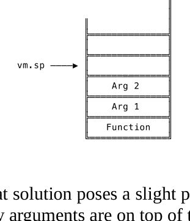

然而，就目前情况而言，这个解决方案给我们的虚拟机带来了一个小问题，因为它不知道栈顶有多少个实参。

想想我们在虚拟机中对 OpCall 的实现。在推送新帧之前，我们直接从栈顶取出要调用的函数。使用这种新的调用约定，栈上可能有零个或多个实参——位于函数之上。我们如何访问栈上的函数以便执行它？

由于函数是普通的 Monkey object.Objects，我们甚至不能选择 hacky 的方式，遍历栈来找到第一个 object.CompiledFunction；那可能只是函数调用的一个实参。

值得庆幸的是，我们不必诉诸那些 hacky 且“唉，这感觉真脏”的修复。有一个简单而优雅的解决方案：我们给 OpCall 操作码一个操作数，用来保存调用的实参数量。一个字节就足够了（或者你想调用超过 256 个实参的函数吗？），并且通过一点计算，我们就能找到实参下方的函数。

所以，让我们给 OpCall 添加一个操作数：

```
// code/code.go

var definitions = map[Opcode]*Definition{
    // [...] 

    OpCall:    {"OpCall", []int{1}},

    // [...] 
}
```

随着这一更改，一些测试因 panic 和索引错误而失败，因为我们定义了编译器和虚拟机都不知道的东西。

这本身不是问题，但新操作数的定义会导致我们的 code.Make 函数在相应位置创建一个空字节——即使我们不传入操作数。我们最终陷入了某种困境，系统中不同部分基于不同假设运作，没人知道到底发生了什么。我们需要重新恢复秩序。

我们将从更新现有的编译器测试开始，确保在创建 opCall 指令时确实传入操作数：

```
// compiler/compiler_test.go

func TestFunctionCalls(t *testing.T) {
    tests := []compilerTestCase{
        {
            // [...] 
            expectedInstructions: []code.Instructions{
                code.Make(code.OpConstant, 1), // The compiled function
                code.Make(code.OpCall, 0),
                code.Make(code.OpPop),
            },
        },
        {
            // [...] 
            expectedInstructions: []code.Instructions{
                code.Make(code.OpConstant, 1), // The compiled function
                code.Make(code.OpSetGlobal, 0),
                code.Make(code.OpGetGlobal, 0),
                code.Make(code.OpCall, 0),
                code.Make(code.OpPop),
            },
        },
    }

    runCompilerTests(t, tests)
}
```

这使编译器测试正确，编译器本身目前也没问题，因为编译器也使用 code.Make 来生成指令，而 code.Make 同样会为新操作数添加一个空字节，即使没有传入操作数。

不过，虚拟机在面对新操作数时会踉跄跌倒，不管是否为空。目前的解决方案，至少在我们编写测试来告诉我们真正想要什么之前，就是简单地跳过它：

```
// vm/vm.go

func (vm *VM) Run() error {
    // [...] 
    switch op {
    // [...]
```

```
case code.OpCall:
    vm.currentFrame().ip += 1
        // [...] 

        // [...] 
    }
    // [...] 
}
```

### 秩序已恢复：

```
$ go test ./...
?       monkey [no test files]
ok      monkey/ast 0.014s
ok      monkey/code 0.014s
ok      monkey/compiler 0.011s
ok      monkey/evaluator 0.014s
ok      monkey/lexer 0.011s
ok      monkey/object 0.014s
ok      monkey/parser 0.009s
?       monkey/repl [no test files]
?       monkey/token [no test files]
ok      monkey/vm 0.037s
```

我们回到了正轨，现在可以编写一个测试，确保编译器通过发出将实参压入栈的指令，符合更新后的调用约定。由于我们已经有了 TestFunctionCalls，我们可以用新的测试用例扩展它，而不必添加新的测试函数：

```
// compiler/compiler_test.go
```

```
func TestFunctionCalls(t *testing.T) {
    tests := []compilerTestCase{
        // [...] 
        {
            input: `
                let oneArg = fn(a) {};
                oneArg(24);
            `,
            expectedConstants: []interface{}{
                []code.Instructions{
                    code.Make(code.OpReturn),
                },
                24,
            },
            expectedInstructions: []code.Instructions{
                code.Make(code.OpConstant, 0),
                code.Make(code.OpSetGlobal, 0),
                code.Make(code.OpGetGlobal, 0),
                code.Make(code.OpConstant, 1),
                code.Make(code.OpCall, 1),
                code.Make(code.OpPop),
            },
        },
```

```
{
    input: `
    let manyArg = fn(a, b, c) { };
    manyArg(24, 25, 26);
    `,
    expectedConstants: []interface{}{
        []code.Instructions{
            code.Make(code.OpReturn),
        },
        24,
        25,
        26,
    },
    expectedInstructions: []code.Instructions{
        code.Make(code.OpConstant, 0),
        code.Make(code.OpSetGlobal, 0),
        code.Make(code.OpGetGlobal, 0),
        code.Make(code.OpConstant, 1),
        code.Make(code.OpConstant, 2),
        code.Make(code.OpConstant, 3),
        code.Make(code.OpCall, 3),
        code.Make(code.OpPop),
    },
    },
}
    runCompilerTests(t, tests)
}
```

值得注意的是，这些新测试用例中使用的函数体为空，没有使用它们的参数。这是有意为之。我们首先要确保能够编译函数调用，一旦实现，我们将引用同一测试中的参数并更新预期。

如这些测试用例的 expectedInstructions 所示，函数调用的第一个实参应该最终位于栈的最低处。从我们目前的角度来看，这并不重要，但很快我们就会看到，一旦我们开始引用参数，这会让虚拟机中的事情变得更加美好。

这些新测试的输出相当有启发性：

```
$ go test ./compiler
--- FAIL: TestFunctionCalls (0.00s)
    compiler_test.go:889: testInstructions failed: wrong instructions length.
    want="0000 OpConstant 0\n0003 OpSetGlobal 0\n0006 OpGetGlobal 0\n\
    0009 OpConstant 1\n0012 OpCall 1\n0014 OpPop\n"
    got ="0000 OpConstant 0\n0003 OpSetGlobal 0\n0006 OpGetGlobal 0\n\
    0009 OpCall 0\n0011 OpPop\n"
FAIL
FAIL    monkey/compiler 0.008s
```

缺少的 OpConstant 指令告诉我们，我们需要编译


函数调用的参数和 OpCall 的操作数告诉我们，它仍然未被使用。

我们可以同时做到这两点，只需将编译器中针对 *ast.CallExpressions 的 case 分支更新为以下代码：

```go
// compiler/compiler.go

func (c *Compiler) Compile(node ast.Node) error {
    switch node := node.(type) {
    // [...] 

    case *ast.CallExpression:
        err := c.Compile(node.Function)
        if err != nil {
            return err
        }

        for _, a := range node.Arguments {
            err := c.Compile(a)
            if err != nil {
                return err
            }
        }

        c.emit(code.OpCall, len(node.Arguments))

    // [...] 
    }

    // [...] 
}
```

这里没有改变的是对 node.Function 的编译。但现在，有了新的调用约定，这仅仅是第一步。我们还需要将函数调用的参数压入栈中。

我们通过使用循环按顺序编译参数来实现这一点。由于每个参数都是一个 *ast.Expression，它会被编译成一条或多条指令，将值压入栈中。结果是，这些参数最终会位于我们想要调用的函数上方的栈中，这正是调用约定要求它们所在的位置。为了告诉 VM 现在有多少个参数位于函数上方，我们使用 len(node.Arguments) 作为 OpCall 的操作数。

完成。测试通过了：

```bash
$ go test ./compiler
ok      monkey/compiler 0.008s
```

我们现在可以编译带参数的调用表达式了。*现在*我们可以开始考虑在函数体中使用这些参数了。

## 解析对参数的引用

在更新测试用例并替换那些空函数体之前，让我们先明确我们对编译器的期望。在函数调用时，参数现在会位于栈上。在函数执行期间，我们如何访问它们？

我们是否应该添加一个新的操作码，比如 opGetArgument，让 VM 将参数压入栈中？要做到这一点，我们需要在符号表中为参数提供它们自己的作用域和索引。否则，当我们遇到对参数的引用时，我们将不知道该发出哪个操作码。

这是一个可行的解决方案，如果我们的目标是明确地将参数与局部绑定区别对待，那么我们应该选择它，因为它在那个方向上提供了更大的灵活性。但我们不这样做。在 Monkey 中，传给函数的参数与在同一函数中创建的局部绑定之间没有区别。对我们来说，更好的选择是接受这一点，并以相同的方式对待它们。

一旦你查看函数调用时的栈，这也会成为显而易见的选择。参数正好位于被调用的函数上方。你知道通常在这个栈区域中存储的是什么吗？没错！局部绑定！所以如果我们把参数当作局部变量处理，它们就已经恰好在需要的位置。那么我们唯一要做的就是在编译器中将它们当作局部变量。

实际上，这意味着每当引用函数参数时都要发出 opGetLocal 指令。为了测试这一点，我们更新 TestFunctionCalls 中的最后两个测试用例：

```go
// compiler/compiler_test.go

func TestFunctionCalls(t *testing.T) {
	tests := []compilerTestCase{
		// [...]
		{
			input: `
			let oneArg = fn(a) { a };
```
oneArg(24);
`
expectedConstants: []interface{}{
    []code.Instructions{
        code.Make(code.OpGetLocal, 0),
        code.Make(code.OpReturnValue),
    },
    24,
},
expectedInstructions: []code.Instructions{
    code.Make(code.OpConstant, 0),
    code.Make(code.OpSetGlobal, 0),
    code.Make(code.OpGetGlobal, 0),
    code.Make(code.OpConstant, 1),
    code.Make(code.OpCall, 1),
    code.Make(code.OpPop),
},
},
{
    input: `
let manyArg = fn(a, b, c) { a; b; c };
manyArg(24, 25, 26);
`
expectedConstants: []interface{}{
    []code.Instructions{
        code.Make(code.OpGetLocal, 0),
        code.Make(code.OpPop),
        code.Make(code.OpGetLocal, 1),
        code.Make(code.OpPop),
        code.Make(code.OpGetLocal, 2),
        code.Make(code.OpReturnValue),
    },
    24,
    25,
    26,
},
expectedInstructions: []code.Instructions{
    code.Make(code.OpConstant, 0),
    code.Make(code.OpSetGlobal, 0),
    code.Make(code.OpGetGlobal, 0),
    code.Make(code.OpConstant, 1),
    code.Make(code.OpConstant, 2),
    code.Make(code.OpConstant, 3),
    code.Make(code.OpCall, 3),
    code.Make(code.OpPop),
},
    },
}
runCompilerTests(t, tests)
}
```

现在函数体不再是空的，而是包含了对函数参数的引用。更新后的预期告诉编译器，这些引用应该转换为 OpGetLocal 指令，将参数加载到栈上。这些 OpGetLocal 指令的索引从 0 开始，对应第一个参数，然后依次递增，就像其他局部绑定一样。

如果我们运行测试，就会看到编译器还无法解析这些引用：

```bash
$ go test ./compiler
--- FAIL: TestFunctionCalls (0.00s)
compiler_test.go:541: compiler error: undefined variable a
FAIL
FAIL    monkey/compiler 0.009s
```

就在这里，我们进入了“哦，太好了”的境地。我们修复这个问题所需要做的，就是将函数的参数定义为局部绑定。这里的“定义”应字面理解，它只是一个方法调用：

```go
// compiler/compiler.go

func (c *Compiler) Compile(node ast.Node) error {
    switch node := node.(type) {
    // [...] 
    case *ast.FunctionLiteral:
        c.enterScope()

        for _, p := range node.Parameters {
            c.symbolTable.Define(p.Value)
        }

        err := c.Compile(node.Body)
        if err != nil {
            return err
        }
        // [...] 
    // [...] 
    }

    // [...] 
}
```

在进入新作用域之后，即将编译函数体之前，我们在函数作用域中定义每个参数。这使得符号表（进而编译器）能够在编译函数体时解析新的引用，并将它们当作局部变量。看：

```bash
$ go test ./compiler
ok      monkey/compiler 0.009s
```

是不是很简洁？

## VM 中的参数

记住，我们的目标是编译并在我们的 VM 中运行这段 Monkey 代码：

```go
let globalNum = 10;

let sum = fn(a, b) {
    let c = a + b;
    c + globalNum;
};

let outer = fn() {
    sum(1, 2) + sum(3, 4) + globalNum;
};

outer() + globalNum;
```

我们快到了。我们已经可以提取这段代码的一部分，并将其变成 VM 的一个测试：

```go
// vm/vm_test.go

func TestCallingFunctionsWithArgumentsAndBindings(t *testing.T) {
    tests := []vmTestCase{
        {
            input: `
let identity = fn(a) { a; };
identity(4);
`,
            expected: 4,
        },
        {
            input: `
let sum = fn(a, b) { a + b; };
sum(1, 2);
`,
            expected: 3,
        }
    }

    runVmTests(t, tests)
}
```

这以最基本的形式展示了我们的目标。在第一个测试用例中，我们向一个函数传递一个参数，该函数只引用它的单个参数并返回它。第二个测试用例是健全性检查，确保我们没有在 VM 中硬编码边界情况，并且能够处理多个参数。两个测试都失败了：

$ go test ./vm
--- FAIL: TestCallingFunctionsWithArgumentsAndBindings (0.00s)

vm_test.go:709: vm error: calling non-function
FAIL
FAIL    monkey/vm    0.039s

这很有意思。测试失败并不是因为 VM 在栈上找不到参数，而是因为它找不到函数。这是因为它在错误的位置查找。

VM 仍然期望函数位于栈顶——这是旧调用约定下的正确行为。但自从我们更新了编译器之后，生成的指令不仅把函数放在栈上，还把参数也放在了栈上。这就是为什么 VM 会报错说无法调用非函数：它被参数绊住了。

修复方法是使用 OpCall 指令的操作数，按照它设计的方式使用：在栈中向下访问更深处以找到函数。

```go
// vm/vm.go

func (vm *VM) Run() error {
    // [...] 
    switch op {
    // [...] 
    case code.OpCall:
        numArgs := code.ReadUint8(ins[ip+1:])
        vm.currentFrame().ip += 1

        fn, ok := vm.stack[vm.sp-1-int(numArgs)].(*object.CompiledFunction)
        if !ok {
            return fmt.Errorf("calling non-function")
        }
        frame := NewFrame(fn, vm.sp)
        vm.pushFrame(frame)
        vm.sp = frame.basePointer + fn.NumLocals

        // [...] 
    }
    // [...] 
}
```

我们不再简单地从栈顶取出函数，而是通过解码操作数 numArgs，并用 vm.sp 减去它来计算函数的位置。额外的 -1 是因为 vm.sp 并非指向栈中最顶部的元素，而是指向下一个元素将被推入的槽位。

这让我们前进了一小步，但并没有前进太多：

```
$ go test ./vm
--- FAIL: TestCallingFunctionsWithArgumentsAndBindings (0.00s)
    vm_test.go:357: testIntegerObject failed:\
        object is not Integer. got=<nil> (<nil>)
panic: runtime error: \
    invalid memory address or nil pointer dereference [recovered]
panic: runtime error: invalid memory address or nil pointer dereference
[signal SIGSEGV: segmentation violation code=0x1 addr=0x20 pc=0x10f7841]

goroutine 13 [running]:
testing.tRunner.func1(0xc420a80f0)
/usr/local/go/src/testing/testing.go:742 +0x29d
panic(0x11215e0, 0x11fffa0)
/usr/local/go/src/runtime/panic.go:502 +0x229
monkey/vm.(*VM).executeBinaryOperation(0xc4204b3eb8, 0x1, 0x0, 0x0)
/Users/mrnugget/code/07/src/monkey/vm/vm.go:270 +0xa1
monkey/vm.(*VM).Run(0xc4204b3eb8, 0x10000, 0x10000)
/Users/mrnugget/code/07/src/monkey/vm/vm.go:87 +0x155
monkey/vm.runVmTests(0xc420a80f0, 0xc4204b3f58, 0x2, 0x2)
/Users/mrnugget/code/07/src/monkey/vm/vm_test.go:276 +0x5de
monkey/vm.TestCallingFunctionsWithArgumentsAndBindings(0xc420a80f0)
/Users/mrnugget/code/07/src/monkey/vm/vm_test.go:357 +0x93
testing.tRunner(0xc420a80f0, 0x11540e8)
/usr/local/go/src/testing/testing.go:777 +0xd0
created by testing.(*T).Run
/usr/local/go/src/testing/testing.go:824 +0x2e0
FAIL    monkey/vm    0.049s
```

第一个测试用例告诉我们，最后从栈中弹出的值不是预期的 4，而是 nil。好吧。显然 VM 找不到栈上的参数。

第二个测试用例没有提供任何信息就崩溃了。为什么会这样并不立刻显而易见，需要沿着堆栈跟踪向上追溯。一旦到达 vm.go，我们就找到了 panic 的原因：VM 试图对两个为相加而从栈中弹出的 nil 指针调用 object.Object.Type 方法。

两种失败归根结底是同一个问题：VM 试图在栈上找到参数，但得到的是 nil。

至少有些东西不工作，这有点是我们预期的。但话说回来，也不是真的。参数位于栈顶，正好在被调用的函数之上。那里本应存储局部绑定。而且由于我们把参数当作局部变量处理，并希望用 OpGetLocal 指令检索它们，它们本就应该在那里。这就是把参数当作局部变量处理的整个想法的精妙之处。那么为什么 VM 找不到它们呢？

简短回答：因为我们的栈指针太高了。我们初始化它的方式

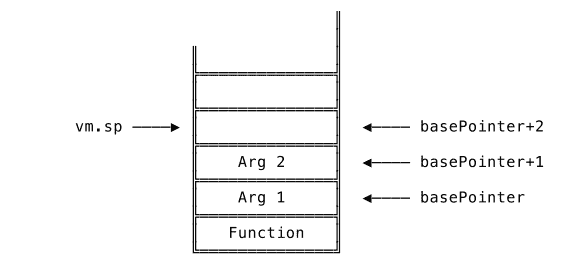

这样就能工作。有了这个，如果我们计算 `basePointer` 加上参数的局部绑定索引，就能得到正确的槽位。而且（双关语！）`vm.sp` 仍然会指向栈上的下一个空槽。完美！

以下是这个想法的代码实现：

```
```go
// vm/vm.go

func (vm *VM) Run() error {
    // […]
    switch op {
    // […]

    case code.OpCall:
        numArgs := code.ReadUInt8(ins[ip+1:])
        vm.currentFrame().ip += 1

        err := vm.callFunction(int(numArgs))
        if err != nil {
            return err
        }

    // […]
    }
    // […]
}

func (vm *VM) callFunction(numArgs int) error {
    fn, ok := vm.stack[vm.sp-1-numArgs].(*object.CompiledFunction)
    if !ok {
        return fmt.Errorf("calling non-function")
    }

    frame := NewFrame(fn, vm.sp-numArgs)
    vm.pushFrame(frame)

    vm.sp = frame.basePointer + fn.NumLocals

    return nil
}
```
```

在为时已晚之前，我们将 OpCall 实现的主要部分移到了一个新方法中，名为 callFunction。不过不要被骗了，实现本身几乎没有变化。唯一的区别是调用 NewFrame 时的第二个参数。我们不再直接传入 vm.sp 作为帧的未来 basePointer，而是先减去 numArgs。这就得到了如前图所示的 basePointer。

现在看一下：

```
$ go test ./vm
ok      monkey/vm   0.047s
```

我们的所有测试都通过了！让我们再大胆一点，给 VM 扔更多测试：

```
// vm/vm_test.go

func TestCallingFunctionsWithArgumentsAndBindings(t *testing.T) {
    tests := []vmTestCase {
        // [...] 
        {
            input: `
let sum = fn(a, b) {
    let c = a + b;
    c;
};
sum(1, 2);
`,
            expected: 3,
        },
        {
            input: `
let sum = fn(a, b) {
    let c = a + b;
    c;
};
sum(1, 2) + sum(3, 4);`,
            expected: 10,
        },
        {
            input: `
let sum = fn(a, b) {
    let c = a + b;
    c;
};
let outer = fn() {
    sum(1, 2) + sum(3, 4);
};
outer();
`,
            expected: 10,
        },
    }
}
```

```
runVmTests(t, tests)
}
```

这些测试用例确保我们可以混合手动创建的局部绑定和参数：在一个函数中，或在同一个函数被多次调用时，或在一个函数中多次调用另一个函数。它们全部通过：

```
$ go test ./vm
ok      monkey/vm  0.041s
```

现在，让我们看看是否已经达到了目标：

```
// vm/vm_test.go

func TestCallingFunctionsWithArgumentsAndBindings(t *testing.T) {
    tests := []vmTestCase {
        // [...] 
        {
            input: `
let globalNum = 10;

let sum = fn(a, b) {
    let c = a + b;
    c + globalNum;
};

let outer = fn() {
    sum(1, 2) + sum(3, 4) + globalNum;
};

outer() + globalNum;
`,
            expected: 50,
        },
    }

    runVmTests(t, tests)
}
```

运行此测试会告诉我们：

```
$ go test ./vm
ok      monkey/vm  0.035s
```

是的，我们做到了！我们已成功将函数调用参数添加到编译器和 VM 中！

现在我们只需要确保在调用参数数量错误时栈不会崩塌，因为我们的很多实现都依赖于这个数字：

```
// vm/vm_test.go

func TestCallingFunctionsWithWrongArguments(t *testing.T) {
	tests := []VMTestCase{
		{
			input:    `fn() { 1; }();`,
			expected: `wrong number of arguments: want=0, got=1`,
		},
		{
			input:    `fn(a) { a; }();`,
			expected: `wrong number of arguments: want=1, got=0`,
		},
		{
			input:    `fn(a, b) { a + b; }();`,
			expected: `wrong number of arguments: want=2, got=1`,
		}
	}

	for _, tt := range tests {
		program := parse(tt.input)

		comp := compiler.New()
		err := comp.Compile(program)
		if err != nil {
			t.Fatal("compiler error: %s", err)
		}

		vm := New(comp.Bytecode())
		err = vm.Run()
		if err == nil {
			t.Fatal("expected VM error but resulted in none.")
		}

		if err.Error() != tt.expected {
			t.Fatalf("wrong VM error: want=%q, got=%q", tt.expected, err)
		}
	}
}
```

我们希望确保在参数数量错误时调用函数会得到 VM 错误。是的，这次我们 *想要* 一个错误，但却没有得到：

```
$ go test ./vm
--- FAIL: TestCallingFunctionsWithWrongArguments (0.00s)
vm_test.go:801: expected VM error but resulted in none.
FAIL
FAIL	monkey/vm	0.053s
```

为了解决这个问题，我们需要快速前往 object 包，并在 object.CompiledFunction 的定义中添加一个新字段：

```
// object/object.go
```

```
type CompiledFunction struct {
    Instructions code.Instructions
    NumLocals    int
    NumParameters int
}
```

我们现在将在编译器中填充这个新的 NumParameters 字段，在那里我们手头有函数字面量的参数数量：

```
// compiler/compiler.go

func (c *Compiler) Compile(node ast.Node) error {
    switch node := node.(type) {
    // [...] 

    case *ast.FunctionLiteral:
    // [...] 

        compiledFn := &object.CompiledFunction{
            Instructions: instructions,
            NumLocals:    numLocals,
            NumParameters: len(node.Parameters),
        }
        c.emit(code.OpConstant, c.addConstant(compiledFn))

    // [...] 
    }

    // [...] 
}
```

在 VM 中，我们可以使用该字段来确保栈上存在正确数量的参数：

```
// vm/vm.go

func (vm *VM) callFunction(numArgs int) error {
    fn, ok := vm.stack[vm.sp-1-numArgs].(*object.CompiledFunction)
    if !ok {
        return fmt.Errorf("calling non-function")
    }

    if numArgs != fn.NumParameters {
        return fmt.Errorf("wrong number of arguments: want=%d, got=%d", fn.NumParameters, numArgs)
    }

    // [...] 
}
```

有了它，我们就处于安全地带：


```
$ go test ./vm
ok	monkey/vm	0.035s
```

即使我们调用函数时传入错误数量的参数，调用栈也能正常保持。

现在，我们可以享受在字节码编译器和虚拟机中实现函数及函数调用这一成果，其中还包括参数和本地绑定。这绝对不是一件小事，再次让我们迈入了另一个层次：

```
$ go build -o monkey . && ./monkey
Hello mrnugget! This is the Monkey programming language!
Feel free to type in commands
>> let one = fn() { 1; };
CompiledFunction[0xc42008a8d0]
>> let two = fn() { let result = one(); return result + result; };
CompiledFunction[0xc42008aba0]
>> let three = fn(two) { two() + 1; };
CompiledFunction[0xc42008ae40]
>> three(two);
3
```

是时候添加另一种类型的函数了。

## 内置函数

在 *Writing An Interpreter In Go* 中，我们不仅为求值器添加了定义函数的功能，还将函数直接内置其中。这些函数如下所示：

```
len([1, 2, 3]);      // => 3
first([1, 2, 3]);    // => 1
last([1, 2, 3]);     // => 3
rest([1, 2, 3]);     // => [2, 3]
push([1, 2, 3], 4);  // => [1, 2, 3, 4]
puts("Hello World!"); // prints "Hello World!"
```

本章的目标是对我们的新字节码编译器和虚拟机做同样的事情，并将这些函数内置其中。这并不像人们想象的那样容易。

虽然这些是 Go 函数，理论上应与我们编写的其他任何函数一样具有可移植性，但它们已在求值器包中扎根。它们被定义为私有，使用内部引用，并利用了私有辅助函数——在编译器和 vm 包中使用它们并非最佳条件。

因此，在我们开始思考在虚拟机中执行这些内置函数，甚至只是在编译器中提及它们之前，我们需要重构前一本书中的一些代码，以便我们的新代码更易于使用。

显而易见的第一个选项是让函数定义公开。将它们名称首字母大写，搞定。这确实有效，但也会与某样微妙的事情——我的品味——发生冲突。我不希望编译器或虚拟机依赖于求值器，而这正是这种做法会导致的结果。相反，我希望所有三个包——编译器、vm 和求值器——都能平等访问内置函数。

这引出了第二个选项：复制定义，保留一份供求值器使用，并为 vm 和编译器包创建一份。但话说回来，我们是程序员，不喜欢重复。不过认真来说：复制这些内置函数是个坏主意。其中编码了相当多非平凡的 Monkey 行为，我们不希望意外分叉并产生分歧。

相反，我们将把这些内置函数移到 object 包中。
这需要稍多一点的 effort，但这也是最优雅的选择，因为它使后续将内置函数整合到编译器和虚拟机中变得容易得多。

## 让变更更简单

所以，第一个任务是：在保持求值器正常工作的情况下，将内置函数移出求值器包。附带一个小支线任务：在移动它们时，我们需要以*稳定的方式*定义内置函数，以便我们可以遍历它们。目前在求值器中的内置函数是一个 `map[string]*object.Builtin`，这并不能保证稳定的迭代。

我们将使用结构体切片代替映射，以便我们可以将 `*object.Builtin` 与其名称配对。这为我们提供了稳定的迭代，并且借助一个小函数，允许我们按名称获取单个函数。

这样做的同时，而不是简单地剪切粘贴现有的 `evaluator.builtins` 定义，还给了我们一个机会，通过再次查看每个内置函数来刷新我们的记忆。

让我们从 len 开始。它返回数组或字符串的长度。我们创建一个新文件，`object/builtins.go`，并将 `len` 的定义从 `evaluator/builtins.go` 复制到新文件。如下所示：

```go
// object/builtins.go

package object

import "fmt"

var Builtins = []struct {
	Name   string
	Builtin *Builtin
}{
	{
		"len",
		&Builtin{Fn: func(args ...Object) Object {
			if len(args) != 1 {
				return newError("wrong number of arguments. got=%d, want=1",
					len(args))
			}

			switch arg := args[0].(type) {
			case *Array:
				return &Integer{Value: int64(len(arg.Elements))}
			case *String:
				return &Integer{Value: int64(len(arg.Value))}
			default:
				return newError("argument to `len` not supported, got %s",
```
```go
args[0].Type()
    }
  },
  },
},
}

func newError(format string, a ...interface{}) *Error {
    return &Error{Message: fmt.Sprintf(format, a...)}
}
```

Builtins 是一个结构体切片，其中每个结构体都包含名称和 *Builtin 函数本身。

虽然我们复制了名为 len 的 *Builtin，但请注意，这并非无脑的复制粘贴：在 *Builtin 本身中，我们必须移除对 object 包的引用。既然我们在 object 包中，这些引用现在是多余的。

newError 函数我们也必须复制过来，因为它被大多数内置函数大量使用。

定义了 Builtins 并包含其第一个定义后，我们现在可以添加一个名为 GetBuiltinByName 的函数：

```go
// object/builtins.go

func GetBuiltinByName(name string) *Builtin {
    for _, def := range Builtins {
        if def.Name == name {
            return def.Builtin
        }
    }
    return nil
}
```

这里没什么好解释的。这是一个允许我们按名称获取内置函数的函数。但有了这个，我们可以消除 evaluator/builtins.go 中的重复，并用这个替换 len 的旧定义：

```go
// evaluator/builtins.go

var builtins = map[string]*object.Builtin{
    "len": object.GetBuiltinByName("len"),
    // [...]
}
```

这就是我们移动的第二个内置函数。恭喜！而且，看看，求值器包的测试仍然有效：

$ go test ./evaluator
ok      monkey/evaluator    0.009s

太好了！现在我们可以对 evaluator.builtins 中的每个函数做同样的事情。接下来是 puts，它打印其参数：

```
// object/builtins.go

var Builtins = []struct {
    Name     string
    Builtin  *Builtin
}{
    // [...] 
    {
        "puts",
        &Builtin{Fn: func(args ...Object) Object {
            for _, arg := range args {
                fmt.Println(arg.Inspect())
            }

            return nil
        }},
    },
},
```

尽管看起来不多，但 puts 的这个新定义包含一个关键变化。

在求值器包中的定义中，puts 返回 evaluator.NULL。这是求值器中 vm.Null 的对应物。但是，由于保留对 evaluator.NULL 的引用意味着在虚拟机中需要处理两个 *object.Null 实例，我们将 puts 改为返回 nil。

一旦我们在虚拟机中，就很容易用 vm.Null 替换它。但由于我们希望在求值器中也使用 puts 的新定义，我们需要更改现有代码，使其现在检查 nil，并在必要时将其转换为 NULL：

```
// evaluator/evaluator.go

func applyFunction(fn object.Object, args []object.Object) object.Object {
    switch fn := fn.(type) {
        // [...] 
        case *object.Builtin:
            if result := fn.Fn(args...); result != nil {
                return result
            }
        return NULL
```

```
// [...] 
}
}
```

下一个要移动的函数是 first，它返回数组的第一个元素。它必须接受与 puts 相同的处理：从 evaluator/builtins.go 复制到 object/builtins.go，移除对 object 包的引用，并在之前返回 evaluator.NULL 的地方返回 nil：

```go
// object/builtins.go

var Builtins = []struct {
    Name     string
    Builtin  *Builtin
}{
    // [...] 
    {
        "first",
        &Builtin{Fn: func(args ...Object) Object {
            if len(args) != 1 {
                return newError("wrong number of arguments. got=%d, want=1",
                    len(args))
            }
            if args[0].Type() != ARRAY_OBJ {
                return newError("argument to `first` must be ARRAY, got %s",
                    args[0].Type())
            }

            arr := args[0].(*Array)
            if len(arr.Elements) > 0 {
                return arr.Elements[0]
            }

            return nil
        },
        },
    },
}
```

当然，我们还定义了一个 last 函数，我们必须遵循相同的配方：

```go
// object/builtins.go

var Builtins = []struct {
    Name     string
    Builtin  *Builtin
}{
    // [...] 
    {
        "last",
        &Builtin{Fn: func(args ...Object) Object {
            if len(args) != 1 {
```


```
				return newError("wrong number of arguments. got=%d, want=1",
						len(args))
			}
			if args[0].Type() != ARRAY_OBJ {
				return newError("argument to `last` must be ARRAY, got %s",
					args[0].Type())
			}

			arr := args[0].(*Array)
			length := len(arr.Elements)
			if length > 0 {
				return arr.Elements[length-1]
			}

			return nil
		},
	},
},
}
```

除了获取数组的第一个和最后一个元素外，有时获取除第一个之外的所有元素也非常有用，这就是我们拥有 `rest` 的原因：

```
// object/builtins.go

var Builtins = []struct {
Name		string
Builtin	*Builtin
}{
// [ ... ]
{
"rest",
&Builtin{Fn: func(args ...Object) Object {
if len(args) != 1 {
return newError("wrong number of arguments. got=%d, want=1",
len(args))
}
if args[0].Type() != ARRAY_OBJ {
return newError("argument to `rest` must be ARRAY, got %s",
args[0].Type())
}

arr := args[0].(*Array)
length := len(arr.Elements)
if length > 0 {
newElements := make([]Object, length-1, length-1)
copy(newElements, arr.Elements[1:length])
return &Array{Elements: newElements}
}

return nil
},
},
}
```

然后我们定义 `push`，它向数组中添加一个元素。它并不改变原数组，而是保持原数组不变，并分配一个新数组，其中包含原数组的元素以及新添加的元素：

```
// object/builtins.go

var Builtins = []struct {
    Name     string
    Builtin  *Builtin
}{}
    // [...]
    {
        "push",
        &Builtin{Fn: func(args ...Object) Object {
            if len(args) != 2 {
                return newError("wrong number of arguments. got=%d, want=2", len(args))
            }
            if args[0].Type() != ARRAY_OBJ {
                return newError("argument to `push` must be ARRAY, got %s", args[0].Type())
            }

            arr := args[0].(*Array)
            length := len(arr.Elements)

            newElements := make([]Object, length+1, length+1)
            copy(newElements, arr.Elements)
            newElements[length] = args[1]

            return &Array{Elements: newElements}
        },
    },
},
```

这就完成了我们要实现的所有内置函数。现在它们都定义在 `object.Builtins` 中，去除了对 `object` 包的冗余引用，也不再提及 `evaluator.NULL`。

现在我们可以回到 `evaluator/builtins.go`，将所有目前重复的定义替换为对 `object.GetBuiltinByName` 的调用：

```
// evaluator/builtins.go

import (
    "monkey/object"
)

var builtins = map[string]*object.Builtin{
    "len":   object.GetBuiltinByName("len"),
    "puts":  object.GetBuiltinByName("puts"),
    "first": object.GetBuiltinByName("first"),
```

```
"last": object.GetBuiltinByName("last"),
"rest": object.GetBuiltinByName("rest"),
"push": object.GetBuiltinByName("push"),
}
```

是不是很巧妙？这就是整个文件！现在我们需要进行健全性检查，以确保一切仍然正常运行：

```
$ go test ./evaluator
ok      monkey/evaluator   0.009s
```

太好了！这样一来，内置函数现在就可以被所有导入 `object` 包的软件包使用了。它们不再依赖于 `evaluator.NULL`，而是遵循自带空值（bring-your-own-null）的方法。求值器的运行方式与 *Writing An Interpreter In Go* 结尾时保持一致，所有测试都通过了。

完美。这就是我所称的重构。它让我们现在需要做的一切都变得更加容易。

## 实施变更：计划

你知道我喜欢什么吗？消除边缘案例，并尽可能减少边缘案例。

这就是为什么我想保持现有的调用约定不变，即使是针对内置函数也是如此。这意味着，为了调用内置函数，你需要做的与其他任何函数相同：将内置函数压入栈，压入调用参数，然后使用 `OpCall` 指令调用该函数。

内置函数*如何*被执行，这是 VM 的实现细节，我们稍后再担心。

从编译器的角度来看，在编译涉及内置函数的调用表达式时，唯一不同的地方是函数如何进入栈。为此，我们确实需要引入另一种情况，但这不是一个边缘案例。

内置函数既不在全局作用域中定义，也不在局部作用域中定义。它们存在于自己的作用域中。我们需要将这个作用域引入编译器及其符号表，以便正确解析对内置函数的引用。

我们将把这个作用域称为 `BuiltinScope`，并在其中按刚刚移动到 `object.Builtins` 定义切片中的顺序定义所有内置函数。这是一个重要的细节，因为这是我们的支线任务（sidequest）。

当编译器（在符号表的帮助下）检测到对内置函数的引用时，它将发出 `OpGetBuiltin` 指令。该指令的操作数将是被引用函数在 `object.Builtins` 中的索引。

由于 VM 也可以访问 `object.Builtins`，它可以使用指令的操作数从 `object.Builtins` 中获取正确的函数，并将其压入栈中，以便随后可以调用它。

同样，我们可以稍后再担心*那*是如何发生的，一旦我们编写了第一个 VM 测试。但作为下一步，我们需要确保编译器知道如何解析对内置函数的引用。为此，我们需要一个新的操作码和一个

## 内置函数新作用域

首先，正如我们现在所知，这通常意味着一个新的操作码。这次它被称为 OpGetBuiltin：

```
// code/code.go

const (
    // [...] 
    OpGetBuiltin
)

var definitions = map[Opcode]*Definition{
    // [...] 
    OpGetBuiltin: {"OpGetBuiltin", []int{1}},
}
```

该操作码带有一个宽一字节的操作数。这意味着我们可以定义多达 256 个内置函数。听起来很少吗？让我们只说，一旦我们达到这个限制，我们可以始终将其改为两个字节。

你知道流程：先操作码，然后是编译器测试。现在有了 OpGetBuiltin，我们可以编写一个测试，期望我们的编译器将对内置函数的引用转换为 OpGetBuiltin 指令。

```
// compiler/compiler_test.go

func TestBuiltins(t *testing.T) {
    tests := []compilerTestCase{
        {
            input: `
len([]);
push([], 1);
`
            expectedConstants: []interface{}{1},
            expectedInstructions: []code.Instructions{
                code.Make(code.OpGetBuiltin, 0),
                code.Make(code.OpArray, 0),
                code.Make(code.OpCall, 1),
                code.Make(code.OpPop),
                code.Make(code.OpGetBuiltin, 5),
                code.Make(code.OpArray, 0),
                code.Make(code.OpConstant, 0),
                code.Make(code.OpCall, 2),
                code.Make(code.OpPop),
            },
        },
        {

```

```
input: `fn() { len([]) }`,
expectedConstants: []interface{}{
    []code.Instructions{
        code.Make(code.OpGetBuiltin, 0),
        code.Make(code.OpArray, 0),
        code.Make(code.OpCall, 1),
        code.Make(code.OpReturnValue),
    },
},
expectedInstructions: []code.Instructions{
    code.Make(code.OpConstant, 0),
    code.Make(code.OpPop),
},
},
}

runCompilerTests(t, tests)
}
```

这两个测试用例中的第一个确保了两件事。首先，调用内置函数遵循我们既定的调用约定，其次，OpGetBuiltin 指令的操作数是被引用函数在 object.Builtins 中的索引。

第二个测试用例则确保对内置函数的引用被正确解析，无论它们出现在哪个作用域中，这与局部和全局作用域的现有行为不同。

如果我们运行测试，我们会得到一个编译器错误：

```
$ go test ./compiler
--- FAIL: TestBuiltins (0.00s)
compiler_test.go:1049: compiler error: undefined variable len
FAIL
FAIL    monkey/compiler 0.008s
```

由于修复此失败测试包含我们的编译器正确解析引用，我们下一站是编译器解决解析需求的地方：符号表。

在这里，我们同样需要编写一个测试，以确保无论符号表被嵌套多少层，内置函数始终解析为 BuiltinScope 中的一个符号：

```
// compiler/symbol_table_test.go

func TestDefineResolveBuiltins(t *testing.T) {
    global := NewSymbolTable()
    firstLocal := NewEnclosedSymbolTable(global)


```go
secondLocal := NewEnclosedSymbolTable(firstLocal)

expected := []Symbol{
    Symbol{Name: "a", Scope: BuiltinScope, Index: 0},
    Symbol{Name: "c", Scope: BuiltinScope, Index: 1},
    Symbol{Name: "e", Scope: BuiltinScope, Index: 2},
    Symbol{Name: "f", Scope: BuiltinScope, Index: 3},
}

for i, v := range expected {
    global.DefineBuiltin(i, v.Name)
}

for _, table := range []*SymbolTable{global, firstLocal, secondLocal} {
    for _, sym := range expected {
        result, ok := table.Resolve(sym.Name)
        if !ok {
            t.Errorf("name %s not resolvable", sym.Name)
            continue
        }
        if result != sym {
            t.Errorf("expected %s to resolve to %+v, got=%+v", sym.Name, sym, result)
        }
    }
}
```

在这个测试中，我们定义了三个相互嵌套的作用域，并期望使用 DefineBuiltin 在全局作用域中定义的所有符号都能解析到新的 BuiltinScope。

由于 DefineBuiltin 和 BuiltinScope 尚不存在，目前无需运行测试，但确保它们按预期报错也无妨：

```bash
$ go test -run TestDefineResolveBuiltins ./compiler
# monkey/compiler
compiler/symbol_table_test.go:162:28: undefined: BuiltinScope
compiler/symbol_table_test.go:163:28: undefined: BuiltinScope
compiler/symbol_table_test.go:164:28: undefined: BuiltinScope
compiler/symbol_table_test.go:165:28: undefined: BuiltinScope
compiler/symbol_table_test.go:169:9: global.DefineBuiltin undefined\
(type *SymbolTable has no field or method DefineBuiltin)
FAIL    monkey/compiler [build failed]
```

正如预期。定义 BuiltinScope 是两个必要步骤中较容易的一个，所以我们先做这个：

```go
// compiler/symbol_table.go

const (
    // [...]
    BuiltinScope SymbolScope = "BUILTIN"
```

但编写 DefineBuiltin 方法也并不困难：

```
// compiler/symbol_table.go

func (s *SymbolTable) DefineBuiltin(index int, name string) Symbol {
    symbol := Symbol{Name: name, Index: index, Scope: BuiltinScope}
    s.store[name] = symbol
    return symbol
}
```

与现有的 Define 方法相比，这里的方法要简单得多。用给定的索引在 BuiltinScope 中定义给定的名称，忽略是否被包含在另一个符号表中，然后完成：

```
$ go test -run TestDefineResolveBuiltins ./compiler
ok      monkey/compiler 0.007s
```

现在我们可以回到编译器中使用 DefineBuiltin 方法：

```
// compiler/compiler.go

func New() *Compiler {
    // [...] 
    symbolTable := NewSymbolTable()
    for i, v := range object.Builtins {
        symbolTable.DefineBuiltin(i, v.Name)
    }
    return &Compiler{
        // [...] 
        symbolTable:    symbolTable,
        // [...] 
    }
}
```

在初始化新的 *Compiler 时，我们遍历 object.Builtins 中的所有函数，并使用全局符号表上的 DefineBuiltin 方法将它们定义在 BuiltinScope 中。

这应该能修复我们的编译器测试，因为编译器现在可以解析对内置函数的引用：

```
$ go test ./compiler
--- FAIL: TestBuiltins (0.00s)
    compiler_test.go:1056: testInstructions failed: wrong instruction at 0.
    want="0000 OpGetBuiltin 0\n0002 OpArray 0\n0005 OpCall 1\n0007 OpPop\n\
```

0008 OpGetBuiltin 5\n0010 OpArray 0\n0013 OpConstant 0\n\
0016 OpCall 2\n0018 OpPop\n"
got ="0000 OpGetLocal 0\n0002 OpArray 0\n0005 OpCall 1\n0007 OpPop\n\
0008 OpGetLocal 5\n0010 OpArray 0\n0013 OpConstant 0\n\
0016 OpCall 2\n0018 OpPop\n"
FAIL
FAIL      monkey/compiler 0.009s

不过，并没有，而且这是因为我们的编译器忽略了符号表所说内容的一半。在当前状态下，使用符号表解析名称后，编译器只检查符号的作用域是否为 GlobalScope。但我们不能再用 if-else 检查来应付了。

我们现在有了第三个作用域，必须真正听从符号表所说的内容。最好在单独的方法中实现这一点：

```
// compiler/compiler.go

func (c *Compiler) loadSymbol(s Symbol) {
    switch s.Scope {
    case GlobalScope:
        c.emit(code.OpGetGlobal, s.Index)
    case LocalScope:
        c.emit(code.OpGetLocal, s.Index)
    case BuiltinScope:
        c.emit(code.OpGetBuiltin, s.Index)
    }
}
```

当我们现在使用 loadSymbol 来编译 *ast.Identifier 时，我们会为解析到的每个符号发出正确的指令：

```
// compiler/compiler.go

func (c *Compiler) Compile(node ast.Node) error {
    switch node := node.(type) {
        // [...] 
    case *ast.Identifier:
        symbol, ok := c.symbolTable.Resolve(node.Value)
        if !ok {
            return fmt.Errorf("undefined variable %s", node.Value)
        }
        c.loadSymbol(symbol)
        // [...] 
    }
    // [...] 
}
```

没错，这就对了：

```
$ go test ./compiler
ok      monkey/compiler 0.008s
```

这意味着，编译器现在可以编译对内置函数的引用。最好的部分是，它也保持了我们现有的调用约定——而我们无需做任何事情。太棒了！

是时候开始担心内置函数的执行这一实现细节了。

## 执行内置函数

“实现细节”听起来总是像在谈论更改的大小，而实际上它关乎可见性和抽象。功能的使用者不应该担心 *如何* 实现它——细节——而只应关注如何使用它。

Monkey 用户不应该担心如何执行内置函数。编译器也不应该担心。这完全是 VM 的职责。这给了我们很大的自由：实现的自由以及测试的自由。我们可以先写下我们希望 VM 做什么，然后再担心 *如何* 实现：

```
// vm/vm_test.go

func TestBuiltinFunctions(t *testing.T) {
   tests := []vmTestCase{
      {`len("")`, 0},
      {`len("four")`, 4},
      {`len("hello world")`, 11},
      {
         `len(1)`,
         &object.Error{
            Message: "argument to `len` not supported, got INTEGER",
         },
      },
      {`len("one", "two")`,
         &object.Error{
            Message: "wrong number of arguments. got=2, want=1",
         },
      },
      {`len([1, 2, 3])`, 3},
      {`len([])`, 0},
      {`puts("hello", "world!")`, Null},
      {`first([1, 2, 3])`, 1},
      {`first([])`, Null},
      {`first(1)`,
         &object.Error{
            Message: "argument to `first` must be ARRAY, got INTEGER",
         },
      },
      {`last([1, 2, 3])`, 3},
      {`last([])`, Null},
      {`last(1)`,
         &object.Error{
            Message: "argument to `last` must be ARRAY, got INTEGER",
         },
      },
      {`rest([1, 2, 3])`, []int{2, 3}},
      {`rest([])`, Null},
      {`push([], 1)`, []int{1}},
      {`push(1, 1)`,
```

```
&object.Error{
    Message: "argument to `push` must be ARRAY, got INTEGER",
}
}
}

runVmTests(t, tests)
}

```

```
func testExpectedObject(
    t *testing.T,
    expected interface{},
    actual object.Object,
) {
    t.Helper()

    switch expected := expected.(type) {
    // [...]

    case *object.Error:
        errObj, ok := actual.(*object.Error)
        if !ok {
            t.Errorf("object is not Error: %T (%+v)", actual, actual)
            return
        }
        if errObj.Message != expected.Message {
            t.Errorf("wrong error message. expected=%q, got=%q",
                expected.Message, errObj.Message)
        }
    }
}

```

这个测试是 evaluator 包中 TestBuiltinFunctions 测试的更新版本。evaluator.NULL 的引用已更改为 vm.Null，并且结果的测试已更新为使用我们的新测试助手。除此之外，它与前身做的事情相同：确保所有内置函数按预期工作，包括错误处理。

当然，这些函数目前都还不能工作。相反，运行测试时会发生 panic。我不会向你展示——为了节省半页书的篇幅，也为了免去你查看时的头痛。可以放心，主要原因是 VM 尚未解码和执行 OpGetBuiltin 指令。这就是我们的第一个任务：

```go
// vm/vm.go

func (vm *VM) Run() error {
    // [...]
    switch op {
        // [...]
        case code.OpGetBuiltin:


```go
builtinIndex := code.ReadUint8(ins[ip+1:])
vm.currentFrame().ip += 1

definition := object.Builtins[builtinIndex]

err := vm.push(definition.Builtin)
if err != nil {
    return err
}

// [...] 
}

// [...] 
}
```

我们解码操作数，把它作为索引去访问 `object.Builtins`，获取内置函数的定义，然后把 `*object.Builtin` 压入栈中。这就是我们调用约定的第一部分：把你想调用的函数放到栈上。

现在当我们运行测试时，panic 消失了，取而代之的是更有帮助的信息：

```bash
$ go test ./vm
--- FAIL: TestBuiltinFunctions (0.00s)
    vm_test.go:847: vm error: calling non-function
FAIL
FAIL    monkey/vm    0.036s
```

虚拟机告诉我们，它只能执行用户定义的函数。要修复这个问题，我们必须修改执行 `OpCall` 指令的方式。不能再像现在这样直接调用 `callFunction` 方法，而是要先检查我们到底要调用什么东西，然后分派给相应的方法。为此，我们引入一个 `executeCall` 方法：

```go
// vm/vm.go

func (vm *VM) Run() error {
    // [...] 
    switch op {
    // [...] 

    case code.OpCall:
        numArgs := code.ReadUint8(ins[ip+1:])
        vm.currentFrame().ip += 1

        err := vm.executeCall(int(numArgs))
        if err != nil {
            return err
        }
    }
}
```

```go
    // [...] 
    }

// [...] 
}
```

```go
func (vm *VM) executeCall(numArgs int) error {
    callee := vm.stack[vm.sp-1-numArgs]
    switch callee := callee.(type) {
    case *object.CompiledFunction:
        return vm.callFunction(callee, numArgs)
    case *object.Builtin:
        return vm.callBuiltin(callee, numArgs)
    default:
        return fmt.Errorf("calling non-function and non-built-in")
    }
}
```

```go
func (vm *VM) callFunction(fn *object.CompiledFunction, numArgs int) error {
    if numArgs != fn.NumParameters {
        return fmt.Errorf("wrong number of arguments: want=%d, got=%d",
            fn.NumParameters, numArgs)
    }

    frame := NewFrame(fn, vm.sp-numArgs)
    vm.pushFrame(frame)

    vm.sp = frame.basePointer + fn.NumLocals

    return nil
}
```

现在 `executeCall` 承担了之前由 `callFunction` 做的一些事情，即类型检查和错误生成。这反过来使 `callFunction` 变得更小，并且需要不同的接口：我们把要调用的函数以及调用的参数数量传进去。

但这主要只是代码的搬移。真正新增的是 `case *object.Builtin` 分支，以及负责执行内置函数的 `callBuiltin` 方法：

```go
// vm/vm.go

func (vm *VM) callBuiltin(builtin *object.Builtin, numArgs int) error {
    args := vm.stack[vm.sp-numArgs : vm.sp]

    result := builtin.Fn(args...)
    vm.sp = vm.sp - numArgs - 1

    if result != nil {
        vm.push(result)
    } else {
```

```
vm.push(Null)
}
    return nil
}
```

这里终于展示了执行内置函数的具体方式。

我们先从栈中取出参数（暂时不弹出），然后把它们传给包含在 `*object.Builtin` 的 `Fn` 字段中的 `object.BuiltinFunction`。这是最核心的部分——内置函数本身的执行。

之后，我们减小 `vm.sp`，把我们刚刚执行的函数以及它的参数从栈中弹出。按照我们的调用约定，这是虚拟机的职责。

栈清理完毕后，我们检查调用的结果是否为 `nil`。如果不是 `nil`，就把结果压入栈中；如果是 `nil`，就压入 `vm.Null`。这是“自带 null”策略的又一次运用。

现在，在我们低声惊叹“漂亮”的同时，可以看到每个内置函数都如预期般工作——无论是在编译器中还是在虚拟机中：

```
$ go test ./vm
ok      monkey/vm   0.045s
```

不过，尽管这个令人欣喜的 "ok" 值得庆祝，但作为最后一步，我们还需要处理 REPL。虽然我们在 `compiler.New` 函数中把每个内置函数都定义到了编译器的符号表里，但这并不会对 REPL 生效，它仍然找不到这些内置函数。

这是因为在 REPL 中我们使用的并不是 `compiler.New`，而是 `compiler.NewWithState`。`NewWithState` 允许我们在 REPL 的每一次提示符之间复用一个符号表：它用一个全局符号表覆盖掉 `New` 初始化好的符号表。由于这个全局表中没有定义任何内置函数，所以这正是我们需要修改的地方：

```
// repl/repl.go

func Start(in io.Reader, out io.Writer) {
    // [...] 

symbolTable := compiler.NewSymbolTable()

for i, v := range object.Builtins {
    symbolTable.DefineBuiltin(i, v.Name)
}

for {
    // [...] 
}
}
```

这样，即使在 REPL 中我们也能使用内置函数了：

```
$ go build -o monkey . && ./monkey
Hello monkey! This is the Monkey programming language!
Feel free to type in commands
>> let array = [1, 2, 3];
[1, 2, 3]
>> len(array)
3
>> push(array, 1)
[1, 2, 3, 1]
>> rest(array)
[2, 3]
>> first(array)
1
>> last(array)
3
>> first(rest(push(array, 4)))
2
```

完美！用这样的输出来结束一章，远比测试中那个不起眼的 "ok" 要好得多。

接下来，让我们走向函数实现的最后前沿：闭包。

## 闭包

是时候完成我们对 Monkey 的新实现了，补上最后一块缺失的拼图——闭包。到目前为止，这是字节码编译器和虚拟机领域中最珍贵、也是具有里程碑意义的特性之一。支持它的实现并不多，很快你就会明白为什么。

首先，让我们简要回顾一下什么是闭包，以及它们是如何工作的。这里有一个最典型的例子：

```
let newAdder = fn(a) {
  let adder = fn(b) { a + b; };
  return adder;
};
```

```
let addTwo = newAdder(2);
addTwo(3); // => 5
```

`newAdder` 函数返回一个名为 `adder` 的闭包。它是一个闭包，因为它不仅使用了自身参数 `b`，还访问了在 `newAdder` 中定义的参数 `a`。当 `adder` 从 `newAdder` 返回后，它仍然可以同时访问这两者。这就是为什么 `adder` 是一个闭包，也是为什么当 `addTwo` 被传入 `3` 调用时会返回 `5` 的原因——它是 `adder` 函数的一个版本，仍然能够访问 `a` 之前的值，也就是 `2`。

这就是用六行代码回答“什么是闭包？”。

我们在《用 Go 编写解释器》中的解释器也支持闭包，尽管那个实现与我们本章要构建的内容明显不同，但简单回顾一下有助于打好基础，所以这里粗略勾勒一下我们在《用 Go 编写解释器》中走向闭包的道路。

我们做的第一件事是给 `object.Function` 添加一个 `Env` 字段，用来保存一个 `*object.Environment`，我们用它来存储全局和局部绑定。当我们求值一个 `*ast.FunctionLiteral` 并将其转换为 `*object.Function` 时，会把指向当前环境的指针放入新函数的 `Env` 字段。

当函数被调用时，我们在这个环境——即放在 `Env` 字段中的那个环境——中求值它的函数体。这一切的实际效果是，函数始终能够访问其定义所在环境中的绑定，无论多晚，无论在哪里。这种能力正是闭包之所以是*闭包*的原因，也是它们与普通函数的区别所在。

我之所以要重新回顾旧实现，是因为它与我们思考闭包的方式非常吻合：它们是在定义时“捕获”其环境、将其包裹并随身携带的函数，就像 `Env` 字段中指向 `*object.Environment` 的指针一样。这是理解闭包最重要的一点。

现在我们需要再次实现闭包，只不过这一次我们没有树遍历解释器了。我们有的是编译器和虚拟机，而这带来了一个根本性问题。

## 问题所在

问题并不是我们不再*求值*函数字面量了；问题不在于*求值*本身。在我们当前的实现中，我们仍然会把 `*ast.FunctionLiteral` 转换成 `object.Object`；也就是说，我们能把它们转换成可以被传递的东西，更重要的是，可以被调用和执行的东西。从这个意义上说，语义并没有改变。

改变的是闭包被创建的时间和地点。

在我们旧的解释器中，把函数字面量转换为 `object.Function`，以及捕获环境并在该 `object.Function` 上设置 `Env` 字段，这两件事发生在*完全相同的时间*，甚至是在*同一个代码块*中。

而在我们新的 Monkey 实现中，这不仅发生在不同的时间，而且发生在两个不同的包中：我们在编译器中编译函数字面量，在虚拟机中构建环境。其结果是，我们无法在编译函数时捕获环境，因为，嗯，那时环境还不存在。

让我们在心里模拟上面那段代码在我们当前实现中的流转过程，从而让这个问题变得更具体。

首先发生的事情是编译。这两个函数——`newAdder` 和 `adder`——都被转换成一系列指令并添加到常量池中。之后，我们发出 `OpConstant` 指令，指示虚拟机把这些函数加载到栈上。此时，编译已经完成，还没有人知道 `a` 的值会是什么。

然而在虚拟机中，一旦我们执行 `newAdder`，这个值就知道了。不过到那时，`adder` 已经被编译完毕，它的指令只会被加载到栈中，包含在一个 `*object.CompiledFunction` 里，然后从 `newAdder` 返回——没有任何机会去“捕获” `a`。

你可以看到挑战在哪里了。在虚拟机中，我们需要在 `adder` 从 `newAdder` 返回之前，把 `a` 的值放入这个*已经编译好的* `adder` 函数中，而且需要以这样一种方式来完成，使得之后的 `adder` 能够访问到它。


是的，这意味着编译器必须事先发出指令，每当 adder 引用它时就将 a 压入栈。考虑到 a 既不是局部绑定也不是全局绑定，而且它的“位置”在我们执行 newAdder 时与之后调用返回的 adder 函数之间发生了变化，这相当了不起。起初它在作用域内，然后它……好吧，然后它必须在 adder 仍能访问到的某个地方。

换句话说：我们需要赋予编译后的函数持有仅在运行时创建的绑定的能力，并且它们的指令必须已经引用了这些绑定。然后，在运行时，我们需要指示 VM 在正确的时间将这些绑定提供给函数。

要求相当高，不是吗？除此之外，我们不再拥有单一环境这一事实也摆在面前。在我们的树遍历解释器中原本的环境现在分散在全局存储和栈的不同区域中，所有这些都可能因一次函数返回而被抹去。

如果您刚刚发出了一点“呼”的声音，这里还有一个问题：我们仍然面临嵌套局部绑定的问题。不过没关系，因为这个问题解决方案与我们未来对闭包的实现紧密交织。当然，您完全可以在不考虑闭包一秒钟的情况下实现嵌套局部绑定，但我们将用一次实现获得两个特性。

让我们开始工作并制定一个计划。

## The Plan

实现闭包并没有唯一正确的方法。相反，有相当多的方法，每种都有其独特之处。并非所有方法都在散文中公开记录，大多数只存在于代码中，而且这些代码通常被优化以节省内存的最后几个字节并获得宝贵的性能毫秒——一般来说，这并不利于其可访问性。而且如果将搜索范围缩小到字节码编译器和虚拟机，愿意深入代码的能力就成为硬性要求。

我们的实现将基于我认为最易获取且可迁移到 Monkey 的资源和代码库。其中主要影响是 GNU Guile，一种具有出色调试工具的 Scheme 实现。随后是多个 Lua 实现以及 Wren 的精美代码库，后者曾启发过 *Writing An Interpreter In Go*。Matt Might 关于编译闭包主题的写作也极具价值，强烈推荐，如果您想更深入地研究该主题。

在我们深入细节并为实现制定计划之前，我们需要扩展词汇表并引入一个新术语，该术语存在于所有上述实现和资源的核心。它就是：“free variable”。再看一下代码片段的这一部分：

```
```text
let newAdder = fn(a) {
  let adder = fn(b) { a + b; };
  return adder;
};
```
```

从 adder 的角度来看，a 是一个 *free variable*。我必须承认这个名字对我来说从来都不直观，但自由变量是指既未在当前局部作用域中定义也不是当前函数的参数的那些变量。既然它们未绑定到当前作用域，它们就是自由的。另一种定义解释说，自由变量是那些在本地使用但在外层作用域中定义的变量。

使用编译器和 VM 实现闭包围绕自由变量展开。编译器需要检测对它们的引用并发出指令，以便将它们加载到栈上，即使在它们已经超出作用域的以后也是如此。在对象系统中，编译后的函数必须能够携带自由变量。VM 不仅必须正确解析对自由变量的引用，还必须将它们存储在编译后的函数上。

我们将这样实现：我们将把每个函数都变成一个闭包。是的，并非每个函数都是闭包，但我们仍会将其视为闭包。这是一种保持编译器和 VM 架构简单常见的方式，也有助于减轻认知负担。（如果您追求性能，您会发现通过这一决策可以产生大量可能的优化。）

让我们将其转化为实际术语。首先，我们将在 object 包中定义一个名为 Closure 的新对象。它将有一个指向 *object.CompiledFunction 的指针，以及一个用于存储其引用的并携带的自由变量的位置。

不过，函数的编译本身不会改变。我们仍然会将 *ast.FunctionLiteral 编译为 *object.CompiledFunction 并将其添加到常量池中。

但在编译函数体时，我们会检查解析的每个符号以确定它是否是对自由变量的引用。如果是，我们将不会发出 OpGetLocal 或 OpGetGlobal 指令，而是发出一个新的操作码，从 object.Closure 的“自由变量存储”部分加载值。我们必须扩展 SymbolTable，以便它能为我们处理这一部分。

在函数体编译完成并且我们在编译器中离开其作用域后，我们将检查它是否引用了任何自由变量。我们升级后的 SymbolTable 应该能告诉我们引用了多少个自由变量以及它们最初是在哪个作用域中定义的。最后一个属性尤其重要，因为下一步是在运行时将这些自由变量转移到编译后的函数。为此，我们首先必须发出指令将引用的自由变量压入栈，而要做到这一点，我们必须知道绑定是在哪个作用域中创建的。否则我们就不知道要发出哪些指令。

之后我们将发出另一个新的操作码，指示 VM 从常量池中获取指定的函数，将刚刚压入栈的自由变量弹出并转移到编译后的函数。这就是将 *object.CompiledFunction 转变为 *object.Closure 并将其压入栈的过程。在栈上它可以像以前的 *object.CompiledFunctions 一样被调用，只是现在它可以访问其指令引用的自由变量。它已被转变为闭包。

总结：编译函数时检测对自由变量的引用，将引用值压入栈，将值和编译后的函数合并为闭包并留在栈上以便随后调用。开始吧。

## Everything’s a closure

如同往常一样，我们通过循序渐进的方式朝着目标前进。为了使这一点成为可能并避免日后需要冒险迈步，我们的第一步是开始将每个函数都视为闭包。再次强调，并非每个函数都是闭包，但它仍可以被视为闭包，这使得日后添加“真正的”闭包变得异常顺畅。你会看到的。

为了将函数视为闭包，我们需要以这种方式表示它们，所以这是我们的新 Monkey 对象，Closure：

```
```go
// object/object.go

const (
    // [...] 
    CLOSURE_OBJ = "CLOSURE"
)

type Closure struct {
    Fn   *CompiledFunction
    Free []Object
}

func (c *Closure) Type() ObjectType { return CLOSURE_OBJ }
func (c *Closure) Inspect() string {
    return fmt.Sprintf("Closure[%p]", c)
}
```
```

它有一个指向其包装的函数的指针 Fn，以及一个用于保存其携带的自由变量的位置 Free。从语义上讲，后者相当于我们在 Writing An Interpreter in Go 中添加到 *object.Function 的 Env 字段。

由于闭包是在运行时创建的，我们不能在编译器中使用 object.Closure。我们需要做的是发送一条信息到未来。这条信息是一个名为 OpClosure 的新操作码，由编译器发送给 VM，指示它将指定的 *object.CompiledFunction 包装在 *object.Closure 中：

```
```go
// code/code.go

const (
    // [...] 
    OpClosure
)
```
```

```
var definitions = map[Opcode]*Definition{
    // [...] 
    
    OpClosure: {"OpClosure", []int{2, 1}},
}
```

现在，这很有趣。OpClosure 有两个操作数！我们之前从未有过。让我解释一下。

第一个操作数宽度为两个字节，是常量索引。它指定在常量池中可以找到要转换为闭包的 *object.CompiledFunction 的位置。它的宽度为两个字节，因为 OpConstant 的操作数也是两个字节。通过保持一致，我们确保永远不会出现可以从常量池加载函数并将其压入栈，但由于索引过高而无法将其转换为闭包的情况。

第二个操作数宽度为一个字节，指定栈上有多少个自由变量需要转移到即将创建的闭包中。为什么是一个字节呢？好吧，256 个自由变量应该足够了。如果一个 Monkey 函数需要更多，我很高兴地说这个 VM 将拒绝执行它。

我们不必太担心第二个参数，因为现在我们只关心将函数视为闭包，而不是实现自由变量。那是后来的事。

不过，我们需要确保我们的工具可以支持具有两个操作数的操作码。目前它有点能做到，但并不完全，而且没有测试。让我们通过添加它们来改变这一点：

```
// code/code_test.go

func TestMake(t *testing.T) {
    tests := []struct {
        op        Opcode
        operands  []int
        expected  []byte
    }{
        // [...] 
        {OpClosure, []int{65534, 255}, []byte{byte(OpClosure), 255, 254, 255}},
    }

    // [...] 
}

func TestInstructionsString(t *testing.T) {
    instructions := []Instructions{


```
Make(OpAdd),
Make(OpGetLocal, 1),
Make(OpConstant, 2),
Make(OpConstant, 65535),
Make(OpClosure, 65535, 255),
}

expected := `0000 OpAdd
0001 OpGetLocal 1
0003 OpConstant 2
0006 OpConstant 65535
0009 OpClosure 65535 255
`

// [...] 
}
```

```
func TestReadOperands(t *testing.T) {
    tests := []struct {
        op Opcode
        operands []int
        bytesRead int
    }{
        // [...] 
        {OpClosure, []int{65535, 255}, 3},
    }

    // [...] 
}
```

当我们现在运行 code 包的测试时，会看到以下内容：

```
$ go test ./code
--- FAIL: TestInstructionsString (0.00s)
code_test.go:56: instructions wrongly formatted.
    want="0000 OpAdd\n0001 OpGetLocal 1\n0003 OpConstant 2\n\
0006 OpConstant 65535\n0009 OpClosure 65535 255\n"
    got="0000 OpAdd\n0001 OpGetLocal 1\n0003 OpConstant 2\n\
0006 OpConstant 65535\n\
0009 ERROR: unhandled operandCount for OpClosure\n\n"
FAIL
FAIL    monkey/code 0.007s
```

看起来我们只需要修复 Instructions 上的 fmtInstruction 方法：

```
// code/code.go

func (ins Instructions) fmtInstruction(def *Definition, operands []int) string {
    // [...] 

    switch operandCount {
    case 0:
        return def.Name
    case 1:
        return fmt.Sprintf("%s %d", def.Name, operands[0])
    case 2:
```

```
return fmt.Sprintf("%s %d %d", def.Name, operands[0], operands[1])
}
// [...]
}
```

再添加一个 case 分支，我们就恢复正常了，因为 code.Make 和 code.ReadOperands 已经可以处理每个操作码的两个操作数：

```
$ go test ./code
ok      monkey/code 0.008s
```

我们已经铺平了道路，可以开始将函数视为闭包了。

在编译器的术语中，这意味着我们现在将发出 OpClosure 指令而不是 OpConstant 指令来将函数压入栈。目前其他一切保持不变。我们将函数编译为 *object.CompiledFunctions 并将其添加到常量池中。但我们不再取常量池的索引并将其用作 OpConstant 的操作数，而是将其传递给 OpClosure 指令。作为 OpClosure 的第二个操作数，表示栈上自由变量的数量，我们目前使用 0。

如果我们现在直接进入 compiler.go 并将 OpConstant 指令替换为 OpClosure 指令，我们将得到大量失败的编译器测试。意外的失败测试总是件坏事，所以让我们先主动解决问题并先调整测试。我们需要做的就是在我们期望函数被加载到栈上的任何地方，将 OpConstant 改为 OpClosure：

```
// compiler/compiler_test.go

func TestFunctions(t *testing.T) {
    tests := []compilerTestCase{
        {
            input: `fn() { return 5 + 10 }`,
            expectedConstants: []interface{}{
                // [...]
            },
            expectedInstructions: []code.Instructions{
                code.Make(code.OpClosure, 2, 0),
                code.Make(code.OpPop),
            },
        },
        {
            input: `fn() { 5 + 10 }`,
            expectedConstants: []interface{}{
                // [...]
            },
            expectedInstructions: []code.Instructions{
                code.Make(code.OpClosure, 2, 0),
```

```
    code.Make(code.OpPop),
},
{
    input: `fn() { 1; 2 }`,
    expectedConstants: []interface{}{
        // [...] 
    },
    expectedInstructions: []code.Instructions{
        code.Make(code.OpClosure, 2, 0),
        code.Make(code.OpPop),
    },
},
}

runCompilerTests(t, tests)
}
```

这看起来比实际要多，但那只是因为我想为这些更改提供一些上下文。在每个测试用例的 expectedInstructions 中，我们将之前的 OpConstant 改为 OpClosure 并添加第二个操作数 0。就这样。现在我们需要在加载函数的其他测试中做同样的事情：

```
// compiler/compiler_test.go

func TestFunctionsWithoutReturnValue(t *testing.T) {
    tests := []compilerTestCase{
        {
            input: `fn() { }`,
            expectedConstants: []interface{}{
                // [...] 
            },
            expectedInstructions: []code.Instructions{
                code.Make(code.OpClosure, 0, 0),
                code.Make(code.OpPop),
            },
        },
    }

    runCompilerTests(t, tests)
}
```

```
func TestFunctionCalls(t *testing.T) {
    tests := []compilerTestCase{
        {
            input: `fn() { 24 }();`,
            expectedConstants: []interface{}{
                // [...] 
            },
            expectedInstructions: []code.Instructions{
                code.Make(code.OpClosure, 1, 0),
                code.Make(code.OpCall, 0),
                code.Make(code.OpPop),
            },
        },
```

```
},
{
    input: `
    let noArg = fn() { 24 };
    noArg();
    `
    expectedConstants: []interface{}{
        // [...] 
    },
    expectedInstructions: []code.Instructions{
        code.Make(code.OpClosure, 1, 0),
        code.Make(code.OpSetGlobal, 0),
        code.Make(code.OpGetGlobal, 0),
        code.Make(code.OpCall, 0),
        code.Make(code.OpPop),
    },
},
{
    input: `
    let oneArg = fn(a) { a };
    oneArg(1);
    `
    expectedConstants: []interface{}{
        // [...] 
    },
    expectedInstructions: []code.Instructions{
        code.Make(code.OpClosure, 0, 0),
        code.Make(code.OpSetGlobal, 0),
        code.Make(code.OpGetGlobal, 0),
        code.Make(code.OpConstant, 1),
        code.Make(code.OpCall, 1),
        code.Make(code.OpPop),
    },
},
{
    input: `
    let manyArg = fn(a, b, c) { a; b; c };
    manyArg(1, 2, 3);
    `
    expectedConstants: []interface{}{
        // [...] 
    },
    expectedInstructions: []code.Instructions{
        code.Make(code.OpClosure, 0, 0),
        code.Make(code.OpSetGlobal, 0),
        code.Make(code.OpGetGlobal, 0),
        code.Make(code.OpConstant, 1),
        code.Make(code.OpConstant, 2),
        code.Make(code.OpConstant, 3),
        code.Make(code.OpCall, 3),
        code.Make(code.OpPop),
    },
},
}

runCompilerTests(t, tests)
}

func TestLetStatementScopes(t *testing.T) {
```

```
tests := []compilerTestCase{
    {
        input: `
        let num = 55;
        fn() { num }`,
        expectedConstants: []interface{}{
            // [...] 
        },
        expectedInstructions: []code.Instructions{
            code.Make(code.OpConstant, 0),
            code.Make(code.OpSetGlobal, 0),
            code.Make(code.OpClosure, 1, 0),
            code.Make(code.OpPop),
        },
    },
    {
        input: `
        fn() {
            let num = 55;
            num
        }`,
        expectedConstants: []interface{}{
            // [...] 
        },
        expectedInstructions: []code.Instructions{
            code.Make(code.OpClosure, 1, 0),
            code.Make(code.OpPop),
        },
    },
    {
        input: `
        fn() {
            let a = 55;
            let b = 77;
            a + b
        }`,
        expectedConstants: []interface{}{
            // [...] 
        },
        expectedInstructions: []code.Instructions{
            code.Make(code.OpClosure, 2, 0),
            code.Make(code.OpPop),
        },
    },
}

    runCompilerTests(t, tests)
}

func TestBuiltins(t *testing.T) {
    tests := []compilerTestCase{
        // [...] 
        {
            input: `fn() { len([]) }`,
            expectedConstants: []interface{}{
                // [...] 
            },
        },
```

```
expectedInstructions: []code.Instructions{
    code.Make(code.OpClosure, 0, 0),
    code.Make(code.OpPop),
},
},
}
    runCompilerTests(t, tests)
}
```

在更新了期望但编译器仍然旧的情况下，我们现在有失败的测试：

```
$ go test ./compiler
--- FAIL: TestFunctions (0.00s)
compiler_test.go:688: testInstructions failed: wrong instructions length.
    want="0000 OpClosure 2 0\n0004 OpPop\n"
    got ="0000 OpConstant 2\n0003 OpPop\n"
--- FAIL: TestFunctionsWithoutReturnValue (0.00s)
compiler_test.go:779: testInstructions failed: wrong instructions length.
    want="0000 OpClosure 0 0\n0004 OpPop\n"
    got ="0000 OpConstant 0\n0003 OpPop\n"
--- FAIL: TestFunctionCalls (0.00s)
compiler_test.go:895: testInstructions failed: wrong instructions length.
    want="0000 OpClosure 1 0\n0004 OpCall 0\n0006 OpPop\n"
    got ="0000 OpConstant 1\n0003 OpCall 0\n0005 OpPop\n"
--- FAIL: TestLetStatementScopes (0.00s)
compiler_test.go:992: testInstructions failed: wrong instructions length.
    want="0000 OpConstant 0\n0003 OpSetGlobal 0\n\
    0006 OpClosure 1 0\n0010 OpPop\n"
    got ="0000 OpConstant 0\n0003 OpSetGlobal 0\n\
    0006 OpConstant 1\n0009 OpPop\n"
--- FAIL: TestBuiltins (0.00s)
compiler_test.go:1056: testInstructions failed: wrong instructions length.
    want="0000 OpClosure 0 0\n0004 OpPop\n"
    got ="0000 OpConstant 0\n0003 OpPop\n"
FAIL
FAIL    monkey/compiler 0.010s
```

正如预期的那样：我们想要 OpClosure 而不是 OpConstant。完美。现在我们可以更改编译器，这是一个多大的改动：

```
// compiler/compiler.go

func (c *Compiler) Compile(node ast.Node) error {
    switch node := node.(type) {
    // [...] 
    case *ast.FunctionLiteral:
        // [...] 
        fnIndex := c.addConstant(compiledFn)
        c.emit(code.OpClosure, fnIndex, 0)
    // [...] 
    }
}
```


```
// [...]
}
```

这些是为 *ast.FunctionLiteral 的 case 分支新增的最后两行代码。我们不再发出 OpConstant，而是发出 OpClosure 指令。需要改动的就这些，而且足以让测试重新通过：

```
$ go test ./compiler
ok monkey/compiler 0.008s
```

我们的 Monkey 实现的前端现在将每个函数都当作闭包来处理。不过，VM 还没有跟上这一变化：

```
$ go test ./vm
--- FAIL: TestCallingFunctionsWithoutArguments (0.00s)
panic: runtime error: index out of range [recovered]
...
FAIL	monkey/vm	0.038s
```

好的一面是我们不必修改任何 VM 测试，只需让它们再次通过即可。第一步：将正在执行的 mainFn 包装到一个闭包中，并更新 VM 的初始化代码。

```
// vm/vm.go
func New(bytecode *compiler.Bytecode) *VM {
mainFn := &object.CompiledFunction{Instructions: bytecode.Instructions}
mainClosure := &object.Closure{Fn: mainFn}
mainFrame := NewFrame(mainClosure, 0)
[...]
}
```

这还不足以让我们走很远，因为 NewFrame 以及底层的 Frames 还不知道如何处理闭包。我们需要做的是让 Frame 持有一个 *object.Closure 的引用：

```
// vm/frame.go
type Frame struct {
cl *object.Closure
ip int
basePointer int
}

func NewFrame(c *object.Closure, basePointer int) *Frame {
f := &Frame{
```
```
cl: cl,
ip: -1,
basePointer: basePointer,
}
return f
}
func (f *Frame) Instructions() code.Instructions {
return f.cl.Fn.Instructions
}
```

这些改动归根结底是增加了一层间接性。Frame 不再持有保存 *object.CompiledFunction 的 fn，而是拥有一个 cl 字段，指向 object.Closure。要获取 Instructions，我们现在必须先经过 cl 字段，再经过闭包所包装的 Fn。

既然我们的 frames 现在假定它们只需要处理闭包，那么我们在初始化并将它们压入 frame 栈时，实际上就需要给它们闭包。这个初始化此前发生在 vm 的 callFunction 方法中。现在是时候将其重命名为 callClosure，并用闭包来初始化 frames 了：

```
// vm/vm.go

func (vm *VM) executeCall(numArgs int) error {
callee := vm.stack[vm.sp-1-numArgs]
switch callee := callee.(type) {
case *object.Closure:
return vm.callClosure(callee, numArgs)
case *object.Builtin:
return vm.callBuiltin(callee, numArgs)
default:
return fmt.Errorf("calling non-closure and non-builtin")
}
}

func (vm *VM) callClosure(cl *object.Closure, numArgs int) error {
if numArgs != cl.Fn.NumParameters {
return fmt.Errorf("wrong number of arguments: want=%d, got=%d", cl.Fn.NumParameters, numArgs)
}

frame := NewFrame(cl, vm.sp-numArgs)
vm.pushFrame(frame)

vm.sp = frame.basePointer + cl.Fn.NumLocals

return nil
}
```

别搞错了：callClosure 只是 callFunction 的翻版。名称改了，局部变量也从 fn 重命名为 cl，因为现在被调用的是一个 *object.Closure。随之而来的是，我们不得不向 cl.Fn 询问 NumParameters 和 NumLocals。不过，该方法所做的事情是一样的。

当然，在 executeCall 中也需要进行同样的重命名，我们现在期望栈上放的是 *object.Closure，而不是 *object.CompiledFunction。

现在剩下要做的就是实际处理 OpClosure 指令。这意味着从常量池中取出函数、将它们包装成闭包，然后把闭包压入栈中，以便调用：

```
// vm/vm.go
func (vm *VM) Run() error {
// [...]
switch op {
// [...]
case code.OpClosure:
constIndex := code.ReadUint16(ins[ip+1:])
_ = code.ReadUint8(ins[ip+3:])
vm.currentFrame().ip += 3

err := vm.pushClosure(int(constIndex))
if err != nil {
return err
}

// [...]
}
 // [...]
}

func (vm *VM) pushClosure(constIndex int) error {
constant := vm.constants[constIndex]
function, ok := constant.(*object.CompiledFunction)
if !ok {
return fmt.Errorf("not a function: %v", constant)
}

closure := &object.Closure{Fn: function}
return vm.push(closure)
}
```

由于 OpClosure 指令有两个操作数，即使我们只需要其中一个，也必须对它们进行解码或跳过。如果做不到这一点，VM 的其余部分就会被未使用的操作数绊倒。虽然手动递增 ip 就足以让它越过两个操作数，但我们还是放了一个象征性的、完全无用的 ReadUint8 在那里，以标明我们稍后将解码第二个操作数的位置。这个 _ 是一个小小的提醒：我们还有工作要做。

然后，我们将第一个操作数 constIndex 传给新的 pushClosure 方法，该方法会负责在常量中查找指定的函数，将其转换为 *object.Closure 并放入栈中。在那里，它可以像之前的 *object.CompiledFunctions 一样被传递或调用，也就是说，它确实奏效了：

```
$ go test ./vm
ok      monkey/vm   0.051s
```

现在，一切都是闭包。是时候添加闭包了。

## 编译并解析自由变量

正如我之前所说，编译闭包的核心在于自由变量以及如何驯服它们。在这方面，我们做得不错。有了 `object.Closure` 上的 `Free` 字段，我们就有地方存储自由变量了；而通过 `OpClosure` 操作码，我们可以告诉 VM 将自由变量存储到那里。

但我们还需要一个操作码来检索 `Free` 字段中的值，并将它们压入栈中。既然我们其他用于检索值的操作码叫 `OpGetLocal`、`OpGetGlobal` 和 `OpGetBuiltin`，那么把这个操作码叫做 `OpGetFree` 也就顺理成章了：

```go
// code/code.go

const (
    // [...]

    OpGetFree
)

var definitions = map[Opcode]*Definition{
    // [...]

    OpGetFree: {"OpGetFree", []int{1}},
}
```

既然有了它，我们就可以编写第一个编译器测试，用 `OpGetFree` 来获取一个 *真正的* 闭包中引用的自由变量：

```go
// compiler/compiler_test.go

func TestClosures(t *testing.T) {
    tests := []compilerTestCase{
        {
            input: `
fn(a) {
    fn(b) {
        a + b
    }
}
`,
            expectedConstants: []interface{}{
                []code.Instructions{
                    code.Make(code.OpGetFree, 0),
                    code.Make(code.OpGetLocal, 0),
                    code.Make(code.OpAdd),
                    code.Make(code.OpReturnValue),
                },
```
```
```go
[]code.Instructions{
    code.Make(code.OpGetLocal, 0),
    code.Make(code.OpClosure, 0, 1),
    code.Make(code.OpReturnValue),
},
},
expectedInstructions: []code.Instructions{
    code.Make(code.OpClosure, 1, 0),
    code.Make(code.OpPop),
},
},
}

runCompilerTests(t, tests)
}
```
```

这个测试简洁地展示了我们的闭包实现应该如何工作。

测试输入中最内层的函数，也就是带有参数 b 的那个函数，是一个真正的闭包：它不仅引用了局部变量 b，还引用了 a，而 a 是在外层作用域中定义的。从这个函数的角度来看，a 是一个自由变量，我们期望编译器发出 OpGetFree 指令将它压入栈中。b 将通过普通的 OpGetLocal 压入栈中。

在外层函数中，a 应该通过 OpGetLocal 加载到栈上——尽管该函数本身从未引用它。但因为它被内层函数引用，所以必须在 VM 执行下一条指令 OpClosure 之前将其压入栈中。

OpClosure 的第二个操作数现在派上了用场，其值为 1，因为栈上有一个自由变量 a，正等待被保存到 object.Closure 的 Free 字段中。

在主程序的 expectedInstructions 中，另一个 OpClosure 负责创建一个闭包，但这次是我们已经了解的旧用例，不涉及任何自由变量。

这就是我们实现闭包的方式，以编译器测试中的预期结果表达出来。不过，这还没完。我们还希望支持深度嵌套的闭包：

```go
// compiler/compiler_test.go

func TestClosures(t *testing.T) {
tests := []compilerTestCase{
```


// [...]
{
    input: `
    fn(a) {
        fn(b) {
            fn(c) {
                a + b + c
            }
        }
    };
    `
    expectedConstants: []interface{}{
        []code.Instructions{
            code.Make(code.OpGetFree, 0),
            code.Make(code.OpGetFree, 1),
            code.Make(code.OpAdd),
            code.Make(code.OpGetLocal, 0),
            code.Make(code.OpAdd),
            code.Make(code.OpReturnValue),
        },
        []code.Instructions{
            code.Make(code.OpGetFree, 0),
            code.Make(code.OpGetLocal, 0),
            code.Make(code.OpClosure, 0, 2),
            code.Make(code.OpReturnValue),
        },
        []code.Instructions{
            code.Make(code.OpGetLocal, 0),
            code.Make(code.OpClosure, 1, 1),
            code.Make(code.OpReturnValue),
        },
    },
    expectedInstructions: []code.Instructions{
        code.Make(code.OpClosure, 2, 0),
        code.Make(code.OpPop),
    },
},
}

    runCompilerTests(t, tests)
}
```

这里有三个嵌套的函数。最内层的函数，即带有参数 c 的那个函数，引用了两个自由变量：a 和 b。b 定义在直接的封闭作用域中，而 a 定义在最外层函数中，相隔两个作用域。

中间的函数被期望包含一条 `OpClosure` 指令，将最内层函数转换为闭包。由于第二个操作数是 2，这意味着当虚拟机执行该指令时，堆栈上应该有两个自由变量。有趣的是，这些值是如何被压入堆栈的：b 使用 `OpGetLocal` 指令获取，而 – 这是关键点 – 外层的 a 使用 `OpGetFree` 指令获取。

为什么使用 `OpGetFree`？因为从中间函数的角度来看，a 也是一个自由变量：它既不在当前作用域中定义，也不是参数。由于我们需要将 a 获取到堆栈上，以便将其传递给最内层函数的 `Free` 字段，因此我们期望有一条 `OpGetFree` 指令。

这就是函数如何访问外层作用域中的局部绑定；这是我们通过实现闭包来实现嵌套局部绑定的方式。我们将所有非局部、非全局、非内置的绑定都视为自由变量。

让我们添加一个测试，使这个目标更清晰：

```
// compiler/compiler_test.go

func TestClosures(t *testing.T) {
	tests := []compilerTestCase{
		// [...]
		{
			input: `
			let global = 55;

			fn() {
				let a = 66;

				fn() {
					let b = 77;

					fn() {
						let c = 88;

						global + a + b + c;
					}
				}
			}
		`,
		expectedConstants: []interface{}{
			55,
			66,
			77,
			88,
			[]code.Instructions{
				code.Make(code.OpConstant, 3),
				code.Make(code.OpSetLocal, 0),
				code.Make(code.OpGetGlobal, 0),
				code.Make(code.OpGetFree, 0),
				code.Make(code.OpAdd),
				code.Make(code.OpGetFree, 1),
				code.Make(code.OpAdd),
				code.Make(code.OpGetLocal, 0),
				code.Make(code.OpAdd),
				code.Make(code.OpReturnValue),
			},
			[]code.Instructions{
			code.Make(code.OpConstant, 2),
code.Make(code.OpSetLocal, 0),
code.Make(code.OpGetFree, 0),
code.Make(code.OpGetLocal, 0),
code.Make(code.OpClosure, 4, 2),
code.Make(code.OpReturnValue),
},
[]code.Instructions{
code.Make(code.OpConstant, 1),
code.Make(code.OpSetLocal, 0),
code.Make(code.OpGetLocal, 0),
code.Make(code.OpClosure, 5, 1),
code.Make(code.OpReturnValue),
},
},
expectedInstructions: []code.Instructions{
code.Make(code.OpConstant, 0),
code.Make(code.OpSetGlobal, 0),
code.Make(code.OpClosure, 6, 0),
code.Make(code.OpPop),
},
},
}

runCompilerTests(t, tests)
}
```

不要因为这些指令的数量而被吓到，而是集中关注组成最内层函数的那些指令。那是第一个 `[]code.Instructions` 切片。它引用了所有可用的绑定，并使用了三种不同的操作码将值压入堆栈：`OpGetLocal`、`OpGetFree` 以及现在的 `OpGetGlobal`。

对全局绑定的引用不会被转换为 `OpGetFree` 指令，因为全局绑定就是那样的：全局。它们在所有作用域中都是可见且可访问的。即使从技术上来说它们也是自由变量，但也没有必要将它们视为自由变量。

测试用例的其余部分确保对外层作用域中通过 `let` 语句创建的局部绑定的引用，产生的指令与对外层函数参数的引用所产生的指令相同。

由于我们将参数实现为局部绑定，这与其说是其他任何检查，不如说更像是一种健全性检查，因为一旦第一个测试用例通过，它应该能在没有额外更改的情况下正常工作。并且这使得我们将外层作用域的局部绑定视为自由变量的意图变得更加清晰。

现在我们有多个测试用例，而第一个测试用例已经告诉我们，我们的编译器目前对自由变量一无所知：

```
```text
$ go test ./compiler
--- FAIL: TestClosures (0.00s)
compiler_test.go:1212: testConstants failed: constant 0 -\\
    testInstructions failed: wrong instruction at 0.
want="0000 OpGetFree 0\\n0002 OpGetLocal 0\\n0004 OpAdd\\n0005 OpReturnValue\\n"
got ="0000 OpGetLocal 0\\n0002 OpGetLocal 0\\n0004 OpAdd\\n0005 OpReturnValue\\n"
FAIL
FAIL    monkey/compiler 0.008s
```
```

我们没有得到预期的 `OpGetFree`，而是得到了一条 `OpGetLocal` 指令。其实这并不奇怪，因为编译器目前将所有非全局绑定都视为局部。这是错误的。相反，编译器必须在解析引用时检测自由变量，并发出 `OpGetFree` 指令。

检测和解析自由变量听起来很令人望而生畏，但一旦将其分解为微小的问题，你就会发现我们可以逐一解决它们。如果我们请求符号表提供帮助，事情甚至会更简单，因为它就是为这类任务而构建的。

那么，让我们从最简单的可能更改开始，并引入一个新的作用域：

```
```go
// compiler/symbol_table.go

const (
    // [...]
    FreeScope   SymbolScope = "FREE"
)
```
```

有了这个，我们现在可以为符号表编写测试，以确保它可以处理自由变量。具体来说，我们希望它能正确解析这段 Monkey 代码片段中的每个符号：

```
```monkey
let a = 1;
let b = 2;

let firstLocal = fn() {
    let c = 3;
    let d = 4;
    a + b + c + d;

    let secondLocal = fn() {
        let e = 5;
        let f = 6;
        a + b + c + d + e + f;
    };
};
```
```

我们可以采用这段 Monkey 代码，通过从符号表的角度查看它，将其转化为测试：

```
// compiler/symbol_table_test.go

func TestResolveFree(t *testing.T) {
    global := NewSymbolTable()
    global.Define("a")
    global.Define("b")

    firstLocal := NewEnclosedSymbolTable(global)
    firstLocal.Define("c")
    firstLocal.Define("d")

    secondLocal := NewEnclosedSymbolTable(firstLocal)
    secondLocal.Define("e")
    secondLocal.Define("f")

    tests := []struct {
        table               *SymbolTable
        expectedSymbols     []Symbol
        expectedFreeSymbols []Symbol
    }{
        {
            firstLocal,
            []Symbol{
                Symbol{Name: "a", Scope: GlobalScope, Index: 0},
                Symbol{Name: "b", Scope: GlobalScope, Index: 1},
                Symbol{Name: "c", Scope: LocalScope, Index: 0},
                Symbol{Name: "d", Scope: LocalScope, Index: 1},
            },
            []Symbol{},
        },
        {
            secondLocal,
            []Symbol{
                Symbol{Name: "a", Scope: GlobalScope, Index: 0},
                Symbol{Name: "b", Scope: GlobalScope, Index: 1},
                Symbol{Name: "c", Scope: FreeScope, Index: 0},
                Symbol{Name: "d", Scope: FreeScope, Index: 1},
                Symbol{Name: "e", Scope: LocalScope, Index: 0},
                Symbol{Name: "f", Scope: LocalScope, Index: 1},
            },
            []Symbol{
                Symbol{Name: "c", Scope: LocalScope, Index: 0},
                Symbol{Name: "d", Scope: LocalScope, Index: 1},
            },
        },
    }

    for _, tt := range tests {
        for _, sym := range tt.expectedSymbols {
            result, ok := tt.table.Resolve(sym.Name)
            if !ok {
                t.Errorf("name %s not resolvable", sym.Name)
                continue
            }
            if result != sym {
                t.Errorf("expected %s to resolve to %+v, got=%+v",
                    sym.Name, sym, result)
            }
        }
    }
}
```


```
if len(tt.table.FreeSymbols) != len(tt.expectedFreeSymbols) {
    t.Errorf("wrong number of free symbols. got=%d, want=%d",
        len(tt.table.FreeSymbols), len(tt.expectedFreeSymbols))
    continue
}

for i, sym := range tt.expectedFreeSymbols {
    result := tt.table.FreeSymbols[i]
    if result != sym {
        t.Errorf("wrong free symbol. got=%v, want=%v",
            result, sym)
    }
}
}
```

就像在 Monkey 代码片段中一样，我们定义了三个作用域：全局作用域、firstLocal 作用域和 secondLocal 作用域，它们彼此嵌套，secondLocal 是最内层的。在测试的设置部分，我们为每个作用域定义了两个符号，这与代码片段中的 let 语句相匹配。

测试的第一部分随后期望算术表达式中使用的所有标识符都能被正确解析。它通过遍历每个作用域并要求符号表解析每个先前定义的符号来实现这一点。

它已经可以做到其中的一部分，但现在它还应该将自由变量识别为自由变量并将其作用域设置为 FreeScope。不仅如此。它还需要跟踪哪些符号被解析为自由变量。这就是测试第二部分的内容。

我们遍历 expectedFreeSymbols 并确保它们与符号表的 FreeSymbols 匹配。该字段目前还不存在，但当它存在时，FreeSymbols 应该包含外层作用域的原始符号。例如，当我们在 secondLocal 中要求符号表解析 c 和 d 时，我们希望返回具有 FreeScope 的符号。但与此同时，当名称被定义时创建的原始符号也应添加到 FreeSymbols 中。

我们需要这样做，因为“自由变量”是一个相对术语。当前作用域中的自由变量可能是外层作用域中的局部绑定。而且由于我们希望在函数编译后将自由变量放到栈上，这是在我们发出 OpClosure 指令并离开函数作用域时发生的，我们需要知道如何在外层作用域内部访问这些符号。

这个测试中的输入与我们的编译器测试非常接近，对吧？这意味着我们走在正确的道路上，但我们仍然有一些事情要做。我们必须确保符号表不会在无法解析时自动将每个符号标记为自由变量：

// compiler/symbol_table_test.go

func TestResolveUnresolvableFree(t *testing.T) {
    global := NewSymbolTable()
    global.Define("a")

    firstLocal := NewEnclosedSymbolTable(global)
    firstLocal.Define("c")

    secondLocal := NewEnclosedSymbolTable(firstLocal)
    secondLocal.Define("e")
    secondLocal.Define("f")

    expected := []Symbol{
        Symbol{Name: "a", Scope: GlobalScope, Index: 0},
        Symbol{Name: "c", Scope: FreeScope, Index: 0},
        Symbol{Name: "e", Scope: LocalScope, Index: 0},
        Symbol{Name: "f", Scope: LocalScope, Index: 1},
    }

    for _, sym := range expected {
        result, ok := secondLocal.Resolve(sym.Name)
        if !ok {
            t.Errorf("name %s not resolvable", sym.Name)
            continue
        }
        if result != sym {
            t.Errorf("expected %s to resolve to %v, got=%v",
                sym.Name, sym, result)
        }
    }

    expectedUnresolvable := []string{
        "b",
        "d",
    }

    for _, name := range expectedUnresolvable {
        _, ok := secondLocal.Resolve(name)
        if ok {
            t.Errorf("name %s resolved, but was expected not to", name)
        }
    }
}

在我们能从测试中获得反馈之前，我们需要在 SymbolTable 上定义 FreeSymbols 字段。否则它们将无法编译：

// compiler/symbol_table.go

```
```go
type SymbolTable struct {
    // [...]

    FreeSymbols []Symbol
}

func NewSymbolTable() *SymbolTable {
    s := make(map[string]Symbol)
    free := []Symbol{}
    return &SymbolTable{store: s, FreeSymbols: free}
}
```
```

现在我们可以运行新的测试，看看它们是否按预期失败：

```
```text
$ go test -run 'TestResolve*' ./compiler
--- FAIL: TestResolveFree (0.00s)
symbol_table_test.go:240: expected c to resolve to\\
    {Name:c Scope:FREE Index:0}, got={Name:c Scope:LOCAL Index:0}
symbol_table_test.go:240: expected d to resolve to\\
    {Name:d Scope:FREE Index:1}, got={Name:d Scope:LOCAL Index:1}
symbol_table_test.go:246: wrong number of free symbols. got=0, want=2
--- FAIL: TestResolveUnresolvableFree (0.00s)
symbol_table_test.go:286: expected c to resolve to\\
    {Name:c Scope:FREE Index:0}, got={Name:c Scope:LOCAL Index:0}
FAIL
FAIL    monkey/compiler    0.008s
```
```

我们期望得到 FREE，但得到的是 LOCAL。完美。让我们开始吧。

我们做的第一件事是添加一个辅助方法，该方法将 Symbol 添加到 FreeSymbols 中并返回其 FreeScope 版本：

```
```go
// compiler/symbol_table.go

func (s *SymbolTable) defineFree(original Symbol) Symbol {
    s.FreeSymbols = append(s.FreeSymbols, original)

    symbol := Symbol{Name: original.Name, Index: len(s.FreeSymbols) - 1}
    symbol.Scope = FreeScope

    s.store[original.Name] = symbol
    return symbol
}
```
```

现在我们可以采用这个方法，并在 Resolve 方法中使用它，使符号表的两个测试都通过。

Resolve 需要做的事情归结为几个检查。名称是否已在此作用域、此符号表中定义？没有？那么，它是全局绑定还是内置函数？也不是？这意味着它是在外层作用域中作为局部变量定义的。在这种情况下，从此作用域的角度来看，它是一个自由变量，应该作为自由变量解析。

最后一点意味着使用 defineFree 方法返回一个 Scope 设置为 FreeScope 的符号。

实际上用代码表达要容易得多：

// compiler/symbol_table.go

func (s *SymbolTable) Resolve(name string) (Symbol, bool) {
    obj, ok := s.store[name]
    if !ok && s.Outer != nil {
        obj, ok = s.Outer.Resolve(name)
        if !ok {
            return obj, ok
        }

        if obj.Scope == GlobalScope || obj.Scope == BuiltinScope {
            return obj, ok
        }

        free := s.defineFree(obj)
        return free, true
    }
    return obj, ok
}

新内容是对 Symbol 的 Scope 是否为 GlobalScope 或 BuiltinScope 的检查，以及对新辅助方法 defineFree 的调用。其余部分是我们已有的对封闭符号表的递归遍历。

但这就足够了。我们已经到达通往闭包的道路上的第一个目的地：一个完全功能的符号表，它知道自由变量！

```
$ go test -run 'TestResolve*' ./compiler
ok      monkey/compiler 0.010s
```

我们可以回到我们失败的编译器测试：

```
$ go test ./compiler
--- FAIL: TestClosures (0.00s)
compiler_test.go:927: testConstants failed: constant 0 -\
    testInstructions failed: wrong instructions length.
    want="0000 OpGetFree 0\n0002 OpGetLocal 0\n0004 OpAdd\n0005 OpReturnValue\n"
    got ="0000 OpGetLocal 0\n0002 OpAdd\n0003 OpReturnValue\n"
FAIL
    monkey/compiler 0.008s
```

现在符号表已经知道自由变量了，我们只需要向编译器的 loadSymbol 方法添加两行代码来修复这个特定的测试：

// compiler/compiler.go

func (c *Compiler) loadSymbol(s Symbol) {
    switch s.Scope {
    case GlobalScope:
        c.emit(code.OpGetGlobal, s.Index)
    case LocalScope:
        c.emit(code.OpGetLocal, s.Index)
    case BuiltinScope:
        c.emit(code.OpGetBuiltin, s.Index)
    case FreeScope:
        c.emit(code.OpGetFree, s.Index)
    }
}

这为我们在闭包内部提供了正确的 OpGetFree 指令。但在外部，事情仍然不如预期工作：

```
$ go test ./compiler
--- FAIL: TestClosures (0.00s)
    compiler_test.go:900: testConstants failed: constant 1 -\
    testInstructions failed: wrong instructions length.
    want="0000 OpGetLocal 0\n0002 OpClosure 0 1\n0006 OpReturnValue\n"
    got ="0000 OpClosure 0 0\n0004 OpReturnValue\n"
FAIL
FAIL    monkey/compiler 0.009s
```

这告诉我们，在编译完函数后，我们没有将自由变量加载到栈上，并且 OpClosure 指令的第二个操作数仍然是硬编码的 0。

我们要做的是，在编译完函数体后，立即遍历我们刚刚“离开”的 SymbolTable 的 FreeSymbols 并 loadSymbol 它们。这应该会在外层作用域中生成指令，将自由变量放到栈上。

同样，这里代码比我用散文解释得更简洁：

// compiler/compiler.go

func (c *Compiler) Compile(node ast.Node) error {
    switch node := node.(type) {
    // [...] 
    case *ast.FunctionLiteral:
        // [...] 
        if !c.lastInstructionIs(code.OpReturnValue) {
            c.emit(code.OpReturn)
        }
    }
}

```
freeSymbols := c.symbolTable.FreeSymbols
numLocals := c.symbolTable.numDefinitions
instructions := c.leaveScope()

for _, s := range freeSymbols {
    c.loadSymbol(s)
}

compiledFn := &object.CompiledFunction{
    Instructions: instructions,
    NumLocals:    numLocals,
    NumParameters: len(node.Parameters),
}

fnIndex := c.addConstant(compiledFn)
c.emit(code.OpClosure, fnIndex, len(freeSymbols))

// [...] 
}

// [...] 
}
```

这里展示这些内容，主要是为了让你理解改动背景——这些改动其实只有五行代码。

第一行新代码是 `freeSymbols` 的赋值。关键点在于，这必须在我们调用 `c.leaveScope()` 之前完成。然后，在离开作用域之后，我们遍历 `freeSymbols`，对每个符号调用 `c.loadSymbol`。

随后，`len(freeSymbols)` 被用作 `OpClosure` 指令的第二个操作数。在 `c.loadSymbol` 调用之后，自由变量位于栈顶，等待着与 `*object.CompiledFunction` 合并成一个 `*object.Closure`。

这五行代码带来了巨大的成果：

```
$ go test ./compiler
ok      monkey/compiler 0.008s
```

看看！我们成功编译了闭包！编译期搞定。现在我们需要处理运行期，闭包的魔力正是从这里展现。

## 在运行期创建真正的闭包

我们的虚拟机已经在运行闭包了。它不再直接执行 `*object.CompiledFunction`，而是在执行 `OpClosure` 指令时将它们包装成 `*object.Closure`，然后调用并执行这些闭包。

目前缺少的是创建“真正”闭包的部分：把自由变量传递给这些闭包，以及执行 `OpGetFree` 指令将它们加载到栈上。由于我们准备工作做得非常充分，可以轻松达成这一目标，只需迈出微小且易于理解的几步。

我们先写一个测试，期望虚拟机能够处理最简单的真实闭包：

```
// vm/vm_test.go

func TestClosures(t *testing.T) {
    tests := []vmTestCase{
        {
            input: `
let newClosure = fn(a) {
    fn() { a; };
};
let closure = newClosure(99);
closure();
`,
            expected: 99,
        },
    }

    runVmTests(t, tests)
}
```

在测试输入中，`newClosure` 返回一个闭包，该闭包捕获了一个自由变量——`newClosure` 的参数 `a`。当返回的闭包被调用时，它应该返回这个 `a`。一个闭包、一个自由变量、一个外层作用域。我们能搞定。

我们要做的第一件事，就是利用 `OpClosure` 的第二个操作数，它告诉虚拟机有多少个自由变量需要被转移到指定的闭包。我们之前已经解码了这个操作数，但一直忽略它，因为当时还没有自由变量。现在有了自由变量，我们必须用上它：

```
// vm/vm.go

func (vm *VM) Run() error {
    // [...] 
    switch op {
    // [...] 
    case code.OpClosure:
        constIndex := code.ReadUint16(ins[ip+1:])
        numFree := code.ReadUint8(ins[ip+3:])
        vm.currentFrame().ip += 3

        err := vm.pushClosure(int(constIndex), int(numFree))
        if err != nil {
            return err
        }

        // [...] 
    }
    // [...] 
}
```

现在我们向 `pushClosure` 传递两个参数：编译函数在常量池中的索引，以及等待在栈上的自由变量数量。函数如下：

```
// vm/vm.go

func (vm *VM) pushClosure(constIndex, numFree int) error {
    constant := vm.constants[constIndex]
    function, ok := constant.(*object.CompiledFunction)
    if !ok {
        return fmt.Errorf("not a function: %+v", constant)
    }

    free := make([]object.Object, numFree)
    for i := 0; i < numFree; i++ {
        free[i] = vm.stack[vm.sp-numFree+i]
    }
    vm.sp = vm.sp - numFree

    closure := &object.Closure{Fn: function, Free: free}
    return vm.push(closure)
}
```

新增的是中间部分。这里我们使用第二个参数 `numFree` 来构建一个切片 `free`。然后，从栈中位置最低的一个开始，依次取出每个自由变量并复制到 `free` 中。最后，通过手动减少 `vm.sp` 来清理栈。

复制的顺序非常重要，因为这与自由变量在闭包体内被引用的顺序一致，也正是我们当初把它们压入栈的顺序。如果颠倒了顺序，`GetFree` 指令的操作数就会出错。这引出了我们的下一个要点：虚拟机还不知道 `OpGetFree`。

实现 `OpGetFree` 与其他 `OpGet*` 指令的差别不大，除了获取值的位置。这次是从虚拟机当前执行的 `*object.Closure` 的 `Free` 切片中获取：

```go
// vm/vm.go

func (vm *VM) Run() error {
    // [...] 
    switch op {
    // [...] 
    case code.OpGetFree:
        freeIndex := code.ReadUint8(ins[ip+1:])
        vm.currentFrame().ip += 1

        currentClosure := vm.currentFrame().cl
        err := vm.push(currentClosure.Free[freeIndex])
        if err != nil {
            return err
        }

        // [...] 
    }
    // [...] 
}
```

正如我所说，只是获取的位置变了。我们解码操作数，用它作为索引从 `Free` 切片中取出值，然后压入栈。就这么简单。

现在，如果你用的是站立式办公桌，接下来这个消息可能会让你想坐下来。看：

```bash
$ go test ./vm
ok      monkey/vm   0.036s
```

是的，真的。我们实现了真正的闭包！完整实现！完成了！不信？那我们再扔一些测试给虚拟机，看看它会怎样：

```go
// vm/vm_test.go

func TestClosures(t *testing.T) {
    tests := []vmTestCase{
        // [...] 
```

```go
{
    input: `
let newAdder = fn(a, b) {
    fn(c) { a + b + c };
};
let adder = newAdder(1, 2);
adder(8);
`,
    expected: 11,
},
{
    input: `
let newAdder = fn(a, b) {
    let c = a + b;
    fn(d) { c + d };
};
let adder = newAdder(1, 2);
adder(8);
`,
    expected: 11,
}
runVmTests(t, tests)
}
```

这里我们有了引用多个自由变量的闭包，有些自由变量是外层函数的参数，有些是局部变量。交叉手指祈祷一下：

```shell
$ go test ./vm
ok      monkey/vm   0.035s
```

漂亮！让我们再提升一个难度：

```go
// vm/vm_test.go

func TestClosures(t *testing.T) {
    tests := []vmTestCase{
        // [...]
        {
            input: `
let newAdderOuter = fn(a, b) {
    let c = a + b;
    fn(d) {
        let e = d + c;
        fn(f) { e + f; };
    };
};
let newAdderInner = newAdderOuter(1, 2)
let adder = newAdderInner(3);
adder(8);
`,
            expected: 14,
        },
        {
            input: `
```

```
let a = 1;
let newAdderOuter = fn(b) {
    fn(c) {
        fn(d) { a + b + c + d };
    };
};
let newAdderInner = newAdderOuter(2)
let adder = newAdderInner(3);
adder(8);
`,
    expected: 14,
},
{
    input: `
let newClosure = fn(a, b) {
    let one = fn() { a; };
    let two = fn() { b; };
    fn() { one() + two(); };
};
let closure = newClosure(9, 90);
closure();
`,
    expected: 99,
},
}
runVmTests(t, tests)
}
```

现在，我们有了返回其他闭包的闭包、全局绑定、局部绑定、在闭包中调用多个闭包，这些特性全部混合在一起，而运行结果依然正确：

```
$ go test ./vm
ok      monkey/vm   0.039s
```

这已经是最接近“认证可用”的状态了。我们现在可以满怀信心地说：我们成功地在字节码编译器和字节码虚拟机上实现了闭包！我们为最耀眼的 Monkey 实现加上了皇冠上的明珠。该庆祝一下了。

## 稍作回顾

我们走到了旅程的终点。我们做到了。我们成功构建了一个字节码编译器和一个虚拟机。

我们已经实现了二元和前缀运算符、带跳转指令的条件判断、全局和局部绑定、字符串、数组、哈希、一等函数、高阶函数、内置函数，现在甚至还有闭包——所有特性中最为荣耀的一个。

是时候给自己一点小小的鼓励了。带着满满的满足感，那种付出努力后收获的充实感，我们现在可以看着我们的编译器编译、虚拟机执行下面这段 Monkey 代码。

这是展示一门编程语言时的经典示例。是的，这可能有点老套，但无论如何，它都是一个里程碑，而且总能让我会心一笑。我说的是计算斐波那契数的递归函数：

```
// vm/vm_test.go

func TestRecursiveFibonacci(t *testing.T) {
    tests := []vmTestCase{
        {
            input: `
            let fibonacci = fn(x) {
                if (x == 0) {
                    return 0;
                } else {
                    if (x == 1) {
                        return 1;
                    } else {
                        fibonacci(x - 1) + fibonacci(x - 2);
                    }
                }
            }
            `;
            fibonacci(15);
            `,
            expected: 610,
        },
    }

    runVmTests(t, tests)
}
```

啊，递归！很美，不是吗？开始吧，交叉手指，敲敲木头


```
if symbol.Scope == GlobalScope {
    c.emit(code.OpSetGlobal, symbol.Index)
} else {
    c.emit(code.OpSetLocal, symbol.Index)
}

// [...] 
}

// [...] 
}
```

现在所做的是在编译函数体之前定义函数将要绑定到的名称，从而让函数体能够引用函数本身的名称。这一行改动给我们带来了：

```
$ go test ./vm
ok      monkey/vm   0.034s
```

漂亮！现在，用递归斐波那契函数来展示一种语言的能力并不完全是这种老套光环的来源——用它来评测一种语言的性能才是。

知道一种语言执行这样一个函数的速度并不能告诉我们它在生产环境中的实际表现，面对真实代码和真实工作负载时。但我们也知道，Monkey 从来不是为此而构建的，而且基准测试和数字很有趣。你可能还记得，在第一章中，我承诺 Monkey 的这个新实现会比旧的快三倍。现在是我兑现承诺的时候了。

让我们创建一个小工具，用来将第一本书中的求值器与新的字节码解释器进行比较，看看它们计算斐波那契数的速度有多快。

在一个新文件夹 benchmark 中，我们创建一个新的 main.go 文件：

```go
// benchmark/main.go

package main

import (
    "flag"
    "fmt"
    "time"

    "monkey/compiler"
    "monkey/evaluator"
    "monkey/lexer"
    "monkey/object"
    "monkey/parser"
    "monkey/vm"
)

var engine = flag.String("engine", "vm", "use 'vm' or 'eval'")

var input = `
let fibonacci = fn(x) {
    if (x == 0) {
        0
    } else {
        if (x == 1) {
            return 1;
        } else {
            fibonacci(x - 1) + fibonacci(x - 2);
        }
    }
};
fibonacci(35);
`

func main() {
    flag.Parse()

    var duration time.Duration
    var result object.Object

    l := lexer.New(input)
    p := parser.New(l)
    program := p.ParseProgram()

    if *engine == "vm" {
        comp := compiler.New()
        err := comp.Compile(program)
        if err != nil {
            fmt.Printf("compiler error: %s", err)
            return
        }

        machine := vm.New(comp.Bytecode())

        start := time.Now()

        err = machine.Run()
        if err != nil {
            fmt.Printf("vm error: %s", err)
            return
        }

        duration = time.Since(start)
        result = machine.LastPoppedStackElem()
    } else {
        env := object.NewEnvironment()
        start := time.Now()
        result = evaluator.Eval(program, env)
        duration = time.Since(start)
    }

    fmt.Printf(
        "engine=%s, result=%s, duration=%s\n",
        *engine,
        result.Inspect(),
        duration)
}
```

这里没有什么我们以前没见过的东西。输入是我们已经知道可以编译执行的同一个 fibonacci 函数，只不过这次输入是 35，这给了我们的解释器一些咀嚼的素材。

在 main 函数中，我们解析命令行标志 `engine`，并根据其值，要么在第一本书的求值器中执行 `fibonacci` 代码片段，要么为我们的新 VM 编译并执行它。无论哪种方式，我们都测量执行所需的时间，然后打印基准测试的摘要。

运行它会告诉我们，从树遍历解释器切换到编译器和虚拟机后，我们获得了多少性能提升——完全没有关注性能，而且大量优化机会未被利用。

我们把它构建成一个独立的可执行文件：

```
$ go build -o fibonacci ./benchmark
```

现在，欢迎第一个登场的求值器：

```
$ ./fibonacci -engine=eval
engine=eval, result=9227465, duration=27.204277379s
```

27 秒。是时候给我们最后一次鼓励的掌声了：

```
$ ./fibonacci -engine=vm
engine=vm, result=9227465, duration=8.876222455s
```

8 秒。快了 3.3 倍。

## 资源

### 书籍
- 哈罗德·阿贝尔森、杰拉尔德·杰伊·萨斯曼与朱莉·萨斯曼。1996年。**《计算机程序的构造和解释（第二版）》**。麻省理工学院出版社。
- 安德鲁·W.·阿佩尔。2004年。**《现代编译原理（C语言版）》**。剑桥大学出版社。
- 安德鲁·W.·阿佩尔。2004年。**《现代编译原理（ML语言版）》**。剑桥大学出版社。
- 基思·D.·库珀与琳达·托尔松。2011年。**《编译器工程（第二版）》**。摩根·考夫曼出版社。
- 迪克·格鲁恩与塞里尔·雅各布斯。1990年。**《语法分析技术：实用指南》**。埃利斯·霍伍德有限公司。
- 迪克·格鲁恩、基斯·范雷韦克、亨利·E.·巴尔、塞里尔·J.H.·雅各布斯与科恩·朗根登。2012年。**《现代编译器设计（第二版）》**。施普林格出版社。
- 诺姆·尼桑与希蒙·肖肯。2008年。**《计算系统要素》**。麻省理工学院出版社。
- 特伦斯·帕尔。2010年。**《语言实现模式：创建你自己的领域特定语言和通用编程语言》**。实用程序员出版社。
- 克里斯蒂安·奎内克。2003年。**《Lisp 语言细节剖析》**。剑桥大学出版社。

### 论文
- 约翰·阿约克。2003年。**即时编译简史**。载于《ACM 计算调查》，第35卷，第2期，**2003年6月**。
- R.·肯特·戴布维格。2006年。**Chez Scheme 的开发**。载于《ACM ICFP'06》。
- R.·肯特·戴布维格。1987年。**Scheme 的三种实现模型**。博士论文，北卡罗来纳大学教堂山分校。
- M.·安东·厄特尔与大卫·格雷格。2003年。**高效解释器的结构与性能**。载于**《指令级并行杂志》第5期**（2003年）。
- 阿卜杜勒阿齐兹·古卢姆。2006年。**编译器构造的增量方法**。载于**《2006年 Scheme 与函数式编程研讨会论文集》**。
- 罗伯特·耶鲁萨利姆斯基、路易斯·恩里克·德菲格雷多与瓦尔德马·塞莱斯。**Lua 5.0 的实现**。https://www.lua.org/doc/jucs05.pdf
- 沃恩·R.·普拉特。1973年。**自顶向下运算符优先级**。麻省理工学院。
- 西奥多·H.·罗默、丹尼斯·李、杰弗里·M.·沃尔克、亚历克·沃尔曼、韦恩·A.·王、让-卢普·贝尔、布莱恩·N.·贝尔沙德与亨利·M.·利维。1996年。**解释器的结构与性能**。载于**《ASPLOS VII：第七届国际编程语言与操作系统架构支持会议论文集》**。
- 方瑞杰和刘。**基于栈与基于寄存器的虚拟机性能调查**。

### 网络资源
- 艾伦·帕特森 - 减少 Ruby 中的内存使用：https://tenderlovemaking.com/2018/01/23/reducing-memory-usage-in-ruby.html
- 艾莉森·卡普图尔 - 用 Python 编写的 Python 解释器：http://aosabook.org/en/500I/a-python-interpreter-written-in-python.html
- 安迪·温 - lambda 不（一定）是闭包：https://wingolog.org/archives/2016/02/08/a-lambda-is-not-necessarily-a-closure
- 安迪·温 - 适用于 Guile 的寄存器虚拟机：https://wingolog.org/archives/2013/11/26/a-register-vm-for-guile
- 安迪·温 - 半自举：自托管与 Guile：https://wingolog.org/archives/2016/01/11/the-half-strap-self-hosting-and-guile
- 埃利·本德斯基 - JIT 编译历险记：第 2 部分 - 一个 x64 JIT：https://eli.thegreenplace.net/2017/adventures-in-jit-compilation-part-2-an-x64-jit/
- GNU Guile 文档 - 关于闭包 - https://www.gnu.org/software/guile/manual/guile.html#About-Closure
- 杰克·W.·克伦肖 - 让我们构建一个编译器！ - http://compilers.iecc.com/crenshaw/tutorfinal.pdf
- 基恩-洪·曼 - Lua 5.1 虚拟机指令简明介绍：http://luaforge.net/docman/83/98/ANoFrillsIntroToLua51VMInstructions.pdf
- Lua 5.3 字节码参考：http://the-ravi-programming-language.readthedocs.io/en/latest/lua_bytecode_reference.html
- LuaJIT 2.0 字节码指令：http://wiki.luajit.org/Bytecode-2.0
- 马修·扎莱斯基 - 分派技术：http://www.cs.toronto.edu/~matz/dissertation/matzDissertation-latex2html/node6.html
- 马特·麦特 - 闭包转换 - “扁平闭包”：http://matt.might.net/articles/closure-conversion/
- 马特·麦特 - 通过闭包转换将 Scheme 编译为 C：http://matt.might.net/articles/compiling-scheme-to-c/
- Mozilla SpiderMonkey 内部机制：https://developer.mozilla.org/en-US/docs/Mozilla/Projects/SpiderMonkey/Internals
- Stack Overflow - Lua 中的闭包实现？：https://stackoverflow.com/questions/7781432/implementation-of-closures-in-lua
- 疯狂之崖 - Emacs JIT 调用约定：http://tromey.com/blog/?p=999
- 维亚切斯拉夫·叶戈罗夫 - 用 JavaScript 解释 JavaScript 虚拟机 - 内联缓存：https://mrale.ph/blog/2012/06/03/explaining-js-vms-in-js-inline-caches.html
- 彼得·米肖 - 从零开始实现 Scheme - 简介：http://peter.michaux.ca/articles/scheme-from-scratch-introduction

### 源代码
- 8cc - 一个小型 C 编译器 - https://github.com/rui314/8cc
- GNU Guile 2.2 - https://www.gnu.org/software/guile/download/
- MoarVM - 为 Rakudo Perl 6 构建的现代虚拟机 - https://github.com/MoarVM/MoarVM
- Lua 编程语言（1.1、3.1、5.3.2）- https://www.lua.org/versions.html
- Ruby 编程语言 - https://github.com/ruby/ruby
- Wren 编程语言 - https://github.com/munificent/wren
- c4 - 四个函数实现的 C 语言 - https://github.com/rswier/c4


- tcc - Tiny C 编译器 - [https://github.com/LuaDist/tcc](https://github.com/LuaDist/tcc)

## 反馈

如果您发现错别字、代码有问题、有改进建议或只是有疑问，请随时发送电子邮件给我：

**me@thorstenball.com**
