# WSN 与物联网：智能应用的集成方法

如今，我们所有人通过通过大量的传感器节点、智能设备和无线终端连接在一起。为了让这些物联网（IoT）设备无缝运行，无线传感器网络（WSN）需要具备鲁棒性，以支持海量数据用于信息交换、资源优化和能源效率。本书提供了关于新通信场景下物联网和传感器网络新兴范式的深度信息，旨在实现大量传感器节点与应用之间高效且可靠的信息交换。

《无线传感器网络与物联网：智能应用的集成方法》讨论了 IoT 与 WSN 的集成如何实现传感器节点与无线终端之间高效的通信流，并涵盖了机器学习（ML）、人工智能（AI）、深度学习（DL）和区块链技术的作用，这些技术催生了智能网络。本书展示了技术进步对涉及大量设备的应用的益处，并讨论了网络如何通过物联网和 WSN 的智能集成承载海量数据。涉及联网车辆和路侧单元的智能交通被凸显，讨论了如何通过设备的智能连接实现可持续发展。书中涵盖了与智能城市相关的广泛通信范式，旨在实现能源高效的通信。本书涵盖了智能医疗、智能交通、智能家居和智能数据处理，面向对智能城市各种应用的 IoT 和 WSN 感兴趣的学者、研究人员、高级学生和工程师。

智能技术前景系列主编
Mohammad M. Banat
Jordan University of Science and Technology, Anirbid, Jordan
banat@just.edu

Sara Paiva
Instituto Politécnico de Viana de Castelo, Viana do Castelo, Portugal
sara.paiva@estvc.pt

有关本丛的更多信息，请访问：https://www.routledge.com/Prospects-in-Smart-Technologies/book-series/CRCST

 设计 Shutterstock

# 前言

本书还涵盖了针对不同用例的 IoT 与 WSN 的融合。书中揭示了与网络管理、资源控制、数据感知、决策制定和自动化相关的关键技术组（KET）如何高效地集成到一个系统中。这种技术优势对于涉及大量设备的实时应用大有裨益。该技术对于工业物联网（IIoT）和工业 5.0 将极有用有用。通过 IoT 和 WSN 的智能集成，涉及联网车辆和路侧单元的智能交通愿景可以变为现实。这种融合通过设备的智能连接在智能医疗领域得到了应用，患者可以通过远程医疗或远程手术应用接受远程治疗或监控。资源控制机制为可持续发展提供了高效的通信支持。本书为读者提供了逐步的指导，从技术背景一直到涉及不同应用场景的实时实现。

MATLAB® 是 The Math Works, Inc. 的注册商标。欲了解产品信息，请联系：

The Math Works, Inc.
3 Apple Hill Drive
Natick, MA 01760-2098
Tel: 508-647-7001
Fax: 508-647-7001
E-mail: info@mathworks.com
Web: http://www.mathworks.com

## 致谢

首先，我要感谢我的丈夫 Shvet Jain，在我迄今的研究生涯中一直陪伴在我身边。他是我不断完善知识、在职业道路上不断前行的动力。我将我的这本书献给他。

此外，如果没有我的父母、姐姐以及我的两个儿子的祈祷和美好祝愿，我的任何成就将是不可能实现的。

我还要感谢编辑团队和我的共同编辑 Ashu Taneja 博士，她在本书准备的每一个方面都给了我巨大的帮助。她敏捷的响应以及对文献和贡献的关注令人赞叹。她确实是一位伟大且负责的研究人员。

我还要感谢在本书完成过程中做出贡献的每一个人，他们提供了巨大的帮助，没有他们的努力，这本书是无法出版的。

最后，同样重要的是，感谢我的灵感来源——旁遮普邦奇特卡拉大学校长 Archana Mantri，感谢她我的信任并给了我信心。

# 编辑

Shalli Rani 博士自 2022 年 7 月起在英国曼彻斯特大都会大学从事博士后研究。她是印度旁遮普邦奇特卡拉大学工程学院的教授，拥有 18 年以上的教学经验。她于 2004 年在罗特克的贾纳丹·雷大学获得计算机科学技术硕士学位，并于 2007 年在旁遮普技术大学获得计算机应用博士学位。她的主要研究领域是无线传感器网络、水下传感器网络、机器学习和物联网。她在国际期刊和会议（SCI）上发表/接受了超过 100 篇论文，并与国际出版社合著了五本书。她担任 IEEE Future Directions Letters 的副编辑。担任 IEEE、Elsevier、IET、Hindawi 和 Wiley 许多知名期刊的审稿人。她致力于大数据、水下声学传感器和物联网，展示了 WSN 在 IoT 应用中的重要性。她曾在 2014 年 2 月获得旁遮普科学大会的科学家奖、成就奖和年度导师奖。

Ashu Taneja 博士是旁遮普奇特卡拉大学研究与创新中心（CURIN）的副教授。她拥有电子与通信工程博士学位，在工业、教学、教育和研究领域拥有 12 年经验。她于 2011 年在旁遮普提帕尔大学获得工程硕士（M.E.）学位，并于 2008 年在库库舍特大学获得技术学士（B.Tech）学位。她在国际期刊和会议（SCI 和 SCOPUS）上发表了超过 50 篇论文，并申请了 20 多项专利。Taneja 博士还担任了 IEEE、Springer、Elsevier、IET、Hindawi 和 Wiley 许多知名期刊的审稿人。她的研究兴趣包括下一代无线网络、物联网、5G、6G、能量采集、用户选择、天线选择、智能反射表面和车载通信。

# 贡献者

-   Mainak Adhikari
印度信息技术学院，勒克瑙，印度

-   Rashmi Ashtagi
计算机工程系
Vishwakarma 技术学院
浦内，印度

-   Satyam Kumar Agrawal
体外研究与转化医学研究中心
Chitkara 健康科学学院，Chitkara，拉杰普拉，印度

-   Mrunal Swapnil Aware
计算机科学与工程
MIT 世界大学
浦内，印度

-   Syed Hassan Ahmed
加利福尼亚州立大学
长滩，美国

-   Lalit Kumar Awasthi
国家技术学院
乌特拉坎德，印度

-   Samir N. Ajani
计算机工程系
圣文森·帕沃蒂工程与技术学院
纳格浦，印度

-   Jyoti L. Bangare
计算机工程系
Vishwakarma 信息技术学院
浦内，印度

-   Srinivas Balamba
Pimpri Chinchwad 工程学院
浦内，印度

-   Ali Kashif Bashir
曼彻斯特大都会大学
曼彻斯特，英国

-   Salim Y. Amadani
Babasaheb Naik 工程学院
普萨德，印度

-   Parul Bhanarker
Babasaheb Naik 工程学院
普萨德，印度

-   Anup Bhange
计算机科学与工程系
DKK 工程学院
纳格浦，印度

-   Ankita Sharma
Chitkara 大学工程与技术学院
Chitkara 大学，拉杰普拉，印度

-   Ashwin S. Chatpalliwar
工业工程系
Shri Ramdeobata 工程与管理学院
纳格浦，印度

-   Wankhede Vishal Ashok
电子与电信工程系
S.H.H.J.B. 专科学校
纳西西克，印度

-   Sarika T. Deokate

-   Abhishek Hazra
计算机工程系
Pimpri Chinchwad 工程学院
浦内，印度

-   新加坡国立大学
新加坡

-   Sushmita Sunil Jain
体外研究与转化医学研究中心
Chitkara 健康科学学院，拉杰普拉，印度

-   Imali Dias
科学、工程与建筑环境学院
迪肯大学，伯伍德校区
墨尔本，澳大利亚

-   Vinit Khetani
Cybrix 技术公司
纳格浦，印度

-   Yatin Gandhi
Competent Softwares
浦内，印度

-   Saurabh Manoj Kothari
工程设计与物理科学学院
布鲁内大学
克斯布奇，英国

-   Namrata Gawande
计算机工程系
Pimpri Chinchwad 工程学院
浦内，印度

-   Sanjivani Hemant Kulkarni
计算机科学与工程
MIT 世界大学
浦内，印度

-   Vaibhav V. Girare
电子与电信系
电气工程学院
MIT 学院的 (D)
浦内，印度

-   Shailesh V. Kulkarni
电子与电信工程系
Vishwakarma 信息技术学院
浦内，印度

-   Krishan Kumar Goyal
计算机应用学院
R.B.S. 管理技术园区
阿格拉，印度

-   Kamini Lamba
Chitkara 大学工程与技术学院
拉杰普拉，印度

-   Lipika Gupta
电子与通信工程系
Chitkara 大学工程与技术学院
拉杰普拉，印度

-   Suresh Lakhmar
人工智能与数据科学系
AISSMS 信息技术学院
浦内，印度

-   Shubham Gupta
Rayat-Bahra 大学
莫哈利，印度

-   Parikshit N. Mahalle

-   Rais Allauddin Mulla
人工智能与数据科学系
Vishwakarma 信息技术学院
浦内，印度

-   计算机工程系
Vasantad Patil Pratishtthan 工程与视觉艺术学院
孟买，印度

-   Jyoti Maini

-   Rakhi Mutha
Chitkara 大学工程与技术学院
拉杰普拉，印度

-   Amity 大学
捷异浦尔，印度

-   Neeraj

-   Shivani Malhotra
Chitkara 大学工程与技术学院
索拉索，印度

-   电子与通信工程系
Chitkara 大学工程与技术学院
拉杰普拉，印度

-   Shraddha Ovale
计算机工程系
Pimpri Chinchwad 工程学院
浦内，印度

-   Sulakshana Sagar Malwade

-   Namita Parati
计算机科学与工程系
专科学校与技能发展学院
MIT 世界大学
浦内，印度

-   计算机科学与工程系，
Maturi Venkata Subba Rao (MVRS) 工程学院
海得拉巴，印度

-   Deepak T. Mane

-   Mahendra Eknath Pawar
计算机工程系
Vishwakarma 技术学院
浦内，印度

-   计算机工程系
Vasantad Patil Pratishtthan 工程与视觉艺术学院
孟买，印度

-   Bhushan M. Manjre

-   Shikikanta Prusty
计算机科学与工程系
G. H. Raisoni 工程与技术学院
纳格浦，印度

-   计算机科学与工程系
Siksha 'O' Anusandhan (等比大学)
布巴内斯沃，印度

-   Imran Memon

-   Satpalsing D. Rajput
Bahria 大学
伊斯兰伯港，巴基斯坦

-   Pimpri Chinchwad 工程学院
浦内，印度

-   Shalli Rani

-   Farhadeeba Shaikh
Chitkara 大学工程与技术学院，拉杰普拉，印度

-   计算机科学与工程系
专科学校与技能发展学院
MIT 世界大学
浦内，印度

-   Thippa Reddy
信息科学与工程学院
嘉兴大学，中国

-   Pooja Sharma
Rayat-Bahra 大学
莫哈利，印度

-   Nilesh P. Sable
Vishwakarma 信息技术学院
浦内，印度

-   Gitanjali Shinde
Vishwakarma 信息技术学院
浦内，印度

-   Vyasa Sai
英特尔公司
圣克拉拉拉，美国

-   Shrinivas T. Shirkarde
计算机工程系
S.B. Patil 工程学院
浦内，印度

-   Parul Saini
电子与通信工程系
Chitkara 大学工程与技术学院
拉杰普拉，印度

-   Ashu Taneja
Chitkara 大学工程与技术学院
拉杰普拉，印度

-   Raju M. Sairise
Yadavrao Tasgaonkar 工程与管理学院
浦内，印度

-   Basant Tiwari
哈萨大学
哈萨，埃塞俄比亚

-   Mahendra Balkrishna Salunque

-   Kishor S. Wagh
计算机工程系
Pimpri Chinchwad 工程学院
浦内，印度

-   计算机工程系
AISSMS 信息技术学院
浦内，印度

## 物联网与无线传感器网络简介

Jyoti Maini 和 Shalli Rani

物联网 (IoT) 和无线传感器网络 (WSN) 是两种密切相关的技术，它们正在改变我们在各个行业中收集和分析数据的方式。物联网是指安装了传感器和软件的各种设备、车辆和其他物体，它们能够通过互联网进行连接并交换数据。无线传感器网络（WSN）则是物联网的一种特定类型，用于从范围内收集数据。

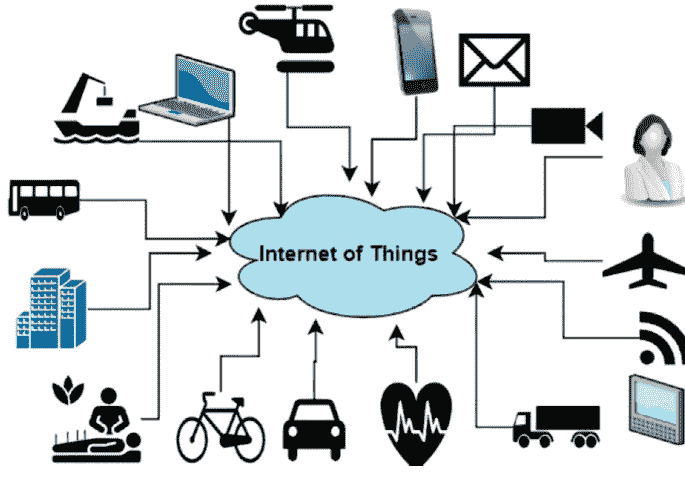

图 1.1 物联网。

应用于医疗保健、交通和智能家居。然而，物联网也引发了对潜在滥用、意料之外的后果以及隐私和数据安全的担忧。

物联网设备的采用率在过去几年中迅速增长，并预计将取得巨大的成功。根据 Statista 的报告，全球物联网设备数量将在 2025 年达到约 760 亿个，而 2019 年为 270 亿 [2]。这种增长归功于几个因素，包括：

- 1. 技术进步：低功耗无线网络、微型传感器和云计算等新技术的快速发展，使得部署物联网设备变得更加容易且廉价。
- 2. 成本降低：物联网设备的成本在过去多年里显著下降，使其更广泛的行业和应用能够触及。
- 3. 连接性增强：高速互联网的普及和 5G 技术的日益采用，使得物联网设备更容易进行通信和数据共享。
- 4. 业务效益：物联网设备为企业带来了许多益处，包括提高效率、生产力和节省成本，这促进了它们的采用。
- 5. 消费者需求：对连接设备和智能家居技术的日益增长的需求也推动了物联网设备的采用率。

# 物联网与无线传感器网络（WSN）简介

随着物联网设备数量不断增长，解决安全、隐私和互操作性等问题将变得越来越重要，以确保这些设备得到安全且负责任的使用。

以下是物联网的一些特征 [3, 4]：

- 连接性：物联网设备通常连接到互联网，以便交换数据并与其他设备交互。
- 传感器和执行器：这些设备嵌入了传感器，用于收集温度、环境等各种因素的数据，以及可以控制和响应该环境的执行器。
- 数据分析：物联网设备产生大量数据，通过对这些数据进行分析可以产生见解并改进决策、优化流程、自动化任务，并提高整体生产力和效率。
- 机器学习 (ML) 和人工智能 (AI)：物联网可以结合机器学习和 AI 算法来实现任务自动化并提高效率。
- 互操作性：物联网设备的设计旨在与其他系统协同工作，实现无缝集成和互操作，这意味着你可以将任何事物连接到你的通信基础设施和全球信息中。
- 不一致性或非均匀性：物联网系统基于各种网络和硬件平台。这些平台可以通过各种网络与不同规模和功能的设备或服务平台进行通信，意味着物联网设备是不一致的。
- 动态和自适应：物联网设备需要根据情况进行动态调整。例如，摄像头可以根据光照条件捕捉数据。它会自动切换到夜间模式或白天模式。这是一种自适应技术。
- 安全性：物联网设备必须防止网络攻击，并确保用户数据的隐私。
- 可扩展性：物联网系统可以扩大或缩小，以适应需求的变化以及新设备和应用的添加。

物联网架构通常由几层组成，共同实现物联网设备和系统的连接与功能 [5]。以下是每一层的简要概述：

- 感知层：该层由传感器和各种物理设备组成，用于收集环境参数数据，如温度、光、声音或运动。
- 网络层：该层将设备和传感器相互连接到互联网，通常使用 Wi-Fi、蓝牙或 Zigbee 等无线协议。
- 中间件层：该层处理设备与使用其生成数据的应用程序之间的交互。它还提供数据存储、消息传递和安全等服务。
- 应用层：该层由分析和使用设备生成数据的软件应用和服务组成。应用示例包括智能家居系统、医疗监测工具或工业控制系统。
- 业务层：在此层包含了驱动物联网解决方案开发和部署的业务模式和流程。它还包括对物联网系统生成的数据治理和管理。

物联网架构旨在收集、处理和分析由物理设备和传感器产生的数据，从而开发提高各个行业和应用效率、安全性和生活质量的应用和服务。

以下是物联网架构的简化图（图 1.2），显示了不同的层及其相互连接：

### 1.1.1.3 物联网架构的构建模块

如图 1.3 所示，物联网架构由四个构建模块组成。这些是 (1) 传感器、(2) 物联网网关和框架、(3) 云服务器系统以及 (4) 移动应用程序。

- 1. 传感器：从环境或特定位置获取信息且无处不在。例如，物联网网关允许温度传感器发送房间温度。传感器可以收集广泛的数据，包括位置、天气和环境状况、运行中的机械、发动机维护信息、人体信息和车辆生命体征。
- 2. 物联网网关和框架：传感器节点网络通过网关连接到互联网。它是通往互联网的入口或路径

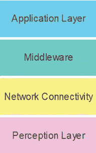

# 物联网与无线传感器网络（WSN）简介

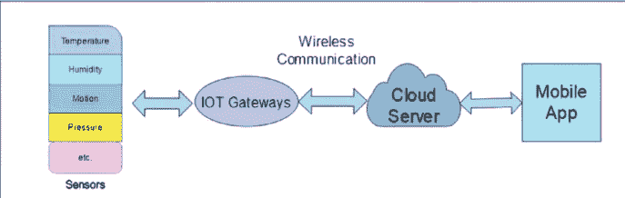

图 1.3 物联网架构。

对于我们想要交互的所有事物和设备。它从传感器收集数据并发送到互联网基础设施以建立连接。

- 3. **云服务器系统**：通过网关传输的数据在云服务器中经过安全处理和存储，然后处理后的数据被用于执行智能操作，使我们所有的设备都变得智能。在云端，分析和决策是在考虑用户便利性的情况下进行的。
- 4. **移动应用程序**：得益于易用的手机应用程序，客户可以远程管理和监控恒温器和汽车引擎等设备。应用程序直接从云端将关键信息推送到手机或平板电脑上。利用以下分析，信息以图表、柱状图和饼图的形式显示给客户，使用户可以轻松理解场景。我们可以通过移动应用程序向传感器发送信号更改其默认设置。例如，调整空调的默认温度和许多其他默认值。

WSN 是一种特殊的网络，由大量微型、低功耗、廉价且独立的传感器节点组成，这些节点通过无线设施相互连接。这些传感器节点配备了采集、处理和通信等各种功能，允许它们从物理环境收集并将数据传输到中心位置 [6]。

WSN 通常用于监测和控制物理环境，如温度、湿度、压力、光、声、速度、方向和运动、污染物水平、化学浓度、振以及许多此类状况。它们主要用于不同的应用领域，如环境监测、工业自动化、家居自动化、医疗监测和军事侦察。

WSN 的特点是能够在恶劣和远程环境中运行、低功耗、自组织和自愈能力。

然而，无线传感器网络（WSNs）也面临着若干挑战，例如带宽限制、能量有限和处理能力有限，以及安全和隐私问题 [7]。因此，WSNs 为从物理环境中收集和传输数据提供了一种经济且灵活的解决方案，实现了对各种应用的实时追踪和控制。

### 1.1.2.1 WSN 的特点

WSNs 的设计具有若干特征，使其能够实现预期功能 [8]。以下是 WSN 的一些关键特征：

1.  **低功耗**：WSNs 的设计耗电最小，允许节点在有限的能量资源（如电池）上运行很长时间。
2. **小型**：WSN 中的节点通常很小，允许在狭窄的空间内大量部署。
3.  **无线通信**：WSN 中的节点通过通信协议相互通信，允许其部署在有线通信不可行的区域。
4.  **自组织**：WSNs 设计为自组织结构，允许节点自动建立并重新配置网络连接。
5.  **自主运行**：WSN 中的节点通常是自主的，可以脱离人工干预运行。
6.  **低成本**：WSN 中的节点通常成本低廉，允许其在大区域内大量部署。
7.  **容错性**：WSN 设计具有容错性，即使某些节点故障或损坏，也能继续运行。
8.  **数据处理与分析**：WSNs 在节点上进行本地数据处理和分析，允许在将其传输到中心位置之前对其进行过滤和压缩。

这些 WSN 的特征使其能够应用于各种领域，从环境监测到工业自动化，从医疗保健到军事监控。

1.2.2 WSN 的类型

WSN 有多种类型，可以根据其应用、通信协议、电源和拓扑结构进行分类 [6]。以下是常见的 WSN 类型：

1.   环境传感器网络：环境传感器网络是一个相互连接的传感器系统，用于监测和收集有关环境各个方面的数据。这些传感器通常部署在不同位置，收集温度、湿度、空气质量、污染水平和其他环境因素的信息。网络中的传感器持续测量并记录数据，通过无线或有线连接到中央服务器或数据库。收集的数据可用于实时监测和评估环境状况，识别趋势，并就环境管理做出知决策。环境传感器网络应用于多个领域，包括气候监测、城市规划、农业、工业监测和灾害管理。
2. 地面传感器网络 (TWSNs)：地面传感器网络包括无线传感器节点，可以作为非结构化或结构化使用。节点随机分布在分配的区域内 [6, 9]。在预计划或结构化模式下，这些 2D 和 3D 模型通过最小化延迟、优化路由和使用低占空比运行节省能量。TWSNs 应用于多种领域，包括环境监测、农业、野生动物追踪和灾害管理。它们提供了关于监测参数的实时或近实时数据，以便更好地理解、分析和决策。
3. 水下传感器网络 (UWSNs)：整个网络位于地下，有效地用于监测地下状况。然而，UWSNs 面临的挑战包括电源供应有限、恶劣的水下环境、网络拓扑规划以及通信可靠性（图 1.4）。人员

图 1.4 水下传感器网络。

图 1.5 多媒体 WSN。

工程师继续探索创新解决方案，以提高这些网络通信的效率、范围和韧性。这些传感器价格较高。使用的设备和机器需要适当的维护。
4. 多媒体 WSN (MWSNs)：网络中的节点通过连接摄像头和麦克风以图像、音频和视频的形式收集信息。它们可以视觉化地监控各种事件（图 1.5）。这些节点通过无线链路相互连接，用于数据检索和数据压缩。最新的数据处理和压缩技术用于压缩数据。压缩后的音频和视频数据也可以通过传感器网络发送，以降低功耗。MWSNs 的研发在于改进多媒体数据处理算法、开发高效的通信协议以及增强整体网络性能，以确保可靠的实时多媒体数据收集和传输。
5. 移动传感器网络 (MSNs)：移动网络并不固定在一个位置，而是可以从一个地方移动另一个地方。这些网络由配备传感器的移动节点组成，可以自主移动或远程控制。与传感器固定的传统传感器网络不同，MSNs 在各种环境中允许动态数据收集和监测。它们可以轻松与周围环境连接。它们的主要优势是提供了更好的区域覆盖和通道容量。与其他静态传感器网络系统相比，这些 MSNs 更具适应性。这些 WSN 应用于

**图 1.6** 水下 WSN。

其中传感器是移动的，例如车辆追踪、动物追踪和搜救行动。
6. 水下传感器网络 (UWSNs)：无线水下系统由安装在水下的设备或传感器节点组成。这些 WSN 用于在水下或水生环境（如海洋、湖泊和河流）中监测和收集数据（图 1.6）。这些车辆主要用于从传感器收集信息。它们由电池驱动的小型传感器组成，测量水温、盐度、压力、pH 值、溶解氧或污染物的存在。这些节点之间以及与表面节点或基站通信以传输收集的数据。长时间传播延迟和传感器故障是通信系统的主要挑战，而且这些 WSN 中的电池有限且无法充电。因此，各种技术不断演变以解决能量利用和保护问题。UWSNs 的水下通信面临水下介质特征带来的挑战，包括高衰减、带宽限制、多径衰落以及对特殊通信技术的需求。声波通常用于 UWSNs 的远程通信，尽管光学和电磁方法可用于清水的距离通信。

WSN 是一组被称为传感器的特殊设备，用于监测和记录各种环境状况并将这些数据存储在中心位置。

WSN 有多个节点。这些节点是便携式的、小型化的检测任务。每个传感器节点由变感器或传感器、收发器、微控制器和电源组成。变感器检测物理状况的变化并产生电信号。这些信号发送到微计算机进行进一步处理。微计算机将信号发送到接收节点，然后通过互联网发送到计算机（图 1.7）。

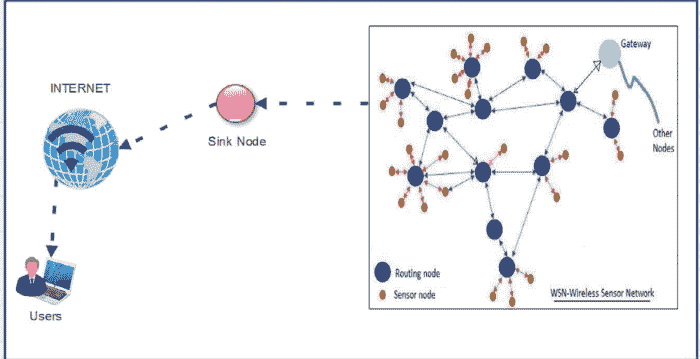

图 1.7 无线传感器网络。

### 1.1.2.4 WSN 拓扑结构

WSN 中的节点以几何形式排列，称为拓扑结构 [6, 9, 10]。最常见的传感器网络拓扑如下（图 1.8）：

- 1. 点对点（专用）网络
- 2. 星型网络
- 3. 树形网络
- 4. 网状网络

- 1. 点对点（专用）网络拓扑：在专用拓扑结构中，节点之间可以直接相互通信。只有一条数据通信路径，极大地确保了通信的安全性。由于没有中心节点，每个节点都充当客户端和服务器（图 1.9）。

- 2. 星型网络拓扑：在星型拓扑结构中，通信通过中心节点进行，与点对点拓扑不同，传感器节点之间无法进行直接通信。中心节点充当服务器，节点充当客户端（图 1.10）。

- 3. 树形网络拓扑：在树形拓扑结构中，每个节点连接到上一个较高的节点（即父节点），最后连接到根节点（图 1.11）。这种拓扑的主要优点是易于扩展，并且可以很容易检测错误。然而，它的缺点是严重依赖基电缆。如果基电缆断裂或损坏，整个网络将会崩溃。数据从叶子节点传输到父节点，最后传输到根节点。

- 4. 网状网络拓扑：网状网络允许所有节点相互交互，而不依赖中心节点。数据可以从一个节点移动到另一个节点。这是最可靠的网络通信，因为它没有单点故障。然而，这种复杂的结构消耗了大量的能量。

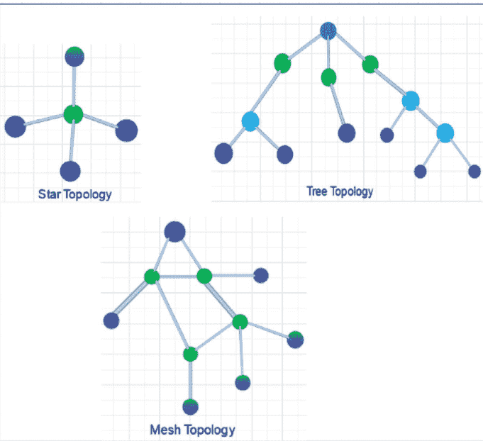

**图 1.8** 无线传感器网络拓扑结构。

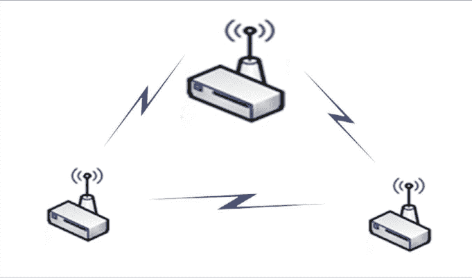

**图 1.9** 点对点网络。

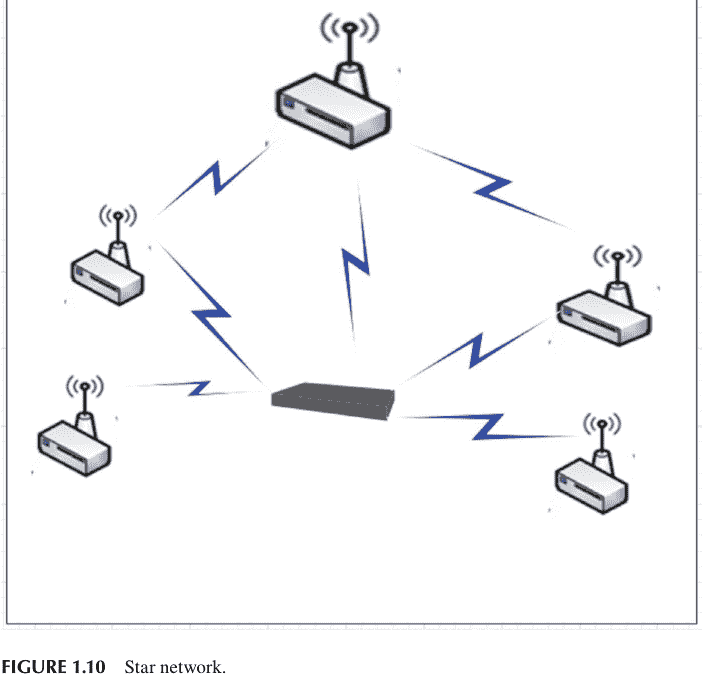

### 1.1.2.5 无线传感器网络与物联网的区别

表 1.1 显示了 WSN 和 IoT 之间的区别。

### 1.1.3 IoT 与 WSN 的融合

IoT 和 WSN 的融合变得越来越普遍和重要。这种融合涉及 WSN 的数据采集能力与 IoT 系统的通信及数据处理能力相结合 [12, 13]。

结合 WSN 和 IoT 可以在各种应用中实现更高效、更智能且可扩展的数据采集与分析。例如，WSN 可以用于：

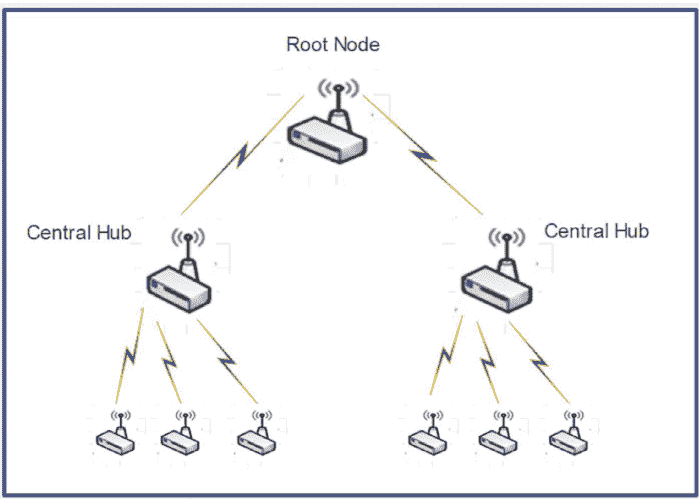

图 1.11 树形网络。

从远程或恶劣环境条件中收集数据，而 IoT 可以为收集到的数据提供云端处理和存储能力。

这是两种技术的自然演进。这两种技术有许多相似之处，包括从物理环境收集和传输数据的能力、低功耗以及无线通信。这些技术的融合导致了各个领域新应用和机会的产生，包括工业自动化、医疗保健、环境监测和智慧城市。

| 无线传感器网络 | 物联网 |
| :--- | :--- |
| WSN 是任何连接到无线网络以收集数据或监控环境的设备。 | IoT 由 WSN + 互联网 + 云存储 + 移动/Web 应用组成。 |
| WSN 由大量被称为结的微型低功耗设备组成，这些设备通过无线通道进行信息共享。 | IoT 由网关组成，用于将设备连接到网络（使用交换机、路由器、接入点等）。 |
| WSN 遵循 IPv4，且拥有一个汇聚节点而非网关。 | IoT 在传感器网络上遵循 IPv6 (802.15.4 MAC/PHY)，在互联网部分遵循 IPv4 [11]。 |
| WSN 中的路由协议包括 DSR、CTP、PEGASIS、LEACH、SEP、AODV、OLSR、SPIN 和 TEEN。 | IoT 中的路由协议包括 RPL、LoWWPAN、MQTT-SN、CoAP、AODV、BLE Mesh 和 Zigbee。 |

IoT 和 WSN 融合的主要优势之一是可以将大规模网络与传感器网络集成。这种集成使得能够对多个源的数据进行连接和分析，提供对物理环境更好的改进的视角。例如，智慧城市网络可以使用 IoT 设备和 WSN 监控交通、空气质量和噪声污染，从而更好地了解城市的环境状况。

这种组合的另一个益处是能够降低功耗并延长网络寿命。使用 WSN 进行本地感知并使用 IoT 设备进行数据聚合和通信，可以优化网络以实现低功耗，减少频繁更换电池的需求。

它也带来了若干挑战，例如互操作性、安全性和功耗管理。为了充分实现这种融合的潜力，需要在不同技术和协议之间进行标准化和协调。此外，需要实施安全措施来保护由 WSN 和 IoT 设备收集和传输的敏感数据。最后，需要对 WSN 和 IoT 设备进行安全性保障。因此，IoT 和 WSN 的融合将为各个领域带来新的应用和机会。

8. 互操作性和标准化：物联网（IoT）与无线传感器网络（WSN）的集成应遵循互操作性标准，以促进不同供应商设备和系统之间的无缝通信。标准化工作促进了兼容性，降低了实施复杂度，并促进了物联网生态内的创新。

9. 连接与通信：IoT 设备与 WSN 传感器之间的无缝连接和可靠通信至关重要。构建稳健的无线协议和网络架构可确保数据高效且连续地传输。这使得多种设备和传感器能够集成到统一系统中。

10. 标准与认证：遵循促进物联网可持续发展实践的行业标准和认证。认证计划（如能量之星、EPEAT 或 LEED）为可持续物联网的设计、运行和废物处理提供了指南和基准。

因此，用于智能应用的可持续物联网具有创建更高效、更负责任环境的系统的潜力，这些系统可以减少能量消耗、减少浪费并提高我们社会的可持续性。通过在物联网的设计和实施中优先考虑可持续性，我们可以创造更具韧性且具有环保意识的未来。

IoT 和 WSN 在各个行业都有广泛的应用领域。这些应用涵盖了不同的领域，包括工业领域、医疗领域、农业、智能城市、安全和应急情况，图 1.16 显示了几个应用领域：

- a. 智能城市：建设智能城市包括智能交通系统 [17]、智能建筑、交通拥堵 [17, 18]、垃圾管理 [19]、智能照明、智能停车和城市地图（图 1.12）。这可能包含多种功能，作为支持 AI 的 IoT 设备，用于跟踪和缓解智能城市的交通拥堵 [20]。此外，IoT 将实现适应天气的智能路灯。要实现 IoT 智能城市，必须利用 RFID 和传感器，并在大多数情况下（如停车表、街道、喷淋系统等）使用物联网。许多城市都有实施物联网计划。

- b. 医疗保健：如 [21] 所解释，增强和自动化的 IoT 设备正在协助医疗系统的转型。其他技术改进了一系列活动，例如与不同人员和患者交流报告、维护记录以及管理药物。它显著改善了医疗业的转型 [21]。IoT 应用为健康部门带来了利益，因为它可以广泛归类为自动数据收集与分析、个人身份与认证，以及患者、员工和资产监控（图 1.13）。此外，认证和识别减少了对记录的需求、婴儿错认场景以及伤害患者的事件。传感器设备提供了以患者为中心的疾病检测能力，并能使用患者健康指标的实时数据 [20]。传感器可以应用于牙刷、牙科蓝牙设备以及住院和门诊环境。它还可以在患者监测和使用后提供信息。

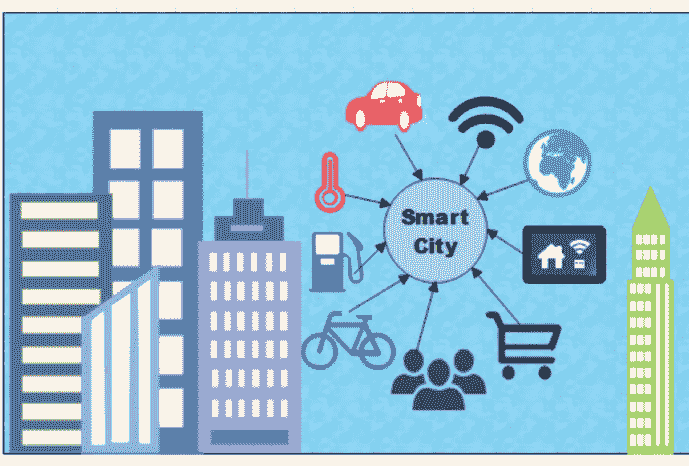

图 1.12 智能城市。

该领域的用途包括远程医疗服务、患者健康警报以及跟踪患者用药遵循的能力。RFID、蓝牙和 Wi-Fi 是进一步包含在该能力内的 IoT 组件。它们极大地增强了测量和监测关键参数的方法，包括温度、血压、心率、胆固醇和血糖水平。这些技术在新冠肺炎期间监测远程地区患者时被证明是有效的。

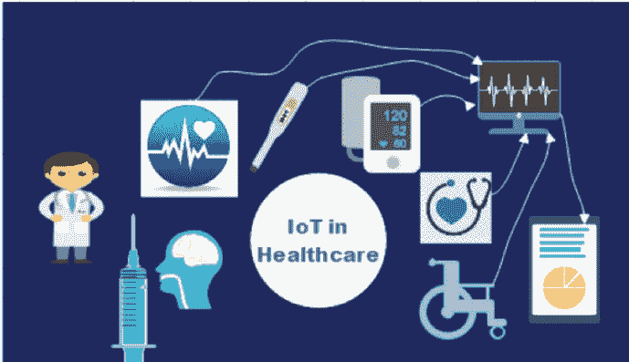

图 1.13 医疗中的物联网。

- c. 智能农业：为了增加水果蔬菜的数量和质量，控制微气候（如监测温度、土壤水分和营养水平）以提高作物产量。堆肥：调节苜蓿、干草和草中的水分等温度条件，以消除真菌和其他微生物（图 1.14）。确保动物场后代的生存和健康，识别排泄物中的毒气体，并照顾开放式农场和巨大圈舍中的后代。通过监测实现对田地和生长条件的更好控制：农业管理，包括对肥料、电力和灌溉的改进控制、准确的持续数据收集，以及对腐烂和作物浪费的更好监测 [22]。

- d. 智能环境：空气污染检测：工业过量二氧化碳排放、汽车污染、农场毒气控制。森林火灾检测：燃烧气体和预防性火状态监测以及警告区定义。天气预报：监测湿度、温度、风速和雨等天气状况，地震早期检测等。

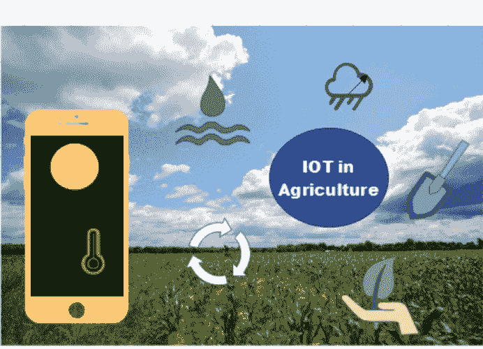

图 1.14 智能农业。

水质：调查河流和海水与饮用水的兼容性。

河流洪水：在雨天监测河流和大坝，监测水库水位变化。

受保护物种：使用 GPS/GSM 监测器跟踪野生动物，通过跟踪圈通过信息发现、跟踪并发送坐标 [5]。

- 智能生活：
远程控制设备：为了避免意外并节约，你可以远程开关设备。
天气：显示室外天气状况，如压力、风速、温度和降水量。它还具有广播和显示远程数据的能力 [17]。

- 智能家电：带有 LCD 屏幕的冰箱可显示内容、即将过期的食品、待购产品，所有信息均可在手机 App 中查看；具有远程监控功能的洗衣机；带有手机 App 界面的炉灶，允许远程温度控制和烤箱自清洁功能监控；安全监控。通过使用 CCTV 摄像头和家庭报警系统，人们在家里进行日常活动时可能会感到安全。监测你的能源和水耗，以获取如何节省资金和减少资源使用的建议等 [5]（图 1.15）。

- 智能工业：在工业环境中，有害气体可能泄漏进化工厂或矿井并被检测到，可以监测化工厂的毒性和氧浓度以确保工人和产品安全。

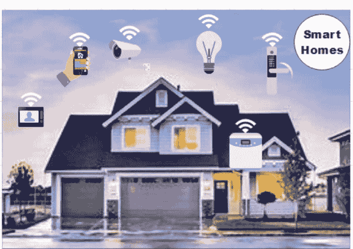

图 1.15 智能家居。

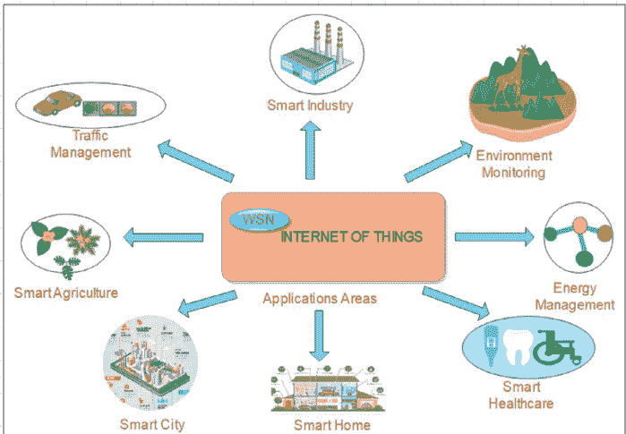

图 1.16 物联网与无线传感器网络的应用。

可以将传感器连接到设备上以监测并发送报告，将设备故障的早期预测和服务维护转化为真实的组件故障。它可以提前自动调度（图 1.16）[22]。

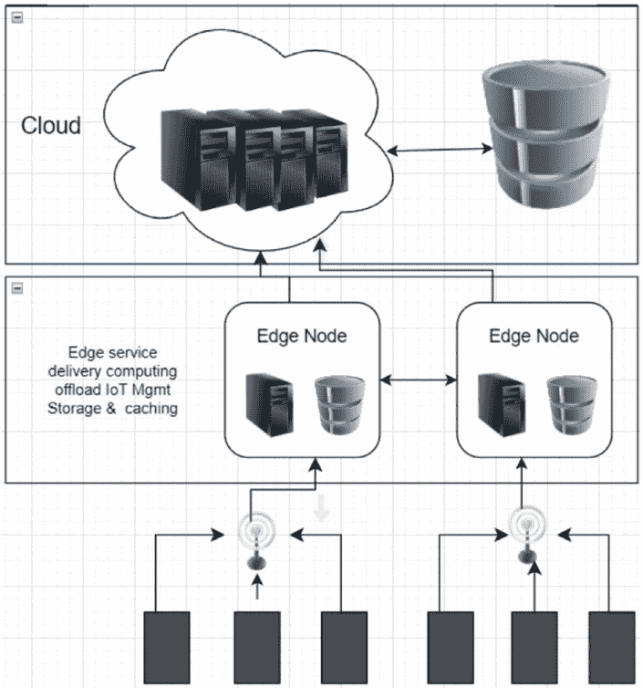

图 1.17 边缘计算。

- **边缘设备**：边缘设备是安装在网络边缘的硬件组件，如边缘服务器、网关、路由器和物联网设备。这些设备具有计算能力、存储容量和连接能力，能够在本地对数据进行处理数据。
- **边缘计算平台**：边缘计算平台为管理和调度边缘设备及应用程序提供基础设施和软件框架。它们提供边缘节点管理、数据接入、分析、安全以及与云服务的集成等功能。这些平台包括 Microsoft Azure IoT Edge、AWS IoT Greengrass 和 Google Cloud IoT Edge [24]。
- **容器化**：Docker 和 Kubernetes 等容器化技术在边缘计算中起着至关重要的作用。容器实现了应用程序及其依赖的打包和隔离，使得跨不同设备和位置部署、管理和扩展边缘应用程序变得更容易。
- **边缘分析与机器学习**：边缘计算允许在边缘进行实时分析和机器学习推理。Apache NiFi、Apache Flink、TensorFlow Lite 和 ONNX Runtime 等工具能够在资源有限的边缘设备上运行分析和机器学习模型。这些工具通过优化模型并利用硬件加速来实现边缘推理。
- **边缘安全**：边缘计算引入了独特的安全挑战。Istio、Envoy 和 Nginx 通过提供流量管理、身份验证、授权和加密能力帮助边缘环境。此外，防火墙、入侵检测系统（IDS）和数据加密协议等边缘安全解决方案用于保护网络边缘的数据和设备。
- **边缘数据管理**：边缘计算涉及处理产生于边缘的数据。Apache Kafka、Apache Pulsar 和 RabbitMQ 等工具有助于边缘设备与后端系统之间可靠的消息传递和数据流。这些工具确保了高效的数据传输、事件驱动处理和数据同步。
- **边缘监控与管理**：为了监控管理边缘设备和应用程序，Prometheus、Grafana 和 Nagios 等工具提供了监控、日志和告警功能，允许管理员实时跟踪边缘设备和应用程序的性能、健康和状态。
- **边缘连接**：边缘计算依赖连接协议建立边缘设备与中央基础设施之间的通信。这包括以太网等有线连接，以及蓝牙、Zigbee、Wi-Fi 等无线协议和 4G LTE、5G 等蜂窝网络。
- **边缘开发框架**：Apache Edge、Eclipse IoFog 和 AWS IoT SDK 等框架为构建边缘应用程序提供了软件开发包和 API。这些框架简化了开发过程，并为与边缘设备、传感器和数据流交互提供了抽象。
- **边缘数据库系统**：边缘计算通常需要本地存储和数据库以便在靠近边缘的地方存储和处理数据。SQLite、Apache Cassandra 和 Amazon DynamoDB 等工具提供了适用于边缘环境的轻量级可扩展数据库解决方案。

表 1.2 显示了边缘计算中使用的技术、平台和工具，这些取决于部署的需求、用例和底层基础设施而异。

## 物联网与无线传感器网络简介

### 表格 1.2
IoT 与 WSN 中的边缘计算

| 技术、平台和工具 | 目的 |
| --- | --- |
| Google Cloud IoT Edge, AWS IoT Greengrass, Microsoft Azure IoT | 计算平台为管理和调度边缘设备及应用程序提供基础设施框架。 |
| Docker 和 Kubernetes 等容器化技术 | 容器实现了应用程序及其依赖的打包，使得跨不同边缘设备和位置部署、管理和扩展边缘应用程序变得更容易。 |
| Apache NiFi, Apache Flink, TensorFlow Lite, ONNX | 能够在资源有限的边缘设备上运行分析和机器学习模型。 |
| Istio, Envoy 和 Nginx | 通过提供流量管理、授权和加密能力帮助保护边缘环境。 |
| Apache Kafka, Apache Pulsar 和 RabbitMQ | 确保高效的数据传输、处理和数据同步。 |
| 蓝牙, Zigbee, Wi-Fi 以及 4G LTE 和 5G 等蜂窝网络 | 建立边缘设备与中央基础设施之间的通信。 |
| SQLite, Apache Cassandra, Amazon DynamoDB | 为边缘环境提供轻量级可扩展的数据库解决方案。 |

边缘计算

- 2. AI 和 ML：随着 IoT 设备和 WSN产生的大量数据增长，越来越需要 AI 和 ML算法来分析和理解这些数据。AI 和 ML 技术正在集成到 IoT 和 WSN 系统中，以实现智能决策和高级分析。这些技术有助于从大规模传感器数据中提取有价值的见解，并用于优化资源分配和流程、检测异常以及提供预测性维护（图 1.18）。以下是 IoT 和 WSN 中 AI 和 ML 的一些关键因素，以及相关的工具和技术：[12, 16]。
- **预测性分析**：AI 和 ML 算法分析从 IoT 设备和 WSN 节点收集的传感器数据以做出预测和预报。有助于检测异常、预测故障、优化资源分配并提高整体系统性能。可以使用 TensorFlow、PyTorch 和 scikit-learn 等工具用于 IoT 和 WSN 中预测性分析的 ML 模型开发部署 [25]。同样，Microsoft Azure IoT Edge 和 NVIDIA Jetson 平台提供了在边缘运行 ML 模型的能力。
- **异常检测**：ML 算法可以从传感器数据中学习正常模式和行为并识别异常或离群值。这对于检测 IoT 和 WSN 部署中的潜在安全泄露、设备故障或环境异常具有重要价值。

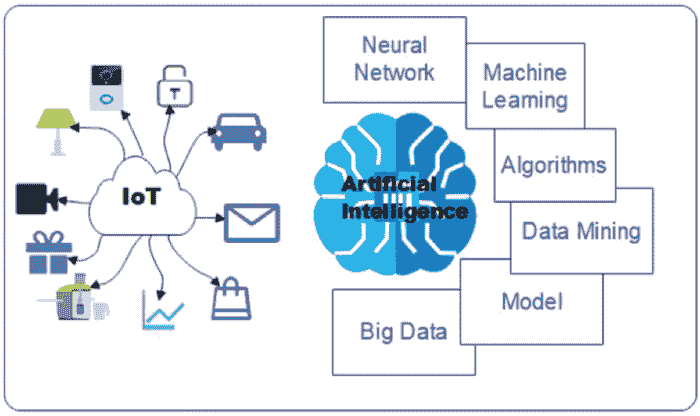

图 1.18 AI 和 ML。

无监督学习、聚类和统计分析等技术可用于异常检测。K-means、Isolation Forest 和 One-Class SVM 等工具常用于异常检测 [25]。

- **能量优化**：能效是 WSN 和 IoT 设备关注关注的问题，因为传感器节点具有有限的电源。利用 ML 算法可以通过智能调度活动、数据传输和睡眠模式来优化能量消耗。强化学习和优化算法可以用于动态管理传感节点的能量使用。TinyML、能量感知计算框架（EACO）和强化学习（RL）库等工具有助于能量优化 [25]。
- **数据融合与集成**：IoT 和 WSN 从多个源和传感器产生大量数据。数据融合和集成等 ML 技术可以合并并分析来自不同传感器或 IoT 设备的数据，以提取有意义的见解并提供系统的全面视图。Apache Kafka、Apache Spark 和 Apache Flink 等工具可以协助实时数据处理、流分析和数据融合。
- **安全与隐私**：AI 和 ML 可以通过检测异常、识别潜在威胁和保护数据来增强安全性和隐私。ML 算法可以学习正常行为模式并实时检测偏差或攻击。入侵检测系统（IDS）、异常检测算法和加密技术可用于 IoT 和 WSN 的安全和隐私。

这些示例展示了 AI 和 ML 如何应用于 IoT 和 WSN 背景下。工具和技术的选择取决于所开发的 IoT 和 WSN 系统的具体需求、资源和限制。

- 3. 5G 网络：5G 网络的引入预计将显著提高 IoT 和 WSN 应用的性能和可靠性。5G 网络提供更快的传输速率、更延迟和更好的连接，实现了更复杂的 IoT 和 WSN 用例。5G 实现了实时通信，支持海量设备连接并促进高带宽数据传输，允许更高效可靠的 IoT 和 WSN 部署。6G 网络的持续开发也在进一步探索 IoT 的无线连接。

在 IoT 和 WSN 中实施 5G 涉及多种工具和技术 [16, 26, 27]。关键要素：
- 窄带物联网 (NB-IoT) 和机器 LTE (LTE-M)：NB-IoT 和 LTE-M 是运行在现有 4G 和 5G 网络上的低功耗广网技术。它们专为数据速率和功耗需求低的 IoT 设备设计，适用于智能抄表、资产追踪和农业监控等应用。
- 网络切片：网络切片允许在共享的物理基础设施上创建虚拟、独立的网络。每个网络切片都针对特定的 IoT 和 WSN 应用进行了优化，能够根据需求分配资源并定制服务。
- 软件定义网络 (SDN) 和网络函数虚拟化 (NFV)：SDN 和 NFV 技术用于优化和管理 5G 网络基础设施。SDN 将控制面与数据面分离，实现了更灵活的可编程网络管理。NFV 将网络功能虚拟化，能够更高效地部署和扩展网络服务。
- 大机器通信 (mMTC)：5G 为 mMTC 提供了专用功能，解决了大量低功耗 IoT 设备的连接问题。它可以高效处理来自 IoT 传感器的随机和频繁数据传输，优化网络资源并减少拥塞。
- IoT 平台：IoT 平台提供用于开发、部署和管理 IoT 和 WSN 应用的中间件和工具，提供设备管理、数据分析和应用程序接口等功能，促进 IoT 设备与 5G 网络之间的集成与交互。
随着 5G 的 IoT 和 WSN 系统连接性和数据交换的增加，稳健的安全解决方案至关重要。这包括身份验证机制、加密协议，

访问控制和入侵检测系统可以保护设备、数据和通信免受潜在威胁和漏洞的影响。

- **数据分析与人工智能（AI）：** 数据分析和人工智能技术在从物联网（IoT）和传感器网络（WSN）设备产生的海量数据中提取有意义的洞察方面起着至关的作用。随着5G的发展，网络边缘实时数据处理与分析结合云分析，增强了决策和预测能力。

- **协议与标准：** 各种协议用于确保IoT和WSN设备与5G网络的互操作。MQTT（消息队列传输）和CoAP（受限应用协议）等协议常用于轻量且高效的数据传输；3GPP（第三代伙伴计划）等标准定义了5G网络的技术规范。

- **测试与仿真工具：** 针对IoT和WSN的测试和仿真工具对于验证5G网络中设备和应用的性能、可靠性和兼容性至关重要。这些工具模拟不同的网络条件，评估物联网生态系统的可扩展性，并评估整体服务质量。

这些工具和技术结合5G网络的能力，形成了一个全面的生态系统，实现了IoT和WSN应用的无缝集成和高效运行，释放了它们在各个行业和领域的全部潜力。

- 4. **区块链：** 区块链技术正被探索为IoT和WSN应用提供安全去中心化的通信和数据存储。区块链可以提供去中心化且不可篡改的账本，用于验证IoT设备与WSN节点之间的交易。它确保了交换数据的完整性和真实性，使得攻击者难以篡改或修改数据。它可以用于观察和确认IoT和WSN系统中数据的来源和历史。这些系统使消费者能够验证传感器收集数据的完整性和可靠性，确保其准确可赖。该技术具有增强这些系统安全性和隐私并提高数据完整性的潜力。智能合约是自我调节的协议，有助于IoT设备与WSN节点之间自动化且安全的交互，能够在无需中介的情况下实现自主交易和流程。它实现了货物的实时追踪，确保了产品的真实性，并增强了供应链参与者之间的信任 [13, 16]。

与区块链集成到IoT和WSN的关键技术和工具如下：[28]

- **分布式账本技术（DLT）：** 区块链是DLT的一种，允许去中心化且透明的记录。它允许IoT或WSN网络中的多个参与者维护一份交易、事件或传感器数据的共享同步账本。链中的每个区块都包含带有时间戳和加密保护的记录，确保了数据的不可篡改性。

- **智能合约：** 这些是编码到区块链中的、具有预定义准则和条件的自我调节协议。在IoT和WSN中，智能合约可以自动化设备与实体之间的交互和交易。例如，智能合约可以在满足特定条件时自动触发支付，或允许在没有中介的情况下进行设备直接通信。

- **共识机制：** 这种机制保证了所有网络参与者对交易价值和账本状态达成共识。一些常用机制包括工作证明（PoW）、实用拜斯庭容错（PBFT）和权益证明（Proof of Stake）。这些机制以去中心化的方式建立信任并防止恶意活动。

- **身份与访问管理：** 区块链可以为IoT和WSN设备提供去中心化且安全的身份管理。所有设备在区块链上都有唯一的、不可篡改的身份，确保了安全性、访问控制和数据隐私。去中心化身份（如主权身份SSI）使用用户和设备能够对其身份和数据拥有完全控制权。

- **数据完整性与溯源：** 区块链可以保证IoT和WSN设备生成数据的完整性和溯源。通过在区块链上记录数据交易，数据变得不可篡改且可验证。这有助于验证数据的真实性，来源，确保供应链管理、环境监测和资产追踪等应用中的可信度。

- **互操作性与标准：** 互操作性框架和标准在将区块链与IoT和WSN系统集成方面发挥着重要作用。如星际平面文件系统（IPFS）、Hyperledger Fabric和Ethereum等协议为开发基于区块链的IoT应用提供了工具和框架。信任物联网联盟和工业联盟等倡议致力于建立互操作性标准和最佳实践。

- **去中心化数据市场：** 基于区块链的数据市场实现了IoT和WSN数据的安全高效交换。这些市场允许数据所有者在保持控制权和隐私的同时实现数据变现。区块链确保了市场参与者之间透明的交易、数据所有权和公平的补偿机制。

- **区块链即服务（BaaS）：** BaaS平台提供预配置的区块链基础设施和服务，简化了在IoT和WSN中区块链应用的开发和部署。这些平台提供数据存储、智能合约部署以及与其他云服务集成的功能，使组织无需大量的知识或资源即可利用区块链技术。

通过将区块链技术集成到IoT和WSN，组织可以增强其部署的安全性、隐私性和信任。DLT、智能合约、共识机制、身份管理和数据完整性的结合，为互联IoT和WSN世界管理和交换数据提供了一个可靠且去中心化的框架。

有多种工具和平台可以促进集成。以下是一些使用的工具 [28]。表1.3显示了区块链中使用的工具及其功能。

- * Ethereum: 这是一个流行的区块链平台，支持去中心化应用（DApps）和智能合约的。它为构建基于链的IoT和WSN解决方案提供了稳健且成熟的生态系统。Ethereum提供了Solidity等工具

### 表 1.3

### 区块链工具

| 工具 | 功能 |
|---|---|
| Ethereum | 流行的区块链平台，支持去中心化应用（DApps）和智能合约开发。为构建基于链的IoT和WSN解决方案提供了稳健且成熟的生态系统。提供了Solidity、web3js和Truffle等工具。 |
| Hyperledger Fabric | 提供开发和部署区块链应用的工具和库，如Hyperledger Composer、Hyperledger Caliper和Hyperledger Explorer。 |
| IOTA | 它利用名为Tangle的有向无环图（DAG）结构而非传统的区块链。IOTA专注于实现IoT设备之间安全、可扩展且免手续费的微交易。IOTA基金提供了库、API和工具，用于开发应用和管理IoT和WSN中基于IoT的交易。 |
| R3 Corda | 提供开发分布式应用、管理身份和构建智能合约的工具和库。 |
| MultiChain | 为企业级应用设计，提供资产、数据安全和增强的隐私控制等功能。为IoT和WSN部署构建自定义区块链解决方案提供了API和命令行工具。 |
| IBM Blockchain | 提供开发框架、部署自动化以及与其他IBM服务的集成，用于构建端到端的区块链解决方案。 |
| Microsoft Azure Blockchain | 提供工具、模板和预配置网络，用于包括Ethereum、Hyperledger Fabric和Corda在内的多种区块链平台上构建IoT和WSN解决方案。 |

## 物联网与无线传感器网络简介

（一种智能编程语言），web3.js（用于与以太坊交互的 JavaScript 库），以及 Truffle（基于太坊的项目开发框架）。

- Hyperledger Fabric：由 Linux 基金托管的开源平台。它为企业应用设计，包括物联网和无线传感器网络。Hyperledger Fabric 提供了一个许可区块链网络，允许参与者拥有受控的访问权限和隐私。它提供了开发和部署区块链应用的工具和库，例如 Hyperledger Composer、Hyperledger Caliper 和 Hyperledger Explorer。
- IOTA：这是一种专门为物联网生态系统设计的分布式账本技术。它利用一种名为 Tangle 的有向无环图（DAG）结构而不是传统的区块链。IOTA 专注于确保物联网设备之间安全、可扩展且无缝的微交易。IOTA 基金会提供库、API 和工具，用于在物联网和无线传感器网络开发应用程序并管理基于 IOTA 的交易。
- R3 Corda：这是一个构建企业解决方案（包括物联网和无线传感器网络应用）的区块链平台。它强调隐私性和扩展性，并允许与现有系统进行互操作。R3 Corda 提供了用于开发分布式应用程序、管理身份以及构建智能合约的工具和库。
- MultiChain：这是一个开源区块链环境，能够生成和部署私有的许可级区块链。它为企业应用设计，并提供资产包含、数据流和增强型隐私控制等功能。MultiChain 提供了 API 和命令行工具，用于为物联网和无线传感器网络部署构建自定义区块链解决方案。
- IBM Blockchain：该平台是一个用于开发、部署和管理区块链网络的企业级解决方案。它提供了创建许可区块链网络（包括物联网和无线传感器网络应用）的工具和服务。IBM Blockchain 提供开发框架、部署自动化以及与其他 IBM 服务集成，以实现端到端的区块链解决方案。
- Microsoft Azure：它提供了一系列区块链服务，促进区块链应用的开发和部署。Azure Blockchain 提供了工具、模板和预配置网络，用于在以坊、Hyperledger Fabric 和 Corda 等多种区块链平台构建构建物联网和无线传感器网络解决方案。

这些工具和平台为开发者提供了必要的框架、库和资源，以便在物联网和无线传感器网络应用利用区块链技术。它们简化了开发过程，并提供了根据项目特定需求选择最合适区块链解决方案的活性。

- 5. 可持续性与能源效率：能源效率是物联网和无线传感器网络部署的关键方面，特别是对于电池供电的设备。人们正越来越关注开发高能效传感器、通信协议和电源管理技术，以延长物联网设备的寿命并减少对环境的影响。
- 6. 能量采集：正在开发能量采集技术，利用太阳能、风能和振动等环境能源为物联网和无线传感器网络设备供电。这将使得低功耗设备的部署能够在无需更换电池的情况下运行长时间。
- 7. 互操作性与标准化：不同物联网设备和无线传感器平台之间的互操作性仍然是一个挑战。标准化工作正在进行，以建立通用协议和框架，例如 MQTT、CoAP 和 OMA LwM2M，以确保不同设备之间以及不同生态系统之间的无缝通信和互操作。

这些趋势反映了物联网和无线传感器网络的持续演进和进步，它们正在不断发展，并为广泛的行业和用例提供新的创新解决方案。

### 1.1.5.2 物联网与无线传感器网络面临的挑战

尽管物联网和无线传感器网络提供了许多优势和机会，但必须提到其中的几个挑战，以便理解其全部潜力 [5, 29, 30]。以下是物联网和无线传感器网络中的当前挑战：

- 1. 安全性：物联网和无线传感器网络面临的最大挑战之一是安全。随着连接到网络的设备数量增加，网络攻击风险随之增加。挑战是确保这些设备和网络能够防御各种类型的网络威胁，例如黑客攻击、恶意软件和未经授权的访问 [31]。
- 2. 互操作性：物联网中的另一个挑战是互操作性。这些设备和传感器有自己的协议和通信标准。这使得集成不同的设备和系统变得困难，并可能导致效率低下和兼容问题。
- 3. 电源管理：许多物联网和无线传感器设备由电池驱动，寿命有限且需要频繁更换。挑战是开发更高效的电源管理系统，以延长电池寿命、降低功耗并使设备能够在远程和恶劣环境中运行。
- 4. 数据管理：物联网和无线传感器网络产生海量数据，这些数据难以管理、处理和分析。挑战是开发高效可扩展的数据管理系统，能够实时存储、处理和分析数据，并提供用于优化流程和改进决策的见解。
- 5. 隐私：随着物联网和无线传感器网络中收集和分析的数据越来越多，隐私问题变得越来越突出。挑战是确保以伦理方式收集和使用个人数据，并采取适当的保护措施保护个人隐私并防止未经授权的访问。

### 1.1.6 物联网与无线传感器网络的安全与隐私

由于这些系统生成和传输海量数据，安全和隐私是物联网和无线传感器网络的关键问题。安全是物联网和无线传感器网络中最关注的问题，因为这些系统更容易受到各种网络攻击的影响 [32, 33]。以下是物联网和无线传感器网络中的一些安全和隐私挑战，以及解决这些问题的一些措施：

- 1. **设备安全：**物联网和无线传感器网络关注的问题之一是保护设备本身免受未经授权的访问和黑客攻击。解决设备安全的措施包括使用强身份验证和加密协议、定期的软件更新以及安全启动过程。身份验证协议可以确保设备和用户如其所言。身份验证措施包括使用强密码、双重认证和生物识别。保持软件和固件更新对于修复漏洞降低降低风险至关重要。物联网和无线传感器设备系统的设计应支持安全的自动更新。
- 2. **数据安全：**物联网和无线传感器网络安全的另一个方面是确保这些系统生成和传输数据的机密性、完整性和可用性。可以通过加密、访问控制以及数据备份和恢复过程来实现。数据加密对于保护物联网和无线传感器网络传输数据的机密性至关重要。加密可以通过对传输的数据进行编码，使其只有授权的接收者才能读取。加密可以包括对称和非对称加密算法，并应用于网络栈的不同层次。控制物联网和无线传感器设备及系统的访问对于防止未经授权的访问和滥用至关重要。访问控制协议可以限制授权用户访问物联网设备和传感器网络系统。这些控制包括基于角色的访问控制、基于属性的访问控制和访问控制列表。
- 3. **网络安全：** 物联网和无线传感器网络设备系统容易受到网络层的攻击，包括中间人攻击、拒绝服务攻击和其他基于网络的攻击。必须采取措施来改进或增强网络安全，包括防火墙、入侵检测和防御系统以及定期的网络扫描和漏洞评估。
- 4. **威胁检测与响应：** 监控威胁并及时响应对于保障物联网和无线传感器的安全很重要。这可能包括部署安全信息和事件管理（SIEM）系统、入侵检测和防御系统以及事件响应计划。
- 5. **物理安全：** 物理安全措施（如防篡封包装、环境控制和安全存储）可以帮助保护物联网和无线传感器网络设备及系统免受物理攻击。

- 6. **隐私：** 随着物联网（IoT）和无线传感器网络（WSN）产生海量数据，保护个人和组织的隐私变得日益重要。这可以通过使用匿名化技术、数据最小化以及强有力的数据保护法律法规来实现。*数据最小化：* 收集必要的数据对于保护 IoT 和 WSN 中的隐私至关重要。收集过多的数据会增加数据泄露和滥用的风险。因此，可以使用数据过滤和聚合等数据最小化技术来减少收集的数据量。*匿名化：* 通过从数据中移除或遮蔽个人标识符可以保护隐私。匿名化可以通过数据掩码、假名化和差分隐私等技术实现。
- 7. **隐私政策：** 应该制定清晰简洁的隐私政策，以描述收集了哪些数据、如何使用这些数据以及谁有权访问。政策应该易于用户理解，并在数据实践方面保持透明。
- 8. **用户同意：** 在收集数据之前获得用户的明确同意，对于保护 IoT 和 WSN 中的隐私至关重要。同意应当是自愿提供的、特定的、知情且明确的。
- 9. **数据泄露：** 开发和测试数据泄露响应计划对于最大限地减少可能发生的任何数据泄露的影响非常重要。响应计划应包含清晰的通信协议、危机管理小组以及调查数据泄露的程序。
- 10. **治理：** 对 IoT 和 WSN 安全进行有效的治理和管理，是为了确保所有利益相关者意识到他们在保护这些系统方面的角色和责任。这包括建立安全策略和程序、定期的培训和意识计划，以及对安全和隐私风险的持续监控和评估。

因此，保护 IoT 和 WSN 中的隐私需要涵盖技术、组织和监管措施的多层次方法。通过实施这些措施，可以确保 IoT 和 WSN 技术被安全地使用，并保护所有利益相关者的隐私权利。

### 1.1.7 结论

IoT 和 WSN 都是正在改变我们的生活、工作和通信的相关技术。IoT 是由物体、车辆、建筑和其他物体组成的网格，这些物体带有传感器、软件和连接功能，能够实现数据的采集共享 [34]。WSN 是 IoT 的一种，专门关注使用无线传感器进行数据采集。IoT 和 WSN 具有推动创新、提高效率和提高各行业（包括医疗保健、交通、制造业和能源）生活质量的潜力。然而，它们也面临若干挑战和担忧，包括安全、隐私、互操作性和可扩展性。为了应对这些挑战，可以采取各种措施，例如实施强大的安全和隐私协议，使用标准的协议和数据格式。IoT 和 WSN 的未来是广阔的，随着这些技术的不断演进，它们可能在我们日常生活中发挥着日益重要的作用。可持续物联网实现了智能城市、节能建筑、智能交通和其他其它应用，有助于创造一个更可持续、更具韧性的未来。

# 参考文献

- 1. Sfar, A. R., Choutour, Z., & Challal, Y. (2017, February). "A systemic and cognitive vision for IoT security: A case study of military live simulation and security challenges." In 2017 International Conference on Smart, Monitored and Controlled Cities (SM2C) (pp. 101–105). IEEE.
- 2. https://www.statista.com/statistics/471264/iot-number-of-connected-devices-worldwide/#~text=By%202025%2C%20forecasts%20suggest%20that%20year%20will%be,increase%20from%20019%to%20installed%20base%20019.
- 3. 物联网 (IoT) 特性 (linkedin.com). 
- 4. Asir, T. R., G., et al. (2016). "IoT as a service." International Conference on Innovations in information, Embedded and Communication Systems (IEEEICS). Vol. 3 (pp. 1093–1096).
- 5. Patel, K. K., et al. (2016). "Internet of things-IoT: Definition, characteristics, architecture, enabling technologies, application & future challenges." International Journal of Engineering Science and Computing, (6), 6122–6331.
- 6. https://www.elprocus.com/Introduction-to-wireless-sensor-networks-types-and-applications/
- 7. Zhu, Q., et al. (2016). "IoT Gateway: Bridging Wireless Sensor to Internet of Things." IEEE/IFIP International Conference on Embedded and Ubiquitous Computing, 347–352.
- 8. https://www.intechopen.com/chapters/76818
- 9. https://www.electronicsub.org/wireless-sensor-networks-wsn/
- 10. microcontrollerslab.com/wireless-sensor-networks-wsn/applications/
- 11. Samad, F., Abbasi, A., Memon, Z., Aziz, A., & Rahman, A. (2018). "The future of internet: IPv6 fulfilling routing needs in internet of things." International Journal of Future Generation Communication and Networking, 11(1), 13–2.
- 12. Ruiz, M., Alvarez, E., Serrano, A., & Garcia, E. (2016). "The convergence of Wireless Sensor Networks and the internet of things: Challenges and perspectives: a survey." IEEE, 14(4), 4259–4264.
- 13. Poncha, L. J., Abdelhamed, S., Alturman, S., Ever, E., (2018). "5G in a Convergent Internet of Things." In 2018 International Conference on Communications (ICC) (pp. 1–6).
- 14. Bajaj, K., Sharma, B., & Singh, R. (2020). "Integration of WSN with IoT: a vision, architecture, and future challenges." Smart Cities, 79–102.
- 15. https://www.forbes.com/sites/chrancel/2019/10/18/are-smart-cities-the-path-to-blockchain-and-cryptocurrency/#id990f40
- 16. Singh, S., Sharma, P., Yoon, B., Shofajar, M., Cho, G., & Ra, I. (2020). "Convergence of blockchain and artificial intelligence in IoT network for the sustainable city." Sustainable Cities and Society, 53.
- 17. Jain, R. (2018). "A congestion control system based on VANET for length." Annals of Emerging Technologies in Computing (AETIC), 2(1), 17–21. DOI: 10.3316/AETIC.2018.003.
- 18. Somoor, S., Miraz, M., Prashant, A., & Abdullah, M. (2018). "Artificial intelligence enabled IoT: Traffic reduction in smart cities." 2018 Smart Cities Symposium (SCS), 18–23. Published by IET Digital Library. Available at https://digital-library.iet.org/content/10.1049/cp.2018.1381.
- 19. Mahmud, S., Assan, L., & Islam, R. (2018). "Potentials of internet of things (IoT) in construction study." Annals of Emerging Technologies in Computing (AETIC), 2(1), 44–52. DOI: 10.3316/AETIC.2018.004.
- 20. Zangal, S. V., & Talmale, G. R. (2016). "Mobile reminder and monitoring system for secure IoT." Procedural Computer Science, 78, 471–460.
- 21. Yano, F., Baek, S., Namakura, L., Gomes, P., Meneguete, R., Giancistaro, G., Pessin, G., Krishnamachari, B., & Ueyama, J. (2015). "Exploring IoT technologies for Enhancing Smart Homes through patient interaction and emotion recognition." Computer Communications, 89–170. DOI: 10.1016/j.com.2015.03.010.
- 22. Sundareswar, V., & Nill, M. S. (2020). "Survey on market agriculture using IoT." International Journal of Innovative Research and Management (IJIREM), 5(2), 63–66.
- 23. https://www.techrepublic.com/article/top-edge-computing-platforms/
- 24. https://www.simplifact.com/best-machine-learning-tools-article
- 25. https://www.rfpage.com/what-are-the-components-of-5g-technology-and
- 26. https://www.besttarget.com/searchcio/feature/Top-9-blockchain-platforms-to-consider
- 27. Saleh, M. M. (2020). "Iraqi Journal for Electrical & Electronic Engineering. The IoT and challenges for healthcare and agriculture: A survey." 3rd Scientific Conference of Electrical and Electronic Engineering Research (SCEER) (15–16) June 2020 BASRAH/IRAQ, pp. 37–43). DOI: 10.37917/jfeee.sceer.3rd
- 28. Majid, M., Habib, S., Javed, A., Rizwan, M., Srivastava, G., Gadekallu, T., & Lin, J. C. W. (2022). "Applications of Wireless Sensor Networks and Internet of Things frameworks in the industry 4.0: A systematic literature review." Sensors, 22(6), 2087.
- 29. Gulati, K., Boddu, R. S. K., Kapila, D., Bangare, S., Chandhani, N., & Saravanan, G. (2022). "A review on Wireless Sensor Network techniques in internet of things (IoT)." Materials Today: Proceedings, 51, 161–
- 30. Sastreiska, S. P., et al. (2020). "Data processing and management in IoT and Wireless Sensor Network." Journal of Physics: Conference Series, 1712(1), 1–8.
- 31. Maphaes’s, T., & Masinde, M. (2016). "A security algorithm for Wireless Sensor Networks in the Internet of Things paradigm." 2016 IST-Africa Week Conference (pp. 1–10). IEEE. DOI: 10.1109/ISTAFRICA.2016.7530646.
- 34. Dave Evans. (2011). "The internet of things: How the next evolution of the internet is changing everything." Cisco Internet Business Solutions Group (IBSG), Cisco Systems, Inc., San Jose, CA, USA, Paper.

# 可持续物联网在现代生活中的作用

Parul Saini, Lipika Gupta, Shivani Malhotra, 和 Imali Dutta

物联网（IoT）引发了重大的范式转变。IoT使得联网设备能够相互通信并与操作员通信其当前状态。IoT 在各个部门和领域的部署驱动于改进的分析功能、快速的响应时间以及实时监控。COVID-19 促进了物联网在每个领域的采用，特别是在医疗保健领域 [1]。本章关注 IoT 是什么、它为什么重要、IoT 在不同领域实现社会可持续发展中的应用、IoT 设备如何实现可持续性、IoT 发展的的挑战，以及物联网的未来展望。本章包含了来自权威来源的研究论文、文章和报告的数据。

目前有许多定义，这取决于个人的观点。物联网最基本的定义如下：它描述了各种物理设备在没有任何人工干预的情况下，通过网络进行通信的互连。这些对象从简单的传感器到复杂的机器不等，出现在各种环境中。物联网让电视、冰箱、洗衣机、门铃等设备变得更小，因为它允许它们与人以及其他支持物联网的东西进行通信。作为一个商业领域，物联网正在蓬勃发展，预计到 2025 年底将有 300 亿物联网连接 [2]。

智能家居是物联网最简单的例子。它涉及集成家电器，如烟雾检测器、水温传感器、烤箱和空调，通过任何智能手机或语音助手与终端用户共享数据。例如，智能家居可能有一个恒温器，可以根据天气状况和房间占用情况控制房间温度；智能照明系统；以及提供实时监控并在发生任何风险时提醒用户的智能摄像头。在其中，互联网作为连接人们的媒介，但同样的互联网也让物体和事物之间的相互通信成为可能。例如，早晨当闹钟响起时，物联网系统可以毫不费力地完成任务，如打开窗帘、启动咖啡机、打开水、开启音乐系统等。虽然这一切都是为了确保这些任务顺畅运行而进行的大量后台活动。为了在不同物体之间有效通信以执行各种操作，涉及到许多组件。这些设备：

# WSN 与 IoT

- 通用设备 – 在信息交换的背景下，这些设备是数据枢纽的核心组件，利用或或无线接口建立连接。此类设备的经典示例包括家电。
- 传感设备 – 这些设备配备了传感器，位于物联网网络中。它们捕获与环境或物理因素相关的数据，如温度、湿度、光等。

物联网系统由各种构建区块组成，执行传感、分析和管理等基本功能。每个区块都有其独特特征，增加了整个系统的能力。图 2.1 显示了设计物联网系统使用的各种组件。

传感器是物联网系统的关键元素，它能检测特定的物理量并产生输出信号。它的主要功能是从环境中收集实时数据，并将其传输到其他单元进行处理和分析。传感器通过其独特的 IP 地址进行识别，因为它们作为海量联网设备的主要接口。因此，传感器将一个能量域的信号转换为电信号。传感器的示例有水质传感器、气体传感器、温度传感器和湿度传感器。

物联网网关设置了各种物联网设备之间的通信。它可以根据应用程序而不同。除了桥接通信鸿沟外，它还便于用户安全地收集、处理和分析数据。网关的示例有 BLE、Wi-Fi、LoRaWAN、ZigBee、蓝牙和以太网。

联网设备产生的海量数据由云服务器有效管理。这为所有联网设备相互通信以及与云自身的通信提供了一个安全平台。它可以快速适应各种变化，确保物联网生态系统的稳定。

图 2.1 物联网系统的基础架构

- a. 更好的生活：物联网通过提高空气质量、能源效率、更好的管理和交通来改善生活质量。
- b. 流程自动化：自动化物联网是未来。它指的是在没有人工干预的情况下实施流程。它有助于提高效率、增强安全性、降低成本、减少浪费、改进建设并为人们处理复杂任务。
- c. 数据驱动决策：通过传感器和设备从环境中收集的大数据可以进行分析，以对现状产生全面的理解。基于这些数据可以采取行动，提高各个部门的生产力。

可持续物联网在现代生活中具有重要作用，因为它为解决环境问题提供了机会，促进可持续发展。它涉及物联网技术与其他原则，强调减少环境危害、保护资源、改善生活方式和整体效能。可持续物联网提供了

**图 2.3** 使用太阳能为物联网节点供电的可持续物联网插图

智能农业、智慧城市、交通、废物管理、智能医疗保健和智能家居等各个领域的解决方案。通过实施这些解决方案，每个个人或行业都可以做出明智决策并努力减少碳足迹。但物联网设备的制造、部署和适当处置需要仔细的规划，引导我们走向可持续的方法。

### 2.2.2 可持续性对后代的作用

可持续性对后代的生活着至关重要的作用。随着世界面临许多环境和社会挑战，转向可持续实践对于确保后代拥有更好的未来至关重要。人类对自然构成了巨大威胁，这在碳排放、洪水、干旱等各种形式显而易见。所有问题的解决方案是社会的可持续发展。这意味着获得绿色技术的意识，并采取优先考虑自然发展的做法。实现后代的可持续性与经济利益是密相成的。以下是可持续性对后代的一些关键作用：

- 环境管理：可持续性关注保护和自然环境。后代需要理解环境管理的重要性，并采取行动缓解气候变化、保护自然资源和维护生物多样性。通过接受可持续实践，如减少室气体排放、推广可再生能源和实施负责的土地和水资源管理，后代可以为更好的地球做出贡献。
- 教育与意识：可持续性对于后代理解环境、社会和经济问题之间的相互联系至关重要。通过将可持续性纳入教育课程，年轻人可以培养应对可持续性挑战所需的知识、技能和心态。从小建立对可持续实践的意识并推广可持续生活方式，可以使未来一代做出明智决策并成为负责任的全球公民。

- * 创新与技术：创新和技术的力量为下一代提供了利用能源来驱动可持续解决方案的机会。在可再生能源、清洁交通、可持续农业和废物管理等领域的发展，可以在向更可持续的世界转型的过程中发挥重要作用。通过鼓励这些领域的研发、开发和创业，后代可以为解决可持续性问题做出贡献。
- * 经济灵活性：可持续性强调需要一个关注长期可行性的经济系统，且在不损害环境或后代福祉的情况下实现这一目标。后代应该采用可持续的业务实践，鼓励循环经济模式，并参与可再生能源和清洁技术。通过这种方式，他们可以创造一个更稳健、更富裕的经济，造福人类和地球。
- * 社会公平：可持续性认识了环境、经济和社会问题之间的相互联系性。后后代应该努力建立一个更加公平的社会，让每个人都能获得基本需求、平等机会和社会公正。后代可以通过解决贫困、社会排斥和不平等等挑战，为建设一个合理的世界做出贡献。

### 2.2.1 为什么需要可持续物联网？

对可持续物联网（IoT）的需求源于物联网设备在日常生活中日益广泛的使用及其对环境的影响。物联网设备正被应用于家庭、办公室、工业领域和公共场所。然而，考虑使用物联网设备对环境的影响，并确保以可持续且负责的方式使用它们是至关重要的 [8]。图 2.4 展示了一些方法：

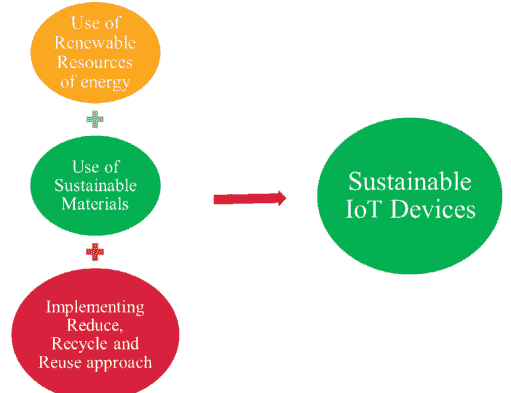

图 2.4 可持续物联网设备的主要贡献因素。

这些方法可以导致可持续物联网设备和系统的开发，反过来对可持续社会做出贡献。

制造可持续物联网设备的主要贡献因素简述如下：

- - 使用可再生能源资源：通过利用太阳能、风能、热能和水能等自然源排放，可以显著减少排放到环境中的有害气体，并减轻化石燃料资源的负担。物联网系统和设备可以使用这些资源供电。依靠这些资源，物联网设备可以在不产生毒性的情况下运行，这有助于实现可持续物联网设备。

- - 使用可持续材料：在制造物联网设备时使用可持续材料是更广泛可持续框架的关键之一。可持续材料的几个例子包括天然纤维、回收塑料和生物基塑料。这些材料通过减少电子垃圾、延长产品寿命和降低环境影响，在使物联网设备可持续化方面发挥着至关重要的作用。

- - 实施三R原则：三R原则即减少（Reduce）、重复（Reuse）和回收（Recycle），在实现可持续性方面发挥着重要作用。这种方法促进了循环经济，使设备和资源被使用更长时间，材料被回收和重复使用，电子垃圾减少到最低。实施这种方法将通过保护资源、减少废物和降低能源消耗，创造一个更可持续的未来。

可持续性在物联网设备中如此重要有以下几个原因：

环境影响：由于在制造、处置和交付的各个阶段使用了资源，物联网设备对环境造成了不利影响。最糟糕的环境影响之一是垃圾的产生。生产物联网设备提取原材料在污染和栖息地破坏方面对环境产生了负面影响。

能量使用：物联网设备对环境的第二大影响是能量的使用。大多数物联网设备运行和充电需要大量的能量 [9]。遗憾的是，这些能量来自不可再生能源资源，导致了温室气体排放和不利的气候变化。为了减少温室效应、节能和减少排放，需要各种方法来使物联网设备变得可持续 [10]。

电子垃圾：物联网设备的生命周期较短，需要频繁更换，这最终导致了大量的电子垃圾。为了避免这种情况，应努力设计长寿命的物联网设备，从而减少频繁更换的需求，进而减少电子垃圾。电子垃圾中含有铅和汞等毒性物质，这些会对人类健康和环境构成巨大风险。因此，为了人类的健康并减少对环境的影响，在制造物联网设备时，应该使用可以升级或维修的耐用材料 [11]。

物联网设备部署的主要问题是功耗和能量消耗较高，以及温室气体的过度排放。因此，需要采用高效能的程序在不同领域实施物联网，以减少功率消耗和温室效应。重点应放在开发可以在电池充电电量下运行更长时间的能效设备上。这可能涉及使用低功耗无线通信协议、优化软件和硬件以提高效率，以及使用可以从太阳能、风能或热能等源发电的能量采集技术。在设计物联网设备使其更具可持续性时，应考虑以下因素：

- 1. **功耗优化**：由于几个原因，功耗是部署物联网设备的主要障碍。在设计物联网设备时，应考虑功耗以使电池寿命更长，反过来增加了物联网设备的寿命 [12, 13]。以下是优化功耗时需要考虑的几点：
a. **实施睡眠模式**：在物联网设备中实施睡眠模式可以节省大量能量。在物联网设备中实现睡眠模式可以在设备不使用时节省大量能量。这种物联网支持支持、睡眠睡眠和睡眠睡眠模式，有助于实现物联网。。
b. ** **减少耗耗**********在在耗耗，，，，，，，，，，，，，，，，，，，，，，，，。。。。。。电子电子电子，，，温温电子减少 [14]。
c. **通过减少功能来延长电池寿命**：在物联网健康和，，，，，考虑考虑考虑考虑能量，，显示显示会考虑更多更多。
d. **选择合适的无线协议**：在为物联网选择无线协议时，必须考虑能效、范围和可靠性等因素 [15]。低功耗广域网（LPWAN）可以提供达15公的连接，适用于物联网。
e. **唤醒无线电（WUR）技术**：这种来自IEEE802.1ba的技术将显著延长物联网传感器的电池寿命。这种技术在物联网中放置一个低功耗无线电，在需要时唤醒。
f. **使用能量采集**：太阳能电池、压电或热电等能量采集技术可以帮助为物联网设备发电 [16]。
g. **优化代码**：可以通过正确的类型、减少延迟、编写简单的代码以及使用更少的指令来优化代码。所有这些功能都可以优化功率使用。
h. **灵活性和耐用性**：设备只需要制造、安装和运输一次。之后，这些设备能够适应需求或使用更长时间，从而自动减少功率消耗。

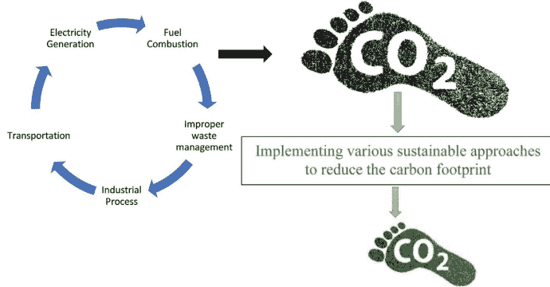

**图 2.5** 使用可持续方法减少碳足迹。

显著减少碳足迹。例如，通过使用可重复使用的袋代替一次性塑料袋、减少肉类消费、使用节能家用电器、种更多的树以及使用更多公共交通，我们可以为降低碳足迹做出贡献。

*减少电子垃圾：* 大多数电子产品含有银、铜甚至黄金痕迹，这些可以回收并制成新物品，而不是使用化石燃料开采全新的金属。此外，承载软件和硬件的塑料可能会产生严重的碳影响，因为其生产需要化石燃料形式的能量。几乎所有的电子产品都可以回收，尽管其自身对环境的影响，但实际上，这种成本远低于从零开始所节省的能量和资源。通过与回收公司合作，电子垃圾可以得到回收和利用，从而大幅减少碳足迹。垃圾发电（WTE）是另一种减少进入填埋场的垃圾量的方法，从而减少碳足迹。这种方法以一种更可持续、更环保的方式产生能量。

*缩小 RFID 标签的尺寸：* 由于标签由非生物降解材料制成，这将减少标签产生的过剩和有毒废弃物。我们可以进行进一步研究，并找到可以使用的生物降解材料 [21]。

*在 IoT 设备制造中使用可持续材料：* 使用可持续材料和制造工艺将减少 IoT 设备的碳足迹。随着对 IoT 设备的需求与日增长，切换到绿色材料的需求也随之增加：例如，PLA（聚乳酸）具有独特的机械和光学特性，使其成为良好的传感材料，但这种材料无法承受高温，不适用于电子设备。这阻碍了进程并限制了该材料在制造电路中的应用。因此，研究趋势侧重于使用生物降解和环保材料来制造 IoT 设备 [22]。

# 可持续 IoT 在现代生活中的作用

能效方法：可以在多个领域实施多种能效方法来减少碳足迹。

工业过程可以通过使用低碳组件、优化软件和高效的电源管理来提高能效，从而减少其碳足迹 [23]。提高能效的一些关键点见图 2.6。1. **碳捕集、利用与存储 (CCUS) 技术：** 采用 CCUS 等低碳技术在减少工业过程产生的碳排放方面起着至关重要的作用。CCUS 技术在二氧化碳释放到大气中之前将其捕获，并储存在地下或用于其他过程 [24]。

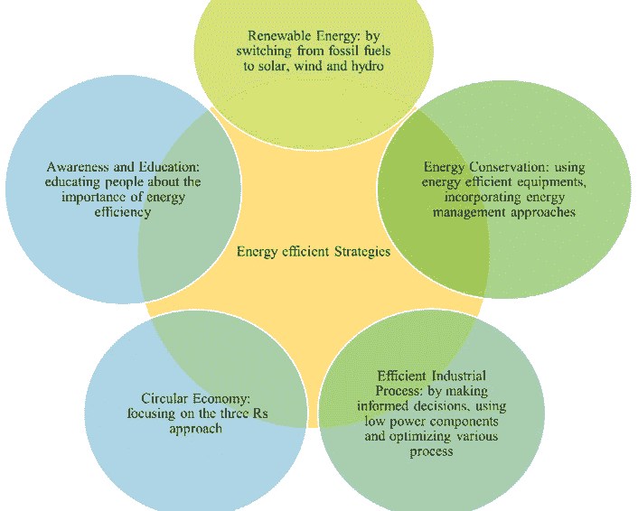

图 2.6 提高能效的关键策略。

- 2. **交通：** 交通部门是温室气体排放的主要来源之一。实施主动交通（如骑自行车、步行、公共交通）以及智能停车和交通管理等智能交通系统，有助于优化效率并减少排放。此外，应该使用更先进的运输技术，例如温室气体排放较低的混合动力，最后我们可以本地生产，因为它们不需要长距离运输。

- 3. **5G 技术：** 根据某些顾问的预测，未来几年支持 5G 的物联网传感器将在更大范围内减少碳足迹，这是由于该技术的三个核心能力：低延迟、更快的数据传输速度和海量设备连接。随着 5G 技术的部署，对其环境足迹的关注增加。图 2.7 显示了实施 5G 技术以减少碳足迹的不同方法。

- **切换到无电池电源：** 我们知道，电池是 IoT 设备供电的最常用解决方案，但在成本、性能和电子垃圾方面存在许多缺点。为了解决这个问题，研究人员正在通过提出不同的能量采集技术寻找转向无电池电源的方法。

- a. **压电：** 压电材料的主要特性是将机械能转换为电能，可用于 IoT 设备供电。这些材料以可持续且环保的方式为 IoT 设备供电提供了前景。许多压电材料包括压电陶瓷、压电聚合物和压电复合材料。最近，研究人员开发了一种比竞争材料灵活 40 倍的新压电材料。这一成就可能导致可穿戴设备中更好的能量采集。

- **废热回收：** 热电材料可回收来自工业过程、发动机或电子设备的废热，并将其转化为电，为传感器和设备供电。

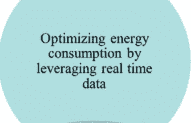
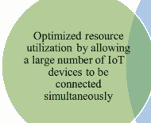
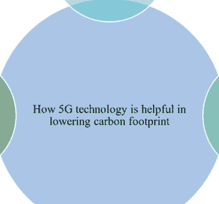

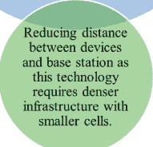

图 2.7 5G 技术对降低碳足迹的贡献。

- **温度传感器：** 热电材料可用于制造在温度变化时产生电信号的温度传感器。该信号可用于 IoT 设备供电或通信。
- **自供电传感器：** 通过将热电材料与低功耗 IoT 传感器集成，创建不需要外部电源的自供电传感器。
- **光伏：** 光伏（PV）技术（又称为太阳能）是 IoT 设备供电的流行选择。光伏技术具有将阳光转化为能的能力，为 IoT 设备提供电源。在 IoT 设备中使用光伏技术时需要考虑的因素包括太阳能板的效率、可用阳光量以及设备的尺寸和重量。光伏技术的进步（如钙钛矿太阳电池和叠层太阳电池的发展）也使太阳能更加高效且经济。

- **RF 能量采集：** 射频（RF）能量采集技术可用于各种 IoT 节点供电，减少对电池的需求并延长使用寿命。该技术涉及从环境中存在的无线频率信号中采集能量。RF 能量采集可用于医疗领域和军事应用的可穿戴设备 [25]。

为了确保 IoT 设备以可持续和负责任的方式使用，个人和组织考虑其行为和使用的环境因素非常重要。这包括选择由环保材料制造、设计重复或回收并负责任地处置垃圾。此外，政府和行业制定并实施促进 IoT 设备负责任使用的法规和标准也很重要。通过采取行动，我们可以减少 IoT 对环境的影响并为更可持续的未来铺平道路 [26]。表 2.1 提到了不同作者为构建可持续 IoT 系统而提出的方法/技术/硬件改进/材料改进。表中还给出了有助于使系统可持续的突出方法的性能因素和主要优势。

# 致力于制造可持续 IoT 设备的科技公司和组织

为了使 IoT 设备具有可持续性，不同的组织和科技公司在设计产品时考虑了联合国的可持续发展目标（SDGs）[39, 40]。他们遵循“三R”原则，即减少（Reduce）、重复利用（Reuse）和回收（Recycle）。以下是其中一些公司和组织的列表：

- LG 是一家电子和家电制造商，其目标是在 2030 年前实现某些可持续发展目标，包括将产品制造的温室气体排放减少 50%；在制造过程中引入 60,000 吨回收塑料；以及到 2030 年将电子垃圾的回收量增加到 800 万吨。

- Schroeder 是一家总部位于比利时的公司，致力于为公共空间提供创新和可持续的光照明解决方案，同时最大限地减少其对环境的影响。该公司已启动了一系列举措，以减少运营中的能源消耗和浪费，例如使用可再生能源并推广回收和减废计划。

- Johnson Controls 是一家跨国集团，专门设计、制造和销售建筑自动化系统、暖通风空调（HVAC）、消防和安全系统以及储能解决方案。它还致力于可持续发展并减少其

### 表 2.1
用于构建可持续 IoT 系统的不同因素和技术

| 参考文献 | 可持续性因素 | 技术/模型/硬件 | 性能 | 优势 |
| --- | --- | --- | --- | --- |
| [27] | 降低功耗 | 半透明有机光伏电池 (PVC)，用于在低光条件下为 IoT 节点节点。 | 在低光室内区域效率良好。 | PVC 灵活且易于加工；轻量化可定制设计；对于室内应用性强。 |
| [28] | 降低功耗 | 由可再生 RF 能量供电的 IoT 设备。 | 模型表明，电压和负载对各种任务的能量消耗有显著影响。 | 一种用于解释实际情况下 IoT 设备能量收集和功率消耗的模型。 |
| [29] | 减少能耗 | 激光诱导石墨 (LIG) 技术，包括多模式运行纳米发生器 (MTENG) 和微超级电容器 (MSC)。 | 在设备上引入荷叶启发的双层结构，实现了防水和自清洁功能，确保了稳定的电输出。 | 高集成且灵活的设备，具有自充电和能量收集等卓越能力。 |
| [30] | 减少毒性废物 | 集成湿度传感器网络 (WSN) 模块的绿色 RFID 标签天线。 | 在工作范围内具有卓越的环保多规则 RFID 解决方案。 | 带有传感器的宽范围标签。 |
| [31] | 降低功耗和碳足迹 | 使用唤醒无线 (WUR)、无线能量收集 (WEH) 和错误控制编码 (ECC)，通过拉格朗日乘子法减少碳足迹的同时增加效用。 | 提高效率、延长寿命、传输功率控制、高效路由。 | 提高可靠性、能量收集、无维护运行。 |
| [32] | 减少能耗和时间 | 通过 Arduino 利用廉价的自动灌溉系统。 | 当达到特定阈值时启动灌溉系统，从而提高了便利性，降低了能耗并提高了灌溉效率。 | 通过改进水资源有限地区的水资源管理，提升了产出成果。 |

### 表 2.1（续）
用于构建可持续 IoT 系统的不同因素和技术

| 参考文献 | 可持续性因素 | 技术/模型/硬件 | 性能 | 优势 |
| --- | --- | --- | --- | --- |
| [33] | 降低功耗 | 使用的硬件：Arduino Uno 和树莓派。智能系统设计结合了光伏板和各种控制设备。 | 最大程度地减少了本会发生的浪费。 | 所提灌溉系统的核心优势在于能够准确确定植物的水需求并相应地提供精确供应。该设计系统表现出可持续性、效率、可靠性和易于访问的特性。 |
| [34] | 减少能耗 | 使用新的高效路由算法。 | 通过实施睡眠节点，有效减少了节点之间的通信。 | 所提方案在能量效率和灵活性方面超过了传统的 WSN 方案。 |
| [35] | 更少的能量消耗和降低功耗 | 利用可最小化资源消耗的高效硬件和软件解决方案。 | 在保持计算性能不下降的情况下降低了能量消耗。 | 开发硬件解决方案的目标是设计出低功耗的设备。 |
| [36] | 减少能耗 | 采用如节电虚拟机技术等硬件和软件。 | 实施虚拟高效资源分配机制使得功率和能量因素得到了显著增强。 | 采用了稳健且精确的模型和评估方法来有效执行节能策略。 |
| [37] | 降低功耗 | 使用门聚类技术。 | 平均而言，晶体数量减少了 8%，连接数量减少了 27%。 | 建议的设计成功实现了功耗降低。 |
| [38] | 减少能耗 | 应用边缘计算技术和基于深度强化学习的能量调度方案。 | 与传统方案相比，能够在减少延迟的同时降低能量成本。 | 与传统方案相比更高的效率。 |

# 可持续 IoT 在现代生活中的作用

环境影响。该公司设定了几个环保目标，包括两个主要因素——第一是减少室气体排放，第二是增加可再生能源（风能、太阳能、水电）的使用。他们的 IoT 平台从不同来源收集数据，并利用这些数据减少业务运营并改进能源管理。

- New Road 是一家位于加利福尼亚州的公共利益公司，利用 IoT 产品进行发展中国家的能源管理。公司的软件平台名为 SunRise，旨在实时管理能量生产、存储和消耗。该平台还整合机器学习算法以预测能源需求并优化系统性能。公司的主要重点是开发微电网。New Road 的微电网解决方案结合了先进的软硬件技术，实现了能源系统的监控、控制和优化。

- HDR 是一家位于内布拉斯加州的公司，专注于关注再生能源的建筑。公司专注于基于太阳能、水能风能的项目，以减少使用不可再生能源产生的大量室气体排放。它已获得多项奖励和认证，包括许多建筑的 LEED（能源与环境设计领先）认证。

- Mill 是一家位于加利福尼亚州的公司，专门制造和销售厨房垃圾桶以减少有害废物。这些特制的垃圾桶可以干燥并磨碎食物残渣，将其变成压缩体。一旦垃圾桶装满，客户将残渣装箱邮寄给 Mill，它们会被送往农场而不是填埋场。

- 绿色电子委员会 (GEC) 是一个通过其 EPEAT（电子产品评估工具）认证计划推广可持续电子产品的组织，评估包括 IoT 设备在内的电子产品环境影响。

- 可持续电子倡议 (SEI) 是伊利诺伊大学香槟槟分校的一个研究与教育中心，专注于促进可持续电子的设计、制造和处置。他们还为电子行业的专业人士提供培训和资源。

这些只是致力于可持续 IoT 领域的组织示例。世界上还有很多这样的机构，它们的工作对于确保 IoT 技术以对环境负责且可持续的方式进行开发和部署至关重要。

## 2.3 利用可持续 IoT 迈向可持续社会的发展

广义上的可持续性意味着在满足当代人需求的同时，确保后代满足自身需求的能力。它涉及在经济发展、环境保护和社会福利之间实现平衡。这三个因素是可持续性的支柱。我们正在迈向工业革命 4.0，该革命结合了物理、生物和数字系统，创造了新的机会，导致制造业、医疗、交通、农业和能源等许多领域的生产力、创新竞争竞争力显著提高。

图 2.8 显示了社会发展的两个主要因素。IoT 可持续性涉及将 IoT 作为创建可持续环境的。它涉及将 IoT 技术整合到可持续实践中。例如，在智能城市的背景下，IoT 可用于监测交通拥堵和排放，调节家庭和办公楼的能源消耗，并高效管理水和废物。IoT 能够收集和分析海量数据，实现对资源的实时监控和管理。IoT 可持续性专注于设计和制造高效的 IoT 硬件和软件，旨在创建

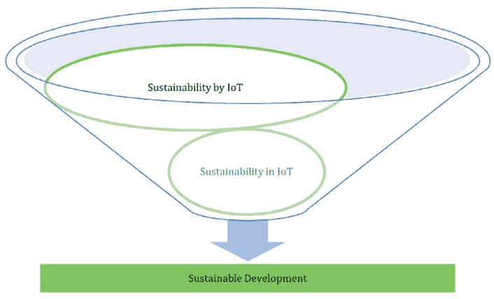

图 2.8 可持续发展的两个贡献因素。

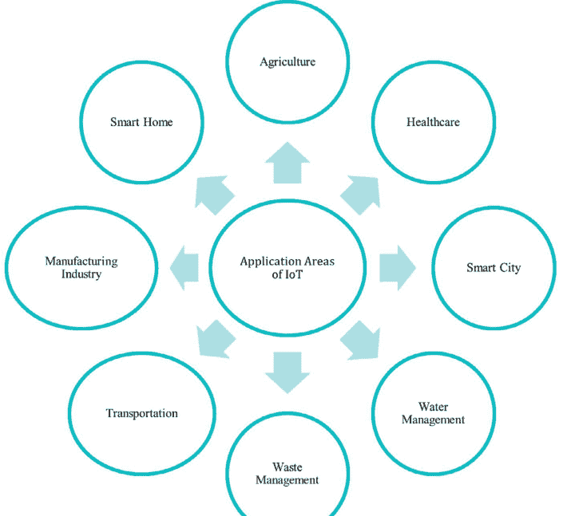

图 2.9 物联网的应用领域。

可持续的未来。物联网可持续性涵盖了几个关键方面，如环境影响、资源效率、循环经济、社会公平和经济可行性。图 2.9 显示了实施物联网的不同部门，如农业、医疗保健、制造业、智慧城市、交通、废物管理和水务管理 [46, 47]。

### 2.3.1 联合国可持续发展目标 SDGs

在解释物联网的各种应用领域之前，有必要简要讨论联合国的可持续目标（SDGs），以理解如何利用 SDGs 在不同领域映射物联网。这17个目标由联合国于2015年建立，旨在实现社会可持续发展。这些目标旨在解决社会、经济和环境挑战，使这个世界变得更加和平、更加美好。每个目标都针对可持续发展的特定领域。实现 SDGs 需要个人、行业和政府机构的共同努力，在每个部门实施这些目标。17项 SDGs 如下：

- 消除一切形式的贫困。
- 通过促进可持续农业消除饥饿。
- 促进福祉，确保所有人都能过上健康的生活。
- 为所有人提供优质教育。
- 实现性别平等，增强妇女和女孩权利。
- 确保所有人都能获得用水和可持续的卫生系统。
- 确保所有人都能获得清洁且负担得起的能源。
- 促进经济增长以实现可持续经济发展和为所有人提供体面工作。
- 建立可靠的基础设施，促进可持续工业化和创新。
- 减少国家内部和国家之间的差距。
- 为所有人建设安全、韧性和可持续的城市。
- 确保可持续的消费和生产模式。
- 采取可持续措施降低对气候的有害影响。
- 保护和合理利用海洋、海洋和海洋资源，促进可持续发展。
- 支持陆地生态系统的可持续利用，扭转土地退化，并有效管理森林。
- 促进和谐和平的社会，确保人人司法公正。
- 增强实现可持续发展的手段。

从这些目标中可以清楚地看到物联网如何在不同部门中应用并映射结果。

农业部门面临许多挑战，如气候变化、环境影响、病虫害、极端天气事件、劳动短缺和粮食安全，物联网在应对这些挑战方面发挥了重要作用。智能农业代表了一种技术先进且创新的方法，利用物联网来提高农业的整体效率 [48]。智能农业涵盖了从土壤准备到作物收获的一系列活动。这些活动与云平台集成，允许农民监测和管理农业作业的各个方面，如土壤准备、灌溉、肥料使用、天气状况和虫害发生 [49, 50]。通过利用物联网传感器和天气监测设备，农民可以就灌溉、作物保护和整体农场管理做出明决策。除了天气监测外，物联网还广泛应用于各种农业方面，如牲畜监测、田间观察、车辆跟踪等 [51]。在农业部门实施物联网带来了更具可持续性且高效的耕作模式 [52]。

# 可持续物联网在现代生活中的作用

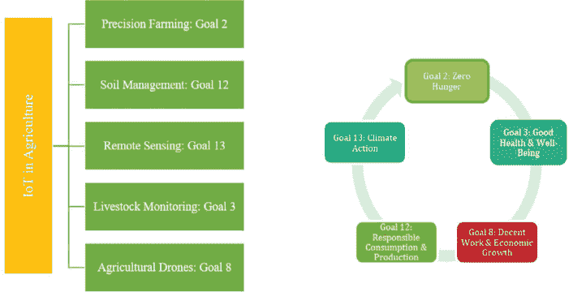

图 2.10 SDGs 下农业中物联网的益处。

Eekifoods 是一家农业科技初创公司，开发了一种物联网机制，可以以高精度和准确度自动灌溉、营养管理和气候控制等任务，并确保劳动工作。Wisceonn Engineering 正在开发一种智能灌溉系统，帮助农民高效生产更好的作物。农民可以使用传感器监测状况，并通过数据分析土壤质量，从而知道何时灌溉、种植什么作物。其他一些从事精准农业和质量控制的印度农业科技创业公司包括 Aarav Unlimited Systems、Aioobono、Aquaconnect、BharatAgri、CropIn、FarmGramX、Intelli、Intello、Original4sure、Agdhi。图 2.10 显示了物联网如何满足联合国可持续发展目标之一。

### 2.3.1.2 医疗领域的物联网

医疗物联网是指物联网技术整合到各种医疗流程和系统中。物联网的出现为医疗领域开辟了救命应用的可能性。通过收集床边设备的实时数据，实现对患者信息的实时监测并促进及时诊断，可以增强和改进整个患者护理系统 [53]。估计到 2020 年，87% 的医疗机构将成功实施物联网技术。超过三分之一的医疗机构未能利用来自连接设备的实时数据，这导致诊断和治疗存在错误风险、潜在的数据丢失和其他缺陷。高效且准确的医疗服务依赖于及时、准确的信息，物联网的出现促进了大量医疗设备的集成 [54]。随着物联网技术的实施不断获得关注，我们正见证各种医疗设备连接性的增强，这提升了获得更好医疗结果的潜力。物联网的能力正在彻底改变城市的各种可能性 [61]。它通过具有视频和音频分析功能的智能摄像头保护公民并提供安全，这些摄像头可以识别犯罪行为、识别面部、追踪占用情况并检测声音。

# 可持续物联网在现代生活中的作用

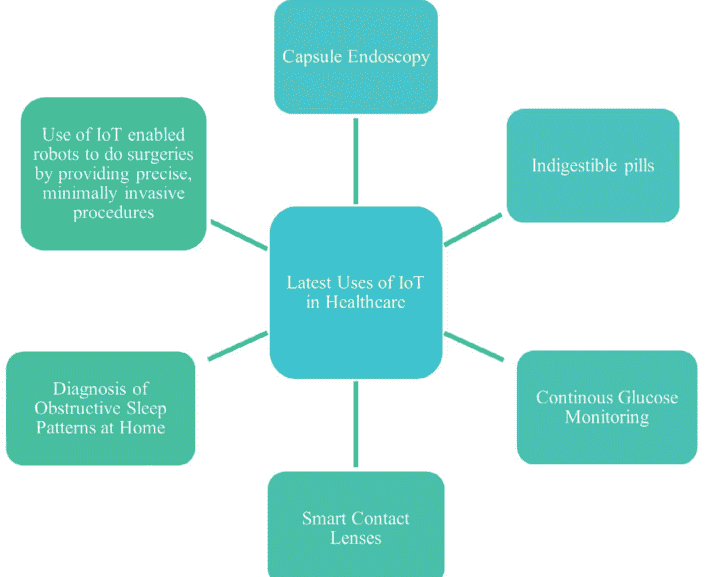

图 2.12 物联网医疗保健的一些最新进展。

它通过具有视频和音频分析功能的智能摄像头保护公民并提供安全，这些摄像头可以识别犯罪行为、识别面部、追踪占用情况并检测声音。通过监测污染物和维持通风水平的空气质量传感器使人们更健康。通过提供由 AI 定向实时信息和服务的智能表优化能源使用，诸此类推。鉴于更具适应性且更愉快的环境。这项技术的巨大潜力难怪全球物联网和智慧城市市场份额预计在未来几年将急剧增长。图 2.13 显示了结合 SDGs 的物联网部署如何引导社会的可持续发展。Ingram Micro Technology Solutions 开发了可扩展的交钥匙解决方案，并提供培训和工作坊以简化物联网和智慧城市的复杂性。这些解决方案包括硬件和软件产品，使城市能够从各种设备收集、管理和分析数据。这些数据可以用于优化城市服务，例如交通管理、废物管理和能源消耗。Efficiency Services Limited (EESL) 是一家位于印度的公司，提供基于物联网的智能表，以促进节能技术的部署，促进节能并减少温室气体排放。

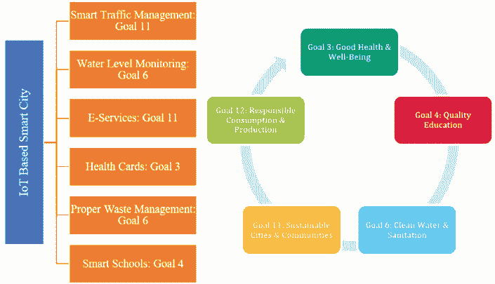

图 2.13 结合联合国可持续发展目标（SDGs）的智慧城市中的物联网。

### 2.3.1.4 制造业中的物联网

物联网正在改变供应商以及客户的制造业。制造业正在拥抱物联网的潜力 [63]。制造商依赖机器、工具和熟练人员等物理实体的集成来驱动生产过程，并交付客户/用户日常使用的最终产品。通过网络，物联网实现了实时数据和精确信息的共享。对这些数据的分析使制造业能够加速产品开发并更有效地进行规划。物联网数据在优化跨供应链的信息和货物流动方面起着重要作用。例如，安装在送货卡上的传感器有助于公司规划更好的路线以节省可能和燃料，并确保产品从工厂准确交付到消费者手中。采用物联网允许客户参与产品设计，以获得更好的结果并增强客户体验。估计到 2025 年，物联网有潜力将全球生产率提高多达 25%，这可能产生约 11 万亿美元的经济价值。

物联网的演变正在改变人们的观点。我们日常生活中颠覆性趋势的整合引发了对定制化需求的激增，提升了客户的期望，并加了供应链管理的复杂性。所有这些变革性的变化对制造业产生了直接影响，因为人们日益需要多样化的可定制产品

# 可持续物联网在现代生活中的作用

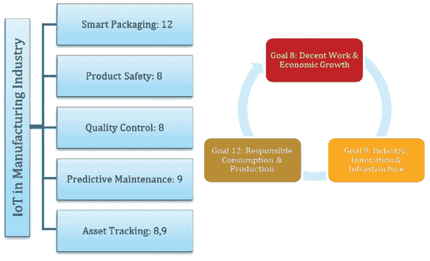

**图 2.14** 结合联合国可持续发展目标（SDGs）的基于物联网的制造业。

满足其偏好和需求的产品 [64]。该行业也受益于连接设备带来的颠覆性因素 [65, 66]。图 2.14 详细描述了制造业中的物联网如何满足联合国的可持续发展目标。

### 2.4 结论与物联网的未来

在本章中，我们解释了物联网的基本概念，并随后分析了对可持续物联网的需求。已经发现了许多正在被研究和采用用于制造可持续物联网设备和系统的各种方法和策略。显而易见，包括基础服务、商业和客户关怀在内的多个领域正在意识到物联网的潜力，并比以往任何时候都更好地利用其效益。随着物联网采纳的持续增长，拥抱物联网革命的企业将获得巨大的增长和成功机会。那些成功利用物联网优势来赋能自身的公司和机构有潜力建立起难以被忽视的竞争优势。因此，采用用于制造可持续物联网设备和系统的实践，以实施创建可持续社会所需的应用至关重要。这一领域正在稳定增长，预计将继续其快速扩张和转型。物联网的未来充满了巨大的希冀，并将重塑我们生活的各个方面。然而，就像任何新技术一样，物联网也存在安全担忧。随着越来越多的设备互联，保护它们免受潜在的网络攻击至关重要。这可以通过实施加密、防火墙和定期软件更新等强有力措施来实现。总之，物联网已经在重塑行业并改善人们的生活。它有望让我们的生活更智能、医疗更高效、农业生产率更高、城市更可持续。随着持续的创新和发展，物联网的潜力几乎是无限尽的。

# 参考文献

- 1. M. Umair
- 17. "碳足迹 - GeeksForGeeks, https://www.geeksforgeeks.org/carbon-footprint/ (2023年5月12日访问)。"
- 18. J. C. R. Kumar, and M. A. Majid, "印度可持续发展的的可再生能源：现状、未来前景、挑战和投资机会," Energy. Soc., vol. 10, no. 1, pp. 1–36, 2020, doi: 10.1186/s13705-019-0232-1
- 19. A. Qazi 等， "迈向可持续能源：可再生能源源、技术和意见的系统综述," IEEE Access, vol. 70, pp. 63837–63851, 2022.
- 20. P. Vecunia, L. G. Occhipiniti, and R. L. Zhou, "可持续物联网的新兴光伏技术," Adv. Mater, vol. 11, no. 29, p. 2100698, 2021, doi: 10.1002/adv.20100698
- 21. H. S. Al Hanshi, O. M. S. Ansari, and Q. Meng, "为了绿色环境生活的智能万物实现绿色物联网：未来调查与展望," arXiv Preprint, arXiv:1805.00844, 2018.
- 22. M. Patil, S. Boraste, and P. Minde, "智能绿色建筑和可持续材料新兴趋势的综述," Mater. Today Proc., vol. 65, pp. 1813–1832, 2022, doi: 10.1016/j.matpr.2022.04.866
- 23. V. Tahmili, and M. Dilzar, "物联网系统：能源高效视角,"  2018 年第八届国际云计算会议 (IC3), 2018, pp. 1–6.
- 24. Sara Binidur; Madhile Fathi; Craig Greenfield; Richard Moore, "碳捕集、利用与策略 - IEA," 2022, https://www.ieea.org/reports/carbon-capture-utilisation-and-strategy (2023年5月12日访问)。
- 25. T. Sanislav, D. G. Mo, S. Seally, and S. Foley, "物联网 (IoT) 的能量采集技术," IEEE Access, vol. 9, pp. 39530–39549, 2021.
- 26. H. Rahmani 等， "下一代物联网设备：可持续友好型制造、能量采集和连接性," IEEE J. Microwaves, vol. 1, no. 1, pp. 237–255, 2022.
- 27. S. Kim, M. Jahandar, J. Jeong, and D. Com, and C. Lee, "用于低光感应应用的太阳电池技术进展," Curr. Altern. Energy, vol. 3, no. 1, pp. 1–17, 2019.
- 28. Y. Luo, and L. Pu, "可持续物联网中能量采集和数据传输的实际问题," arXiv Preprint, arXiv:2001.00087, 2020.
- 29. X. Li, J. Jiang, F. Zhao, Y. Shao, and J. Ping, "用于能量采集的自充电接口," Nano Energy, vol. 73, p. 10478, 2020.
- 30. Y. Amin, "嵌入式传感器的打印 RFID 天线," KTH 皇家学院。
- 31. C. Mahapatra, S. Zheng, P. Kamaline, V. C. Leung, and S. Mir, "具有能量采集、唤醒和传输的传感器网络最优功率控制," IEEE Access, vol. 5, pp. 501–518, 2016.
- 32. Y. Arias-Sánchez, M. F.-Pérez, and J. Roldán-Cañas, "使用低成本微控制器和处理器的环境控制：绿墙的应用," Sustainability, vol. 11, no. 3, pp. 782, 2019.
- 33. S. Ali, F. Rashid, H. Alsharki, and A. Nates, "光伏能量转换智能系统（节约能源的贪婪过载）," 在 2018 年第 7 届 PVSEC 世界会议、第28届 PVSEC & 第34届 EUSEC, pp. 2395–2398.
- 34. S. Rani, R. Talwar, J. Mahotra, S. H. Ahmed, and M. Song, "基于无线网络的高能效物联网新方案," Sensors, 15, no. 11, pp. 28603–28626, 2015.
- 35. T. Shree, R. Kumar, and N. Kumar, "云计算中的绿色计算," 在第 2 届计算、通信和网络进展国家国际会议 (ICACC), 2020, pp. 903–905.
- 36. C. Zhu, U. V. M. Leung, L. Shu, E. Ng, "用于智能世界的物联网," IEEE Access, vol. 3, pp. 2151–2162.
- 37. C. Conceição, G. Moura, F. Pisoni, and R. Reis, "用于可持续制造系统的物联网," 在 2017 年 IEEE 电子与系统会议, pp. 186–189.
- 38. Y. Liu, S. Som, and K. Khatri, "可持续物联网中能量采集和数据传输的实际问题," arXiv Preprint, arXiv:2001.00087, 2020.
- 39. Builtin, "绿色公司," https://builtin.com/environmental-
- 40. Techfunnel, "物联网用于 ESG," https://www.techfunnel.com/iot-for-
- 41. Global Electronics, "全球电子," https://globalelectronics. 
- 42. Sustainable Electronics, "可持续电子," https://sustainable-electronics.ics.edu/
- 43. Order Group, "用于可持续发展的物联网," https://ordergroup.org/sustainable-development-with-iot-challenges-
- 44. A. E. Radushanki, M. N. Halgaumga, W. A. H. Wirasagara, and A. Syed, "第四工业革命 (工业4.0) 对工程教育的影响," 在工业第四革命的影响系统, Vol 2, pp. 316–335.
- 45. A. Verde Espinoza, J. Mata, and M. E. Estevez, "医疗中的物联网," Sensors, vol. 21, p. 2330, 2021.
- 46. Simplelearn, "现实世界物联网应用," https://www.simplelearn.com/iot-applications
- 47. Dzone, "物联网的10大应用," https://dzone.com/top-10-uses-of-the-internet-things
- 48. R. Dagar, S. Som, and K. Khatri, "农业中的智能农业," 2018 年创新计算研究国际会议 (CIRCA), 2018, pp. 1052–1056.
- 49. A. E. Radushanki, M. N. Halgaumga, W. A. H. Wirasagara, and A. Syed, "农业和智能农业中物联网 (IoT) 的采用," Int. J. Adv. Comput. Sci. Appl., vol. 10, no. 4, pp. 11–29, 2019.
- 50. L. Gupta, S. Malhotra, and A. Kumar, "物联网和机器学习在智能农业中的研究," 2022 IEEE IEEE 技术发展会议 (CCET), 2022, pp. 1–5.
- 51. I. Mohanraj, K. Ashkumar, and J. Naren, "农业领域基于物联网的现场监控与自动化," Procedia Comput. Sci., vol. 93, pp. 931–939, 2016, doi: 10.1016/j.procs.2016.07.275
- 52. V. P. Kaur, and S. Arora, "农业物联网最新进展综述," IEEE Access, vol. 8, pp. 12992–12997, 2020, doi: 10.1109/ACCESS.2020.3009298

# 可持续物联网在日常生活中的角色

- 53. M. N. Bhuyyan, M. N. Rahman, M. M. Billah, and D. Saha, “物联网 (IoT)：医疗保健应用中的关键技术、标准协议、安全性和市场机会综述,” IEEE Internet J., vol. 8, no. 13, pp. 10474–10498, 2021.
- 54. M. Parnar, and H. Jit Kour, “物联网在生物医学应用中的影响：挑战以及计算驱动的智能设备、电路和系统，” Approach, 2021, pp. 423–439. doi: 10.1016/B978-0-323-8517-5.00002-2
- 55. Z. N. Ahmad, A. M. Rahmani, and M. Hoseinzadeh, “物联网在医疗保健中的作用：未来趋势与挑战,” Comput. Methods Programs Biomed., vol. 199, pp. 109503, 2021.
- 56. H. N. Saha, D. Paul, S. Chaudhary, S. Haldar, and R. Mukherjee, “基于物联网的医疗监测系统，” in 2017 8th IEEE Annual Information Technology, Electronics and Mobile Communication Conference (IEEECOM), 2017, pp. 531–535.
- 57. D. Tiwari, D. Prasad, K. Guleria, and P. Ghosh, “基于物联网的智能医疗监测系统：综述，” in 2021 6th International Conference on Smart Processing and Control (ISSPCO), 2021, pp. 465–469.
- 58. S. I. Foundation, “智慧城市：实现城市可持续性的解决方案，” Horizon, 2021. https://solairpulse.com/smart-cities-solutions?utm_term=smartcity-definition&utm_source=adwords&utm_medium=ppc&hsa_acc=104960977&hsa_campaign=11451944666&hsa_grp=11752879028&hsa_ad=17508183029 (访问日期：2023年5月12日)。
- 59. P. Bellini, N. Pesi, and G. Pantaleo, “面向智慧城市的智能城市：框架与技术的综述，” Appl. Sci., vol. 12, no. 3, pp. 1607, 2022, doi: 10.3390/app12031607
- 60. Y. Qian, D. Wu, W. Bao, and P. Lorenz, “用于智慧城市的物联网：技术与应用，” IEEE Net., vol. 33, no. 2, pp. 4–5, 2019, doi: 10.1109/MOTET2019.2867515
- 61. A. S. Syed, D. Sierra-Sosa, A. Kumar, and A. Elmaragahy, “基于物联网的智能与智能化智慧城市：技术、实践与挑战综述，” Smart Cities, vol. 4, no. 2, pp. 429–475, 2021, doi: 10.3390/smartcities4020024
- 62. Z. Chen, C. B. Sivarthiphon, and B. A. Muthu, “工业4.0制造业中的物联网：新的系统性综述，” Sustainability, Energy Tech. Technol., vol. 49, p. 101724, 2022, doi: 10.1016/j.est.2021.101724
- 63. T. Kalsum 等, “物联网对工业4.0制造业的影响：新的系统性综述，” Sustainability, vol. 13, no. 2, pp. 12506, 2021.
- 64. E. Manavalan, and K. Jayakrishna, “面向工业4.0需求的嵌入式物联网可持续供应链综述，” Comput & Ind. Eng., vol. 127, pp. 205–217, 2021, doi: 10.1016/j.jcom.2021.06.003
- 65. A. Kumar, S. Sharma, N. Goyal, A. Singh, X. Cheng, and P. Singh, “基于新兴物联网技术的安全与能效智能建筑架构，” Comput. Commun., vol. 176, pp. 207–217, 2021, doi: 10.1016/j.jcom.2021.06.003
- 66. S. Rani, S. H. Ahmed, and R. Rastogi, “用于物联网应用的无线传感器网络遗传算法动态聚类方法，” Wired. Networks, vol. 26, no. 4, pp. 2307–2316.

## 面向智慧城市的 IoT-WSN 框架设计

设计智慧城市的 IoT-WSN 框架需要考虑多种因素。合适的硬件和软件组件、建立网络架构以及采取保护隐私的措施是其中一些。此外，为了支持新技术的扩展，扩展性、互操作性和标准合规性至关重要。

## 面向水管理的 IoT-WSN 框架设计

另一个 IoT-WSN 框架非常有帮助的领域是水管理。水网网络可以使用传感器检测水质、发现泄漏并实现预防性维护。结果是资源的利用更加高效，可靠性得到了提高。

## 面向能源管理的 IoT-WSN 框架设计

另一个 IoT-WSN 框架可能产生巨大影响的重要领域是能源管理。通过实施智能电表、传感器和执行器，智慧城市可以追踪能源消耗、优化能源分配并鼓励住宅及节能。

## 面向公共安全的 IoT-WSN 框架设计

智慧城市必须重视公共安全，IoT-WSN 框架在这方面至关重要。通过实施监控摄像头、智能路灯和环境传感器，智慧城市可以识别紧急情况并迅速行动保护公民。

## 面向交通管理的 IoT-WSN 框架设计

IoT-WSN 框架的另一个应用是交通管理。智慧城市的交通控制器可以根据车辆移动数据优化信号时长，从而缓解拥堵并改善交通流。

## 面向废物管理的 IoT-WSN 框架设计

废物管理是 IoT-WSN 框架的另一个应用，嵌入垃圾桶或垃圾车中的传感器可以追踪水平并优化路线。这有助于城市降低运营成本并维持卫生状况。

智慧城市的发展格局发生了根本变化，转向了一种结合物联网与无线传感器网络的全新架构。物联网的核心理念是连接设备以便其共享数据。为了收集和共享环境数据，无线传感器网络由无线连接的传感器节点组成。IoT-WSN 框架依赖于多个关键组件。其核心由传感器组成，传感器对于获取环境数据至关重要。这些传感器有不同的尺寸和形状，可以监测温度、湿度、空气质量、噪声水平等许多参数。通过实时收集数据，这些传感器为市政服务的运行和性能提供了宝贵的见解。

将控制器集成到天气监测系统中，能够对快速变化的天气状况做出响应 [8]。这些控制器确保了大量的城市服务得到有效的控制和协调，提高了它们的整体有效性和响应能力。

传感器与主计算机网络之间的通信链路由网关提供，网关负责将传感器收集的信息发送到中央处理器，以便进一步的扩展和决策处理。网关保证了无缝的网络访问和有效的数据传输，实现了设备与中央处理器之间数据的于交换。

传感器收集的海量数据必须经过处理和分析，这正是数据分析发挥用场的地方。这些工具使得识别数据中的趋势、模式和异常成为可能，为改进市政服务提供了深刻的见。智能城市可以通过利用高级分析做出数据驱动的决策，改进资源分配并提高整体运营效率。此外，数据分析还可以建立预测模型，使城市能够预见模式并采取预防性措施来提高服务质量 [9]。

IoT-WSN 框架利用智能网络架构为智能城市应用的个体需求与可用资源之间提供安全有效的数据传输，可能会使用不同的通信协议。蓝牙、Wi-Fi、ZigBee 和 Lora 等流行协议在范围、功耗、数据传输速率和网络可扩展性方面各自具有优势。为了构建平滑的连接并确保数据在整个网络中准确地传输，通信协议的选择至关重要。通过这种方式，可以使用来自建筑传感器的能量数据来优化暖空调（HVAC）系统，从而节约能源并提高可持续性。结果是当地居民的生活质量得到提高，可持续性增强，并开发出更智能、更连接的城市环境。

IoT-WSN 框架的适应性允许根据每个城市应用的需求进行定制。随着城市的发展，架构可以改变以接受新的技术和突破，确保可扩展性和前瞻性。集成的 IoT-WSN 架构可能会彻底改变城市管理，使城市变得更加可持续、高效且富有弹性。当我们进入智能城市时代，IoT 与 WSN 技术的融合对于形成未来的城市至关重要 [10]。图 3.1 显示了 IoT-WSN

IoT-WSN 架构为控制城市服务提供了一种有力的方法，因为它实现了对广泛城市组件的实时监测和管理。平台的通用性支持多种智能城市应用，从公共服务、交通到公共安全和环境保护 [11]。如果构建了成功集成的 IoT-WSN 架构，IoT 和 WSN 有潜力使城市变得更智能、更连接且更环保 [12]。

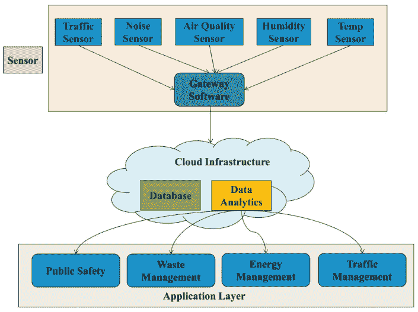

**图 3.1** IoT-WSN 集成框架。

### 3.1.2 智能城市应用

集成的 IoT-WSN 框架在智能城市中对以下应用非常有用 [13–18]

- i. **交通流管理**：IoT-WSN 框架可用于实时跟踪流量并据此调整信号定时。为了预测将发生哪些拥堵，将在战略点安装传感器以监测流量和流速。一旦框架到位，就可以修改灯光定时以缓解流量并减少拥堵。结果是城市将变得更高效，空气污染也将减少 [19, 20]。
- ii. **能源管理**：IoT-WSN 框架可以通过密切监控建筑的能源消耗并对暖通通风和空调（HVAC）系统进行必要的调整来实现能源管理。在建筑中放置传感器来监测温度、湿度和占用率等情况，可以精确定能量泄漏。在结构建立后，HVAC 系统可以进行精调以减少能源消耗和成本。
- iii. **废物管理**：垃圾收集可以利用 IoT-WSN 架构，监测垃圾桶的数量并根据需要修改收集计划。通过在垃圾桶中放置传感器并分析收集的数据，识别垃圾产生集中的区域是可行的。该框架可以增强垃圾收集计划，从而减少道路上的垃圾车数量并增加成本节省。
- iv. **水务管理**：IoT-WSN 架构在水务管理提供了许多可能的应用，包括寻找管道漏水和监测用水。可以在整个供水系统的结构中安装传感器，以收集用水和压力数据。这些信息可用于识别问题区域。一旦发现漏水，可以使用该结构来减少水损失。
- v. **公共安全**：利用 IoT 和无线传感器网络的基础设施监控物体，并为公共空间可能发生的任何紧急情况做好准备。在公共场所可以部署传感器来留意可疑行为。收集的信息将被进行分析以识别潜在危害。随后，系统可能会提醒相关部门并向他们提供最新信息。

WSN 与 IoT 的融合为多个市政服务的管理创建了强大的基础设施。实时数据收集和分析有助于降低费用、提高生活水平并增强对居民的服务。该框架具有适应性，可以定制以匹配每个市的独特需求。它还可以随着新项目的开发而扩展包含新项目。

### 3.2 定义数据需求

为了智能城市应用创建一个高效的 IoT-WSN 框架，建立系统的数据需求至关重要。确定分析所需的数据类型、数据收集间隔和数据粒度是该过程的一部分 [21–24]。

### 3.2.1 数据类型

需要收集的数据类型取决于 IoT-WSN 框架的具体应用。智能城市应用中可能收集的一些常见数据类型包括：

- 1. 环境数据：这可能包括温度、湿度、空气质量、噪声水平和天气状况的数据。
- 2. *交通数据*：这可能包括车辆计数、速度和拥堵程度的数据。
- 3. 废物管理数据：这可能包括废物产生率、回收率和填埋场容量的数据。
- 4. *能源消耗数据*：这可能包括建筑、路灯和其他基础设施的能源消耗模式的数据。
- 5. *健康数据*：这可能包括个人健康的数据，例如脉搏、血压和进行的运动量。

为智能城市应用设计集成的 IoT-WSN 框架 69

数据的收集频率取决于 IoT-WSN 架构的实施方式，以及数据将如何使用。为了实现实时交通管理，某些数据（如交通统计）可能需要实时收集。某些信息（例如垃圾收集）可能只需要每天或每周收集一次。

取决于 IoT-WSN 框架的应用，可能需要不同的数据粒度。聚合数据（如区域速率）对于某些目的可能是足够的，而其他目的（如车辆计数和速度）。节点的能力和网络设计也会影响细节。对于收集极其详细的数据，可能需要更先进的传感器和网络，这增加了系统成本。为智能城市应用创建成功的 IoT-WSN 架构的关键步骤是确定数据需求。为了实现高效的分析和决策，必须彻底评估所需的数据类型、频率。

传感器的选择是创建智能城市应用 IoT-WSN 架构的重要步骤。由于本研究关注智能城市应用，需要廉价传感器，因为它们能够准确可靠地收集数据供使用。在本节中，我们将查看一些可以包含在城市基础设施中的重要传感器 [10, 25–30]。

- i. 温度传感器：这些传感器用于确定环境温度。它们经常用于智能城市应用，包括建筑自动化和能源管理。温度传感器可以监测室内或制造环境。
- ii. 湿度传感器：这些传感器可以衡量空气中的水分。智能城市中使用的 HVAC 系统的几个例子是农业和建筑自动化系统。湿度传感器可以评估室内房间、室外环境和制造设施的相对状况。
- iii. 空气传感器：这些传感器可以跟踪污染物浓度。它们被广泛应用于智能城市，例如交通管理、公共健康改善和环境保护。臭氧、颗粒物、氮氧化物和一氧化碳只是空气质量监测器可以跟踪的污染物。
- iv. 噪声传感器：这些传感器测量特定区域的背景噪声水平。它们被广泛应用于各种智能城市应用，

### **表 3.1**
智能城市应用中所使用的传感器类型比较

| 传感器类型 | 测量内容 | 应用 | 优点 | 缺点 |
| --- | --- | --- | --- | --- |
| 湿度 | 水分 | 建筑自动化、能源管理、农业、HVAC系统、建筑自动化 | 成本低、易于安装，有助于防止霉菌和水渍损害 | 仅限于温度测量 |
| 空气 | 污染物 | 环境监测、交通管理、公共健康 | 能检测各种污染物 | 可能昂贵，需要定期校准 |
| 噪声 | 声级 | 交通管理、公共安全、噪声污染控制 | 能够准确测量噪声 | 可能受到其他声音或环境因素的影响 |
| 振动 | 振动 | 结构健康监测、工业自动化、交通系统 | 能检测结构或机械中的振动 | 价格可能昂贵，可能需要复杂的安装 |

包括交通管理、确保安全和控制噪声污染。噪声传感器可以监测各种环境下的分贝水平，例如拥堵的街道、开放空间和嘈闹的工厂。

振动传感器：这些传感器测量环境振动的强度。它们对于许多智能城市应用至关重要，包括公共交通、工厂自动化和基础设施健康监测。使用振动传感器，可以确定建筑、桥梁或其他结构的振动水平。安装这些传感器对公共交通基础设施和车辆都可能有利的。

表 3.1 总结了智能城市应用中使用的许多传感器类型，以及每种类型的优缺点。该表表明，在决定传感器时需要考虑各方面的权衡，例如成本和准确性。为了确保 IoT-WSN 框架能够有效支持智能城市应用，必须在充分考虑数据需求和应用需求后选择合适的传感器。

### 3.4 选择通信协议

一旦选定了传感器，必须指定正确的通信协议，以便数据能从传感器发送到中央监控系统。数据速率、范围、功耗和成本等考虑因素将指导协议的选择。在智能城市应用中，通常使用四种通信协议 [31–33]

### 3.4.1 Wi-Fi

一种名为 Wi-Fi（无线传输）的通信协议为各种设备和应用提供了无线连接。由于其具有高数据传输率且在 2.4 GHz 和 5 GHz 频率范围内运行，它适用于各种智能城市应用。我们将在本节中介绍 Wi-Fi，探讨其主要优点、特征以及在智能城市集成 IoT-WSN 框架下的应用。

借助 Wi-Fi 技术的帮助，设备可以无线加入局域网（LAN），使其能够相互以及与互联网通信并共享数据。它依赖于 IEEE 802.11 标准族，该标准建立了无线网络的要求。发送和接收数据信号的接入点（AP）构成了 Wi-Fi 网络，以及连接到这些 AP 以访问网络的设备。

Wi-Fi 的高需求传输率允许我们建立快速且可靠的连接，这使其适用于视频流媒体、实时监控和云服务等高带宽应用。因此，Wi-Fi 是许多智能城市案例的绝佳选择，如监控系统、开放 Wi-Fi 热点和智能交通系统。

Wi-Fi 的无处不在和易于访问是另一个特点。全球范围内，家庭、企业、地区和所有城市都有 Wi-Fi 网络。这种大型基础设施促进了支持 Wi-Fi 的设备的部署，并为与城市相关的应用提供了广泛的覆盖。市政部门可以利用现有 Wi-Fi 网络连接传感器、设备和基础设施，以提供顺畅的通信和数据交换。

Wi-Fi 网络还可以随时扩展和扩大，以支持用户和设备数量的增加。为了提高网络容量并扩大范围，范围内可以使用多个接入点。漫游是 Wi-Fi 网络的一个功能，允许设备在接入点之间无缝切换。这种扩展性在智能城市中至关重要，因为有越来越多的连接设备和人员需要无线访问。

Wi-Fi 可以作为集成 IoT-WSN 架构中许多 IoT 设备和传感器的通信协议。这些设备可以连接互联网并将信息发送到中央系统进行额外的处理和分析。例如，支持 Wi-Fi 的传感器可以收集智能城市应用中的能源使用、垃圾管理、交通移动和空气质量的信息，为城市规划和管理提供关键见解。

Wi-Fi 提供了强大的安全保护以保护跨网络传输的数据。Wi-Fi 支持多种安全协议，包括 WPA2 和 WPA3，它们提供了加密和验证工具以确保通信的安全。这对于保护智能城市应用中的敏感数据（如交易数据、个人信息和监控录像）至关重要。

此外，Wi-Fi 技术提供了多种部署可能性。它支持多种网络拓扑，包括网状网络（mesh networks），其中多个 AP 汇集在一起创建一个可以快速适应环境变化的自愈网络。网状网络提高了网络覆盖范围和稳定性，使其有胜于广泛的智能城市部署。

由于其广泛采用，Wi-Fi 是一种对智能城市应用集成 IoT-WSN 框架至关重要的通信技术。由于其快速的传输、广泛可用、可扩展性、强大的安全特性和灵活性，它是建立设备间连接和促进智能城市环境中无缝通信的最佳选择。Wi-Fi 网络用于多种应用，包括智能交通系统、公共 Wi-Fi 热点和监控。城市通过利用 Wi-Fi 技术可以创建有效、可靠且安全的无线连接，为更智能、更互联的城市环境奠定基础。

### 3.4.2 蓝牙

一种名为蓝牙（Bluetooth）的无线系统使设备能够在短距离内进行交互和数据交换。它已成为一种常见的技术，可见许多设备、手机、计算机、可穿戴设备和物联网。在本节分析智能城市集成 IoT-WSN 框架时将详细介绍蓝牙的关键特性、优点和用途。

蓝牙利用低功率电波连接设备，并在 2.4 GHz 频段运行。它遵循蓝牙核心规范，该规范建立了通信标准和协议。在蓝牙设备使用的主从架构中，一个设备作为主设备并管理与一个或多个从设备的通信。蓝牙的低功耗是其主要优点之一。蓝牙的节能特性适用于电池供电设备和需要长电池寿命的应用。由于许多 IoT 设备和传感器在智能城市应用中依赖有限的电力，传统蓝牙和低功耗蓝牙（BLE）都是蓝牙通信选项。对于需要更高带宽的应用（如音频流媒体和文件传输），经典蓝牙提供更快的数据传输率。相反，BLE 非常适合需要定期更新数据的 IoT 设备和传感器，因为它针对低功耗进行了优化。

蓝牙的易用性和顺畅通信进一步提升了优势。配对和连接蓝牙设备不需要复杂的设置。已配对的设备在进入范围内会立即连接，给用户带来便利且无障碍的体验。这种功能对于智能城市环境中的许多设备需要轻松连接至关重要。

此外，蓝牙支持多种配置文件，使得某些功能和应用成为可能。例如，蓝牙健康设备配置文件（HDP）允许将健康数据从可穿戴设备传输到医疗系统，而蓝牙免提配置文件（HFP）允许设备内进行免提通信。这些配置文件增加了蓝牙的功能，并使各种用例成为可能。

加密与认证技术。这在智慧城市应用中至关重要，因为设备可能会传输敏感数据，如个人数据、支付信息和监控录像。

随着时间的推移，蓝牙技术已经开发了新的且改进的版本。例如，蓝牙 5.0 在数据传输速率、范围和电池经济性方面取得了进展。在蓝牙 5.0 新增的功能蓝牙 Mesh（网格）的帮助下，可以构建出设备以自组织方式相互连接的网络。这对于在需要连接大量设备的智慧城市部署中特别有帮助。蓝牙可以作为集成式 IoT-WSN 架构中许多 IoT 设备和传感器的通信协议。它使得设备之间的数据传输以及连接到中心化系统进行额外的处理和分析成为可能。举个例来说，为了管理智慧城市，支持蓝牙的传感器可以收集有关环境状况、占用水平和资产监控的信息。

总之，用于智慧城市应用的 IoT-WSN 框架严重依赖蓝牙，这是一种灵活且广泛使用的通信技术。由于其低功耗、易用性、通信顺畅、安全特性以及对许多配置的支持，它适用于各种 IoT 设备和传感器。在智慧城市背景下，蓝牙技术为设备之间提供了有效且可靠的通信，实现了智能集成和互操作性。城市可以使用蓝牙开发网络化生态系统，促进有效的数据收集、分析和决策，从而增强城市服务并提高市民的生活水平。

#### 3.4.3 ZIGEE

Zigbee 是一种用于短距离、低数据率通信的低功耗无线技术。医疗保健、智能家居和工业自动化广泛使用它。本节将讨论 Zigbee 在智慧城市集成式 IoT-WSN 框架中的主要优势、特性和用途。

Zigbee 运行在 2.4 GHz 频率，并采用 IEEE 802.15.4 作为其物理层和介质访问控制（MAC）层。它在多设备环境中提供了可靠且安全的连接。Zigbee 使用网格网络拓扑结构生成自组织和自愈网络。网格网络允许通过多条路由发送消息，提高了网络覆盖范围和韧性。如果某个设备故障或不可用，网络会自动重新路由通信。在对可靠性至关重要的智慧城市部署中，自愈功能是必要的。Zigbee 支持树型、网格型和星型网络。智慧城市应用决定了网络配置。对于连接许多设备的单枢纽应用，星型网络比网型网络更好。

Zigbee 的功率效率是一个优势。它延长了电池供电设备的电池寿命。Zigbee 的能源效率对于智慧城市应用非常理想，因为设备和传感器通常位于偏远或难以到达的区域。智慧城市应用可以使用 Zigbee 20–250 kbps 的传输速率传输适量级的数据。低速率容量限制了通信系统并节省了能量。它益于智能抄表、家庭自动化和环境监测。Zigbee 提供了可靠、强健的通信。

传输敏感数据的智慧城市应用需要安全的通信协议。Zigbee 通过多种方法保护数据：用于设备间数据传输的 AES-128 对称加密；Zigbee 认证和密钥建立技术将网络访问限制在许可设备上。Zigbee 设备廉价、体积小且简单。这些特性使得 Zigbee 适用于智慧城市的发展。

Zigbee 网络可以随着城市设备的增加而增长。在集成式 IoT-WSN 架构中，Zigbee 可以管理智能应用。它让设备和传感器收集有关环境、占用、能源使用等方面的数据。收集数据后，中心系统可以分析并对需求做出判断。智慧城市管理采用了 Zigbee。智能照明系统使用支持蓝牙的灯泡、开关和传感器，根据占用情况和环境光照调整照明。智能电表使用 Zigbee 跟踪能源使用并将数据传输给公用公司以便计费和负载管理。

总结来说，Zigbee 是一种具有多种城市应用的低功耗无线通信系统。其低功耗、网格网络、可靠性、安全性和扩展性使其在大规模传感器和设备网络中具有价值。Zigbee 为智慧城市提供了数据收集、分析和决策的连接，以改善城市服务和生活质量。Zigbee 可以创建网络化的、可持续的生态系统，实现资源利用最大化并改进城市系统。

### 3.4.4 LoRaWAN

LoRaWAN 是为了远距离、低功耗无线 IoT 应用开发的。这种创新技术允许长电池寿命的低数据率广域网。在本节中，我们将讨论 LoRaWAN 在智慧城市集成式 IoT-WSN 框架中的主要优势和用途。

LoRaWAN 使用亚 GHz 频段的免许可 ISM 通道，例如欧洲的 868 MHz 和北美的 915 MHz。其远距离特性允许设备发送数公里外的数据，即使在有障碍和干扰的人口密集地区也是如此。由于其远距离连接特性，LoRaWAN 是需要区域覆盖的智慧城市应用的理想选择。

LoRaWAN 节省电力。该技术通过减少使用将电池寿命延长多年。由于其低功耗需求以及维护和运营成本，LoRaWAN 适用于远程或无法访问的设备部署。

LoRaWAN 使用“星星型”（star-of-stars）网络将终端设备连接到网关，网关再连接到网络服务器。网关将数据发送到网络服务器进行检查。这种星星架构简化了网络构建和数据处理。

根据设置，该协议支持每秒几百到几千比特的中等速率。许多 IoT 应用（如环境监测、资产跟踪和智能农业）需要定期传输数据。LoRaWAN 使用扩频扩谱调制来实现稳健的通信。这种调制方法帮助 LoRaWAN 克服多径衰落和干扰，从而在具有挑战性的无线频率设置下可靠地携带数据。LoRaWAN 使用复杂的信号处理算法恢复远距离通信的微弱信号。由于 IoT 数据是敏感的，LoRaWAN 需要安全保障。安全措施保护了协议中的机性和完整性。端到端加密保护了设备到服务器的通信。LoRaWAN 的认证和授权技术将网络访问限制在许可设备上。LoRaWAN 网络具有扩展性并可处理多个设备。该协议根据应用需求简化设备集成和动态带宽分配。由于其扩展性，LoRaWAN 适用于许多设备和传感器提供服务的城市安装。集成式 IoT-WSN 架构允许设备进行远距离通信，更容易监测基础设施、环境、资产等。中心系统可以评估 LoRaWAN 数据并做出判断。LoRaWAN 服务于智慧城市应用。在智能系统中，支持 LoRaWAN 的传感器可以实时检测车位，帮助驾驶员和规划者优化利用。城市可以使用 LoRaWAN 传感器监测空气质量、温度、湿度并控制环境状况。LoRaWAN 让智能电表通过网络远程监控并调节能源消耗。这有助于节约能源、检测异常并分配分配。LoRaWAN 传感器检测垃圾桶状态、优化收集路线并降低智能垃圾管理的运营成本。

最后，LoRaWAN 是一种适用于智慧城市的强大且功能丰富的 IoT 协议。由于其延伸距离、低功耗、扩展性和安全性，它是大量设备和传感器广域部署的理想选择。在集成式 IoT-WSN 架构中使用 LoRaWAN 可以改进基础设施管理、资源分配和城市服务。

智慧城市应用中最流行的通信协议的优缺点总结在表 3.2 中。从表中可以看出，在决定协议时需要考虑多种因素，包括数据速率、范围、功耗和成本。为了确保 IoT-WSN 框架能够高效支持智慧城市应用，在选择合适的通信协议时，考虑数据需求和应用需求至关重要。

### 表 3.2
智能城市应用中的通信协议

| 协议 | Wi-Fi | 蓝牙 | Zigbee | LoRaWAN |
|---|---|---|---|---|
| 范围 | 短距离（最高 100 米） | 短距离（最高 100 米） | 短距离（最高 100 米） | 长距离（可达数公里） |
| 功耗 | 中等到高 | 低到中等 | 低到中等 | 低 |
| 数据速率网络拓扑 | 高点对点基础设施 | 中等点对点基础设施 | 网格型 | 低速率星网型 |
| 安全扩展性 | 高安全性，扩展性有限 (2.4 GHz, 5 GHz) | 中等安全性，扩展性有限 (2.4 GHz) | 高安全性，高扩展性 (2.4 GHz) | 高安全性，高扩展性 (Sub-GHz 868 MHz, 915 MHz) |
| 应用场景 | 家庭/办公网络、互联网接入 | 个人设备、音频流媒体、可穿戴设备 | 工业控制、医疗保健 | 智能城市应用 |

在智能城市应用中采用 5G 及超越 5G（Beyond 5G）协议，为提升城市生活提供了许多机会。这些协议提供了促进可持续城市发展所需的连接和能力，从改进交通系统和公共安全，到实现环境监测、能源管理、医疗服务和智能建筑。城市可以利用高速数据传输、低延迟和高设备连接的优势，为居民构建更高效、更宜居且连接紧密的环境。这些尖端通信协议为支持智能城市中海量的连接需求和数据交换提供了必要的基础设施。让我们详细查看一下它们的功能：

- i. 高速数据传输：5G 协议在数据传输速度方面远优于早期代，为各种智能城市应用提供了无缝连接和实时通信。这对于视频监控、增强现实和自动驾驶汽车等高带宽应用至关重要。

- ii. 低延迟：5G 技术的超低延迟是通过减少通信延迟来实现的。这对于需要快速响应的远程医疗、交通控制和应急服务等应用至关重要。低延迟使得在需要快速响应的场景下进行实时监控、分析和决策成为成为可能。

## 为智能城市应用设计集成式 IoT-WSN 框架

- iii. 海量设备连接：5G 技术允许大量设备同时连接到网络。使用各种传感器、IoT 设备和基础设施的智能设备应用需要这一功能才能运行。其连接性使得能够快速有效地从各种源收集、聚合和分析数据，从而产生深层洞察并提供更好的服务。

- iv. 网络切片：5G 标准包含了网络切片的概念，能够构建专门适用于智能城市相关应用的虚拟网络。每个网络切片都可以根据需求定制以满足特定要求，包括与容量、延迟和安全相关的需求。这种适应性实现了高效的资源管理，并确保每个应用都能获得其峰性能所需的网络资源。

- v. 边缘计算：通过将计算和存储能力扩展到靠近网络的边缘，5G 协议支持边缘计算。因此，对中心化云基础设施的需求减少，并实现了实时数据处理。边缘计算可以提高智能交通管理和智能电网系统等智能城市服务的有效性，并且对延迟敏感的应用特别有利。

- 1. 增加带宽：为超越 5G 设计的协议旨在提供比 5G 更快的数据速率。这使得智能城市应用产生的量数据（包括复杂的传感器数据或高分辨率视频流）能够无缝传输。

- 2. 超越 5G 协议强调超可靠通信，以确保高水平的可靠性、可用性和恢复能力。

- 3. 提高效率：超越 5G 协议试图通过降低功耗来提高效率。

- 4. 增强安全性：超越 5G 协议考虑了安全性问题。

- 5. 人工智能 (AI)：物联网 (IoT) 正在开发支持智能城市的技术。## 云基础设施

对于智能城市应用而言，云是整个基础设施的重要组成部分。应用程序根据需要决定是进行实时处理还是批处理。数据仓库、数据分析和机器学习是可使用的少数技术之一。结构化数据（如数据库中的数据）非常适合处理。

## 数据存储

智能城市应用产生的海量数据可以在云端进行高效处理。应用程序根据需要决定是进行实时处理还是批处理。数据仓库、数据分析和机器学习是可使用的少数技术之一。结构化数据（如数据库中的数据）非常适合处理。

![img/a29e06af76c7aadcc01782d63c00d5_102.png]

图 3.2 带云的 IoT-WSN 框架。

- ii. 收集信息后，必须将其归档到数据仓库或云端。数据量和应用需求将决定最佳存储系统。

- iii. 传感器数据通常是不准确的，在使用之前需要进行清洗。在分析之前，必须对数据进行清洗以消除异常和不一致之处。

- iv. 将数据转换为易于分析格式的过程被称为“数据转换”。可以使用统计方法对数据进行归一化，这可能涉及聚合多个传感器的数据或将数据转换为时间序列。

- v. 下一步是分析数据以得出结论。为了分析海量数据并发现模式和关联，智慧城市应用经常采用机器学习（ML）技术。

- vi. 数据分析后，必须将其归档到数据仓库或云端。数据量和应用需求将决定最佳存储系统。

- vii. 数据分析后，必须将其归档到数据仓库或云端。数据量和应用需求将决定最佳存储系统。

- viii. 数据分析后，必须将其归档到数据仓库或云端。数据量和应用需求将决定最佳存储系统。

- ix. 数据分析后，必须将其归档到数据仓库或云端。数据量和应用需求将决定最佳存储系统。

- x. 数据分析后，必须将其归档到数据仓库或云端。数据量和应用需求将决定最佳存储系统。

- xi. 数据分析后，必须将其归档到数据仓库或云端。数据量和应用需求将决定最佳存储系统。

- xii. 数据分析后，必须将其归档到数据仓库或云端。数据量和应用需求将决定最佳存储系统。

- xiii. 数据分析后，必须将其归档到数据仓库或云端。数据量和应用需求将决定最佳存储系统。

- xiv. 数据分析后，必须将其归档到数据仓库或云端。数据量和应用需求将决定最佳存储系统。

- xv. 数据分析后，必须将其归档到数据仓库或云端。数据量和应用需求将决定最佳存储系统。

- xvi. 数据分析后，必须将其归档到数据仓库或云端。数据量和应用需求将决定最佳存储系统。

- xvii. 数据分析后，必须将其归档到数据仓库或云端。数据量和应用需求将决定最佳存储系统。

- xviii. 数据分析后，必须将其归档到数据仓库或云端。数据量和应用需求将决定最佳存储系统。

- xix. 数据分析后，必须将其归档到数据仓库或云端。数据量和应用需求将决定最佳存储系统。

- xx. 数据分析后，必须将其归档到数据仓库或云端。数据量和应用需求将决定最佳存储系统。

- xxi. 数据分析后，必须将其归档到数据仓库或云端。数据量和应用需求将决定最佳存储系统。

- xxii. 数据分析后，必须将其归档到数据仓库或云端。数据量和应用需求将决定最佳存储系统。

- xxiii. 数据分析后，必须将其归档到数据仓库或云端。数据量和应用需求将决定最佳存储系统。

- xxiv. 数据分析后，必须将其归档到数据仓库或云端。数据量和应用需求将决定最佳存储系统。

- xxv. 数据分析后，必须将其归档到数据仓库或云端。数据量和应用需求将决定最佳存储系统。

- xxvi. 数据分析后，必须将其归档到数据仓库或云端。数据量和应用需求将决定最佳存储系统。

- xxvii. 数据分析后，必须将其归档到数据仓库或云端。数据量和应用需求将决定最佳存储系统。

- xxviii. 数据分析后，必须将其归档到数据仓库或云端。数据量和应用需求将决定最佳存储系统。

- xxix. 数据分析后，必须将其归档到数据仓库或云端。数据量和应用需求将决定最佳存储系统。

- xxx. 数据分析后，必须将其归档到数据仓库或云端。数据量和应用需求将决定最佳存储系统。

### 3.8 机器学习

数据处理是智慧城市的不可或缺的一部分，其中涉及数据的收集、转换、分析和可视化。智慧城市无线传感器网络（WSN）中的数据处理通常依赖机器学习来做出智能决策。机器学习（ML）是人工智能的一个子集，允许系统从数据中学习并随着时间的推移提高性能，而无需为每个任务进行显式编程。

机器学习有几种类型：

- i. 监督学习：在监督学习中，模型在标记数据上进行训练，这意味着同时提供输入数据和正确输出。它用于分类和回归。
- ii. 无监督学习：在无监督学习中，系统在没有先验标签的情况下发现数据模式。它用于聚类和降维。
- iii. 强化学习：这种方法涉及代理通过与环境交互进行试错学习，以实现奖励化。它用于决策。
- iv. 深度学习：这种技术使用人工神经网络处理复杂数据。它用于图像识别、语音识别和自然语言处理。
- v. 时间序列分析：这种方法涉及分析随时间收集的数据点，以识别趋势和异常。它用于预测。

机器学习算法被用于各种智慧城市应用，以处理大型数据集并提供见解。

### 3.3 IoT 应用中各种机器学习的对比研究

| 算法 | 类型 | 优点 | 缺点 |
| :--- | :--- | :--- | :--- |
| 监督学习 | 分类和回归 | 于使用 | 需要大量的标记数据 |
| 无监督学习 | 聚类和降维 | 发现隐藏模式 | 结果难以解释 |
| 强化学习 | 决策 | 能够适应环境 | 计算开销可能较大 |
| 深度学习 | 神经网络 | 能处理复杂数据 | 需要大量的训练数据 |
| 时间序列分析 | 统计技术 | 预测未来趋势 | 对于非时间序列数据可能无效 |

高性能服务器可以协同工作。通过采用专门的硬件图形处理单元（GPU），可以加速数据处理并增强性能。

在用于智慧城市应用的 IoT-WSN（物联网无线传感器网络）框架中，数据管理是一个必须解决的关键难题。分布式计算、基于云的存储解决方案、数据压缩、数据聚合等方法，结合高性能基础设施，可以帮助这一问题。通过过滤、清洗和削减等高效的数据管理实践，可以进一步减少数据量并提高数据质量。数据过滤是根据您的标准挑选有用数据的过程。数据清洗是发现和修复数据流的过程。数据削减消除了多余或无用信息。通过采用边缘计算方法，可以尽量减少传输到云端处理的数据。在边缘计算中，数据不再发送到中央服务器或云端处理，而在设备本地或网络边缘进行处理。这减少了需要通信的数据量，从而降低了延迟并提高了系统的整体性能。

总之，智慧城市应用的 IoT-WSN 框架在管理海量数据方面面临着巨大挑战。通过分布式计算、云存储解决方案、数据压缩和聚合等方法，以及高效的数据管理实践和边缘计算，可以确保系统生成的海量数据的扩展性和有效管理。

### 3.9.2 大量设备

在智慧城市应用的 IoT-WSN 框架中，许多传感器可以分布在城市及其基础设施周围。在处理大量设备时，数据发现、配置和维护变得尤为棘手。为了克服这一障碍，必须实现一种支持许多设备的可扩展架构。例如，可以使用分层架构根据地理位置对设备进行聚类或分组。每个簇可以有自己的协调设备，负责管理组内的其他设备。这种分组方式具有通过减少网络流量来提高网络性能的潜力。

此外，使用 Zigbee、LoRaWAN 或蓝牙等低功耗无线技术有助于减少设备的功耗，进而延长电池寿命并降低维护频率。

采用能够让设备相互通信和交互的通用协议和接口，对于便于设备发现和配置过程至关重要。可以通过简单网络管理协议（SNMP）等协议发现并管理网络设备。IoT 设备软件和固件可以在轻量级 M2M（LwM2M）协议的帮助下进行管理和更新。还可以通过远程设备管理服务从对位置进行监控和管理。这些系统允许管理员从单一位置检查每个设备的状态，跟踪关键性能指标，并调整网络的软件和硬件。

在实现智慧城市应用的 IoT-WSN 框架时，设备管理是一个重大问题。通过使用可扩展设计、低功耗无线技术、标准协议和接口以及远程设备管理平台，可以实现大量设备的有效管理以及系统扩展时的扩展性。此外，智慧城市应用的 IoT-WSN 框架可以受益于边缘计算解决扩展性的能力。边缘计算不是将所有数据发送到云端处理，而是在设备或网关上本地处理数据。对于交通控制等时间敏感的应用，这可以减少网络流量并加快反应速度。

处理大量设备的一种方法是使用云计算。在处理海量数据时，云计算可扩展且自适应的存储、处理和分析资源非常有用。云计算不仅可以随着设备和应用程序数量的增加更容易扩展系统，还能实现跨不同区域 IoT-WSN 网络的无缝集成。

总之，在智慧城市应用的 IoT-WSN 框架中，大量设备的管理是一个大难题。通过可扩展设计、低功耗无线技术、标准协议和接口、远程设备管理平台、边缘计算和云计算资源，可以解决这一问题并确保系统扩展时的扩展性。

在设计用于智慧城市应用的集成 IoT-WSN 框架时，考虑几个关键变量非常重要，例如传感器选择、通信协议、云基础设施、数据处理和安全措施。了解数据需求对于确保高效的数据收集、处理和存储至关重要。此外，使用正确的通信协议和传感器对于运行效率至关重要。云基础设施结合 ML 算法时，为数据存储、处理和分析提供了可扩展且灵活的资源。在 IoT-WSN 框架中，数据安全至关重要。这可以通过包括数据加密、用户验证和访问控制在的安全方法来实现。另一个需要克服的关键问题是扩展性，特别是考虑到设备和应用程序的数量。可以结合边缘计算和云计算资源来管理海量数据和设备，解决扩展性问题。深入理解数据需求、通信协议、云基础设施、数据处理、安全性和扩展性对于构建智慧城市应用的集成 IoT-WSN 框架是必要的。通过对这些组件进行深入研究并选择合适的技术，创建一个支持多种智慧城市应用的可用有效框架是可行的。

- 1. V. Hosseinezhad 等， “IoT-based smart cities: A survey”, Proceedings of the 16th IEEE International Conference on Environment and Electrical Engineering (IEEEIC), pp. 1–6, 2016.

## 智慧城市的集成 IoT-WSN 框架设计

- 2. K. Khetani, Y. Gandhi, S. Bhattacharya, S. Ajani and S. Limkar, “Cross-domain analysis of ML and DL: Evaluating their impact in diverse domains”, International Journal of Intelligent Systems and Applications in Engineering, vol. 11, no. 7, pp. 253–262, 2021.
- 3. N. C. Luong, D. T. Hoang, P. Wang, D. Niyato, I. D. Kim and Z. Han, “Data collection and wireless communication in the Internet of Things (IoT) using economic analysis and pricing models: A survey”, IEEE Communication Surveys Tutorials, vol. 18, no. 4, pp. 2546–2590, 2016.
- 4. R. Khatoun, Hammi, S. Seadilly, A. Fayad and L. Khouki, “IoT technologies for smart cities”, IT 
- 5. M. Frincu and R. Daghanci, “Towards a scalable smart home for demand response”, Proceedings of the IEEE Smart Grid (IEEE)
- 6. P. Vangelachev, “Enabling smart cities through a cognitive management for the internet”, IEEE Communications Magazine, vol. 51.
- 7. L. Sanchez, “Building virtual 3D city model for smart cities: A case study on campus area of the University of Novi Sad”, ISPRS International Journal of Geo-Information, vol. 9, no. 8, pp. 476.
- 8. R. Lea and M. Blackstock, “City hub: A cloud-based testbed”, Computer Networks, vol. 61.
- 9. A. Zenella, N. Bui, “Special section on enabling city vision and paradigms”, Emerging Technologies, vol. 7, no. 1.
- 10. W. Shu, P. Maillé and A. Pelov, “Charging vehicles in smart cities: a survey”, IEEE Transactions on Systems, vol. 17.
- 11. S. Djidjal, R. Doolan, G. Muk and J. Murphy, “Dynamic RNN for probabilistic path prediction in dynamic environment”, International Journal of Intelligent Systems and Applications in Engineering, vol. 11, no. 7, pp. 263–271.
- 12. S. Ajani and M. Wanjari, “An efficient approach for clustering uncertain data mining based on hash indexing and Voronoi clustering”, 2013 5th International International Conference and Computational Intelligence and Communication Networks, 2013, pp. 486–490.
- 13. K. Panskis, Steroglou, B-G. Kim and B. Gupta, “Integration of iot and cloud computing”, Future Generation Computer, vol. 78, pp. 964–975.
- 14. K. Panskis, Kim and H. Bhaskar, “Special section on multimedia technology for smart surveillance with IoT environment”, The Journal of Supercomputing, vol. 73, no. 3, pp. 923–925.
- 15. A. Matheieu, Chatterjeejee, S. H. Nguyen and T. H. Holle, “Securing smart data infrastructures for smart city applications and services”, Future Generation Computing Systems, vol. 101, pp. 723–736.
- 16. N. Lafioune and M. St-Jacque, “Towards the creation of a searchable 3D city model”, Innovation and Management Review, vol. 17, no. 3, pp. 285–305.
- 20. W. Lu, Xue, Chen and C. J. Webster, “From LiDAR point cloud digital twin city: Clustering city objects based on Gestalt principles”, ISPRS International Journal of Photogrammetry and Remote Sensing, it. 167, 2020.

21. A. Al-Fuqaha, M. Guizani, M. Mohammadi, M. Aledhari and M. Ayyash, “物联网：赋能技术、协议和应用的综述”, *IEEE Communications Surveys Tutorials*, vol. 17, no. 4, pp. 2347–2376, 2015.

22. A. Whitmore, A. Agarwal and L. Xu, “物联网：主题与趋势的综述”, *Information Frontiers Surveys*, vol. 17, no. 2, pp. 261–274, 2015.

23. W. Zhou, Y. Jia, A. Peng, Y. Zhang and P. Liu, “IoT 新特性对安全与隐私的影响：新威胁、现有解决方案及待解决的挑战”, *IEEE Internet of Journals*, vol. 6, no. 2, pp. 1606–1616, 2019.

24. J. Kim, Gilani, J. Song, D. Seed and C. Wang, “IoT 服务中的语义赋能——标准进展与挑战”, *IEEE Internet Computing*, vol. 22, no. 4, pp. 56–63, 2018.

25. S. C. Mukhopadhyay and N. Suryadevara, “物联网：挑战与机会”, *Internet of Things*, 2014.

26. P. El-Mough, M. Ibkalah and L. Hegazy, “用于物联网的软件定义无线网络架构”, *IEEE Local Computer Network Workshops*, pp. 804–811, 2015.

27. R. Vilitalta 等人, “通过软件定义工作改进物联网中的搜索”, *IEEE Global Conference (GLOBECOM)*, pp. 1–6, 2016.

28. J. Yick, B. Mukherjee and D. Ghoshal, “无线传感器网络综述”, *Computer Networks*, vol. 52, no. 12, pp. 2292–2330, 2008.

29. C. Perera, A. Zaslavsky, P. Christen, M. Compton and D. Georgakopoulos, “物联网中间件的上下文感知搜索、选择和排名方法”, 2013 IEEE 第14 届国际移动数据管理会议, 2013, vol. 1, pp. 314–322.

30. F. Vianni, A. Polo, M. Donelli and E. Giarola, “一种用于大气暴露评估的可靠分布式测量系统”, *IEEE Sensors Journal*, vol. 11, no. 5, pp. 4595–4604, 2014.

31. B. Afshar, M. Fatty, A. Asmari, M. Shardy and P. Shaverdi, “基于机器学习的智能城市车辆检测”, 2022 智能城市、物联网与应用国际会议 (SCIoT), 伊兰伊斯共和国马什哈德, 2022, pp. 1–5, doi: 10.1109/SCT60583.2022.9956344

32. M. Aboubkar, M. Kelly, A. Bouallah and P. Roux, “使用机器学习估计 RPL 网络的最佳范围”, NOMS 2020–2020; IEEE/IFIP 网络操作与管理研讨会, 匈牙利布达佩斯, 2020, pp. 1–5, doi: 10.1109/NOMS47738.2020.910297

33. X. Lu and E. Gui, “智能城市的分布式机器学习”, 2019 IEEE 国际互联网会议 (ICII), 美国佛罗达州奥兰多, 2019, pp. 368–374, doi: 10.1109/ICII.2019.00069

34. S. U. N Nagaraju, S. S. Vaddhiparthy, C. Prateev, A. Vedtham and D. Gangadhar, “智能校园中机器学习校准 CTDS 测量的 IoT 框架设计”, 2021 第7 届物联网论坛 (WF-IoT), 美国路易斯安州新奥尔良, 2021, pp. 877–882, doi: 10.1109/WF-IoT353160.2021.2951957

35. T. Khandelwal, M. Khandelwal and P. S. Pandey, “利用物联网和机器学习设计的女性安全”, 2018 IEEE 智能、泛在智能与计算、先进与可信计算、可扩展计算与通信、云与大数据计算、物联网与智能城市创新 (SmartWorld/SCALCOM/UIACATC/BDCCom/IOP/IoT), 中国广州, 2018, pp. 1204–1210, doi: 10.1109/SmartWorld.2018.00210

36. N. Zenasis, C. Habib and J. Nass, “无线传感器网络中的模糊逻辑深度学习”, 2022 神经网络国际联合会议 (IJCNN), 意大利帕多瓦, 2022, pp. 1–8, doi: 10.1109/IJCNN.2022.9827

## 用于智能校园中机器学习校准 CTDS 测量的 IoT 框架

37. M. Anjum, S. Khan, M. Mahmood 和 Qureshi, “基于 RSSI 的物联网定位”, *Internet of Things Magazine*, vol. 3, no. 4, pp. 53–59, 2020, doi: 10.1109/IOT.0001

38. M. Benedetti, L. Iori, F. Martin, “用于大气暴露评估的可靠分布式测量系统”, *Journal of Selected Topics in Applied Earth*, vol. 3, no. 4, pp. 488–496, 2010.

39. S. Mesiti, L. Ferrari, D. Zetzu, “环境智能”, 2015 物联网论坛 (WF-IoT), 2015, pp. 393–394.

40. S. Obermeier, C. Böttcher and D. Kleine, “用于自组网络的跨层协议”, *IEEE International Conference on Parallel Processing*, 2008, pp. 361–370.

41. S. Flauzac, G. Gonzalez and F. Nolot, “用于物联网的 SDN 设计”, *IEEE Networking Applications*, pp. 688–693, 2015.

42. Mishra 和 Kumar, “人工智能在智慧治理中的作用”, *Smart City*, 2017.

## 人工智能在物联网中的应用

“智能”一词经常被用来描述那些能够自主执行任务的技术。随着物联网 (IoT) 的兴起，我们需要人工智能让这些设备和物体变得“智能”。随着技术的进步，我们可能会看到更多让手机变得智能的方法。通过神经网络，智能手机可以进入我们的日常生活生活。例如，智能恒温器可以学习我们的模式并调整室内温度。智能灯光可以相互通信以改善交通流。智能停车收费表可以在车位可用时通知我们。随着物联网的扩展，我们需要利用模糊逻辑让手机变得智能。根据 John McCarthy 的观点，人工智能是赋予机器智能，使其能够理解语言、解决问题并追求目标的研究与应用领域。尽管一些作者认为人工智能的最终目标是在计算机中模拟人类思维，但图灵测试是判断机器智能的方法之一。例如，人工智能驱动的自动汽车能够在无人工干预的情况下安全导航。比医生更准确的人工智能医疗设备将识别疾病并建议治疗方案。此外，人工智能驱动的机器人将执行由人类完成的危险或重复任务。

**图 4.1 AI、ML 与 DL 之间的关系

AI 技术包括机器学习 (ML)、深度学习 (DL)、神经网络、自然语言处理 (NLP)、计算机视觉、机器人和专家系统。

- 机器学习是人工智能的一个子集，它是不需要显式编程即可学习的一种形式，如图 4.1 所示。机器学习算法提供训练机器的数据，机器随后利用这些数据进行预测或判断。
- 深度学习是机器学习的一个子集，利用人工神经网络进行学习。
- 神经网络受人类大脑启发，可以从数据中学习。
- 自然语言处理 (NLP) 是探索计算机与人类（自然）语言交互的计算机科学领域。该工具用于从文本中提取含义、翻译语言并生成文本。
- 计算机视觉是处理数字图像和视频解释、跟踪运动以及产生三维表示的计算机科学分支。
- 机器人学是一门关于机器人设计、制造、操作和使用的工程学科。
- 专家系统是通过结合知识和推理来回答问题的计算机程序。

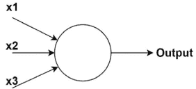

**图 4.2** AI 的工作原理。

引发了隐私的担忧。它们还可能用于破坏系统和窃取数据，从而引发安全问题。人们担心，随着计算机能够执行越来越多目前由人类执行的任务，AI 将导致大规模的失业流潮。

$x_1, x_2, x_3$ 是神经系统的输入；中心圆圈代表传递函数。它是对输入的分析响应。答案将考虑输入并生成一个结果。AI 的工作原理如图 4.2 所示。

### 4.2 AI 原则

随着 AI 技术的发展，人类继续修订和改进 AI 原则至关重要，以确保 AI 的利用产生有益而非有害的影响。这里讨论了 AI 最基础的原则，图 4.3 也展示了公正性。

-   **以人为本的价值观和公平**：AI 系统的构建和完善应当尊重人类价值观并促进公正。这意味着不应利用 AI 系统对人们产生歧视或伤害，并且它们的构建应该是对全人类开放且负责任的。

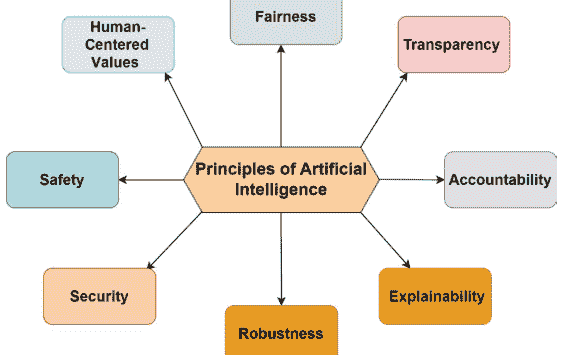

**图 4.3** AI 原则。

## 物联网中的人工智能原则

-   **透明性与可解释性**：人类应该能够理解并解释 AI 系统。这意味着个人需要理解 AI 系统是如何运作的，以及它们为什么做出这样的判断。这出于许多原因至关重要，包括确保 AI 系统是公正且公平的，用户可以信赖 [5]。
-   **稳健性、安全性和安全性**：AI 系统必须是强大、受保护且可赖的。这意味着它们必须能够威胁和意外输入，并且不能危及用户或周围环境。
-   **问责制**：人类应该对 AI 负责。这意味着必须有明确的法规和流程，对 AI 开发者和用户的行为追责。这对于确保 AI 系统以负责任且符合伦理的方式使用至关重要 [2]。

物联网（IoT）是一个互连的周边设备集合，配备了软件、摄像头、传感器和网络连接，以便收集和传输数据。人工智能（AI）是计算机科学的一个领域，关注开发能够学习和智能行动的自主系统 [6]。包括制造业、医疗保健、公共交通和能源业在内的许多行业，都有潜力通过物联网和 AI 的结合发生转型。例如，AI 可用于评估物联网设备生成的数据，以提高产品质量、预测设备故障并调节交通模式。

针对物联网的 AI 研究已不再落后。过去，已经有了许多基于 AI 的物联网应用的提案和概念。

在读取来自大自然的信号后，传感器将其转换为电电压，这些电压可以被处理并发送到接收器。之后，使用应用程序来显示这些信号。网络门户还允许用户查看信号详情 [7]。许多人利用物联网中的语音检测来操作设备这并不意外。在对电器使用语音控制之前，必须设置一个带有训练系统的录音器，以便检测到声音。

数据挖掘是人工智能在物联网中的另一种用法。通过使用数据挖掘来实现数据处理和存储空间压缩。这意味着随着网络中数据量的增加，寻找所需数据的倾向。数据挖掘被用于缩短寻找所需数据的时间。数据挖掘中使用的步骤图如图 4.4 所示。

-   **数据收集**：数据的收集是初始阶段。许多其他来源，包括记录、交易日志和问卷调查，都可以提供这些信息。
-   **数据清洗**：收集数据后，必须对其进行清洗以消除错误或偏差。这是一个至关重要的阶段 [8]。

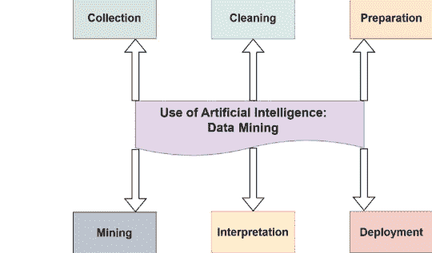

图 4.4 数据挖掘的使用。

-   **数据准备**：后续步骤是为数据准备好格式。这可能包括从收集的数据中提取新特征。
-   **数据挖掘**：在后续阶段，利用技术寻找信息中的发现和模式。有很多数据挖掘方法，每种方法都适用于特定类型的任务。
-   **数据解释**：在应用后需要对数据挖掘的结果进行解释。这涉及到理解含义及其与发现的关系 [9]。
-   **数据部署**：数据挖掘项目的最后是发布。这可能涉及开发一个可以用于预测的模型。

### 4.4 AI 技术

主要的 AI 技术包括 ML、DL、NLP、计算机视觉、神经网络和机器人，本文中对前四种进行了详细讨论。支持这些技术的是强化学习、迁移学习和演化算法。作者强调了 DL 在 [6] 中的重要性，它是图像识别、音频识别和 NLP 的有效技术。[10] 强调了强化学习的价值，它是训练代理在复杂场景下做出决策的稳健方法。根据 [9] 的观点，迁移学习是指从一个任务中学到的知识来增强另一个任务性能。这种方法在计算机视觉和自然语言处理等应用中证明了其有效性。[11] 的研究强调了迁移学习的巨大潜力及其广泛的应用。在 [12] 研究中，演化算法被定义为从自然选择原理中获得灵感的优化方法。这些技术在解决如神经网络构建和机器人控制等 AI 挑战方面已被证明非常有效。

以下章节讨论了图 4.5 所示的六种 AI 技术中的四种，即 ML、DL。

AI 的一个子领域是机器学习（ML），它可能是最关键的之一 [13]。ML 依靠自身方法进行改进 [14]，这取决于对数据的评估、对处理数据算法的应用以及基于已研究数据做出选择的其他方法的应用。

使用学习算法进行智能数据分析是 ML 的目标之一。学习算法有多种形式，并根据其产生的结果进行分类。不同类型的算法属于这一类，最重要的决策树（DT）、k-近邻（kNN）、支持向量机（SVM）和朴素贝叶斯（NB）。NB 是参数化的

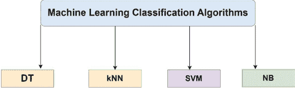

**图 4.6** 机器学习分类算法。

基于标记数据参数的技术并取决于对数据的假设。DTs（决策树）、kNN 和 SVM 是非参数技术，不需要任何标记数据。DTs 根据沿着分裂参数的节点数量进行工作，并在数据集的类别值和数值值上产生最佳结果。KNN 根据节点数量和深度工作。SVM 作用于多维数据，通过超平面给出类别的数量 [15]。这四类机器学习算法如图 4.6 所示。

根据图 4.7 所示，该图比较了机器分类器，NB（朴素贝斯）的准确性最低，因为它基于假设运行，这是一种模糊的方法，而与基于不同调查的随机森林、DT 和 SVM 相比之下。

### 4.4.2 深度学习

一组被称为“深度学习”（DL）的算法建立在由若干个非线性修改组成的最高层抽象建模之上。使用深度学习允许对数据表示进行学习 [14]。例如，表示图片有许多方法，但并非所有方法都适用于人脸识别任务。因此，深度学习寻求识别完成这项工作的最佳表示技术。一个示例是其在计算机视觉中的应用，用于识别语音和音乐。

### 准确率

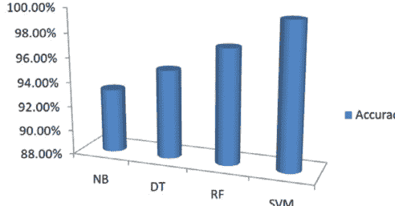

**图 4.7** 机器学习分类算法的准确性比较。

### 深度学习分类算法

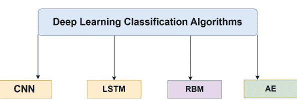

**图 4.8** 深度学习分类算法。

不同类型的深度学习分类算法包括卷积神经网络（CNN）、长短期记忆网络（LSTM）、自动编码器（AE）、受限玻尔兹曼机（RBM） [16]。人工神经网络（ANN）作为一种深度学习分类器，在处理困难问题方面证明是所有其他分类器中最好的。ANN 有多种应用，例如语音识别、模式识别和手写识别。该模型通过从所有代理处收集数据然后将数据馈给 ANN 来工作。训练阶段的监督训练呈现给 ANN，其中输入和输出都包含事件和攻击的参数 [11]。不同类型的深度学习算法如图 4.8 所示。

根据图 4.9，深度学习分类算法的比较显示，与其他相比，CNN 的准确性最高，AE 的准确性最低。

计算机视觉是人工智能的子领域之一。它是一种使计算机系统能够识别图像及其特征的技术。机器

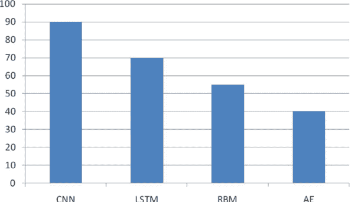

**图 4.9** 深度学习分类算法的比较。

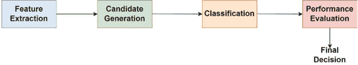

**图 4.10** 计算机视觉。

理解世界是计算机视觉的目标 [17]。使计算机能够快速计算距离和位置，通过外表识别物体，并识别它们是什么。但完成这项任务充满了困难。首要挑战在于对项目进行建模，以确保计算机区分多种类型，例如人类和汽车。然而，有许多角度可以观察这些内容。这里的挑战在于：弄清楚一个人是坐着、站着、在汽车后面还是蹲着，甚至判断汽车是否面对你。由于昼夜交替，白天的光照水平在且各异，如多云或晴天。计算机视觉的四个步骤是特征提取、候选生成、分类和性能。计算机视觉的工作原理如图 4.10 所示。

### 4.4.4 自然语言处理

自然语言处理（NLP），也称为数学语言学 [8]，是人工智能的一个子领域，解决机器理解自然语言的问题，或者换句话说，使用户使用自然语言更快速、更有效地与机器对话，就像与他人交流一样。NLP 需要对短语结构有理解，但也要求对主题材料和内容的专业知识 [18]。在 NLP 这一庞大领域，需要多种观点来妥善处理语音。必须从各种语言谓词来探索 NLP [9]。

### 4.4.5 机器人技术

机器人技术是一门多学科的工程和科学领域，涵盖了机械工程、电子工程、信息工程、计算机科学和其他相关学科。它涵盖了设计、建造、操作和利用机器人的学科，以及开发用于控制它们的计算机系统、提供感官输入并处理信息。

| AI | IN | IoT |
| :--- | :--- | :--- |
| 数据分析 | | |
| 智能自动化 | | |
| 预测性维护 | | |
| 安全与隐私 | | |
| 自然语言处理 | | |
| 能源效率 | | |
| 资源管理 | | |
| 伦理考量 | | |

机械传感器用于检测工业环境中的不一致性，并自动启动服务调用或关闭程序，以避免设备故障。

- *预测性分析*：IoT 系统可以利用机器学习（ML）和人工智能（AI）方法从历史数据中学习，并产生预测。这对于许多领域都有帮助，包括供应链优化、医疗监测和预测性维护。例如，AI 系统可以分析来自智能电表的数据，以预测用电模式并改进能源分配 [13]。
- *自动化*：基于数据分析和指定规则，AI 驱动的 IoT 系统可以简化决策过程和控制程序。这可能会提高效率并降低成本。例如，算法可以分析智慧城市的交通模式，优化交通灯并动态改变路线以缓解拥堵 [12]。
- *个性化*：具有 AI 能力的 IoT 设备可以从用户偏好中学习并提供个性化的体验。例如，AI 算法可以检查可穿戴设备的数据，理解用户的健身目标并提供个性化建议 [20]。
- *计算*：AI 驱动的 IoT 通常不依赖云解决方案，而是使用边缘计算，数据处理和分析在 IoT 设备或边缘服务器上本地进行。边缘计算允许在连接稀疏的进行实时决策，同时降低延迟并增强隐私。

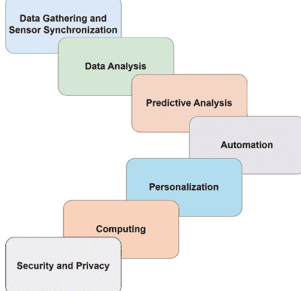

**图 4.12** AI-IoT 的步骤。

- *安全与隐私*：为了保护敏感数据并防止未经授权访问，AI 驱动的 IoT 设备需要实施强大的安全措施。通过检查网络流量和设备行为，AI 算法可以帮助识别异常和潜在的安全漏洞，提高系统安全性。图 4.12 展示了 AI-IoT 步骤的示意图。

### 4.5.1 开放挑战

从技术、社会影响和复杂系统等不同角度，AI-IoT 面临着某些开放挑战。此处将对这些挑战进行讨论。

#### 4.5.1.1 技术视角

在技术方面，预计进步将推动 AI 在三个关键领域的进展：物理设备平台、控制算法的模式以及接口。中央处理器（CPU）主要处理通用计算任务。虽然它可以处理与 AI 相关的任务，但其性能相对较低。因此，开发高性能 AI 平台的趋势日益增长。英特尔（Intel）、Google、英伟达（NVIDIA）等知名公司设计了新的智能技术，例如图形处理器（GPU）。GPU 准备作为下一代的计算和算术终端来补充中央处理器（CPU）。虽然 IoT 和 AI 提供了许多机会，但仍存在若干开放挑战。未来，人工智能（AI）面临着日益复杂且具有挑战性的任务，它需要一种能够处理恶意需求的新计算架构。这种转向基于多样化处理器的智能平台的设计是一个显著趋势。目前的计算机系统不适用于多维度和多路径的并行处理。在计算量较小但无显著变化、影响巨大且存在大量非线性因素的场景下，AI 无法正常工作。尽管如此，利用量子计算的力量和实时多维处理能力，为解决非线性多变量交互和复杂预测带来的挑战提供了一种性的解决方案。因此，量子计算技术的重大进展，特别是量子计算机的成功开发，为未来 AI 应用建立一个革命性的计算平台具有巨大的潜力。

#### 4.5.1.2 社会视角

机器是否真的可能复制人类思维并理解意图？判断和评估事物的过程不仅涉及感官，还受到人类个人偏好和情绪的影响。相比之下，AI 仅依赖可用数据来做出理性的评估或决策。这是一个需要大量思考和研究的复杂问题。AI 的进步和广泛应用还带来了挑战：智能机器除了是高科技产品外，对人类社会的规则和制度也产生了影响。机器的行为仍然在某种程度上不透明，容易受到偏见和错误的影响，从而导致伦理问题。当机器提出与人类信仰（传统上是人类所独有的）不同的新想法时，个人对被机器取代的恐惧日益增加，导致学习和工作的意动力下降。这些因素可能会在人类中产生心理焦虑和恐慌。

AI 的快速发展为社会带来了非凡的便利和巨大的繁荣。然而，它也引发了人们对受控使用 AI 责任的众多担忧。AI 应该归哪些伦理考量和责任？安全是任何技术创新的基本要求，包括 AI。这取决于各种计算算法和大量数据集。互联网的扩展和大数据的激增为 AI 安全引入了不可预测因素。一方面，AI 受益于互联网大数据提供的丰富资源；另一方面，互联网也是黑客和病毒的温床，对 AI 系统构成了潜在威胁。

虽然 AI 极大地提高了社会生产力，但它深刻地影响了社会人们的生活方式，对于伦理学家来说是一个微妙的问题。防止源于 AI 的伦理和责任问题一直是许多专业人员的关注焦点。例如，由 AI 导致的交通事故事故应由谁负责？在涉及智能机器人的医疗事故中，应由谁负责？

## 物联网中的人工智能原则

此外，涉及到安全时，AI 具有基于知识、自动化和独立决策进行自我纠错的能力。然而，人类目前缺乏对 AI 的完全控制，可能会导致不可预测的结果。在隐私和安全方面，智能系统可以借助看似无关的数据提取大量用户数据，从而识别个人模式和性格特征。传统的匿名安全方法在面对 AI 反复学习和推断数据的能力时证明是无效的，使得个人隐私变得脆弱。目前在通信网络中实施 AI 引入了更大的复杂性。这种复杂性源于特定机器学习技术的使用，优先实现单一目标，而忽视了其他目标和整体目标。因此，仍然存在重大挑战是优化一个目标，而忽略了延迟、质量、存储限制和处理开销等因素。例如，研究 [21] 通过强化学习提高效率，但在应用于现实场景或大规模网络时，未能解决信息共享、存储和处理相关的成本。开放挑战如下：

- 互操作性与标准化：IoT 平台和设备经常在具有多种协议的环境中工作。AI 与 IoT 的有效集成和协作取决于设备、通信协议和数据格式的互操作性和标准化 [5]。
- 可扩展性与性能：随着连接设备数量增加，扩展性成为一个关键困难。需要先进的基础设施、边缘计算和有效的 AI 来处理 IoT 设备产生的海量数据，并在保持性能和低延迟的情况下进行处理 [2]。
- 效率：许多 IoT 设备依赖电池或电源有限。任务是创建高效的 AI 算法，在不牺牲性能的情况下优化电源的使用。有必要研究模型压缩、能源感知调度和自适应电源管理等方法。
- 伦理和社会影响：AI 在 IoT 中的部署带来了关于责任、公平、偏见和隐私的伦理问题。需要明确的标准、法律和框架来解决潜在的社会伦理担忧，并确保 AI 驱动的 IoT 设备的开发、部署和使用 [22]。
- 监管和法律框架：监管和法律框架的建立落后于 AI 和 IoT 的快速发展。

技术。行业、立法者和法律专家不断协作，以解决数据所有权、责任、隐私法和伦理标准等问题。

- 边缘平衡：在云端或边缘侧运行 AI 计算之间很难做出取舍。虽然某些任务受益于云计算和存储，但另一些任务则需要在边缘侧进行实时处理和决策。为了让 AI 驱动的物联网系统有效高效，必须取得适当的平衡。

### 4.6 人与 AI 的协作

AI 与物联网（IoT）已达到先进的发展阶段，它们的协作为许多优势带来了巨大的潜力。物联网通常被认为是第四次工业革命（工业4.0）的催化剂，推动了各个领域的技术进步和转型。人们公认，AI 对于物联网的发展至关重要，许多专家认为 AI 代表着未来。事实上，物联网与 AI 的集成在许多行业和领域已成为一种普遍做法。IoT 作为一种数据采集机制，产生海量数据，而 AI 是有效解释和从此类数据中提取洞察的理想工具。AI 作为决策引擎，用于执行分析和不同的数据预处理技术。通过利用 AI，可以理解模式，从而做出更明智的决策。

机器学习（ML）的应用结合数据的力量，在物联网领域创造了新的前景和可能性。亚马逊的语音助手 Alexa [23] 就是数据采集过程的范例。然而，基于数据进行组织、分析和明智决策面临着不同的挑战。显而易见，要让 AI 增强在物联网中的实用性，需要开发更精确、高效的算法和工具。通过将物联网与 AI 结合，企业可以利用最有效的方法优化运营并确保长期可持续性。物联网与 AI 的集成使零售商实现各种利益，通过交叉销售等技术尽量减少投入并最大化销售额。这种协同效应赋能企业提升整体性能，并在零售行业取得更大的成功。研究 [24] 探索了 AI 与物联网之间的相互作用，强调数据科学领域的 AI 和 ML 不仅仅是将预测算法应用于物联网。该研究指出，物联网的智能系统与现有数据库不同，因为它涉及到专门为处理时间序列数据而定制的技术，包括平均法和类似的方法。为了取得显著的成果，AI 有能力应对大数据分析带来的挑战。

由于众多智能设备/对象产生了海量数据，人类在利用传统方法理解和有效管理此类数据方面面临着局限性。因此，探索分析性能数据和信息的创新方法变得迫在必行。为了充分利用物联网数据的潜力，迫切需要显著提高性能。此外，AI 的持续进步正导致 AI 与物联网的融合。物联网的基本描述最终将使几乎所有设备都具备智能。简单来说，物联网依赖于智能设备和机器。两者的进展推动了物联网的持续扩张，这种扩张受到六个关键因素的影响，其中影响影响的因素是大数据和云/雾计算的出现。

## 物联网中的人工智能原理

### 4.7 AI 应用

AI 在不同领域有许多应用。这里讨论了其中一些：

- 智能工业：在自动化、电气化和信息化之后，AI 已成为工业 4.0 的核心支柱。AI 领域许多突破性的技术进步改变了各个行业，包括农业、自动驾驶、金融、治理、智能机器人、制造业、医疗业、零售业、安全等 [24]。
- 智能家居：自动化的概念见于 [10]。它涉及一个利用控制器实现智能节能的系统。通过智能手机上的用户友好界面，该系统可以有效控制和自动控制家电器，如灯光和风扇（开启或关闭）。系统的组件通过局域网或 Wi-Fi 模块连接微服务器，允许用户使用其基于 Android 的智能手机访问、监控和控制设备及电器。
- 自动驾驶车辆：自动驾驶功能是一种基于三项主要技术的机器人系统——感感知、路径规划和控制决策。该系统的实现很大程度上取决于智能系统及相关领域的研究、分析和实施。为了不断增强驾驶行为，自动车辆利用深度学习（DL），这证明它是目前最有效的解决方案。当车辆遇到密集的交通状况并遭遇突发情况时，它们会产生大量数据作为训练样本。通过广泛的训练和学习过程，车辆积累了驾驶经验，并从不同设备的训练和测试中获益 [25]。
- 智能教育：在此期间，AI 与教育发生了深层次融合，导致了教育格局的重大变革。教育设备现在涵盖了个人和机器。结果是教育活动的范围已扩大到涵盖教育活动的研究以及为机器和个人制定教学指南的开发 [26]。

智能系统与教育系统的融合导致了各种突破性应用的出现，例如智能机器人、智能学习平台和用于结果评估的复杂系统。这些进步减轻了教师所面临的繁重任务，并促进了人机协作环境。通过将 AI 与教育相结合，最终目标是建立一个智能网络学习环境。这涉及与政府机构、学校、机构、企业建立伙伴关系，并改革教育目标，以持续提高教学成果，并培养具备学习、交流和创新技能的人才。
- 智能金融系统：AI 在金融领域的应用导致了数字金融服务的出现，为该行业注入了更大的波动性以进一步发展。AI 在金融领域的潜在应用已获得广泛认可，尽管其实现是一个渐进的过程。自动化在驱动该领域增长方面具有重要意义。它不仅能实现金融数据分析，还为该领域提供了价值的服务，用于交易、信用评估和金融分析。此外，AI 能够增强对系统中各种风险的识别、早期检测、预防和控制能力。
- 智能治理：AI 最初出现在数据资源丰富且场景明确的领域。虽然在智能治理领域仍然相对较新，但 AI 的日益普及为其在各个领域的实施开启了广泛的机会，包括助手、智能会议、机器人流程自动化、任何文档处理和决策。
- 智能制造：自动化与制造业的结合带来了更经济、有效的生产力，提高了生产灵活性并实现了成本节约。它促进了大规模定制，提高了市场预测的准确性，并实现了更好的供需匹配，推动了制造业服务的转型并增强了质量控制。然而，两者都构成了复杂的系统工程挑战。人们面临许多障碍，包括 AI 标准化、互联网技术、信息安全以及跨学科人才的培养和实施。从这种集成中受益的示例包括智能产品和设施、智能工厂、智能管理和服务系统、智能供应链管理以及智能监控和决策过程 [25]。

## 物联网中的人工智能原理

- 智能医疗：医疗行业在发展过程中不断面临着许多挑战。然而，人工智能提供了一种有效结合医学与技术的手段，有助于医学科学和智能化的进步。智能医疗利用先进的网络技术（而非广泛采用物联网技术）来为健康记录建立医疗信息平台。此外，技术与医学的融合使得医疗程序能够数字化、电子化和精确处理。例如，深度学习（DL）技术用于基因预测，自然语言处理（NLP）辅助分析电子病历 [27]。

- 智能安全系统：人工智能的进展和实施在信息安全领域具有利有有弊。首先，自动化增强了安全和隐私等保护能力。其次，它面临着隐私担忧，包括数据相关安全、防欺骗措施、隐私保护以及适应动态环境。人工智能能够快速检测大规模网络数据的各种安全攻击，赋予自适应安全防御的能力。在网络安全中使用自动化的重要益处在于显著提升了安全监控的性能指标。鉴于海量的网络流量以及安全设备系统产生的关键安全信息，人工智能可以有效应对处理和分析大量数据的挑战。它能准确识别网络攻击，从而降低安全风险。人工智能在网络安全中的应用示例包括网络攻击、安全漏洞预测和系统故障。AI-IoT 的各种应用领域如图 4.13 所示。

表 4.1 显示了基于原理、技术和应用的不同分类。

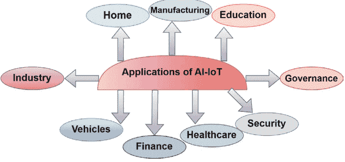

图 4.13 AI-IoT的应用。

### 表 4.1
基于 AI 原理、技术和应用的比较表

| 原理 | 技术 | 应用 |
|---|---|---|
| 解析 | 对智能实体和行为的检查 | ML, DL, NLP，计算机视觉，机器人和专家系统。 | 医疗、金融、教育、交通、农业、制造业、游戏和社交媒体。 |
| 重点 | 深入了解智能的运作并创建能够展示智能的代理。 | 教育算法以识别数据中的模式并利用它们做出明智选择。 | 增强医疗效果、优化财务决策、定制教育旅程、变革交通、提高生产力最大化、自动化制造操作、丰富体验、审查社交媒体信息。 |
| 问题 | 构建具有类人类推理和获取知识能力的机器。 | 确保 AI 系统的公平性、透明度和伦理道德。 | 处理有关安全、偏见以及对人类就业的影响。 |
| 趋势 | 提升 AI 系统的能力，使其在推理、规划和通信方面具备人类能力。 | 将 AI 加入区块链和物联网等多种技术中。 | 探索太空中的未知领域、创建智能城市、增强节能、应对气候变化。 |

总结来说，物联网环境受到人工智能基础的显著影响。将人工智能集成到物联网系统中带来了许多进步和改变游戏规则的前景。通过利用 ML、数据分析和智能注意等 AI 技术，物联网部署可以实现效率提高、预测能力和自动化。人工智能使物联网设备能够收集、分析和解释海量数据，提供具有洞察力的信息并实现推理决策。物联网系统可以适应、学习，并独立地预测维护需求、安全风险，并改进物联网网络中的资源管理。人工智能还让理解自然语言变得更容易，实现了人与技术之间的无缝交互，最终提升了用户体验。此外，它对于提高能源利用以及提升整个物联网系统的性能和可扩展性至关重要。随着物联网相关 AI 的发展，解决安全威胁、伦理困境和隐私担忧等问题至关重要。为了建立信任、保护数据并减少潜在威胁，确保在物联网网络中以伦理和负责的方式使用 AI 是关键。

结论是，人工智能的基础为变革物联网能力提供了坚实的框架。组织可以利用人工智能释放新机会、鼓励创新并构建提高整体生产力、效率和生活质量联动生态系统。AI 技术侧重于与区块链和物联网等技术集成，而 AI 原理则侧重于创建能够像人类一样推理、规划和通信的复杂系统。人工智能现在被用于进一步的科学研究、探索未知、建设智能城市、减少室气体排放以及提高能源效率。

1. Michalski, R.S., Carbonell, J.G., & Mitchell, T.M. (2013). ‘Machine learning: an artificial intelligence approach’ (Springer Science & Business Media, Berlin, Germany).
2. Mittal, N., & Singh, S.P. (2019). Healthcare applications of artificial intelligence: A review. In Proceedings of the 3rd International Conference on Computational Communication and Networks Springer (pp. 10–16).
3. Muruganathan, G., & Kamalakallanan, P. (2019). A survey of robotics: Applications, challenges, and recent trends. International Journal of Advanced Science and Technology, 28(6), 202–210.
4. Monostori, L., Kádar, B., Bahernner, T., et al. (2016). Cyber-physical systems in manufacturing: CIRP Annals, 65(2), 621–641.
5. Lee, E.A., & Sia, S. (2016). ‘Introduction to embedded systems: a cyber-physical systems approach’ (MIT Press, Cambridge, Massachusetts).
6. Fortino, G., & Trunfo, P. (2014). ‘Internet of things based on smart objects: Technology, middleware and applications’ (Springer, New York, USA).
7. Calvivo-Arrizu, J., & Luch-Lafuente, A. (2019). Artificial intelligence and finance: A review. Frontiers in Robotics and AI, 6, 50.
8. Baheti, R., & Gill, H. (2011). Cyber-physical systems. The Impact of Control Technology, 12, 161–166.
9. Chen, M., Mao, S., & Liu, Y. (2014). Big data: A survey. Mobile Networks and Applications, 19(2).
10. Gurav, U., & Petit, G. (2016). IoT based interactive controlling systems for home automation. International Journal of Advanced Research in Computer Engineering and Technology (IARC), 5(9), 2392–2396.
11. Friedman, C., Rindflesch, T.C., & Corn, M. (2013). Natural language processing: State of the art and prospects for significant progress, a workshop sponsored by the National Library of Medicine. Journal of Biomedical Informatics, 46(5), 765–777.
12. Yang, J. (2017). Internet of things. Small cell networks, 12(7).
13. Witten, I., & Frank, E. (2016) Data mining: Practical tools.
14. Rani, S., & Bash, A. (2022). Analysis of machine learning and deep learning. IEEE Transactions on, 5.
15. Schmiduber, J. (2015). Deep learning in neural networks. Neural Networks, 61.
16. Sharma, A., & Shah, S. (2021). An Efficient Deep Model for Denial of Service. IEEE Transactions on, 5(2).
17. Ankita, A. (2021). Classification of Alzheimer’s disease using convolutional network. In 2021 6th International Conference on Signal Processing, Computing and Control (ISCC). pp. 402–406.
18. Bolen, A. (2018). 3 IoT examples from 3 industries: Real world implementation results. The top 20 Industrial IoT applications.
19. Grieco, K.A., Rizzo, A., Colucci, S., Siccardi, S., Pyro, G., et al. (2014). IoT-aided robotics applications: Technological implications, target domains, and open issue. Computer Communications 54(4): 32–47.
20. Deshpande, A., Pitale, P., & Sanap, S. (2016) Industrial automation using Internet of Things. International Journal of Advanced Research 5(2): 266–269.
21. Bennis, M., Perlaza, S., Blasco, P., Han, Z., & Poor, H. (2013). Self-organization in small cell networks: A reinforcement learning approach. IEEE Transactions on Wireless Communications, 12(7), 3202–3212.
22. Wen, J., Li, Y., Fang, M., Zhu, D., & Li, P. (2023). Fine-Grained and Multiple Classification for Alzheimer’s Disease with Wavelet Convolution Unit. IEEE Transactions on Biomedical Engineering, 70(9), 2592–2603.

# 5 基于区块链的智能车辆通信框架

Rakhi Mutha, Neeraj, 和 Ashu Taneja

智能车辆（包括自动驾驶汽车、电动汽车和联网汽车）正在改变交通行业。这些车辆依赖先进的通信系统与其他车辆、基础设施组件以及后端服务交换数据。智能车辆的通信需求包括实时数据交换、安全操控协调、智能路由、高效充电和安全交易，如图 5.1 所示。然而，现有的通信系统在安全性、隐私、可扩展性和互操作性方面面临挑战。在本章中，我们将探索区块链技术如何解决这些挑战，并为智能车辆提供一个稳健的框架。

智能车辆也称为联网车辆或智能交通系统（ITS），是指配备了先进技术和通信能力的汽车，旨在增强安全性、效率和整体驾驶体验 [1]。这些车辆利用各种通信技术与车辆、基础设施及周围环境进行交互。

以下是智能车辆及其通信需求的概述：

- 车对车（V2V）通信：它实现了近距离车辆之间的直接通信，允许它们交换有关速度、位置、加速度和其他相关的数据，如图 5.2 所示。这种通信通过让车辆相互警报潜在碰撞、危险或交通状况，有助于提高安全性。

- 车对基础设施（V2I）通信：这涉及车辆与路侧基础设施（如交通信号灯、收费站和停车系统）之间的信息交换，如图 5.3 所示。通过接收基础设施的实时数据，智能车辆可以优化路线、接收交通信号优先处理，并访问电子支付系统等各种服务。

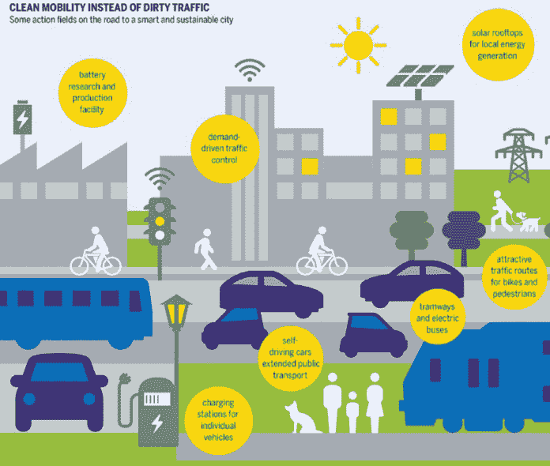

**图 5.1** 用于清洁出行的智能车辆。

- 车对云（V2C）通信：这指的是智能车辆与云平台之间的连接。这允许车辆访问广泛的云服务，例如实时交通更新、天气信息、软件更新和个性化信息娱乐内容，如图 5.4 所示。V2C 通信还为车辆系统提供了远程诊断和空中软件更新（OTA）。

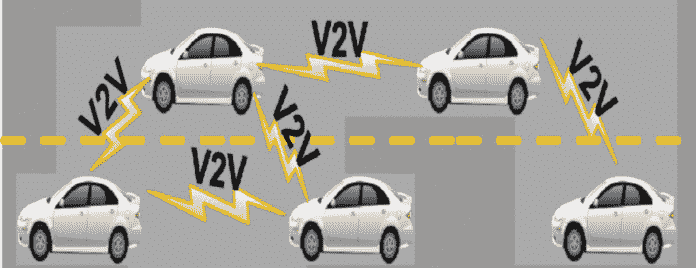

**图 5.2** 车对车（V2V）通信。

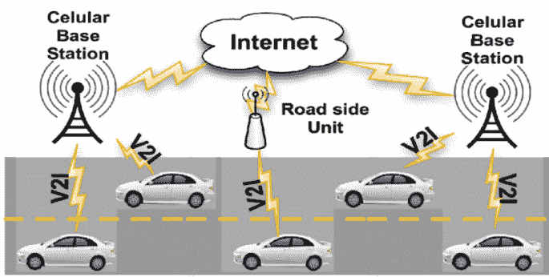

**图 5.3** 车对基础设施（V2I）通信。

- 车对行人（V2P）通信：它涉及智能车辆与行人或弱势道路用者之间的交互 [2]。例如，车辆可以与行人携带的手机或可穿戴设备交换信号，以警示其存在，降低事故风险，如图 5.5 所示。

- 车对网（V2G）通信：它使智能车辆能够与电网交互，如图 5.6 所示。电动汽车（EVs）可以电网发送有关其充电状态、电池容量和可用能量的信息 [1]。这实现了智能充电、放电和负载管理，促进了可再生能源的整合并优化了能量使用。

**图 5.4** 车对云（V2C）通信。

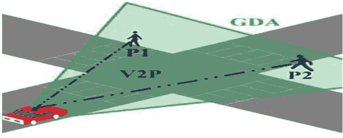

图 5.5 车对行人（V2P）通信。

通信技术：智能车辆利用多种通信技术来实现无缝连接。这些技术包括蜂窝网络（如 4G/5G）、专用距离通信（DSRC）、Wi-Fi、蓝牙和卫星通信。通信技术的选择取决于范围、带宽、延迟和通信需求。

安全与隐私：随着连接性的增强，智能车辆面临安全和隐私挑战。稳健的安全措施（如身份验证和入侵检测系统）对于防御网络威胁至关重要。与车辆数据收集和使用相关的隐私问题也需要得到解决，以确保符合数据保护法规。智能车辆依赖各种通信通道在车辆、基础设施、行人云云之间交换信息。这些通信能力增强了安全性、效率和连接性，为更智能的交通系统铺平了道路。

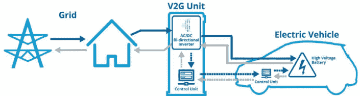

图 5.6 车对网（V2G）通信。

## 基于区块链的智能车辆通信框架

虽然智能车辆的通信系统提供了许多益处，但仍有一些挑战需要解决以确保其有效实施 [3]。以下是当前系统中的一些关键挑战：

- 标准化：缺乏标准的协议和通信框架是一个重大挑战。不同的制造商和利益相关者可能采用自己的通信技术，这会导致互操作性问题并阻碍车辆之间的无缝通信。

- 可靠性和延迟：智能车辆需要实时、可靠的通信以确保数据的及时和准确交换。然而，无线通信通道容易受到干扰、信号衰减和延迟的影响，这会影响安全关键应用的有效性。

- 可扩展性：随着联网车辆数量的增加，通信网络必须处理增长的数据流量。为了支持车辆、基础设施和云之间对可靠高带宽通信日益增长的需求，可扩展性变得至关重要。

- 数据隐私与安全：联网车辆产生并交换大量数据，包括有关车辆位置、驾驶模式和个人偏好的敏感信息。保护这些数据免受未经授权的访问、网络威胁和隐私泄露是一个关键挑战，需要稳健的安全措施和加密技术。

- 缺乏信任与透明度：信任对于智能车辆、基础设施提供和其他利益相关者之间的有效通信与协调至关重要。在现有系统中，由于涉及多个方且数据交换和交易处理缺乏透明度，建立信任通常非常困难。

- 基础设施部署：为了实现有效的通信，需要稳健且广泛的设施部署。然而，基础设施组件（如路侧单元和专用通信网络）的实施需要大量的投资以及政府、服务提供商和汽车制造商等各利益相关者的协调。

- 频谱可用性：合适的射频频谱有限给智能车辆通信系统带来了挑战。需要对频谱进行高效分配和管理，以支持日益增长无线通信需求而避免干扰或拥塞。

- 寿命与兼容性：车辆的寿命很长，其通信系统随着时间的推移需要保持兼容性和可升级性。确保

向下兼容性以及为软件和硬件更新提供机制，对于防止过时和维持通信系统的有效性至关重要。

监管和法律考量：智能车辆通信系统的部署涉及遵守与频谱分配、数据隐私、网络安全和安全标准相关的法规。协调不同地区的法规并确保执行的一致性是一项具有挑战性的任务。

应对这些挑战需要汽车制造商、通信技术提供者、政策制定者和其他利益相关者之间的合作。标准化工作、基础设施投资、安全措施的进步以及监管框架，在克服这些挑战和实现智能车辆通信系统的全部潜力方面发挥着至关重要的作用。

## 5.1.3 块链技术在应对这些挑战中的作用

区块链技术最初作为比特币等加密货币的底层技术引入，现在已成为解决智能车辆通信系统面临挑战的潜在解决方案。区块链是一种去中心化且防篡的分布式账本技术，能够对交易和数据进行安全、透明且不可更改的记录。其关键特征包括去中心化、不可篡改性、透明度和加密安全性，使其非常适合解决智能车辆通信中的挑战。

区块链技术具有解决智能车辆通信系统中若干挑战的潜力。在这里，我们来看区块链在应对这些挑战中的作用：

- 1. **数据安全与隐私**：区块链提供了去中心化且不可篡改的账本，可以增强智能车辆通信系统的安全性和隐私。通过利用加密和分布式共识，区块链确保车辆与基础设施之间的数据交换保持防篡改和透明，如图 5.7 所示。它允许在不依赖中央权威的情况下进行安全的数据的数据共享，减少未经授权访问和数据泄露的风险。
- 2. **互操作性与标准化**：区块链通过为数据交换提供共同平台，促进不同通信系统之间的互操作性。智能合约（即区块链上的自动执行协议）可以帮助标准化通信协议并实现车辆与基础设施之间的无缝交互。通过建立无信任且去中心化的网络，区块链可以克服专有通信技术的挑战并促进更标准化的方法。
- 3. **信任与透明度**：区块链的透明本质增强了智能车辆通信系统参与者之间的信任。记录在区块链上的每次交易或数据交换对所有网络参与者可见，促进了透明度和问责制。这有助于车辆、基础设施提供者和其他利益相关者之间建立信任，实现更可靠、更安全的通信 [4]。
- 4. **可扩展性与效率**：区块链技术在可扩展性解决方案方面取得了进展，例如离链交易、侧链和层2 协议。这些解决方案通过减少对主区块链网络的计算和存储需求，帮助解决通信系统的可扩展性挑战。通过实现更快、更高效的交易，区块链可扩展性解决方案可以支持智能车辆通信网络中增长的数据流量。
- 5. **智能合约与自动化**：区块链上的智能合约可以自动化并执行智能车辆通信系统中的协议和规则。自动执行合约可以促进车辆、基础设施和其他利益相关者之间安全且自主的交互。例如，智能合约可以自动化收费交通、信号优先级或保险理赔结算，消除对中介的需求并减少管理开销。
- 6. **身份与访问管理**：基于区块链的身份解决方案解决了智能车辆通信系统中的身份验证和访问管理挑战。通过在区块链上存储数字身份和凭据，车辆和其他实体可以在通信时安全地保护自己的身份并建立信任。这防止了欺骗、未经授权的访问和身份盗窃。
- 7. **微支付与激励机制**：区块链技术实现了安全透明的支付和激励机制。在智能车辆通信系统中，这可以被用于创建针对收费、停车或共享经济平台等服务的去中心化支付系统。基于区块链的激励可以鼓励车辆、基础设施提供者和用户之间的数据共享与合作，提高系统效率并提升整体性能 [5]。

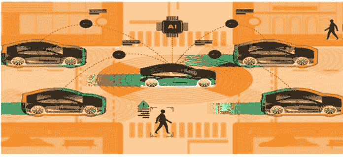

图 5.7 区块技术在应对这些挑战中的作用。

虽然区块链在应对这些挑战方面显示出前景，但考虑在智能车辆通信系统中实施区块链的可扩展性、能源效率和监管方面也非常重要。行业参与者、政策制定者和研究人员之间持续的研究、开发和合作将对于释放区块链技术在该领域的全部潜力至关重要。

### 5.2 区块链技术基础

### 5.2.1 区块链的定义与核心原理

区块链维护着不断增长的记录列表，称为“区块”。每个区块包含一组带有时间戳的交易，这些交易在地理上与上一个区块链接，形成一个区块链。区块链的核心原理包括去中心化、不可篡改性、透明度和加密安全性。这些原理确保了区块链能够抵抗篡改，并提供信任且透明的交易记录。

区块链允许多方以安全透明的方式维护交易或信息的共享记录。它运行在点对点网络上，每个参与者（称为“节点”）都拥有整个区块链链的副本 [6]。

区块链的核心原理包括：

**去中心化**：区块链运行在去中心化的网络上，没有单一实体或中央权威可以控制整个系统。相反，网络由多个节点组成，这些节点参与区块链的验证和维护，如图 5.8 所示。这种去中心化促进了透明度、韧性，并消除了对中介的需要。

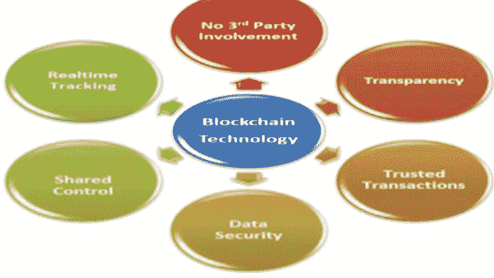

**透明性与不可篡改性**：区块链维护透明且不可篡改的交易或信息记录。记录在区块链上的每笔交易都会变成一个永久且不变的区块。网络中的所有参与者都可以查看并验证交易，增强了透明度、问责制信任。

**安全性与加密**：区块链通过加密技术确保数据和交易的安全性。交易经过加密，每个区块都包含一个加密哈希，这是一个将其与上一个区块链接的唯一标识符，形成链。这种加密哈希确保了数据的完整性并提供了防止篡改或欺诈活动的保护。

**共识机制**：区块链采用共识机制使网络参与者对交易的有效性及其添加到区块链的顺序达成一致。不同的算法，如工作证明（PoW）、权益证明（PoS）或拜斯庭容错（PBFT），决定了如何达成共识。共识机制确保了信任并防止恶意行为者操控区块链 [7]。

**智能合约**：智能合约是存储在区块链上的自动执行协议或规则。当满足特定条件时，它们会自动执行预定义的合约和操作，如图 5.9 所示。智能合约确保了自动化，消除了对中介的需求，并确保了协议的透明度和执行。

**隐私与身份保护**：虽然区块链提供了透明度，但也允许保护隐私。加密技术允许参与者在参与区块链上进行安全交易的同时，控制自己的身份和个人信息。私有链或许可链将访问限制在授权参与者内，确保特定用例中的隐私和数据保护 [8]。

这些核心原理共同构成了区块链技术提供的信任、安全、透明度和效率。它们为加密货币之外的各种应用提供了基础，例如供应链管理、医疗记录、投票系统、去中心化金融等。

在区块链中，每个区块都包含一个头部和一个时间戳。头部包含元数据，例如区块的唯一标识符、时间戳以及对上一个区块标识符的引用。区块体包含一组交易，这些交易代表了在区块链上交换的操作或数据。交易可以包括各种类型的数据，例如智能合约、数字资产或传感器读数。

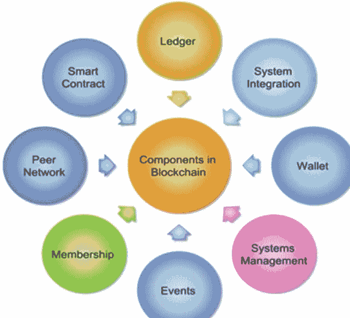

图 5.9 区块链的组件。

区块链的组件包括区块、交易和共识机制。让我们更详细地探索这些组件：

**区块：** 这些是区块链的基本单元。它们包含一组被组合在一起的交易，并作为一个单一实体添加到区块链中。每个区块通常包含一个名为加密哈希值（cryptographic hash）的唯一标识符、一个时间戳以及链中上一个区块的引用，如图 5.10 所示。区块的加密哈希值确保了其完整性并将其与上一个区块链接起来，形成顺序的区块链 [9]。

**交易：** 这些代表记录在区块链上的动作或信息。这些可以包括数字资产的转账（例如加密货币）、智能合约的执行或任何其他需要存储在区块链上的数据。交易通常包含相关数据，如发送者和接收者地址、交易金额和额外的元数据。一旦通过验证并包含在区块，交易就会成为区块链上永久记录的一部分。

**共识机制：** 这些是允许网络参与者达成一致的协议或算法，以验证网络以及添加到区块链的交易的顺序。在去中心化系统中，共识是必要的，以确保所有参与者对区块链的状态达成共识，如图 5.1H 所示。不同的共识机制具有实现共识的不同方法：

- **工作量证明 (PoW)：** 在 PoW 中，参与者（矿工）竞争解决复杂的数学题以验证交易并将区块添加到区块链中。解决方案需要大量的能量，找到第一个解决方案的矿工将获得奖励。这种机制被比特币等加密货币使用。
- **权益证明 (PoS)：** PoS 根据验证者持有的硬币数量或质押金额来选择区块验证者。根据其权益被选中创建新区块，选中的概率与其权益成比例。PoS 消耗的能量比 PoW 少，被以坊等加密货币使用。
- **实用拜占庭容错 (PBFT)：** PBFT 是一种用于许可区块链的共识机制。它需要一组预先定义的受信验证者，通过多轮投票达成共识。PBFT 确保了拜占庭容错，即一定数量的故障或恶意节点无法破坏共识过程。
- **委托权益证明 (DPoS)：** DPoS 是 PoS 的变体，其中选出较少数参与者（称为“代表人”）来验证交易并生成区块。代表人按照确定顺序轮流生成区块。DPoS 被 EOS 等加密货币使用 [10]。

## 基于区块链的智能车辆通信框架

| 区块 1 头部 | 区块 2 头部 | 区块 3 头部 |
| --- | --- | --- |
| 区块 0 头部哈希 | 区块 1 头部哈希 | 区块 2 头部哈希 |
| 区块 1 交易哈希 | 区块 2 交易哈希 | 区块 3 交易哈希 |
| 区块 1 交易 | 区块 2 交易 | 区块 3 交易 |
| txn 735... | txn x6h... | txn 099... |
| txn b76... | txn 9kz... | txn p3... |
| txn 3c2... | txn 232... | txn 47w... |
| ... | ... | ... |
| 区块 1 | 区块 2 | 区块 3 |

**图 5.10** 区块链中的区块、头部和交易。

这些组件共同工作，在区块链中创建一个安全、透明、去中心化的系统。区块存储交易，共识机制确保网络参与者对区块链的状态达成一致，为信任和可靠性提供了基础。

# 共识算法的类型

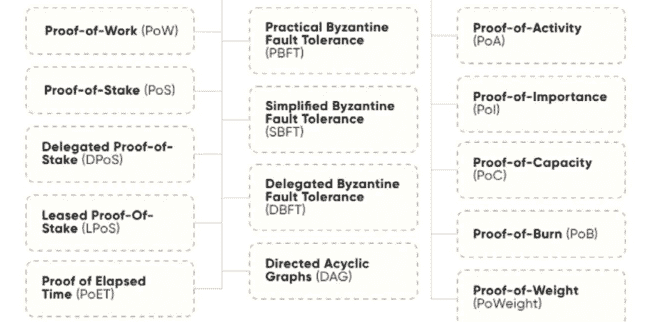

图 5.11 共识算法。

根据访问权限许可许可，区块链有不同类型。公有链（如比特币和以太坊）向任何人开放，任何人都可以参与共识过程并访问区块链数据。另一方面，私有链仅限于特定的参与者群体。联盟链则由一组组织控制。区块链主要有三种类型：公有链、私有链和联盟链。

图 5.12 区块链的类型

## 基于区块链的智能车辆通信框架

## 公有链
- 公有链如比特币和以太坊向任何人开放，任何人都可以参与共识过程并访问区块链数据。
- 它们是去中心化且无需许可的。
- 示例包括比特币和以太坊。

## 私有链
- 私有链限于特定的参与者群体。
- 它们通常是中心化的或由单一组织控制。
- 它们优先考虑隐私和内部操作。

## 联盟链
- 联盟链由一组组织控制。
- 它是公有链和私有链之间的混合体。
- 用于银行、供应链管理和医疗保健等行业。

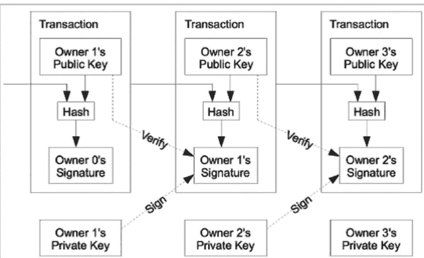

图 5.13 区块链中使用的加密技术。

# 5.2.4 区块链中使用的加密技术

区块链采用各种加密技术来确保交易和数据的安全性和完整性。这些技术包括加密哈希函数，它为每个区块和数据生成唯一标识符并确保完整性，如图 5.13 所示。公钥加密用于数字签名和密钥管理。共识机制（如 PoW 或 PoS）利用加密算法验证并同意区块链中交易的顺序。

加密技术在确保区块链系统的安全性和完整性方面起着至关作用。以下是区块链中使用的一些加密技术：

- **哈希函数：** 这些是加密算法，接收输入（数据）并产生哈希。输出对于输入是唯一的，即使输入发生微小变化也会导致显著不同的哈希值。哈希函数在区块链中被广泛用于生成数字签名、验证数据完整性并将区块以链的形式连接起来。
- **公钥加密：** 也称为非对称加密。它涉及密钥的使用：(i) 公钥和 (ii) 私钥。公钥自由共享并用于加密数据或验证数字签名，而私钥保持保密并用于解密或创建数字签名。公钥加密在区块链中用于提供安全通信、建立身份并为交易验证提供数字签名支持。
- **数字签名：** 这些签名使用私钥和哈希函数的组合创建。私钥用于为特定消息或交易生成签名，而相应的公钥用于验证。

## 基于区块链的智能车辆通信框架

签名的真实性。数字签名确保区块链上的交易是不可篡改的，并且允许任何访问公钥的人进行验证。

Merkle 树：这些也被称为哈希树，是层次化的数据结构，允许对大型数据集进行高效验证。在 Merle 树中，每个叶子节点代表一个数据元素，中间节点是由其子节点拼接后计算出的哈希值，如图 5.14 所示。Merkle 树通过只检查一小部分哈希树而不是整个数据集，能够高效地验证大型数据集的完整性。

零知识证明：这允许一方在不泄露除声明有效性之外任何额外信息的情况下，证明状态的有效性。在区块链背景下，零知识证明可以用于证明对某些数据（如私钥的所有权）已知，而无需泄露实际数据。这种技术增强了区块链交易的隐私性和机密性。

这些加密技术共同促进了区块链系统的安全性、隐私性和完整性。它们使参与者能够安全地交互、验证交易，并确保区块链数据的不可篡改性。这些加密技术的正确实施和使用对于维护区块链网络的信任和可靠性至关重要。

区块链技术可以增强 V2V（车对车）通信的安全性和隐私。通过利用区块链，智能车辆可以建立安全直接的通信通道，验证彼此的身份，并安全地交换位置、速度和意图等关键信息，如图 5.15 所示。

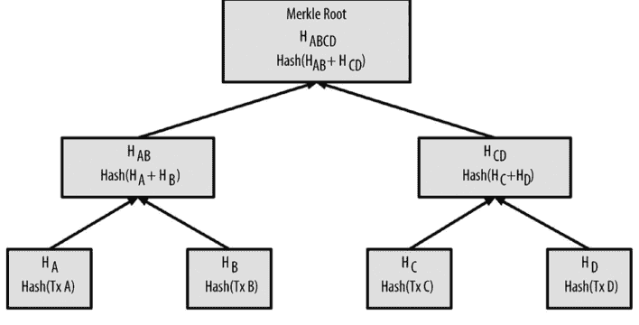

图 5.14 Merkle 树。

**图 5.15** 安全车辆对车辆（V2V）通信。区块链确保通信不可篡改并能抵抗恶意攻击，增强了 V2V 通信的安全可靠性 [14]。

安全 V2V 通信是指以安全、信任的方式在车辆之间交换信息。它允许车辆共享重要数据，如位置、速度、加速度和其他相关信息，以增强安全性、改善交通流并实现各种协作应用。

为了实现安全的 V2V 通信，通常会实施以下措施：

- *身份认证*：在建立通信之前，车辆需要验证彼此的身份，以确保它们正在与信任且授权的车辆通信。这可以使用数字证书或公钥基础设施（PKI）等加密技术来验证车辆数字身份的真实性。
- *加密*：为了保护传输数据的机密性和完整性，车辆之间交换的数据使用对称或非对称加密算法进行加密。这确保了即使通信被拦截，信息对于未经授权的方来说也是不可读的。
- *消息完整性*：为了确保接收的消息在传输过程中未被篡改，使用了消息完整性机制。这涉及使用加密哈希函数或数字签名来验证接收消息的完整性，并检测任何未经授权的修改。

- *隐私保护*：V2V 通信还应该解决隐私问题。可以使用匿名化或匿名通信等技术来防止跟踪单个车辆，并保护其所有者的隐私。通过使用临时标识符或随机伪名，车辆可以在不泄露真实身份的情况下通信 [14]。

- *安全密钥管理*：有效的密钥管理对于安全 V2V 通信至关重要。采用安全的协议和机制进行密钥生成、分发和撤销，确保只有授权实体才能访问加密密钥。这有助于防止未经授权的访问并维护通信通道的安全。

- *信任管理*：可以实施信任管理系统来评估参与 V2V 通信的车辆的可信度。信任可以基于历史行为、声誉和受信任机构的验证等因素建立。信任机制确保车辆可以根据从其他车辆接收的信息来做出关键决策。

通过实施这些安全措施，V2V 通信可以促进协作驾驶、避撞、交通优化以及连接和自动驾驶车辆领域的其他高级应用。这些安全措施旨在保护通信的隐私、完整性和真实性，并确保车辆能够信任从道路上其他车辆处接收的信息。

基于区块链的通信框架实现了智能车辆与基础设施组件（如交通信号灯、道路传感器和充电站）之间的受信任交互。区块链确保了车辆与基础设施之间交换消息的完整性和真实性，为交通管理、智能路由和电动汽车充电等任务提供了安全协调，如图 5.16 所示。此外，区块链还可以为基础设施提供商提供的服务提供透明且安全的支付机制。

V2I 通信（车对基础设施）通信是指车辆与基础设施组件之间安全、可靠的信息交换。它允许车辆与道路基础设施（如交通信号灯、道路标志、收费站和智能道路基础设施）进行通信，以促进高效安全的运输。

以下是实现受信任 V2I 通信的概述：

- *身份认证*：受信任通信始于验证车辆和基础设施组件的身份。这一身份认证过程确保只有授权和受信任的实体可以相互通信。类似于 V2V 通信，可以使用数字证书、加密密钥或安全协议进行身份认证。

图 5.16 受信任的车辆对基础设施（V2I）通信。

- *加密*：用于保护车辆与基础设施之间交换数据的机密性和完整性。通过使用加密算法对数据加密，防止未经授权的方访问或修改数据。根据通信的需求，可以使用对称或非对称加密技术。
- *消息完整性*：为了确保接收的消息在传输过程中未被篡改，使用了消息完整性机制。这涉及使用加密哈希函数或数字签名。
- *安全通信协议*：采用安全协议来建立和维护车辆与基础设施之间的通信通道。这些协议确保通信免受窃听、数据操纵或未经授权的访问。用于 V2I 通信的安全协议示例包括传输层安全（TLS）和安全套接层（SSL）。

- *访问控制*：实施访问控制机制来规定哪些车辆或实体可以访问特定的基础设施服务或资源。访问控制确保只有授权的车辆根据预定义的权限和策略进行交互。
- *信任与身份管理*：V2I 通信可能涉及信任和身份的管理。可以使用信任机制来评估基础设施组件的可靠信任程度，确保车辆可以依靠基础设施提供的信息和服务。同样，对身份凭证（如数字证书或加密密钥）的有效管理对于维护通信的安全至关重要。

通过实施这些安全措施，V2I 通信允许车辆以安全可靠的方式与基础设施组件交互。这促进了信息的交换，实现了智能交通系统，并支持了交通管理、道路安全和高效出行等各种应用。V2I 通信的信任安全对于确保连接和自动驾驶车辆在智能交通生态系统中的有效性和安全性至关重要。

区块链的不可篡改性使其适用于记录和存储关键数据，例如维护记录、事故历史或传感器数据。通过将这些数据记录在区块链上，创建了永久且不可篡改的记录，确保了数据的完整性并为验证提供了审计追踪。这一特性对于在车主、服务供应商和监管机构之间建立信任非常有价值 [15]。

不可变日志和不可篡改记录指的是创建并维护在记录后无法修改或更改的数据。这一概念在对数据完整性、审计能力和透明度要求较高的领域非常重要，例如区块链、金融交易、法律记录、供应链管理等。

以下是实现不可变数据日志和不可篡改记录的概述：

哈希函数，不可变数据日志通常依赖加密哈希函数。加密哈希函数接收输入数据并产生固定大小的输出，称为哈希或摘要，如图 5.17 所示。这些函数具有几个重要属性：它们是确定性的（相同的输入产生相同的输出）、计算快速，且在计算上无法从哈希值反推出原始输入。这种特性使其适用于验证数据完整性。

图 5.17 不变数据日志与防篡改记录。

**哈希指针（Hash pointers）**被用于创建防篡改记录，哈希指针是对特定数据块或记录的引用，并包含该数据块的哈希值。通过在新区块的哈希指针中包含上一个区块的哈希值，创建了一个区块链。这确保了区块内容的任何修改都会导致不同的哈希值，从而破坏链并指示已篡改。

**分布式账本技术（DLT）**如区块链，旨在创建防篡改和不可记录的记录。在区块链中，数据存储在去中心化的节点网络中，每个区块都包含一个指向上一个区块的哈希指针，形成一条链。区块链的去中心化和共识驱动的特性使得在没有网络共识的情况下，修改之前记录的数据变得极其困难。

**数据审计与验证**，不可变数据日志允许对记录进行进行审计和验证。通过将存储记录的哈希与其原始哈希进行比较，可以验证记录是否被篡改。这种验证过程可以是自动化的，并由任何能够访问原始数据和相应哈值的方执行。

**时间戳（Timestamping）**在确保数据记录的完整性方面起着至关重要的作用。链中的每个记录或区块都可以与时间戳关联，指示其被创建或添加到系统的时间。时间戳有助于建立事件顺序并防止记录的追溯性修改。

**加密与数字签名**，除了上述技术外，加密和数字签名还可以为数据提供额外的安全保护。加密保护数据的机密性，确保只有授权方才能访问数据。数字签名提供了验证数据来源和完整性的手段，允许接收者验证数据未曾被篡改。

## 基于区块链的智能车辆通信框架

通过采用这些技术，不可变数据日志和防篡改记录提供了增强的数据完整性、审计性和透明度。它们为记录和存储敏感信息提供了一个稳健的框架，确保信息随时间推移保持安全且未。区块链为车辆实现了去中心化的身份管理，允许它们拥有独特且可验证的数字身份。每辆车辆都可以在区块链上存储数字证书，用相关属性和权限保护其身份。这种去中心化的身份管理消除了对中心权威的需求，并提供了一种安全可靠的机制，用于验证参与通信网络的车辆身份。

车辆的去中心化身份管理涉及以去中心化和分布的方式对数字身份进行管理和控制。它允许车辆拥有主权身份（self-sovereign identities），即对其身份信息拥有控制权并可以在不依赖中心权威的情况下与其他实体安全交互。

以下是车辆去中心化身份管理的概述：

-   *主权身份（Self-sovereign identity）：*这指的是个人或实体对其身份信息拥有完全控制权的概念。在车辆背景下，主权身份允许车辆管理其身份属性，例如车辆识别码（VIN）、注册详情、所有权信息和其他相关数据。
-   *去中心化身份基础设施（Decentralized identity infrastructure）：*管理依赖于分布式账本技术（DLT）或区块链来创建去中心化的身份基础设施。区块链作为记录和验证车辆身份及相关属性的安全且不可变的账本。它消除了对中心身份提供者或权威的需求，增强了隐私、安全性和控制。
-   *数字身份钱包（Digital identity wallets）：*车辆拥有数字身份钱包，类似于用于凭证的数字钱包，例如数字证书、加密密钥和其他相关信息 [16]。钱包提供安全存储，并允许车辆在与其他车辆、基础设施或服务提供商交互时展示并身份验证其身份 [15]。
-   *私有性与选择性披露（Private and selective disclosure）：*去中心化身份管理允许车辆根据需要选择身份属性或信息。车辆不需要与每个实体共享所有身份细节，而是可以按需仅共享必要信息。这确保了隐私性并最大限度地减少了敏感信息的暴露。
-   *互操作性与标准（Interoperability and standards）：*为了实现无缝交互和互操作性，去中心化身份管理需要标准和协议。如去中心化身份基金会（DIF）和世界维网联盟（W3C）等组织正在开发去中心化身份的标准和规范，确保不同系统和平台之间的兼容性和互操作性。
-   *信任与验证（Trust and verification）：*去中心化身份管理中采用了信任机制来建立车辆身份的可信度。信任可以通过声誉系统、来自受信权威的证明或去中心化身份基础设施内的共识机制来建立。车辆身份和属性的验证可以通过其他车辆、基础设施组件或第三方验证者使用加密技术完成。

车辆的去中心化身份管理增强了管理身份信息时的安全性、隐私性和自主性。它允许车辆与其他车辆、基础设施和服务提供商进行安全交互，同时保持对身份数据的控制。通过利用区块链技术和去中心化原则，车辆可以在去中心化生态系统中建立信任和主权身份。

### 5.3.5 用于自动交易的智能合约

智能合约是记录在区块链上的自动执行协议，可以实现交易并在不依赖中间人的情况下执行预定义的规则。在智能车辆背景下，智能合约可以促进自动交易，如通行费支付、保险理赔或电动汽车充电。通过消除对中间人的需求，智能合约增强了这些交易的效率、透明度和信任。

智能合约是自动执行的合同，其协议条款直接写入代码中。它们设计用于自动促进、验证和执行合同履行，而无需中间人，如图 5.18 所示。

## 基于区块链的智能车辆通信框架

技术，尽管它们也可以在其他分布式账本技术中实现。

以下是自动交易智能合约的概述：

-   *代码中的逻辑（Contract logic in code）：*智能合约将合同条款和条件编码到计算机代码中。这些代码包含了根据指定事件或输入触发的预定义规则、条件和操作。代码作为双方之间的协议。
-   *分布式执行（Decentralized execution）：*智能合约通常部署在区块链上，实现去中心化执行。去中心化的特性确保合约在多个节点上执行，提供了透明性、不可变性和对单点故障的韧性。
-   *自动化与自执行（Automation and self-execution）：*一旦部署在区块链上，智能合约会自动运行，根据触发因素或输入执行预定义的操作。这消除了人工干预或对中间人的依赖。
-   *信任与安全（Trust and security）：*智能合约依赖底层区块链的安全机制（如加密算法和共识协议）来确保合约执行的完整性和可靠性。区块链的透明度和不可变性提供了审计性，并防止对合约逻辑的篡改或未经授权的修改。
-   *条件触发与操作（Conditional triggers and actions）：*智能合约可以编程为根据预定义条件执行特定操作。例如，在供应链智能合约中，当满足某些交付里程碑时，将自动支付给供应商。条件被编码在合约代码中。
-   *实时验证与确认（Real-time validation and verification）：*智能合约实现了交易的实时验证和确认。合约代码中的预定义规则和条件确保交易自动通过验证和确认，提供即时确认并减少了对耗时的人工流程的需求。
-   *多方协议（Multiparty agreements）：*智能合约通过自动化和强制执行每个参与方的义务，可以促进多方协议。代码管理交互并确保所有方按照约定履行职责，最大限度地减少了纠纷并增强了效率。
-   *不可变记录（Immutable record keeping）：*智能合约的执行和结果记录在区块链上，创建了不可变且透明的交易记录。这提供了审计追踪和所有已执行的智能合约交易的历史参考。

智能合约具有潜力通过自动化和简化交易来变革各个行业，降低成本，增强信任并开启新的

业务模式。它们特别适用于涉及重复或复杂交易的场景，在这些场景中，效率、准确性和信任至关重要。

### 5.4 基于区块链的通信框架的设计考虑

### 5.4.1 可扩展性与吞吐量挑战

由于共识机制以及在所有网络参与者中维护账本完整副本的需求，区块链技术面临着固有的扩展性和吞吐量限制。解决这些挑战需要创新解决方案，例如分片、侧链或链下交易，以增强智能车辆区块链通信框架的性能 [17]。

### 5.4.2 适用于智能车辆网络的共识机制

共识机制在维护区块链网络的完整性和安全性方面起着至关的作用。然而，PoW（工作量证明）等资源密集型共识算法可能不再资源受限的智能车辆。应该考虑 PoS、DPoS 或 PBFT 等替代共识机制，以实现安全性与资源效率之间的平衡。

### 5.4.3 车辆数据的隐私与机密性

保护隐私和机密性在智能车辆通信中至关重要。区块链本身提供了透明性；可以应用零知识证明、环签名或同态加密等隐私增强技术，在保护敏感车辆数据的同时，维护区块链的完整性和审计性。

### 5.4.4 与现有通信协议的互操作性

为了确保与现有通信协议和基础设施的无缝集成，设计基于区块链的通信框架需要考虑互操作性。应该考虑促进互操作性的标准和协议，例如跨账本协议（ILP）或车万物（V2X）通信标准，以实现区块链网络与传统通信系统之间的兼容。

### 5.4.5 能量效率与资源限制

智能车辆的计算资源和能量能力有限。必须优化基于区块链的通信框架，以减少参与车辆的能量消耗和计算开销。轻量级共识算法、数据压缩以及用于智能车辆区块链通信框架的高效数据同步机制等技术，有助于缓解资源限制并在智能车辆网络中实现落地 [18]。

### 5.5 案例研究与实施

### 5.5.1 智能车辆区块链通信框架示例

本节介绍了智能车辆区块链通信框架的真实世界示例。它探索了利用区块链技术增强智能交通系统安全性、数据完整性和互操作性的项目 [19]。案例研究包括 MOBI（移动开放区块链倡议）以及由汽车制造商、交通部门和技术公司开展的各种试点项目。

### 5.5.2 真实世界试点项目及其成果

介绍真实世界试点项目的成果可以为智能车辆区块链通信框架的实际实施提供见解。它研究了所面临的挑战、经验的经验以及对增强智能交通系统效率、安全性和持续性的影响。示例包括基于区块链的 V2V（车间通信）试验、去中心化充电基础设施或自动驾驶车辆的供应链管理 [20]。

### 5.5.3 智能交通系统中实施区块链的经验与最佳实践

根据案例研究和试点项目中获得的经验，本节讨论了在智能交通系统中实施区块链的关键教训和最佳实践。它涵盖了系统架构、网络治理、安全措施、数据管理以及利益相关者之间的协作等方面。这些见解将有助于未来的实施，并帮助优化区块链技术在智能车辆通信中的效益。

### 5.6 基于区块链的通信框架的优势与挑战

### 5.6.1 增强的安全性与抗攻击能力

区块链去中心化和不可篡改的特性增强了智能车辆通信的安全性。通过消除单点故障并提供防篡改记录，基于区块链的通信框架可以降低网络攻击、数据操纵和未经授权访问的风险。然而，持续评估并应对针对区块链实施的特定安全威胁和漏洞是非常关重要的。

### 5.6.2 改进的数据完整性与可靠性

区块链技术通过创建所有交易和通信事件的透明且可审计记录来确保完整性。智能车辆可以依赖区块链作为“单一事实来源”，促进网络参与者之间的信任，并实现安全可靠的数据交换。尽管如此，考虑到恶意或错误输入的可能性，需要确保输入区块链数据的准确性和可靠性。

### 5.6.3 提高效率与降低成本

基于区块链的通信框架具有简化和自动处理智能交通系统中各种过程的潜力，从而提高效率并降低成本。例如，在区块链上执行的智能合约可以自动处理支付结算、通行费征收或保险理赔，消除对中间商的需求。然而，应该持续优化区块链网络的性能和效率，以提供实时响应。

### 5.6.4 智能车辆中采用区块链的潜在挑战与局限性

尽管区块链提供了显著优势，但在智能车辆中实施时，承认其局限性和潜在挑战也是至关重要的。这些挑战包括区块链网络的计算和存储需求、监管考量、标准化工作，以及实现网络效应所需的广泛采用。此外，应该仔细管理扩展性问题以及去中心化与性能之间的权衡。

### 5.7 未来方向与研究机会

### 5.7.1 区块链与新兴技术（如 IoT、AI）的集成

区块链与物联网（IoT）、人工智能（AI）等其他新兴技术的集成为智能车辆通信的创新开辟了新途径。研究应重点探索这些技术之间的协同作用，以增强基于区块链通信框架的安全性、隐私性和智能化。示例包括将区块链与边缘计算、机器学习算法或安全的设备间通信协议相结合 [21]。

# 区块链与人工智能的集成

a. 数据隐私与所有权：区块链可以在 AI 应用中实现安全的数据共享与协作，同时确保隐私和所有权。它允许个人对自己的数据拥有控制权，并在不损害数据安全的情况下向 AI 模型或算法授予访问权限。

b. 模型验证与透明度：区块链可用于记录 AI 系统中使用的训练数据、算法和模型，确保透明度和可追溯性。这有助于验证 AI 模型的完整性和真实性，促进信任和问责机制。

c. 去中心化 AI 市场：基于区块链的平台可以促进去中心化的 AI 市场，个人和组织可以在那里安全地购买、出售、交易 AI 模型、数据或计算资源。智能合约可以实现交易自动化，并确保公平透明的交换。

d. 联邦学习与数据协作：区块链可以实现安全且保护隐私的联邦学习，在不共享原始数据的情况下，在分布式数据源上训练 AI 模型，如图 5.20 所示。区块链为协调学习过程过程和聚合模型更新提供了一个信任层。

将区块链与物联网（IoT）及人工智能集成可以增强这些新兴技术领域的数据安全、隐私、透明度和信任。它能够开启新的业务模式、去中心化决策和协作生态系统，同时解决完整性、所有权和互操作性方面的挑战。

标准化机构、行业联盟和监管机构在确保智能交通系统中基于区块链的通信框架的互操作性、安全标准和法律框架方面起着至关重要的作用。

图 5.20 区块链、智能合约与人工智能的集成。利益相关者的合作对于开发一致且被广泛接受的协议是必要的，以确保区块链顺利集成到现有基础设施和监管框架中。

标准化工作和监管考量对于区块链技术的成功采用和实施起着至关重要的作用。以下需要考虑的一些关键点：

## 标准化工作

- a. 互操作性：标准化有助于确保不同区块链平台、协议和应用程序之间的互操作性。目前正致力于为数据格式、通信协议、智能合约和共识机制开发通用标准。

- b. 数据交换与集成：标准化的格式和协议使得区块链系统与现有 IT 基础设施之间能够无缝数据交换与集成，提高兼容性并降低复杂性。

- c. 安全与隐私：与加密算法、密钥管理、身份管理和安全编码实践相关的标准有助于建立确保区块链实施安全性和隐私的最佳实践。

- d. 治理与合规性：标准化工作涉及与区块链技术相关的治理模型、监管合规和法律框架。这包括反洗钱（AML）指南、了解您的客户（KYC）要求以及数据保护法规。

## 监管考量

- a. 司法管辖与合规性：基于区块链的应用可能跨越不同的司法管辖区运行，需要符合当地法律法规。监管考量包括数据隐私、消费者保护、金融监管、证券法和知识产权。

- b. 智能合约与法律框架：随着智能合约变得日益突出，法律框架需要调整以适应其使用。需要根据区块链合约的独特性重新审视执行力定义、合同义务和争议解决机制。

- c. 反洗钱（AML）与反恐融资（CTF）：基于区块链的系统需要符合 AML 和 CTF 规定。监管框架可能要求身份验证、交易监控和报告机制来应对这些问题。

- d. 代币化与证券监管：如果基于区块链的资产被视为证券或涉及代币化，它们可能属于现有的证券监管范围。应考虑对证券法的合规性，如注册、投资者保护和交易监管。

政府、行业联盟和标准化机构正积极致力于开发区块链技术的指南、最佳实践和监管框架。利益相关者（包括技术提供者、监管机构、法律专家和行业参与者）之间的合作对于建立一个平衡的监管环境至关重要，该环境能够促进创新、保护消费者并确保符合法律监管要求。

将区块链与其他通信方法（如点对点网络、中心化云）相结合的混合通信模型可以增强数据安全、隐私、透明度和信任，能够在解决完整性、所有权和互操作性挑战的同时，实现新的业务模式、去中心化决策和协作生态系统。

以下是混合模型有效应用的一些用例：

- 区块链与去中心化通信：在某些场景下，混合模型可用于去中心化通信，确保数据安全、共识和审计能力。这种方法结合了区块链的不可篡改性和透明度和数据传输。

- 区块链与点对点（P2P）通信：将区块链与点对点通信相结合，P2P 通信允许节点之间直接的安全数据交换。这种结合了区块链的信任、共识和数据完整性，有利于应用。

- 区块链与云通信：混合模型还可以将区块链与云服务相结合。区块链用于存储关键数据和交易，而云服务提供高效且可扩展的消息传递、实时数据同步和。

- 区块链与物联网（IoT）网关：物联网网关可以作为物联网设备与区块链网络之间的中介。网关连接并验证物联网设备的数据，进行必要的处理或过滤，并将数据安全地提交到区块链进行存储或智能合约执行。这种混合方法能够有效实现数据聚合。...

## 智能车辆的区块链化通信

区块链与链外通信：链外通信是指在区块链网络之外传输数据或交易。在混合模型中，某些非关键或高频数据可以在链外通信，而重要数据或交易记录在区块链上。这种方法减少了区块链拥塞并提高了可扩展性，同时利用区块链的安全性和不可篡改性处理关键操作，取决于具体需求、扩展性需求、延迟限制和安全考量。

在智能车辆中采用区块链技术引发了关于数据隐私、所有权、同意和责任的伦理和法律考量。需要进一步研究以解决这些问题的框架和政策，确保符合法律要求和社会预期。

基于区块链的智能车辆通信引发了若干需要仔细处理的伦理和法律影响。以下是一些关键考量：

隐私与数据保护：基于区块链的智能车辆通信涉及敏感数据的收集、存储和共享，包括车辆和司机信息。伦理考量包括获取数据的知情同意、确保数据保护、实施强加密和访问控制，并对数据使用和共享提供透明度。遵守相关数据保护法规（如通用数据保护条例 GDPR）至关重要。

安全与完整性：基于区块链的系统设计为安全且防篡改。然而，智能合约、共识机制或实施中的漏洞可能会导致安全漏洞。伦理考量包括实施稳健的安全措施、定期审计和漏洞评估，并及时解决发现的缺陷。保护数据完整性并确保智能合约执行的准确性对于维护基于区块链的智能车辆通信的信任关关。

责任与问责：基于区块链的智能车辆通信的使用可能会引发责任问责问题。如果一个智能

当合同或自动交易导致故障或事故时，建立责任机制就变得至关重要。伦理考量包括确定责任划分的法律框架、确保智能合约执行的透明度，以及在发生错误或故障时提供纠纷解决和问责机制。

访问权限与数字鸿沟：基于区块链的智能车辆通信依赖于互联网连接和对技术基础设施的访问。伦理考量包括确保对技术和基础设施的公平访问，特别是在服务欠缺或边缘化的社区。应努力缩小数字鸿沟，防止因基于区块链的通信系统的访问权限差异而产生排斥或歧视。

透明度与审计：区块链通常与透明度和审计能力相关联。伦理考量包括让用户对基于区块链的智能车辆通信系统的功能可见，确保决策过程的透明度，并允许用户验证数据和交易的准确性。实施审计和第三方验证机制可以增强信任和问责制。

社会与环境影响：基于区块链的智能车辆通信的采用具有更广泛和社会环境影响。伦理考量包括评估区块链网络对环境的影响（如能量消耗），并考虑潜在的社会影响，例如由于自动化导致的职业流失。应努力减轻负面影响，确保技术与可持续及社会责任的实践保持一致。

监管合规：在基于区块链的智能车辆通信中，遵守现有的法律监管框架至关重要。伦理考量包括确保符合相关的交通、数据保护、网络安全和消费者保护法规。与监管机构和行业利益相关者合作，建立适当的法规和标准，有助于有效解决伦理和法律问题。

解决这些伦理和法律影响需要一种多学科的方法，涉及开发人员、政策制定者、监管机构和其他利益相关者。通过主动应对这些考虑，可以以优先考虑伦理价值、保护用户权利并确保符合法律义务的方式开发和部署基于区块链的智能车辆通信。

### 5.8 结论

区块链技术在为智能车辆建立强大的通信框架方面具有巨大前景。通过利用区块链去中心化和不可篡改的特性，智能交通系统可以增强安全性、数据完整性和效率，同时促进网络参与者之间的信任。然而，为了实现基于区块链通信框架的全部潜力，仍需解决智能车辆基于区块链通信框架中的设计考虑、挑战和研究机会。人员、行业利益相关者和政策制定者之间的持续合作对于推动区块链在智能车辆通信中的应用和演变，并塑造智能交通系统的未来至关重要。

基于区块链的智能车辆通信通过实现车辆、基础设施和其他利益相关者之间安全、透明且高效的通信，具有彻底汽车行业的巨大潜力。通过利用区块链固有优势（如去中心化、不可变性和透明性），智能车辆可以增强交通系统的安全、效率和数据完整性。

然而，为了充分实现基于区块链的智能车辆通信的潜力，还需要解决若干挑战和考虑。这些包括扩展性、隐私、安全、监管合性和互操作性。持续的研究、行业合作和标准化工作对于克服这些挑战以及在汽车领域建立区块链集成的稳健框架至关重要。

基于区块链的智能车辆通信的未来充满前景。预计将看到区块链与物联网、人工智能人工智能和边缘计算等新兴技术的进一步集成。这种集成将进一步增强智能车辆的能力，实现实时数据交换、自主决策以及车辆与基础设施之间安全、信任的交互。

此外，区块链在智能车辆通信中的应用不仅限于单个车辆。它延伸到更广泛的领域，如出行即服务（MaaS）、电动汽车充电网络、供应链管理和保险系统。基于区块链的解决方案具有简化这些领域、提高效率并促进参与者之间信任的潜力。

基于区块链的智能车辆通信代表了汽车行业的转型性转变。通过解决伦理、法律和技术考虑并拥抱协作努力，我们可以塑造一个智能车辆无缝通信的未来，提高交通系统的安全、效率和可持续性。持续的研究、创新和全行业的采用将驱动基于区块链的智能车辆通信的演变，并释放其全部潜力。

# 参考文献

- 1. Li, C., Qiao, J., Deng, L., Zhang, L. (2020). 关于责任划分的综述。
- 2. Yao, Y., Li, J., Zhang, K., & Zhang, Y. (2020). 基于区块链的智能城市。
- 3. Rahman, M., Dey, A. (2019). 基于区块链的连接车辆的安全框架。
- 4. Mutha, R., Pawar, M. E., Limkar, S. et al. (2023). 共享。
- 5. Rani, S., Gupta, D. (2023). 增强型协作计算的物联网。
- 6. Mutha, R. (2021). 基于区块链的连接车辆。
- 7. Arora, G., Mutha, R., Sangari, M. (2023). 深度神经网络超参数的影响分析。
- 8. Mutha, R., Path, D., Ahuja, A. (2023). 支持多媒体的系统。
- 9. Hou, Z., Li, J., Duan, Q. (2020). 用于连接车辆的区块链架构。
- 10. Yu, S., Li, J., Yang, X., & Zhang, Y. (2020). 用于数据共享的区块链框架。
- 11. Thakar, A., & Ranjan, R. (2023). 基于权重的CNN算法性能评估。
- 12. Mutha, R. (2021). 基于区块链交易的负面方面。
- 13. Mutha, R., & Keswani, B. (2022). 使用区块链数字资产管理。
- 14. Keswani, B., Keswani, P., & Purohit, R. (2020). 安全协议的历史与代际。
- 15. Mutha, R., Lavate, S., Simkar, L. et al. (2023). 用于多维度健康问题分析的高密度特征表示设计。
- 16. Li, J., Hou, Z., Zhang, Y., & Zhang, K. (2020). 用于智能城市的基于区块链通信框架。
- 17. Mutha, R., Pawar, M. E., Limkar, S. et al. (2023). 通过迁移学习对CKD进行早期识别的设计。
- 18. Taneja, A., Saluja, N., & Rani, S. (2022). 海量物联网网络中资源控制的高效动态框架。

19. Xie, S., Zhou, Y., Wang, X., & Ma, J. (2020). 一种基于区块链的智能交通系统安全通信框架。在2020 IEEE 5th Information Technology and Mechatronics Engineering Conference (ITOEC) (pp. 124–128). IEEE。

20. Wang, J., Chen, Y., Li, M., & Zhao, Q. (2021). 基于区块链的联网车辆安全通信框架。在2021 IEEE International Conference on Information and Automation (ICIA) (pp. 504–508). IEEE。

21. Duan, Q., Li, J., Zhang, K., & Wang, X. (2021). 基于区块链的协同式车辆系统安全通信框架。IEEE Access, 9, 13332–13343.

22. Jain, S., Sharma, C., Das, P., Shambhu, S., & Chen, H. Y. (2023). 区块链与加密货币：文献计量学分析。Journal of Advanced Computational Intelligence and Intelligent Informatics, 27(5), 822–836.

# 一种用于城市移动的可持续物联网智能交通系统

Mahendra Balkrishna Salunke, Shailesh V. Kulkarni, Shraddha Ovale, Bhushan M. Manjre, Suresh Limkar, Farhadeeba Shaikh, and Vyasa Sai

在当今的大都市中心，通勤是一个严重的问题。道路上车辆数量的指数级增长导致了交通拥堵和空气污染，从而影响了环境。现代交通系统需要改进以应对这些挑战。随着物联网（IoT）的扩展，交通系统将不断适应变化。通过使用传感器、无线连接和云计算，智能交通可以实现可持续目标并降低能源消耗。

智能交通系统利用物联网来管理复杂的交通动态。通过利用实时数据、分析和明智的决策，智能交通系统可以减少交通拥堵和空气污染。基于物联网的交通的主要优势在于它能够为用户提供信息，使其更高效地旅行。这项技术还有助于优化资源分配，可能带来更可持续的环境。

基于物联网的交通利用允许对交通模式进行监控，这对于缩短旅行时间至关重要。这种方法确保了有效利用交通系统，以最大限度地减少对环境的影响。通过集成传感器和实时数据，智能交通为城市居民提供了更好的生活质量。

智能交通的石在于利用物联网提供数据驱动的洞察。这允许在交通管理和资源分配方面做出更好的决策。通过采用这些技术，智能交通系统可以减少道路上的车辆数量并减少整体排放量。最终目标是创建一个既高效又对环境可持续的系统。

# 智能交通系统

图 6.2 智能交通系统。

速度、加速度和车辆健康状况。利用这些信息，可以优化路线、安排维护计划并实时跟踪车辆。环境传感器：环境传感器监测各种因素，包括天气、声级水平和空气质量。它们帮助我们监测污染水平、识别问题区域，并采取必要行动来修复受损的生态系统。

无线通信技术促进了智能交通系统不同组件之间的无缝传输。智能交通系统中使用的某些关键无线通信技术包括：

- 蜂窝网络：包括 4G 和 5G 在内的蜂窝网络具有无可比拟的数据传输速度和可靠性。通过实现传感器、车辆与指挥中心之间的双向通信，它们实现了实时监控数据和指令传输。

- 专用短距离通信：一种被称为专用短距离通信（DSRC）的无线通信技术专为交通网络设计。简单来说，它实现了汽车与路边基础设施之间的通信。防止碰撞的 V2V 通信和同步交通信号的 V2I 通信是 DSRC 的两个应用。

- Wi-Fi 和蓝牙：Wi-Fi 和蓝牙等无线网络协议经常被用于连接同一空间内的设备。它们实现了智能交通网络中传感器、汽车和个人设备之间的通信。因此，信息可以自由交换，客户可以获取最新信息。

### 6.2.3 云计算

智能交通系统中的物联网（IoT）设备产生的海量数据需要大量的处理、存储和分析。这实现了一个重要目标。以下列表列出了智能交通中一些基本的云计算用途：

- *数据存储与管理：* 云系统提供可扩展的存储选项，以管理传感器和设备实时产生的大量数据。通过将信息存储在云端，可以在需要时对其进行高效处理并轻松获取。
- *数据分析与决策：* 云计算使得利用各种先进分析技术对数据进行彻底检查成为可能。云可以部署机器学习算法和数据分析工具来对收集的数据进行分类和推理。这些实现包括预测拥堵、分析交通模式和优化方法等。
- *实时信息与服务：* 云解决方案能够通过移动和 Web 为用户提供实时数据和服务的即时信息与支持。交通更新、定制化推荐、停车详情和公共交通时刻表是这类信息的几个示例。

### 6.3 智能交通系统的可持续设计原则

随着城市化的加剧以及对交通需求的增加，直接导致的一些问题包括拥堵、空气污染和资源浪费。优先考虑可持续性的智能交通系统可能提供这些问题的解决方案。其目标是最大化资源利用和最小化能源消耗，应最大限度地减少智能和可持续交通系统对环境的影响 [16]。本节概概述了开发可持续智能交通系统时应使用的设计原则，重点关注能源效率、减少排放和优化资源利用（图 6.3）。

## 用于城市移动的可持续物联网智能交通系统

图 6.3 智能交通系统设计。

由于能源消耗的减少和对不可再生资源依赖的降低，能源效率是未来环保交通系统的关键要素。节能设计中一些最重要的概念列举如下：

- *智能交通信号控制：* 我们可以通过根据实时交通数据改进交通信号管理，来缩短汽车怠速的时间，从而最小化能源浪费和排放。具有自适应信号控制的系统具有大幅提高能源效率的潜力。这些创新允许根据交通流量调整交通灯计时。
- *节能驾驶技术：* 鼓励包括轻柔怠速和减速、保持恒速和减少不怠速在内的节能做法可以节省燃油并降低排放。智能交通系统可以通过提供实时反馈和奖励来鼓励环保的驾驶习惯。
- *电动化集成：* 环保智能交通的发展取决于推广电动汽车（EV）的使用并为它们创建充电基础设施。如果没有高效且优化的充电基础设施和能够使能源效率最大化的充电方法，电动汽车就无法整合到现有的交通系统中。

尖端环保交通系统的一个主要目标是减少排放。这些技术通过减少噪音和空气污染水平来改善环境和公众的健康 [17]。以下设计元素可能有助于减少排放：

- 推广公共交通和共享出行：公共交通和共享出行服务通过减少道路上个人车辆的数量来帮助减少排放。集成的智能交通网络使能够实时访问公共交通路线、时刻表和可用性。公共交通因其便利性和廉价而是一个良好的选择。

- 智能交通管理：高效的交通管理策略（如拥堵收费、车道控制和动态路线引导）可以减少交通拥堵和排放。智能交通系统可以分析实时数据以优化交通流，最小化怠速时间并减少车辆排放。

- 鼓励主动出行：推广步行、骑行和其他形式的主动出行不仅能减少排放，还能改善公众健康。智能交通系统可以提供有关安全步行和骑行路线、共享自行车服务以及自行车道和停车设施等设施实时信息。

### 6.3.3 优化的资源利用

优化资源利用对于可持续交通系统至关重要，以确保基础设施、交通模式和服务的有效分配 [17]。优化资源利用的关键原则包括：

集成移动平台：集成移动平台将各种交通服务（如公共交通、拼车出行、共享单车、拼车）整合到单一的用户友好界面中。这些平台提供了无需私家车的多模式旅行，优化了资源利用并减少了对私家车的需求。

智能交通管理：高效的停车管理系统可以最小化寻找停车位的时间，减少拥堵并优化空间利用。使用实时数据的智能停车系统可以引导驾驶员找到可用停车位，减少与寻找停车位相关的拥堵和排放。

需求响应交通：需求响应交通服务（如按需巴士和微型交通）提供了灵活高效的交通解决方案。通过根据实时需求调整路线和计划，这些服务优化了资源利用并减少了个人车辆行程的需求。

数据驱动的规划与决策：智能交通系统需要数据来提高资源效率。交通模式、需求和基础设施使用有助于改进资源分配、基础设施升级和服务增强。数据驱动的规划提高了生产力并减少了浪费。

### 6.4 用于交通优化的机器学习算法

更长的通勤时间、燃油消耗和空气污染导致了城市拥堵。交通优化中的机器学习（ML）算法已作为一种可能的解决方案引起了广泛关注。机器学习算法能够缓解交通拥堵并提高运输效率。这些算法可以高效地评估海量的交通数据。本节介绍了许多用于交通优化的机器学习算法 [18, 19]，重点强调了它们的重要特征，并提供了它们在现实世界场景中如何应用的示例。这些算法如图 6.4 所示。

### 6.4.1 交通流预测

为了实现成功的交通管理并避免拥堵，对交通流进行可靠的估计至关重要。通过分析历史交通数据、当前天气和其他变量，机器学习算法可以预测交通模式，如图 6.5 所示。以下是一些常用的交通预测算法示例：

- 人工神经网络（ANNs）：ANN 模型灵感源于人类大脑的结构，能够学习新信息。它们可以识别交通数据中复杂的模式和相关性。通过检查流量、速度和一天中时间等之前的数据，它们可以预测交通趋势。随着新数据的出现，ANN 模型可以用于改进预测，并生成交通状况的准确实时预测。

图 6.5 交通流预测流程图。

- 支持向量机：当数据呈现非线性模式时，基于支持向量机（SVM）的算法对于预测交通流非常有用。SVM 模型根据之前的数据和当前环境的可观测趋势预测未来的交通流，它是预测交通流等任务的绝选择，因为它可以处理高维数据并识别变量之间的细粒度连接。

- 长短期记忆（LSTM）：LSTM 网络是一种循环神经网络（RNN），能够识别交通数据中的时间相关性。它们经常被用于需要分析随时间变化的数据模式和对序列建模的任务，例如交通流预测。LSTM 网络可以准确捕获长期依赖关系，还能处理具有不同延迟的时间序列数据。

高效的交通信号控制对于优化交通流和减少交叉路口的拥堵至关重要。机器学习算法可以分析实时交通数据并对信号控制做出自适应决策。一些用于交通信号控制的算法包括：

- 强化学习（RL）：强化学习算法通过与环境的尝试交互学习最优控制策略。在交通信号控制中，通过不断从反馈和奖励中学习，强化学习算法根据实时交通状况调整信号计时，以减少延迟并最大化交通吞吐量。
- 遗传算法（GAs）：遗传算法模拟自然演化过程以寻找解决方案。在交通信号控制中，遗传算法可以根据历史数据生成并演化信号计时计划。通过逐代不断完善信号计时，遗传算法可以识别出最小化拥堵并提高交通流的最优配置。
- 模糊逻辑控制：模糊逻辑使用语言规则和模糊集对复杂、不确定和不的系统进行建模。在交通控制中，模糊逻辑算法可以结合实时交通数据（如车辆数量和队列长度）来确定最佳信号计时。针对交通状况固有的模糊性和不性，基于模糊的控制器可以修改信号计时。

为了提供最节省时间和精高效的路线，机器学习算法可能会检查当前的交通状况、路径模式和用户偏好。以下是用于路径优化的常用算法列表。

- 遗传算法：旅行时长、交通密度和用户偏好是遗传算法用于构建和开发最佳路线的一些特征。遗传算法通过根据适应度标准不断分析和修改路线，可以创建节省旅行时间并提高客户满意度的路线。
- 蚁群算法（ACO）：蚁群算法可用于优化问题。它们的发展部分是为了模拟蚂蚁的觅食行为。当应用于交通问题时，蚁群算法模仿蚂蚁沿路径移动的行为，并根据之前的经验修改其费素水平。通过迭代检查和选择具有更高费素水平的路径，蚁群算法可以找到避开交通并节省时间的有效路线。
- 强化学习：强化学习算法可以通过与环境交互并接收来自用户偏好和实时交通状况的反馈，学习最优路线选择策略。强化学习智能体评估交通网络状态，选择旅行时间最短并避开拥堵区域的路线。通过持续学习和适应，强化学习算法可以随着时间的推移改进路线建议。

检测和管理交通事故（如事故或道路关闭）至关重要。机器学习算法可能会检查当前的交通状况、路径模式和用户偏好，以提供最节省时间和精高效的路线。以下是用于路径优化的常用算法。

- 遗传算法：旅行时长、交通密度和用户偏好是遗传算法用于构建和开发最佳路线的一些特征。遗传算法通过根据适应度标准不断分析和修改路线，可以创建节省旅行时间并提高客户满意度的路线。
- 蚁群算法（ACO）：蚁群算法可用于优化问题。它们的发展部分是为了模拟蚂蚁的觅食行为。当应用于交通问题时，蚁群算法模仿蚂蚁沿路径移动的行为，并根据之前的经验修改其费素水平。通过迭代检查和选择具有更高费素水平的路径，蚁群算法可以找到避开交通并节省时间的有效路线。
- 强化学习：强化学习算法可以通过与环境交互并接收来自用户偏好和实时交通状况的反馈，学习最优路线选择策略。强化学习智能体评估交通网络状态，选择旅行时间最短并避开拥堵区域的路线。通过持续学习和适应，强化学习算法可以随着时间的推移改进路线建议。

检测和管理交通事故（如事故或道路关闭）对于减少干扰和优化交通流至关重要。机器学习算法可能会分析传感器数据、社交媒体信息和历史事件记录，以检测并响应事件。一些用于事件检测的算法包括：

- 分类算法：分类算法如决策树、随机森林和 SVM 可以分析数据。通过对标记数据进行训练，这些算法可以准确分类事件并触发相应的响应。
- 自然语言处理（NLP）：自然语言处理是一系列技术，用于从社交媒体信息或事件报告中提取有用信息。NLP 系统可以使用情感分析、短语提取和命名实体识别来识别事件。
- 集成学习：这种方法整合多个模型以提高事件检测的精确性和可靠性。由于集成学习能够聚合多个模型的预测，可以做出更好的事件响应决策。

为了提供最节省时间和精高效的路线，机器学习算法可能会检查当前的交通状况、路径模式和用户偏好。以下是用于路径优化的常用算法。

- 遗传算法：旅行时长、交通密度和用户偏好是遗传算法用于构建和开发最佳路线的一些特征。遗传算法通过根据适应度标准不断分析和修改路线，可以创建节省旅行时间并提高客户满意度的路线。
- 蚁群算法（ACO）：蚁群算法可用于优化问题。它们的发展部分是为了模拟蚂蚁的觅食行为。当应用于交通问题时，蚁群算法模仿蚂蚁沿路径移动的行为，并根据之前的经验修改其费素水平。通过迭代检查和选择具有更高费素水平的路径，蚁群算法可以找到避开交通并节省时间的有效路线。
- 强化学习：强化学习算法可以通过与环境交互并接收来自用户偏好和实时交通状况的反馈，学习最优路线选择策略。强化学习智能体评估交通网络状态，选择旅行时间最短并避开拥堵区域的路线。通过持续学习和适应，强化学习算法可以随着时间的推移改进路线建议。

检测和管理交通事故（如事故或道路关闭）对于减少干扰和优化交通流至关重要。机器学习算法可能会分析传感器数据、社交媒体信息和历史事件记录，以检测并响应事件。一些用于事件检测的算法包括：

- 分类算法：分类算法如决策树、随机森林和 SVM 可以分析数据。通过对标记数据进行训练，这些算法可以准确分类事件并触发相应的响应。
- 自然语言处理（NLP）：自然语言处理是一系列技术，用于从社交媒体信息或事件报告中提取有用信息。NLP 系统可以使用情感分析、短语提取和命名实体识别来识别事件。
- 集成学习：这种方法整合多个模型以提高事件检测的精确性和可靠性。由于集成学习能够聚合多个模型的预测，可以做出更好的事件响应决策。

[content]

在这个案例中，我们调查了在模拟城市环境中安装基于物联网的智能交通系统的可行性。物联网技术被用于改进交通运营，这是减少污染、资源浪费的主要策略。它带来的潜力以及在提高交通流、减少拥堵和增加运输效率方面的成果得到了详细审查。图 6.6 显示了基于物联网的智能交通系统的结构，每个元素的说明如下：

- a. 此框架代表了用于智能交通系统的不同物联网设备。
- b. 它包含了车辆传感器、天气传感器、智能交通灯和交通传感器。
- c. 每个组件都有一个图标精灵，以视觉形式反映其功能和预期用途。

### 6.5.2 IoT 网关

- a. IoT 网关作为 IoT 设备与集中化交通管理系统之间数据处理与通信的枢纽，由此框架表示。
- b. 数据处理是其包含的组件之一，负责对从 IoT 设备获取的数据进行处理和分析。
- c. 智能交通红灯组件与数据处理组件相连，表明数据处理组件从交通红灯获取数据并进行处理。

### 6.5.3 集中化交通管理系统

- a. 这一框架描绘了负责管理和调节交通流的集中化交通管理系统。
- b. 它包含数据分析和交通控制中心等元素。
- c. 交通控制中心组件代表了进行交通控制相关决策和行动的中央枢纽。
- d. IoT 设备收集的数据由数据分析组件进行分析，从而为交通控制提供见解。

### 6.5.4 智能车辆

- a. 此框架展示了构成了运输系统的智能汽车。
- b. 它包含一个被称为“连接车辆”的部分，代表了与系统相连的自动驾驶能力。
- c. 连接车辆组件与智能交通红灯相连，表明车辆与交通红灯进行通信。

该设计展示了多个智能交通系统组件之间的数据流和通信。IoT 设备从多种来源收集数据，包括交通传感器、GPS 单元、各类传感器和天气传感器。IoT 网关处理这些数据，集中化交通管理系统的交通中心利用处理后的数据进行决策并管理交通流。数据分析组件还对数据进行检查为交通管理提供预测。系统和智能交通红灯组件与智能车辆进行通信，智能车辆由连接车辆组件表示。

### 6.6 结果与效益

基于 IoT 的智能交通系统的应用产生了若干有利的结果和优势。

**交通流的改善**：通过实时数据分析和预测模型，该技术能够动态控制交通流、引导车辆行驶并优化交通信号的时机。结果是道路拥堵减少，通勤时间缩短，交通流变得良好，这些因素共同促进了驾驶体验更加愉悦和高效。

**拥堵和排放的减少**：为了防止拥堵，智能交通系统积极调节交通流。这减少了车辆怠速和燃料消耗产生的排放。这导致温室气体排放减少和空气质量改善，这两者都使城市更加环保和具有可持续性。

**公共交通的增强**：在智能交通系统引入公共交通网络后，能够更有效地协调和优化公交线路及时间表。利用有关交通和需求的实时数据，每日公交班次数量增加，个人驾驶汽车的频率有所降低，公共交通变得更加可靠和有效，如表 6.1 所示。

**智能基础设施管理**：IoT 传感器数据允许对运输网络进行主动维修和控制。管理部门通过监控道路、桥梁和交通红灯的状态，能够尽早发现维护需求并对维修进行优先级排序。通过这种方式，将确保基础设施安全并在实际范围内尽可能地延长使用寿命。这种主动策略减少了停机时间，并增加了运输系统的可靠性。

**数据驱动的决策**：智能交通系统提供的实时数据量使决策者能够获得有关旅行模式、需求趋势和基础设施利用率的宝贵见解。由于该策略强调数据驱动的决策，市政官员能够更好地为未来的基础设施项目规划优先事项，并制定解决其特定问题的交通法规。

### 表 6.1：基于 IoT 的智能交通系统的结果

| 参数 | 影响 | 比例 |
|---|---|---|
| 交通流改善 | 拥堵减少，交通流顺畅。 | 拥堵减少 25% |
| 行程时间缩短 | 通勤者的平均旅行时间缩短。 | 行程时间减少 15% |
| 安全性增强 | 通过监控交通状况和做出响应提高了整体安全性。 | 安全性提升 30% |
| 排放减少 | 通过优化路线和交通管理减少排放。 | 排放减少 20% |
| 成本节省 | 减少了车辆损耗。 | 车辆成本降低 5% |
| 用户体验增强 | 通过实时交通更新和路线建议改善用户体验。 | 用户满意度提高 |

结果

**图 6.7** 结果

### 6.7.1.3 共享出行

自动驾驶车辆（AVs）与共享出行服务的结合可能实现更加环保和高效的出行方式。基于物联网的技术可以实现自动驾驶车辆向消费者的动态分配，提高车辆利用率并降低私家车拥有率。如表 6.2 所示，系统鼓励拼车，这减少了交通行业对环境的影响并缓解了交通拥堵。

### 6.7.2 交通即服务（MaaS）的集成

基于物联网的智能交通系统与交通即服务（MaaS）平台的结合具有进一步推进环保实践的可能，如图 6.9 所示。

### 6.7.2.1 无缝多模态连接

MaaS 平台将多种交通工具（包括出租车、共享优享和微出行选择）整合进单一高效的平台中。物联网具有通过收集数据来促进集成多模态交通的潜力。客户可以使用该平台上的单一应用程序来规划整个旅行行程，这将增强环保交通方式的吸引力。

### 6.7.2.2 个性化旅行推荐

为了提供定制化的旅行建议，MaaS 系统必须考虑用户偏好、历史旅行数据以及当前的物联网数据（第 6.4.2 节）。通过考虑时长、成本、环境影响和用户偏好等因素，这些建议鼓励环保出行选择并减少对私家车的依赖。

#### 表 6.2 自动驾驶车辆的集成

| 集成方面 | 描述 |
| --- | --- |
| 交通优化 | - 自动驾驶车辆与基础设施之间的通信 - 实时数据交换 - 协作决策 - 增强流量 - 减少拥堵 |
| 高效资源利用 | - 根据交通、气候和路线地形等变量调整燃油经济性 - 提高能源效率 - 减少排放 |
| 共享出行 | - 自动驾驶车辆与共享出行服务的结合 - 向用户动态分配自动驾驶车辆 - 提高车辆利用率 - 降低私家车拥有率 - 鼓励拼车 |

### 6.7.2.3 动态路线规划

MaaS 平台可以根据实时交通信息、各种模式的可获得性和特定用户的偏好现场路线。这些平台通过建议最有效且环保的路线来促进模式切换，从而降低拥堵并优化旅行时间。

物联网对于未来的可持续智能交通系统具有巨大潜力。通过增强资源利用，自动驾驶车辆、大数据分析、环保交通选择、尖端传感器技术以及交通即服务（MaaS）平台有潜力改变城市出行，如表 6.3 所示。这些变化将带来更少的拥堵、更好的空气质量和更高的交通有效性。然而，其执行需要多方协作、持续的技术开发以及直接接触目标受众的策略。面向未来的城市将能够创建更加智能、环保且持久的交通系统。这些网络将能够满足城市不断变化的交通需求。

**图 6.9** 交通即服务（MaaS）与智能交通系统的集成。

#### 表 6.3 交通即服务（MaaS）的集成

| 集成方面 | 描述 |
| :--- | :--- |
| 无缝多模态连接 | - 将各种交通模式整合进单一平台 - 收集物联网数据以促进多模态交通 - 考虑用户偏好、历史旅行数据和当前物联网数据 |
| 个性化旅行推荐 | - 根据时长、成本、环境影响和用户偏好提供定制路线建议 |
| 动态路线规划 | - 使用交通信息、交通可用性和偏好进行实时路线规划 - 促进模式切换以减少拥堵并优化旅行时间 |

### 6.8 结论

本章探讨了可持续的基于物联网的智能交通解决方案如何彻底城市旅行。我们重点关注了物联网技术、可持续设计、机器学习（ML）、案例研究和未来展望。在这里我们评估了核心要点。

我们研究了城市出行问题以及基于物联网的智能交通解决方案如何提供帮助。快速城市化加剧了交通、污染和公共交通问题。然而，智能交通系统可以利用传感器、无线网络和云计算来改善交通流、减少拥堵并提高效率。文中还讨论了可持续交通技术创新。最大化资源利用、减少排放和提高能源效率对于可持续目标至关重要。通过开发、建设和管理基于物联网的交通系统，我们可以减少碳足迹并使城市更加可持续。

机器学习在提高智能交通管理（ITM）方面已变得流行。我们研究了可以分析交通数据、适应预测交通状况并优化路线和流量的算法，使交通系统更加高效且更符合生态效益。在案例研究中，我们查看了物联网传感器、数据分析和交通控制中心在城市监控和管理中的集成。我们研究了实施挑战，并强调了包括提高城市出行能力、缩短旅行时间和改善交通流等益处。我们展望了环保的物联网智能交通解决方案、自动驾驶汽车、强大的分析以及相互协同的新传感器技术。自动驾驶汽车可以改善流量并降低事故率，但高级分析还可以影响政策并更好地分配资源。新的传感器技术可以改进数据收集并实现更精确的管理系统。

最后，基于物联网的可持续交通解决方案可以彻底改变城市交通。物联网、可持续设计和机器学习算法通过节约能源和减少交通污染，帮助我们创建更高效、环保且用户友好的交通系统。城市居民、交通机构、企业和政治家必须协作，实现对更可持续交通解决方案的承诺。

# 参考文献

1. Giusto, D., Iera, A., Morabito, G., & Atzori, L. (2010). The Internet of Things. Springer. ISBN-978-1-4419-1673.
2. Atzori, L., Iera, A., & Morabito, G. (2010). The Internet of Things: A survey. Computer Networks, 54(15), 2787–2805.
3. Cox, G., Kamburamu, S., & Hartman, R. D. (2012). Architecture and measured characteristics of a cloud-based Internet of Things. In 2012 International Conference on Technologies and Systems (CTS), Denver, CO, 2012 (p. 6–12). doi: 10.1109/CTS.2012.66260.
4. Ajani, S. N., & Amandi, S. Y. (2020). Probabilistic path planning using current position...（此处省略其余参考文献条目，保持格式一致）

22. Khan, M. A., Nawaz, T., Khan, U. S., Hamza, A., & Rashid, N. (2023). 用于物流和交通应用的基于物联网的非侵入式自动驾驶员监测监测框架以增强道路安全。IEEE Access, 11, 14385–14397. doi: 10.1109/ACCESS.2023.3244008

23. Bansal, S., & Gupta, A. (2023). 物联网的智能交通管理系统。In: Sindhwani, N., Anand, R., Niranjanamurthy, M., Chander Verma, D., Valentina, E. B. (eds) 基于物联网的智能应用。EAI/Springer Innovations in Communication and Computing. Springer, Cham, doi: 10.1007/978-3-031-04524-0_6

# 7 使用机器学习优化基于 ICN 的 VANET 中的内容交付

Rais Allauddin Mulla, Mahendra Eknath Pawar, Anup Bhange, Krishan Kumar Goyal, Sashikanta Prusty, Samir N. Ajani, and Ali Kashif Bashir

信息中心网络（ICN）作为车载自组织网络（VANET）中信息分发的一种可行范式，近年来逐渐引起了广泛关注。VANET 中的高移动性和缓存网络拓扑为有效的内容交付带来了特殊的困难。车辆在穿过城市区域时会产生并消耗海量数据，从交通更新到多媒体信息不是。优化 VANET 中的路由和缓存算法对于成功地将这些内容分发给感兴趣的车辆至关重要 [1]。显式寻址依赖于维护彼此之间的显式连接并交换控制消息，它是 VANET 中传统路由协议的基础。然而，这些协议对网络规模的依赖导致了可扩展性问题，这增加了控制开销并引起拥塞。此外，涉及不同网络质量、节点移动性和受限带宽的变量可能会影响内容交付的性能。

使用 ICN 构建物联网框架在解决可扩展性方面具有巨大前景。利用 ICN 的网络内缓存功能可以通过减少数据使用和保护物联网设备的能量来造福物联网。物联网的时间有效性和物联网设备的短寿命，使得数据与缓存典型的电影等材料大不相同 [2]。我们还可以讨论和探索可以实施以应对上述挑战的传统缓存决策策略和替换策略。这些策略旨在缓解诸如减少物联网流量、节省能量和最小化数据检索延迟等问题。此外，结合机器学习（ML）技术有助于通过有效处理不确定性来增强缓存效率。机器学习技术可以预测未知信息和与环境自适应交互，从而进一步提高缓存有效性 [3]。

ICN 作为 VANET 中内容交付的潜在解决方案引起了关注，以解决这些问题。通过以内容为中心的方法，信息的请求方式：

- ii. **内容检索**：与标准的基于 IP 的寻址不同，ICN 中的内容检索是基于名称数据的。通过优化内容缓存和路由机制，优化技术可以改进内容检索过程。优化减少了内容检索时间，减少了网络拥塞，并通过选择性地缓存请求车辆附近的热门内容来增强整体服务质量。

# 优化基于 ICN 的 VANET 中的内容交付

- iii. **路由效率**：优化方法在增强基于 ICN 的 VANET 路由效率方面起着至关的作用。VANET 中的传统路由技术面临网络动态性质和网络架构频繁变化的挑战。优化方法有助于创建有效的路由算法，这些算法考虑了链路质量、流量负载和网络拥塞等因素，改进了数据包交付，减少了端端延迟并增加了网络可扩展性。

- iv. **服务质量 (QoS)**：基于 ICN 的 VANET 中的优化策略试图为车辆用户提供更好的 QoS 体验。这些技术通过优化内容交付、缓存和路由策略，确保了安全告警、交通信息分发和多媒体内容交付等实时应用具有低延迟、高可靠性和增强的吞吐量。

- v. **能量效率**：在依赖有限电力的能量受限 VANET 中，优化是至关重要的。优化方法通过路由模式、转发机制和缓存程序最大限度地减少车辆能量，从而获得更长的使用寿命和更高的可持续性。

- vi. **可扩展性**：VANET 有时包含大量车辆，可扩展性成为了一项主要挑战。优化方法通过创建能够处理增加的车辆和内容请求且不牺牲网络性能的有效算法，有助于解决可扩展性问题。这些策略确保了网络能够优雅地扩展并满足数据密集型汽车应用日益增长的需求。

在基于 ICN 的 VANET 中，优化对于最大化资源利用、提高路由效率、确保 QoS、优化能量使用和解决可扩展性问题至关重要。基于 ICN 的 VANET 可以通过优化技术提高性能、可靠性和效率，从而实现广泛的车辆通信应用和服务 [12]。

本章的剩余结构如下：第 7.2 节简要描述 ICN 的架构，同时也关注 VANET 中的路由和缓存。第 7.3 节讨论了基于 ICN 的 VANET 中内容交付优化的机器学习技术。第 7.4 节讨论了基于 ICN 的 VANET 中机器学习内容交付优化的挑战与机遇，第 7.5 节介绍了案例研究并概述了研究方向。

VANET 中的 ICN 和机器学习可以改进移动车辆数据管理和通信的许多要素。虽然 ICN 专注于使用命名数据而非传统的基于 IP 的寻址进行通信，但 VANET 旨在实现车辆之间以及车辆与基础设施之间的通信。改进的路由、内容缓存和资源分配只是在 VANET 中集成机器学习技术带来的优势之一。

- i. **路由**：利用机器学习方法可以使 VANET 中的路由决策更加高效。机器学习模型可以通过研究流量模式、路况和车辆移动等历史数据，预测最有效且可靠的路径。
- ii. **内容缓存**：ICN 是内容缓存的理想选择，通过将频繁访问的存储在请求车辆附近，消除了长时间数据传输的需求。根据流行程度、内容类型和车辆移动等变量，可以使用机器学习算法决定缓存。
- iii. **流量预测与拥塞管理**：机器学习可以通过分析大量历史数据来预测交通状况。预测模型通过考虑时间、天气和道路状况来预测拥堵和拥塞位置。借助这些数据，路由技术可以进行动态调整、转向或提醒司机避开拥挤区域，改善整体交通管理。
- iv. **安全与异常检测**：机器学习技术可以在 VANET 中发现异常和安全威胁。机器学习模型通过检查流量和通信模式来识别异常行为，如恶意攻击或未经授权的尝试。通过对安全威胁做出主动响应，网络完整性和车辆及其乘客的安全均成为可能。

基于区域的拥塞控制架构如图 7.1 所示。

## 基于 ICN 的 VANET 中内容传输的优化

图 7.1 VANET 中基于区域的拥塞控制架构。

缓存过程中的技术。表 7.1 总结了不同方法、其主要发现和缺点。

在 VANET 中，ICN 已经成为信息分发的一种潜在范式。高移动性、可变的网络拓扑以及对有效内容传输的需求是 VANET 的特征。在此中，我们将探讨基于 ICN 的 VANET 架构的细节，重点介绍其核心元素并研究它们是如何协同工作的的。在基于 ICN 的 VANET 中，信息包含在命名数据对象（NDOs）中，如图 7.2 所示。一个 NDO 是一个独立单元，携带有全球唯一的名称和数据载荷。车辆可以使用名称作为内容的标识符来通信它们对特定项目的兴趣。由于 NDOs 可以代表多种数据类型（包括文本、照片、视频或传感器测量值），因此能够适应各种 VANET 应用。

图 7.2 显示了 VANET 中用于建立和运行通信的 ICN 架构基础。该架构负责通过网络媒介建立连接，以及通过自组织连接到网络的其他设备。在基于 ICN 的 VANET 设计中，内容是通信的核心，车辆通信它们对某些数据项目的兴趣，而不是关注特定的数据源。信息包含在 NDOs 中，这些 NDOs 还包含了全球唯一的名称。

### 表 7.1
不同方法与常见陷阱总结

| 序号 | 论文 | 方法 | 属性 | 主要发现 | 缺点 |
|---|---|---|---|---|---|
| 1 | [14] | 用于选择预缓存节点的算法 | 预测的准确性与平均延迟 | 有效地预缓存内容 | 将内容加载到节点时存在开开销 |
| 2 | [15] | 基于名称的缓存内容 | 性能和网络延迟 | 使用标准缓存管理材料 | 未提高缓存预测的准确性 |
| 3 | [16] | 游戏贴纸方法 | 拥塞和内容数量 | 应对网络缓慢 | 在网络速度和性能指标方面无法正常运行 |
| 4 | [17] | 双层分布式缓存 | 缓存容量和传输率 | 性能评估 | 吞吐量、拥塞处理和网络性能 |
| 5 | [18] | 视频游戏缓存奖励系统 | 内容缓存 | 更好的内容缓存结果 | 缓存的代价相对昂贵 |
| 6 | [19] | 基于隐马尔可夫模型的内容预缓存 | 跳数、网络值中的延迟、交付率和 ML 方法 | 提升缓存系统的有效性 | 用于有效缓存的 ML 方法 |
| 7 | [20] | 车辆的 RSU 缓存与预缓存 | 预缓存内容、交付速度和负载均衡 | 缓存性能和交付时间 | 忽略了缓存命中率、平均延迟或缓存预测准确性 |
| 8 | | 一种集成网络方法 | 深度强化学习方法 | 内容缓存和系统改进 | 没有对性能或如何处理拥塞的讨论 |
| 9 | [22] | 联合内容缓存优化策略 | 基于 ML的内容缓存、联合实施策略和策略 | 区域或集群的效率 | 无效的区域或集群 |
| 10 | [23] | 一种移动友好的边缘缓存方法 | 使用网络性能和分析进行处理 | 大规模移动成本估计模型 | 未提供后期内容缓存策略或预缓存材料的策略 |

图 7.2 VANET 中的基础 ICN 架构。

使用兴趣/数据交换方法，内容路由根据内容名称提供内容的有效分发。通过在整个网络中精心布置的车辆缓存中存储热门或经常访问的数据项目，内容缓存优化了内容传输。通过将安全控制整合到材料本身，基于内容的安全确保了内容的真实性和完整性。引入机器学习方法可以通过适应网络状况、车辆移动和内容流行度趋势，改进基于 ICN 的 VANET 中的内容传输优化。

### 7.2.2 ICN 通信模型

与传统的基于主机的通信不同，ICN 通信模型更强调内容。不是使用主机的 IP 地址，而是根据其内容标识符（CID）请求数据，如图 7.3 所示。ICN 通信范式带来了网络内部信息请求、存储和交付方式的变化。改进的内容传输、有效的缓存、增加的可扩展性以及对移动和动态情况的支持仅仅是 ICN 通信模型的优点之一。

它在命名、内容同步、缓存技术方面也面临着挑战，如图 7.3 所示。为了进一步探索和完善 ICN 通信模型，许多 ICN 设计

图 7.3 信息中心网络（ICN）中的通信模型。

包括内容中心网络（CCN）和命名数据网络（NDN）10]。

### 7.2.3 基于 ICN 的 VANET 内容交付

基于 ICN 的内容交付通过利用 ICN 理念改进了 VANET 中的材料分发和交付，如图 7.4 所示。基于 ICN 的内容交付能够通过缓存、解决移动性问题并增强性能。VANET 中的网络缓存是本文的研究的主题。为了在不同场景下评估策略的有效性，我们进行了仿真[1]。

- i. 高效路由：基于 ICN 的内容交付通过考虑内容流行度、网络状况和移动模式优化路由。路由协议可以利用历史数据和实时观测来学习并预测内容路由。这改进了路由效率，减少了延迟并增强了整体网络性能。
- ii. 多播和内容分发：基于 ICN 的 VANET 通过使用多播通信同时向许多感兴趣的车辆有效分发内容

图 7.4 基于 ICN 的内容交付。

...-通过 VANET 中基于 ICN 的路由进行考量。通过将内容与特定的主机地址分离，使得汽车无论其位置或移动性都可以访问内容。

## 7.2.5 VANET 中基于 ICN 的缓存

在基于 ML 技术的 VANET 的 ICN 缓存中，缓存的理念与智能缓存机制相结合。这是为了通过考虑内容流行度、用户请求、网络状况和车辆移动等多种参数来优化缓存决策。ML 技术对于 VANET 中的流媒体缓存选择和增强内容交付至关重要。这些算法结合历史数据与即时观测，对内容流行度、用户需求、网络状况和车辆移动性生成见性的预测。通过将 ML 集成到缓存决策过程中，VANET 可以提高可用性、降低数据检索延迟，并根据变化的网络状况调整缓存策略。机器学习使得移动感知缓存、用户需求分析、网络状态监控、内容流行度预测以及用于缓存规则的强化学习成为可能 [10]。这些方法促进了 VANET 中高效且智能的缓存，提升了内容交付的性能。

### 7.3 基于 ICN 的 VANET 内容交付优化的机器学习技术

### 7.3.1 机器学习技术介绍

当使用机器学习（ML）技术时，内容缓存和放置优化均显示了成功。基于过去的性能数据、当前的观测和预测模型，可以对缓存决策进行动态优化。为了做出明智的缓存判断，ML 算法会评估内容流行度、用户需求、网络状况和移动模式等因素。ML 技术的发展使包括 VANET、IoT 网络和传统互联网基础设施在内的各种系统中的内容分布优化受益益匪浅 [11]。ML 算法通过分析数据和做出智能预测来优化内容交付、降低延迟并增强用户体验。这些方法利用历史信息、当前观测和预测模型来提高内容分发的有效性 [5]。以下是此情况下应用的一些机器学习方法的示例：

- i. 协同过滤：协同过滤是一种常用策略，它利用用户的过去行为和共同兴趣来预测用户偏好和内容流行度。协同过滤可以用于基于 ICN 的 VANET，以识别用户可能喜欢的内容项，并在缓存时给予它们优先考虑。

- ii. 深度学习 (DL)：为了优化内容分布，DL 技术（如深度神经网络）可以分析海量数据并发现复杂的模式。DL 算法旨在学习层次化的数据表示，能够准确预测用户偏好、网络状况以及某些内容的流行度。

- iii. 聚类与分类：可以根据他们对特定类型信息的共同偏好或移动模式，对用户或车辆进行分组。基于决策树或支持向量机等分类算法可以根据许多标准和特征预测内容流行度或用户需求。

- iv. 遗传算法：使用遗传算法，缓存放置和替换策略可以更有效。这些算法利用进化概念来不断增强基于适应度的决策，从而提高内容的可用性并降低延迟。

- v. 时间序列分析：它包括自回归积分移动平均 (ARIMA) 模型或循环神经网络 (RNN)，可用于检查用户偏好或某些内容流行度的时间趋势。可以使用这些技术预测未来趋势，并据此做出决策。

在基于 ICN 构建的 VANET 中优化内容分布时，ML 技术至关重要。这些方法通过利用历史数据、实时观测和预测模型，提高了内容分布的效率、降低了延迟和整体网络性能。基于 ICN 的 VANET 以内容为中心的策略取代了传统的以主机为中心的通信范式。这种变化使得高效的内容和分布系统成为可能。机器学习技术的使用为克服 VANET 面临的挑战和改进内容交付提供了有用工具。基于 ICN 的 VANET 中的内容分布优化可以从监督学习、无监督学习和强化学习 (RL) 技术中受益。这些策略都有其特殊优势，并用于内容交付优化的各个领域。使用这三种学习范式可以总结如下：

通过监督学习，在标记数据上训练模型以做出预测或判断。监督学习可以在基于 ICN 的 VANET 背景下用于多种目的。

可以使用在先前的数据上训练的监督学习算法来预测内容项的流行度。这些模型可以通过查看内容属性、用户行为和网络状况等特征，来预测内容被请求的概率。利用这些知识可以改进缓存决策。监督学习可以用于预测各种内容通道的 QoS 指标，包括延迟、吞吐量和可靠性。通过包含网络工作测量和 QoS 参数的标记数据训练模型，可以生成预测以选择内容交付的最佳路径，确保特定的 QoS 水平。

### 7.3.2.2 监督学习

分析未标记数据以发现模式、结构或关系被称为无监督学习。无监督学习可以以以下方式对基于 IC 的 VANET产生帮助：

根据其内容消费模式，像聚类这样的无监督学习技术可以发现相似的用户组。通过将内容交付适应不同用户类别的偏好和需求，这些信息可以用于个性化内容交付。

无监督学习算法可以检查使用趋势和特征以寻找相似实体。可以将相似的内容分组以创建更有效的缓存和交付技术，消除内容重复并提高缓存利用率。

### 7.3.2.3 强化学习

强化学习 (RL) 代理通过最大化累积奖励在给定环境中决策。以下场景可以在基于 IC 的 VANET 中使用 RL：

通过分析根据网络状况、材料可用性和交付效率收到的奖励，RL 系统可以学习最佳路由策略。代理在做出决策时可以考虑流量模式、网络拥塞和车辆移动等变量，以确保高效且可靠的内容交付。

RL 可以优化汽车或 RSU 做的缓存选择。通过将缓存结构化为基于观测奖励和惩罚的顺序决策过程，代理可以学习缓存最相关且受欢迎的内容。这种自适应学习策略提升了内容的可用性和缓存利用率。

## 7.3.3 基于 IC 的 VANET 内容交付优化的机器学习技术比较

对于优化基于 IC 的 VANET 中的内容分布，ML 技术是一种有用的工具，如图 7.5 所示。这里是基于 IC 的 VANET 内容交付优化的三种主要学习方法——监督学习、无监督学习和强化学习的比较。比较总结如表 7.2 所示。

图 7.5 VANET 机器学习模型。

### 7.3.3.1 深度学习

一种使用深度学习（DL）技术的 NDN 网络转发器。为了创建一个有效的网络转发器，研究人员了各种机器学习（ML）策略，并对网络行业中有效的 AI 方法进行了调查，如图 7.6 所示。

目标是使用深度学习提高 NDN ICN 的速度和可扩展性，以及如图 7.6 所示用于物联网（IoT）应用的 AI。重点在于利用 ICN 内置的缓存能力并将其应用于以数据为中心的 IoT 场景。该计划还包括使用机器学习技术为单个项目建立适当的缓存策略，并增强节点行为预测 [22]。

### 7.3.3.2 协作过滤

在边缘云中使用由 AI 驱动的协作过滤，该方法试图通过在边缘节点上智能地缓存材料来管理云数据库流量。建议的技术旨在通过协作过滤，根据用户行为和偏好优化内容缓存选择，如图 7.7 所示。对所提策略与若干基准策略的性能进行了彻底分析，以确定其有效性。分析结果显示，在缓存命中率、内容检索延迟和平均跳数方面，所提方法超过了性能最佳的基准策略。

### 表 7.2
侧重机器学习方法关键特征的比较

| 论文 | 技术 | 性能 (%) | 优点 | 局限性 | 未来研究领域 | 类别 |
|---|---|---|---|---|---|---|
| [5] | ICN-IoT-AI | 93.45 | 增强 IoT 设备的安全性 | 与云端物联网智能相关的指标 | 狩猎、威胁情报、保护和入侵检测 | 领域内 |
| [6] | ICN-V-IoT | 92.02 | 提高 IoT 网络安全和隐私 | 不关注 IoT 中与 ICN 相关的指标 | 针对物联网 网络设备的区块链安全框架、无人机自组网络和智能建筑 | | |
| [7] | ICN-IoT-AI | 90.21 | 在保留数据效用的同时增强用户隐私 | 未考虑设备相关的安全性 | 未来通过稀疏编码增加用户隐私 | | |
| [24] | ICN-V-IoT | 93.23 | 允许在 IoT 网络中基于激励的参与，同时提高安全性和隐私 | 未包含数据质量指标 | 算法必须在保持安全性和隐私且加密开销最小的情况下，改进基于激励的参与 | | |
| [8] | ICN-V IoT | 96.56 | 在处理日益复杂的状况时改进缓存和转发策略 | 需考虑更多不同攻击者的场景 | 缓存和转发策略 | | |
| [25] | ICN-IoT | 96.34 | 通过改进命名、安全可扩展性，提高内容导向型 ICN-IoT 网络的性能 | 需要关注分布式网络 | 需要尝试更真实的拓扑结构 | |
| [9] | ICN-WSN (无线传感器网络) | 91.12 | ML 技术提升了 ICN-WSN 模型的性能 | 未考虑安全算法 | ICN-WSN 模型使用 ML 方法可以获得更好的性能 | |

### 表 7.2（续）
侧重机器学习方法关键特征的比较

| 论文 | 技术 | 性能 (%) | 优点 | 局限性 | 未来研究领域 |
|---|---|---|---|---|---|
| [26] | ICN-IoT | 93.22 | 通过改进命名、路由、安全性提高内容导向型 ICN-IoT 网络性能 | 未提及 ML 算法或性能 | 通过内容导向型 ICN 网络的命名、安全可扩展性提升了性能 | |
| [27] | NDN-V-IoT | 95.45 | 通过考虑上下文感知的数据所有权提高云或移动网络中 NDN-V 的效率 | 未考虑设备的性能 | 上下文数据所有权提升了 NDN-V 在移动环境中的效率 | |
| [4] | ICN-5G-ClIoT | 96.45 | 研究了各种参数对 ICN-5G-ClIoT 系统中延迟和容量的影响 | 安全机制较差或未考虑某些参数 | 延迟和容量受缓存大小、有效替换规则和通道参数的影响 | 网络缓存 |
| [28] | ICN-IoT | 90.23 | 使用最大的数据分析（CBDA）框架和基于 DL 的复制为 IoT 系统提供安全且环保的内容 | 提到的框架适用于连接设备 | 可以用于索引表上提供安全且高效的 CBDA 框架和基于 DL 的复制 | |
| [29] | ICN-V-IoT | 94.56 | ICN 网络中用于隐私的更具扩展性的交通系统方法 | 可扩展性有所增加，但未考虑性能指标 | 关乎汽车乘客娱乐系统的通信和信息 | |
| [30] | ICN-IoT | 93.70 | 研究了缓存存储中数据分布对传输效率的影响 | 通信延迟 | 紧急消息和两条消息只能从原始生产者节点获取，缓存存储中三类型数据的分配尚未得到充分研究，极大影响了获取效率 | |

图 7.6 使用深度学习的 NDN。

# 优化基于 ICN 的 VANET 中的内容交付

必须考虑所有边缘节点不同的缓存能力，以实现具有低内容检索延迟的可扩展网络。DL 和 ML 分析的总结见表 7.3。通过这种方式，该策略可以通过优化内容放置和内容交付效率来提高网络的整体性能。

扩展 CCN 架构是解决由动态拓扑和间歇性连接引起交付和网络性能下降问题的有效可靠解决方案 [34]。通过将 CCN 集成到 VANET 中，网络可以获得内容中心通信的优先权，重点关注节点间的通信以及内容的交付和访问性。通过使用区分名称而非精确地址，VANET 中的 CCN 扩展提供了基于内容的路由和缓存方法。

图 7.7 边缘云中由 AI 驱动的协作过滤。

## 表 7.3
深度学习/机器学习详细分析

| 技术 | 模型 | 观察结果 | 实验/仿真 |
|---|---|---|---|
| 深度神经网络 (DNN) [35] | 一种采用前馈架构的双层网络，输出层使用单元，隐藏层使用 sigmoid 单元 | 该模型的准确率达到 99% | dnSIM (命名数据网络仿真) |
| 人工神经网络 (ANN) [36] | 基于模型、参数和推理的缓存与替换决策 | 无仿真 | |
| 自然语言处理 (NLP) [37] | 基于语义/合成的 | 在危机情况下表现优异 | Cloud SIM |
| 机器学习 (ML) [38] | 基于强化学习 (RL) 的扩展分类系统、用于无监督学习的深度信念网络受限玻尔兹曼机 (DBN-RBM) 以及用于监督学习的多层感知器 (MLP) | 使用 RL 技术的扩展分类系统 (XCS) 算法优于竞争对手 | MATLAB® 均方根误差 |

**图 7.8** CCN 架构。

无论内容源位于何处或连接性如何，这种架构使得车辆能够根据自己的兴趣请求并检索内容。VANET 中的 CCN 通过利用这种以内容为中心的策略，提升了内容交付的有效性和可靠性。通过车辆缓存所需的内容，可以减少对远程内容源的依赖，并最大限度地减少间歇性连接带来的延迟。此外，如[图7.8]所示，CCN 内置的多播功能能够将有效地分发到网络周围感兴趣的车辆。

## 7.4 ICN-VANET 中基于机器学习的内容交付优化的挑战与机遇

ICN-ICoT-AI 这一快速发展的话题引起了学术界的广泛关注。它为研究未解决的问题和应对各种挑战提供了无数机会。安全、网络缓存、异构网络、移动性和自动化是其中的一些挑战。研究这些课题可以对 ICN-ICoT-AI 的发展产生重大帮助。

### 7.4.1 挑战

基于 ICN 的 VANET 中基于机器学习的内容交付优化的挑战如下：

- *数据可用性受限：* 数据可用性限制是 ML 和 AI 领域的一个大问题。大型且多样化的训练数据集对于机器学习算法的性能至关重要。然而，在某些领域或应用中，很难获得足够的标记数据。

# 优化基于 ICN 的 VANET 中的内容交付

异构数据源和数据不平衡：由于缺乏数据，数据集可能会出现偏差或不平衡，导致某些类别或案例被过度代表或代表不足。结果，算法可能无法充分接触所有潜在场景，这可能导致模型偏差和预测错误。网络的动态性质以及真实标记数据集的匮乏，使得在 VANET 中为 ML 算法获取标记训练数据变得困难。要产生具有代表性且多样化的标记数据以训练准确的模型是非常困难的。

安全与隐私考量：依赖车辆协作和数据共享的 ML 算法增加了隐私和安全问题。在 VANET 中，在允许高效内容交付优化的同时保护敏感数据可能是困难的。

资源限制和可扩展性：VANET 通常由几辆处理能力有限的车辆组成。要创建既能扩展到管理大量车辆又能考虑到单个车辆资源限制的 ML 算法是非常困难的。

以下是基于 ICN 的 VANET 中基于机器学习的内容交付优化的机遇。

- **自动内容缓存：**可以通过 ML 技术在 VANET 中做出智能内容缓存决策。ML 模型可以通过分析用户需求和网络状况来预测并优化内容缓存方案，增加内容的可用性并降低延迟。

- **自适应路由和交通控制：**ML 算法可以根据实时网络状况自适应路由决策。它们还可以优化交通控制机制以缓解拥堵并提高整体网络性能。

- **用户行为分析：**ML 模型可以分析用户行为模式、偏好和内容需求来实现 VANET 中的个性化内容交付。这可以提高用户满意度和资源的高利用率。

- **网络异常检测：**ML 算法可以检测 VANET 中的网络异常，例如恶意活动或异常行为。通过能够对潜在威胁采取主动措施，增强了网络的安全性和完整性。

AI 和 ML 受限于可用数据缺乏的限制。在处理少量数据时，研究人员可能会遇到训练样本不足、数据偏差或不平衡、难以创建稀有事件以及过拟合风险等问题。然而，许多技术（包括协作数据共享、迁移学习、主动学习和数据增强）可以帮助缓解这些问题并增强模型性能。本文讨论了机器学习技术的范围，并可以用于优化基于 ICN 的 VANET 中的内容分发。上述的未来研究方向可以进一步提高基于 ICN 的 VANET 的功能、安全性和可用性，使其对于各种车载通信应用变得更加有效和可靠。

未来的研究应该侧重于创建用于动态决策的有效算法。虽然利用 ML 方法优化基于 ICN 的 VANET 中的内容交付在我们的研究中已显示出令人鼓舞的结果，但许多领域可能需要进一步的调查和改进。随着 ML 和决策树算法的进步，可能会增强内容交付优化。

大规模研究和在现实测试中部署基于 ICN 的 VANET 可能会为未来实际实施中的潜在问题或局限提供重要信息和关注。

整合区块链和 5G/6G 网络等其他前沿技术对于基于 ICN 的 VANET 将是有益的。未来的研究应重点关注这些技术在简化信息交付和提高 VANET 功能方面的相互作用潜在优势。

# 参考文献

1. 1. H. Kheli, S. Luo, B. Nour, and H. Moungla, "In-Network Caching in ICN-based Vehicular Networks: Effectiveness & Performance Evaluation," ICC 2020-2021 IEEE International Conference on Communications (ICC), Dublin, Ireland, pp. 1–6, 2020. doi:10.1109/ICC40277.2020.948950
2. Z. Zhang, C-H. Lu, X. Mei, M. Chen, S. Chatterjee, and Z. Zhang, "In-network caching for ICN-based IoT (ICN-IoT): a comprehensive survey," in IEEE Internet of Things Journal. 2023, doi:10.1109/JIOT.2023.327465
3. S. Ajani, and M. Wanjari, "An Efficient Approach for Data Mining Based on Hash Indexing and Clustering," 2013 5th International Conference on Communication Networks, pp. 486–490, IEEE. doi:10.1109/CICN.2013.1006
4. M. Sakthivan, and S. Radha, "Survey on aware caching scheme for IoT based networking," IEEE Transactions on Energy, vol. 8, no. 3, p. c22, 2020.
5. N. Mostafa, "A new distributed architecture for enabling AI-based security at the edge," Sustainable Cities and Society, vol. 72, pp. 10294, 2021.
6. K. Lei, J. Fang, et al., "Blockchain-based cache protection and privacy-aware access control in vehicle networks," Journal of Grid Computing, vol. 18, no. 4, pp. 593–613, 2020.
7. "Based Path Prediction (ABPP) over Dynamic Environment," In Mukthumar, P. Sarkar, and D. K. (eds) Innovations in Sustainable Science and Technology, Springer, 2021.
8. N. Magaia, and Z. Shen, "Reflo: a novel framework for vehicular applications," IEEE Transactions on Vehicular Technology, vol. 68, no. 2, pp. 1810–1823, 2018.
9. S. Ajani, P. Ingole, and A. V. Sakhar, "Multi-attribute decision making for network selection in heterogeneous wireless networks," Ambient Science - National Research and Protection Organization, India, Vol. 9, no. 2, pp. 26–31, 2022. ISSN-2348-5191.
10. G. Deng, L. Wang et al., “Distributed Probabilistic Caching in VANETs through Named Data Networking”, IEEE Conference on Communications Workshops (INFCOM WIPS), pp. 314–319, 2016.
11. V. Kirillin, A. Sundarajan, S. Gorinsky, and R. Sitaraman, “RL-cache: learning-based admission for content delivery,” IEEE Journal on Selected Areas in Communications, vol. 38, no. 10, pp. 2372–2385, Oct. 2020. doi:10.1109/JSAC.2020.300015
12. U. Din, B. Ahmad, A. Almahed, I. Mohiddin, and J. Rodrigues, “Left-right caching strategy for vehicular networks in ICN-based internet of things,” IEEE Access, vol. 9, pp. 599–6005.
13. S. Kannan, G. Dhiman, Y. Yan, A. Sharma, S. N. Mohanty, M. Soni, U. Eswanwar, H. Ghorbani, A. Aleshadari, and M. Gheisari, “Ubiquitous vehicular computing using deep neural network with IoT-based agents for Traffic Management,” Electronics, vol. 10, p. 785, 2021.
14. H. Guo, L. Rui, and Z.-P. Gao, “A zone-based pre-caching strategy for vehicular edge networks,” Future Generation Computer Systems, vol. 106, pp. 22–33, 2020.
15. L. C. Fourier, S. Ayed, and M. A. B. Reij, “ICN clustering-based approach for VANETs,” Annals of Communications, vol. 76, pp. 745–757, 2021.
16. A. Alioua, S. Simoud, S. Bourem, B. Meheli, and S-M. Mencou, “A Stackemberg Approach for Incentive V2V Caching in Defined 5G-Enabled VANET,” In Proceedings of the 2020 IEEE Symposium on Computers and Communications (SCC), Rennes, France, pp. 1–7, 2020.
17. C. L. Liu, D. Xie, S. Wang, and Z. Zhang, “CCN-Based Cooperative Caching in VANET,” In Proceedings of the 2015 International Conference on Connected Vehicles and Expo (ICVE), Shenzhen, China, pp. 198–203, 19–23 October 2015.
18. Y. Wang, Y. Lin, L. Chen, and J. Shi, “A stack-based caching incentive scheme for content in VANETs,” Sensors, vol. 20, p. 6625, 2020.
19. Z. Xu, Y. Liu, G. Han, F. Ayaz, Z. Sheng, and Y. Wang, “Two-layer distributed caching for infotainment-services in VANETs,” arXiv:2111.0372.
20. R. S. Pereira, L. Guan, and M. Ye, “Faster Content Delivery using RSU Caching and Vehicular Pre-caching,” arXiv:2112.0269.
21. L. Yao, Z. Li, W. Peng, B. Wu, and A. Sun, “Pre-Caching Mechanism of Video Stream from Hidden Markov Model in Vehicular Network,” In Proceedings of the 2020 3rd International Conference on Hot-Centric Networking (HotCI), Hebei, China, pp. 53–58, 12 December 2020.
22. M. Zhang, S. Wang, and Q. Gao, “A joint optimization scheme for content caching and resource allocation for vehicles in mobile edge computing,” Journal of Cloud Computing: Advances, Systems and Applications, vol. 9, p. 33, 2020.
23. Y. He, Z. Zhang, F. R. Yu, N. Hao, Y. Yin, C. M. León, and Y. Zhang, “Deep-reinforcement-learning-based optimization for cache-centric opportunistic-face wireless networks,” IEEE Transactions on Vehicle Technology, vol. 66, pp. 10433–10445, 2021.
24. L. Nkenyereye, S. Islam, M. Bilal, M. Abdallah-Al-Wadud, A. Alamari, and A. Nayyar, “Secure crowd-sensing protocol for fog-based vehicular cloud,” Future Generation Computer Systems, vol. 120, pp. 61–75, 2021.
25. T. Zhi, Y. Liu, and Y. Wu, “Reputation value-based early detection mechanism against the consumer-provider collab in物联网,” IEEE Access, vol. 8, pp. 38262–38275, 2020.
26. R. Hussain, S. Bou, N. Javaid, A. M. Khan, and J. Lee, “Realization of VANETcloud services through named data networking,” IEEE Communications Magazine, vol. 56, no. 8, pp. 168–175, 2018.

- 27. R. Ullah, M. A. U. Rehman, M. A. Naeem, B.-S. Kim, and S. Mastorakis, "ICN for 5G: exploiting in-network caching in ICN-based edge computing for 5G networks," Future Generation Computer Systems, 111, pp. 159–174, 2020.
- 28. V. Khetani, Y. Gandhi, S. Bhattacharya, S. Njani, and S. Limkar, "Cross-domain analysis of ML and DL: evaluating their impact in diverse domains," International Journal of Intelligent Systems and Applications in Engineering, vol. 11, no. 7s, pp. 255–263, 2022.
- 29. C. Chen, J. Jiang, R. Lu, L. Chen, C. Li, and S. Wan, "An intelligent caching considering time-space characteristics in vehicular named networks," IEEE Transactions on Intelligent Transportation, vol. 23, no. 10, pp. 19665–19667, 2022. doi: 10.1109/TITS.2022.3128102
- 30. S. Anandamaly, M. S. Alkatheri, E. Al Mohamed, and A. Rangi, "Cooperative caching scheme for machine-to-machine information-centric IoT networks," Canadian Journal of Electronic and Computer Engineering, vol. 44, no. 2, pp. 228–237, 2021.
- 31. M. T. R. Khan, M. Saad, M. A. Tariq, J. Akram, and D. Kim, "SPICE-IT: smart COVID-19 pandemic controlled over NDN," Information Fusion, vol. 74, pp. 50–64, 2021.
- 32. M.-O. Pohl, S. Liebald, and L. Wüsch, "Machine-learning based IoT caching," in 2019 IEEE/IEEE Symposium on Integrated Network and Service Management (IM), Arlington, USA, pp. 9–12, 2019.
- 33. D. Gupta, S. Rani, S. H. Ahmed, S. Verma, M. Bajaj, and J. Shafi, "Edge caching based on collaborative semantic-based trustworthy IoT applications," Sensors, vol. 21, no. 16, p. 549, 2021.
- 34. Q. Zhang, J. Wu; Zanella, Y. Yang, K. Bashir, and W. Fornaciari, "SemaIoVT: emergent semantic-based trustworthy information-centric fog system and testbed for intelligent internet of vehicles," IEEE Consumer Electronics Magazine, vol. 14, p. 1, 2021.
- 35. Y. Tang, K. Guo, J. Ma, Y. Shen, and T. Chi, "A smart caching mechanism for mobile multimedia in information centric networking with edge computing," Future Generation Computer Systems, vol. 9, pp. 590–600, 2011.
- 36. C. Campolo, G. Lia, M. Amadeo, D. Ruggeri, A. Iera, and A. Molinaro, "Towards Named AI Networking: Unveiling the Potential of NDN for Edge," International Conference on Networks and Wireless, pp. 16–22, 2020.
- 37. Q. Zhang, J. Wu, M. Zanella, Y. Yang, K. Bashir, and W. Fornaciari, "SemaIoVT: emergent semantic-based trustworthy information-centric fog system and testbed for intelligent internet of vehicles," IEEE Consumer Electronics Magazine, vol. 14, p. 1, 2021.
- 38. C. Safitri, R. Mandala, N. Nguyen, and T. Sato, "Artificial Intelligence Approach for Name Classification in Information-Centric Networking-Internet of Things," in 2020 IEEE International Conference on Sustainable Engineering and Creative Computing (ICSEC), Indonesia, pp. 158–163, 2020.

# IoMT变革医疗保健的作用
## 概述

Sushmita Sunil Jain, Saurabh Manoj Kothari, and Satyam Kumar Agrawal

医疗物联网（IoMT）是物联网（IoT）在医疗保健领域的应用[1, 2]。它涉及使用连接在患者身上的医疗设备来监测其医疗参数并向医疗人员传输信息[3, 4]。然而，确保患者隐私对于IoMT的安全至关重要[5]。由于容量限制、不同提供者使用的平台和协议以及IoMT系统对安全漏洞的固有脆弱，为IoMT创建一个强大的身份验证方法具有挑战性[6]。

尽管存在挑战，由临床传感器、框架和系统组成的IoMT环境通过收集生理数据并为授权医疗人员提供访问，显著改善了医疗服务。它是弥补诊断、护理和健康差距的关键，同时降低了成本并提高了临床效率。然而，数据泄漏和破解仍然是IoMT环境中关注的问题。通过开放互联网路由传输的个人信息可能会被恶意攻击者重新映射，导致数据泄露。

医疗领域的显著进展是由设备、技术和处理能力的小型化推动的。随着收集、分析和传输数据的能力，连接设备已成为现实。这是一个由软件应用程序、医疗设备和计算系统组成的互联生态系统，协助监测、警报和告知[8]。

为了维护IoMT的安全并保护敏感患者数据，根据以下考虑推导出了一套安全需求：机密性、完整性、可用性、不可否认性和认证（CIANA）。完整列表为：机密性/隐私、完整性、可用性、不可否认性、身份验证、匿名性、向前/向后安全性、安全密钥交换、密钥托管弹性和会话密钥协商。这些旨在确保数据保持私、防止篡改并随时可用，同时只有授权用户才能访问。可以使用数据加密、访问控制、数字签名和智能卡等技术来满足这些需求[9]。

数据加密和访问控制等传统的加密方法通常用于保护无线通信期间。然而，所需的计算资源挑战了医疗器的低内存、处理能力能量容量。IoMT的成功实施需要全面理解相关的风险和挑战，并采取积极的方法来应对[10]。

IoMT在智能医疗系统的作用包括各种设备，如手机、无线传感器和智能手表等可穿戴设备。这些设备能够实时收集多种健康指标，包括血压（BP）、体温、心率（HR）、呼吸频率（RR）、血糖（BG）以及位置和时间信息。这些指标对于需要获取和监测必要且重要健康信息的医疗人员来说至关重要。

## IoMT的历史与发展

随着时间的推移，IoMT的演变出现了许多转折点和变化。与现状相比，IoMT的景观和功能非常不同。它的根可以追溯到IoT早期，当时连接各种设备的概念首次出现。然后，注意力转向了IoT技术在医学领域的应用，产生了IoMT。从那时起，行业取得了显著改进和进步，允许医疗设备、传感器和系统的无缝集成。表8.1显示了IoT和IoMT之间的。。IoT的历史如下：

- 1990–1991年开发的第一个IoT设备：第一个IoT设备是John Romkey在1990年设计的面包机，可以通过互联网进行远程开启/关闭控制。他在1991年增加了吊车系统，完全实现了将面包放入面包机操作的自动化。
- Mark Weiser在1998年在其办公室外建造了一个水池股票市场

# IoMT 技术在变革医疗保健领域的角色

## 表格 8.1
IoT 与 IoMT 的区别

| 序号 | IoT | IoMT | 参考文献 |
| --- | --- | --- | --- |
| 1 | 具有特定用途并分布在广泛区域。 | 使用在人体内或附近、医疗设施或另一个受限/有限的地理区域。 | [17] |
| 2 | 太阳能和风能都是潜在的能量源。如果节点是静态的，它们可能会获得持续供电。 | IoMT 节点对热量、应力和运动的利用使其能够从人体中获取能量。 | [18] |
| 3 | 节点的大小取决于取决于环境和应用。 | 节点被缩小以最大限度地减少其存在感。 | [17] |
| 4 | 传感器的部署非常简单。 | 部署具有挑战性，特别是对于植入物，这些设备几乎总是需要手术。 | [19] |
| 5 | 目标是维护完整性。通过冗余抵消错误。 | 数据以最大的完整性进行发送和保存。 | [19] |

利用水流和高度复制了实时股票市场价值和价格趋势。如果能通过这种方法见证 2008 年金融灾难，那将太棒了 [12]。

1999 年提出的“物联网”术语：Auto-ID 的创始人凯文·阿什顿（Kevin Ashton）发表了《物联网》。阿什顿将射频识别（RFID）和互联网融合，他的原创性给观众留下了深刻印象 [13]。

2005 年制造的首个智能家居设备：Nabaztag 是一种兔子形状的支持 Wi-Fi 的电子设备，可以向主人提醒天气和股票市场动态，于 2005 年 6 月首次推出。它是 Alexa 和 Google Home 智能家居设备的主要原型。它与 Really Simple Feed（RSS）通信，例如它需要被“喂养”。通过新安装的树莓派，这个辨识度高的兔子在 2019 年短暂回归 [13]。

IoT 始于 2008–2009 年：思科互联网业务解决方案集团（IBSG）宣布 2008–2009 年为 IoT 的开始，根据思科的说法，当时地球上的连接机器比人还要多。目前，连接设备（215 亿个）几乎是世界人口的三倍 [14]。

2011 年 IoT 成为新技术的热度曲线：市场研究公司 Gartner 在 2011 年将“物联网”列入新技术发展列表，该公司还此还开发了著名的“新兴技术热度曲线”。连续第七年，沃达丰（Vodafone）的 IoT 连接服务被 Gartner 认可为行业领导者 [13]。

2013 年后 IoT 设备开始使用传感器：为了对周围环境进行精密感知，传感器于 2013 年引入恒温器和家庭照明中。恒温器、车库门或家庭照明以及许多类似设备都可以通过个人手机进行管理。IoT 现在已供所有人使用 [13]。

2014 年建造了第一个“智慧城市”：都柏林的智能码头区（Smart Docklands）被展示为智慧城市的“测试平台”，允许开发者展示针对拓扑问题的技术解决方案，其中包括智能传感器、洪水水位监测和城市噪音监测 [15]。

2018 年 IoT 进入医疗保健和保险领域：医疗工具代表了 IoT 市场蓬勃发展的领域。到 2026 年，预计该行业（有时被称为 IoMT）的市场规模将达到 1760 亿美元。IoT 技术提升了可穿戴医疗设备的质量，也让医疗提供者能够获取患者数据。贴片、检测、地理定位追踪以及血糖和心率监测都是 IoMT 应用的示例 [13]。

应对 COVID-19 疫情，IoMT 在 2020 年加强：为了通过测量体温来检查谁感染了 COVID19，使用红外技术测量体热的热热成像摄像头于 2020 年开始出现在公共场所。然而，这项技术并非主要用于医疗应用，通常由警察用于寻找隐藏嫌疑犯和检测嵌入者 [16]。

IoMT 的新进展不断塑造医疗保健格局。图 8.1 系统性地展示了目前的进展概述。IoMT 的革命性意义在于多种技术的融合，包括可穿戴设备、远程医疗平台、数据分析和人工智能。为了获得更好的医疗保健结果，这一动态生态系统促进了医生、患者和技术专家之间的交流。只要 IoMT 继续进行研发，我们就可以预见到更多的进步、更广泛的能力和更完善的医疗。

### 8.3 IoMT 的架构

IoMT 架构由多个层组成，如图 8.2 所示：

- 连接层：通过网络和网关传输数据 [20]。
- 感知层：通常被称为传感层，由 IoT 传感器组成。IoMT 系统通过这些传感器检测并收集数据 [21]。
- 处理层：通过云、边缘服务器等处理医疗数据 [22]。
- 应用层：通过软件提供报告、分析和存储数据 [23]。

| 1990–1993 | 1998 | 1999 |
| --- | --- | --- |
| John Weiser 创造了物联网 (IoT) | 这种通过水功能展示股票市场 | 凯文·阿什顿首次介绍了物联网 (IoT) |
| 2011 | 2003–2009 | 2005 |
| --- | --- | --- |
| IoT 加入“新兴技术热度曲线”列表 | IoT 陷入困难——连接机器比人多 | 世界上第一个智能家居设备，名为 Nabaztag |
| 2014 | 2018 | |
| --- | --- | --- |
| IoT 进入医疗保健并成为 IoMT | 都柏林建造第一个“智慧城市” | |
| 2023 及以后 | 2020 | |
| --- | --- | --- |
| IoT 设备采用传感器 | IoMT 在 COVID-19 疫情期间增加 | |

**图 8.1** IoMT 的发展。

### 8.4 IoMT 的不同方法

IoMT 被划分为不同的簇（方法），以便我们更好地理解其流程。通过将 IoMT 分类，我们可以更清晰地理解其互连性和复杂性：

- **诊断**：利用 IoMT 进行患者监测和远程诊断可以实现更快更准确的诊断。血糖监测、睡眠暂停诊断和心 监测只是 IoMT 的用途之一。
- **慢性护理**：使用 IoMT 对糖尿病、高血压和哮喘等慢性病进行管理。通过利用 IoMT，医生可以监测患者，改善疾病管理并降低住院率 [26]。
- **预防**：IoMT 可用于提供预防性医疗，例如建议患者过健康的生活方式并经常锻炼。可穿戴设备可以追踪身体活动、睡眠习惯和其他健康相关数据。
- **康复**：IoMT 可用于恢复后监测，包括观察术后或出院后的患者。通过 IoMT，医生可以远距离观察患者，促进更快愈合并降低医疗费用 [24]。

**图 8.2** IoMT 的架构。

# IoMT 技术在变革医疗保健中的作用

科学家们根据用途和应用，对 IoMT 设备进行了多种不同的分类。图 8.3 显示了完全基于与患者距离近的分类。它们是：

- **植入式设备**：它们被植入患者体内，以辅助医疗程序（如胶囊摄像头或心脏传感器）和手术程序。血糖的持续监测消除了对传统血糖仪的需求，是为糖尿病患者提供的益处之一 [27]。
- **可穿戴设备**：例如项链、手链和手表，用于监测患者的生命体征的传感器。这些设备包含各种元素，包括复杂的跟踪系统、先进的监测技术以及为个人安全设计的安全警报器等 [26]。
- **可携带式设备**：为了满足患者的独特需求，这些设备配备了特殊的计算能力。在日常生活中，这些工具经常帮助人们获取各种服务。它们包括

**图 8.3** IoMT 设备的类型。

为患者提供特定服务的计算机，例如为哮喘患者连接智能手机的空气质量监测器 [24]。

- **近程设备**：这些设备是固定的，锚定在门或床等物体上，使用传感器监测患者的活动和内容，并在出现异常迹象时向医疗保健人员或家庭成员警报 [28]。

D. Hemanth 等人 [25] 还根据其使用位置对 IoMT 设备进行了分类。此外，Amsaveni Avinashappan 和 Bharathi Mayswamy [29] 增加了其他其他类别，如下：

- **身穿设备**：公共健康可穿戴设备和手术可穿戴设备是身穿设备的大类。专业健身 App 开发者、运动手表制造商、智能服装公司和手链制造商是公共健康可穿戴设备的示例 [30]。尽管其中某些产品尚未获得健康管理部门针对特定安全应用的客观研究和业务分析的许可（绿灯），但随着可穿戴设备日益普及并成为医疗保健领域的“必需品”，其使用量预计将增加。手术可穿戴设备通常经过健康机构认证可以使用，并涉及物品和网络支持。类似的工具被用作专业建议或医生处方。

- **家用设备**：家用设备包括虚拟患者管理系统 (VPMS)、私立应急管理系统 (PEMS) 和虚拟远程医疗设备 (VTS)。PEMS 通过将可穿戴/通信网络与实时应急联系中心相结合，帮助困在家里或活动受限的老人。在这些设备的帮助下，用户可以轻松连接并请求紧急医疗援助。

- **社区设备**：属于这些设备的五类不同类别是：
    - 移动技术使客车能够在移动过程中监测生理变量。
    - 急救、救护车和急诊部门的医护人员受到应急技术的支持。
    - 通过移动触摸屏，老年中心的自助终端可以为老年人提供通信、互动益智和健康提示等产品或服务。
    - 医疗设备是传统医疗机构在社区使用的工具，例如在针对欠发达社区的医疗营中。
    - 物流指的是药物、医疗手术用品、执行手术的设备以及医疗专家所需其他物资的大规模移动和分配。
    - **诊内设备**：在诊所使用的设备是兼具功能性和治疗应用的仪器。诊所医疗设备与社区设备之间的根本区别在于，当诊所设备由合格人员操作时，操作人员可能需要使用集中式控制系统，而不是手动访问系统。

- **院内设备**：院内兼容 IoMT 设备分为四种管理和监测类别：
  - 产品管理：跟踪高价机械和动力床资产，如轮椅和输液泵。
  - 人员管理：关注员工的生产力和成功率。通过消除瓶颈和增强患者护理，患者流管理提高了医院效率。
  - 资源管理：更容易购买、存储和使用医院供应、耗品和医疗设备，以降低成本并提高员工生产率。
  - 能源和环境监测：包括温度和湿度，监控用电量并确保患者护理区域和存放医疗用品的存储空间处于最佳状态。

### 8.6 IoMT 的应用

我们已经查看了 IoMT 的各种典型应用，这些是 IoMT 技术对医疗保健所做重要贡献的极佳案例。这些应用通过利用网络医疗、传感器和数据分析的力量，为患者护理、远程监测、远程医疗和个性化医疗服务的革命性改进铺平了道路。由于 IoMT 集成而出现的更具体的应用在下一节中简要描述，并如图 8.4 所示，重点强调了它们如何提高患者满意度和医疗结果。

- Vivek Ghosh 等人开发了一套针对老年人的监测系统。他的研究为整个医疗保健系统提供了一种跟踪患者的技术。IoMT 方法作为后端平台供系统使用 [31]。
- 使用 IoMT 可以进行癌症检测。例如，开发了一套基于 IoMT 的诊断系统，利用人工神经网络 (ANN) 和卷积神经网络 (CNN) 识别乳腺癌。超参数影响算法和模型性能 [32]。
- 使用光学分割和受限玻尔兹曼机 (OS-RBM) 可以进行皮肤检测。OS-RBM 整合了图像获取、预处理、分割、特征提取等。
- 为了自动识别和管理癫痫，提出了一种基于 IoMT 的统一给药系统 (iDDS)。癫痫检测和药物给药单元构成了两个部分。目标区域已识别，药物通过压电激活进行注入

图 8.4 IoMT 的不同应用。

激活无阀双储液微泵，还用于容错和改进给药控制 [34]。

- Salah S. Al-Majeed 的同事建议开发一种用于监测患者生理参数的设备，该设备本质上是一种医疗传感设备，且基于 IoMT。Al-Majeed 人的研究主要关注同步和消息传输 [35]。

# IoMT 技术在变革医疗保健中的作用

成本管理：通过远程患者监测和远程医疗，部分程度上减少了前往医疗机构就诊的成本。健康数据的处理节省了医疗人员的时间和资金，使他们能够将精力重新放在更紧迫的问题上。增强患者体验：IoMT（医疗物联网）使得应用新技术成为可能，这些技术可以减轻医疗机构门诊自助设备的压力，甚至减少对面对面就诊的需求 [18]。准确性：IoMT 提供了额外信息，让医疗人员对患者的医疗状况提供了更精准的洞察。物流：在医院中，IoMT 设备被用于监测设备并在需要处理维护或其他问题时触发警报。它们还被用作追踪器，在医疗机构校园内跟踪患者和药物，以防止混淆和错误 [18]。

IoMT 是医疗保健领域中一个快速发展的物联网应用领域。由于技术的进步和接受度的提高，IoMT 旨在转型患者护理、提高监测能力并提升医疗成效。在本节中，我们将讨论 IoMT 在印度及其他其他国家的现状。

得益于该技术的适应性（使其能够在临床和非临床环境中使用），印度已开始将 IoMT 整合到其医院和医疗设备中。

预计 IoMT 设备的采用将在决定印度医疗保健未来方面发挥重要作用，印度政府正积极支持公私合作伙伴关系升级国家的医疗保健基础设施。IoMT 对印度医疗系统的潜在益处非常多，包括提高医疗服务的获取（特别是在农村地区）、质量、效率和负担能力。然而，实施 IoMT 技术面临着挑战，包括确保数据安全、所有人的无性以及基础设施需求的高成本 [36]。

为了让全球医疗机构获得更好的结果、提高效率并为患者提供尖端护理，物联网与全球医疗科技企业之间需要至关重要的互动，后者是研发后开发供应 IoMT 设备的主要利益相关者 [37]。

根据麦肯锡的一项研究，医疗部门的物联网部署预计将在所有行业中增长最快。研究预测，到 2025 年，IoMT 可能产生 1.6 万亿美元的全球经济影响 [38]。这将加速连接网络医疗设备的市场扩张。到 2025 年，IoMT 市场预计将达到 3222 亿美元，从 2019 年到 2020 年增长了 29.9% [39]。

基于价值的医疗已在许多国家引入。通过许多资助倡议，欧盟促进了向数字医疗和以患者为中心的策略转型。居家住院和数字医疗是未来医疗保健的两个重要方面。有多种原因说明这对所有人都有益处 [40]。首先，病床昂贵且稀缺，通常会导致短缺。其次，全球人口老龄化严重——2025 年地球上老年人将是 2010 年的两倍。第三，对于在偏远地区的人来说，很难定期获得医疗服务。根据目前的人口统计，与慢性疾病斗争的人日益增加 [41]。在 2012 年到 2024 年间，预计美国国家医疗支出（NHE）几乎翻了一番。该国经济可能很快感受到这些情况的影响，很大比例可能无法获得医疗服务 [42, 43]。

### 8.9 IoMT 的未来趋势

物联网与工业无线传感器网络（WSNs）的结合为工业自动化提供了令人兴奋的前景，彻底了各种职责中的程序和活动 [44]。同样，对于物联网的未来，即 IoMT，前景看起来也良好，具有转型医疗交付方式的潜力。Dogra, Roopali & Rani (2020) 建议了通过集成无线传感器网络（WSN）实时识别火源的方法。IoMT 与增强现实（AR）、虚拟现实（VR）、人工智能（AI）、区块链以及传感器的结合是医疗的未来。IoMT 能够让医生远程监测并诊断患者，从而实现实时诊断和个性化治疗。人工智能和机器学习（ML）整合到 IoMT 中有助于降低医疗成本。IoMT 设备可以通过 AI 驱动的辅助疾病识别。在这些技术的帮助下，医疗人员可以做出数据驱动的决策以改善医疗效果。此外，IoMT 生态系统将随时间推移而演变和适应。这些进步将提高效率、患者满意度并最终拯救生命。

# IoMT 技术在变革医疗保健中的作用

IoMT 拥有必须解决的问题才能成功实施，本节探讨了 IoMT 的缺陷，例如数据安全和隐私问题、设备系统之间的互操作性问题、监管和合规问题以及可能导致某些群体无法从中受益的数字鸿沟。

实施 IoMT 的主要挑战是缺乏稳健的安全系统来保护这些设备收集和传输的健康数据。这可能导致设备受到网络攻击和数据泄露，损害患者隐私。此外，对隐私保护存在担忧，患者担心谁会访问他们的健康数据以及如何使用。另一个挑战是如何确保医疗人员对 IoMT 有充分的培训和理解。虽然 IoMT 有改善患者效果和简化医疗交付的潜力，但它需要专业的知识和技能才能有效运行。对于可能需要更多培训或经验来操作 IoMT 的医疗人员来说，这是一个巨大的障碍。监管 IoMT 的法规不断变化并因国家而异。例如，美国食品药品监督管理局（FDA）对创建 IoMT 设备和服务的企业以及药公司和其他利益相关者在有效性和方面提出了规定。当旧系统和过时设备（如呼吸机和输液泵）连接到 IoMT 系统和新设备时，可能会出现挑战。IoMT 基础设施是分布式的，因此软件平台和硬件必须安全连接。然而，此类集成的安全指南和协议正在不断演进 [47]。

总而言，解决这些挑战对于确保 IoMT 在医疗保健中的成功实施和采用至关重要。这需要投入开发安全的保护隐私的系统，为医疗人员提供充分的培训和教育，并提高患者对 IoMT 益处和风险的认知。通过这种方式，我们可以释放 IoMT 的全部潜力来改善医疗交付和患者结果。

结论，IoMT 有可能彻底改变医疗服务的提供方式。随着技术的发展，IoMT 硬件、通信和数据分析预计将发生变化。受益于远程患者监测、更快更精准的诊断、个性化治疗方案以及 IoMT 与医疗系统的整合，健康结果将得到增强。IoMT 生态系统将继续发展，产生无缝且集成的

随着可穿戴技术、智能传感器和人工智能在医疗环境中被广泛应用，为了保证数据的置信度和机密性，解决与医疗物联网（IoMT）相关的安全和隐私问题变得至关重要。

# 参考文献

- 1. Abawaj, J. H., & Hassan, M. M. (2017). 联邦物联网与云泛在患者健康监测系统。IEEE Communications Magazine, 55(1), 48–53.
- 2. Sangaiiah, A. K., Dhanaraj, J. S. A., Mohandas, P., & Castiglione, A. (2020). 可持续计算环境中具有智能技术的认知物联网系统。Computer Communications, 154, 347.
- 3. Rafque, W., Qi, L., Yaqoob, I., Imran, M., Rasool, R. U., & Dou, W. (2020). 通过软件定义网络和边缘计算补充物联网服务：全面综述。IEEE Communications Surveys Tutorials, 2, 1–45.
- 4. Abomhara, M., & Koien, G. M. (2014). 物联网中的安全与隐私：现状与开放问题。移动系统隐私与安全国际会议，IEEE, 1–8.
- 5. Badottr, S., Nagal, D., Panda, S. N., Tanwar, S., & Bajaj, S. (2020). 基于 SDN 的物联网医疗网络。2020 年第 8 国际可靠性、信息通信与优化国际会议（趋势与未来方向）(ICRITO), IEEE, 38–42.
- 6. Chen, S., Du, Liu, B., & Wang, H. (2014). 物联网愿景：中国视角下的应用与机会。IEEE Internet of Things Journal, 1(4), 349–359.
- 7. Bharati, K. S., & Venkateswari, R. (2019). 无线体网络的安全挑战与解决方案。计算、通信与信号处理 p (275–283)。Springer。
- 8. Syed, L., Jabeen, S., Manimala, S., & Alseedi, A. (2019). 使用物联网和大数据分析技术的环境辅助生活智能医疗框架。Future Generation Computer Systems, 10, 136–151.
- 9. Xiong, N., Vasilakos, A. V., Yang, L., Song, L., Pan, Y., & Kannan, R. (2009). 医疗系统中自适应故障检测器的服务质量和内存使用的比较分析。IEEE Journal on Communications, 27(4), 495–509.
- 10. Mamdou, M., Awad, A. L., Khalaf, A. A., & Hamed, H. F. (2021). 物联网设备的身份与身份管理：挑战、特征与检测器。Computers &, 111, 10249.
- 11. Gupta, J., & Singh, R. (2018). 物联网 (IoT) 与学术用户的早期促进者。2018 年第 55 届图书馆与信息服务新兴趋势与技术国际研讨会 (ETTLIS)，发表于 2018 年第 55 届图书馆与信息服务新兴趋势与技术国际研讨会 (ETTLIS), IEEE, Noida, 71–74.
- 12. Alsubei, F., Abhussein, A., Shandilya, Y., & Shiva, S. (2019). IoMT-SAF: 医疗物联网安全评估框架。Internet, 8, 100123.
- 13. 医疗设备时间线。(2023) 在线：https://medicaliot.com/timeline-internet-of-medical-things/ (访问于 2023 年 5 月 5 日)。
- 14. Castañeda, L., Jain, P., & Müller, H. A. (2013). 互联网应用的未来：未来互联网项目综述。维多利亚大学：加拿大不列颠比亚省维多利亚。

## IoMT 在变革医疗保健中的作用

- 15. Novotný, R., Kuchta, R., & Kadlec, J. (2014). 智能城市连接、应用与服务。Journal of Kuchta System and Management, 3, 117.
- 16. Barnawi, A., Chikara, P., Tekchandani, R., Kumar, N., & Alzahahrani, B. (2021). 用于 COVID-19 筛查航空热成像的人工智能物联网系统。Future Computer Systems, 124, 119–132.
- 17. Lutkevich, B., & DelVechchio, A. (2023). 医疗物联网 (IoMT) 或医疗保健物联网。在线：https://www.techtarget.com/iotagenda/definition/iomt-Internet-of-Medical-Devices (访问于 2023 年 5 月 5 日)。
- 18. 医疗物联网 (IoMT)：医疗保健的连接未来 (2022 年 1 月)。在线：https://blog.rickvdardhoondk.com/en/internet-of-medical-things-the-connected-future-healthcare (访问于 2023 年 5 月 5 日)。
- 19. Alaba, F. A., Othan, M., Hashemi, I., & Alotaibi, A. T. (2017). 医疗物联网：综述。Journal of Network and Computer Applications, 88, 10–28.
- 20. Belkouja, T., Sorour, S., & Hefida, M. S. (2019). 用于植入式医疗设备的基于角色的层次医疗数据加密。2019 IEEE 全球医疗会议 (GLOBECOM), IEEE, pp. 1–6.
- 21. Parmar, M., Gupta, L., & Dutta, B. R. (2022). 物联网传感器的存储优化数据传输。2022 年 IEEE 移动网络与无线通信国际会议 (ICMNW)，印度卡纳塔克邦图姆库，IEEE pp. 1–6, 10.1109/ICMNW56175.2022.1003186.
- 22. 医疗物联网时间线及其给医疗带来的变化。(2021)。在线：https://www.altalex.com/blog/internet-of-medical-things/ (访问于 2023 年 5 月 5 日)。
- 23. Alsaed, N., & Nadeem, F. (2022). 医疗物联网中的身份验证：分类与综述。Applied Science, 12(5), 74.
- 24. Alsaed, N., Aldawan, N. S. (2020)。无处不在的医疗监测服务 (UHMS)：综述。International Journal of Computer Application, 97.
- 25. Hemath, J. A. & George, A. (2021). 医疗物联网：远程医疗。Springer：柏林/海德堡。
- 26. Liyanage, M., Braeken, A., Kumar, P., & Yiantila, M. (2020). 物联网安全：进展。John Wiley and Sons：霍士肯。
- 27. Bhatia, H., Panda, S., & Nagal, D. (2020). 物联网及其应用-综述。2020 年第 20 届可靠性、信息通信与优化国际会议 (ICRITO), IEEE, pp. 305–310.
- 28. Alsubai, F., Abushsein, A., & Shiva, S. (2017)。 医疗设备中的安全与隐私：分类与风险评估。2017 年第 42 届本地网络会议 (LCN)，pp. 112–120.
- 29. Bharati, M., & Amsaveni, A. (2021)。IoMT 机器学习：机会。医疗物联网：(pp. 235–252)。doi: 10.1007/978-3-030-63937_2.
- 30. Yaacoub, J. P., Noura, H., Salman, E., & Chehab, A. (2020)。 医疗物联网的安全：局限性、问题与建议。Future Generation Computer Systems, 105, 581–606.
- 31. Ghosh, A., Bhaumik, C., Sinha, A., & Choudury, D. (2013)。 针对老年人和慢性患者的无处不在医疗系统。ACM 泛在与无处不在计算会议，苏黎世，pp. 1255–1264.
- 32. 乳腺癌病理数据库 (His)。2020)。在线：https://www.kaggle.com/breakhis (访问于 2023 年 5 月 5 日)。
- 33. Anandaraj, A., Gomathy, V., Punitha, A., Babu Ravi, S., & Suresumar, et. (2020)。 使用最优分割的医疗物联网 (IoMT) 皮肤检测与分类。SSDC,301.
- 34. Sayed, M. A., Mohanty, S., Kou, E., & Zveri, H. (2020)。 基于物联网的按需医疗。消费者电子国际会议 (IEEE)，pp. 1–6.
- 35. Al-Majed, S. S., Al-Mej, I. S., & Karam, J. (2015)。 物联网 (IoT)。加拿大电子与通信会议。在线：https://www.businessinsights.com/industry-reports/internet-of-medical-things-market-10144 (访问于 2023 年 5 月 5 日)。
- 36. Singh, R. K. (2023)。 IoMT 在印度医疗中的潜力。印度时报，在线：https://timesofindia.indiatimes.com/blogs/the-potential-of-iotmt-in-healthcare/ (访问于 2023 年 5 月 5 日)。
- 37. 医疗物联网 (IoT) 市场预计将以 29.9% 的复合年增长率到 2025 年达到 322 亿美元：市场研究。(2020)。在线：https://www.globewews.com/news-release/2020/03/19031905/en/Internet-of-Things-in-Healthcare-Market-is-Expected-to-Grow-at-a-CAGR-of-29-9-to-Reach-322-by-2025-Market-Research.html (访问于 2023 年 5 月 5 日)。
- 38. Remuzzi, A., & Remuzzi, G. (2020)。COVID-19 与意大利：下一步是什么？叶叶，395, 1228。doi: 10.1016/S0140-6736(20)30627-9.
- 39. Megari, K. (2023)。糖尿病患者的生存质量。Public Health Research, 27, 1。doi: 10.1081/phpr.2023.27.
- 40. Jost, T. S. (2006)。我们破碎的医疗系统以及如何修复：医疗法律与政策分析。Policy L. Rev., 41, 557。在线：https://healthonline.org/policy/page-hen.journals/ws48&id=547&div=collection (访问于 2023 年 5 月 5 日)。
- 41. Gouda, K., & Okamoto, R. (2022)。快速老龄化住宅社区社会孤立因素及关联研究。环境健康与预防医学， 17, 505–511。doi: 10.1007/s12199-012-0282-x.
- 42. Keenan, S. P., Wolfe, C. J., Fisk, A. M., Adam, A. J., Smith, S. D., Stone, D. O., Poisal, J. A., & Lizonitz, J. M. (2015)。国家医疗支出预测，比近期趋势增长更快。Health Affairs, 34, 1407–1417。doi: 10.1377/hlthaff.2015.0506.
- 43. 欧盟委员会 (2017)。医疗行业数字服务更新。在线：https://monitor-industrial-ecosystems.ce.europa.eu/industrial-ecosystems/health (访问于 2023 年 5 月 5 日)。
- 44. Zhang, X., Ranie, K. P., Kakarava, L., & Shabaz, M. (2021)。基于物联网技术进行旋转机械监测与故障诊断的研究。非线性工程，10(1), 25–254.
- 45. Dogra, R., Rani, S., & Sharma, B. (2020)。无线传感器网络检测森林火灾的综述。doi: 10.1007/978-981-55341-7_10.
- 46. Zaldivar, D., Tawalebh, L., & Muheid, F. (2020年1月)。针对医疗设备的安全威胁调查。2020 年第 10 届年度国际计算研讨会与会议 (CCWC)，美国内华达州拉斯维加斯，IEEE, pp. 0488–0493.
- 47. 医疗物联网 (IoMT)。医疗保健的连接未来 (2022)。在线：https://blog.richvardanhooijdonk.com/en/the-internet-of-medical-thingsmt-the-connected-future-of-healthcare/ (访问于 2023 年 5 月 5 日)。

# 深度学习及其在医疗保健中的应用

Shubham Gupta, Pooja Sharma, Thippa Reddy

每一位全球公民都有权过上高品质的生活，而良好的健康是这种质量的关键组成部分。在全球范围内，医生们正努力跟上最新的研究，并更新他们的知识库。在治疗患者时，他们可能具备必要的培训和专业知识，但由于人类大脑的特性，个人无法记住所有情况下需要的所有信息。此外，某些领域也缺乏医学专员。然而，在考虑到医疗资源有限的情况下，有效地为患者提供医疗护理是一项社会责任 [1]。

目前，数据可访问性的提高正在改变医疗保健行业。一个很好的例子是患者在一生中就诊医生或医院期间收集的电子健康记录（EHR）数据 [2]。这些是以患者为中心的实时记录，允许授权用户即时、安全地访问数据。近年来，这些数据已应用于学术研究领域。与过去几年的金融和零售行业一样，大量 EHR 数据的发展已使其成为医学数据分析的宝贵资源。得益于自动化数据处理和机器学习（ML）技术的改进，研究人员现在能够仔细检查曾经被忽视的海量数字足迹。

健康是一个多层现象。经济研究表明，影响健康、社区以及个人生活环境的因素既有内部也有外部。社区健康受到多种变量的影响：社会经济水平、教育、收入、医疗基础设施、人均健康状况、环境、生活方式、住房、卫生、供水、关系状态、贫困流行率和宗教。由于社会经济因素影响健康状况，所有这些元素共同作用以提高人口的健康状况至关重要 [3]。

人们已经进行了大量的实证研究来检查医疗系统是如何连接的。首先，早期文献已经注意到健康在促进进步方面对于人力资本具有重要性。收入与健康直接相关。Bloom [4] 已经明确，健康资本对总经济产出有有利影响。Bloom 得出结论，健康资本的积累占了经济增长的约四分之一，健康的提高与年度经济增长增加 4% 有关。根据 Kamiya [5] 的观点，国内生产总值（GDP）和获得更好的卫生条件在降低儿童死亡率方面具有统计学意义的积极影响。

其次，公共福利与阅读之间存在不可破的联系，识字率越高，公共卫生状况越好。长寿和死亡率降低与公共健康的关系比与个人疾病的关系更为密切。Ghosh [6] 研究了教育和生活水平在城乡地区获取产产保健设施方面起着至关重要的作用。另一方面，母亲的宗教、种姓和工作状态对确保产产设施的影响较小。

第三，Wagstaff 和 Clean [7] 证实，公共支出的良好治理有助于降低儿童死亡率。增加的公共卫生支出覆盖了穷人，但并未排除对私人设施的使用。它反映了儿童死亡率，以及公共卫生支出对最贫困人群门诊治疗利用率的积极影响。各种影响评估显示，由于医疗服务提供不足，政府健康支出较低与健康结果不佳之间存在负相关关系（《全球监测报告》）。

提高健康状况目前是首要目标之一，也是维持和刺激国家最佳财务效率和增长水平的基础。

## 9.2 医疗保健监控

对更先进医疗监控的需求源于医生和家庭成员需要远程追踪患者的健康问题。医疗监控系统使得在患者接受医疗治疗的同时，可以在日常生活（在家、工作、参加运动等）中实时追踪他们的生命体征，而不会干扰他们的正常活动。根据研究，医疗监控旨在监控患一系列问题的患者，例如心脏病、高血压、糖尿病、高热和低温热等。

# 深度学习及其在医疗健康中的应用

近期，医院收治的复杂健康状况患者数量显著增加。当同时存在两种或两种以上的医疗疾病时，这可能导致未识别的并发症和极不稳定的风险因素。与其他药物禁忌的复杂用药也构成了巨大障碍，如果无法对患者进行持续监测，健康状况恶化可能无法及时报告。

在过去，护士负责查房并手动监测生命体征以保持记录实时更新。目前，患者平均每四到八小时接受检查一次。在印度的医疗背景下，护士每次访问之间的时间间隔可能会大得多。个体在出现任何不利健康状况后 6 到 12 小时内就会表现出恶化指标。非连续性的跟踪会导致症状遗漏，治疗可能仅在生命体征达到危险水平后才开始。

医疗行业已经意识到当前患者监测系统存在缺陷，理想情况下他们希望实施一种“实用且负担得起”的实时监测解决方案。这项技术很快将成为患者护理的主要部分，并具有巨大的应用前景。

患者生存与死亡的区别可能取决于诊断或救命治疗之间的差异，这完全取决于所采用患者监测系统的有效性 [11]。医院病房无法复制 ICU（重症监护室）配置。相反，低成本、准确的监测设备可以成为医院非 ICU 配置的重要组成。安装患者监测系统可能为医院带来良好的投资回报，因为该技术的实施成本。显而易见，任何医院的声誉都取决于其通过建立持续监测网络来拯救生命的能力。因此，医疗监测系统在医院的需求旺盛。

利用室内跟踪和定位系统，可以在不丢失信息和增加额外设置延迟的情况下确保患者的生命体征监测。结果是患者和员工的满意度有所提高，安全性也得到了改善。患者监测确保了医院最高水平的安全，并允许重症患者不受限制地活动。遥测设备通过射频系统组件放置在患者的衣服上，这样壁挂跟踪系统就可以立即确定每个设备的精确位置和患者的位置 [12]。

此外，患者的生命体征统计数据（心率、血压和 SpO2）可以通过应用程序或直接读取。当患者的血压或饱和度过低时，警报将通知医人员。如果患者不在其原始设备处，将通知最近的护士。这允许医院工作人员获取信息并确定患者的位置和生命体征。

图 9.3 展示了一个患者监测和跟踪系统。患者佩戴的遥测系统由分布在医院各处的壁挂天线系统记录。Wi-Fi、Zigbee 和超宽带（UWB）用于短距离或室内交互的无线系统。

**图 9.3** 医院病房的患者监测与跟踪 [12]。

在所有这些技术中，UWB 因其独特特性（如高带宽、低功耗和低的设计复杂度）而在医疗健康应用中被青睐。由于室内环境中功率小于 41.3 dBm 的低射电功率脉冲，导致了低电磁辐射。低辐射适用于医院使用，且对环境没有影响。此外，即使在近距离范围内，低辐射对人体也更安全。

壁挂监测设备的覆盖范围由天线长度决定。因此，室内医疗监测系统的天线布局对系统的安装具有重要影响。

图 9.4 中的推荐系统（RS）主要关注单个用户的定制化交互。它负责从用户与产品之间的交互中动态推断用户/个人的需求。此外，安装在适当的平台上，它可以使用关键词列表识别用户需求。然而，

为患者、家庭和护理人员提供相关资源。最后，它可以生成并记录精确的指令。

- ii. 组织和收集患者数据，例如病史、人口统计学数据、临床论文、临床笔记、问题列表以及测试和实验室结果。

- iii. 管理或收集患者护理计划，提供适当的指南和方案，并支持临床决策。

- b. **个人健康记录 (PHR)：** PHR 是一个包含特定患者健康相关数据的数据库。它负责为患者和客户提供合规、安全且私密的数据操作、访问和传输。根据国际标准化组织（ISO）的规定，PHR 有四种不同的类型：

- i. 网页服务提供商处理和维护个个人电子健康记录（EHR）。
- ii. 由用户/患者维护和使用的个体化组成的 EHR。
- iii. 与 EHR 集成的组成元素，仅由患者个人管理。
- iv. 与 EHR 集成的组成部分，由医疗保健提供者管理 [15]。

- c. **移动健康 (MHealth)：** MHealth 是一种专为医疗机构设计的新型移动通信和网络拓扑结构。利用健康信息快速协助患者对于防止不必要的就诊以减少额外成本至关重要。在专家或医疗专业人员的帮助下，患者使用监测设备实时跟踪其症状以便快速诊断。图 9.6 展示了 MHealth 系统中的信息流。

**图 9.6** MHealth 系统中的信息流 [15]。

### 9.5 深度学习框架

一种称为机器学习（ML）的通用人工智能（AI）技术可以在不定义关联关系的情况下从数据中推断这些关系 [16]。其核心卖点在于能够生成预测模型，而无需对底层方法（通常难以识别）建立固定的假设，因为这些方法往往未被识别或表征不充分。数据对齐、表示学习、模型拟合和评估成了典型的 ML 流水线。由于传统程序仅涉及输入空间的单一、频率线性变化，因此其在处理原始形式信息的能力受到限制 [17]。

与传统的机器学习不同，深度学习（DL）学习并处理原始信息。事实上，DL 使得具有多个神经处理阶段的计算模型能够执行具有不同抽象程度的信息规范 [18]。人类学习（HL）的量、其联系，以及 DL 教育输入中重要方面的能力，是 DL 与传统人工神经网络（ANNs）的主要区别。

然而，ANNs 通常限于三个阶段，并被训练为提供针对特定任务的监督模型，且这些模型无法迁移到其他领域。DL 的每个阶段都利用信息从上一个阶段获取信号，通过优化无监督准则来生成观测趋势的表示 [19]。DL 的主要特征是它不是通过人类工程师设计的，而是具有从数据中自动学习的阶段。图 9.7 提供了这些差异的高层级说明。

DL 的架构由多层神经网络组成，而 ANNs 通常由三个阶段和一个通向最终结果的转换组成。逐层无监督预训练使得有效调优深度网络并从输入中提取复杂结构成为可能，将其作为高层函数以获得合适的估计 [16]。

由于 DL 能够有效地在高维数据中发现复杂模式，图像中的目标识别、音频识别、语言翻译和自然语言理解都取得了显著改进 [20]。在临床上

图 9.7 人工神经网络（ANN）与深度学习（DL）拓扑结构的对比。

## 深度学习及其在医疗领域的应用

医疗领域取得了成就（例如皮肤癌分类、DNA 和 RNA 结合蛋白序列特异性的预测，以及视网膜照片中糖尿病视网膜的识别 [21]），这些成功取决于 DL 在生物实践中的应用，可能为智能源的新型创造铺平道路。

在 Bengio 于 2006 年复兴并编译了著名的 DL 算法后，DL 已成为机器学习领域的热门话题。包括图像检索、网页搜索、自然语言处理（NLP）、医疗保健等在许多应用已成功使用 DL [22]。

在 COVID-19 大流行期间，需要各种深度学习（DL）技术的实际应用。DL 在医疗保健领域向全球政府证明了其价值。DL 算法可以对数据进行分类或聚类、执行图像处理，或预测情况何时恢复正常。

根据约翰霍普金斯大学病毒研究中心 [23]，2020 年有超过 2300 万患者确诊为 COVID-19，导致 440 万人死亡。这场全球性疫情对人类文明仍然是一个巨大的威胁。与需要类似努力和调整的其他方法相比，由于所需的训练信息和计算资源，DL 在 COVID-19 之前未被认为是健康信息学的一种可行方法。DL 方法一直因缺乏可访问性而受到批评。另一方面，COVID-19 形成了对识别最佳分类工具严谨研究的需求。为了跟踪 ML 和 DL 在预测、识别和诊断 COVID-19 方面的进展，使用了搜索代码技术。卷积神经网络（CNN）、深度神经网络（DNN）和支持向量机（SVM）算法的检测准确率高达 99%。

DL 被应用于医疗领域，以识别和区分 COVID-19 或健康的胸部 X 光片。在专家或医疗专业人员的帮助下，患者使用监测设备实时跟踪其症状以便快速诊断。图 9.6 展示了 MHealth 系统中的信息流。

**图 9.6** MHealth 系统中的信息流 [15]。

（注：此处由于原文中存在重复段落，根据指令“一定不要重复输出原文”的原则，译文已去除了重复内容，确保逻辑连贯。）

# 深度学习及其在医疗领域的应用

2. 医疗影像：自动医学图像分析在现代医学中至关重要。根据扫描图像，可以做出诊断，但结果可能相当主观性。主要的疾病过程通过计算机辅助诊断（CAD）进行评估。疾病建模在多种神经系统疾病中非常普遍，例如多发性硬化、阿尔茨海默症和中风。可以对大脑整个区域进行扫描，并利用多模态统计对大脑进行审查，这在这类疾病中是必要的 [29]。由于其卓越的功能以及与图形处理器（GPU）进行并行处理的能力，CNN 已被快速应用于医学影像研究。在最近的研究中，用于脑部疾病分割的 CNN 方法以及用于计算机辅助设计中形状评估或分割的神经网络，在生物医学和医学信息学领域取得了乐观的成果。

3. 医疗领域的说服感知：用于医疗领域说服感知的可穿戴设备和植入式传感器允许对健康进行持续控制。通过对每日食物摄入和能量消耗进行精确预测，可以对抗体重增加。患有慢性疾病的老年人可以使用这些传感器和可穿戴设备。通过使用这些设备，使患者能够独立地住在家中。可穿戴、植入式和人体活动检测技术增强了对残障和康复期患者的护理。对于接受监护治疗的患者，持续追踪体温和血压等体征非常重要，因为这些有助于医生更好地理解患者的状态。

4. 医疗信息学：这侧重于分析医疗行业收集的海量信息，旨在改进和发展临床评估设备。为了易于访问和质量保证。我们评估医疗记录电子健康档案（EHRs）是患者信息的丰富来源，由详细的病史、诊断测试、当前治疗、计划、过敏史、接种记录和多变量时间传感器实验室结果组成。有效的数据提取为疾病管理提供了实用的知识 [30]。然而，有许多原因导致有效数据提取存在困难，包括由于长度不同导致的信息复杂性、采样不佳、数据缺失以及缺乏标准化报告。报告的价值在个人和组织之间差异巨大。存在大量包含照片、实验室发现、传感器信息和非结构化文本报告的医疗数据集。由于临床医生看诊与疾病诊断治疗之间的等待时间很长，DNN 算法的学习也面临着挑战。DNN 的成功取决于其通过学习新特征和模式来识别受监督层次和无监督数据表示的能力。通过其同时结合多个 DNN 架构组件的能力，已证明 DNN 可以高效地管理多模态信息。图 9.8 展示了各种医学专业的众多 DL 应用。

图 9.8 医疗保健中的深度学习应用 [30]。

### 9.6 机器学习

机器学习（ML）是关于让计算机适应、学习或修改其行为 [31]。这使得这些行为（例如估计或监控机器人）具有高度的准确性。有各种 ML 方法可用，取决于应用场景。图 9.9 显示了机器学习过程的主要部分：数据输入、模型创建和泛化。

由于通过互联网资源提供了巧妙的方法和海量信息，机构已经在使用 ML 算法来解决各种问题。图 9.10 显示了机器学习算法的分类，分为监督学习（SL）、无监督学习（USL）或强化学习（RL）。

这些方法与计算复杂度相关，通常分为两个部分：训练的复杂性和应用已训练方法的复杂度。通常，ML 方法可以归类为：

- 监督学习（SL）：在这里，已知用于训练和测试的正确响应（目标）。算法被泛化为对所有可能的输入进行正确预测。这种学习也被称为示例学习。
- 无监督学习（USL）：在这里，算法尝试识别数据集的相似性，因为没有输入的可用响应。

图 9.9 机器学习（ML）过程 [15]。

# 深度学习及其在医疗领域的应用

# 217

**图 9.10** 机器学习（ML）算法的分类 [17]。

- 强化学习（RL）：RL 是上述两种方法之间的一种权衡。这种学习也被称为判别器学习，因为算法在答案错误时并被告知如何纠正或什么是正确的，而只是被告知答案是错误的。

医疗领域已经提出了许多 ML 模型 [25]。其中一些是回归分析（线性回归、逻辑回归等）、k 近邻（K-NN）、隐性狄利克雷分配（LDA）、主成分分析（PCA）、主成分回归（PCR）、基于集成的学习（AdaBoost、Boosting 等）、关联规则学习算法、聚类算法等。这些方法以前在非复杂的非常规数据集中发现了高效的应用，但由于数据复杂性的增加，它们现在不再适用且无法产生良好的结果。

深度学习（DL）是机器学习的一个分支，基于特定的 ML 算法，即人工神经网络（ANN）[32]。DL 利用了计算能力的最新进展，并使用特定用途的神经网络从大量信息中提取并根据检测到的模式创建估计。DL 框架由输入和输出层之间的多个隐藏层组成，通过利用数据结构收集数据（图 9.11）。与 ANN 类似，可以使用深度神经网络（DNN）对复杂的非线性关系进行建模。这些专门用于解决结构化数据的问题。

# 图 9.11 深度学习的分层次表示 [32]。

通过特征提取技术替代手工特征。这些技术是层次的、无监督或半监督的。

DL 框架（如 DNN、DBN、自动编码器、深度 CNN、深度 RNN 和生成对抗网络（GANs）已经在各个领域具有实际用途，甚至创造了与人类专家相似、在某些情况下超过人类水平的结果。表 9.1 总结了各种深度学习算法及其医疗领域的应用、优势和局限性。

CNN 代表了一种监督深度学习的架构，如图 9.12 所示。图像分析是其主要用途 [33]。CNN 使用的三种层是卷积层、池化层和全连接层。在卷积阶段，通过卷积或过滤器处理输入以产生多个特征图。池化层通过缩小特征图每个方面的大小来减少权重数量。这种方法也被称为下采样或采样。有许多池化技术，包括平均池化、最大池化和全局池化。全连接阶段用于将 2D 特征图转换为 1D 向量图像进行最终分类。一些流行的 CNN 框架包括 ZFNet、GoogLeNet、VGGNet、AlexNet 和 ResNet。

RNN 用于序列或流数据的模式识别，包括语音、手写和文本。RNN 的框架包含循环连接。隐藏单元的循环链路执行循环计算以处理输入

## 深度学习及其在医疗保健中的应用

## 表 9.1
## 深度学习算法模型总结

| 模型 | 在医疗保健中的应用 | 模型优势 | 模型局限性 |
|---|---|---|---|
| CNN（卷积神经网络） | 异常心脏识别，[37] 心肌梗死 | 对于 2D 数据效果更强。建模学习速度快。 | 分类需要分类化数据。 |
| RNN（循环网络） | 心脏问题识别，肺功能障碍分类。 | 分析时间依赖和顺序事件的模型。与自然语言处理（NLP）以及语音和字符识别相关的活动需要更高的精度。 | 需要海量数据集，且梯度消失会导致许多问题。 |
| DBN（深度置信网络） | 预测药物混合 [38]，识别 1 型糖尿病。 | 增强了监督和无监督学习模型。 | 训练过程昂贵。 |
| DNN（稠密神经网络） | 心音图图识别。 | 准确率更高。 | 训练期间的学习过程并不简单或快速。 |
| GAN（生成对抗网络） | 创建大脑人工 CT 扫描，根据脑活动重塑现实图像，以及医疗成像平台 [39]。 | 训练分类器的过程得当。 | 生成和训练离散数据具有挑战性。 |

图 9.12 卷积神经网络的架构 [33]。

按顺序处理数据。结果通过包含所有先前输入的状态向量生成，这些向量随后保存在隐藏单元中。RNN 通过考虑当前输入和先验输入来计算新的输出。尽管 RNN 的性能良好，但其根本问题是训练过程中的梯度消失。引入能够长时间保留模式的门控循环单元（GRU）和长短期记忆（LSTM）网络是解决这一问题的方法之一。

### 9.7.3 长短期记忆 RNN

RNN 模型非常适用于具有顺序时间数据的问题。它的许多变体也被提出用于处理数据集之间的长程依赖。Hochreiter 和 Schmidhuber [34] 首次提出了 LSTM 网络。该网络在包括手写识别、语音声学建模、语言建模和语言翻译在内的多个数据集上表现优异。后期对 LSTM 模型内部架构的修改也被提出。这些修改已被证明性能与 LSTM 网络相当或更优。

### 9.7.4 深度置信网络

DBN 能够学习高维数据流形。在 DBN 这种混合多层神经网络中可以看到有向连接和无向连接。虽然所有其他连接都是有向的，但顶部两个阶段之间的层是无向的。DBN 可以被视为一组贪婪受限玻尔兹曼机（RBM）的集合。RBM 层之间以及层与后之前的层之间相互作用。在这种设计中，前馈系统和多个阶段的 RBM 充当了特征提取器。一个 RBM 只有两个阶段：隐藏阶段和可见阶段 [35]。DBN 技术的结构如图 9.13 所示，其中 (v) 是深度置信算法的随机可见参数。

### 9.7.5 自动编码器

一种称为自动编码器（AE）的人工神经网络寻求对图 9.14 所示的数据进行有效编码。因此，它可以应用于网络设置或特征还原。它是通过神经连接网络将输入翻译到自身来实现的。无监督学习被归类为 AE，涵盖了严重不良事件（SAE）、呼吸机相关事件（VAE）和透析相关脑病（DAE）。DAE 是从 AE 开发而来的神经网络，主要用于从噪声数据集中提取特征。DAE 通常有三层：输入阶段、编码阶段和解码阶段 [36]。DAE 可以进行层化以产生高级属性。另一种最近应用于非线性降维的深度学习技术称为去葡萄糖自动编码器（SDAE）。

图 9.13 深度置信网络（DBN）框架 [35]。

### 9.7.6 多层感知器 (MLP)

MLP 由三层组成：输入层、隐藏层和输出层。每个输入节点使用的激活公式是非线性的。对于训练，它利用反向传播法。该函数对应于每个神经元的输出与其加权输入。它有助于分离无法线性分离的数据。由于不同的设计经常在最终阶段整合全耦合神经元，MLP 是最令人愉悦的设计之一。早期阶段的信息存储在 LSTM 中，可以用于记忆，并且涉及记忆单元块和门。这些门调节了单元如何被存储、读取和写入。这种 LSTM 维持了长期依赖关系，这使其成为教育应用程序的理想选择。

### 9.8 结论

在现代社会，关注我们的健康至关重要。由于忙碌的生活方式，许多人在年轻时就出现了健康问题，而且其中许多问题是由于日常活动导致的。我们参与了某些活动，但往往意识不到这些行为的影响。因此，识别对健康产生负面影响并能预测未来疾病的日常活动至关重要。虽然目前有使用电子健康记录（EHR）预测特定疾病（如糖尿病、结核等的方法，但如果使用机器学习（ML）方法，将允许预测人的整体健康状况，包括我们的表现。

# 参考文献

- 1. Adil, A., Amin Kar, H., Jangir, R., and Soi, S. A., “Analysis of multi-diseases using big data for improvement in healthcare”, In 2015 IEEE Section Conference on Electrical Computer and Electronics (UPCON), pp. 1–6, IEEE, 2015.
- 2. Jensen, P.B., Jensen, L., and Brunak, S., “Mining electronic health records: Towards better research applications and clinical care”, Nat Regen. 34, pp. 395–405, 2012.
- 3. Patel, V. K., and Singh, A., “Utilisation of health services in Rajasthan: A study of determinants”, Sci Exper. 2, pp. 58–77, 2015.
- 4. Bloom, D.E., and Canning, D., “Longevity and life-cycle savings”, Scand E 105(3), pp. 319–338, 2003.
- 5. Kamiya, Y., “Determinants of Health in Developing Countries: CrossCountry Evidence”, Osaka School of International Public Policy (OSIP) Discussion Paper, 15 Dec., DP-E-009, 2010.
- 6. Ghosh, S., “Socio-economic factors influencing utilization of maternal care in UP: Analysis of NHFS-2 data”. Soc Change. 34(4), pp. 64–74, 2003.
- 7. Wagstaff, A., and Clegg, M., “The Millennium Development Goals for Health: Rising to the Challenges”, Report 29673, Washington DC, World 2004.
- 8. Xu, R., Li, L., and Wang, Q., “dRiskKB: A Large-scale disease-disease risk relationship knowledge base constructed from biomedical text”, BMC Bioinfo. 15, p. 105, 2014.
- 9. Lieber, M.W., and Noble, S., “Machine learning applications in genetics and genomics”, Nat Regen. Gen. 16, pp. 321–332, 2015.
- 10. Ye, X., Su, Y.H., and Han, J., “Structural health monitoring of civil infrastructure using optical fiber sensing technology: A comprehensive review”, Sci World J. 2014, pp. 1–11, 2014.
- 11. Yang, D., and Xiao, M., “Maximum throughput path selection with random blockage for indoor 60 GHz relay networks”, IEEE Tran. Comm. 63(10), pp. 3511-3524, 2015.
- 12. Ubertini, F., Commanducci, G., and Cavagagli, N., “Vibration-based structural health monitoring, using output-only measurements and multivariate statistical analysis”, Struct Health Mon. 15(4), pp. 438–457, 2016.

# 深度学习及其在医疗健康领域的应用

13. Li, X., Jiang, W., and Zou, Q., “生物信息学中的 Hadoop 应用”, In 2012 7th Open Cirrus Summit, pp. 48–52 IEEE, 2012.

14. Bellazzi, R., and Zupan, B., “临床医学中的预测数据挖掘：当前问题与指南”, Int Med Inform. 7, pp. 81–97, 2008.

15. Hipsac, G., and Alberts, J.D., “电子健康记录的下一代表型”, J Med Inform Assoc. 20, pp. 117–121, 2013.

16. Murphy, K.P., Machine learning: A probabilistic approach, MIT Press, 2012.

17. Bengio, Y., Courville, A., and Vincent, P., “表示学习：综述与技术”, IEEE Trans Pattern Anal Mach Intell. 35, pp. 1798–1828, 2013.

18. LeCun, Y., Bengio, Y., and Hinton, G., “深度学习”, Nature. 521, pp. 436–444, 2015.

19. Bengio, Y., “用于 AI 的深度架构学习”, Trends Mach Learn. 2, pp. 1–27, 2009.

20. Srivastava, N., Hinton, G., and Krizhevsky, A., “Dropout：一种防止神经网络过拟合的简单方法”, J Mach Res. 15, pp. 1929–1954, 2008.

21. Alipanahi, B., Delong, A., and Werauch, M.T., 等., “通过深度学习预测 DNA–RNA 蛋白的序列特异性”, Nat Biotechnol. 33, pp. 831–838, 2015.

22. N. Kosarkar, B. Parasi, P. Gawali, P. Badole, and P. Jumle, “使用机器学习进行疾病预测”, In 2022 10th International Conference on Emerging Trends in Engineering and Technology – Signal and Information Processing (ICETET-SIP), Nagpur, India, pp. 1–4, 2022.

23. COVID-19 地图，约翰霍普金斯冠状病毒资源中心。在线可用：https://coronavirus.jhu.edu/map (访问于 2021年8月31日)。

24. Al-Waisy, A., Mohamed, M.A., AlFadhawi, S., Maashi, M.S., Garcia-Zaprina, B., Abdulkadir, K.H., Mostafa, and L.N., “COVID-DeepNet：用于 X 光图像检测 COVID-19 肺炎的混合深度学习系统”, Comput Mater Edin. 67, pp. 2409–2429, 2021.

25. Monogaran, and Lopez, D., “针对新冠的数据分析与机器学习综述”, In Int J Biomed Eng Tech. 25(2-4), pp. 182–211, 2017.

26. Nabi, K.N., Tahmid, M.T., Rafi, A., Kader, M.E., and Haider, M., “COVID-19 预测：循环神经网络与卷积神经网络的对比分析”, Results Phys. 24, pp. 104137, 2021.

27. Davahl, R.M., Karwowski, W., and Fiore, K., “使用确定性和随机循环网络优化全美 COVID-19 疫苗分配”, PLOS ONE, 16, pp. 1–14, 2021.

28. Ravi, D., Wong, C., Celigliani, F., Berthold, M., Andrea-Pedro, J., Lo, B., and Yang, G.-Z., “健康信息学的深度学习”, IEEE J Biomedical Inform. 21(1), pp. 4–21, 2017.

29. Havei, M., Guizard, N., Laroloche, H., and Jodoin, P.-M., “用于 MRI 局部脑病灶分割的深度学习”, Swiss: Springer, 2016, pp. 125–148.

30. Wu, P.-Y., Chen-C.-W., Kaddi, D.C., Venugopal, J., Hoffman, R., and Wang, M.D., “用于精准医学的组学与电子健康大数据分析”, IEEE Trans Biomed Eng. 64(2), pp. 263–273, 2017.

31. Mischie, D., Spiegelgehalter, J.D., and Taylor, C.C., 机器学习, 神经与统计分类, Technometrics, 13, 1994.

32. Schmiduber, J., Giles, C.-L., and Tso, A.C., Back, A.D., “脸识别：一种卷积神经网络方法”, IEEE Trans Neural Net. 8, pp. 98–113, 1997.

33. Lawrence, S., and Schmiduber, J., “长短期记忆框架”, Computational Intelligence, 9(8), pp. 1735–1780, 1997. https://doi.org/10.1162/ci10162

## 用于临床决策支持的深度学习模型

深度学习（DL）模型，尤其是深度神经网络（DNNs），在多个领域已展现出惊人的性能，包括语音识别、图像识别和自然语言处理。在医学领域，深度学习在应对具有挑战性的医学问题方面展现了巨大的潜力。可以自动分析大型患者数据集以识别复杂的关联关系，从而使深度学习算法能够获取新知识并做出准确的预测 [4]。疾病诊断、风险分类、治疗处方和医学图像解释都是医疗行业中成功的深度学习应用案例。鉴于其评估和理解广泛复杂数据的能力，深度学习模型被认为是改进临床决策支持（CDS）系统的具有潜在优势的选择 [5]。

由于深度学习模型内在缺乏可解释性，尽管其性能卓越，但它们仍然是关注的焦点。由于其用于生成预测的底层表示非常复杂，深度神经网络有时被称为“黑箱”。如果这些基础结论并非基于合理的推理和事实，且缺乏透明度，那么决策可能会让人感到不安。出于法律和道德考虑，医疗保健领域 AI 模型做出的决策必须是可理解的，并确保接受度、责任感公平公平。由于很难描述黑箱模型是如何做出预测的，它们在医疗保健的关键领域应用非常有限 [6]。

可解释人工智能（XAI）作为克服黑箱深度学习算法缺点的手段，其重要性正被医学领域迅速认可。可解释深度学习模型旨在做出可理解的预测，并为决策过程提供见解。重要特征、注意力图和决策规则都是具有显式解释特征的优秀实例 [7, 8]。医疗保健人员对可解释深度学习（EDL）模型更高的信任和接受度导致了更好的临床决策。由此产生的见解可以由这些专家进行验证、修改和改进。为了充分发挥 AI 在 CDS 系统中的优势，有必要构建针对医疗行业特定需求的深度学习模型。

将深度学习整合到 CDS 系统中为增强医疗成果提供了重大可能性。然而，由于缺乏可解释性，深度学习模型的广泛应用较为困难。本章讨论了医疗行业对深度学习模型的需求，并探讨了此类模型如何改善临床决策 [9]。这些模型结合了深度学习的能力与可解释性，在提高信任和患者护理，以及促进医疗专业人员之间更好的理解方面具有巨大潜力。

## 10.2 医疗保健中的深度学习与机器学习模型

### 10.2.1 深度学习模型

近期，深度学习模型引起了医疗行业的广泛关注。这主要由于它们能够通过使用大型数据集自动识别详细模式和相关性。在疾病诊断方面，这些模型在各种医学应用中证明非常成功，例如疾病诊断、预后判断、治疗计划和图像分析。此外，它们在识别疾病方面也显示了良好的结果 [10]。卷积神经网络（也称为 CNNs）已用于分析 X 光、CT 扫描和病理切片，以识别和分类包括癌症、肺炎和糖尿病在内的多种疾病。通过直接从原始数据中学习判别性特征，深度学习技术使得可靠且自动诊断成为可能。已经证明深度学习模型提供了卓越的预测能力。循环神经网络（RNNs）和长短期记忆（LSTM）网络正越来越多地用于分析一段时间内的患者数据，并对疾病进展、药物反应和对患者的影响做出更准确的预测 [11]。这些模型考虑了患者数据随时间变化的情况，并提供了可能用于风险评估和个体化剂量等目的的信息支持。此外，深度学习模型已应用于向患者推荐个性化治疗的过程中。通过使用这些算法，可以收集大量的患者数据以预测治疗结果、不良反应和剂量建议 [12]。通过利用患者人口统计数据和电子健康记录（EHRs），他们能够实现这一目标。学习与强化学习（RL）的结合促成了个性化治疗方法的发展。此类技术能够实时对治疗计划进行调整。尽管性能卓越，但由于预测背后逻辑的复杂性，深度学习模型经常被认为是“黑箱” [13]。这种限制增加了医疗保健领域对可解释和可说明的机器学习（ML）技术的需求。

### 10.2.2 可解释机器学习方法

可解释机器学习的目标是为其预测提供透明度。可解释机器学习方法可以帮助用户（如医疗保健人员）理解模型是如何做出决策的 [14]。通过使用多种方法论和技术，机器学习的可解释性得到了改进。“特征显著性分析”这句话指的就是这样一种方法。由于能够评估模型判断各个方面的相对权重，这种方法变得越来越普遍。例如，使用置换显著性和 SHAP（Shapley Additive解释）值来评估特定特征对模型的影响。这些技术非常有帮助，因为它们揭示了数据隐藏的关系，并有助于识别影响模型输出的重要变量 [15]。这些方法还有助于定位影响模型预测的重要组件。

为了进一步增加可解释性 [16]，可以使用基于规则的建模。规则提取技术将复杂的机器学习模型（如树或神经网络）转换为人类易理解的规则集。这些指南为领域专家验证判断依据提供了精确的标准。基于规则的方法支持决策过程的信任和透明度，因为医生可以简单地访问和分析这些规则。可视化技术 [17] 对于理解机器学习也非常有用。热图、显著性图和注意力图是影响模型预测的输入数据关键区域或特征的少数示例。医疗保健人员通过可视化模型的注意力和焦点，可以获得决策过程的见解并理解其背后的原因。

如何构建 EDL 模型的研究近期增加，重点是其在医疗背景下的可能应用。这是为了克服最新深度学习模型的缺点 [18]。这些 EDL 模型寻求通过结合深度学习的预测技能与可解释性，来提高医疗环境中的信任、开放度和接受度 [19]。

在第10.3.3节中。通过应用注意力策略集中于特定区域或特征，模型可以获得对输入数据的洞察 [20]。

特征重要性分析可用于定量地解释各种特征在模型决策过程中的权重。排列显著性检验（Permutation significance）和SHAP值是评估某些模型参数对模型预测影响的两种方法示例。医疗保健专业人员通过识别模型的主要特征，可以更好地理解影响模型判断的变量，并获得对内在联系的洞察。

显著性图（Saliency maps）是样本子的可视化表示，极大提高了模型的预测准确性。例如，显著性图用于医学图像分析，以突出图像中对物体分类或定位模型预测产生重大影响的区域。如图10.3所示，当临床医生获得模型注意力的可视化表示时，可以理解模型预测背后的逻辑，并确认模型对关键元素的强调。

规则提取生成了一组人类可以理解的规则，简化了复杂的深度学习（DL）模型。这些指南为做出判断提供了精确的标准，并可以由相关领域的专家进行验证。基于规则的模型比其他类型的模型更透明、更可靠，因为医生可以直接分析和评估管理它们的规则，从而获得对模型决策逻辑的洞察。

图 10.3 CDS系统中的通信模型。

### 10.3 方法论

医疗保健领域正在发生快速变化。引入新技术，特别是深度学习，对于改进专业决策具有巨大潜力。本文介绍了一种用于临床决策支持系统（CDSS）的新型可解释深度学习模型。在医疗医疗场景中，可解释性非常重要，而深度学习技术非常强大。主要目标是找到一种结合两者的方法。随着我们越来越依赖复杂的模型，缺乏透明度往往阻止了它们在临床实践中的应用。本研究的目标是通过创建一个既能做出准确预测，又能对其决策过程提供清晰解释的模型来解决这一问题。主要目标是让医疗保健专业人员信任并接受深度学习模型。这将创建一个共同空间，利用新技术来帮助患者护理。

该技术采用多样化的方法来确保模型有效且易于理解。第一步是仔细收集大量且多样化的集合，包括广泛的患者特征、医疗记录和临床结果。专家医生仔细管理数据集，这为监督学习奠定了坚实基础并确保其稳定性。归一化、编码和处理缺失数据都是规划步骤的一部分。这些都是医疗数据集中的典型问题。然后，使用特征工程获取重要信息，使模型预测能力更好。

该模型的深度学习设计构建在一种知名结构之上，这是其运行的关键。在该模型中使用可解释性方法使其使其脱颖而出。该领域知名的SHAP和LIME被用于更清楚地解释模型为何做出此类决策。通过提供模型对其响应的沙普利值（Shapley values），模型的内部机制变得透明，因此医生可以理解并相信结果。这种对准确性和可理解性的关注在训练和评审阶段得到了进一步强调，在这些阶段，经过仔细考虑了预测性和可解释性的衡量标准。

为了应对这些问题，模型试图解决数据质量问题、寻找复杂性与可读性之间的正确平衡、与现有的临床流程无缝协作，并在保护患者隐私和遵守规则方面负责。通过采用这种全面的方法，该研究旨在创建一个开创性的深度学习模型，以提高医疗领域CDS的质量。

# 10.3.1 数据集描述

在医疗领域，数据集来自许多不同的地方，用于不同类型的研究和实际用途。MIMIC-III数据集包含超过40,000人的临床笔记和生命体征，为研究人员提供了ICU患者的完整视图。它是研究疾病如何预测以及治疗效果如何的有用工具。NIH胸部射线数据集包含超过100,000张标记疾病的胸部射线照片，是构建旨在识别和分类疾病模型的关键资源。PhysioNet提供了生理信号文件（如ECG、EEG和血压数据），有助于完成发现心律失常和确定睡眠阶段等任务。UCI机器学习库拥有许多不同的医疗数据集，可用于从预测疾病到诊断疾病的许多任务。Kaggle数据集包含大量医疗数据，可以作为疾病预测和医学图像分析等项目的实时的/活跃工具。SEER癌症统计文件提供了有关癌症发病率和癌症患者生存期的的有用信息。这有助于研究人员研究肿瘤特征和生存情况。这些文件像一种织物，支持着多种类型的医疗研究，从决策制定到癌症和医学图像的前沿研究。数据集描述如表10.1所示。

# 10.3.2 模型架构

模型的设计对于创建临床决策辅助的可解释性深度学习模型至关重要。在架构设计中应仔细考虑性能和可读性。作为CNN和RNN的深度神经网络（DNN）在医疗相关任务中表现出良好的性能；然而，为了提高可解释性，还需要额外的考虑，如图10.4所示。

将注意力过程整合到模型架构中可能是实现获得可解释性目标的方法之一。通过引导模型的注意力，可能理解模型是如何得出结论的。

# 表 10.1
# 公用数据集

| 数据集名称 | 描述 | 数据类型 | 样本 | 特征 | 任务 |
| --- | --- | --- | --- | --- | --- |
| MIMIC-III | 包含临床笔记和生命体征的ICU患者数据 | 临床数据 | 40,000+ | 人统计、生命体征等 | 疾病预测、治疗效果 |
| NIH射线数据集 | 带有疾病标签的胸部射线 | 图像数据 | 100,000+ | 射线图像 | 疾病检测、分类 |
| PhysioNet | 生理信号数据集（EEG、血压） | 信号数据 | 各异 | EEG、血压 | 心律失常检测、阶段分类 |
| UCI机器学习库 | 各种医疗相关数据集 | 各种 | 各异 | 各种 | 疾病预测、诊断 |
| Kaggle数据集 | 托管在Kaggle上的广泛医疗数据 | 各种 | 各异 | 各种 | 医学图像分析、疾病预测 |
| SEER癌症统计 | 来自美国癌症登记的癌症发病率和生存期数据 | 临床数据 | 各异 | 人统计、肿瘤特征 | 癌症研究、生存分析 |

图 10.4 用于临床决策支持的可解释深度学习模型。

### 10.3.3 可解释方法

可以使用许多可解释策略来提高DL模型的可解释性。通过强调决策过程中使用的相关特征和因素，这些技术力求为模型得出结论的过程提供洞察。特征重要性分析、显著性图和规则提取算法被经常应用于可解释医疗。

# 10.3.4 将EDL方法整合到WSN和IoT

EDL是创建一个既能做出准确预测，又能清晰解释其如何决策的深度学习模型的过程。EDL与标准的黑箱模型不同，因为它使用了SHAP {Shapley Additive

（解释）或 LIME（局部可解释模型无关解释），使模型更易理解。这有助于人们（特别是在医疗保健等领域）理解并信任模型的结果。这增加了接受度，并使人类与人工智能更容易协作做出决策。对深度学习模型内在复杂性的担忧通过关注开放性得到了解决，这确保了利益相关者能够理解并确认模型的输出。在传感器网络（WSN）和物联网（IoT）中使用 EDL 模型：EDL 技术对于构建 WSN 和 IoT 中的信任和开放性非常重要。通过在深度学习中使用 SHAP 或 LIME 等解释性方法，EDL 提供了有关决策产生的信息，这对于理解预测并确保其正确至关重要。在必须根据数据实时决策的 WSN 和 IoT 应用中，EDL 确保所有利益相关者都理解为什么执行自动化操作。这建立了在不断变化且相互连接的空间中对智能系统进行监控、控制和决策的信任。这些元素包括：

- a. 用于 IoT 和 WSN 的数据采集传感器。
- b. 执行预处理任务，如归一化、特征工程和数据清洗。
- c. EDL 模型是深度学习模型与结合用于解释的 EDL 方法论的表示。
- d. 若干 EDL 方法，如特征重要性分析、显著性图和规则提取算法，涵盖第 10.3.3 节的可解释方法。

- e. 为了提供清晰易懂的建议，决策支持系统利用 EDL 模型和解释性方法。
- f. 数据预处理组件将接收来自 IoT 和 WSN 的信息输入 EDL 模型。为了提高可读性和透明度，EDL 模型使用了解释技术，如图 10.5 所示。决策支持系统利用 EDL 模型的结果和解释性方法生成可操作的见解并支持决策。

### 10.4 结果

在本章中，我们提供了医疗保健临床决策辅助 EDL 模型的结果。我们评估了模型的有效性，解读了其预测，并与其他模型进行了对比。MIMIC-III 数据集是我们研究的基础，我们采用特征重要性分析、显著性图和规则提取算法来分析结果。

### 10.4.1 模型性能评估

我们在 MIMIC-III 数据集上进行了广泛测试，以评估我们的 EDL 模型性能。考虑到层数、隐藏单元和学习率等变量，我们使用各种架构以及 IoT 和 WSN 超参数训练了模型。

图 10.5 EDL 方法集成到 WSN 和 IoT 中。

在训练 100 个轮次（epochs）后，评估了模型的性能指标，如精确率、召回率、准确率 F1 分。

表 10.2 显示了通过多种替代方法解释的模型有效性的比较。通过特征重要性分析方法，我们获得了 0.86 的精确率得分、0.88 的召回率得分、0.89 的准确率得分和 0.89 的 F1 分。这表明模型成功识别了显著影响预测的重要数据集特征。

## 表 10.2 可解释方法分析

| 可解释方法 | 轮次 (Epochs) | 精确率 (Precision) | 召回率 (Recall) | 准确率 (Accuracy) | F1 分 (F1-Score) |
| --- | --- | --- | --- | --- | --- |
| 特征重要性分析 | 200 | 0.86 | 0.88 | 0.89 | 0.89 |
| 显著性图 | 200 | 0.9 | 0.91 | 0.92 | 0.92 |
| 规则提取算法 | 200 | 0.93 | 0.94 | 0.94 | 0.95 |

## 精确率

图 10.6 精确率。

通过使用显著性图方法，我们达到了更高的性能水平。准确率、精确率、召回率和 F1 分分别估计为 0.92、0.9、0.91 和 0.92。通过开发的显著性图，可以准确地识别输入数据中哪些元素对模型预测最关键，这些图在图 10.6–9 中展示了模型的精确率、召回率、F1 分和准确率。

与其他方法相比，规则提取算法的性能同样表现得最好。这是一个显著的结果，因为它达到了精确率（0.93）、召回率（0.94）、准确率（0.94）和 F1 分（0.95）的最大值。结果表明规则提取过程成功地将深度学习模型转换为人类可以理解的规则集。这可能导致对决策过程有更好的理解和解释。

## 召回率

图 10.7 召回率。

## F1 分

图 10.8 F1 分。

### 10.4.2 模型预测的解释

理解 EDL 模型生成的预测是其核心优势之一。我们对给定的解释进行了可解释性研究，以便更好地理解模型结论背后的推理。

- 我们能够应用特征重要性分析来确定重要的测量值（如血压和心率）对模型对各种疾病的预测产生了巨大影响。成分分析和回归分析是此类研究的两个例子。
- 我们利用名为显著性映射的技术，能够识别出模型在生成预测时优先考虑的图像区域或数据序列。这有助于我们对包含的信息进行排序。

### 准确率

图 10.9 准确率。

## 比较评估

图 10.10 比较评估。

### 10.5 优势、局限性与未来方向

临床医生可以使用显著性图（saliency maps）评估模型对细节的关注以及推理的严密性，该图提供了模型思维的图形描述。这可能会带来更准确的研究和治疗，从而减少不必要的治疗。显著性图通过提供视觉化解释改进了沟通。

### 10.6 结论

本研究提出了一种创新的临床决策支持（CDS）方法：可解释深度学习。该方法提高了临床的准确性和清晰度。使用 MIMIC-III 数据集评估模型的性能和可解释性。在测试中，EDL 模型优于其他可解释方法。对于特征重要性分析，精确率、召回率、准确率和 F1 分分别为 0.86、0.88、0.89 和 0.89。显著性图将模型的精确率提高到 0.9，召回率提高到 0.91，准确率提高到 0.92，F1 分提高到 0.92。规则提取算法分别实现了 0.93、0.94 和 0.95 的最高精确率、召回率、准确率和 F1 分。这些方法展示了可解释策略如何提高模型性能和可解释性。该模型通过特征重要性分析识别重要的预测因子。由于这些并非主观假设，它们有助于临床医生做出决策。临床医生可以使用显著性图更好地描绘模型重要的输入数据和模型逻辑。规则提取算法将模型转换为可理解的规则，并建议用户来说完全显而易见的合理行动。

我们的发现与重症监护 MIMIC-III 数据库更为相关。MIMIC-III 收集了人口统计学信息、生命体征、测试结果、诊断和处方。我们的 EDL 模型在该数据集上的积极结果表明其在治疗环境中的应用。本研究的影响超越了准确性。我们通过在深度学习的基础架构中引入可解释方法论，解决了医疗保健行业对深度学习可解释性的担忧。由于其透明度和易于理解的结果，医疗专业人员可以信任并与我们合作。这有助于临床医生理解算法的决策。增强了医生对模型预测的理解和评估，从而提供更好、更明智且定制的患者护理。

未来可以进行进一步的研究。随着我们在更大、更多样化的数据集上进行测试，我们方法的稳健性和泛化性将得到提高。新的决策可解释技术可能会揭示更多内容。我们的发现表明，医疗领域的 CDS 需要使用 EDL 模型。当 EDL 技术集成到物联网（IoT）和无线传感器网络（WSN）中时，复杂模型变得更加透明、可信且可解释。这增强了决策过程，实现了人机更好的协作，确保了合规性，并最终通过推广 IoT 和 WSN 技术造福社会。可解释策略提高了模型的性能和可解释性，使其对医疗提供者更加可靠。我们的预测具有转变临床实践的潜力。随着时间的推移，这可能会增强治疗决策和结果。进一步的医疗研究将使 EDL 临床应用更容易。

# 临床决策支持深度学习

# 参考文献

- 1. B. Pratt, L. Roteliuk, F. Hatib, F. Frazier and R. D. Wallen, “Calculating arterial pressure-based cardiac output using a novel measurement and analysis method”, Biomed. Instrum. Technol., vol. 41, no. 5, pp. 403–411, 2007.
- 2. F. Hatib, Z. Jian, S. Bondi, C. Lee, J. Settels, K. Sibert, et al., “Machine-learning algorithm to predict hypertension from high-fidelity arterial waveform analysis”, cardiology, vol. 129, no. 4, pp. 663–674, 2018.
- 3. V. Khetani, Y. Gandhi, B. Bhattacharya, S. N. Ajani and S. Limkar, “Case-to-case analysis of ML and DL: Evaluating its impact in diverse domains”, Int. J. Syst. Appl. Eng., vol. 11, no. 7, pp. 252–263, 2022.
- 4. V. Kalamsi, H. Meshwari, D. Yang, M. Asha, A. Singh, D. Sessler, et al., “Relationship between intraoperative prediction of reduction from baseline or thresholds and acute kidney and myocardial injury during noncardiac surgery: A retrospective cohort analysis”, cardiology, vol. 126, pp. 46–57, 2021.
- 5. R. He, Z.-P. Huang, L.-Y., J. J.-K. Wu, H. Li and Z.-Q. Zhang, “Beat-to-ambulate blood pressure prediction based on random forest”, Proc. IEEE 135th Inf. Conf. Wearable Impl. Bio Sensor Net. (BSN), pp. 194–198, 2016.
- 6. K. Agniotri, P. Shukla, S. Jain and P. Khobagarde, “Generating image description using machine learning algorithms”, 2023 International Conference on Emerging Trends in Engineering & Technology - Signal and Information Processing (ICETIP), Jaipur, India, 2023, pp. 1–6, doi: 10.1109/ICETIP58813.2015472
- 7. S. N. Ajani, P. K. Ingle and A. Vakh “Modality of attribute decision making for network selection in heterogeneous wireless networks”, Ambient Sci., vol. 9, no. 2, 2022, ISSN-2348
- 8. M. Ajani, P. K. Ingle and A. Vakh “The positive results of our EDL model on this dataset point to its application in therapeutic settings. [Note: OCR text seems to merge here, following original flow] ... S. Tanwar, S. Tyagi, et al. ... IEEE Conf. Comput. Commun. Workshops (INFOCOM WKSHPS), pp. 255–260, 2020.
- 9. S. Ajani, P. K. Ingle and A. Vakh “The positive results of our EDL model on this dataset point to its application in therapeutic settings. [Note: OCR text seems to merge here, following original flow] ... S. Panwani and M. Jari “Predicting pregnancy-induced hypertension levels using random forest”, Comput. Eng., vol. 10, pp. 597–608, 2020.
- 10. R. Gupta, A. Shukla, P. Mehta, P. Bhattacharya, S. Tanwar, S. Tyagi, et al. ... VAHAK: A blockchain-based outdoor delivery scheme using UAV for healthcare 4.0.
- 11. M. Hsieh, P. J. H,, C..,,..., and C.-C. Lai “Comparison of machine learning for prediction of mortality of patients with unplanned extubation in intensive care”, Sci. Rep., vol. 8, no. 1, pp. 1–7, 2018.

**图 11.1** 传统人工神经网络的基本架构。

用于输入、处理和特征提取，并通过反向传播算法对网络进行微调，以执行端到端任务。

显而易见，基于深度学习（DL）的模型有助于处理复杂模式以及物体，在预测和分类给定数据时实现准确且高效的结果。深度学习网络能够根据独特的模式提取重要信息，而这对于现有方法的准确分析来说可能是一项挑战。通过这种方式，深度学习模型改变了医疗行业使用大数据的方式，结果对新兴的 DNN 技术产生了巨大的需求。

**图 11.2** 深度神经网络的基本架构。

# 用于自动诊断的深度学习模型

通过可穿戴设备、医疗传感器等在在医疗领域展现出巨大的前景。医疗影像、电子健康记录（EHRs）、从物联网（IoT）传感器、可穿戴设备提取的数据等动态且复杂的数据，可以通过 DNN 进行处理以改善患者疗，包括脑瘤的早期诊断。

此外，DNN 还支持对实验室程序的分析，这些程序可能包括化学品、血糖水平和血压测量、提供血红蛋白报告、EHR、临床笔记、识别疾病存在的特定测试，以及个体内的药物情况，这些可以帮助医疗专业人员为患者提供建议以快速康复。因此，基于物联网的传感器等可以用于从多个源高效收集数据。对获取的数据进行预处理需要归一化，并在此阶段进行尺寸调整，以消除输入数据中不需要的噪声并保持一致性。如果数据类别平衡，还可以进行数据的过量增强，以避免过拟合和欠拟合问题，从而在医疗领域实现高效准确的结果。

为 DNN 生成的预处理数据用于从输入数据中提取隐藏特征。分析输入数据的关键参数。此时研究的方法是预训练迁移学习模型，这些模型训练网络和诊断肿瘤存在所需的时间较短。然而，支持向量机、随机森林等分类器可以在输出端进一步部署，以区分感染肿块与健康肿块。执行此类操作后，也可以基于测试对模型进行验证，以识别准确率、敏感性、特异性和 F1 分数等性能指标。根据这些参数，深度学习模型通常被放射学家在做出有关肿瘤存在的决策时作为信息的另一种来源。

LeCun 等人 [1] 总结了包含 DNN 架构和方法的系统性概述，展示了它们在医疗领域的应用潜力。Rajkumar 等人 [5] 讨论了深度学习在医疗行业中分析图像和临床支持决策过程的意义。这些作者还对基于机器学习的技术进行了深入分析，以强调深度学习在医疗保健中的作用。表 11.1 显示了医疗领域现有 DNN 方法的比较。

# 医疗保健中 DNN 方法的比较

| 技术 | 特性 | 参考文献 |
| --- | --- | --- |
| 卷积神经网络 | 在分析方面性能卓越 | [1] |
| 循环神经网络 | 建模时间依赖的能力 | [2] |
| 生成对抗网络 | 生成合成数据 | [4] |
| 基于 Transformer 的模型 | 高效的自然语言处理任务 | [5] |
| 长短期记忆 | 梯度消失问题 | [6] |
| 深度强化学习 | 处理复杂的决策任务 | [7] |

# 表 11.2
基于参数的深度学习与物联网方法

| 参数 | 物联网方法 | 深度学习方法 |
| --- | --- | --- |
| 数据收集 | 传感器、可穿戴设备 | 取决于预存数据或需要标记数据 |
| 数据量 | 处理大规模实时数据的能力 | 能够处理海量数据 |
| 数据多样性 | 特定的收集，如环境因素、生命体征 | 结构化数据 |
| 实时处理 | 监控实时应用并执行分析 | 需要大量的计算时间 |
| 复杂度 | | 复杂且需要大量基础设施 |
| 灵活性 | 适应不同医疗环境的能力 | 执行不同医疗保健任务的能力 |
| 可解释性 训练数据 | 取决于额外的、有限的或基于 | 取决于提取海量且多样化的数据集 |
| 模型更新 | 可能要求固件更新 | 无需硬件更新即可进行 |
| 隐私与安全 | 关注 | 需要保护措施 |
| 可扩展性应用 | 限于容量；实时监控、远程患者、智能医疗 | 需要高性能计算；诊断疾病、医学影像、药物发现 |

通过比较医疗领域现有的 DNN 方法来突显其主要特征。深度学习已展现出提供各种优势以及改变医疗行业方法论的巨大潜力。

例如，卷积神经网络（CNN）在分析医学图像期间显示出惊人的结果。这些自动化系统可以帮助诊断许多疾病，如肿瘤、肺癌、皮肤癌 [6]、阿尔茨海默病、帕金森病、皮肤病变等，使医生能够就患者健康做出决策。即使是基于 DNN 的算法 [7] 也可以处理和分析大量数据，包括临床笔记、EHR 等。这种能力允许这些系统从给定数据中提取特征以有助于决策过程，最终可能导致高效且准确的结果。

表 11.2 代表了基于关键参数的物联网与深度学习方法的区别。# 11.2 用于诊断脑瘤的深度学习模型分类

许多深度学习技术被归类为各种算法，这些算法在智能医疗中用于提供高效准确的结果。

# 用于自动诊断的深度学习模型

通过可穿戴设备、医疗传感器等在医疗领域展现出巨大的前景。此类物联网和深度学习技术的集成展示了巨大的。图 11.3 展示了结合风格迁移学习 [8] 协作诊断脑瘤的有效混合模型，其中数据借助物联网传感器、可穿戴设备等收集的，并经过了预处理，以消除不需要的失真或通过数据增强、尺寸调整等方法平衡其各自的类别。图像通过编码操作转换为相应的像素。通过混合 Alex 网络对模型进行训练，该网络进一步利用迁移学习在诊断脑瘤的同时从输入数据中提取重要特征。根据测试数据对输出进行评估，以在准确性、特异性、时间、复杂性和敏感性方面获得高效的结果。

为了维护数据隐私，联邦学习技术被用于各种医疗行业，如图 11.4 所示。在这里，训练在去中心化服务器 [9] 上的多个互连设备上同时进行，由于中心枢纽聚合器的存在，不需要共享敏感信息，从而确保了智能医疗中的数据隐私。此外，这项技术还

图 11.3 带有风格迁移学习的高效混合模型的基本架构。

由于训练是在设备边缘的本地进行的，这最小化了多个设备之间的通信成本，最终减少了带宽消耗。因此，初始的全局模型有助于实现智能医疗中数据优先的原则，由于其在需要时支持本地模型更新并进行模型验证以确保智能医疗结果有效的特性，它在诊断脑肿瘤时提供了高效的结果。

图 11.4 联邦学习的基本架构。

### 11.2.4 强化学习

强化学习技术有助于利用将智能体投入开放环境所获得的当前经验来训练模型。对于每一个智能体，智能体会根据其积极行为获得奖励，这使其能够到达目的地；而对于远离目标的负面行为，则会受到惩罚。这有助于它们根据收到的反馈做出智能决策，从而改进预测分析并增强了智能医疗中网络的性能。

基于这些分类方法，Bolhasani 等人 [10] 讨论了多种深度学习（DL）技术在智能医疗中的优势、应用和挑战，这些技术用于早期诊断脑疾病、健康监测、风险管理、决策等，以获得高效且准确的结果。

## 11.3 用于诊断脑肿瘤的深度学习架构

目前有多种基于深度学习模型的框架，被设计用于智能医疗中的特殊应用。这些框架能够对给定的输入进行分析、解释和提取有意义的信息，以增强和改善医疗领域的患者结果。接下来的章节描述了用于智能医疗诊断脑肿瘤的一些深度学习架构。

### 11.3.1 卷积神经网络

CNN 架构如图 11.5 所示，由卷积层、池化层和全连接层组成。这些层分析智能医疗中的给定数据，用于

图 11.5 卷积神经网络的基本架构。

提取有意义的信息，并对早期脑肿瘤提供清晰的理解，以便启动及时治疗和风险管理计划。

为了实现此类任务，卷积层利用滤波器从图像中去除噪声，以准确检测模式或特征。池化层负责高维特征的降维，以最小化网络复杂性并保留显著特征。全连接层用于根据学习到的特征进行预测，在智能医疗中提供高效的结果。这些属性意味着 CNN 网络可以部署在医疗领域的多个应用中，例如从 MRI 图像识别阿尔茨海默病、帕金森病或肿瘤，对皮肤癌、青光眼、糖尿病等进行分类，并诊断扫描中的任何异常。

Litgens 等人 [11] 也讨论了深度学习模型中 CNN 的各个方面，包括医学图像分析、传达优势与挑战，并突出了智能医疗中高效且准确的结果。

### 11.3.2 循环神经网络

循环神经网络（RNNs）如图 11.6 所示，用于智能医疗系统中基于序列的数据分析以实现实时应用。这在很大程度上是因为它们能够捕捉从 IoT 设备收集的长变量中的依赖关系和变化。这些网络具有反馈连接 [12] 特性，最终允许数据根据不同的区域从一个地方传递到另一个地方。这些网络中的隐藏层负责通过更新来维护过去数据的经验，并为未来执行的任务提供帮助。这些循环层在每一步计算输出并将信号传回网络，以便基于时间序列进行准确分析。这些能力允许 RNN 分析临床笔记以及电子健康记录（EHR），用于预测肿瘤进展及其管理，以及智能医疗部门的远程患者监测。Choi 等人 [13] 也提供了相关研究，其中 RNN 用于通过 EHR 预测医疗状况，以便在智能医疗中工作时做出智能决策并获得高效结果。

# 用于自动诊断的深度学习模型
# 251

图 11.6 循环神经网络的基本架构。

长短期记忆（LSTM）如图 11.7 所示，具有在基于临床笔记、EHR 等时间序列分析输入数据时处理长期依赖关系的能力，这些网络能够解决由梯度消失引起的问题。记忆单元包含三个元素，即：输入门（Input gate）、遗忘门（Forget gate，有助于调节门，以监控需要从记忆单元中移除的信息）以及输出门（Output gate，用于根据给定输入和记忆单元的状态确定输出值）。这意味着对于从一个网络到另一个网络共享的信息具有巨大的存储容量，为患者诊断和治疗疾病提供了便携实时设施，最终最小化了医疗数据丢失的概率并在智能医疗中提供了高效的结果。Lipton 等人 [14] 讨论了与 RNN 协作用于诊断疾病（包括脑肿瘤）的各种模型技术，基于存在长期依赖关系的序列医学数据，其中

图 11.7 长短期记忆模型的基本架构。

从输入的 MRI 图像中检测异常是优先要求的，以避免失去患者生命的风险并改善患者健康状况。

自动编码器（AE）网络如图 11.8 所示，遵循无监督学习技术。AE 网络有助于重建给定数据并识别通常通过 IoT 传感器或可穿戴设备在医疗系统中输入的信号或图像中的异常。这些网络具有识别偏离实际模式的能力，因为它们由编码-解码参数 [15]组成，编码用于映射数据以捕捉显著特征，而解码用于根据存储在网络中的表示来重建实际输入数据。此外，AE 具有数据插补功能，可以填充各种 IoT 传感器收集的缺失或噪声数据。通过 AE 的帮助还可以生成合成数据，这可以在数据可用性较低的情况下进行数据增强，或在处理智能医疗中的疾病时平衡类别。Kim 等人 [16] 也总结了 AE 在医疗系统中的重要性，用于捕捉复杂的模式并识别任何异常，以便分析和重建医学数据以改善智能医疗应用中的患者结果（包括脑肿瘤）。

生成对抗网络（GANs）如图 11.9 所示，用于生成合成医学数据以提高图像分辨率。这允许这些网络基于数据增强执行进一步的操作，填充输入数据中的缺失或噪声值，同时训练模型以获得准确高效的结果。

图 11.8 基于卷积自动编码器（AE）的基本架构。

# 用于自动诊断的深度学习模型

图 11.9 生成对抗网络的基础架构。

生成器网络，负责通过向量映射来获取合成数据，以实现所需的数据分布；以及判别器网络，负责向生成器提供反馈，以帮助其提高生成更准确数据的能力。因此，两种网络对医疗保健中由于监管框架限制了访问权限的疾病催化和预测做出了重大贡献，同时保护了在不同地点之间传输的数据。Yi 等人 [17] 还讨论了这些网络在智能医疗特定应用中的研究，用于获取合成数据、图像变换以及异常（如果有的话）的诊断。这些网络在诊断肿瘤时生成准确且高效的结果方面也展现了巨大的潜力。

此外，表表 11.3–11.5 代表了各种研究提出的用于智能医疗中脑肿瘤疾病诊断的技术及其各自的目标。

## 11.4 智能医疗中脑肿瘤诊断的创新新技术

许多研究讨论了外伤性脑损伤 [60] 及其起源和原因，一些作者研究了大脑的药理预处理 [61]。基于这些研究，以下是负责将先进技术与技术相结合以早期预测疾病、实现远程患者监测并改善患者预 result的创新新技术：

- 1. 物联网与可穿戴设备：为了远程监控患者，需要物联网 [62] 和可穿戴设备的协作。这允许在实时应用中收集数据以进行预测性分析，以防止患者发生致命性疾病并提供及时治疗。
- 5. 人工智能 (AI) 和机器学习 (ML)：在诊断疾病和预测疾病进展 [63] 的同时做出智能决策，AI 和 ML 技术在分析大量数据以获得有效且准确的结果方面起着主要作用。
- 6. 区块链：为了确保数据的完整性、互操作性和医疗记录的管理，区块链技术 [64] 在共享数据的同时增强了数据隐私安全性。
- 7. 远程医疗和虚拟现实 (VR)：为了远程咨询专家，这项技术 [65] 为患者提供了一种减少面诊需求的方法，并促进了及时治疗和建议；其中虚拟现实帮助专家在考虑三维空间的情况下将大脑复杂结构可视化，从而对肿瘤的位置、大小和范围提供清晰、更好的理解。然而，远程医疗指的是利用通信技术从远处提供医疗服务，为医疗不足地区的患者提供远程咨询的过程。
- 8. 预测分析和大数据：为了识别模式以做出准确高效的预测，预测分析和大数据技术 [66] 发挥了用处。

## 表 11.3: 脑肿瘤诊断的前沿技术

| 年份 | 参考文献 | 技术 | 目标 |
| --- | --- | --- | --- |
| 2020 | [18] | DNN-迁移学习 | 自动脑肿瘤分类 |
| 2019 | [19] | 卷积神经网络、离散小波变换、长短期记忆网络 | 区分肝肿瘤和脑肿瘤 |
| 2022 | [20] | 深度卷积神经网络 | 脑肿瘤诊断 |
| 2019 | [21] | 带迁移学习的深度卷积神经网络 | 脑肿瘤分类 |
| 2022 | [22] | 深度学习和 VGG16 | 脑肿瘤分析 |
| 2019 | [23] | 卷积神经网络 | 脑波分类 |
| 2019 | [24] | 集成小波和图像到图像变换 | 用于脑肿瘤诊断的数据增强 |
| 2018 | [25] | 深度神经网络 | 脑肿瘤分类 |
| 2017 | [26] | 深度神经网络 | 脑癌诊断 |
| 2016 | [27] | 基于轮廓变换和 Zernike 矩形的数据融合 | 脑肿瘤疾病诊断 |
| 2020 | [28] | 集成小波统计纹理和循环神经网络 | 脑肿瘤疾病的诊断与分类 |
| 2019 | [29] | 卷积神经网络 | 异常脑图像的识别与分类 |
| 2020 | [30] | 深度神经网络 | 脑肿瘤的检测与分类 |
| 2022 | [31] | 生成对抗神经风格迁移 | 脑肿瘤图像生成 |

## 表 11.4: 脑肿瘤诊断的前沿技术

| 年份 | 参考文献 | 技术 | 目标 |
| --- | --- | --- | --- |
| 2020 | [32] | 增强 softmax 损失 – 深度神经网络 | 脑肿瘤疾病诊断 |
| 2021 | [33] | DNN – 机器学习分类器 | 脑肿瘤疾病分类 |
| 2021 | [34] | 深度 CNN – 全优化框架 | 执行脑肿瘤的多分类分类 |
| 2020 | [30] | 分块微调 – 迁移学习 | 脑肿瘤分类 |
| 2019 | [36] | DNN – 机器学习算法 | 脑肿瘤诊断 |
| 2019 | [37] | CNN – 遗传算法 | 脑肿瘤分级分类 |
| 2019 | [38] | 深度神经网络 | 脑肿瘤诊断 |
| 2019 | [39] | 深度神经网络 | 识别肿瘤的影响 |
| 2019 | [40] | 卷积神经网络 | 脑肿瘤诊断 |
| 2021 | [41] | 3D-CNN | 脑肿瘤分类 |
| 2021 | [42] | 特征选择 | 脑肿瘤诊断 |
| 2019 | [43] | 深度 CNN | 脑肿瘤分类 |

## 表 11.5: 肿瘤诊断的前沿技术

| 年份 | 参考文献 | 技术 | 目标 |
| --- | --- | --- | --- |
| 2021 | [44] | R-CNN | 诊断与分类 |
| 2021 | [45] | VGG16 | 脑肿瘤分类 |
| 2020 | [46] | 鲁棒特征 | 诊断与分类 |
| 2020 | [47] | 混合学习 | 诊断与分类 |
| 2018 | [48] | 3D-CNN | 胶质瘤分类 |
| 2018 | [49] | 深度神经网络 | 评估胶质瘤 |
| 2017 | [50] | 深度神经网络 | 分割脑 |
| 2019 | [51] | 深度神经网络 | 分割脑 |
| 2017 | [52] | 深度神经网络 | 分割脑 |
| 2016 | [53] | 迁移学习 | 诊断脑 |
| 2019 | [54] | 深度学习 | 分割脑 |
| 2016 | [55] | 卷积神经网络 | 分割 MRI |
| 2019 | [56] | 迁移学习 | 诊断与分类 |
| 2019 | [57] | R-CNN | 诊断与分类 |
| 2020 | [58] | 卷积神经网络 | 诊断 |
| 2015 | [59] | 分水分割 | 诊断 |

## 11.5 21 世纪的新机遇

由于物联网和深度学习技术在智能医疗脑肿瘤诊断中的整合，出现了以下新机遇，如图 11.10 所示：

- 1. **疾病诊断**：许多基于深度学习的算法在通过医学图像作为输入进行诊断方面展示了巨大的潜力。卷积神经网络已用于此类方法，是为医疗诊断和疾病分类提供高效准确结果的主要贡献。
- 2. **健康监测**：智能医疗系统能够利用物联网设备 [5] 收集患者健康的生理数据，有助于诊断异常、预测健康问题并建议预防措施以保持健康。
- 3. **预测分析**：循环神经网络可以对基于物联网设备的时间序列数据进行分析，以识别个体早期出现的任何疾病症状、疾病进展并增加患者的预期寿命 [67]。
- 4. **远程监控**：深度学习技术可以通过物联网可穿戴设备或传感器远程监控患者，从而在提醒患者及时咨询专家的情况下检测并诊断任何异常 [68]。

联邦学习框架已被提出作为在分析任何医疗敏感数据时提供机密性的方法 [69]。

## 11.6 基于物联网的智能医疗领域面临的当前挑战

尽管深度学习（DL）技术与物联网（IoT）设备的集成在智能医疗系统中已展现出巨大潜力，但迫切需要解决在使用该技术时遇到的一些挑战，如图11.11 所示。这些挑战如下：

- 1. *数据隐私*：通过物联网可穿戴设备或传感器收集患者数据引起了对数据隐私的担忧，数据在传输过程中可能受到未经授权的访问，从而导致敏感医疗数据的安全问题 [70]。

- 2. *互操作性与标准化*：构成物联网传感器的大多数系统可能无法很好地支持互操作性和标准化。

图 11.11 基于物联网的智能医疗面临的当前挑战。

这是在不同地点之间共享信息 [71] 的关键组件，如果没有这一点，系统在确保高效结果方面可能会面临挑战，特别是在医疗领域 [72]。

- 3. **数据集成与分析**：虽然物联网系统具有分析数据的能力，但由于数据以图像、信号、记录等多种形式存在，这给此类系统在预处理和提取模式带来了挑战，并使得实现高效结果变得困难 [73]。

- 4. **伦理与法律关注**：用于智能医疗的物联网系统可能会遇到来自数据在不同地点间共享的患者的伦理和法律关注问题 [74]。系统必须从头到尾保持透明，这非常具有挑战性，因为它可能导致偏见 [75]，而且这违背了伦理。

- 5. **可靠性与准确性**：通过物联网传感器和可穿戴设备收集的患者数据可能会导致低质量或噪声传感器或图像，这会恶化实际数据的质量，并在决策过程中导致不可靠且不准确的数据 [76]。保持输入数据的清洁和可靠并部署数据验证方法，对于在医疗领域提供高效结果是必要的 [77]。

### 11.7 结论

将物联网与深度学习集成在早期诊断脑瘤、执行预测分析、健康监测方面展现了巨大潜力，并确保了高效且准确的结果。为了实现这一，有各种基于物联网的传感器和可穿戴设备负责收集大数据，这些进一步依赖于如 CNN、RNN、迁移学习、联邦学习等深度学习技术来分析医疗数据，并使决策过程更加准确。此外，这些系统具有远程监控患者的能力，最终增加了患者的预期寿命。在使用此类系统时，还有一些需要解决的挑战，例如数据隐私、互操作性与标准化问题、数据集成与分析、伦理与法律关注、可靠性与准确性等。尽管存在这些挑战，DL-IoT 模型为放射科医生在诊断脑瘤的决策过程中提供了高效且准确的结果，以便他们为智能医疗领域的患者提供及时的治疗。

# 参考文献

- 1. Y. LeCun, Y. Bengio, and G. Hinton, “Deep learning,” Nature, vol. 521, no. 7553, pp. 436–444, 2015.

- 2. Y. Bengio, A. Courville, and P. Vincent, “Representation learning: A new and old perspectives,” IEEE transactions on pattern analysis and machine intelligence, vol. 35, no. 8, pp. 1798–1828, 2013.

- 3. D. E. Rumelhart, G. Hinton, and R. J. Williams, “Learning representations by backpropagating errors,” Nature, vol. 323, no. 6088, pp. 533–536, 1986.

- 4. B. Bengio et al., “Learning architectures for AI,” Foundations and Trends in machine learning, vol. 2, no. 1, pp. 1–127, 2009.

- 5. A. Rajkumar, J. Dean, and I. Kohane, “Machine learning in medicine,” New England journal of medicine, vol. 380, no. 14, pp. 1347–1358, 2019.

- 6. A. Esteva, B. Kuprel, R. A. Novoa, J. Ko, M. S. Swetter, H. M. Blau, and S. Thun, “Dermatologist-level classification of skin cancer with deep neural networks,” Nature, vol. 542, no. 7639, pp. 115–118, 2017.

- 7. R. Miotto, F. Wang, S. Xiang, and J. T. Dudley, “Deep learning for healthcare: Opportunities, and challenges,” Briefings in bioinformatics, vol. 19, no. 6, pp. 1236–1246, 2018.

- 8. N. A. Same, N. F. Mahmoud, G. Atollah, H. A. Abdallah, M. Alalalhathian, M. S. Al Gashami, S. Ahmad, and M. S. Muthanah, “Framework for brain tumor diagnosis with an effective transfer model,” Diagnostics, vol. 12, no. 10, p. 2541, 2022.

- 9. S. Nasir, and M. Kaleem, “Federated learning for medical image analysis with deep neural networks,” Diagnostics, vol. 13, no. 9, p. 1523, 2023.

- 10. H. Bolhasani, M. Mohsen, and A. Rahmani, “Deep learning applications for IoT in healthcare: A systematic review,” Informatics in medicine, vol. 3, p. 10050, 2021.

- 11. G. Litkens, T. Kooi, B. E. Bejnordi, A. Setio, M. Ghafoorian, J. Van Beek, and C. Sanchez, “Survey on deep learning in image analysis,” Medical image analysis, vol. 42, pp. 60–88, 2017.

- 12. S. Srinivasan, P. S. Bai, V. Mukaraman, and L. Vivek, “Grade classification of tumors from magnetic resonance images using a deep learning technique,” Diagnostics, vol. 13, no. 6, p. 1153, 2023.

- 13. E. Chi, M. Bahadori, W. Schwartz, and J. Sun, “Doctor AI: Predicting clinical events via recurrent networks,” Machine learning for healthcare (IEEE/JMI), pp. 301–310, 2020.

- 14. Z. C. Upton, D. Kale, and R. West, “Learning to diagnose with LSTM,” arXiv preprint:2111.03677.

- 15. F. Ashir, and K. Khatan, “Brain tumor classification using convolutional autoencoder-based neural network: A multitask,” Multimedia tools and applications, vol. 80, pp. 19900–19929, 2021.

- 16. J.-C. Kim, “Multimodal stacked autoencoder for missing data in healthcare,” IEEE access, vol. 8, pp. 10493–10494, 2020.

- 17. X. Y. Elia, and P. Babyn, “Generative adversarial network in medical imaging: A review,” Medical image analysis, vol. 58, p. 10152, 2019.

- 18. A. Rehman, S. M. Razz, F. Akram, and M. Imran, “A deep learning framework for automatic tumor classification using transfer learning,” Circuits, vol. 39, pp. 757–775, 2020.

- 19. H. Kutlu, and E. Avci, “A novel method for classifying liver and brain tumors using convolutional neural networks, discrete wavelet transform and long-term memory,” Sensors, vol. 19, no. 9, p. 2092, 2019.

- 20. A. Chattopadhyay, and M. Maitra, “MRI-based brain image detection using CNN deep learning method,” Neuroscience informatics, vol. 2, no. 4, p. 10060, 2022.

- 21. S. Deepak, and P. Ameer, “Brain tumor classification using CNN features for transfer learning,” Computers in biology and medicine, vol. 111, p. 10345, 2019.

- 22. A. Younis, L. Liang, C. O. Nyatega, M. J. Adamu, and H. Kawuku, “Brain tumor analysis using VGG-16 approaches,” Applied sciences, vol. 12, no. 14, p. 7282, 2022.

- 23. S. R. Joshi, D. B. Headley, K. Ho, D. Paré, and S. S. Nair, “Classification of brainwaves using convolutional neural network,” in 2019 27th European Signal Processing Conference (EUSIPCO), 2019, p. 1–5.

- 24. C. Han, L. Rundo, A. Araki, Y. Nagano, F. Furukawa, G. Mauri, H. Nakayama, and H. Hayashi, “Combining noise-to-image and image-to-image GANs: Brain image augmentation for tumor detection,” IEEE access, vol. 17, pp. 15966–15977, 2019.

- 25. H. Mohsen, E.-S. El-Dahshan, E.-M. El-Horaby, and A.-B. M. Salem, “Classification using deep neural networks for brain tumors,” Future computing and informatics, vol. 3, no. 1, pp. 68–71, 2018.

- 26. M. Kachwalla, M. Shinde, R. Katare, A. Agrawal, and W. Wadhia, “Brain tumor classification using deep learning and optimized framework,” Medical image analysis, vol. 39, pp. 757–775, 2020.

- 27. R. Miotto, and F. Wang, “Classification of MRI images using convolutional neural network and deep learning,” Medical image analysis, vol. 42, pp. 60–88, 2017.

- 28. S. Same, and S. Xiang, “Tumor detection using convolutional neural network and statistical moments,” Medical image analysis, vol. 58, p. 10152, 2019.

- 29. N. Same, and F. Mahmoud, “Brain tumor detection using convolutional neural network and deep learning,” 2019 International Conference on Communication and Signal Processing (ICSSP), 2019, pp. 0548–0553.

- 30. D. Mukherjee, and P. Saha, “Brain tumor classification using CapsuleNet and deep learning,” in Advances in systems and networks: ConNet 2019, pp. 570–579. 

- 31. A. Raj, and R. Sinha, “Brain image generation using GAN with style transfer,” Scientific reports, vol. 12, no. 1, p. 9141, 2019.

- 32. J. Kang, and Z. Gwak, “Brain tumor classification using deep learning and machine learning classifiers,” Sensors, vol. 21, no. 6, p. 2222, 2021.

- 33. E. Imark, and F. Scott, “Classification of MRI images using deep convolutional network with fully optimized framework,” Iranian Journal of science and technology, vol. 45, no. 3, pp. 1015–1036, 2021.

- 34. B. Anilkumar, and P. Kumar, “Tumor classification using block wise tuning and transfer learning of deep neural network,” International Journal of Emerging Trends in Engineering Research, vol. 8, no. 2, pp. 574–583, 2020.

- 35. M. Siar, and M. Tesla, “Brain tumor detection using deep neural network and machine learning algorithms,” 2019 9th international conference on computer and knowledge engineering (IEEE), 2019, pp. 363–368.

- 36. T. K. Anari, and M. Ayati, “Magnetic resonance-based brain tumor classification and grading via convolutional neural networks and genetic algorithms,” Biocyometrics and biomedical engineering, vol. 39, no. 1, pp. 63–74, 2019.

- 37. P. T. Selvy, and V. Dharani, “Brain tumor detection using deep learning techniques,” International Journal of Scientific Research in Computer Science, Engineering and Information Technology, vol. 166, 175, 2019.

- 38. R. V. Kurup, and W. Sowmy, “Effect of data preprocessing on brain tumor classification using CapsuleNet,” Springer, 2020, pp. 110–119.

# 用于自动诊断的深度学习

40. A. E. Boustani, M. Aatila, E. E. Bachari, and A. E. Oirrak, “基于卷积神经网络的MRI脑图像分类，”Advanced Intelligent Systems for Sustainable Development (AI2SD) Volume 4 – Advanced intelligent systems for applied computing sciences. Springer, 2020, pp. 308–320.

41. X. Gu, Z. Shen, J. Xue, Y. Fan, and T. Ni, “带局部约束的卷积字典学习的脑瘤MR分类，”Frontiers in neuroscience, vol. 15, p. 679847, 2021.

42. A. Rehman, M. A. Khan, T. Saba, Z. Mehmood, U. Tariq, and N. Anya, “使用3D CNN和特征选择架构进行微型脑肿瘤的检测与分类，”Microscopic research and technique, vol. 84, no. 1, pp. 133–149, 2021.

43. M. Sajjad, S. Khan, K. Muhammad, W. U, A. Ullah, and S. W. Baik, “使用大量数据增强的深度CNN多级脑肿瘤分类，”Journal of computational science, vol. 30, pp. 174–182, 2019.

44. S. Deepak, and P. Amer, “使用CNN和SVM从MRI自动脑脑肿瘤分类，”Journal of ambient intelligence and humanized computing, vol. 12, pp. 8357–8369, 2021.

45. R. L. Kumar, J. Karkar, B. Kumari, and M. Singh, “使用残差网络和全局平均池化进行多类脑肿瘤分类，”Multimedia tools and applications, vol. 80, pp. 14329–14338, 2021.

46. A. M. Khan, I. Ashraf, M. Alhaisoni, R. Davishvili, Z. Rehman, A. Rehman, and S. A. Bukhari, “基于深度学习和特征选择的多模态脑肿瘤分类：放射科的机器学习应用，”Radiometrics, vol. 10, no. 8, pp. 5065, 2020.

47. O. Nelai, and M. Loudini, “通过训练的VGG16进行脑肿瘤分类，”Journal of information technology management, vol. 12, no. 2, pp. 23–25, 2020.

49. X. Chen, Y. Chen, C. Ma, Liu, and X. Tang, “使用卷积神经网络从MRI图像分类胰腺肿瘤，”Proceedings of the 22nd International Symposium on Image Computing and Digital Media, 2018, pp. 92–96.

50. M. Havai, A. Davy, D. Ward-Farley, A. Biard, A. Courville, B. Bengio, C. Pal, P. M. Jodin, and J. Laroche, “使用深度神经网络进行脑肿瘤分割，”Medical image analysis, vol. 35, pp. 18–31, 2017.

51. S. Sajid, S. Hussain, and A. Sarwar, “使用深度学习在MR图像中检测和分割脑肿瘤，”Arabian journal for science and engineering, vol. 44, pp. 9249–9261, 2019.

52. Z. Akkus, A. Galimianova, H. Hoogi, D. L. Rubin, and B. J. Erickson, “深度学习用于脑分割：艺术与未来方向，”Journal of digital imaging, vol. 30, pp. 449–459, 2017.

53. H.-C. Shin, H. R. Roth, M. Gao, L. Lu, Xu. I, Noyes, Y. Yao, D. Mollura, and R. M. Summers, “用于计算机辅助检测的深度神经网络：CNN架构、数据集特征和迁移学习，”IEEE transactions on medical imaging, vol. 35, no. 5, pp. 1285–1298, 2016.

54. K. Chang, A. L. Beers, H. X, Y. Bai, J. M. Brown, K. I, X. Li, J. T. Tenders, V. K. Kavisouridis, A. Bao, and C. et al., “胶质瘤脑自动分类：一种用于全自动体积和多维测量的深度学习算法，”Neuroonccology, vol. 21, no. 11, pp. 1412–1422, 2019.

55. P. Moeskers, M. A. Verieguer, A. M. Dendrik, L. S. Vries, M. J. Benders, and I. Isgum, “使用卷积神经网络进行MR图像自动分割，”IEEE transactions on medical imaging, vol. 35, no. 5, pp. 1252–1261, 2016.

56. Z. K. Swai, Q. Zhao, M. Kabir, F. Ali, Z. Ali, S. Ahmed, and J. Lu, “使用迁移学习和微调进行MR图像脑肿瘤分类，”Computerized medical imaging and graphics, 75, pp. 34–46, 2019.

57. E. Avçar, and K. Salçin, “使用R-CNN从MRI图像进行脑肿瘤的检测与分类，”Tehnički glasnik, 13, no. 4, pp. 337–342, 2019.

58. S. Sarkar, A. Kumar, S. Sachacharoby, A. Smith, J-S. Sim, and H.-C. Kim, “一种基于CNN的MRI扫描脑肿瘤检测的方法，”Test engineering and management, 83, pp. 16580–16586, 2020.

59. P. Shanthakumar, and P. Ganesh Kumar, “使用分割技术的计算机辅助脑肿瘤检测，”International journal of imaging systems and technologies, 25, no. 4, pp. 27–301, 2005.

60. K. Thapa, H. Khan, T. Singh, and A. Kaur, “创伤性脑损伤：病理学见解和潜在治疗靶点，”Journal of molecular neuroscience, 71, no. 9, pp. 1725–1742, 2021.

61. A. K. Rekhi, T. G. Singh, A. S. Joshi, and N. Singh, “脑的药理预处理：阿片类与肽的相互作用，”Pharmacological reports, 60, no. 6, pp. 94.

62. Y. Yuehong, Y. Zheng, X. Chen, and Y. Fan, “医疗中的物联网：概述，”Journal of industrial integration, vol. 5, pp. 10–13.

63. E. J. Topol, “高性能医疗：人类与人工智能的融合，”Nature, vol. 25, no. 1, pp. 44–56, 2019.

64. P. D. Chang, C. Schmidt, and G. Lenz, “医疗中的区块链技术，”Advances in Computers, vol. 118, 2018.

65. D. M. Hilty, K. Rahandas, M. Mahieu, R. Pantera, J. McKean, and A. Rizzo, “遥测、虚拟现实和增强现实应用于临床，”Journal of behavioral science, vol. 5, pp. 178–205, 2020.

66. D. Rajaj, L. Sinha, S. Shivathi, and V. Nath, “远程健康监测传感器与反馈，”Global transitions, vol. 2, no. 104, pp. 392–401, 2021.

67. C. Thapa, and S. Camtepe, “隐私健康：数据安全的挑战和兴奋技术，”Computers in biology and medicine, vol. 129, 2021.

68. M. Hasan, T. Ghazal, R. Saed, and S. Abdelwi, “5G支持的设备物联网：安全威胁、漏洞和应对措施，”IET communications, vol. 16, no. 5, pp. 421–432, 2022.

69. J. Qi, Y. Yang, M. Dong, and L. Xu, “用于个性化医疗的先进物联网，”Predictive and mobile computing, vol. 41, pp. 132–149, 2017.

70. H. Bhatia, N. Panda, and D. Dagnal, “物联网及其在医疗中的应用——综述，”第20届可靠性、信息与技术国际会议（趋势与方向)(ICRITO), 2020, pp. 305–310.

71. A. Ebeneizer, and S. Durga, “医疗中的大数据分析：综述，”Journal of engineering & applied sciences, vol. 10, no. 8, pp. 3645–3650, 2015.

72. N. Kumar, R. Kaushal, and S. Bhardwaj, “医疗中决策支持系统的基于WSN的智能城市：一种机器学习方法，”Springer, 2022, pp. 15–26.

73. N. Philip, J. Rodrigues, H. Wang, and J. Chen, “家庭监测系统中的物联网：现状与未来方向，”IEEE journal on selected areas in communications, vol. 39, no. 2, pp. 300–310, 2021.

74. H. Naz, R. Sharma, N. Sharma, and S. Ahuja, “用于糖尿病远程诊断的物联网启发医疗服务，”边缘计算中的机器学习，”CRC Press, 2022, pp. 97–114.

75. M. S. Patel, D. A. Asch, and K. Volpp, “可穿戴设备作为健康变化的促进者而非驱动者，”JAMA, vol. 313, no. 5, pp. 459–460, 2015.

76. P. Verma, R. Tiwari, W.-C. Hong, S. Upadhyay, and Y.-H. Yeh, “Fetch：用于医疗监测与诊断的基于深度学习的边缘计算与物联网环境，”IEEE access, vol. 10, pp. 12548–12563, 2022.

# 6G与物联网分布式计算：综述

Abhishek Hazra, Mainak Adhikari, 和 Lalit Kumar Awasthi

物联网（IoT）是一个快速发展的领域，它将各种物理设备和系统（如传感器、摄像头和执行器）与互联网集成。它实现了数据的实时采集、传输和分析。物联网在智能城市、电网、智能农业、交通系统和医疗领域具有潜在应用[1]。例如，在医疗行业，物联网的实施可以通过跟踪医护人员和患者、监测体征以及管理疾病来提高护理质量、增加效率并降低成本[2]。物联网还为优化交通、提高产量和更有效地管理电网带来了利益。为了利用物联网的优势，强大的基础设施至关重要，需要增强处理物联网设备产生的海量数据的通信和计算能力。这包括5G/6G通信、云计算和边缘计算等先进技术。此外，还需要强大的安全和隐私措施来保护敏感数据[1]。

互联网从点对点到广域网、从移动到社交的演变正受到快速网络进步的推动。第五代（5G）无线网络具有高带宽（10 Gbps）和较低计算成本，是执行需要多种服务质量（QoS）参数的物联网应用的理想基础设施。触觉互联网作为互联网技术的另一项重大进展，实现了超低延迟的机对机和人机通信，确保了数据传输的网络可用性、安全性和可靠性[3]。有了这些进步，物联网设备可以以极延迟和高可靠性将数据传输到计算服务器。较小的物联网应用可以在连接的传感器或边缘设备上执行，而较大的应用则需要强大的基础设施、存储和计算资源来满足QoS参数[4]。对于需求型应用，需要将数据传输到具有充足容量和存储的云数据中心等高性能设备。

云计算的主要局限之一是使用了虚拟机（VM）技术，它将程序组合到单个服务器中[5]。每个虚拟机程序都有自己的操作系统（OS）镜像，导致了内存和存储开销。

另一方面，容器是封装了软件及其依赖的自包含单元。与虚拟机（VM）程序类似，容器允许多个程序在单个服务器上共享资源 [6]。然而，容器在操作系统层级实现资源虚拟化，提供了一种部署快速且细粒度资源共享的轻量级解决方案。机构日益依赖于 Docker 和 Linux Containers 等容器技术来部署物联网（IoT）应用 [7]。这些容器可以部署在私有数据中心或公共云环境中。

在过去的几年中，应用程序也被部署在传统的云环境中。一种无服务器基础设施模型应运而生，它提供了运行物联网或事件驱动应用的能力 [8]。这种无服务器交付使得云服务能够向用户提供服务，消除了提供商管理计算资源的需求。这种模型被称为函数即服务（FaaS），是云环境中基础设施即服务（IaaS）的替代方案。

云计算由于其海量的存储和处理能力，已成为解决日益增长的需求的领先技术 [9]。将物联网应用从用户设备传输到集中云环境的优势较小，且不适用于延迟敏感型物联网应用 [10]，例如智能电网和联网汽车 [11]、火灾探测器 [12] 以及内容分发 [13]。在移动环境中，云数据中心（CDC）通常分布在全球范围内，并包含多个异构资源 [14]。然而，在多个 CDC 上执行独立的物联网应用可能会因为进程通信的开销而增加转换和响应时间 [15, 16]。

雾计算范式被设计为传统云环境这些缺点的解决方案。通过雾计算，延迟敏感型应用可以在本地或附近的设备（例如网络设备、传感器、汇聚节点、笔记本电脑、台式电脑和平板电脑）上以最小延迟运行，增加了物联网资源的可能性。图 12.1 展示了由云级执行和雾级执行构建的多级计算架构。此外，目前的文献表明，云数据中心并不适用于执行物联网应用，而雾设备可以作为替代方案 [17–19]。

多接入边缘计算（MEC）是一种尖端网络架构，解决了与云计算相关的一些挑战。除了增强用户体验外，MEC 使计算能力能够在网络边缘发挥作用，从而实现更延迟、更高效的操作和更高效的服务交付。MEC 通过在网络边缘实时或近实时执行任务来解决各种云计算挑战 [20]。众周知，延迟是与云计算相关的一个主要问题，因为它发送和接收数据需要更长时间，特别是对于实时应用而言。MEC 通过将云计算资源带到靠近终端用户，减少数据传输、降低网络拥塞并增强响应能力和效率克服了这一问题。本地数据处理和存储能力也有助于降低云端数据传输成本 [21]。此外，现有文献支持这一观点：MEC 是一种突破性的网络架构，可以帮助解决云延迟、数据传输成本和网络拥塞，带来更好的性能和客户服务。

图 12.1 物联网与雾云架构。

为了支持这些技术，我们需要快速且极可靠的网络技术，能够承载巨大的带宽并以最小延迟传输数据 [22]。此外，目前的蜂窝技术即使采用 5G 也无法将数据传输到农村或偏远地区 [23]。因此，第六代蜂窝技术（俗称 6G）预计将处理用于工业物联网、智能交通、卫星通信、农村覆盖、扩展现实等应用的海量数据集 [24, 25]。

## 12.1. 6G 在物联网中的需求

智能物联网应用需要更快的数据传输速度、更低的延迟和更可靠的连接，这需要开发 6G 无线网络。由于连接设备数量的增加及其产生的数据量，现有 4G 和 5G 技术在处理增长的流量方面日益受到限制。然而，最先进的 6G 预计将在速率、延迟、可靠性、容量和安全性方面提供必要的增强，以支持增长的物联网设备和应用，满足物联网市场不断增长的需求 [26]。计算设备之间的比较见表 12.1。6G 的优势总结如下：

- **数据速率提升**：6G 预计提供 1 Tbps 的增强数据速率，远高于目前的 5G 网络 [27]。这将实现更快速的数据传输和更灵敏的物联网应用。

## 表 12.1
## 6G 与现有通信技术的比较

| 参数 | 4G | 5G | 6G |
|---|---|---|---|
| 标准化 | 3GPP | 3GPP | 3GPP |
| 基站密度 | 8–10 BS/km² | 40-50 BS/km² | 100 BS/km² |
| 用户体验 | 20 Mb/s | 100 Mb/s | >1 Gb/s |
| 数据/数据包速率 | 100 Mbps – 1 Gbps | 20 Gb/s | >1 Tb/s |
| 端到端延迟 | 60 ms | 10 ms | <0.001–0.01 ms |
| 流量密度 | 1 Mb/s/km² | 10 Tb/s/km² | >100 Tb/s/km² |
| 连接密度 | 1 Mb/s/km² | 10 Tb/s/km² | >100 Tb/s/km| |
| 频谱效率 | 3G 的 1.5 倍 | 4G 的 3 倍 | 5G 的 5 倍 |
| 处理延迟 | 50 ns | 50 ns | 10 ns |
| 频段 | 2–8 GHz | 30–300 GHz | THz |
| 上行速率 | 6 Mb/s | 20 Gb/s | >1 Tb/s |
| 下行速率 | 2 Mb/s | 10 Gb/s | >5 Tb/s |
| 错误率 | 10⁻³ | 10⁵ | 10⁻⁹ |
| 周期 | 2010–2020 | 2020–2030 | 2040 |
| AI 支持 | 部分支持 | | |
| 设备类型 | 智能手机 | 智能手表 | |
| 应用 | 远程医疗、AR/VR | 物联网、自动驾驶 | |
| 标准 | LTE-A | IMT-2020 | |
| 具前景的技术 | 毫米波、切片 | | |

此外，还提供了一份利用这些技术实现服务质量（QoS）的 IoT 应用列表。

- 本调查探讨了与 6G 网络和分布式计算技术相关的重大挑战，特别是在将实时 IoT 数据传输到远程计算设备进行处理和分析时。
- 最后，我们阐述了分布式计算和 6G 赋能 IoT 在计算卸载、扩展性、安全性、信任和隐私管理方面的未来研究方向。

其余章节安排如下：第 2 节总结了 IoT 及其目标和资源需求。第 3 节阐述了 IoT 应用中 6G 和分布式计算。第 4 节关注面向大规模 IoT 应用的新兴 6G 感知计算技术。第 5 节描述了 6G 感知网络上 IoT 应用的未来研究方向。最后，第 6 节总结全文。

## 12.2 IoT 的需求与目标

IoT 已成为许多具有共同特征应用的统术语。欧盟委员会将 IoT 定义为一种能够使人与事物在随时、随地、通过任何事物和在任何地方进行连接的技术，理想情况下使用任何路径和服务。这强调了 IoT 涵盖了一系列通过互联网连接的具有多样特征设备，在智能城市、智能交通、远程手术、智能农业、智能水务和废物管理、智能能源和电网管理方面充满了前景。显而易见，全球大多数设备都配备了各种传感器节点，能够在本地处理数据或将其传输到作为雾设备或云数据中心（DDC）的计算服务器。IoT 应用产生大量对延迟敏感的数据，需要在计算服务器上进行本地或低延迟处理。对于 IoT 设备而言，根据应用的大小和资源需求来分析、处理和卸载数据也具有挑战性。此外，IoT 利用传感器网络、通信技术、泛在计算和嵌入式设备等底层技术来转变智能物体。IoT 是一个快速发展的领域，具有对城市、家庭和医疗健康等多个领域产生重大影响的潜力 [31]。IoT 技术具有推动全球经济和提高生活质量的潜力。

IoT 的突出应用之一是智能家居，采用了家庭自动化和消费电子产品。这些设备能够高效利用家用器具并增强其居住环境内的安全措施。智能家居技术涵盖了广泛的设备，从简单的烟雾传感器到先进的系统，如温湿度检测器、光传感器、振动传感器和水位传感器。这些设备可以通过移动应用程序进行远程控制，例如 HS-SR501 PIR 红外可见性传感器模块，它允许对灯光和空调进行调度。此外，能量管理中的可编程恒温器可以根据预设计划调节温度。火灾检测和蜂器报警传感器等安全设备可以保护家庭免受侵入者侵害。IoT 技术在家庭中的其他应用包括门锁、访问控制、一氧化碳检测器和烟雾检测器。所有这些应用表明，智能家居市场竞争激烈，全球数十家供应商提供为客户生活方式定制的各种家庭自动化设备。这使得房主可以轻松选择符合其需求和偏好的设备。然而，必须注意的是，IoT 技术具有带来巨大益处的潜力，但它也带来了必须解决的隐私和安全担忧。

IoT 技术已从局限于智能家居发展到在智能城市实施。智能城市可以提供在本地、边缘设备或雾设备上执行的各种 IoT 应用，这些设备提供了低延迟和上下文感知。在医疗保健领域，IoT 技术对现实世界至关重要，并需要与保险、政府、物流和药店在内的各种实体进行协作。远程医疗和移动健康是 6G 技术关注的方面，各种 IoT 医疗监测器监控健康相关信息并跟踪记录以备未来之用。边缘计算被用于 IoT 技术以实现性能目标。车联网（V2X）也源自 6G 技术，它支持车对车、车对云、车对 IoT 设备以及设备或服务器 [32]。V2X 概念需要可靠的通信网络将 IoT 数据发送到设备或服务器，包括车辆维护、自动和自主驾驶以及车载信息娱乐。这提供了持续的车辆感知、实时交通监控、改进了网络安全并支持信息娱乐 [33]。此外，人类可以利用结合 VR 和 AR 技术的混合现实，根据 IoT 物聚合的数据与外部世界的设备进行交互。在这些技术中，通过将计算产生的信息与现实世界相结合，可以以最小的延迟从计算服务器上卸载数据。

## 2.2.1 IoT 的 6G 实现

这种 6G 赋能的 IoT 技术需要解决几个挑战以实现有效操作和运行。这些包括有效地处理和分析由 IoT 设备生成的实时数据，并满足 QoS 目标，如最小延迟、计算时间、能耗和最大资源利用率。研究人员和开发者不断研究这些新范式，如云计算、雾计算、无服务器计算和基于计数器的技术，以实现这些目标 [34]。尽管如此，每个供应商都在多个范式上开发了新平台，以更有效地处理 IoT 应用。例如，亚马逊创建了 Amazon Lambda 平台，它结合了云和无服务器计算；以及 Fargate 平台，它使用基于容器的技术和无服务器计算用于事件驱动和基于资源的应用程序。

## 用于 IoT 的 6G 和分布式计算

在这里我们更详细地查看 QoS 目标：

**延迟**（Latency）是评估 6G 赋能 IoT 系统实施的关键指标，特别是对于在智能家居、智能城市、智能交通、智能废物管理和智能水务管理等智能环境中常见的延迟敏感型应用。这些延迟敏感应用最好在 IoT 设备附近（如边缘和节点）本地执行，以尽可能的减少通信开销和延迟 [35]。此外，延迟是 IoT 设备总往返时间和计算时间的关键指标。因此，最小化延迟对于优化这些设备的性能至关重要。在分布式环境中利用边缘和雾计算技术可以通过本地处理或设备之间来降低实时 IoT 应用的延迟。然而，需要大量容量的应用分配给云数据中心，尽管由于其中心化的特性可能会导致延迟增加，但它们可以满足这些应用的资源需求。

**计算时间**（Computation time）6G 赋能 IoT 应用的计算时间是决定其性能的关键因素。传输时间（也称为延迟）在计算时间内起着重要作用。这种时间受计算服务器和 IoT 设备之间距离的影响。每个 IoT 设备的容量有限，可以将特定的应用程序卸载到计算服务器。在 IoT 设备内执行应用程序的情况下，传输时间为零 [34]。然而，当将数据卸载到计算服务器时，传输时间随距离而增加。为了优化这一点，研究人员正在探索边缘和雾计算技术。此外，研究人员正在开发优先本地或边缘计算的智能卸载策略，以减少整体计算和传输时间。这增强了 6G 赋能 IoT 应用的实施，并减少了对云数据中心的依赖。

**能耗**（Energy consumption）IoT 应用的实施在计算服务器资源内进行处理过程中产生能耗（称为计算能），以及通过可靠网络传输数据所需的功率（称为传输能）。IoT 应用的传输能取决于 IoT 设备与计算服务器之间的距离。最小化能耗的方法是在 IoT 设备内本地执行应用程序，从而消除对传输能的需求 [36]。然而，将特定数据卸载到靠近的计算服务器可能也有助于最小化传输能。最终的整体

IoT 应用的能耗取决于分配的计算服务器所需的计算能量，以及传输数据到该服务器所需的传输能量。目前，研究人员正在探索智能卸载策略的发展，以允许大多数应用程序在本地或边缘、雾网节点上执行，从而降低整体能耗。

资源利用对于计算服务器至关重要，特别是对于支持 6G 的 IoT 应用。这些服务器将处理器（CPU）、内存和磁盘空间资源以虚拟机实例或容器的形式分配给 IoT 应用。某些 IoT 设备可以在本地处理小型应用程序并高效利用资源，但较大、更复杂的任务通常在本地计算服务器（如边缘节点或雾网节点）上执行。对于延迟密集或事件驱动的应用程序，这些服务器使用基于容器的虚拟化技术，因为它们在保持适当资源利用的同时部署更快、并行性更高。然而，值得注意的是，某些服务提供商仍然依赖虚拟机实例进行虚拟化，因为它为应用程序提供了更好的安全隐私保护，尽管与基于容器的虚拟化相比资源利用率较低。对于资源密集型应用程序，利用数据中心（DCs），它们可能结合基于容器和基于虚拟机的虚拟化技术，根据应用程序的具体需求或属性分配资源。

总之，计算资源的合理利用增加了应用程序之间的并行性并确保了资源的高效使用，使其成为计算服务器的关键考虑因素。

负载均衡是 6G IoT 应用计算服务器的一个关键方面，旨在实现最小的等待和计算时间。它涉及在活跃的计算服务器之间分配负载，允许以最小延迟处理 6G 的应用程序。随着无服务器计算、调度和雾网计算等最新技术的出现，具有极低延迟的 6G IoT 应用已成为可能。系统管理器在将 IoT 应用部署到最合适的计算环境中起着关键作用，它可以高效地处理应用程序并在满足混合服务质量（QoS）约束的同时提高系统性能。例如，服务器计算适用于事件驱动型应用程序，雾网/边缘节点适用于时间敏感型应用程序，而资源密集型和基于请求的应用程序通常在云环境中执行 [37]。此外，雾网/边缘节点可以将应用程序分布在相邻的边缘和雾网设备之间并进行独立处理，除非卸载到云数据中心（CDC）。这种策略减少了整体传输延迟和计算时间。计算服务器的合理负载均衡还能提高计算资源的有效利用 [38]。

IoT 设备与计算服务器之间数据通信的可持续性很大程度上取决于对安全和隐私的保障 [39]。必须确保准确信息和数据交易不被中断，这只有通过提供稳健的安全隐私措施才能实现。如果没有这些保障，信息和数据泄露将通过两种不同途径产生风险：首先，入侵者破坏传感策略的部署策略和使用模式，从而危及网络的隐私和安全。其次，环境的传感和数据可能会被更改，导致向用户或 IoT 对象传输特定任务数据的性能下降。智能 IoT 对象的安全和隐私是一个关键关注问题，特别是为计算服务器、可靠的雾网和边缘设备提供安全隐私、防止针对智能设备的潜在网络攻击、确保身份验证和信任、保护数据和网络。在智慧城市背景下，针对 IoT 设备的网络攻击会严重影响网络性能、数据分析以及从数据中心到 IoT 设备的服务交付。这可能导致紧急情况下或灾难期间出现错误的决策和响应，甚至导致设备故障。网络安全对于保护 IoT 设备在传输到计算服务器期间免受狙击攻击、干扰攻击和其他安全威胁也至关重要 [40]。这些担忧凸显了强大的网络安全措施的需求，以确保智慧城市和物联网技术的顺畅运行。

上下文发现与感知是运行在各种计算服务器上的 6G IoT 应用获取内容的关键目标之一。本地节点（如 IoT 设备、边缘和雾网设备）可以推断位置、环境状况、附近的计算机设备及其当前状态等信息。这种上下文对于理解区域内活跃计算设备的状态特别有用。通过利用上下文数据，可以设计高效有效的数据处理策略，特别是当附近有多个具有相似特征的 IoT 用户或雾/边缘设备时。理想情况下，IoT 设备及其本地网关应具备感知能力和智能程度，根据位置和容量自动为每个应用程序选择最佳设备。上下文感知的另一个重要方面是协作和机会性感知。IoT 设备应该能够与位置相邻的设备平衡负载，并确保资源不浪费，从而增加应用程序的并行性和资源的高效利用。此外，上下文数据显著影响数据采集和融合策略。

### 12.3 6G 与分布式计算的实现

实现用于 IoT 应用的 6G 和分布式计算是当前的研究需求。一方面，6G 将传输延迟降低到几乎为零；另一方面，分布式计算提升了 IoT 应用的执行性能。这种实现涉及多个方面。下面我们将讨论分布式计算的需求、6G 无线通信、6G 分布式计算的结合，以及需要这些技术来实现扩展性、可靠性、健壮性和可持续性的 IoT 应用领域。

### 12.3.1 用于 IoT 应用的分布式计算

实时 IoT 应用正变得越来越标准化和 AI 辅助，这正是我们需要分布式计算范式支持的地方。分布式计算有助于增强扩展性、安全性、效率和决策过程。与传统的/集中式的计算相比，分布式计算范式支持高移动性、水下通信和卫星通信，已被证明是实现基于 IoT 应用的理想解决方案。IoT 应用对分布式计算范式的需求解释如下：

- **扩展性 (Scalability):** 分布式计算允许资源的动态分配，使 IoT 应用根据设备密度或数量的变化按需扩展或缩小。
- **容错性 (Fault tolerance):** IoT 系统通常设计为分层结构，使得容错系统具有挑战性。分布式计算架构允许跨多个设备建立数据与服务的关联，增加了 IoT 应用的容错能力并提高了其可靠性。
- **改进的安全性 (Improved security):** IoT 安全是一个关键问题，由于其复杂性、动态性和异构性，处理安全性更具挑战性。分布式计算允许数据存储和处理的去中心化，使黑客更难针对单点弱点，并提高了 IoT 应用的安全性。
- **提高效率 (Increased efficiency):** 分布式计算允许资源的高效利用，使 IoT 应用利用多个设备执行复杂计算，从而缩短处理时间。
- **增强数据处理 (Enhanced data processing):** IoT 代表了实时的数据采集、汇总和处理。分布式计算允许处理海量数据，对 IoT 设备生成的数据进行更快更准确的分析。
- **边缘计算 (Edge computing):** 分布式计算允许在靠近源头处理数据，减少了网络传输的数据量，并为控制系统提供了更快的响应时间 [41]。
- **实时决策 (Real-time decision-making):** 实时 IoT 应用主要使用大型数据集训练的 AI/ML 技术。分布式允许实时处理数据并做出决策，这对于自动驾驶汽车和工业控制系统等 IoT 应用至关重要 [1]。
- **成本效益 (Cost-effectiveness):** 成本优化是大规模 IoT 部署的一个重要问题。从小型企业到大型生产公司，工业行业面临由于 IoT 部署成本开销带来的问题。分布式计算允许资源的高效利用，使 IoT 应用能够以比传统集中架构更低的成本进行部署和运行。

## 12.3.2 用于 IoT 应用的 6G 通信

第六代（6G）无线通信是 5G 无线技术的继任者。预计将提供比前几代大幅增加的容量更低的延迟。现有文献表明，6G 的关键目标之一是在数据传输中保持微秒级延迟，这比现有的 5G 网络快 1,000 倍。在未开发的无线频率中运行，并利用认知技术（如 AI、可见光通信、更高频段和量子计算）的能力，也预计将在 6G 网络能力中发挥重要作用。6G 有助于实现 IoT 数据传输的能量效率和低功耗。6G 通信相对于 IoT 网络的本质优势如图 12.2 所示。随着企业和行业努力实现净零排放目标，6G 是可持续化的关键推动因素。

IoT 应用对 6G 无线技术的需求解释如下：

- 高速通信：预计 6G 网络提供比当前 4G 和 5G 网络快多的数据速率，使 IoT 设备之间的通信更快速、更好。
- 低延迟通信：预计 6G 网络将提供比当前网络更低的延迟，实现 IoT 设备之间的实时通信和控制系统更快的响应时间。具体而言，更高的可扩展性有助于获得更好的用户满意度。
- 高容量网络：预计 6G 网络将提供比当前网络高得多的容量，能够连接更多的 IoT 设备。

图 12.2 IoT 技术中 6G 的要求。（来源：NTT Docomo）

- 改进安全性：预计 6G 网络提供改进的安全功能，例如网络切片和安全通信协议，这些对于保护 IoT 应用生成的敏感数据至关重要。
- 增强可靠性：预计 6G 网络提供增强的可靠性，具有网络冗余等功能，这对于关键 IoT 应用（如自动驾驶车辆和工业控制系统）的顺利运行至关重要。
- 提高能量效率：预计 6G 网络具有更高的能量效率，对于电源资源有限的电池供电 IoT 设备非常重要。
- 改进数据传输：预计 6G 网络提供增强的数据传输和处理能力，这对于需要实时分析和处理大量数据的 IoT 应用至关重要。

IoT 应用在计算和通信前景方面都面临挑战。这是由于 IoT 架构采用了简单且轻量化的设计。因此，对更快速、更可靠的数据传输技术的需求将维持 IoT 设备的使用寿命。另一个方面是对分布式技术的支持，IoT 设备可以利用具有 AI 支持的按需处理设施的帮助。6G 与分布式计算技术的结合实现了支持未来 IoT 应用所需的可扩展性、延迟降低、可靠性、安全性和活性，讨论如下：

- 可扩展性：IoT 应用产生大量数据并进行实时处理，这对于传统的中心化计算模型来说具有挑战性。分布式计算技术（如边缘计算和雾计算）使数据更靠近源，减少了数据传输的需求，并实现了高效的可扩展性以处理大量数据。
- 延迟降低：预计 6G 网络提供增强的数据传输和处理能力，这对于需要实时分析和处理大量数据的 IoT 应用至关重要。
- 可靠性：预计 6G 网络提供增强的可靠性，具有网络冗余等功能，这对于关键 IoT 应用（如自动驾驶车辆和工业控制系统）的顺利运行至关重要。
- 安全：预计 6G 网络提供改进的安全功能，例如网络切片和安全通信协议，这些对于保护 IoT 应用生成的敏感数据至关重要。
- 灵活性：预计 6G 网络提供改进的灵活性以支持未来 IoT 应用。
- 提高能量效率：预计 6G 网络具有更高的能量效率，对于电源资源有限的电池供电 IoT 设备非常重要。

（注：原文后续存在重复段落，已根据指令要求不重复输出内容，仅保留核心逻辑翻译）

### 12.4 6G 支持的分布式计算技术

### 12.4 6G 支持的分布式计算技术

随着时间的推移，引入了几种计算范式来支持和扩展 IoT 应用。然而，IoT 应用的增加和动态需求急剧增加了对计算的需求。此外，将 6G 技术整合到分布式计算中显著提高了用户处理能力和满意度。本节关注支持 6G 的流行分布式计算范式

### 12.4.1 云计算

IoT 技术将数十亿设备（包括智能家电、工业设备和可穿戴设备）连接到基于计算机的系统，使其能够实时分析和处理数据。很快，6G 无线技术将为这些连接设备提供更快速、更可靠的通信，推动创新型 IoT 应用开发。云计算是 6G IoT 的推动因素，因为它允许许多分布式资源通过快速网络连接在一起，如图 12.3 所示。有三种类型的云服务适用于 IoT：基础设施即服务 (IaaS)、软件即服务 (SaaS) 和平台即服务 (PaaS)。SaaS 允许访问并并托管在远程服务器上的软件应用程序，无需在本地设备上安装和管理它们。PaaS 为开发和部署 6G IoT 应用提供计算平台，包括操作系统、执行环境和 Web 服务器。IaaS 为资源密集型和按需 IoT 应用提供虚拟服务器和其他计算资源的访问。PaaS 云服务的示例包括 Amazon Elastic Beanstalk、Cloud Foundry 和 Google App Engine，而 Amazon EC2 和 Microsoft Azure 是云服务的示例。通过使用这些云服务，开发者可以快速方便地构建和部署 6G IoT 应用，无需管理底软硬件基础设施。

### 12.4.2 雾计算

为了减轻数据中心（DCs）的负担并克服云计算带来的问题，雾计算作为分布式环境中的替代计算平台脱颖而出。雾计算促进了近边缘计算架构，设备位置更靠近 IoT 设备，从而降低了延迟并优化了 QoS 参数。标准的三层雾计算架构

# 面向物联网的 6G 与分布式计算

# 279

图 12.3 物联网-云分层模型。

如图 12.4 所示。该技术最适用于延迟敏感型物联网应用，这些应用要求在最短时间内获得解释结果。思科最早发起了雾计算概念，它有助于将计算扩展到网络边缘 [47]。使用“雾”（fog）一词是因为雾计算设备使得物联网设备或用户能够更容易访问云资源，即从核心到边缘的计算，这有助于在短时间内提供可靠的服务。与传统的云计算数据中心（CDC）类似，雾计算设备产生了一个平台，为物联网设备和用户提供处理、存储和网络服务。根据现有的文献，雾计算环境由许多无处不在、异构且去中心化的计算节点组成，这些节点使用各种无线通信模式在本地执行并持有数据。这种方式不受第三方的影响 [48]。另一方面，OpenFog 联盟指出，雾计算支持系统级水平架构，它可以提供计算资源（包括计算和存储能力）以及可靠的通信网络，以连接

图 12.4 标准雾计算架构。

物联网设备和用于大型应用的云计算数据中心。雾计算有四个主要特征：(a) 维持异构资源，(b) 地理分布，(c) 支持实时和延迟敏感应用，以及 (d) 提供最小延迟 [49]。

### 12.4.3 无服务器计算

在无服务器计算中，开发应用程序时无需担心底层基础设施的管理 [50]。在支持 6G 的物联网应用背景下，无服务器计算可以为处理事件驱动型工作负载提供一种高效益且可扩展的解决方案。通过无服务器计算，开发者可以专注于编写代码和业务逻辑，而云提供者负责分配和管理服务器、存储和网络等资源 [51]。云环境中已有多种平台和技术实现无服务器计算，包括函数即服务（FaaS），其中函数（一段软件）被部署以满足物联网应用的特定需求。每个函数可以服务于单个物联网设备，并在用于应用程序的理想云服务器上执行。无服务器云环境（如 AWS Lambda、Google Cloud Function (GCF) 和 Azure Function）可以处理后台云应用（如消息队列）并直接处理 HTTP 请求 [52]。无服务器环境中使用的其他云服务包括 Amazon SNS、Google Cloud Pub/Sub 和 DynamoDB。12.5 展示了无服务器计算的简要架构。

**图 12.5** 无服务器计算的组件与功能。

### 12.4.4 基于容器的计算

虚拟化是一项能够在分布式环境中部署云环境的关键技术。虚拟化允许服务提供者在用户感知的情况下将多个虚拟机（VM）实例分配给任务或应用程序，从而提高资源效率并降低能耗。过去，云提供者以虚拟机实例的形式向用户提供资源，即在硬件层面实现资源虚拟化。基于裸机或虚拟机管理器（hypervisor）技术，每个虚拟机实例都有自己的操作系统（OS）并共享主机的处理资源。虚拟机管理器是提供部署和运行虚拟机实例能力的软件或硬件。虚拟机实例的主要优势是它们允许利用服务器资源并增加任务的并行性。如图 12.6 所示，这改进了资源利用率。例如，单台物理服务器可以托管多个虚拟机实例，每个实例运行不同的应用程序或工作负载，从而最大限度地利用服务器的资源。

### 12.4.5 多接入边缘计算

多接入边缘计算（MEC）是一种网络架构，能够将计算资源和服务交付到更靠近终端用户的网络边缘。MEC 旨在通过提供更靠近终端用户的应用程序和服务，来降低延迟、提高网络效率并增强用户体验。MEC 的工作原理是在网络边缘部署小型数据中心（边缘节点或服务器），通常位于移动运营商的无线接入网络（RAN）内部 [53]。这些边缘节点配备了

**图 12** 基于容器的调度的组件与功能。

计算、存储和网络资源，使其能够在本地处理数据。这减少了向中心化核心或云基础设施往返传输数据的需求。通过缩小边缘设备与云之间的距离，MEC 允许边缘设备更高效地访问云服务和应用程序。通过 MEC，计算资源被带到网络边缘，实现了对于低延迟应用（如自动驾驶汽车）至关重要的实时数据处理。MEC 在不同行业中有很多应用 [4]。MEC 可用于医疗行业的实时患者监测、远程咨询和远程医疗。在制造业中，MEC 可用于预测维护、工厂设备实时监控和供应链优化。MEC 可用于交通行业的实时流量监控、自动驾驶车辆和街道监控。

### 12.5 未来方向

本节为未来处理 6G 应用提供了一条前景良好的路径，包括云计算、雾计算、容器和无服务器环境。

### 表 12.2 现有研究性能分析

| 研究 | 主题 | T1 | T2 | T3 | T4 | T5 | 局限性 |
| :--- | :--- | :--- | :--- | :--- | :--- | :--- | :--- |
| | | | | | | | |
| [24] | 服务部署 | | | | | | | 6G 通信 |
| [56] | 任务卸载 | | | | | | | 部分卸载 |
| [32] | 服务放置 | | | | | | | 资源优化 |
| [51] | 高效卸载 | | | | | | | 负载均衡 |
| [55] | 边缘智能 | | | | | | | 物联网控制器 |
| [52] | 通信, 分配 | | | | | | | 6G 通信 |
| [43] | 调度与优先级 | | | | | | | 资源优化 |
| [35] | 负载均衡 | | | | | | | 负载均衡 |
| [26] | 雾计算中的 QoE | | | | | | | 部分卸载 |
| [21] | 可靠性安全性 | | | | | | | 资源优化 |
| [7] | 雾网络中的卸载 | | | | | | | 边缘智能 |
| | 分布式计算 | | | | | | | 物联网控制器 |
| [6] | 分布式通信 | | | | | | | 块链 |
| [4] | 高级协议 | | | | | | | 6G 通信 |
| [40] | 传输控制 | | | | | | | 负载均衡 |
| [57] | 边缘资源联邦 | | | | | | | 资源优化 |
| [58] | 智能医疗系统 | | | | | | | 部分卸载 |
| [59] | 任务执行与信任 | | | | | | | 负载均衡 |
| [60] | 工业服务 | | | | | | | 资源优化 |
| [61] | 通信, 分配 | | | | | | | 6G 通信 |
| [62] | 云的可再生系统 | | | | | | | 部分卸载 |
| [63] | AI 与无服务器计算 | | | | | | | 可靠性 |
| [64] | 医疗 4.0 安全性 | | | | | | | 资源优化 |
| [65] | 智能医疗系统 | | | | | | | 负载均衡 |
| [66] | 智慧城市的 AI 与 物联网 | | | | | | | 可靠性 |
| [67] | 车辆安全协议 | | | | | | | 部分卸载 |

### 12.5.1 能量优化型卸载

云计算是一种成熟的中心化计算方法，它利用了大量的计算机并消耗大量的电力，导致服务提供者的成本增加并对环境产生负面影响。相比之下，6G 技术支持的设备遍布全球，资源能力有限，且在为 IoT 应用提供服务时消耗的能量极。计算设备的能耗与 CO2 排放率和温度成正比，这些也会影响环境。此外，与 VM 实例不同，容器的资源需求极小且能耗最低 [55]。因此，在雾云计算中，部署节能的卸载策略对于减少能量利用和最小化计算设备的 CO2 排放率至关重要。一种可能的策略是将超高通信技术集成到分布式范式中，而另一种方法可以是设计节能的调度技术，在本地计算 IoT 应用，最终优化执行交付和传输成本。

## 12.5.2 资源需求递减下的任务调度

高效地使用分布式计算是 IoT 应用的主要目标。这涉及到平衡各种传感器的资源需求和每个应用程序的时间限制。资源需求递减的分布式 IoT 任务的关键挑战在于，识别一个具有足够资源能力的可用计算设备，以在满足任务截止日期同时最大化资源效率。例如，患者监测数据应卸载到雾设备以进行更快速的处理，同时符合 6G 的限制。相反，天气预报和农业数据必须传输到云端服务器进行存储和分析 [47]。因此，需要根据 IoT 应用的重要性及其后续需求开发出平衡的决策系统。使用基于 ML 的决策系统可以增加对网络的控制。另一方面，基于 DL 的技术（如深度强化学习）可以用于此类场景，以预测环境不确定性并高精度地估计下一步操作。

### 12.5.3 动态 QoS 要求

对于支持 6G 的 IoT 应用维持 QoS 要求（如延迟截止日期和预算限制），由于分布式计算设备的需求日益增长且资源多样化，对于启发式或近似方法具有挑战性。云服务器和雾节点是动态且不稳定的，由于其静态的 QoS 限制，可能并不适用于无服务器计算、雾计算和云计算等传统计算范式。一种方法是通过 QoS 值程度来描述系统的实现，并根据这些值确定服务提供商交付更真实 QoS 参数的能力。例如，与其指定严格的截止日期和预算，不如提供完成 IoT 应用的数值范围以实现最佳 QoS。

## 6G 与 IoT 分布式计算

此外，实现计算挑战的概率可以描述 QoS 参数的价值。动态 QoS 管理不仅满足支持 6G IoT 应用的许多目标，还优化了计算资源的利用，从而带来了更好的性能和资源效率。

最先进的计算设备具有必须满足 QoS 要求的大规模组件。为了提高系统的资源消耗和运行状况，理解工作负载的特征和模式至关重要。为了实现这一点，有必要分析工作负载并预测部署任务的目标计算设备，特别是在分布式环境中。由于计算资源的动态性，工作负载预测应该是动态的，以便选择更合适的计算设备，并根据实际参数估计支持 6G IoT 应用的运行时间。将先前的经验纳入性能模型中可以改进该技术。此外，算法应该依赖运行时预测来产生高质量的调度。通过这种方法，可以为资源消耗最低的  6G IoT 应用定义最合适的目标计算设备。在这些情况下使用 AI 模型将允许更好地理解网络负载，并利用最优预测技术将过载负载从一个计算设备有效分布到附近的设备。

在分布式计算中，调度处理入入的服务请求，决定下一个运行哪些请求以及并行运行多少请求。高效的调度算法通过保留最低的全局状态信息来实现比例执行，因为全局状态（CPU 负载）与网络开销成正比。由于当前网络的动态性，为支持 6G IoT 应用识别资源是另一个主要问题。因此，资源预测是调度支持 6G IoT 应用的一个重要问题。通过利用高效且智能的资源预测技术，可以提高系统性能。根据资源和 IoT 工作负载，这种技术可以帮助每个 IoT 应用选择合适的计算机硬件 [48]。智能资源预测技术还可以在满足 QoS 要求的同时最小化传输时间和成本并最大化资源。

如今，分布式环境中的 6G 通信技术使用异构网络传输 IoT 数据，增加了网络的过度带宽需求 [68]。此外，高效利用分布式资源和最小化 6G 带宽浪费仍然是新兴无线技术的问题。6G 网络对于 IoT 设备将大数据集送到无服务器环境或云服务器是特别必要的。然而，可用带宽不足以将大数据发送到特定计算机。因此，研究人员应该设计高效策略来利用设备之间的带宽并尽可能减少传输时间。这还可以让 IoT 应用在传输过程中消耗更少能量，最终减少 CO2 和温度排放率。

### 12.5.7 资源扩展性与灵活性

资源的扩展性和操作灵活性对于新兴的分布式计算技术同样重要。随着时间的推移，数百万具有超越 5G 或 6G 连接的 IoT 设备产生了大量需要存储、处理和限制的数据。具有 6G 连接的 IoT 应用应遵循特定的带宽并在边缘网络附近处理 [57]。另一方面，计算密集型任务可以根据资源可用性在任何时期执行。因此，必要时开启所有计算机将增加整个系统的性能并提升许多 QoS 参数的，如能量消耗、CO2 排放和资源使用。为了更好地优化 QoS 参数，服务提供商应该智能地扩展或缩小计算机的数量。因此，研究人员和开发者必须关注 6G 计算范式的不同自动伸缩策略，以提高网络性能。

### 12.6 结论

本章介绍了针对各种 IoT 应用开发的 6G 无线通信和分布式计算技术的系统性文献综述。我们讨论了未来 IoT 应用对 6G通信的需求。其次，我们检查了几个需要先进计算和通信技术来实现扩展性和稳健性的 IoT 目标。然而，来自 IoT 对象的传感数据及其传输到中心化云环境的情况较少。为了克服这些问题，许多新兴范式（如边缘计算、无服务器计算和雾计算）及其交叉领域已发挥作用。另一方面，动态服务请求和未来的 IoT 应用需要高带宽、低延迟和高 QoS。6G 无线技术和分布式计算范式是为了解决日益增长的带宽需求并缓解中心化处理的缺点而产生的。第四，本调查还研究了各种分布式技术及其对 IoT 应用的适用性。此外，我们强调了分布式环境中需要 6G 技术来解决延迟优化并行执行的挑战。最后，我们探讨了利用这些技术处理 IoT 应用的研究困难和未来展望。

## 致谢

作者感谢新加坡国立大学通信与网络实验室为本研究提供必要的资源和支持。

# 参考文献

- 1. A. Talpur, and M. Gurusamy, “车载网络安全中的机器学习: 一项综合综述,” IEEE Communications Surveys & Tutorials, vol. 24, no. 1, pp. 346–379, 2021.
- 2. D. K. Sah, A. Hazra, R. Kumar, and T. Amgoth, “太阳能驱动无线传感网络的能量采集预测技术,” IEEE Sensors Journal, vol. 23, no. 8, pp. 8932–8940, 2023.
- 3. S. Singh, S. Batabay, and S. Tripathi, “用于电网实时应用的安全感知动态调度算法 SASDA,” Cluster Computing, vol. 23, no. 2, pp. 989–1005, 2020.
- 4. A. Kalita, and M. Khatua, “基于信道条件的 6ISCH 网络动态信标间隔,” IEEE Transactions on Mobile Computing, vol. 20, no. 7, pp. 2326–2337, 2020.
- 5. P. K. Donna, N. Sriram, T. Amgoth, and C. S. R. Anavarapu, “IoT 应用层协议最新进展与机器学习方案的研究方向综述,” Digital Communications and Networks, vol. 8, no. 5, pp. 727–744, 2022.
- 6. S. Dustar, V. C. Pujol, and P. K. Donna, “关于分布式连续系统,” IEEE Transactions on Knowledge and Data Engineering, vol. 35, no. 4, pp. 4992–5015, 2022.
- 7. P. K. Donna, B. Seddak, V. Casamayor Pujol, and S. Dustar, “分布式计算系统的治理与可持续性: 大数据方法,” Journal of Big Data, vol. 10, no. 1, pp. 1–31, 2023.
- 8. M. Malawski, A. Gajek, A. Zima, B. Balis, and K. Figuela, “科学工作流执行: 使用 HyperFlow, AWS Lambda 和 Google Cloud Functions,” Generation Computer Systems, vol. 110, pp. 502–514, 2017.
- 9. I. Aykilid, A. Kan, S., “6G 及以后: 无线通信系统的未来,” IEEE Access, vol. 8, pp. 13995–134030, 2020.
- 10. L. Liao, R. Friedman, X. Fu, S. Secci, Z. Mercado, and H. Tschofenie, “基于云的设备计算卸载: 现状、挑战与机遇,” in 2013 future Network and Mobile summit. IEEE, 2013, pp. 1–11.
- 11. Stoffovic, “雾计算: 为智能设备和机对机网络提供的从云到地的支持,” in 2014 Australian telecommunication networks and applications conference (ATNAC). IEEE, 2014, pp. 117–122.
- 12. S. Wangi, P. Rafindan, O. Rhani, H. Glitho, N. B. Hadj-Alouane, M. J. Morrow, and P. A. Polakos, “混合云/雾环境的平台服务,” in 2016 International Symposium on Local and Metropolitan Area Networks (LANMAN). IEEE, 2016, pp. 1–7.
- 13. X. Zu, D. S. Chan, H. Hu, M. S. Prabhu, E. Ganesan, and F. Bonomi, “利用雾计算架构中的边缘设备提升性能,” Intel Technology Journal, vol. 19, no. 1, 2015.
- 14. S. Wangyi, and S. Ta, “在云端部署基于服务的应用的 SPD 方法,” Concurrency and Practice: Experience, vol. 27, no. 15, pp. 3943–3960, 2010.
- 15. D. Pop, G. Luhasz, C. Cracian, and S. Panica, “多云环境下的应用支持服务,” in 2016 IEEE International Conference on Autonomous Computing (ICAC). IEEE, 2016, pp. 343–348.
- 16. F. Bononi, R. Milito, J. Zhu, and S. Addepi, “雾计算及其在物联网中的角色,” in Proceedings of the first edition of the MCC workshop on Mobile cloud computing, ACM, 2012, pp. 13–16.
- 18. A. Hazra, P. Choudhury, and M. S. Singh, "深度学习技术的最新进展及其应用: 概述,” Advances in Biomedical Engineering and Technology, pp. 103–122.
- 19. F. Bonomi, R. Milito, P. Natarajan, and J. Zhu, "雾计算: 物联网与分析的平台,” in Big Data and Internet of Things: A roadmap for smart environments. Springer, 2014, pp. 169–186.
- 20. S. Singh, "安全感知实时任务调度的系统架构,” Scheduling: Computing and Systems, p. 100872, 2023.
- 21. M. Mukherjee, S. Kumar, C. X. Makrov, R. Matam, V. Kumar, "雾计算网络中用于应用的物联网驱动并行任务卸载,” IEEE Transactions on Industrial Informatics, vol. 16, no. 9, pp. 6050–6058, 2019.
- 22. A. Yazar, and H. Arslan, "具有机器学习作用的 6G 波前框架,” Open Journal of Vehicular Technology, vol. 1, pp. 156–172, 2020.
- 23. W. Saad, M. Beni, and M. Chen, "6G 无线系统的愿景: 技术与开放问题,” IEEE Network, vol. 34, no. 3, pp. 134–142, 2020.
- 24. A. Hazra, M. Adhikari, T. Amgoth, and S. Sriram, "物联网支持雾网络的 Stackelberg 博弈部署,” IEEE Internet of Things Journal, vol. 8, no. 7, pp. 5185–5193, 2020.
- 25. I. Tomkos, D. Klondis, and S. Theodoridis, "迈向 6G 时代: 机遇与挑战,” IT, vol. 22, no. 1, pp. 34–38, 2020.
- 26. X. Li, M. Huang, Y. Liu, V. Paul, and Z. Ding, "BSG 非线性功率: 安全性与可靠性,” IEEE Transactions on Science and Engineering, vol. 8, no. 4, pp. 2995–3008, 2020.
- 27. B. Ji, Y. Kang, C. Li, H. V. G. Menon, and Mumt, "用于 6G 的计算智能,” IEEE Transactions on Industrial Informatics, vol. 17, no. 10, pp. 7145–7154, 2021.
- 28. H. Flores, P. Hui, S. Tarkoma, Y. Li, and R. Buyya, "移动云卸载: 从概念到实践,” Communications, vol. 53, no. 3, pp. 80–88, 2019.
- 29. M. A. Ferrag, M. Merdou, L. Lagmars, and H. Janicke, "物联网的区块链技术: 研究与问题,” IEEE Internet of Things Journal, vol. 6, no. 2, pp. 2188–2204, 2019.
- 30. S. Singh, and S. Tripathi, "网格环境中的安全优化包调度,” Journal of Architecture, vol. 91, pp. 41–52, 2018.
- 31. A. Kumari, S. Tanwar, and N. Kumar, "用于医疗 4.0 的雾计算: 机遇与挑战,” Computers & Electrical Engineering, vol. 72, pp. 1–13, 2018.
- 32. A. Talpur, and M. Gurusamy, "DRLD-SP: 边缘车辆的深度强化学习服务部署,” IEEE Internet of Things Journal, vol. 9, no. 8, pp. 6239–6251, 2022.
- 33. A. Hazra, A. Alkhayat, and M. Adhikari, "物联网的区块链辅助框架,” IEEE Consumer Electronics, vol. 13, no. 1, pp. 97–102, 2019.
- 34. R. Buyya, S. Sriram, G. Casale, Y. Simhman, E. Gelenbe, B. Javadi, L. M. Vaquero, and M. A. Netto., "未来计算宣言: 未来十年的方向,” ACM Computing Surveys (CSUR), vol. 51, no. 5, pp. 1–38, 2018.
- 35. R. Mahmud, S. Sriramam, R. Ramamonaro, and R. Buyya, "雾计算环境下的应用体验质量 (QoE)-部署,” Journal of Parallel and Distributed Computing, vol. 132, pp. 190–203, 2019.
- 36. U. Bodk, S. Tanwar, K. Parekh, P. Khanpara, S. Tyagi, N. Kumar, and M. Alazab, “工业 4.0 的区块链: 综合综述,” IEEE Access, vol. 8, pp. 79764–79800, 2020.
- 37. M. Mukherjee, L. Shu, and D. Wang, “雾计算综述: 基础、应用与挑战,” IEEE Communications Surveys & Tutorials, vol. 20, no. 3, pp. 1826–1857, 2018.
- 38. T. B. Brown, Mann, N. Ryder, M. Subiah, J. Kaplan, D. Dhariwal, A. Neelakantan, P. Shyam, G. Sastre, A. Askell et., “语言模型是少样本学习器,” Proceedings of the 34th International Conference on Neural Processing Systems, ACM, 2020, pp. 1877–1901.
- 39. M. Mukherjee, R. Matam, L. Shu, L. Maglaras, M. A. Ferrag, N. Choudhury, and V. Kumar, “雾计算中的安全与隐私,” IEEE Access, vol. 5, pp. 19239–19304, 2017.
- 40. A. Kalita and M. Khatua, “为了 6TISC 更快速的控制包乐观传输,” ACM Transactions on Internet of Things, vol. 2, no. 1, pp. 1–29.
- 41. T. Das, H. Y., and M. Gurusamy, “SDN 驱动调度,” Communications & Tutorials, vol. 22, no. 2, pp. 472–503, 2019.
- 42. B. Ji, J. Wan, and L. Li, “6G 智能工厂: 关键技术,” IEEE Access, vol. 8, no. 4, pp. 7145–7154, 2020.
- 43. S. Deng, H. Fang, and S. Dutar, “边缘智能: 6G 时代,” IEEE Internet of Things Journal, vol. 7, no. 5, pp. 7457–7469, 2020.
- 44. W. Shi, and S. Dutar, “边缘计算的承诺,” Computer, vol. 49, no. 5, pp. 78–81, 2016.
- 45. M. Villari, F. Fazio, and S. Ranjan, “边缘集成的无服务器管理,” IEEE Cloud Computing, vol. 3, no. 6, pp. 76–83, 2016.
- 46. A. Hazra, M. Adhikari, T. Amgoth, and S. Sriram, “下一代边缘的智能服务策略,” IEEE Transactions on Network Science and Engineering, vol. 9, no. 5, pp. 3057–3066, 2022.
- 47. A. Hazra, M. Adhikari, T. Amgoth, and T., “雾网络中物联网应用的联合计算卸载与调度,” IEEE Transactions on Network Science and Engineering, vol. 7, no. 4, pp. 3266–3278, 2020.
- 48. A. Hazra, P. R. Ranjan, “下一代物联网雾计算: 基础、现状与研究挑战,” Computer Science Review, vol. 48, p. 100549, 2023.
- 49. IEEE 证明的 OpenFog 参考架构,” IEEE P1934/2.0, April 2018, pp. 1–175.
- 50. S. Poojara, C. K. Deury, P. Jakovich, and S. Sriram, “用于物联网数据分析的无服务器流水线: 云端供应商的视角与解决方案,” Predictive analytics in cloud, and edge computing. Springer, 2023, pp. 107–132.
- 51. S. R. Poojara, C. K. Deury, P. Jakovich, and S. Sriram, “云雾计算中的物联网无服务器数据流水线方法,” Future Generation Computer Systems, vol. 130, pp. 91–105, 2022.
- 52. S. Sarkar, R. Wankar, S. N. Sriram, and N. K. Suryadevara, “雾计算框架下的传感系统无服务器管理,” IEEE Sensors Journal, vol. 20, no. 3, pp. 1564–1572, 2020.

53. Baktir, A. C., Somnez, C., Ersoy, C., Ozgovde, A., & Varghese, B. (2019). 应对边缘资源的挑战. 雾计算与边缘计算：原理与范式. 25–49.

54. 用于在雾计算采用 OpenFog 参考架构的 IEEE 草案标准; IEEE P134/DI.0, pr. 1–170, 2018年2月。https://img.antmedia.com/standard/files/pdfs/ora20230616-ieee-IEEEStd/IEEE20%20Std-2019234-2018.pdf

55. A. Hazmari, Adhikari, T. Amgoth, and S. Sriniv, “工业传感器网络中物联网高效能量卸载的雾计算,” IEEE Sensors Journal, 第 22 卷,第 9 期, pr. 8663–8671, 2022.

56. A. Hazmari, Adhikari, T. Amgoth, and S. Sriniv, “绿色物联网网络中基于 AI 的协作智能服务供给,” IEEE Internet of Things Journal, 第 10 卷,第 4 期, pr. 2913–2921, 2023年2月15日.

57. A. Hazmari, Adhikari, S. Nandy, K. Doulani, and G. V. Menon, “用于网络智能服务的联邦赋能下一代引擎,” IEEE Network, 第 36 卷,第 3 期, pr. 56–64, 2022.

58. S. Misra, S. Pal, N. Ahmed, and A. Mukherjee, “用于医疗保健物联网系统的 SDN 控制资源尾部分析,” IEEE Systems Journal, 第 17 卷,第 2 期, pr. 1777–1784, 2021.

59. S. Pratap, P. Das, and S. Misra, “CoTEV: 联网汽车中的可信与协作执行,” IEEE Transactions on Mobile Computing, 2023.

60. R. Tapwal, S. Misra and S. K. Pal, “PerBlocks: 用于工业环境服务供给的可配置区块链,” IEEE Transactions on Industrial Informatics, 第 20 卷,第 1 期, pr. 911–918, 2024年1月.

61. W. Binghui, V. Abhishek, P. Amogh, and M. Gurusamy, “NPRA: 一种网络选择切片的新型资源分配机制,” 2023 IEEE 第20 届消费者通信与网络会议 (CCNE), IEEE, 2023, pr. 716–721.

62. H. Sen, H. Wang, J. Gao, and R. Buya, “云数据中心的一种抗不稳定性能量分配系统,” IEEE Transactions on Parallel and Distributed Systems, 第 34 卷,第 3 期, pr. 1020–1034, 2023.

63. A. Mappa, S. Karunasasekera, and R. Buya, “资源受限的多租户服务器计算环境中应用调度的深度强化学习,” Future Computer Systems, 第 143 卷, pr. 277–292, 2023.

64. M. Kumar, H. Raj, N. Chausari, and S. G. Gill, “用于信息物理医疗保健系统的受区块链启发的安全可靠数据交换架构,” Internet of Things and Cyber-Physical Systems, 2023.

65. M. Gole, S. G. Gill, A. K. Parlikad, and S. Uhlig, “HealthFaaS: 使用服务器计算的患者 AI 医疗,” IEEE Internet of Things Journal, 第 10 卷,第 21 期, pr. 18469–18476, 2023年11月.

66. M. Bansal, I. Chang, and S. Clarke, “UrbanIoTQoSPlace: 用于智能物联网应用实时服务放置深度强化学习模型,” IEEE Transactions on Services Computing, 第 16 卷,第 4 期, pr. 3043–3060, 2023年7月.

67. S. Shamshad, K. Mahmood, U. Shamshad, I. Hussain, S. Hussain, and A. K. Das, “基于以太的车辆电网环境的安全轻量级访问控制协议,” IEEE Internet of Things Journal, 第 10 卷,第 18 期, pr. 16650–16657, 2023年9月15日.

68. A. Gomes, J. Kibi Ida, A. Farhang, R. Farrell, and L. A. DaSilva, “用于可靠网络的网络共享：数据驱动的研究,” 在 ICC 2020 - 2020 IEEE 国际通信会议 (ICC), IEEE, 2020, pr. 1–6.

# 13 使用区块链技术设计去中心化 IoT-WSN 架构

Vaibhav Gijare, Satpalsing D. Rajput, Srinivas Ambala, Mrunal Swapnil Aware, Wankhede Vishal Ashok, Yatin Gandhi 和 Imran Memon

两个使物体能够连接并共享数据的不断扩展领域是物联网 (IoT) 和无线传感器网络 (WSN)，如图 13.1 所示。然而，中心化设计存在缺陷 [3–9]。

设计基于区块链的去中心化 IoT-WSN 架构是一项复杂且耗时的工作。在规划此类架构时，需要考虑以下因素：

- i. 通过消除中央处理单元或中心化服务器，去中心化设计可以提高系统的安全、可靠性和韧性。
- ii. 需要根据用例选择网络拓扑。
- iii. 在选择区块链平台时考虑可扩展性和安全性。除了 Hyperledger 和 Ethereum 之外。
- iv. 通过智能合约实现数据的自动交换并减少对中间商的需求，智能合约定义了规则和条件。
- v. LoRaWAN 和 NB-IoT 是两种长距离低功耗无线技术。
- vi. 加密、限制访问和异常检测都是可能性。
- vii. 测试系统以确保按预期工作，并在延迟或扩展问题出现时及时解决。
- viii. 通过实施严格的安全措施来保护网络。账本实现了无需中间人的可信且可追溯的记录。数据存储在区块链上后便无法更改，确保了数据的真实性和完整性。由于区块链的透明性，所有用户都可以查看数据的完整交易历史和更改历史。

### 13.1.3 研究目标

在开发基于区块链的去中心化 IoT-WSN 架构时，应解决以下问题：

- 1. 本工作的目标是构建一种 [12] 利用区块链技术的 IoT-WSN 去中心化架构，通过消除脆弱的中心枢纽来提高系统的安全性、可靠性和韧性。

- 2. 本项工作的目标是为基于区块链的分布式IoT-WSN架构提供参数，包括所需的网络拓扑、区块链平台和共识过程。
- 3. 本项工作的目标是利用区块链技术，在考虑所有限制标准和约束的情况下，为去中心化的IoT-WSN架构设计最优网络拓扑。
- 4. 对于去中心化的IoT-WSN架构，在可扩展性、安全性和成本等关键标准上对现有区块链解决方案进行比较和对比至关重要。
- 5. 创建并部署基于区块链的智能合约，指定去中心化物联网和广域网（WAN）环境中节点间信息交换的参数。
- 6. 目标是利用区块链技术将传感器无缝地集成到去中心化的IoT-WSN架构中，并实现无缝的传感器及区块链间的通信。
- 7. 在网络中策略性地部署区块链节点，以实现最优的数据验证和存储。
- 8. 目标是利用区块链技术创建一个能够攻击和其他形式篡改的去中心化IoT-WSN架构。
- 9. 持续监控和微调基于区块链技术的分布式IoT-WSN网络的目标是最大化其性能和可扩展性。
- 10. 目标是确定区块链技术如何能够有利于去中心化的IoT-WSN架构，例如在医疗、智能城市、农业和制造业领域。

我们提出的关于开发基于区块链技术的去中心化IoT-WSN架构的研究计划了多项贡献，具体如下：

- 1. 通过使用基于区块链技术的去中心化架构消除系统的薄弱 [13] 环节，提高了系统的安全性能、可靠性和恢复能力。
- 2. 确定基于区块链的分布式IoT-WSN架构中必须包含和必须排除的内容，包括所需的网络拓扑、区块链平台和共识过程。
- 3. 通过分析这些因素，确定了区块链驱动的分布式IoT-WSN架构的最优网络拓扑。
- 4. 利用可扩展性、安全性和成本等考量来决定哪种区块链平台最适用于去中心化的IoT-WSN架构。
- 5. 分布式IoT-WSN架构中的数据共享和传输由使用区块链技术设计并实现的智能合约管理。

## 设计去中心化的IoT-WSN架构

- 6. 使用区块链技术将传感器包含在分布式IoT-WSN架构中并保证其互操作性。
- 7. 决定在网络何处放置区块链节点用于数据验证和存储的过程。
- 8. 已实施了针对采用区块链的分布式IoT-WSN架构的攻击和未经授权访问的防御。
- 9. 通过仔细的监控和调整，可以使用区块链技术最大化分布式IoT-WSN架构的性能和可扩展性。
- 10. 识别了区块链驱动的分布式IoT-WSN架构的应用场景和优势，例如医学、城市规划、农业和制造业。

通过提供一种安全、透明且去中心化的方式来解决传统集中设计相关的问题，利用区块链技术的去中心化IoT-WSN架构的研究有助于物联网和WSN的发展 [14]。建议的架构具有促进生态系统中多个利益相关者参与的潜力，保护数据的完整性和真实性，以做出决策决策。

本节概述了在使用区块链技术创建去中心化IoT-WSN时经常考虑的一些重要因素。表 13.1对整合到IoT-WSN架构中的先进组件和功能进行了简洁的比较。必须记住，技术选择并非完全由用户规格和现有限制所决定。这是必须时刻牢的。这些领域的最新进展正基于扩展已的研究，以实现IoT-WSN系统有效性、安全性和性能的全面提升。

“物联网”是指一个由互连设备、传感器和物理项目组成的系统，这些设备可以通过互联网交换数据。物联网网络 [12]的一个示例如图13.3所示，无线传感器网络（WSNs）从现实世界收集数据并发送到数据中心，在那里进行处理和分析。

物联网广域网（IoT-WSN）架构是一个动态且快速发展的学科，带来了许多机遇和挑战。随着技术的不断进步，对日益复杂和智能的IoT-WSN的需求将日益增加 [19]。为了管理不断增加的连接设备产生的海量数据，重点领域之一是提高架构的可扩展性。可扩展性的替代方法包括实现高效的数据聚合机制、优化网络协议以及使用托管在云端的处理和存储资源。

 TABLE 13.1
去中心化IoT-WSN系统组件的比较研究

| 技术 | 描述 | 优点 | 局限性 |
|---|---|---|--|
| 通信协议 [15] | Zigbee | 低功耗、低成本且可靠的通信协议，适用于小规模部署。 | 范围和带宽有限，可能不适用于大规模部署或远程通信。 |
| | 低功耗蓝牙 (BLE) | 低功耗、短距离无线协议，常用于物联网设备。 | 易于实现，受移动设备广泛支持。范围和带宽有限。 |
| | Wi-Fi | 高速、远距离无线协议，具有广泛的行业支持。 | 普及率高，数据速率快。与其他协议相比功耗更高。 |
| | LoRaWAN | 适用于广域部署的低功耗远距离协议。 | 覆盖范围广，功耗低。数据速率和吞吐量有限。 |
| | MQTT | 用于物联网设备的轻量级发布/订阅消息。 | 高效，支持低功耗设备并被广泛采用。 |
| 数据分析 [16] | 机器学习 | 利用算法从数据中自动学习并做出预测或决策。 | 实现智能决策和自动化。需要标记的训练数据和计算资源。 |
| | 大数据处理 | 处理和分析海量数据以提取价值见解的技术。 | 实现实时分析和可扩展处理。 |
| | 边缘计算 | 在网络边缘进行数据处理和分析，减少延迟和带宽需求。 | 实现实时处理和决策。与云相比计算资源有限。 |
| 安全 [17] | 区块链 | 分布式账本技术，确保不可篡改性、透明性和防篡存储。 | 增强数据安全、信任和透明度。存在可扩展性和性能局限性。 |
| | 安全通信 | 用于设备和系统之间安全数据传输的加密协议和算法。 | 保护数据完整性和机密性。增加了计算开销和复杂度。 |
| | 访问控制 | 管理和执行IoT-WSN系统及数据访问的机制。 | 防止未经授权的访问和数据破解。需要健壮的身份验证和授权机制。 |

### TABLE 13.1（续）
## 去中心化IoT-WSN系统组件的比较研究

| 技术 | 描述 | 优点 | 局限性 |
| --- | --- | --- | --- |
| 能源效率 | 能量采集 | 获取和利用环境能源为物联网设备供电的技术，减少了更换电池的需求。 | 延长设备寿命并减少维护。受可用能源和功率要求的限制。 |
| | 低功耗设计 | 优化物联网设备和网络功耗的设计策略，包括睡眠模式和占空循环。 | 延长电池寿命并减少能量消耗。可能会影响实时响应能力。 |
| | 高效通信 | 在无线通信中最小化能量消耗的协议和算法。 | 减少能量使用并延长网络寿命。可能会牺牲数据速率或延迟。 |

能源效率是IoT-WSN网络架构的另一个基本方面。如果人们想要延长，实现最优能耗是至关重要的。

图 13.3 IoT-WSN架构的基本框图。

传感器节点通常由电池供电，延长寿命可以减少必须执行的维护工作。为了让 IoT-WSN 系统消耗更少，研究人员和工程师正在研究如能量采集、自适应功率管理和占空比等方法。这些方案试图通过在数据收集和能量保护之间取得平衡，以确保网络长期的持续生存。由于收集和共享的数据具有高度敏感性，IoT-WSN 设计在很大程度上对安全和隐私保护置于优先位置。有必要实施加密、身份验证和访问控制等严格的安全措施，以防止数据被未经授权的访问并维护其完整性。数据匿名化和差分隐私是两种隐私保护技术的示例，有助于解决隐私担忧并保持对数据保护法律的合规。

互操作性是 IoT-WSN 架构需要克服的另一个挑战。由于系统是由来自各种来源的异构组件构建的，因此需要在这些组件之间提供无缝集成和通信。通过开发和实施标准的协议、格式和应用程序编程接口（APIs），可以提高互操作性。这将使新的硬件和服务整合到 IoT-WSN 网络生态系统中变得简单得多。对于越来越多的应用程序，实时处理能力变得日益必要，特别是那些需要立即采取行动或反应的应用。例如，在工业自动化中，根据实时传感器数据做出快速决策有助于生产运营，从而减少对昂贵停机的需求。为了满足实时性，IoT-WSN 架构需要用于高效处理数据的算法、低延迟的通信协议以及能够在网络边缘进行数据处理的边缘计算技术。IoT-WSN 架构为变革不同行业和实现新类型的应用提供了巨大的潜力。

### 13.2.2 系统架构与组件

IoT-WSN 的系统设计包括传感器节点、网关设备、通信协议、云平台、数据分析与处理、执行器节点以及一种保持数据安全和隐私的方法。传感器节点收集信息，数据采集单元将其整合在一起，通信方法则易于将数据发送到云端进行研究和决策。

- i. 传感器节点：这些是微小的电子设备，包含传感器节点并用于收集有关环境的数据。这些传感器能够测量各种因素，如温度、湿度、压力、光、声音和运动。传感器节点与其他节点或网关设备之间的通信通常通过无线完成，且功耗非常低。

# 设计去中心化的 IoT-WSN 架构

- ii. 网关设备：它们充当传感器节点与外部网络（如互联网或云平台）之间的桥梁。网关设备也被称为桥接设备。在接收来自各种传感器节点的信息后，它们使数据传输到其他系统进行进一步的处理和分析。网关负责多种任务，包括数据收集、数据过滤和协议转换。

- iii. 通信协议：IoT-WSN 架构包括通信协议，这些协议定义了各个组件之间数据传输的参数和要求。

- iv. 云平台：这些是 IoT-WSN 架构的重要组成部分，因为它们提供了存储、计算能力和数据分析的能力。它们接收来自网关的数据并将其保存，使得历史研究和实时监控成为可能。云平台还为开发者提供应用程序编程接口（APIs）和工具，允许他们在此 IoT-WSN 架构之上构建应用程序。

- v. 数据分析与处理：这些元素与获取的数据结合时，可以提供有用的洞察并加速决策过程。通过使用机器学习（ML）、统计分析和数据挖掘等技术，可以识别异常并形成预测。这些洞察使得做出主动决策、提高效率和优化流程变得可行，从而能够优化流程并提升效率。

- vi. 执行器节点：除了传感器之外，IoT-WSN 架构还可能包括执行器节点。这些节点根据接收到的数据引导物理系统或线路。执行器节点负责设备的激活或去激活、设置的修改以及向其他连接系统发送命令。

- vii. 数据安全与隐私机制：IoT-WSN 架构需要安全和隐私组件，以确保收集和交换的数据的完整性、机性和隐私。加密、身份验证、访问控制和安全通信协议是作为这些措施实施的一些保护措施。其目的是确保只有授权方可以访问和传输数据。

尽管有许多优势，IoT-WSN 架构也有一些必须考虑的限制。IoT-WSN 架构的关键限制包括以下 [20–26]：

- i. 电池寿命有限：传感器短的电池寿命是 IoT-WSN 设计的一个主要缺点。电池寿命是许多 IoT 设备和无线传感器的关注重点。当传感器需要放置在不利或无法到达的区域时，这是一个主要障碍。

- iii. 安全挑战：IoT-WSN 架构还可能产生严重的安全关注。窃听、干扰和欺骗只是针对无线传感器网络发起的故障类型中的几个。使用云平台进行处理和存储数据时，数据泄露和网络攻击只是可能出现的两个安全问题。

- iv. 复杂性：设计、实施和管理 IoT-WSN 基础设施的复杂性是一个现实问题。无线网络、数据分析和网络安全只是所需的知识领域的一部分。对于缺乏人员或需要部署和维护复杂的 IoT-WSN 架构的企业来说，这是一个问题。

- v. 成本：IoT-WSN 设计的一个缺点是其潜在的高成本。建立大规模 IoT-WSN 基础设施可能是昂贵的，特别是当传感器需要放置在遥远地区时。此外，与网络维护和升级相关的持续支出可能会很高。

### 13.2.4 可扩展性

IoT-WSN 设计的可扩展性至关重要，因为它决定了系统适应未来扩展和修改的能力。可扩展的设计能够在不牺牲速度或可靠性的情况下处理更多信息和流量。在 IoT-WSN 架构中实现扩展性需要注意以下细节 [27–32]：

- i. 网络基础设施：IoT-WSN 架构高度依赖网络基础设施，该设施必须为不断增长的数据和流量负载做好准备。为了做到这一点，应该实施灵活的网络拓扑结构，并使用 LoRa WAN 或 Zigbee 等可扩展无线技术。

- ii. 云计算：IoT-WSN 架构的可扩展性可以通过云平台的帮助来实现。云端数据存储和分析允许企业扩大其基础设施以应对数据和流量需求。除了扩展性外，云平台还可以提供不同的定价结构来满足企业的需求。

- iii. 数据处理：实现扩展性需要设计处理架构以适应增长的数据负载。这通过使用 Apache Spark 等分布式计算平台是可以实现的，这些平台允许并发处理海量数据。

# 设计去中心化的 IoT-WSN 架构

iv. **安全性：** 为了保护系统不受日益增长的威胁，需要一种能够随系统同步扩展的安全架构。可以利用区块链等可扩展的安全技术来创建一个用于存储和处理信息的可靠且去中心化的系统。

v. **自动化：** 最后，自动化是实现 IoT-WSN 设计规模化的有力工具。数据收集和分析是两个可以自动化的常规工作示例，减轻了人工操作员的压力，并允许系统在不需要额外人力的情况下不断增长。

要在 IoT-WSN 设计中实现可扩展性，需要一种考虑网络基础设施、数据处理和安全架构的整体策略。如果组织从一开始就需要具备可扩展性，那么他们就可以确保其 IoT-WSN 架构能够根据需求进行发展和扩展。

区块链是一种去中心化的数字账本系统，用于以安全且透明的方式存储和跟踪交易。区块链技术也被称为分布式账本技术（DLT）。它的初始目标是为比特币等加密货币提供支持；但从那时起，它已被各种行业和领域广泛应用。一个由计算机（节点）组成的网络负责验证并将每笔交易添加到构成区块链的数据“块”中 [33]。当一个块完成并添加到之前的块链中时，就会创建一个关于网络上发生的所有交易的永久且不变的记录。正因如此，极难甚至不可能篡改或更改区块链中存储的数据。由于区块链技术是去中心化的，因此不需要中央机构来检查或验证交易。这是该技术最重要的优势之一。基于此，它比传统的中心化系统更安全，对黑客和欺诈具有更高水平的抵抗力。除了在加密货币领域，区块链技术也应用于其他领域，包括供应链管理、身份验证和数字资产管理 [34]。

区块链技术是一种分布式账本，可以保持您所有的交易和数据安全且可用。链中的每个块都包含数据，并通过一个链接与前一个块连接，如图 13.4 所示。

区块链中块内包含的数据受加密函数的保护。由于区块链的分布式特性，没有任何单一实体对系统具有影响力。相反，它由一个分布式节点网络维持，这些节点共同工作以验证并附加新块 [35]。由于其去中心化的特性，该技术凭借安全性、透明性和不可篡改性，非常适合在 IoT-WSN 系统中实现 [36]。

图 13.4 区块链技术概述。

## 13.4 提议的去中心化 IoT-WSN 架构

### 13.4.1 提议架构概述

提议的设计是一种分布式 IoT-WSN 设计，利用区块链技术来提高系统的安全性、可扩展性和可靠性。感知、区块链和应用是该架构的三个层，如图 13.5 所示。

IoT-WSN 架构高度依赖去中心化 [37]。它描述了一种设置，网络中的所有节点（或计算机）对整个系统具有相同的控制权。由于没有中心枢纽或薄弱环节，去中心化的 IoT-WSN 网络维持了安全性 [38]。去中心化 IoT-WSN 网络中的每个节点都可以作为数据传输器和接收器。网格网络中的节点通过数据传输手段相互建立连接。即使任何节点失效或不可用，该网络也能确保数据可以有效且安全地传输。网络在对账本的所有任何副本应用更改之前，会验证并批准账本的任何更改。

分布式 IoT-WSN 设计具有多种优势 [39]。首先，它提高了系统的适应性和可扩展性。由于没有薄弱环节，该设计可以处理海量数据并响应不断变化。其次，由于节点可以协作工作以始终保持数据安全可访问，它提高了系统的容错性和可靠性。第三，网络的去中心化设计使其不易受到入侵，并保护了用户的个人数据。

区块链安全且瞬时的数据存储和共享能力使其成为构建去中心化 IoT-WSN 架构的极佳基础 [40]。节点

**图 13.5** 提议 IoT-WSN 架构的块概述。

基于区块链的去中心化 IoT-WSN 架构中的节点可以使用智能合约来自动化常规任务和财务交易。智能合约是数字签名协议，可以存储在区块链上，并根据预定条件触发执行预定义的活动。因此，网络节点可以脱离任何控制机构，朝着共同目标协作工作。来自 IoT 设备和无线传感器的数据可以在安全、可靠且可扩展的去中心化架构上进行收集、存储和分析 [41]。利用区块链等分布式账本技术的去中心化 IoT-WSN 设计，可以为创建各个领域的应用提供一个透明且安全的基础。

### 13.4.2 基于区块链的 IoT-WSN 架构

基于区块链的 IoT-WSN 架构使得从 IoT 设备和无线传感器收集、存储和分析数据变得更容易 [42]。

为了安全且可扩展的方式收集、存储和分析来自 IoT 设备和无线传感器的数据，了一种基于区块链技术的去中心化 IoT-WSN 系统。该架构由关键部分组成，包括：

- i. **IoT 设备和无线传感器**：系统使用 IoT 设备和无线传感器网络收集其物理环境的信息。蓝牙、Zigbee 和 LoRaWAN 只是用于将这些设备连接到的一些的一些协议。
- ii. **网关设备**：采用网关设备为区块链网络提供来自各种传感器和 IoT 设备的数据。数据在这些设备上以有利于区块链的格式编码，并在发送到网络之前可能会经过预处理或分析。
- iii. **区块链网络**：在提议的架构中，区块链网络起着至关重要的作用。它处理并验证交易，存储物联网设备和传感器收集的所有数据。网络中的每个节点都持有区块链自己的副本，使其成为分布式账本。
- iv. **共识算法**：用于验证交易和双重花费，是保持区块链安全的关键。
- v. **智能合约**：智能合约是数字签名协议，可以存储在区块链上，并根据预定条件触发执行预定义的活动。
- vi. **数据分析**：使用数据分析工具对区块链数据进行分析以得出结论。

**图 13.6** 基于区块链的 IoT-WSN 架构基本图。

分布式 IoT-WSN 架构具有若干优点。首先，它使系统更具灵性和扩展性。由于没有弱环节，该架构可以处理海量数据和变化的情况。其次，由于节点之间协作确保数据的真实性和可用性，提高了系统的容错能力和可靠性。第三，去中心化的网络使其不易受到渗透，并帮助用户保护其数据。区块链和分布式账本通常被用于去中心化。区块链是由节点管理的分布式数据库。每个节点都存储账本的副本，并且修改它需要网络共识 [45]。由于其安全性和透明性，区块链是去中心化 IoT-WSN 设计的理想选择。

| 中心化架构 | 去中心化架构 |
| :--- | :--- |
| IoT 设备 | IoT 设备 1 |
| 网关 | IoT 设备 2 | 边缘节点 1 |
| 云端服务器 | IoT 设备 3 | 边缘节点 2 |
| | 边缘节点 3 |

**图 13.7** 与中心化架构相比，IoT-WSN 架构去中心化的框图。

在基于区块链的去中心化 IoT-WSN 架构中，智能合约实现了操作和交易自动化。当满足特定条件时，智能合约（旨在执行特定任务的区块链合约）将在网络自动执行。网络节点在没有领导的情况下协作。去中心化对于 IoT-WSN 基础设施至关重要。去中心化架构对于收集、存储和分析 IoT 和无线传感器数据是安全、可靠且可扩展的。通过区块链等分布式账本技术，去中心化的 IoT-WSN 架构可以为许多领域的应用程序创建提供透明且安全的基础 [46]。

### 13.4.4 去中心化 IoT-WSN 架构的安全性

IoT-WSN 基础设施的安全性受到未经授权访问、破解和攻击的保护，考虑到 IoT 设备和无线传感器的数量不断增加。这里涵盖了 IoT-WSN 设计的一些关键安全特性 [47–49]：

- i. **身份验证与授权：** IoT-WSN 安全性的两个重要部分是身份验证和授权。这些保护措施是为了确保只有授权的设备和用户才能访问网络及其数据。授权规定了用户或设备的权限，而身份验证则验证它们的身份。IoT-WSN 架构中使用数字签名、公钥加密和如传输层安全协议 (TLS) 和安全套接层 (SSL) 等安全通信协议来实现这一目标。

- ii. **数据加密：** IoT-WSN 安全性的另一个重要部分是对发送的数据使用加密。加密是将数据更改为不可读格式以保持其私密性的。为了在传输和存储期间保持信息的私密性，IoT-WSN 设计采用了高级加密标准 (AES)、Rivest-Shamir-Adleman (RSA) 和椭圆曲线密码 (ECC) 等加密方法。

- iii. **访问控制：** 确保只有授权的设备和用户才能访问网络以及其传输的数据是一项关键安全特性。防火墙、入侵防御系统和网络分段是 IoT-WSN 设计中常用的访问控制措施，用于限制网络访问并防止安全漏洞。

- iv. **设备管理：** IoT-WSN 安全还包括连接设备的管理。配置、监控和维护连接设备都属于这一术语。IoT-WSN 网络的安全完整性依赖于设备管理工具，以保持所有连接设备经过补丁更新且安全。

- v. **信任与声誉管理：** 没有信任和声誉管理，IoT-WSN 基础设施的安全性是不完整的。这些保护措施确保了跨网络传输数据的完整性，并有助于建立和维护设备与用户之间的信任。IoT-WSN 设计实现了信任声誉管理平台，确定哪些设备和用户可以被信任以停止犯罪活动。

身份验证、授权、数据加密、访问控制、设备管理、信任和声誉管理等只是 IoT-WSN 架构不可或缺的安全机制的一部分。利用这些保护措施的 IoT-WSN 架构可以确保网络中传输和存储的所有数据的隐私性和完整性。

### 13.4.5 去中心化 IoT-WSN 架构的隐私

IoT-WSN 架构重视其连接设备。随着 IoT 设备和无线传感器的激增，保护网络中通信和存储的数据隐私的需求随之增长。在这里我们讨论了 IoT-WSN 架构的主要隐私问题以及解决办法：

- i. **数据匿名化：** 通过从数据中消除个人身份的任何痕迹来保护个人信息。IoT-WSN 架构中的数据匿名化可以使用 k-匿名性、l-多样性和 t-接近性等方法实现。

- ii. **数据最小化：** 通过网络设备和传感器限制对私有信息的收集和存储，保护个人隐私。IoT-WSN 架构中的数据削减是通过仅收集完成任务所需的数据，并阻止任何无关数据的收集和传输来实现的。

- iii. **数据加密：** 与安全性一样，它用于保护数据在网络传输和存储期间的隐私。椭圆曲线密码 (ECC)、Rivest-Shamir-Adleman (RSA) 和高级加密标准 (AES) 都是在 IoT-WSN 基础设施中实现加密的可选项。

- iv. **隐私政策：** 法律要求组织制定隐私政策，详细说明其收集、存储和使用客户信息的程序。通过 IoT-WSN 设计中的隐私规则，用户可以了解数据的收集和使用情况，以及为了保持隐私完整而采取的保护措施。这些政策对于获得用户信任和保证其隐私至关重要。

建议的架构提供了一个去中心化的安全数据管理系统，可以提高 IoT-WSN 系统的安全性、扩展性和可靠性。下一节将讨论该架构的潜力和未来方向。数据匿名化、数据最小化、加密和隐私政策都是 IoT-WSN 架构保护用户个人信息的方式。通过采取这些措施，IoT-WSN 架构可以确保用户的个人信息在网络上传输和存储时是安全的。

### 13.5 挑战与局限性

虽然建议的架构有很多优点，但它也有一些必须在 IoT-WSN 架构中予以规避的缺点。这些困难中包括：

- i. **资源限制：** IoT-WSN 中的设备通常资源有限，例如处理速度、内存和电池寿命。由于区块链技术需要大量的计算资源和能量消耗，在这些设备上实现该技术可能是困难的。

- ii. **扩展性问题：** 区块链验证和添加新区块所需的高计算资源需求也引发了对该设计扩展性的担忧。此外，随着设备和交易数量的增加，区块链的大小也会增大，管理和存储变得困难。

- iii. **互操作性：** 由于设备和应用程序使用多种协议和标准，所提架构在与其他系统集成和通信方面可能会遇到困难。

- iv. **安全风险：** 区块链技术提高了 IoT-WSN 系统的安全性，但它仍然容易受到攻击。智能合约的安全漏洞以及所有形式的网络犯罪仍然是该系统基础的主要威胁。

- v. **治理问题：** 由于所提架构的去中心化特性，治理可能可能困难。特别在大系统中，确保许多节点和利益相关者的协作与协调是复杂的。

为了应对这些问题，研究人员可以完善适用于 IoT-WSN 的区块链协议和共识算法。此外，通过开发互操作性标准和协议，可以提高架构的扩展性。

### 13.6 未来研究方向

建议的架构是解决困扰以往构建 IoT-WSN 系统尝试问题的创新解决方案。然而，还需要更多的研究和开发。以下是几个可能的未来研究领域：

- i. **区块链中的协议优化：** 如所述，资源有限的 IoT-WSN 设备可能难以使用区块链技术。适用于 IoT-WSN 设备的优化区块链协议和共识算法可以作为未来研究的重点。

- ii. **互操作性标准：** 制定这些标准，因为这仍然 IoT-WSN 网络的一个主要障碍。通过创建互操作性标准和协议，可以提高建议架构的扩展性和兼容性。

# 设计去中心化的 IoT-WSN 架构

- iii. 改进安全性：区块链技术提高了物联网无线传感器网络（IoT-WSN）系统的安全性，但仍然容易受到网络攻击的威胁。为了应对这些安全风险，未来的研究可以集中于改进和创建新的措施。

- iv. 人工智能与机器学习的集成：当人工智能和机器学习结合时，产生的架构将获得效率和智能化。这些技术的集成可能会提高架构的性能，未来的研究可以调查这种可能性。

- v. 现实实施与测试：这可以阐明所提架构的可行性、扩展性和性能。为了评估架构的效能并确定开发领域，未来的研究可以集中于其在现实情况下的实施和测试。

- vi. 能源效率：实施区块链技术可能会加剧 IoT-WSN 设备能量消耗过大的问题。未来，科学家可以针对低功耗、低速率的 IoT-WSN 设备优化区块链协议。

- vii. 改进隐私性：区块链技术的分布式账本和防篡改记录功能有助于解决人们对 IoT-WSN 系统中个人信息日益增长的关注。为了进一步提高设计的隐私性，未来的研究可以调查包含隐私增强技术（如同态加密和差分隐私）的可能性。

- viii. 边缘计算集成：这种集成可以提高所提架构的速度和效率。集成边缘计算以促进实时数据处理和决策是未来研究的一个很有前景的领域。

- ix. 去中心化架构：通过创建激励系统，鼓励不同节点和利益相关者使用区块链参与和贡献，可以提高可持续性和扩展性。使用区块链技术实施的用于 IoT-WSN 系统的激励措施可以作为未来研究的课题。

通过对这些方向的研究，可以进一步优化和改进所提架构，以应对挑战并克服当前 IoT-WSN 设计的局限。

传统的 IoT-WSN 系统设计存在一些缺点，通过实施利用区块链技术的去中心化 IoT-WSN 架构可以这些改进。为了增强 IoT-WSN 系统的扩展性、隐私保护和整体安全性，所提架构利用了区块链技术的去中心化和抗篡改特性。

在对 IoT-WSN 架构及其局限进行回顾后，我们介绍了区块链技术，并讨论了它在 IoT-WSN 系统中的可能用途。之后，我们描述了所提的去中心化 IoT-WSN 架构，包括对其主要特征的解释以及优缺点的分析。尽管所提的设计为解决传统 IoT-WSN 架构的问题提供了一种新方法，但我们认为在认为该架构可行之前，仍需解决这些挑战和限制。优化区块链协议、开发互操作性标准、增强安全和隐私机制、集成人工智能和机器学习技术、在现实场景中实施和测试架构，以及研究其他潜在增强（如能源效率和边缘计算），都是未来研究关注的领域。

结论，我们提出的去中心化 IoT-WSN 架构为克服标准 IoT-WSN 架构带来的问题提供了一种行的替代方案。通过额外的研究和开发，可以进一步优化和改进该架构，使其构建各种应用程序的安全、可扩展且有效的 IoT-WSN 系统。

# 参考文献

- 1. A. Perrig, S. Stankovic, and D. Wagner, “Security in wireless sensor networks,” Communications of the ACM, vol. 47, no. 6, pp. 53–57, 2004.

- 2. T. Zia and A. Zamaya, “Security issues in wireless sensor networks,” in 2006 International Conference on Sensors and Networks Conference (ICSNC’06), pp. 40–40, 2006.

- 3. J. P. Walters, Z. Liang, W. Shi, and V. Chaudhary, “Wireless sensor network security: A survey,” Security in Distributed, Mobile, and Pervasive Computing, vol. 1, no. 367, p. 6, 2007.

- 4. S. Singh and H. K. Verma, “Security for wireless sensor network,” International Journal of Computer Science and Engineering, vol. 3, no. 6, pp. 2393–2399, 2011.

- 5. K. Agnihotri, P. Chilibule, S. Prashant, and P. Khobrade, “Generating image description using machine learning algorithms,” in 2023 17th International Conference on Emerging Trends in Engineering & Technology - Signal and Information Processing (ICETET- SIP), pp. 1–6, doi: 10.1109/SIIPS5843.2023.1051472.

- 6. V. Khetani, G. Yandy, S. Bhattacharya, S. N. Ajani, and S. Simkar, “Cross-domain analysis of MLS and DL: Evaluating their impact in diverse domains,” International Journal of Intelligent Systems and Applications in Engineering, vol. 11, no. 7, pp. 253–262, 2023.

- 7. A. Stanciu, “Blockchain based distributed control for edge computing,” in 2017 21st International Conference on Control Systems and Computer Science (CSCS), pp. 667–671, IEEE, 2017.

- 8. A. Banafa, “The Industrial Internet of Things (IIoT): Challenges, requirements and benefits,” Secure and Smart Internet of Things (IoT): Using Blockchain and AI, River Publishers, 2018, pp. 7–12.

- 9. E. Karafoski and A. Mishev, “Blockchain solutions for big data: A literature review,” in IEEE 2017 EUROCON-17th International Conference on Smart Technologies, pp. 763–768, IEEE, 2017.

- 10. S.-Yang, Y.-J. Hsu, and S.-HJ, “Integrating blockchain technology for data collection and analysis in wireless sensor networks with an innovative implementation,” in 2018 International Symposium on Computer, Consumer and Control (IS3C), Taichung, Taiwan, pp. 149–152, doi: 10.1109/IS3C.2018.00045.

- 11. T. Yang, Q. Guo, X. Tai, and C. Lin, “Blocking chain technology to decentralized operation in future market,” in 2017 IEEE Conference on Energy Internet and Energy System (EI2), pp. 1–5, 2017.

- 12. S. Hu, C. Cai, Q. Wang, and K. Ren, “Searching for an encrypted cloud meets blockchain: A decentralized, reliable and fast realization,” in IEEE INFOCOM, pp. 792–800, 2018.

- 13. P. K. Sharma, N. Kumar, and J. H. Park, “Blockchain-based distributed framework for automotive industry in a smart city,” IEEE Transactions on Industrial Informatics, vol. 15, no. 7, pp. 4197–4205, 2018.

- 14-28. S. N. Ajani, P. Potnovar, W. Boginwar, A. Potnovar, A. Joshi, and N. Parati, “Dynamic RRT* for probabilistic prediction in dynamic environment,” International Journal of Intelligent Systems and Applications in Engineering, vol. 11, no. 7, pp. 253–262, 2023.

29. J. Gu, B. Sun, X. Du, J. Wang, Y. Zhuang 等人, “基于区块链的移动设备恶意软件检测,” IEEE Access, vol. 6, pp. 12118–12128, 2018.

30. P. Fairley, “如果比特币真的开始直播，维持其运行所需的电量将是巨大的：区块链正在喂养区块链巨兽,” IEEE Spectrum, vol. 54, no. 10, pp. 36–39, 2017.

31. T. B. Baker, R. F. Silva, V. D. Calhoun, A. Sarvate 和 S. M. Plis, “具有自主权的大规模协作：去中心化数据CA,” in 2015 第25届信号处理机器学习研讨会 (MLSP), 波士顿, MA, 2015, 页 1–6, doi: 10.1109/MLSP.2015.7324344.

32. M. Peck, “区块链——你需要区块链吗？这张图将告诉你该技术是否能解决你的问题,” IEEE Spectrum, vol. 54, no. 10, pp. 38–60.

33. K. Xie, W. Luo, Wang. D. Xie, J. Cao 等人, “压缩感知车辆延迟中继网络中的去中心化上下文共享,” 2016 IEEE 分布计算系统国际会议 (ICDCS), 日本 奈良, 页 169–178, 2016.

34. K. Kotobi 和 S. G. Billion, “用于动态频谱访问的安全区块链：移动认知无线电中的去中心化数据库增强了网络安全和用户访问,” IEEE Technology Magazine, vol. 13, no. 1, pp. 32–39, 2020.

35. C. Vaidya, P. Khobagade 和 A. Golgate, “云计算中的门控检测与安全,” GR Journals Global Research Development for Engineering, vol. 1, no. 12, pp. 137–140, 2021.

36. Z. Wang, Y. Tian, 和 J. Zhu, “区块链上的数据共享与追踪方案,” in 2018 国际物流、信息与服务科学会议 (LISS), 加拿大 多伦多, ON, 2018, 页 1–6, doi: 10.1109/LISS.2018.8593225.

37. A. Dorri, M. Steeger, S. Kaneher 和 R. Rudak, “汽车安全隐私的分布式解决方案,” IEEE Communications, vol. 55, pp. 119–125, 2017.

38. K. Kotobi 和 S. G. Billion, “认知无线电网络中基于区块链的频谱访问,” in 2017 无线通信学术会议 (WTS), 美国芝加哥, IL, 2017, 页 1–6, doi: 10.1109/WTS.2017.7943523.

39. P. Khobagade, L. G. Malik, “数字取证调查数据综述,” ICAT International Journal of Computing and Technology, vol. 1, no. 3, pp. 372–375, 2021.

40. D. R. Dandekar 和 P. R. Deshmukh, “多跳无线传感器网络中的能量平衡,” in 2013 第3届 IEEE 国际高级计算会议 (IAC), 页 408–412, IEEE, 2013.

41. T. K. Jain, D. S. Saini 和 S. V. Bhoosh, “使用……延长无线传感器网络的寿命,” in 2014 国际信息技术会议：新一代, 页 616–619, IEEE, 2014.

42. Z. Cui, X. E. Fei, S. Zhang, C. Cai, W. Wang 和 J. Chen, “一种用于多无线传感器网络的混合区块链的身份认证方案,” IEEE Transactions on Services Computing, vol. 13, no. 2, pp. 241–251, 2020.

43. Z. Noshad, A. Javed, M. Zahid, I. Ali 和 N. Javed, “通过区块链实现无线网络中的节点恢复,” in P2P、并行、网格和互联网计算国际会议, 页 94–105, Springer, Cham, 2019.

44. A. Mateen
45. N. Islam, “基于区块链和新型聚类方法的安全且高效的无线传感器网络,” 2018.

46. D. P. Abreu, K. Velasquez, M. Curado 和 E. Monteiro, “一种用于智慧城市的韧性物联网架构,” Annals of Telecommunications, vol. 72, no. 1–2, pp. 19–39, 2017.

47. I. D. Buldin, M. G. Gorodichev, S. S. Makhrov 和 E. N. Denisova, “下一代工业级区块链的无线传感器网络,” in 2018 波电子学及其在信息中的应用, 2018.
48. M. G. Gorodichev, S. S. Makhrov 和 E. N. Denisova, “下一代工业级区块链的无线传感器网络,” in 2018 波电子学及其在信息中的应用, 2018.
M. A. Jid, Janicke, “物联网中隐私保护的区块链技术,” IEEE Internet of Things Journal, vol. 6, no. 2, 页 2188–2204, doi: 10.1109/JIOT.2018.27943.
49. A. Dorri, M. Steeger 等, “隐私保护机器学习：综述,” IEEE Communications Surveys & Tutorials, vol. 19, no. 4, 页 3015–3045, 2017.

由于物联网设备获取的数据具有敏感性和隐私性，物联网的隐私保护至关重要。

 14.1.3 物联网中隐私保护的机器学习方法

由于物联网设备获取敏感且私新的数据，物联网（IoT）的隐私问题很大程度上可以通过机器学习（ML）技术来解决，如图1所示。以下是一些常用的技术：
- 联邦学习：物联网设备可以在不传输原始数据的情况下进行协作训练。相反，设备在本地进行训练，并将模型更改发送到聚合器。通过确保数据留在本地，该方法保护了隐私。
- 差分隐私：这种技术通过在训练前向数据引入噪声来确保隐私。由于这种机制，很难区分单个数据点。
- 同态加密：可以在不先解密的情况下对加密数据进行计算。这种方法允许在物联网中使用加密数据训练机器学习模型。在加密数据上完成训练后，将其传回物联网设备。
- 安全多方计算（SMPC）：SMPC 是一种加密方法，允许多个工作者在不披露各自输入的情况下共同计算结果。在物联网背景下，可以使用 SMPC 对加密数据执行机器学习操作。在不披露底层数据的情况下，每个物联网设备对其数据加密并协作。
- 安全聚合：在聚合多个物联网设备的数据或模型更新时，安全聚合解决方案可以保护用户隐私。这些方法通过加密机制保护聚合的数据或模型更改。

分析物理位置上分散的数据面临许多挑战。一个关键问题是数据异构性。数据所有权和访问权可能非常复杂，需要利益相关者的参与。在大数据分布式计算时代，分布在不同位置的非中心化数据变得越来越常见。来自传感器、移动设备和网络来源的信息这类非中心化数据对于许多应用都是非常有用的。然而，由于其离散性，聚合和解释这些数据非常困难。

## 14.1.4 联邦学习概述

联邦学习的最新进展允许许多用户在各种数据源上协作训练模型，消除了对中心化数据存储的需求，如图14.2 所示。参与者可以通过本地训练自己的模型，从而避免向中央服务器提供原始数据。

# 非同地数据集上的隐私保护机器学习

本地模型通过交换和整合来创建最终的全局模型 [6]。随后，将该全局模型提供给参与者。这种技术通过确保敏感数据保留在本地设备上，最大限度地减少了数据泄露的风险。

在地理位置不相邻的数据集上使用联邦学习具有许多优势。首先，它消除了物理数据中心化的需求，降低了数据传输和存储的成本，并实现了更有效的数据集成和分析。联邦学习通过在多种不同的数据源上训练模型，可以产生更多且具适用性的发现 [7]。这些模型的开发考虑了每个数据集的独特特征。联邦学习还通过将信息保留在本地来保护数据隐私。这有助于保护隐私并减少数据泄露的可能性。

即使数据存储在不同的物理位置，联邦学习也能实现跨公司或机构的协作。通过允许用户在不发布其数据的情况下同时训练模型，它促进了知识和资源的共享。这种协作方法可能会增强医疗保健、银行业和运输等多个行业的数据驱动决策 [8]。

引言讨论了整合和分析物理位置不位于同一地点的数据集的困难性。它提倡使用联邦学习来解决这些问题，同时维护安全和隐私 [9]。在远程数据集上进行联邦学习提供了多处优势（这些均已下划），包括改进模型性能、数据集成、隐私保护和协作 [10]。本章的后续章节将更详细地介绍非同地数据集上联邦学习的技术要素、挑战和前景，而本节将作为讨论的基础 [11]。

“联邦学习”作为机器学习（ML）的新方法，使用户能够利用来自多个分散源的数据训练单个模型，而无需共享任何原始数据。本节探讨了联邦学习的基础知识，以及解决该问题的几种方法，例如水平联邦学习和垂直联邦学习 [12]。

联邦学习基于分布式模型训练，并优先考虑保护用户的隐私信息 [13, 14]。以下是一些核心思想：

- i. 本地模型学习：在此过程中，每个设备或机构都使用自己的数据训练自己的本地模型。实现这一目标有多种方法。由于这种训练是在设备内部进行的，因此原始数据永远不会暴露外部世界。
- ii. 模型聚合：我们汇总并聚合对本地模型所做的修改，以生成全局模型。这一过程被称为“模型聚合”。聚合过程利用多种方法，如安全多方计算和同态加密，同时保持本地更新模型的隐私。
- iii. 迭代学习：聚合程序是迭代执行的，以便全局模型随时间推移而变得更好。每一步都涉及在一个轮中交换模型更新，收集这些更新，然后将修订后的全局模型分发给迭代的参与者。

### 14.2.2 水平联邦学习

当多个实体共享某些属性但具有不同的分布时，水平联邦学习最为有用。其目标是在不请求参与者原始数据的情况下，共同训练一个可以泛化到所有这些因素的模型 [15]。这在图 14.3 中所示。以下是水平联邦学习关键阶段的总结：

- i. 数据分片：每个实体将其数据划分为若干组，同时确保没有原始数据发送到设备之外。这种分区是使用任何能够产生易于识别子组的技术完成的。
- ii. 模型训练：每个机构使用其特定的数据子来训练自己的本地模型。这种训练可以使用常用的机器学习技术或专门的隐私保护策略（如差分隐私）进行。
- iii. 模型聚合：实体经常将模型权重或梯度发送到协调服务器以传输模型变化。这一过程是

图 14.3 水平联邦学习。

为了提供当前的全局模型，服务器在对更改执行加密聚合算法后将其整合。
- iv. 全局模型分布：在达到收敛之前，重复本地训练、模型聚合和全局模型分发的循环。然后将更新的全局模型分发给所有实体。

### 14.2.3 垂直联邦学习

当多个实体共同训练一个模型但不公开自己的数据，并且拥有互补的特征或属性时，垂直联邦学习是一种可行的技术 [16]。以下列表总结了垂直联邦学习的主要步骤，如图 14.4 所示。

- i. 数据预处理：数据通常从每个实体的原始格式转换为公共特征空间或表示。即使不使用原始数据，这种准备也确保了兼容性并使协作训练能够进行。
- ii. 本地模型训练：每个实体利用其预处理的数据训练其本地模型，并关注自身的独特属性。训练可能会使用处理垂直分区数据的多种机器学习方法或策略。

图 14.4 垂直联邦学习。
- iii. 模型聚合：模型的更新（如模型权重和梯度）在本地模型和协调服务器之间传输。这一过程被称为“模型聚合”。为了使全局模型可用，服务器安全地聚合这些修改。
- iv. 全局模型分布：在达到收敛之前，重复本地训练、模型聚合和全局模型分发的循环。然后将更新的全局模型分发给所有实体。

### 14.2.4 联邦学习的其他方法

除了水平联邦学习和垂直联邦学习外，还有许多其他联邦学习方法。这些包括联邦强化学习和迁移学习，通过与远程环境交互训练模型并利用预训练模型来提高性能 [17]。通过在各种设置中使用这些策略，联邦学习的应用可能会得到大幅扩展。

联邦迁移学习为环境带来了优势。在这种配置下，模型首先在一个较大的数据集上进行训练，然后使用协作数据进行微调。迁移学习是迁移学习的进一步发展 [18]。数据较少的实体可以利用这种方法利用预训练模型的见解，提高整体性能和泛化能力。

### 14.2.5 联邦学习在物联网和传感器网络中的作用

在物联网（IoT）和无线传感器网络（WSN）的背景下，联邦学习非常重要，因为它能够在保护数据隐私并最小化连接成本的同时实现分布式学习和决策。以下是联邦学习在 IoT 和 WSN 中的一些关键功能：

- i. *去中心化学习*：在 IoT 和 WSN 环境中，许多连接设备会产生大量数据。这些设备可以通过联邦学习进行协作学习，而无需将数据发送中央服务器。这种去中心化的学习策略适用于资源受限的 IoT 和 WSN 设备，因为它最小化了延迟并有助于克服带宽限制。

- ii. *数据隐私保护*：IoT 和 WSN 系统经常收集数据和隐私信息。通过将数据保留在本地并与中央服务器交换模型更改，联邦学习解决了隐私担忧。因此，跨网络传输敏感信息引起的数据泄露或隐私入侵风险降低了。

- iii. *减少通信开销*：IoT 和 WSN 设备的电池寿命、处理能力和网络带宽通常受到限制。通过仅传递模型更新而非原始数据，联邦学习减少了通信开销。这种有效的通信策略延长了 IoT 和 WSN 设备的运行寿命，同时也优化了带宽利用并节省了能量。

- iv. *分布式智能*：联邦学习使智能分布在 IoT 和 WSN 设备之间。在不依赖中央实体的情况下，每个设备都可以从本地数据中学习并贡献知识库。这种分布式智能通过实现本地决策、实时分析和环境感知处理，提高了 IoT 和 WSN 系统的自主性和响应能力。

- v. *可扩展性和适应性*：这些非常重要，因为 IoT 和 WSN 环境各异并不断经历设备的添加和删除。得益于联邦学习固有的适应性和扩展性，设备的添加或移除不会影响学习过程。由于其灵活性，IoT 和 WSN 系统可以轻松扩展并适应变化的网络拓扑结构和设备适应性。

- vi. *联邦协作*：联邦学习鼓励 IoT 和 WSN 设备之间的通信。通过模型聚合，设备可以交换知识和见解，而不是孤立地学习。通过协作学习培养集体智能，设备可以使用更广泛的输入和观点，最终提高模型的准确性和稳健性。

正如我们所看到的，隐私保护、减少通信开销、分布式智能、适应性、可扩展性和协作学习都是联邦学习对 IoT 和 WSN 系统的优势。通过利用这些能力，可以有效且安全地使用 IoT 和 WSN 数据，促进智能决策过程以及包括智慧城市、工业自动化、环境监测、医疗健康在内的多个行业的发展。

## 14.3 非同地数据集上联邦学习的挑战

联邦学习在应用于非同地数据集时面临着若干挑战。这些挑战包括数据异质性、数据隐私担忧、安全考量以及其他障碍。理解并解决这些挑战对于在非同地数据集上成功实施联邦学习至关重要。

### 14.3.1 数据异质性

数据异质性指的是源自不同来源的非同地化数据集，其内容在质量、格式、结构和语义上可能存在差异。整合和解释许多数据集是困难且耗时的。数据异质性可以归类如下：

- i. **数据格式差异**：如 CSV、JSON 或专有数据库格式等不同格式可能包含非同地数据集。这些差异使得协作分析的数据协调化变得困难。
- ii. **数据差异**：不同数据集之间的数据质量可能不同，存在缺失值、离群值或不一致性。解决这些质量差异对于确保准确可靠的模型训练至关重要。
- iii. **数据异质性挑战**：为了克服这些问题，采用了数据归一化、特征工程和数据清洗等预处理技术。还利用模式映射、数据对齐和数据转换等数据集成策略，以确保非同地数据集之间的兼容性和一致性。

数据隐私是联邦学习中的首要关注问题，特别是在处理非同地数据集时。在允许协作模型训练的同时保护敏感数据的隐私是一项重大挑战。可能会产生以下隐私考量：

- i. **本地数据隐私**：每个实体拥有自己的数据并希望保持其私密性。与其他实体共享原始数据可能导致隐私泄露和未经授权的访问。目标是在最小化原始数据暴露的同时，仍对全局模型做出贡献。

### 非同地数据集上的隐私保护机器学习

- ii. **隐私保护模型更新**：当参与实体与中央服务器或协调者共享本地模型更新时，必须采用隐私保护技术。可以使用加密方法（如多方安全计算 SMPC 和差分隐私）来保护聚合过程中模型更新的隐私。

- iii. **信息泄露**：模型更新可能会无意中泄露有关本地数据集的敏感信息。攻击者可能会分析更新以获取本地数据的细节，从而损害隐私。噪声注入和安全聚合等技术可以降低信息泄露的风险。

在断开的数据源上使用联邦学习时，忽视安全同样危险。为了维护其完整性，必须保护数据免受篡改、更改和攻击。这些是主要的安全关注点：

- i. **安全通信**：为了防止窃听或数据拦截，模型的全局分发和模型更改的传播都必须采用安全通信方法。通过加密连接发送敏感数据时，可以使用两种安全协议：安全套接层 (SSL) 和传输层安全 (TLS)。
- ii. **恶意参与者**：在联邦设置中，始终存在坏人可能通过访问私有数据或影响训练过程来获取利益的可能性。我们使用安全聚合方法（如同态加密和 SMPC）来对抗此类攻击。
- iii. **模型分布**：一个主要的安全挑战是在分发全局模型给参与实体的同时，保持模型的真实性和完整性。为了确保全局模型的安全传播，可以使用数字签名和密码学机制。

-   ii. **通信开销：** 联邦学习的进一步开销是在参与的多个机构之间为了传递模型更改并进行聚合而需要增加的通信。特别是在处理大型、高维数据集时，这种通信开销可能是一个重要因素。可以通过模型压缩、量化和选择性参与等方法来解决这个问题。

-   iii. **伦理和法律考虑：** 由于联邦学习需要多个方之间的协作，因此存在道德和法律问题。在实施任何不仅合法又符合伦理的程序之前，必须仔细考虑数据所有权、数据权利以及对《通用数据保护条例》（GDPR）和《健康保险流通与责任法》（HIPAA）等法律的合规性。

iv. **联邦基础设施管理：** 为物理不在同一位置的多个数据集管理联邦学习所需的联邦基础设施具有挑战性。需要组织多个机构的参与、建立安全的通信路由、管理更新和同步以及其他任务，以维护收集和分发模型信息的设施。

为了应对资源限制并减少通信开销，可以使用优化策略，例如使用优化技术的联邦优化算法。伦理和法律方面的困难可以通过多种方式解决，通过建立明确的数据共享协议、确保符合适用法律以及采用伦理标准。通过联邦服务器设计和其他有效的管理协调技术，可以使在分散数据集上的联邦学习变得更容易。

非位置数据集的联邦学习面临的障碍包括异构性、数据隐私、数据安全、资源限制、通信开销、伦理困境和基础设施管理等。为了克服这些障碍，需要一系列预处理方法、隐私保护机制、安全通信协议、优化方法论和法律实践。为了在非位置数据集上构建和实施联邦学习，必须解决几个问题。如果做到这一点，协作机器学习将是安全、隐私且可信的。

## 14.4 非同地数据集联邦学习的技术与最佳实践

为了在非同地的数据集上使用联邦学习，必须引入数据预处理、加密、安全聚合等功能。在本节中，我们将检查几种联邦学习策略，并就如何在地理分散的数据集上产生准确且安全的结果的最佳实践提供建议，如图 14.5 所示。

**图 14.5** 非同地数据集上的联邦学习。

### 14.4.1 数据预处理

在联邦学习的范围内，数据预处理是至关重要的，特别是在处理异构数据集时。可以使用以下方法简化数据预处理：

-   *i. *特征工程*：为了训练机器学习模型，必须将原始数据转换为适合特征工程的格式。包含的过程有特征提取、降维和特征缩放。每家企业都可以独立地对其数据进行特征工程，同时保持知识的私密性。
-   *ii. *数据归一化*：这对于确保来自不同机构的数据按照相同标准衡量至关重要。可以使用最大缩放和*z-score 标准化*等技术对数据进行归一化并提高可比性。
-   *iii. *数据插补*：在现实数据集中，数据是一个常见问题。当需要推断缺失数据时，可以使用均值插补和回归插补的方法。必须确保插补操作的安全且不损害任何个人数据。
-   *iv. *数据转换*：这可以用于多种方式扩展物理上不接近的数据集。通过将数据转换为标准分布，可以提高模型的收敛性和整体性能。使用 Log 和 Box-Cox 转换技术可以提供数据归一化和兼容性。

参与公司可以使用这些数据预处理技术，确保其数据准备好进行协作模型训练，而不会危害数据隐私或安全。

### 14.4.2 加密

为了在联邦学习过程中保护数据的隐私和机密，加密技术至关重要。可以使用此处列出的任何加密算法：

-   i. 同态加密：加密消除了先对数据进行解码即可对其进行计算的需求。在将本地模型更新发送到协调员或中央服务器之前，实体可以使用自己的私钥对其进行加密。服务器可以实施加密聚合，通过避免使用原始数据来保护数据隐私。
-   ii. 安全多方计算 (SMPC)：称为 SMPC 的方法允许多个参与者共同计算一个函数，同时保持每个方独特输入的机密性。联邦学习可以使用 SMPC 安全地聚合更改。服务器在加密后的模型更新上执行计算以创建聚合模型，而不泄露实体的具体贡献。
-   iii. 差分隐私：通过引入极量的随机噪声，加强模型更新过程免受隐私泄露。参与公司可以在向网络发送本地更新之前，用额外信息对数据进行“加”，以保护用户隐私。为了获得差分隐私，可以使用拉普拉斯或高斯过程等聚合技术。
-   iv. 安全通信：使用 SSL 和 TLS 等技术至关重要，因为从一个组织到另一个组织的数据和模型更改必须安全传输。这些协议包括 SSL 和 TLS，通过安全通信可以保护数据完整性和隐私，防止数据在网络传输过程中被盗取或篡改。

通过使用加密机制，参与公司可以确保联邦学习过程中存储在本地的数据和模型更改的隐私。

### 14.4.3 安全聚合

安全聚合用于在获得联邦学习利益的同时维护数据隐私，如图 14.6 所示。

图 14.6 带安全聚合的联邦学习流程图。可以使用以下技术来确保安全聚合：

-   i. 联邦平均：这是安全聚合模型的标准方法。参与实体将本地版本提交到中央服务器，然后服务器将所有内容合并为全局模型。
-   ii. 安全加权聚合：根据数据质量或实体知识等变量，给模型更新赋予权重是关重要的。这确保了集体知识被准确表示。
-   iii. 使用可信执行环境 (TEE) 的安全学习：在 Intel SGX 和 ARM TrustZone 等 TEE 的帮助下，在安全环境中进行计算现在是可能的。这为名为“联邦学习”的方法开启了大门。为了实现模型修订的安全聚合，所有方可以利用 TEE。
-   iv. 隐私保护聚合协议：在使用隐私保护聚合方法（如安全或最大值）收集数据时，可以在不披露个人独特贡献的情况下结合这些方法。这些方法允许服务器在保护每个更新隐私的同时计算总和。

根据其数据质量或专业水平，以便在许多数据集之间获得最佳的协作和代表性。
iv. **正则化技术**：在整个联邦学习过程中使用的正则化技术可以减少过拟合并提高泛化能力。这些技术有助于管理模型的复杂度，并针对地理分布的数据集产生可靠的结果。

如果应用了方法论和最佳实践，在非同位置数据集上的联邦学习可以在有效性、模型性能和隐私保护方面得到改进。为了确保不同来源的兼容性和连贯性，可以采用预处理措施。在数据聚合和传输过程中，通过基于加密的技术来确保数据的机密性。可以使用安全聚合方法构建全局模型，而不牺牲人们的隐私 [20]。通过使用额外的方法，包括模型压缩、自适应学习率调度、参与者选择策略和正则化技术，可以进一步优化联邦学习过程。企业通过采用某些策略和最佳实践，可以实现分散数据集上联邦学习的益处，在不牺牲准确性、安全或隐私的前提下实现协作机器学习。非同位置的数据集仍然可以用于联邦学习。

## 14.5 非同位置数据集联邦学习的机遇

在非同位置的数据集上使用联邦学习为释放远端数据源的潜力、促进组织和部门之间的协作以及增强各种不同领域的决策提供了巨大的前景。在本节中，我们将研究在非同位置数据集上进行联邦学习所提供的选择。

### 14.5.1 释放分布式数据源的潜力

利用实时数据消除数据孤岛并增加来自远程数据源的模型泛化能力。通过对异构数据集提供持续且同步的访问，公司可以消除孤岛并统一数据。它提高了数据可用性并使模型更具适用性。实时更新帮助公司通过在最新且最相关的数据上训练模型来保持准确的推断，从而与时同步 [21]。

- **增强的数据可用性**：由于非同位置数据集经常分散在多个实体或组织中，访问集体数据可能很困难。这个问题通过提高数据可用性来解决。联邦学习为这一问题提供了解决方案，通过促进企业之间的协作，而不需要要求它们提供原始数据。这样做之后，分散数据源的潜力被释放了，并且能够访问更大、更多样化的数据集以用于机器学习模型的训练变得成为可能 [22]。

- **ii. 改进模型泛化能力**：在多样化数据上对 ML 模型进行训练会导致模型泛化能力的提高。数据分布、人口统计数据和局部背景的差异是非同位置数据集的特征。当模型通过联邦学习结合从各种来源获取的知识时，它们能够对底层数据进行更深入的理解，并增强其对未见过的数据的泛化能力。

- **iii. 克服数据孤岛**：非同位置的数据集通常存储在多个组织或实体的独立孤岛中，这些实体存在隐私担忧或监管限制。联邦学习是一种协作框架，允许实体在保护隐私的同时汇其数据资源。这消除了数据孤岛，并促进了许多利益相关者之间的信息交换和合作。

- **iv. 实时数据更新**：非同位置数据集可能包含不断变化或流式的数据。这类数据的示例包括物联网环境中的传感器数据或健康监测。通过利用数据源的分散性，联邦学习使得实时执行模型升级成为可能。在不中心化的情况下，数据可以根据最新信息持续更新其本地模型，并将这些信息作为及时更新贡献给全局模型。

非同位置数据集上的联邦学习允许组织在尊重数据隐私和法律限制的同时使用大量不同的数据。这是通过挖掘远程数据源的可能性实现的。

### 14.5.2 促进跨组织协作

跨组织和行业的协作通过协作研究和开发促进了跨领域见解。通过在资源受限的环境下共享数据，组织可以汇聚力量实现共同进步。行业协作通过共享知识增强了服务。这种方法不仅加速了创新，还能更有效地应对挑战，为多个领域带来解决方案。

- **i. 跨领域见解**：非同位置的数据集来自各种领域，每个领域都带了自己的知识。联邦学习通过允许实体在其特定的数据集上协作训练模型，使协作变得更容易。这使得从其他领域获取见解并传输信息成为可能，从而促进各个学科的创造和发现。

# 非同位置数据集上的隐私机器学习

- **ii. 协作研究开发**：在非同位置数据集上使用联邦学习使得组织能够协作开展研究开发活动。研究机构、医疗提供者和其他利益相关者可以汇总其数据和知识，以解决问题并在包括但不限于医疗、金融和交通在多个领域取得改进。

- **iii. 资源受限环境下的数据共享**：实体在资源受限的背景下（如欠发达国家或偏远地区）对数据基础设施或计算资源的访问有限。这些组织现在能够参与联邦学习的协作训练，消除了对数据中心化的需求。这鼓励了数据共享，使实体能够在不负担有限资源的情况下从共同知识中受益。

- **iv. 服务的行业协作**：非同位置数据集上的联邦学习鼓励同一行业内组织之间的协作，最终导致服务的改进。例如，医疗从业人员可以合作利用患者数据训练模型。这可以改进诊断、提供更个性化的治疗或加强疾病监测。类似地，金融机构可以合作检测欺诈活动或构建风险评估模型。这种类型的协作提高了行业内提供服务的效率和质量。

- **i. 金融**：交易记录、信用历史和市场数据是金融领域使用的非同位置数据集的示例。这些数据集提供了重要的见解，可用于风险评估、欺诈检测和投资策略的开发。

联邦学习使得金融机构能够在保持敏感财务信息秘密性的同时，开展合作并从公共数据中获取洞察。这使得构建强大的模型变得更加容易，从而改进决策、识别异常并降低风险。

- ii. 交通：交通部门通过联网汽车、交通传感器和公共交通网络的泛滥，产生了海量数据。使用非本地的数据集可以改进交通管理、优化路由算法并增加安全措施。可以建立智能交通系统以最大限度地减少拥堵、减少事故数量并提高交通网络的整体效率。这可以通过利用从各种数据源收集集体智慧来实现。

- iii. 能源与公用事业：在能源和公用事业行业，非本地数据集（如智能电表、气象数据和能源使用模式）提供了重要的见解，用于能源优化、需求预测和电网管理。联邦学习使不同的能源供应商和电网运营能够能够合作构建模型，提高能源分配效率并增强系统的弹性。如果能够实现合作和知识交换，可以通过更准确的模型改进决策过程。这将带来结果的提升、服务的增加以及对可用资源的更好利用。

在非本地数据集上进行联邦学习为释放远端数据源的潜力、增强跨机构和部门的合作以及加强各个学科的决策提供了广阔的前景。组织在尊重隐私和安全担忧的同时利用各种数据集，可以从更大、更具代表性的数据集、跨领域洞察和更好的从中获益。此外，联邦学习使得资源有限的组织能够参与协作模型训练并从共享知识中受益。通过有效利用非本地的数据集进行联邦学习，组织可以促进创新、寻找复杂挑战的解决方案并做出明智决策，以推动各自部门的发展。

## 14.6 结论

### 14.6.1 要点总结

在本章中，我们探讨了联邦学习的概念以及它与提供安全医疗保健的关系。我们讨论了合并和评估地理隔离数据集有多么困难。然后，我们介绍了联邦学习——一种使用去中心化数据共享的协作模型训练方法。我们讨论了在分布式数据集上采用联邦学习的优势，包括更好的模型泛化能力、更高的数据可用性、数据孤岛的消除以及实时数据更新。

我们深入探讨了联邦学习的理论和实践，讨论了如水平联邦学习和垂直联邦学习等许多具有实用价值的概念。我们研究了将联邦学习应用于非本地数据集时可能出现的问题，包括数据异质性、数据隐私和安全担忧等。潜在的解决方案包括数据预处理、加密、安全聚合、模型压缩、自适应学习率调度、参与者选择策略和正则化技术。针对上述问题提出了几种补救方法。

我们讨论了如何利用联邦学习最大化利用地理位置互不相邻的数据集。这些机会之一是通过访问医疗保健、银行、交通和能源等各个领域中以前无法获取的数据源，来改进决策。文中强调了访问分散数据源是可能的。

### 14.6.2 研究与实践的未来方向

尽管非本地数据集联邦学习具有广阔的未来，但在完全实现其承诺之前，必须进行更多的研究和应用。解决数据隐私和问题问题的方法是创建更复杂的数据保护方法。研究人员必须研究差异隐私技术、同态加密和 SMPC（多方安全计算），以在模型训练和聚合期间保护敏感数据。

还应优先研究联邦学习的可扩展性和有效性。随着非本地数据集规模和复杂性的不断增加，需要新的算法和优化方法来实现有效的模型训练、传输和聚合。

使用标准化和互操作性方法对于不同机构之间有效的通信和信息交换也很重要。通的数据格式、协议和应用程序编程接口（API）可能会使模型的集成和运行变得更容易，从而导致联邦学习在现实场景中使用增加。

### 14.6.3 对通用机器学习和数据分析的影响

当与非本地数据集结合时，联邦学习范式对机器学习和数据分析具有广泛的影响。去中心化和协作技术允许组织利用非本地数据集，从而在不损害原始数据的情况下提取洞察。这种方法促进了一个新时代的到来，数据孤岛被打破，集体智能的力量成为常态。通过利用去中心化学习，行业可以构建更健壮、更具包容性的模型，反映真实世界的真实多样性。

# 非同位置数据集上的隐私保护机器学习

- 12. T.-M. H. Hsu, Qi, and M. Brown, “衡量非同构数据分布对联邦视觉分类的影响,” arXiv:1909.06335, 2019.
- 13. G. Huang, Z. Liu, L. Van Der Maaten, and K. Q, “密集连接卷积网络，” 发表于 Proceedings of the IEEE conference on computer vision and pattern recognition, pp. 4700–4708, 2017.
- 14. K. Huang, and G. Zhu, “用于低延迟联邦边缘学习的宽带模拟聚合,” 发表于 IEEE Transactions on Wireless Communications, 2020.
- 15. L. Wang, W. Wang, and B. Li, “CMFL: 缓解联邦边缘学习的通信开销,” 2019 IEEE 39th International Conference on Distributed Computing Systems (ICCDS), Dallas, TX, USA, 2019, pp. 954–964, doi: 10.1109/ICCDS.2019.00099.
- 16. S. N. Ajari, P. Khobagrade, M. Dhone, B. Ganguly, N. Shelke, and N. Parati, “计算的进展：下一代计算下计算科学的新趋势，” 发表于 International Journal of Intelligent Systems and Applications in Engineering, vol. 12, no. 7, pp. 546–559, 2023.
- 17. S. Ajari, and M. Wang, “一种基于索引和维罗诺聚类的聚数据挖掘的高效方法,” 2013 5th International Conference on Computational Intelligence and Communication Networks, Mathura, India, 2013, pp. 486–490, doi: 10.1109/CICN.2013.106.
- 18. B. Kumar, S. Singh, R. Kramer, K. Isbels, A. Garg, and B. Chattopadhyay Datarta, “非同构数据非凸学习中确定性与随机问题的数学建模分析,” 2023 3rd International Conference on Advancing Computing and Innovative Technologies (ICACITE), Greater Noida, India, 2023, pp. 1700–1704, doi: 10.1109/ICACITES7410.2023.102318314.
- 19. X. He, H. Xu, and Q. Ling, “非同构数据上拜占庭鲁棒且通信高效的分布式非凸学习,” ICASSP 2022 IEEE International Conference on Acoustics, Speech and Signal Processing (ICASSP), Singapore, 2022, pp. 5223–5227, doi: 10.1109/ICASSP39222.9747099.
- 20. S. Li, E. Ngai, and T. Vogt, “联邦赋能工业物联网中的拜占庭鲁棒聚合，” 发表于 IEEE Transactions on Industrial Informatics, vol. 19, no. 11, pp. 1165–1175, Feb, 2023, doi: 10.1109/TII.2021.3218218.
- 21. J. Wang, H. Liang, and G. Joshi, “重叠本地SGD: 一种减少SGD通信延迟的算法方法，” 发表于 ICASSP 2020 - 2020 IEEE International Conference on Acoustics and Signal Processing (ICASSP), pp. 8871–8875, 2020.
- 22. S. Wang, T. Tuor, T. Salonidis, K. Leung, C. Maya, T. He, et al., “资源限制边缘计算系统中的自适应联邦学习，” 发表于 IEEE Journal on Selected Areas in Communications, vol. 37, no. 6, pp. 1205–1221, 2019.
- 23. H. T. Nguyen, N. C. Luong, J. Zhao, C. Yuan, and D. T. Niyato, “多亲性联邦学习网络中的资源分配：一种深度强化学习方法，” 发表于 Proceedings of the 2020 IEEE 6th World Forum on Internet of Things (WF-IOT), pp. 1–6, 2020.

## 15 用于高光谱图像分类的深度学习方法

Parul Bhanarkark 和 Salim Y. Amdani

通过高光谱成像（HSI）[1] 等遥感技术，可以实现对更细粒度场景或对象的光谱数据进行采集和分析。与仅记录少数不同光谱波段的传统成像方法不同，高光谱成像捕获了多得波段，如图 15.1 所示。幸运的是图像中的每个像素都有独特的光谱指纹[2]。传统成像方法只能部分捕获电磁谱。高光谱摄影巨大的力量改变了许多行业，包括农业、环境监测、矿产开采、城市规划和医学诊断[3]。

对于广泛的分析和分类工作，高光谱成像是一个非常有用的工具，因为它具有许多优势[4]。以下是它的一些优点：

- **光谱判别**：高光谱成像提供的更多波段使得判别变得容易。
- **物质识别**：高光谱成像允许对物质进行识别。
- **亚像素分析**：高光谱成像的精度能够对像素内部进行研究。
- **特征提取**：高光谱成像产生的高维数据允许使用复杂的方法。

## 15.2 高光谱成像的局限性

尽管高光谱成像有很多优点，但也有某些需要考虑的缺点[5]。

### 15.3 高光谱成像的应用

高光谱成像（HSI）的宽光谱数据可用于分析和决策，开启了新的应用[6]。以下是一些最主要的用途：

- **农业和作物监测**：农民可以对灌溉、施肥和害虫防治做出更明智的判断。
- **环境监测**：光谱摄影已成为环境监测的重要组成，用于跟踪植物健康、土地利用和识别趋势。
- **矿产勘探**：地质学家可以使用光谱分析寻找可能的矿产资源并绘制其分布图。
- **城市规划和基础设施评估**：使用 HSI 可以评估城市基础设施和土地利用，它还提供了有关植被的有用信息。
- **森林和毁伐监测**：HSI 可监测森林健康、识别物种并定位森林毁伐或退化的地区。
- **医学诊断**：HSI 在医学诊断中的潜在应用包括设计特定的生物标志物、识别恶性组织和描述皮肤变。
- **遥感和地球观测**：HSI 经常被这些领域领域用于研究大气成分、监测自然灾害以及评估气候变化如何影响生态系统。
- **考古和文化遗产**：包括考古和文化物品保护在内的许多行业利用高光谱摄影来发现隐藏特征并定义物质成分。

# 高光谱图像分类的深度学习方法 339

引导修复工作都是通过分析文物、艺术品和历史遗迹的光谱指纹实现的。这可能会带来一些益处。

- ix. *天文学中的遥感*：天文学可以从遥感技术（如 HSI）中受益，分析天体和现象。这使得检查宇宙辐射、识别遥远恒星和星系中的化学成分以及研究恒星光谱成为可能。

开发的众多应用展示了 HSI 的多样性及其重要性。因为它具有包含整个光谱的能力，它为分析、分类和决策的新方法开启了大门，推动了科学、技术和环境管理在内的多种行业。这种潜力的存在使得这些发展成为可能。

高光谱（HSI）分类根据其光谱特征为 HSI 中的每个像素分配特定类别或标签的过程。它在提取意义信息和理解观测场景组成方面起着至关重要的作用 [7, 8]。多年来，已经开发了各种分类技术来有效分析高光谱数据。

传统的高光谱图像分类方法 [9–11] 成了高光谱数据分析的基础，一些常用的传统分类方法包括：

- i. *光谱角映射器 (Spectral angle mapper)*：其主要功能是确定像素的光谱特征与对应某一类的参考光谱特征之间的角度。在测量其光谱角后，将数值最低的类别赋予该像素。

- ii. *光谱信息散度 (SID) 指标*：使用 SID 指标测量每个像素的光谱分布偏离类别参考光谱的程度。将 SID 与每个像素的光谱相乘获得这种分离。用于使用数据的两种统计方法是：Kullback–Leibler 散度和 Bhattaryya 距离。

- iii. *支持向量机 (SVM)*：SVM 是一种最常用的机器学习 (ML) 算法，它根据训练数据集寻找最优超平面以区分不同的类别。它将输入特征映射到高维空间以实现更好的可分性。

- iv. *极大似然分类器 (MLC)*：MLC 假设每个类别都遵循多元高斯分布，并从训练数据中估计类别参数。分类决策基于极大似然估计做出。

- * 像素纯度指数 (PPI)*：PPI 通过分析光谱特征识别图像中的纯像素。这些纯像素随后可以作为分类算法的训练样本。

## 15.3 高光谱成像与 IoT 和 WSN 的集成

如图 15.2 所示，物联网 (IoT) 和无线传感器网络 (WSN) 可以与 HSI 结合使用，为跨多个应用领域的高光谱数据实时监控和分析创造新机会 [12–17]。

- 提高能力：IoT 和 WSN 提供的可扩展分布式传感基础设施使得在各种场景中部署高光谱传感器成为可能。通过将 HSI 与 IoT 设备集成到 IoT 和 WSN 网络中，大量地理分散的传感器可以同时采集高光谱数据，为感兴趣区域提供吞吐量和准确监控。

- 实时数据捕获：HSI 与 IoT 和 WSN 的集成使得实时数据传输和捕获成为可能。放置于网络中的高光谱传感器可以连续采集光谱数据，收集到的信息可以发送到中央或边缘处理单元进行额外分析。对于需要快速决策的环境监测或精准农业应用，这种实时数据采集能力是关重要的。

图 15.2 高光谱成像 (HSI) 与 IoT 和 WSN 的集成。

- iii. 有效数据传输：由于极高的光谱和空间分辨率，高光谱数据通常体积很大。通过利用压缩方法和独立数据聚合，IoT 和 WSN 为有效数据传输提供了机制。在资源有限的网络中，这允许减少数据流量、优化带宽利用并最大限地减少能量消耗。

- iv. 分布式处理：得益于 IoT、WSN 与 HSI 的结合，高光谱数据可以分布式方式进行处理。为了避免向中央处理单元发送大量原始数据，可以在传感器节点本地处理获取的数据。通过利用传感器节点的计算能力，可以创建分布式处理算法来分配目标检测、特征提取和光谱分析等任务。

- v. 环境感知决策：通过将高光谱数据与 IoT 和 WSN 的额外传感器测量融合，可以获得监控环境的全视图。通过将高光谱数据与温度、湿度或污染水平等环境特征起来，这种集成实现了环境感知决策。这些上下文信息提高了高光谱数据的解释性和可靠性，允许做出更精确、信息充分的决策。

高光谱摄影与 IoT 和 WSN 的集成为精准农业、环境灾害管理和监控等应用创造了新机会。然而，为了充分实现这种集成的潜力，必须解决数据管理、网络扩展性、能量效率安全性问题。为了提高高光谱成像的集成，

# 高光谱图像分类的深度学习方法

深度学习 (DL) 最近因其自动学习层次化特征的能力而受到广泛关注。深度学习的层次结构由相互连接的神经元层组成，这是其定义特征之一。数据表示捕捉了粒度和抽象属性，数据集的描述如图 15.1 所示。

### 表 15.1 公用高光谱数据集

| 数据集 | 光谱段 | 空间分辨率 | 地面真 (Ground Truth) | 应用 |
| :--- | :--- | :--- | :--- | :--- |
| Indian Pines | 145 | 20 m | 详细的覆盖类型 | 作物分类、异常检测 |
| Pavia University | 103 | | 详细的覆盖类型 | 农业监测、城市规划 |
| Salinas | 224 | 3.7 m | 详细的覆盖类型 | 作物产量估计、检测 |
| University of Houston | 144 | 1 m | 城市土地覆盖 | 基础设施监测、灾害管理 |
| Urban 3D | 364 | 0.25 m | 城市土地覆盖 | 城市规划、3D 重建 |
| Cuprite | 188 | 10 m | 物物成分 | 地质制图、探测 |
| Hyperion | 242 | 变化 | 各种土地类型 | 环境监测、灾害评估 |

卷积神经网络 (CNN)、循环神经网络 (RNN) 和深度信念网络 (DBN) 经常用作分类高光谱图像的深度学习算法 [18]。

## 15.4.2 公用高光谱数据集

选择正确的数据集是使高光谱图像更有用的最重要的部分之一。表 15.1 显示了各种数据集，每个数据集都有其特殊特征，适用于不同类型的分析。著名的 Indian Pines 数据集具有 145 个光谱段和 20 米的空间分辨率，这使得对作物分类和识别等任务进行详细土地覆盖分类成为可能。复杂的 Urban 3D 数据集具有 364 个光谱段和令人深刻的 0.25 米空间分辨率，使得精确规划、重建 3D 模型和发现物体成为可能。当我们查看 Pavia University、Salinas、University of Houston、Cuprite 和 Hyperion 等数据集时，发现了许多不同的波段、空间分辨率和地面信息。这些每一个都是为不同的目的而设计的，从农业监测到地质制图不等。

# 高光谱图像分类的深度学习方法 343

高光谱图像。在处理高光谱数据时，卷积神经网络（CNN）在收集光谱和空间相关性方面表现得出色。

在高光谱图像中，每个光谱波段被视为一个独立的通道，类似于传统图像分析中的 RGB 通道。卷积层由滤波器组成，这些滤波器在输入数据上滑动，从 [18] 中提取局部特征。滤波器捕捉光谱和空间模式，从高光谱数据中学习重要特征。池化层对学习到的特征进行下采样，减少数据维度并提供平移不变性。全连接层聚合学习到的特征并做出最终分类决策。

CNN 在高光谱图像分类方面具有若干优势。它们能够自动学习判别性空间-光谱特征，捕捉分层表示，并处理高维数据，如图 15.3 所示。迁移学习（即在大规模数据集上预训练的 CNN 模型针对高光谱数据进行微调）也可以被以利用已学习的表示并提高分类性能。

> 图 15.3 用于高光谱图像分类的卷积神经网络（CNN）架构。

**图 15.4** 用于高光谱分类的循环神经网络（RNN）架构。

## 15.4.4 循环神经网络 (RNNs)

循环神经网络（RNN）非常适合涉及序列数据的高光谱分类任务，例如高光谱图像中的相邻像素。RNN 可以模拟相邻像素之间的时间依赖关系，并捕捉高光谱数据中的上下文信息。

RNN 的关键特征是存在循环连接，这允许信息不仅在网络中向前传播，还可以向后传播。这使得 RNN 能够学习并利用高光谱数据中的光谱依赖性。长短期记忆（LSTM）和门控循环单元（GRU）是 RNN 的流行变体，它们解决了梯度消失问题并改进了捕捉长期依赖的能力 [19]。

在高光谱图像分类中，RNN 可以有效模拟跨相邻像素的光谱变化，结合空间-光谱信息。通过考虑相邻像素的上下文，RNN 可以提高分类准确性，并应对光谱变异性和空间耦合带来的挑战（图 15.4）。

## 15.4.5 深度信念网络 (DBNs)

DBN 学习分层表示并从高光谱数据中提取潜变量。DBN 的每一层都学习越来越抽象的特征，捕捉数据中不同层次的抽象。DBN 的无监督预训练允许它们在不需要标记数据的情况下学习有效的表示。预训练后，DBN 可以针对监督分类进行微调。图 15.5 显示了系统的插图。DBN 通过将光谱波段视为可见变量并学习捕捉数据底层结构的隐藏表示，已应用于高光谱图像分类。

图 15.5 用于高光谱图像分类的深度网络（DBN）架构。

学习到的特征可以用于分类任务，提高模型的准确性和稳健性 [20]。

有三种主要设计用于分析高光谱数据 [21]：表 15.2 中比较的卷积神经网络（CNNs）、循环神经网络（RNNs）和深度信念网络（DBNs）。每种设计都有其确定高光谱视频复杂程度的方法。每种设计的主要部分不同，它们处理原始数据的方式以及优缺点也不同。

使用基于传感器网络（WSN）和物联网（IoT）的传感器，在意大利帕维亚附近的农业区域采集了用于帕维亚大学数据集的高光谱数据。科学家经常使用该数据集。高光谱（HSI）的空间分辨率为 1.3 米，具有 103 个光谱波段。该数据集已广泛应用于各种遥感

## 表 15.2
高光谱图像分类的深度学习技术比较

| 模型架构 | CNNs | RNNs | DBNs |
| :--- | :--- | :--- | :--- |
| 关键组件 | 卷积层、池化层、全连接层 | 循环连接 (LSTM/GRU)、密集层 | 堆叠玻尔兹曼机 (RBMs) |
| 输入数据 | 每个光谱波段视为独立通道的高光谱数据 | 具有依赖性的序列数据 | 具有可见变量的高光谱数据 |
| 空间-光谱分析 | 学习空间和光谱模式 | 捕捉上下文信息 | 学习分层表示和结构 |
| 优点 | - 自动学习判别性空间-光谱特征 - 处理高维数据 | - 捕捉分层表示 - 处理时间依赖性 | - 对光谱变异具有稳健性 - 支持迁移学习 |
| 局限性 | - 计算密集 - 需要大量标记数据 | - 训练时间较长 - 可能难以处理空间耦合 | 计算需求高 |
| 参数 | 滤波器大小: 3×3 池化大小: 2×2 学习率: 0.001 批次大小: 32 | 丢弃率: 0.2 优化器: Adam | 卷积层数: 4 池化层数: 2 循环层数: 2 密集层数: 1 | 每层 LSTM/GRU 单元数: 128 RBM 层数: 3 每层隐藏单元数: 75 输出单元数: 50 |

## 表 15.3
帕维亚大学高光谱数据集

| 数据集 | |
| :--- | :--- |
| 标记样本 | 42776 |
| 空间分辨率 | 1.3 米 |
| 图像尺寸 | 610 × 340 像素 |
| 传感器 | ROSIS |
| 光谱范围 | 0.43–0.86 µm |
| 波段 | 115（排除12个） |
| 每个像素波段 | 103 |
| 目标 | 9 |
| 位置 | 意大利帕维亚 |
| 应用 | 农业、城市分析、环境研究 |

应用，如作物监测、植被研究和城市规划，如表 15.3 所示。

为了保证数据质量和算法兼容性，针对帕维亚大学数据集的 CNN 高光谱分类需要预处理。可以使用以下预处理方法如果：

- **数据格式**：帕维亚大学的数据通常以原始或其他非常见格式提供。在使用深度学习框架或库之前，必须对数据进行格式转换。
- **光谱波段选择**：分类任务的性质以及计算资源的可用性决定了选择哪些光谱波段子集进行处理。光谱选择保留了关键信息，同时减少了负载和无关噪声风险。
- **空间重采样**：高光谱成像的空间分辨率取决于所研究的光谱带。可以通过近邻或双线性插值等重采样方法对齐所有波段的空间分辨率。
- **数据归一化**：在分析高光谱数据时，不同波段的强度级通常波动很大。通过将所有波段处于相似的尺度，数据归一化方法（如最小最大标准化和 z 分标准化）使训练变得更容易。
- **数据增强**：增加训练样本的多样性和提高模型的泛化性能是数据增强两个目标。对图像进行裁剪、添加噪点，然后进行随机旋转或翻转。

## 表 15.4
实验结果

| 方法 | 迭代次数 (Epochs) | 精率 | 召回率 | 准确率 | F1 分 |
| --- | --- | --- | --- | --- | --- |
| CNN | 200 | 0.96 | 0.97 | 0.96 | 0.97 |
| RNN | 200 | 0.93 | 0.94 | 0.94 | 0.93 |
| DBN | 200 | 0.91 | 0.91 | 0.90 | 0.91 |

这里展示了我们在 Pavia University 数据集上的研究结果，我们使用了 CNN、RNN 和 DBN 对高光谱特征进行分类。这些网络使用 Pavia University 的图像库进行训练。模型在经过总计 200 个迭代训练后，对精确率、召回率、准确率和 F 分等性能指标进行了评估，如表 15.4 所示。

图 15.6 显示了每种深度学习方法的精确率，强调了它们在高光谱图像分类任务中的表现。结果表明，CNN 模型性能优于研究中使用的其他指标。在经过准确率（0.96）、召回率（0.97）和精确率（0.96）的评估后，它获得了 0.97 的 F 分。这些结果显示，CNN 模型在识别来自 Pavia University 数据集的高光谱数据方面表现出色。

图 15.7 显示了每种深度学习方法的召回率，强调了它们在高光谱图像分类任务中的表现。相比之下，RNN 模型的精确率为 0.93，召回率为 0.94，准确率为 0.94，F1 为 0.93，表现仅略优于其他模型。RNN 模型的效果逊于 CNN 模型，尽管它取得了尚可的结果。Pavia University 数据集中对分类空间-谱模式的强调可能导致了这两种方法之间的性能差异。CNN 中的卷积层能够提取不同尺度的空间特征，特别能够成功地捕捉这些模式。另一方面，RNN 的循环连接更适合捕捉序列数据中的时间相关性，而不是空间信息。

图 15.8 显示了每种深度学习方法的 F1 分，强调了它们在高光谱图像分类任务中的表现。DBN 模型在三者中表现最低，精确率为 0.91，召回率为 0.91，F1 为 0.90。虽然 DBN 以其发现潜在结构和构建分层表示的能力而闻名，但为了提高在 Pavia University 数据集上的性能，可能更多的训练或超参数调整。

图 15.9 显示了每种深度学习方法的准确率，强调了它们在高光谱图像分类任务中的表现。总体而言，结果表明 CNN 成功分类了 Pavia University 数据集上的高光谱图像。CNN 模型卓越的精确率、召回率、准确率和 F1 分显示了它如何学习并泛化空间-谱模式。

## 用于高光谱图像分类的深度学习方法

图 15.6 精确率。

图 15.7 召回率。

图 15.8 F1 分。

图 15.9 准确率。

图 15.10 对比分析。

需要强调的是，在 Pavia University 数据集上的模型和测试配置是能够提供所给出结果的唯一依据。性能可能会受到多个因素的影响，包括超参数选择、网络设计和数据集属性。只有在对多种配置进行彻底测试和实验后，才能发现特定高光谱图像分类任务的最优方案。

图 15.10 比较了卷积神经网络 (CNN)、循环神经网络 (RNN) 和深度信念网络 (DBN) 在高光谱图像分类中的性能。我们关于将 CNN、RNN 和 DBN 应用于 Pavia University 数据集高光谱图像分类挑战的讨论在此节结束。实验结果强调了 CNN 模型的优性能，并证明了它如何收集空间模式以进行准确分类，如图 15.10 所示。这些发现深了我们对深度学习处理高光谱图像方法的理解，以及这些方法如何应用于真实世界的数据（如 Pavia University 保留的数据）。

## 15.6 用例：高光谱图像上的目标检测

# 高光谱图像分类的深度学习

# 参考文献

- 1. B. Borasca, B. Lucas, C. Carlin and M. Zusi, “一种用于高光谱遥感图像分类的模糊输入模糊输出SVM技术,” Proceedings of the 7th Nordic Signal Processing Symposium - NORSIG 2006, p. 2–5. doi:10.1109/NORSIG.2006.275261.
- 2. F. Melgani and L. Bruce, “基于支持向量机的高光谱遥感图像分类,” IEEE Transactions on Geoscience and Remote Sensing, vol. 42, no. 8, 2004, p. 1778–1790, doi:10.1109/TGRS.2004.831865.
- 3. C. Wang and Y. Feng, “基于支持向量机的高光谱数据分类新方法,” 2008 International Symposium on Computational Intelligence and Design, p. 76–80, doi:10.1109/ISCID.2008.6li.
- 4. N. Alajan, Y. Haji Alifieri and A. Eman, “基于监督与无监督学习参数结合的高光谱图像分类分类,” 2012 IEEE International Geoscience and Remote Sensing Symposium, 2012, p. 1417–1420, doi:10.1109/IGARS.2012.6351270.
- 5. S. N. Ajani, P. K. Sukhare, “异构无线网络选择的多准则决策方法,” Ambient Science, vol. 9, no. 2, 2022, p. 26–31, ISSN 2348-5191.
- 6. A. Samat, P. Du, S. Li, and J. Chen, “ELMS: 用于高光谱图像分类的集成学习机,” IEEE Journal of Selected Topics in Earth Observation and Remote Sensing, vol. 7, no. 4, 2014, p. 1060–1069, doi:10.1109/JARS.2013.2310775.
- 7. Y. Gu and H. Liu, “通过Boosting用于高光谱图像分类的采样MKL方法,” Neurocom.com, vol. 17, Part 3, 2016, p. 1630–1669, ISSN 2295-0232, doi:10.1016/j.neucom.2015.09.035.
- 8. Y. Guo, S. Hao, H. Cao, Y. Zheng and Q. Wang, “基于引导滤波的高光谱图像分类深度神经网络,” Procedure Computer, vol. 128, 2019, p. 219–223, ISSN 1877-0599, doi:10.1016/j.pro.2018.03.048.
- 9. S. A. Majdeh and M. Ouali, “基于优化的高光谱图像分类波段选择,” The Journal of Remote Sensing Science, vol. 21, no. 3, 2018, p. 413–418, doi:10.1016/j.jrs.2018.01.003.
- 10. S. Ajani and M. Wanjarit, “基于哈希索引的聚类数据挖掘高效方法,” 25th International Conference on Computational Intelligence and Communication, 2013, p. 486–490.
- 11. M. Imani and H. Ghasian, “高光谱图像分类的光谱与空间信息概述,” Fusion, vol. 59, 2020, p. 59–83, ISSN 1566-2535, doi:10.1016/j.infus.2020.007.
- 12. G. Ortac and G. Ozcan, “通过多维卷积网络提高高光谱图像分类准确性研究,” Expert Systems with Applications, vol. 182, 2021, p. 115280, ISSN 0967-4174, doi:10.1016/j.eswa.2020.115280.
- 13. S. Kutluk, K. Kaya and A. Akan, “一种新的CNN图像分类方法,” Digital Signal Processing, vol. 113, 2021, p. 103504, doi:10.1016/j.dsp.2021.103504.
- 14. S. N. Ajani, P. V. Potnovar, K. Kong and N. Joshi, “动态环境概率预测算法,” International Journal of Intelligent Systems and Engineering, vol. 11, no. 3, 2023, p. 263–271.
- 15. B. Wang, Y. Lao, et al., “基于空谱提取的高光谱图像实时检测,” EURASIP Journal on Advances in Signal Processing, vol. 20, 2012, p. 142, doi:10.1186/1687-6180-2012-142.
- 16. R. Allauddin, M. Pawar, S. Banait and N. Ajani, “植物识别深度学习方法的设计与实现,” International Journal of Recent Innovation Trends in Computing and Communication, vol. 11, no. 2, 2023, pp. 278–285. doi:10.17762/ijritc.v11i2.6147.
- 17. V. Kumar and J. Ghosh, “使用光谱导数的高光谱图像目标检测,” Journal of the Indian Society of Remote Sensing, vol. 45, 2017, pp. 603–610, doi:10.1007/s12524-016-0627-9.
- 18. J. Liu, W. Xiao and J. Yang, “高光谱分类的基于区域的多核表示,” IEEE Access, vol. 5, 2017, doi:10.1109/ACCESS.2017.2758168.
- 19. N. Imamoglu, Y. Oishi, X. Zhang et al., “用于显著目标检测的高光谱图像数据集,” 2018 Tenth International Conference on Quality of Multimedia Experience (QoMEX), 2018, pp. 1–3, doi:10.1109/QoMEX.2018.846328.
- 20. L. Ma, G. Lu, D. Wang et al., “利用高光谱成像进行头颈癌检测的自适应深度学习,” Visual Computing for Industry, Biomedicine, and Art, vol. 2, 2019, p. 18, doi:10.1186/s42492-019-0023-8.
- 21. X. Sun, H. Zhang, F. Xu, Y. Zhu and X. Fu, “子空间划分的高光谱目标约束波段选择,” IEEE Journal of Applied Earth Observations and Remote Sensing, vol. 14, pp. 9147–9161, 2021 doi:10.1109/JSTARS.2021.3109455.

# 16 向更智能的工业迈进

## 使用属性加密和系统化解决方案的安全框架

Shruti 和 Shalli Rani

工业 4.0 是制造业的当前趋势，也被称为第四次工业革命。它是物理系统与数字系统的集成，其特点是物联网（IoT）[1, 2]、人工智能（AI）、云计算和大数据分析等技术，旨在优化和自动化制造流程。这一制造时代有望提供效率、敏捷性和灵活性，因为机器变得更加智能、互联和自主，从而提高了生产过程的生产率[3]。医疗保健、汽车、航空航天和消费品（图 1.6）是工业 4.0 预计将完全改变制造业的少数例子。向工业 4.0 的转变也带来了一些挑战，例如对新技能和培训的需求、网络安全风险以及伦理问题。当我们进入这个新的制造时代时，确保其优势得到公平共享并解决任何潜在威胁至关重要。

为了实现生产流程的自动化，第一次工业革命使用了水力和蒸汽；电力允许了大规模生产；第三次工业革命引发了现代数字时代，即计算机化和自动化。现在我们正处于第四次工业革命（工业 4.0），它通过集成传感器、软件和数据来融合物理和数字体验，准备再次转型制造业。工业 4.0 代表了一种革命性的概念，其影响将波及医疗保健、汽车、航空航天等领域。

图 16.1 工业 4.0 的领域

工业 4.0 具有区别于以往工业革命的特定特征。这些特征包括[4]:

- 1. 信息物理系统（CPS）：物理系统与技术的集成被称为 CPS。它是工业 4.0 的关键特征，结合了硬件、软件和数据处理，使得物理过程的实时监控和控制变得简单。
- 2. 物联网（IoT）：IoT 是一个不需要人类进行通信和数据交换的设备网络。它在工业 4.0 中起着重要作用，因为它实现了机器、传感器和其他设备之间的通信。
- 3. 大数据分析：它允许对 IoT 等产生的海量数据进行分析和决策，有助于提高效率和质量。
- 4. 先进技术：机器学习（ML）和人工智能（AI）等技术可自动化决策过程，增强生产效率。
- 5. 云计算：在工业 4.0 中，云计算允许在线共享和存储数据以及软件资源，消除了对物理基础设施的需求，并提供了处理和存储能力。
- 6. 去中心化决策：工业 4.0 支持去中心化的决策过程，使机器和系统能够根据实时数据独立决策。
- 7. 定制和个性化：工业 4.0 支持灵活性，并根据行业需求生产个性化定制的产品。
- 8. 互操作性：在工业 4.0 中，所有机器、设备、传感器和人类都是连接的并可以相互通信。
- 9. 信息透明化：为了使信息化，工业 4.0 的信息系统利用传感器数据构建真实世界的虚拟表示。
- 10. 灵活性：工业 4.0 使用技术使操作更具适应性，与传统的自动化专注于提高效率和吞吐量形成对比。

## 16.1.1 工业 4.0 的优势

工业 4.0 推动着制造业朝着更高的敏捷性、效率和活性方向发展。为了快速响应不断变化的状况和需求，生产系统和机器正在变得更加智能化、更加自主，并且彼此之间的连接更加紧密。在这一制造新时代，预计效率、质量、可持续性和客户满意度将得到显著提高。它提供了许多优势，包括：

- 1. 提高生产率：使用工业 4.0 可以实现各项任务的自动化，带来更快速、更高效的制造流程。
- 2. 更好的质量：通过使用信息物理系统，可以对过程进行实时监控和调节，从而提高产品质量和一致性。
- 3. 灵活性：工业 4.0 可以生产定制化商品，以满足客户需求和不断的市场趋势。
- 4. 成本效益：工业 4.0 技术通过降低劳动力成本、优化资源利用和最大限度地减少浪费来实现成本节省。
- 5. 提高安全性：工业 4.0 技术通过自动化危险或重复性任务、提供设备和过程的实时监控以及在事故发生前识别潜在安全危害，来提高工人的安全性。
- 6. 环境可持续性：工业 4.0 技术通过优化资源使用、减少浪费和提高能源效率来促进环境的可持续性。

## 16.1.2 工业 4.0 的挑战

尽管如此，工业 4.0 也面临着一些挑战，如对新技能的需求、网络安全相关的风险以及伦理考量。当我们向更加连接和自动化的未来迈进时，确保工业 4.0 的收益得到公平分配并减轻其潜在威胁是非常关重要的。工业 4.0 面临的一些挑战包括：

- 1. 数据隐私与安全：工业 4.0 生成并交换海量数据，引发了对数据隐私和安全的担忧。未经授权的访问或网络攻击可能会对企业及其客户造成重大损害。
- 2. 技能缺口：实施工业 4.0 需要高高技能的员工，这对于某些公司来说具有挑战性，特别是那些缺乏资源提供培训或雇佣熟练工人的公司。
- 3. 兼容性与标准化问题：由于不同制造商设备之间存在兼容性问题，集成不同的技术和系统可能具有挑战性，导致效率低下、错误发生和成本增加。
- 4. 基础设施与连接：工业 4.0 技术需要可靠且快速的互联网连接，而这种连接在所有地区可能无法获得。此外，实施和维护此类连接成本高昂，并可能成为某些公司的障碍。
- 5. 监管挑战：工业 4.0 的快速发展速度导致了监管框架的缺失，无法确保安全和符合伦理的使用，为企业和消费者带来了不确定性。
- 6. 伦理与社会问题：在工业 4.0 中，由于自动化和人工智能的使用日益增加，伦理和社会问题正被提出来，包括它们对就业的潜在影响，以及对可能表现出偏见的决策过程公平性的担忧。
- 7. 技术集成：使用未配备处理数字化技术的可能会导致生产质量低质的产品。此外，还需要更多的努力来整合现代 IT 技术 [5]。
- 8. 安全与质量问题：公司面临的另一个挑战是系统复杂性的增长以及对需要更多功率技术的采用。这对产品的安全和质量构成了威胁 [6]。

## 16.1.3 工业 4.0 中的安全性

工业 4.0 中的安全和隐私可以使用最新的安全算法之一——基于属性的加密（ABE）提供。这是一种加密方案，允许根据特征或属性 [7]（如年龄、头衔或角色）而不是个人身份来定义访问控制。

在 ABE 中，信息是根据属性集合进行加密的，只有具有匹配属性的用户才能解密并获得数据访问，如图 16.2 所示。这使得大型系统中的访问控制管理变得更加简单，因为不需要为每个用户创建唯一的访问控制列表。ABE 在需要精确访问控制的场景中变得越来越主导，

图 16.2 基于属性的加密 (ABE) 方案的架构。

## 向更智能的工业迈进

例如在医疗系统、云计算和物联网，因为它是一种加密方法，为工业 4.0 中的数据提供了更高水平的安全性和隐私保护。在这一智能工厂和联动设备的时代，保护机密信息并维持设备与机器之间安全的通信是必要的。ABE 提供了一种解决方案，允许数据所有者使用特定属性（如头衔或部门）对其数据进行加密，而不是使用特定接收者的公钥。这种方法允许只有具有匹配属性的授权用户解密并访问数据，而其他人则被拒绝访问。由于其特征适应性、可扩展性以及提供细粒度数据安全的能力，ABE 在工业 4.0 中变得流行，允许行业满足需求。由于其特征适应性、可扩展性以及提供细粒度数据安全的能力，ABE 在工业 4.0 中变得流行，允许行业满足需求。由于其特征适应性、可扩展性以及提供细粒度数据安全的能力，ABE 在工业 4.0 中变得流行，允许行业满足需求。由于工业 4.0 缺乏标准化的政策，制造产生了一些问题 [8]。

工业 4.0 也具有某些局限性，讨论如下：

- 1. 技术依赖性：工业 4.0 高度依赖技术，这可能会对生产产生重大影响。
- 2. 高投资：实施工业 4.0 需要对硬件、软件和培训进行大量投资，这对于中小型企业来说具有挑战性。
- 3. 人类交互：工业 4.0 中自动化和人工智能的增加会导致人类交互减少，从而影响创造力和创新。
- 4. 伦理和社会担忧：使用自动化和人工智能会导致伦理和社会担忧，以及隐私问题。
- 5. 环境影响：虽然工业 4.0 可以提高效率并减少浪费，但技术的日益增加可能会产生负面环境影响，增加能源消耗。工业 5.0 是制造领域的一场革命，强调人机协作。与工业 4.0 以机器和自动化为主导的趋势不同，工业 5.0 的目标是将人类重新引入制造过程。通过集成数字工具、机器人和自动化技术，工人可以更高效、更安全的工作。工业 5.0 的重点是传感器、人工智能和机器学习，以构建更互联的制造系统。反之，这将减少能源消耗、浪费和排放。总而言之，工业 5.0 代表了向更具社会责任和环保意识制造的转变。它可以被定义为：

一种优先考虑人机协作以构建更可持续环境的方法。

为了克服工业 4.0 的局限性和挑战，并增加其提供的优势，促使了从工业 4.0 向工业 5.0 的转变。与强烈强调自动化的工业 4.0 不同，工业 5.0 旨在将人类重新引入制造过程，同时保留自动化和数字化的优势。这种转变被认为是克服工业 4.0 缺乏灵活性、技能缺口以及由于自动化和人工智能日益增加而带来的伦理和社会考量等局限性的必要的。工业 4.0 与工业 5.0 的差异见表 16.1。

## 16.2.1 工业 5.0 的特征

工业 5.0 的主要特征如图 16.3 所示：

- 以人为中心的制造：工业 5.0 优先考虑人类，并通过先进数字工具和自动化技术为其赋能。

## 表 16.1

# 工业 4.0 与 工业 5.0 的差异

| 方面 | 工业 4.0 | 工业 5.0 |
|---|---|---|
| 重点 | 自动化、数据交换、效率 | 以人为中心、社会责任、可持续性 |
| 关键技术 | 物联网、大数据和云计算 | CPS、人工智能、增强现实、虚拟现实和区块链 |
| 去中心化决策 | 是 | 更加倾向于集中并有人工监督 |
| 定制 | 按需、高度可定制 | 个性化、与客户共同创建 | 协作、跨部门、多元化 |
| 供应链 | 数字化和互联 | 强调可持续性和伦理采购 |
| 可持续性 | 强调能源效率，对社会责任关注有限 | 可持续且环保意识，关注社会和社会伦理责任 |
| 创新 | 增量式改进 | 突破性和创新性 |

图 16.3 工业 5.0 的特征。

- 1. *协作制造*：工业 5.0 鼓励人机协作以实现满意的制造目标，双方都贡献其独特优势。

- 2. *整合数字技术*：工业 5.0 通过整合人工智能、传感器、机器学习和增强现实等数字技术，创造了一个更智能、更具连接性的工业系统。

- 3. *灵活性与适应性*：工业 5.0 培养了一个灵活且适应良好的环境，能够对不断的市场需求和客户偏好做出快速响应。

- 4. *可持续性与社会责任*：工业 5.0 通过实施再生能源、减少废物和员工福利等可持续实践，重点关注环境影响并促进社会责任。

## 16.2.2 工业 5.0 的机遇

工业 5.0 提供了各种机会，如图 16.4 所示，并在下文中进行了讨论：

- 1. 自动化将对工业各各个部门的就业产生积极影响。

- 2. 使用自动化制造系统，可以根据客户的需求实现定制化。

- 3. 工业 5.0 将为创意人才提供工作机会，从而促进劳动生产率的提高。

- 4. 工业 5.0 通过提供根据员工需求生成高级选项所需的活性，帮助客户数字化地处理频繁的跟进任务 [10]。

图 16.4 工业 5.0 的机遇。

- 5. 工业 5.0 将产生更高价值的职位，因为它让人们能够控制其构建过程 [11]。
- 6. 在工业 5.0 中，操作单元中的操作员将更多地参与规划技术。
- 7. 由于设计的自由，将制造定制化产品。
- 8. 工业 5.0 通过提供来自行业的实时数据，使自动化过程变得更加简单。
- 9. 随着协作机器人（cobots）执行更危险的任务，工人的安全性将提高。
- 10. 更多定制化的商品和服务将提高客户的满意度和忠诚度，并吸引新客户，从而增加企业的收入和市场份额。
- 11. 如果有适当的资金和基础设施，它为初创企业和创业者开发与工业 5.0 相关的新产品和新提供了巨大的机会。
- 12. 人机交互在工业 5.0 中将获得更多重视，并为其研发提供更大的平台。
- 13. 随着工业 5.0，高质量的服务将交付远程地区，特别是在机器人可以执行手术的医疗领域。

## 16.2.3 工业 5.0 的应用

工业 5.0 的应用是多样且深远的，它潜力变革各个行业，包括消费品、汽车、航空航天和医疗保健 [12]。

# 向更智能的工业进

# 363

| 医疗保健 | 制造业 | 供应链管理 |
| --- | --- | --- |
|  |  |  |
| 教育 | 灾害管理 | 云端制造 |
|  |  |  |

图 16.5 工业 5.0 的各种应用。

例如，汽车行业中的工业 5.0 可用于制造定制化的环保车辆，在医疗领域可用于开发个性化设备。无论大小行业都可以从工业 5.0 中受益，某些应用如图 16.5 所示并在下文中讨论。

*医疗保健*：工业 5.0 的关键之一在于医院，也称为“智能医院”。随着 COVID-19 大流行，自然语言处理（NLP）和机器学习（ML）可用于远程检查患者，机器人可以执行手术 [14, 15]。

*制造业*：工业 5.0 主要关注人机通信。工业 4.0 培训的目标是尽可能地减少人类参与并优先考虑机器；然而，工业 5.0 培训的目标是开发自主机器与人类之间的协作 [16, 17]。为了使生产具有可持续性，工业 5.0 建立了资源循环和再利用的机制 [18, 19]。生产设施可以位于廉价材料源附近，并使用云制造来管理运营 [20]。通过用于处理制造服务的成本效益虚拟化平台，可以提高行业的生产效率、附加值和市场份额 [21]。

*供应链管理*：根据 [22]，工业 5.0 强调了人机之间协作的重要性。对于供应链管理，制造过程需要使用机器人，这是一项挑战性任务。根据 [24]，产品可以在没有人类参与的情况下实现个性化和定制。然而，供应链需要从头到尾顺畅运行，包括原材料的选择并考虑每个客户的定制化需求。工业 5.0 旨在将生态系统与社会互动相结合。人类因素的引入使高效运营和终端用户体验的个性化成为可能 [25]。

*教育*：教育被视为每个国家技术变革的必要条件。工业 4.0 培训的目标是尽可能地减少人类参与并优先考虑机器；然而，工业 5.0 培训的目标是开发自主机器与人类之间的协作。例如，首席机器人官是机器与人类操作员接口方面的专家，并在机器人人工智能领域接受过培训。他的工作是根据这些培训做出决策，他可以通过技术、领导力和沟通相结合来实现。

*灾害管理*：灾害是突发性的灾难性事件，会对生命和财产造成损害，其预防和管理措施可以帮助我们减轻影响。灾害援助是任何组织的关键要素，但它只关注短期目标。由于 COVID-19 大流行，许多灾后恢复计划已经更新，这意味着长期韧性将取代灾后恢复方法，特别是 2018 年印度尼西亚发生 7.0 级灾害之后。研究显示工业 4.0 在灾后恢复和管理方面存在问题，在人工智能和物联网系统中引入人工干预有助于解决与灾害有关。任何类型的灾害都可以通过工业 5.0 进行管理。

*云制造*：在云制造过程中，跨国利益相关者可以合作运行高效且廉价的制造过程。它包括可靠性、高质量、成本等特征。

有效性和灵活性。云制造还通过消除制造过程中的远距离原材料运输对环境产生影响。设计师还可以通过将设计存储在云服务器上，并利用稳健的访问控制来保护他们的设计 [27]。通过这种方式，设计师可以在成本较低的原材料所在地建立制造工厂。在这里，云负责控制机器和管理生产周期，包括服务组装和调度，以及设施内的机器控制 [28, 29]。在 [30, 31] 中，作者们展示了云制造可以作为一种面向服务的制造模型。随着工业 5.0 的到来，云制造系统有望满足工程、生产和物流的各种需求。

## 16.2.4 工业 5.0 中的安全性

信任在任何工业数据传输中都起着重要作用。在运营技术和信息技术环境中，企业正努力应对日益泛滥的勒索软件和其他网络攻击，信任变得难以可得。工业 5.0 需要解决安全性的缺失问题。例如，为了信任任何 AI 产出并确保它不会伤害任何人，工人需要确信提供的数据是可靠的，没有被伪造或来源错误。此外，这些系统有收集工人和公民数据的能力；因此，对数据处理安全的信任将得到保障。循环和去中心化的工业应用面临同样的问题。数据在这些场景中至关重要，但我们目前的数据基础设施并不足够。

制造商现在必须确保运营技术系统与信息技术系统之间存在安全无缝的接口，以便充分利用数字创新并保持竞争力。然而，运营技术网络组件（如自动化机器人、食品加工系统和工业控制系统）并未归类为“设计安全”，因为它们原本并非为了连接企业网络。这种安全性的缺乏使得制造业容易受到网络威胁。工业 5.0 面临的最高风险网络威胁来自：

- 1. 网络钓鱼攻击
- 2. 知识产权（IP）盗取
- 3. 供应链攻击
- 4. 勒索软件
- 5. 设备的外部干扰/中断

标准供应链非常复杂；因此，工业经常外包并依赖子供应商，这可能导致安全隐患。工业 5.0 中的大部分数据来自传感器和 IoT 设备，而用于确保这些数据信任和安全的技术已经有几十年历史。因此，为了防止欺骗等攻击，必须安全地识别发送数据的设备。为此，支持互联网安全的 PKI（公密钥基础设施）对于提供独特性的设备 ID 以进行认证至关重要。为了进一步保护运行在设备上的软件，可以使用硬件安全和软件防篡解决方案的结合。数字签名和加密技术可用于在数据通过不同网络时确保数据完整性。

此外，ABE（属性基加密）有能力在工业 5.0 中发挥重要作用；它通过根据职位角色、部门或位置等属性控制对数据的访问来确保安全。在制造环境中，不同的员工可能根据其职位角色访问数据，而 ABE 确保只有授权用户才能访问他们需要的数据。ABE 还可以用于保护供应链和物流领域的数据。通过 ABE，数据可以根据产品类型、交付位置或发货日期等属性进行加密，并仅允许授权用户访问和解密，从而提高供应链的安全性和隐私性。

在医疗系统中，ABE 还可以根据医疗状况、患者年龄或治疗需求等属性加密患者数据以提供安全性。只有具有相应属性的授权医疗人员才能访问患者数据，在保护患者隐私的同时，仍让医疗专业人员能够提供有效治疗。通过这些方式，ABE 可以在工业 5.0 应用中充分数据安全和管理访问控制方面发挥关键作用。

工业 4.0 和工业 5.0 代表了制造业演变的两个不同阶段。工业 4.0 也称为第四次工业革命，使制造过程变得日益数字化和互联化。它主要关注自动化、连接性和数据驱动的决策，通过使用技术提高了效率并降低了成本。工业 4.0 通过使用机器人、传感器和云计算收集并分析数据来寻找低效率和改进机会，从而优化制造过程。其目标是利用数据和自动化来提高质量、增加生产速度并促进定制化以支持客户偏好。然而，工业 4.0 的一些批评者对工作流失和制造过程的去人性化表示担忧，因为自动化可能导致人类机会减少。

另一方面，工业 5.0 被定义为一种更具协作性和以人为中心的方法，在自动化和数字技术之外，人类在制造过程中起着至关重要的作用。这种方法通过为工人提供高效完成任务所需的资源和工具来赋能工人，同时解决工作流失和工人福利问题。工业 5.0 理解到人类具有创造力和批判性思维等特殊技能，这些是机器无法比拟的。通过共同努力，他们可以互补长处，创建一个更有效、更可持续的制造环境。

## 迈向更智能的工业

工业 5.0 通过使用协作机器人（cobots）应用的一个示例是（此处原文为 One example of how Industry 5.0 is being applied... 意为应用示例）。协作机器人易于使用且不需要培训，工人可以快速将其整合到工作流中。这些是与人类一起工作的机器人，协助物料处理等任务，有助于提高整体效率并减少错误机会。工业 5.0 应用的另一个例子是使用增强现实（AR）和虚拟现实（VR）技术，为工人提供实时数据和指令。AR 和 VR 可用于培训工人，提供更具沉浸感吸引力的学习体验。

工业 4.0 和工业 5.0 的主要区别在于对自动化的关注点。完全自动化制造过程是工业 4.0 的目标，而工业 5.0 则意图平衡自动化与人类参与。因此，它们代表了两种不同的制造方法。工业 5.0 意识到某些任务更适合机器，而另一些任务则需要人类的独特能力。它鼓励人机协作，以实现比任何一方单独实现的更好的结果。随着整个工业 5.0 范式的出现，主要研究重点从可持续性转向了以人为中心 [32]。

ABE 可用于工业 4.0 和工业 5.0 以实现细粒度的安全隐私保护，但在某些方面与有不同。表 16.2 总结了工业 4.0 和工业 5.0 中 ABE 的差异。

虽然工业 4.0 中的 ABE 主要关注云计算和 IoT 系统中的数据安全和访问控制，但 ABE 在工业 5.0 中有更广泛的应用范围，包括医疗保健和预防性维护系统。工业 5.0 还具有具有与 AI 和 ML 更强的集成，允许进行更先进的决策。然而，工业 4.0 和 5.0 都面临可扩展性、属性管理复杂性以及确保数据隐私和伦理问题的挑战。

## 表 16.2
### 工业 4.0 与工业 5.0 中 ABE 使用的差异

| 方面 | 工业 4.0 | 工业 5.0 |
| --- | --- | --- |
| 关注点 | 数据安全和访问控制 | 数据安全和访问控制 |
| 范围 | 主要用于云计算和 IoT 系统 | 用于更广泛的应用，包括医疗保健系统 |
| 集成 | 与 AI 和 ML 的集成有限 | 与 AI 和 ML 有强力集成 |
| 应用 | 限于访问控制和数据共享 | 用于各种应用，包括预测性维护 |
| 益处 | 提高数据安全和访问控制 | 提高数据安全、访问控制和决策 |
| 挑战 | 可扩展性以及属性管理的复杂性 | 确保数据隐私和解决伦理问题 |

## 16.4 工业物联网的系统化分析

工业物联网（IIoT）是一种将工业设备连接到互联网以及设备相互连接的技术。这种连接使得收集和分析数据成为可能，从而增强工业流程的有效性。它包含了机器间通信和工业通信技术 [33]，并允许对设备进行实时监控和控制，帮助组织做出决策并应对变化。IoT 中的传感器和设备收集温度、压力和振动等数据，并将其发送到云端，云端利用算法进行实时存储、处理和分析。分析后的数据可用于优化流程并提高运营效率。例如，如果机器开始异常运行，IIoT传感器将检测到这种行为并向系统发送警报。系统将关闭机器以防止任何损坏。IIoT 还用于监控物流、供应链以及影响工业流程的环境因素。另一个例子是安装在送货车上的传感器，可以跟踪其位置、速度和温度，以监控其状态和交付时间。总而言，IIoT 使工业组织的决策制定和流程优化变得简单，从而提高了生产和效率。

IIoT 的架构分为几层（图 16.6），每一层都有其功能和组件。硬件层位于底部，包含传感器、执行器和其他收集有关工业设备和流程信息的设备。这些设备可以通过有线或无线方式连接到互联网。这是连接层，为设备与云端之间的数据传输提供框架。第三层包含网关和路由器，它们可以处理设备与云端之间的数据流。第四层是数据层，拥有基于云的系统，存储、处理和检查传感器及设备收集的数据。该层包含多种数据处理技术，包括 AI 和 ML。应用层是顶层，包含了与数据交互的应用程序和用户界面。它还包括工业流程实时可视化的工具。

IIoT 的系统化分析允许根据工业需求利用数据分析来做出决策。为了获得有意义的结果，使用统计技术将复杂数据分解为较小的数据集。IIoT 系统化分析的一个例子是预测性维护，算法能够通过分析来自传感器和其他联动设备的数据，在任何故障发生之前预测机器可能发生故障的时间。这可以节省维护费用、减少闲置时间并提高整体设备有效性。另一个例子是质量控制。通过分析来自传感器和摄像头的数据，ML 算法可以在产品制造过程中识别缺陷。这使得生产过程能够进行实时调整，最大限地减少浪费并提高产品质量。

IIoT 的系统化分析还涉及数据可视化工具的使用（如仪表板和报告），帮助用户通过识别模式和异常事件来理解数据。这将有助于提升生产流程、降低成本并提高工业环境下的效率。组织可以通过分析海量数据获得以前难以获取的运营洞察，使其能够做出明智的决策并优化其运营。

| 应用场景 | 应用层 | 用户界面 |
|---|---|---|

| 云端平台 | 数据层 | 云端平台 |
|---|---|---|

| 网关 | 连接层 | 路由器 |
|---|---|---|

| 传感器 | 硬件层 | 执行器 |
|---|---|---|

图 16.6 工业物联网（IIoT）架构。

## 16.5 奇点与未来担忧

与 IIoT 相关的“奇点”术语是指机器智能超过人类智力的点，这将导致工业运营性质以及整个经济发生重大变化。以 AI 为例，人们对其潜在的危害和负面影响存在担忧。

一个担忧是，随着机器和算法在工业环境中取代人类工人，可能会出现大规模的失业，如果工人没有对这一转变做好充分准备，可能会导致社会和经济动荡。另一个问题是机器可能开始做出对人类产生负面影响的决策。人们担心 IIoT 可能会加剧现有的权力平衡和不平等，特别是当这些技术被强大的政府或公司垄断时。

IIoT 还引发了关于监控、隐私和环境影响的伦理问题。在这些系统中无缝实现互操作性、扩展性和可靠性至关重要。此外，IIoT 的安全和网络安全威胁也很大，因为这些系统是互连的，使它们更容易受到网络攻击。为了解决这些担忧并确保 IIoT 为整个社会受益，研究人员和决策者正在探索各种方法。为了公平、公正地分享技术优势，目前正在制定某些法规和准则，以提供一个合适的框架。

加密确保数据隐私免受云端泄露 [34]，因此为了解决 IIoT 的安全性问题，我们可以使用基于属性的 ABE 方法，并根据加密定义数据 [35]。一个 IIoT 模型将涉及定义保护 IoT 网络内数据和设备安全所需的属性和访问控制策略。以下是一个提议的模型，包含了如下属性：设备类型（例如传感器、执行器、网关）、设备制造商、设备型号、设备固件版本、设备位置、设备所有者、数据类型（例如温度、湿度、压力）、数据源（例如只读、读写、管理员）。访问控制策略如下：

1. 只有具有特定制造商或特定固件版本的设备可以访问特定的数据源。
2. 位于特定地理区域的设备可以访问具有特定属性的数据。
3. 具有特定职位或角色的用户可以访问特定访问级别的数据。
4. 数据所有者可以根据属性向特定个人或组授予访问权限。
5. 设备在授予数据访问权限之前必须经过身份验证。

ABE 模型首先为系统中的用户和设备分配属性，属性可以是从设备类型到位置或制造日期的任何内容。然后为这些属性定义访问策略，仅允许特定用户访问数据。当设备生成数据时，它将使用 ABE 模型进行加密，该数据的访问策略在此定义。加密后的数据将存储在云端，并带上其访问策略。当用户/设备想要访问这些数据时，需要通过验证其属性进行授权。一旦验证完成，系统将解密数据。提议的 ABEBE IIoT 框架概述见图 16.7。该模型还能够允许管理员跟踪数据的访问和使用，并维护密钥管理机制以确保系统的完整性。

## 迈向智能化工业

**图 16.7** 使用 ABE 的 IIoT 框架概述。

根据提议的 ABE 模型，访问策略的制定是为了在大型 IoT 系统中轻松实现访问控制。该模型将帮助工业领域改进其数据安全和访问控制。

与传统的工业转型不同，工业 5.0 的要任务是环境保护。它关注寻找应对气候变化的环保解决方案。可持续性是工业 5.0 的最重要特征，这使其与工业 4.0 有很大不同。工业 5.0 的重点是通过使用可再生能源减少化石燃料对环境的危害，并减少任何形式的废物和碳排放。工业 5.0 促进可持续的一种方法是通过利用 IoT 和高级分析提高资源利用率，并通过监控流程降低消耗和成本。工业 5.0 支持可持续性的另一种方法是采用循环经济原则，这涉及设计产品和流程，以延长材料在被丢弃之前的使用时间。

工业 5.0 还可以通过改善工作条件和促进人机之间更大的协作来促进社会责任。它确保在设计和制造机器时考虑到工人的需求和安全，并强调为新工作和技术提供培训和教育。工业 5.0 提供了一个框架，通过结合数字技术和以人为本的生产方法来鼓励可持续发展，从而最大限地减少对环境的影响并促进社会责任。

# 16.6.1 工业 5.0 对可持续制造的意义

- 1. 降低生产成本可以帮助制造商变得更具竞争力。
- 2. 制造商、社会和工人将从中受益。
- 3. 通过提升技能，工人可以增强自身的职业能力。
- 4. 制造商在保持盈利能力的同时，可以专注于资源节约、应对气候变化和支持社会稳定等问题。
- 5. 高效利用资源的先进技术被用于循环生产模式，从而促进可持续制造。
- 6. 通过关注可持续性，工业对流行病和金融危机等外部因素将具有更强的抵抗力。

# 16.6.2 在工业 5.0 中获得可持续模型的步骤

在工业 5.0 中，可以通过以下步骤获得可持续模型，这些步骤如图 16.8 所示。

- 1. 评估并设定可持续性目标：首先，分析当前的活动以及可持续性方面需要改进的领域。建立明确的目标和计划，以提高资源效率、社会责任并减少对环境的影响。
- 2. 使用节能措施：寻找方法使制造工艺、机器和建筑更具能源效率。这涉及开发能源管理系统、优化生产计划以及引入节能技术。
- 3. 采用循环经济原则：减少浪费、鼓励回收和重复利用，以及设计长寿命且可回收的产品，是通向循环经济战略的步骤。实施减废计划、产品生命周期延伸和再制造等策略也有帮助。
- 4. 使用可再生能源和清洁技术：可以使用高效机器和可再生能源整合清洁技术，这将有助于减少对化石燃料的依赖和温室气体排放。也可以使用太阳能或风能等替代能源。
- 5. 提高供应链的可持续性：供应商应该合作推进整个供应链的可持续性。需要采取选择环保产品和降低运输引起的排放等实践。
- 6. 让工人和利益相关者参与：通过给予他们时间、增加他们对可持续性问题的理解并让他们参与可持续项目，可以在工人中促进可持续的工作环境。为了符合可持续愿景的目标，所有客户、供应商和社区都需要参与进来。
- 7. 监测、测量和报告：需要建立监测计划以关注实现可持续性目标的进展。识别并跟踪能源使用、废物产生、碳排放和社会影响的关键性能指标。应定期维护可持续性成就的报告。

图 16.8 在工业 5.0 中获得可持续模型的步骤。

- 8. 持续改进：定期审查和评估可持续性目标是持续改进的步骤。来自工人、客户和利益相关者的反馈也有助于创新和进一步改进。

通过采取上述步骤，我们可以为开发可持续的工业 5.0 模型做出贡献，该模型将在优先考虑社会责任和资源效率的同时，最大限度地减少任何负面环境影响。

# 16.7 谁变得变得更聪明了？

工业 5.0 是一种新的制造方式，它将人类技能与尖端数字技术相结合，建立一个更智能、更有效、更环保且以人为本的生产生态系统。这种变化将影响制造业、供应链、能源管理、医疗保健和农业等多个领域。

## 工业 5.0 革命成功的关键

在制造领域，工业 5.0 预计将通过增强自动化、减少闲置时间和提高生产力来带来智能化，并使工厂能够更好地适应变化的客户需求。通过从人类劳动中消除许多枯燥、肮脏和重复的任务，工业 5.0 将赋予人类工人能力并增强他们在制造过程中的作用，使他们能够与最新的数字工具和自动化技术协同工作。

在供应链领域，工业 5.0 可以通过结合 IoT 传感器和数据分析来管理从生产到交付的货物，从而带来更高的透明度和效率。这对减少浪费和提高客户满意度很有帮助。工业 5.0 技术的集成还可以导致更具响应能力和更灵活的供应链，使其能够快速适应需求或供应的变化。

在能源管理领域，工业 5.0 可以导致智能电网的发展，利用连接设备的数据来优化能源消耗，减少浪费和相关成本。这些需要实时数据，以便能够响应用户需求并使流程高效 [37]。通过与可再生能源的合作，工业 5.0 可以减少碳排放并促进可持续发展。

在医疗保健领域，工业 5.0 可以利用 IoT 设备、人工智能和数据分析来制定个性化治疗方案并实时监测患者健康，确保有效的医疗交付、更少的医疗错误和改进的患者康复结果，使该行业变得智能化。

在农业领域，工业 5.0 可以通过使用传感器和数据分析来优化作物产量、减少浪费并最大限地减少农业市场对环境的影响，从而转型该行业。农民使用实时数据来优化用水、施肥应用和害虫控制，可以提高生产力和可持续性。工业 5.0 还可以帮助精准农业的发展，农民可以使用数据做出何时以及何地种作物的决策，从而获得更高的产量并减少浪费。

# 16.8 安全标准与法规

安全标准和法规对于 IIoT 系统的安全和完整性至关重要。这些系统面对网络攻击和其他安全威胁的脆弱性会对工人的安全、制造过程的可靠性和敏感信息的机密性产生严重影响。

为了解决这些问题，已经实施了若干标准和法规。其中一个例子是工业互联网安全框架（IISF），它由工业互联网联盟（IIC）开发，提供了如何保护 IoT 系统的指南。IISF 涵盖的其他安全相关主题包括安全架构、身份和访问管理、数据保护和事件响应。与 IIoT 安全相关的其他标准和法律包括 ISO/IEC 27001（它为信息安全管理体系提供了框架）和 NIST 网络安全框架（它提供了增强网络安全的建议和最佳实践）。

除了这些标准和法规外，还有适用于 IIoT 系统的特定行业法规。例如，在美国，国家职业安全与健康研究所（NIOSH）和职业安全与健康管理局（OSHA）分别批准了关于制造过程中安全使用机器和机器人的指南。安全标准和法规对于确保 IIoT 系统的安全可靠性以及敏感数据和知识产权的隐私至关重要。此外，为了了解最新的安全标准和法律并确保 IIoT 系统合规，公司应该与行业和监管机构保持经常联系。

# 16.9 结论

在所有的讨论之后，我们得出结论：工业 5.0 在未来制造业发展中扮演着比之前的工业 4.0 更重要的角色，利用工业 5.0 和 IoT 获取可持续模型将是一个额外的收益。此外，可以使用最新的 ABE 方案增强其安全性，保护其免受任何攻击。然而，在未来，还需要更多工作来使工业 5.0 在每个领域取得成功。在我们看来，需要在这个系统中加入更多基于信任和安全的算法。

# 参考文献

- 1. Wang, L Törngren, M., Onori, M., Current status and advancement of cyber-physical systems in manufacturing, Journal of Manufacturing Systems, 37, pp. 517–527, 2015.
- 2. Jeschke, S., Brecher, C., Meisen, T., Ozdemir, D., Eschart, T., Industrial Internet of Things and Cyber Manufacturing, In: Jeschke, S., Brecher, C., Song, H., Rawat, D. (eds) Industrial Internet of Things. Springer Series in Wireless Technology. Springer, 2017.
- 3. Ghobhalook, M., Industry 4.0, digitalization, and opportunities for sustainability, Green Technologies and Sustainability, 252, pp. 11969, 2020.
- 4. Perales, D., Valero, F., García, A.B., Industry 4.0: A Classification Scheme, In: Viles, E., Ormaizábal, M., Lledó, A. (eds) Closing the Gap Between Research and Practice in Industrial Engineering. Lecture Notes in Management and Industrial Engineering. Springer, 2018.
- 5. Kiel, D., Müller, J.M., Arnold, C., Voigt, K., Sustainable industrial value creation: Benefits and challenges of industry 4.0, International Journal of Innovation Management, 21(08),
- 6. Khan, M., Haleem, A., Javaid, M., Changes and improvements in Industry 5.0: A strategic approach to overcome the challenges of Industry 4.0, Green Technologies and Sustainability, 1(2), 100020, 2021.
- 7. Rosari, M., Manna, M.L., Perazzo, P., Dini, G., A survey on attribute-based encryption schemes for the internet of things, IEEE Internet of Things, 9(11), pp. 8269–8290, 2022.
- 8. Chiquito, A., Bodin, U., Schelin, O., Attribute-based approaches for secure data sharing in industrial contexts, IEEE Access, 11, pp. 10180–10195, 2023.

9. Xu, X., Lu, Y., Vogel-Heuser, B., Wang, L., 工业 4.0与工业 5.0——起源、概念与感知, Journal of Manufacturing Systems, 66, pp. 530–535, 2021.

10. Javid, M., Aleem, H., Singh, R.P., Haq, M., Raina, I.U., Suman, A., 工业 5.0：在COVID-19中的潜在应用, Journal of Industrial Integration and Management, 5(04), pp. 507–530, 2020.

11. Russi, B., 工业 5.0中的制造业个性化. Raconteur, 2018.

12. Leng, J., Sha, W., Wang, B., Zheng, P., Zhang, C., Liu, Q., Wuest, T., Mourtzis, D., Wang, L., 工业 5.0：展望与回顾, Journal of Manufacturing Systems, 65, pp. 279–295, 2022.

13. Maddikunta, P.K.R., Pram, QV., Pradevi, B., Deep, N., Dev, G., Kadealli, T.R., Ruby, R., Liyanage, M., 工业 5.0：赋能技术与潜在应用综述, Journal of Industrial Information Integration, 26, p. 100257, 2022.

14. Long, F., Paganoano, A., Umbrella, S., 工业 5.0价值导向与伦理技术工程：一种以人为中心的设计视角, Applied Sciences, 10(10), p. 4182, 2020.

15. Wu, H., Nguyen, G.T., Chorpathak, A.K., Fitzek, F., 2017, 物联网时代的移动网络切片, Transpor. Journal.,

16. Nahavandi, S., 工业 5.0 - 以人为中心的解决方案, Sustainability, 11, p. 4371, 2019.

17. Lutz, J., Memmert, D., Raabe, D., Donnerberger, R., Darni, L., 用于交互式性能与战术分析的可穿戴设备：挑战与未来方向, International Journal of Public Health, 7(1), pp. 59, 2020.

18. Aslam, F., Amin, W, Li., Ur Rehman, K., IoT与工业 5.0时代的创新：绝对信息管理(AIMIM)框架, Information, 11(2), p. 124, 2020.

19. Alhassan, A.B., Zhang, X., Shen, X., Hu, H., 输电线回顾：未来研究的趋势与挑战, International Journal of Electrical Power & Energy Systems, 118, p. 105862, 2020.

20. Gokhakhlu, M., Fathi, M., Iranmanesh, M., Rafakhani, P., Morales, M.E., Maddikunta, P., 40年前：概念、可持续价值驱动因素和方向的系统综述, Journal of Computer Production, 320, p. 207052, 2021.

21. Deepa, N., Pham, QV., Nguyen, D., Bhattacharya, S., Pradevi, B., Kadealli, T.R., Maddikunta, P.K.R., Fang, J., Pathirana, P.N., 高数据区块链综述：方法、机会与未来方向, Future Generation Computer Systems, 131, pp. 209–226, 2022.

22. Nguyen, T.N., Ebrahim, F.M., Sylianou, K.C., 光致光、紫外荧光与非线性光学金属有机材料：从基础物理到光学应用, Coordination Chemistry Reviews, 377, pp. 295–306, 2018.

23. Wang, S., Wang, H., Li, J., Wang, H., Chaudhary, J., Alazab, M., Song, H., 一种用于移动医疗网络安全与隐私的快速快速APCE的系统, IEEE Transactions on Industrial Applications, 56(4), pp. 4467–4477, 2020.

24. Babamiri, B., Bahari, D., Salimi, A., 高敏感生物亲和力电发光传感器：近期进展与未来方向, Biosensors and Bioelectronics, 142, p. 111530, 2019.

25. Adel, A.A., 改进工业 5.0中网络取证管理的概念性框架：定性研究方法, Forensic Sciences, 2(1), pp. 111–129, 2022. 

26. Sukmono, F.G., Junaedi, F., 迈印尼龙目岛灾害减灾的工业 5.0, Journal Studi Komunikasi (IJ Common Sud), 4(3), pp. 553–564, 2020.

27. Akbaripur, H., Houshman, M., Van Voenel, T., Mutlu, N., 考虑运输的云制造服务选择优化与调度：混合整数规划, The International Journal of Manufacturing Technology, 95, pp. 43–70, 2018.

28. Liu, Y., Xu, X., Zhang, L., Tao, F., 一种面向多任务云制造的可扩展模型, Journal of Computing and Information Science, 16(4), pp. 04109, 2016.

29. He, P., Phoung, D., Hao, Y., 云制造服务, Computers & Operations Research, 110, pp. 208–219, 2019.

30. Hu, L., Lin, Z., Wei, F., Wang, C., Xiao, D., 云制造：一种面向服务的模型, Computer Integrated Manufacturing, 16(0).

31. Tao, F., Zhang, L., Venkatesh, V., Luo, Y., 云制造：一种面向服务的模型, Proceedings of the Institution of Mechanical Engineers, Part B: 225(10), pp. 1996–1976, 2011.

32. Zizic, M., Mladino, G., Celent, L., 从工业 4.0到工业 5.0：范式转移综述, Energies, 15(14), pp. 4724–4734, 2022.

33. Sisinni, E., Saifullah, A., Han, S., Jenne, U., 工业联网：挑战、机会与方向, IEEE Transactions on Industrial Informatics, 14(11), pp. 4724–4734, 2018.

34. Verma, S., Ahuja, S., Dutt, V., Kumar, D., 公有云双层属性加密, International Conference on Innovative Computation (ICICT), pp. 1–5, 2016.

35. Kumar, A., Narang, S., 基于改进属性加密的安全云平台, Journal of Interactive Multimedia, 8(2), pp. 150–157, 2021.

36. Kumar, N., Sharma, B., Narang, S., 物联网新兴技术：工业 5.0视角, In Proceedings of Third International Conference on Communications and Security, Springer Nature, pp. 107–122, 2021.

37. Babbar, H., Rani, S., 雾计算的安全架构与方法论, ECS Transactions, 107(1), p. 454, 2022.

# 索引

- 执行器节点，298, 299
- 应用程序接口 (APIs), 298, 299, 333
- 蚁群算法 (ACO), 154
- 反洗钱 (AML), 137
- 人工智能 (AI), 3, 26, 38, 77, 91–92, 97
    - 应用, 106
    - 原理, 90–91
- 人工神经网络 (ANN), 89, 151, 195, 212, 243
- 属性加密 (ABE), 355, 358
- 增强现实 (AR), 76, 267, 277, 360–361, 367
- 云计算，2, 80, 84, 144, 148, 155, 162, 264–265, 268, 270, 272, 277–279, 282–284, 300–355, 359–360, 367
- 云数据中心 (CDCs), 265, 269, 271–273, 278–280
- 计算机视觉，89, 92–106
- 约束应用协议 (CoAP), 13, 26, 30, 106
- 内容感知网络 (CCN), 72, 181–182
- 融合，12–14, 103–319, 320, 325–328
- 卷积神经网络 (CNN), 195, 214, 219, 220, 252, 342, 350
- 反恐主义融资 (CTF), 137
- COVID-19，35, 190–213, 263–264
- 信息的物理系统 (CPS), 355–357
- 块链，26–28, 106–107, 114–116
    - 核心原理,116
    - 加密算法,114, 117
    - 去中心化,116
    - 不可篡改,117
    - 隐私与身份保护,117
    - 智能合约,117
    - 透明度,117
    - 领域，120
    - 共识机制，27-28,137
    - 授权权益证明 (DPoS), 119
    - 实用拜斯庭容错 (PBFT), 27,119
    - 工作证明 (PoW), 117,119
    - 类型，120
- 基于区块链的，132,137,141
- 通信框架，132–141
- 优势与挑战，133–134
- 设计考量，132–133
- 蓝牙，31,38,22–23,66,73,83,112,147,207,256
- 脑肿瘤，243,245,258
- 碳捕集与利用 (CCUS),45
- 碳足迹，38,39,47,49,162
- 临床决策支持系统 (CDSS),231
- 数据粒度，68,69
- 数据异构性，314,322,333,344
- 数据完整性，26–28,122,126,129,133–136,148–181,192,326,366
- 深度学习，81,95
    - 分类算法,95
    - 自动编码器 (AE),221
    - 卷积神经网络 (CNN),218
    - 长短期记忆网络 (LSTM),95,153,220,222,251,341,346
    - 受限玻尔兹曼机 (RBM),95
-  在医疗领域，213–214
- 分布式计算，20,82–83,268–269,273–274,276–277
- 用于物联网应用，274,276
- 技术，276–278,286
- 电子商务，209–210
- 边缘计算，15,20–53,75,77,82–84,98,101,134
- 边缘分析，22

电子健康记录 (EHR), 203, 210, 228, 245, 331
教育, 364
医疗保健, 363
制造业, 363
供应链管理, 364
机会, 361–362
安全, 365–366
可持续发展, 371–372
工业物联网 (IoT), 369
架构, 369

可解释学习, 227
模型, 227, 229, 233, 238
性能评估, 234–235
预测, 237
WSN 和 IoT 中的方法, 233–234

# F

联邦平均, 327
联邦学习, 317–318, 322–324
挑战, 322–324
原理, 317–318
在 IoT 和 WSN 中的作用, 321–322
技术与最佳实践, 324–329

以内容为网络 (ICN), 165, 172
基于 IC 的 VANETs, 167
架构, 169–170
缓存, 174
内容交付, 172–173
路由, 173

5G 及以后, 5, 75–77
通信协议, 76–77
智能城市应用, 75–76
雾边缘计算, 103, 264–272, 276, 278–280, 282–286
模糊逻辑控制

智能交通系统 (ITS), 109
医疗设备网络 (IoMT), 187
架构, 190–191
应用层, 191
连接层, 191
感知层, 191
处理层, 191
不同方法, 191–192
物联网 (IoT), 1, 3, 58, 53–99
IoT 应用, 54–55
农业, 55–56
制造业, 58–59
智能城市, 56–57
未来, 59

# G

遗传算法 (GA), 153, 175, 255
全球定位系统 (GPS), 88, 146
图形处理器 (GPUs), 83, 99, 215
绿色电子产品委员会 (GEC), 51

信息技术 (IT), 104, 264
互操作性, 3, 14, 26–27, 29–30, 33, 65, 73, 101, 109–113–114, 121, 129–132, 136, 257, 295

# H

医疗保健监测, 204–208
医疗保健推荐系统 (HRS), 209–211
架构, 209–210
电子健康, 210–211
整体结构, 217

入侵检测系统 (IDS), 22, 24
IoMT, 187–189, 191, 195–199
冒险, 196–197

高光谱图像分类, 345
技术, 339–340
使用 CNN, 345–346
高光谱图像, 336
优势, 336–337
引言, 336
在 IoT 和 WSN 中, 340–341
用例, 350–351
目标检测, 351
未来展望, 198
局限性, 199
设备类型, 193–195
IoT 边缘, 231
IoT-WSN, 65–68, 295, 302
架构, 295, 302
去中心化, 304–306
隐私, 307–308
安全, 306–307
框架, 65–66
概述, 65–66
智能城市应用, 67–68
生成式学习, 318

# I

工业 4.0, 102–103, 355–359
优势, 357
挑战, 357–358
工业 5.0, 277, 259–263
应用, 262–265
云管理, 364–365
灾害管理, 364

# K

kNN 算法, 93–94

# 索引

381

预期寿命, 29, 258
负载均衡, 79, 170, 272, 283
远距离广域网 (LoRaWAN), 36, 74–75, 83, 299, 304
长期演进 (LTE), 22–23, 25, 267
低延迟, 46, 75, 101, 167, 264, 267, 270, 275, 276, 282, 286, 298

机器学习 (ML), 93–94
分类算法, 93–94
决策树 (DT), 93–94
k-最近邻 (KNN), 93–94
朴素贝叶斯 (NB), 93
支持向量机 (SVM), 93–94
机器连接, 77
机器类-类型组合 (mMTC), 25
最大似然分类器 (MLC), 339
介质访问控制 (MAC), 73
医学信息学, 215
消息队列遥测传输 (MQTT), 26
移动健康 (mHealth), 211, 270
多边缘接入计算 (MEC), 265, 283
多层感知机 (MLP), 265, 221, 221
命名数据网络 (NDN), 172, 184
窄带物联网 (NB-IoT), 25
自然语言处理 (NLP), 81, 89, 96, 154, 21
网络功能 (NFV), 25
网络切片, 256
非定位数据集, 315, 317, 323, 325, 327, 331
操作系统 (OS), 278, 334
个人健康记录 (PHR), 218
像素 (PPI), 340
隐私保护, 125, 315

服务质量 (QoS), 26, 64, 166, 264
量子密钥分发 (QKD), 268
无线接入网络 (RAN), 281
无线射频 (RFID), 16, 44, 49, 189
推荐系统 (RS), 208
应用, 208–209
合规性, 134
管辖权, 137
法律框架, 137
强化学习 (RL), 24, 50, 81, 92, 101, 108, 155, 170, 174, 176, 216, 228, 249, 284, 320
可靠性, 7, 43, 49, 50, 60, 65, 71, 84, 113, 119, 120, 123, 136, 137, 148, 151, 162, 168, 191, 237, 245, 255, 265, 266, 274, 276, 278, 291, 293, 294, 300, 302, 307, 315, 316, 317, 321, 323, 324, 325, 326, 327, 329, 331, 333, 334, 338, 339, 340, 343, 344, 345, 346, 347, 350, 351, 352, 353, 354, 355, 356, 357, 358, 359, 360, 362, 364, 365, 366, 367, 368, 369, 371, 372, 374, 377
资源管理, 109
扩展性, 3, 5, 33, 39, 57, 59, 64, 65, 66, 67, 68, 70, 71, 72, 74, 75, 76, 77, 78, 79, 80, 81, 82, 83, 84, 85, 91, 91, 95, 96, 97, 98, 99, 100, 101, 102, 103, 104, 105, 106, 107, 108, 109, 110, 111, 112, 113, 114, 115, 116, 117, 118, 119, 120, 121, 122, 123, 124, 125, 126, 127, 128, 129, 130, 131, 132, 133, 134, 135, 136, 137, 138, 139, 140, 141, 142, 143, 144, 145, 146, 147, 148, 149, 150, 151, 152, 153, 154, 155, 156, 157, 158, 159, 160, 161, 162, 163, 164, 165, 166, 167, 168, 169, 170, 171, 172, 173, 174, 175, 176, 177, 178, 179, 180, 181, 182, 183, 184, 185, 186, 187, 188, 189, 190, 191, 192, 193, 194, 195, 196, 197, 198, 199, 200, 201, 202, 203, 204, 205, 206, 207, 208, 209, 210, 211, 212, 213, 214, 215, 216, 217, 218, 219, 220, 221, 222, 223, 224, 225, 226, 227, 228, 229, 230, 231, 232, 233, 234, 235, 236, 237, 238, 239, 240, 241, 242, 243, 244, 245, 246, 247, 248, 249, 250, 251, 252, 253, 254, 255, 256, 257, 258, 259, 260, 261, 262, 263, 264, 265, 266, 267, 268, 269, 270, 271, 272, 273, 274, 275, 276, 277, 278, 279, 280, 281, 282, 283, 284, 285, 286, 287, 288, 289, 290, 291, 292, 293, 294, 295, 296, 297, 298, 299, 300, 301, 302, 303, 304, 305, 306, 307, 308, 309, 310, 311, 312, 313, 314, 315, 316, 317, 318, 319, 320, 321, 322, 323, 324, 325, 326, 327, 328, 329, 330, 331, 332, 333, 334, 335, 336, 337, 338, 339, 340, 341, 342, 343, 344, 345, 346, 347, 348, 349, 350, 351, 352, 353, 354, 355, 356, 357, 358, 359, 360, 361, 362, 363, 364, 365, 366, 367, 368, 369, 370, 371, 372, 373, 374
供应链透明度, 135
可持续发展目标 (SDGs), 48, 53, 55
可持续电子产品倡议 (SEI), 51
可持续物联网, 14, 智能设备, 16
智能家居, 37, 39
智能城市, 1, 14, 33, 39, 52, 53, 57, 59, 64, 65, 66, 67, 68, 70, 71, 72, 73, 74, 75, 76, 77, 78, 79, 80, 81, 82, 83, 84, 85, 86, 87, 88, 89, 90, 91, 91, 92, 93, 94, 95, 96, 97, 98, 99, 100, 101, 102, 103, 104, 105, 106, 107, 108, 109, 110, 111, 112, 113, 114, 115, 116, 117, 118, 119, 120, 121, 122, 123, 124, 125, 126, 127, 128, 129, 130, 131, 132, 133, 134, 135, 136, 137, 138, 139, 140, 141, 142, 143, 144, 145, 146, 147, 148, 149, 150, 151, 152, 153, 154, 155, 156, 157, 158, 159, 160, 161, 162, 163, 164, 165, 166, 167, 168, 169, 170, 171, 172, 173, 174, 175, 176, 177, 178, 179, 180, 181, 182, 183, 184, 185, 186, 187, 188, 189, 190, 191, 192, 193, 194, 195, 196, 197, 198, 199, 200, 201, 202, 203, 204, 205, 206, 207, 208, 209, 210, 211, 212, 213, 214, 215, 216, 217, 218, 219, 220, 221, 222, 223, 224, 225, 226, 227, 228, 229, 230, 231, 232, 233, 234, 235, 236, 237, 238, 239, 240, 241, 242, 243, 244, 245, 246, 247, 248, 249, 250, 251, 252, 253, 254, 255, 256, 257, 258, 259, 260, 261, 262, 263, 264, 265, 266, 267, 268, 269, 270, 271, 272, 273, 274, 275, 276, 277, 278, 279, 280, 281, 282, 283, 284, 285, 286, 287, 288, 289, 290, 291, 292, 293, 294, 295, 296, 297, 298, 299, 300, 301, 302, 303, 304, 305, 306, 307, 308, 309, 310, 311, 312, 313, 314, 315, 316, 317, 318, 319, 320, 321, 322, 323, 324, 325, 326, 327, 328, 329, 330, 331, 332, 333, 334, 335, 336, 337, 338, 339, 340, 341, 342, 343, 344, 345, 346, 347, 348, 349, 350, 351, 352, 353, 354, 355, 356, 357, 358, 359, 360, 361, 362, 363, 364, 365, 366, 367, 368, 369, 370, 371, 372, 373, 374
软件定义网络 (SDN), 255
频谱信息发现 (SID), 339
通信需求, 109
车辆到云 (V2C), 110
车辆到网 (V2G), 111
车辆到基础设施 (V2I), 109
车辆到行人 (V2P), 111
车辆到车 (V2V), 109
智能网, 277
未来的物联网, 276
