# 
Tech Today 的 x86 软件逆向工程、破解与防御指南


4.  引言 

    1.  谁应该阅读本书

    2.  本书的预期内容

    3.  历史

    4.  法律


    1.  反汇编

    2.  实验 1：反汇编

    3.  架构


    1.  x86 入门

    2.  汇编语法

    3.  数据表示

    4.  寄存器

    5.  内存访问

    6.  寻址模式


    1.  x86 指令格式

    2.  x86 指令

    3.  整体概述

    4.  常见 x86 指令错误


    1.  输出

    2.  系统调用

    3.  构建和链接

    4.  objdump

    5.  实验：Hello World


    1.  条件码


     1.  二进制分析

     2.  断点

     3.  gdb


     5.  实验：Shark Sim 3000


     1.  控制流

     2.  x86 逻辑构造

     3.  栈

     4.  函数调用和栈帧


     1.  查找起始代码

     2.  编译器


     1.  实验：RE Bingo

     2.  基础逆向工程

     3.  逆向工程策略


     1.  关键检查

     2.  关键生成器

     3.  实验：入门关键生成器


     5.  Resource Hacker

     6.  补丁


     1.  在 010 Editor 中补丁

     2.  CodeFusion 补丁

     3.  Cheat Engine

     4.  实验：LaFarge 破解


     6.  IDA 补丁

     7.  实验：IDA 逻辑流
     8.  Ghidra

     1.  混淆

     2.  实验：混淆


     1.  防範篡改

     2.  打包

     3.  实验：检测和解包
     4.  虚拟化

     5.  加密/解密
     6.  摘要
## Introduction

Reverse engineering and software cracking are disciplines with a long, rich history. For decades, software developers have attempted to build defenses into their applications to protect intellectual property or to prevent modifications to the program code. The art of cracking has been around nearly as long as reverse engineers have been examining and modifying code for fun or profit.

Before diving into the details of how reverse engineering works, it is useful to understand the context in which these disciplines reside. This chapter describes what to expect from this book and dives into the history and legal considerations of software reverse engineering and cracking.

## Who Should Read This Book

From security professionals to hobbyists, this book is for anyone who wants to learn to take apart, understand, and modify black-box software. This book takes a curious security-minded individual behind the curtain to how software cracking and computers work. Learning how an x86 computer works is not only powerful from a reverse-engineering and cracking perspective, but will make each reader a stronger developer, with advanced knowledge they can apply to code optimization, efficiency, debugging, compiler settings and chip selection. Then the curtain continues to pull back as readers learn how software cracking happens. Readers will learn about tools and techniques that real-world software crackers use, and they will set their newfound knowledge to the test by cracking real-world applications of their own in numerous hands-on labs. We then circle back to understand defensive techniques for combating software cracking. By learning both the offensive and defensive techniques, readers will walk away as strong software crackers or software defenders.

## What to Expect from This Book

This book is based on these three core tenets of reverse engineering:

*   There is no such thing as uncrackable software.

*   The goal in offense is to try to go faster.

*   The goal in defense is to try to slow down.

Based on this philosophy, any software can be reverse engineered and have its secrets stolen and protections circumvented. It's just a matter of time.

Like other areas of cybersecurity, both offensive and defensive reverse engineers benefit from having a similar set of skills. This book is designed to provide an introduction to these three interrelated skill sets:

*   **Reverse engineering:** Reverse engineering is the process of taking software apart and figuring out how it works.

*   **Cracking:** Cracking builds on reverse engineering by manipulating a program's internals to get it to do something that it was not intended to.

*   **Defense:** While all software is crackable, defenses can make a program more difficult and time-consuming to crack.

Both offensive and defensive reverse engineers benefit from the same set of skills. Without an understanding of reverse engineering and cracking, a defender can't craft effective protections. On the other hand, an attacker can more effectively bypass and overcome these protections if they can understand and manipulate how a program works.

### Structure of the Book

This book is organized based on these three core capabilities and skill sets. The structure is as follows:

| PART || TOPICS || GOAL |

| --- | --- | --- |

| Part 1: Background || History and legal considerations  

x86 crash course || Understand x86 and learn to move quickly. |

| --- | --- | --- |

| Part 2: Software Reverse Engineering || Reconnaissance  

Key checkers  

Key generators  

Process monitoring  

Resource manipulation  

Static analysis  

Dynamic analysis  

Writing key gens  

Cracking software || Master the tools, approaches, and mindset required to take software apart and understand its inner workings. |

| Part 3: Software Cracking || Manual patching  

Automated patchers  

Advanced dynamic analysis  

Execution tracing  

Advanced static analysis  

Trial periods  

Nag screens  

More key gens  

More cracks || Master the tools, approaches, and mindset necessary to isolate behavior and modify software. |


| Part 4: Defenses, Countermeasures, and Advanced Topics || Obfuscation/deobfuscation  

Anti-debugging/anti-anti-debugging  

Packing/unpacking  

Cryptors/decryptors  

Architectural defenses  

Legal  

Timeless debugging  

Binary instrumentation  

Intermediate representations  

Decompiling  

Automatic structure recovery  

Visualization  

Theorem provers  

Symbolic analysis  

Cracking extravaganza || Master defenses and counter-defenses.  

Evaluate defensive posture and tradeoffs.  

Explore advanced topics.  

Exercise reverse engineering and cracking tools, techniques, and mindset. |

### Hands-On Experience and Labs

The best way to learn reverse engineering and software cracking is by doing it. For this reason, this book will include several hands-on labs that demonstrate the concepts described in the text.

The goal of this book isn't to teach a particular set of tools and techniques. While the focus is on x86 software running in Windows, many of the approaches and techniques will translate to other platforms. This book will attempt to demonstrate a wide range of tools, including open-source, freeware, shareware, and commercial solutions. With an understanding of what tools are available and their relative strengths and weaknesses, you can more effectively select the right tool for the job.

Hands-on labs and exercises will also focus on reverse engineering and cracking a variety of different targets, including the following:

*   **Real software:** Some exercises will use real-world software carefully selected to avoid copyright violations.

*   **Manufactured examples:** Software written specifically for this book to illustrate concepts that are impractical to demonstrate with real-world examples.

*   **Crackmes:** Manufactured software developed by crackers to illustrate a concept or challenge others.

### Companion Download Files

The book mentions some additional files, such as labs or tools. These items are available for download from `https://github.com/DazzleCatDuo/X86-SOFTWARE-REVERSE-ENGINEERING-CRACKING-AND-COUNTER-MEASURES`.

## History

Before diving into the nitty-gritty details of cracking and reverse engineering, it is useful to understand its history. Software protections and the tricks and techniques used to overcome them have been evolving for decades.

### The First Software Protections

The first software copy protections emerged in the 1970s. Some of the early movers in the space were as follows:

*   **Apple II:** The Apple II incorporated proprietary disk drivers that would allow writing at half-tracks, writing extra rings, and staggering and overlapping sectors. The purpose of this was to make the disks unusable by non-Apple machines and software that wouldn't know to read and write at these odd offsets.

*   **Atari 800:** Atari 800 systems would intentionally include bad sectors in their disks and attempt to load these sectors. If these loads didn't return a “bad sector” error, then the software knew it wasn't a valid disk and would halt execution.

*   **Commodore 64:** Legitimate Commodore 64 software was distributed only on read-only disks. The software would attempt to overwrite the disk, and, if it succeeded, it knew the disk was counterfeit.

These protections all depended on unusual behavior by the software, such as the use of invalid memory or attempting to overwrite the program's own code. Defeating these protections required an understanding of how the software worked.

### The Rise of Cracking and Reverse Engineering

The rise of cracking and reverse engineering began in the 1980s. However, these early crackers weren't in it for the money. Cracking was a contest to determine who could figure out and bypass software protections the quickest.

Over the next several decades, the reverse engineering and cracking scene evolved. These are some of the key dates in the history of reverse engineering:

*   **1987:** Fairlight's formation in 1987 by Bacchus defines one of the first operational groups. Fairlight will later come to prominence in FBI crackdowns of the early 2000s. For more historic details visit `www.fairlight.to` and `csdb.dk`.

*   **1990:** Elliot J. Chikofsky and James H. Cross II defined reverse engineering as “the process of analyzing a subject system to identify the system's components and their interrelationships and to create representations of the system in another form or at a higher level of abstraction. (“Reverse Engineering and Design Recovery: A Taxonomy.” *IEEE Software*, Vol. 7, Issue 1, Jan 1990).

*   **1997:** Old Red Cracker (handle +ORC) founds the Internet-based High Cracking University (+HCU) to allow everyone to learn about cracking. +ORC released “how to crack” lessons online and authored academic papers. +HCU students had handles that began with an +.

*   **1997–2009:** The “warez scene” emerges with groups competing to be the first to release copyrighted material. Insiders (aka “suppliers”) provided early access to their groups, “crackers” broke the protections, and “couriers” distributed cracked software to FTP sites. Between 2003 and 2009, approximately 3,164 active groups were on “the scene”, competing primarily for pride and bragging rights, not money.

*   **2004:** The FBI and other countries begin raids against “the scene”. Operation Fastlink (2004) led to the conviction of 60 warez members, and Operation Site Down (2005) took down 25 warez groups.

The arms race between software protections and crackers continues to rage, and reverse engineering is an invaluable skill set on both sides. Crackers need to understand how a program works to manipulate it and bypass defenses. On the defensive side, it's important to understand the latest cracking techniques to develop defenses that protect intellectual property and other sensitive data.

## Legal

The best way to learn is by doing. This is why this book includes labs and exercises with real-world software as well as manufactured examples and crackmes. We are not lawyers, and those with concerns should consult a lawyer. We recommend the Electronic Frontier Foundation (`www.eff.org`). Chapter 15 covers legal topics because we feel it's important for everyone to understand the US-based laws that affect this area. There are two main laws to be aware of: the Copyright Act and the Digital Millennium Copyright Act (DMCA).

The Fair Use Clause of the Copyright Act (Copyright Act, 17 U.S.C. § 107) states that reverse engineering falls under “fair use” when done for “…purposes such as criticism, comment, news reporting, teaching (including multiple copies for classroom use), scholarship, or research….” This exception is balanced against “the effect of the use upon the potential market for or value of the copyrighted work.” In essence, reverse engineering used for educational purposes is legal if you don't share or sell the cracked software.

In October 2016, the DMCA also added an exception for good faith security research. It states, “accessing a computer program solely for purposes of **good-faith testing**, …where such activity is carried out in a controlled environment designed to **avoid any harm** to individuals or the public, …and is not used or maintained in a manner that facilitates copyright infringement.”

The software examined in this book and used in exercises was carefully selected to fall under the fair use and DMCA exceptions. If you are planning to reverse engineer and crack software for anything other than self-education, you should consult a lawyer. The legal considerations of reverse engineering will also be explored in greater detail in a later chapter.

Software reverse engineering and cracking have a rich history, and this skill set has both offensive and defensive applications. However, it is important to understand the laws around these disciplines and ensure that your activities fall under the good-faith testing and fair use exemptions.


这本书旨在为软件逆向工程和破解所需的技能和工具提供坚实的基础。从基础入手，书中将通过关于软件逆向工程和破解的章节，最终探讨高级攻防技术。

# CHAPTER 1  

反编译与架构

一个有效的逆向工程师或破解者是理解其分析对象系统的人。软件是为特定环境设计的，如果你不理解该环境的工作方式，就难以理解软件。

本章探讨开始逆向工程应用的必要步骤。反编译对于将应用从机器代码转换为人类可读、可理解的形式至关重要。要真正分析生成的代码，还需了解其运行所依赖的计算机架构。

## 反编译

大多数程序员使用 C/C++ 或 Java 等高级编程语言，这些语言设计为易于人类阅读。但计算机是为运行机器代码而设计的，它表示二进制中的指令。

*编译* 是将编程语言转换为机器代码的过程。这意味着*反编译* 是将机器代码转换回原始编程语言，恢复原始源代码的过程。当有可用的反编译工具时，这是最简便的逆向工程方法，因为源代码设计为供人类阅读和解释。本书大部分内容聚焦于反编译不可行的典型情况，但为了学习目的，需了解有时可以反编译回源代码，且在可行时应优先选择。

### 反编译何时有用？

对于许多编程语言，完全反编译是不可能的。这些语言直接编译为机器代码，部分信息（如变量名）在过程中丢失。虽然高级反编译工具可以生成伪代码，但过程并不完美。

然而，一些编程语言采用所谓的*即时编译*（JIT）技术。当使用 JIT 语言编写的程序“构建”时，它们会先从源代码转换为*中间语言（IL）*，而非机器代码。JIT 编译器会在程序运行时将 IL 转换为机器代码，并暂存 IL 版本的代码副本。JIT 语言的例子包括 Java、Dalvik（Android）和 .NET。

例如，Java 因使用中间语言（Java 字节码）和 Java 虚拟机（JVM）而广泛平台无关。它将程序代码以字节码形式分发，仅在运行时编译为特定机器的机器代码。JVM 将 Java IL 转换为该机器的特定机器代码。这种方式虽然可能增加文件体积和影响性能，但极大提升了可移植性。

JIT 编译也使得逆向工程这些应用更加容易。这些中间语言与原始源代码足够相似，可以反编译或转换回可用的源代码。源代码设计为易于人类阅读，从而更容易理解应用逻辑，并识别软件保护或其他隐藏秘密。

### 反编译 JIT 编程语言

对于 .NET 等 JIT 语言，目前有多个免费反编译工具可用。其中 JetBrains dotPeek 是广泛使用的 .NET 反编译器，可从 `www.jetbrains.com/decompiler` 获取。Figure 1.1 展示了 dotPeek 中反编译的 .NET 代码示例。

如图所示，反编译后的 .NET 代码易于阅读，因为中间语言在元数据中编码了大量信息，从而更准确地重构源代码。代码中包含的任何敏感信息或商业机密对逆向工程师都轻易可见。

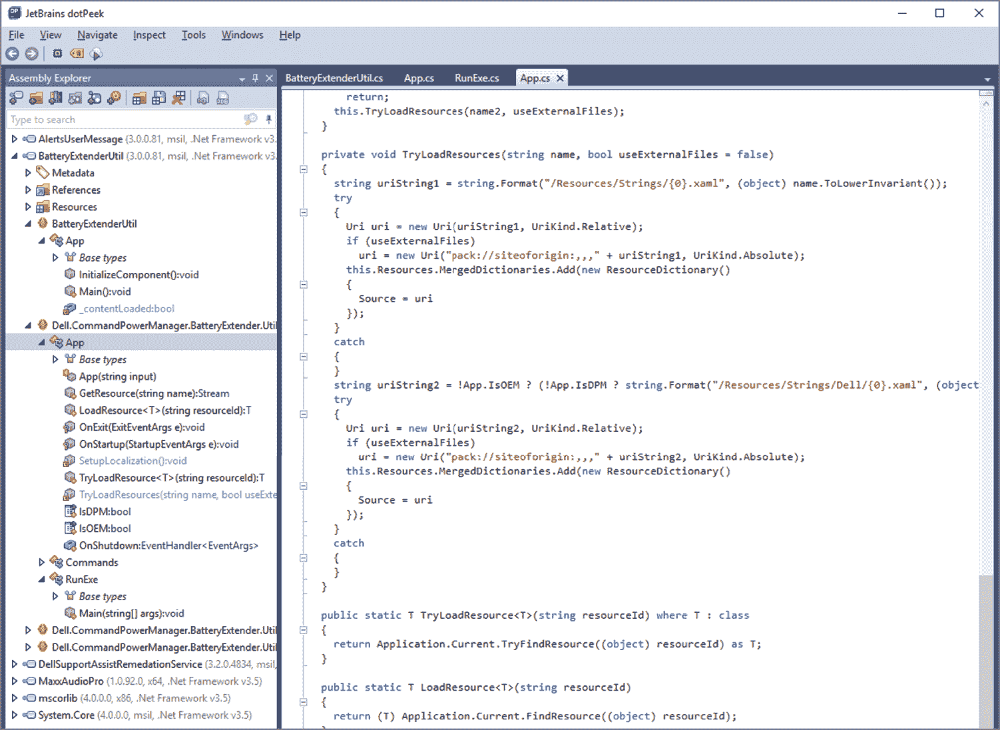

**Figure 1.1**: JetBrains dotPeek .NET decompiler

### 防御 JIT 语言

与真正的机器代码程序不同，JIT 编译程序通常可以转换为源代码。降低逆向工程门槛使许多在 x86 领域讨论的反向工程防御措施变得不必要且过度。

对于可反编译的语言，常用的防御手段是混淆（obfuscation）。Figure 1.2 展示了 .NET 应用在混淆前后的示例。

图上半部分展示混淆前的代码，函数和变量名称以及字符串均清晰可辨。这些名称帮助逆向工程师理解每个函数的作用及整体应用逻辑。

图下半部分展示混淆后的同一代码，函数名、变量名和字符串均被混淆，使得难以理解该函数的目的，更不用说整体应用了。

另一项重要的安全最佳实践是避免在 JIT 语言中编写安全或隐私关键代码，因为此类代码易于反编译。应改用 C/C++ 等更难反编译的编译语言编写，并将其包含在 DLL 中，与使用 JIT 语言编写的不敏感代码一起链接到可执行文件中。

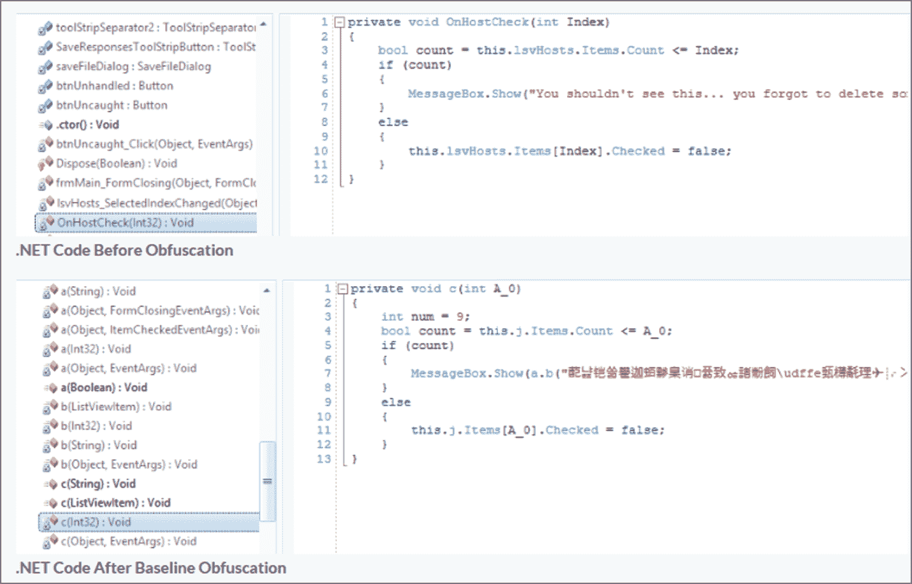

**Figure 1.2**: Obfuscation in JetBrains dotPeek

## Lab 1: 反编译

这是本书的第一个动手实验。实验及相关说明可在以下链接中找到：

`https://github.com/DazzleCatDuo/X86-SOFTWARE-REVERSE-ENGINEERING-CRACKING-AND-COUNTER-MEASURES`

本实验要求您查找“反编译”实验并遵循提供的指示。

### 练习技能

本书每个实验旨在教授并提供特定技能的实践经验。本实验的练习技能包括：

*   反编译

*   入门级逆向工程

为掌握这些技能，您将使用 JetBrains dotPeek 对 .NET 应用进行逆向工程和修改。

### 要点总结

反编译是理解和修改程序的强大且简便的方法。但它并非万能。C/C++ 等语言可通过 IDA 的 Hex-Rays 反编译器或 Ghidra 等工具反编译，但结果往往质量较低且难以使用。

在开发包含敏感信息或希望防止修改的应用时，选择不易反编译的语言更为合适。例如，C/C++ 优于 .NET 语言（如 C#）用于敏感功能。

## 架构

反编译是逆向工程的简便途径，因为它能将程序还原为高级语言和逻辑结构。但这种便捷路径并非总是可得。对于直接编译为机器代码的语言，我们需要更深入地理解计算机架构、机器代码和汇编代码的工作原理。

### 计算机架构

通常认为普通程序员无需深入理解计算机工作原理。在编写过程式语言程序时，操作系统处理所有低级操作。程序以进程形式运行，按需访问处理器、内存和文件系统。进程看似拥有独立的连续内存空间，文件仅是字节序列，用于读取和写入。


然而，这些都不是事实，你的操作系统一直在向你隐瞒真相（为了让编程更简单）。要真正理解计算机体系结构的工作原理是反向工程师的基础。Figure 1.3 展示了构成计算机的主要组件，包括中央处理器、桥、内存和外设。

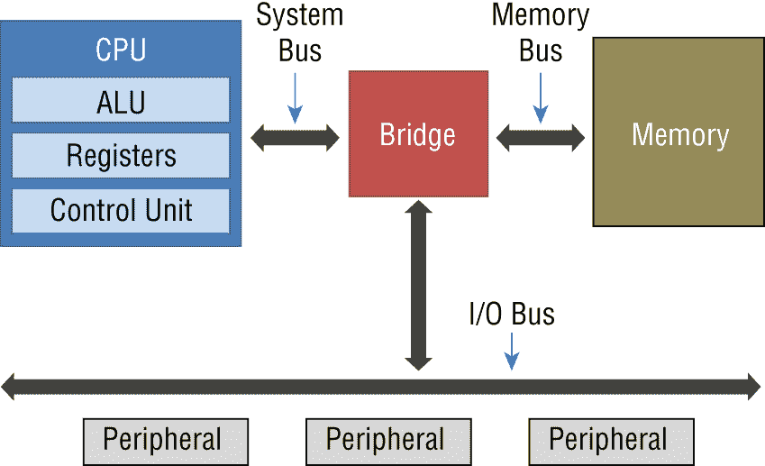

**Figure 1.3**: 计算机体系结构

#### *The Central Processing Unit*

*central processing unit (CPU)* 是计算机上处理的地方。CPU 内部包含以下组件：

*   **算术逻辑单元 (ALU)：** ALU 在计算机内执行数学运算，如加法和乘法。

*   **寄存器：** 寄存器用于临时存储数据，作为 x86 指令的主要输入和输出。寄存器提供极快的单词大小数据访问，通常按名称访问。

*   **控制单元：** 控制单元执行代码，包括读取指令和协调计算机内其他元素的操作。

#### *桥和外设*

CPU 通过 *总线* 与 *桥* 相连。桥的作用是将 CPU 与系统的其他组件（包括内存和 *I/O 总线*）连接起来，I/O 总线是键盘、鼠标和扬声器等外设连接到系统的地方。虽然信息通过总线流动，桥负责控制此流量，并确保通过一条总线传入的流量被路由到合适的总线上。

通过 I/O 总线连接的 *外设* 使计算机能够与外部通信。这包括向显卡、键盘、鼠标、扬声器等发送和接收数据。

#### *内存和寄存器*

顾名思义，*内存* 是计算机上存储数据的地方。数据以线性字节序存储，并通过地址访问。这种设计能够对系统中存储的数据提供中等速度的访问。

当程序需要访问内存中的数据时，CPU 会通过总线向桥发送请求，桥再转发到内存，获取指定地址的数据。请求的数据随后需要沿相同的路径返回 CPU 才能供程序使用。相比之下，寄存器物理位于 CPU 内部，因此更易于访问。

寄存器是位于 CPU 内部的存储区，不同于内存，它们不是线性的字节序列。寄存器有特定的名称，并且每个寄存器都有固定大小。

寄存器和内存的功能相同：存储数据。但它们有不同的专长（质量 vs. 数量）。寄存器数量少且成本高，但能以极快的速度访问数据。内存成本低廉且数量丰富，但访问速度较慢。

程序代码及其数据的大部分将存储在内存中。运行时，程序会将少量数据复制到寄存器中进行处理。

### Assembly

计算机基于二进制数字工作，逻辑为开（1）或关（0）。这包括在计算机上运行的程序。所有高级语言最终都会转换为称为 *机器代码* 的位序列。机器代码定义了计算机执行以完成所需功能的指令集。

#### *机器代码入门*

每位程序员都会从“Hello, World”程序开始学习。在 x86 架构中，“Hello, World”的机器代码如下：

```
55 89 e5 83 e4 f0 83 ec 10 b8 b0 84 04 08 89 04 24 e8 1a ff ff ff b8 00 00 00 00 c9 c3 90
```

这段机器代码使用十六进制表示，以提高可读性和紧凑性，但其真正的值是由 1 和 0 组成的二进制字符串。该二进制字符串包含指令，用于翻转晶体管计算信息、从内存获取数据、向系统总线发送信号、与显卡交互，最后打印 “Hello, World” 文本。如果这段字符看起来太短以完成所有这些操作，那是因为这些指令会让操作系统（本例为 Linux）提供帮助。

机器代码在最细粒度级别控制处理器。机器代码执行的功能包括：

*   将数据在内存和寄存器之间移动
*   控制系统总线
*   控制 ALU、控制单元及其他组件

这种低层次控制意味着用机器代码编写的应用可以极其强大且高效。然而，记忆和输入各种位序列来执行任务虽然很酷，但效率低且易出错。

#### *从机器代码到 Assembly*

在机器代码中，一系列位代表特定操作。例如，`0x81` 或 `10000001` 是一条指令，用于将两个值相加并将结果存储在特定位置。

*Assembly code*（伪代码）是机器代码的可读性版本。与记忆二进制或十六进制字符串（如 `0x81` 或 `10000001`）不同，程序员可以使用 `add` 这样的助记符。`add` 助记符映射到 `0x81`，这种简写使编程更便捷，同时保留了机器代码的所有优势。

将机器代码转换为伪代码极大地提高了可理解性。例如，前面的 “Hello, World” 示例可以转换为一系列易懂的指令。

| MACHINE CODE || ASSEMBLY |
| --- | --- |
| `55` || `push ebp` |
| `89 e5` || `mov ebp,esp` |
| `83 e4 f0` || `and esp, 0xfffffff0` |
| `83 ec 10` || `sub esp, 0x10` |
| `b8 b0 84 04 08` || `mov eax` |
| `89 04 24` || `mov [esp], eax` |
| `e8 1a ff ff ff` || `call 80482f4` |
| `b8 00 00 00 00` || `mov eax, 0x0` |
| `c9` || `leave` |
| `c3` || `ret` |
| `90` || `nop` |

如果你理解机器代码，直接在其上编写可以很有趣，且在某些情况下可能是合理的。但大多数情况下，它是低效且不切实际的。编写伪代码能够提供机器代码的所有好处，同时更加实用。

代码编写完后，可以通过 *assembler*（汇编器）将其转换为机器代码，过程称为 *assembling*。已有的机器代码程序可以通过 *disassembler*（反汇编器）转换为伪代码。

许多程序员不直接编写机器代码或伪代码，而是使用更高级的语言，这些语言抽象了更多细节。例如，以下伪代码类似于许多高级过程化语言：

```
int x=1, y=2, z=x+y;
```

在编译过程中，这些高级语言会转换为类似下面的伪代码：

```
mov   [ebp-4], 0x1
mov   [ebp-8], 0x2
mov   eax, [ebp-8]
mov   edx, [ebp-4]
lea   eax, [edx+1*eax]
mov   [ebp-0xc], eax  
```

随后，使用 *assembler* 将伪代码转换为计算机可执行的机器代码：

```
c7 45 fc 01 00 00 00 c7 45 f8 02 00 00 00 8b 45 f8 8b 55 fc 8d 04 02 89 45 f4
```

#### *指令集架构和微架构*

术语 *computer* 涵盖广泛的系统。智能手表和台式计算机的工作方式相似，但其内部组件可能有显著差异。

*Instruction set architecture (ISA)* 描述了程序运行的生态系统。ISA 定义的因素包括：

*   **寄存器：** ISA 指定处理器是有单个寄存器还是数百个。它还定义了这些寄存器的大小，是 8 位还是 128 位。


# CHAPTER 2  

x86 Assembly: Data, Modes, Registers, and Memory Access  

## Introduction to x86  

Thousands of computer architectures exist. While they all work similarly, a computer is a computer—but there are minor or major differences between each.  

To study reverse engineering, we need to select an architecture to focus on. In this book, we'll be using x86, which was selected for a few different reasons:  

*   **Ubiquity:** x86 is the most widely used assembly language, making it widely applicable for reverse engineering.  
*   **Computer support:** x86 applications can be built, run, and reverse engineered on any desktop, laptop, or server.  
*   **Market share:** x86 is the core of the major operating systems (Windows, Linux, and macOS), so it is used in billions of systems.  

The x86 architecture has been around for decades and has evolved significantly over the years. It was first introduced in 1974 by Intel, and some of the main milestones in the history of x86 include the following:  

*   **Intel 8080:** 8-bit microprocessor, introduced in 1974  
*   **Intel 8086:** 16-bit microprocessor, introduced in 1978  
*   **Intel 80386:** 32-bit microprocessor, introduced in 1985  
*   **Intel Prescott, AMD Opteron, and Athlon 64:** 64-bit microprocessor, introduced in 2003/2004  

Over its nearly 50-year history, the x86 architecture has regularly added new features while maintaining backward compatibility. Even if a feature was determined to be unused, it was never removed from the system. As a result, programs written for the Intel 8086 processor released in 1978 can still run on the latest x86 chips with no modifications.  

This focus on backward compatibility has created an immense, complex, and interesting architecture. The latest Intel Software Developer's manual (`www.intel.com/content/www/us/en/developer/articles/technical/intel-sdm.html`) is more than 5,000 pages long and only begins to scratch the surface of what this architecture can do. This book focuses on understanding the basics of x86, which is all that is needed to read, write, and manipulate most x86 code.  

As the x86 architecture has changed, the term *x86* has become an umbrella term for all of the architectures that have evolved from the Intel 8086 16-bit architecture. This includes the Intel 80286 architecture, which contains both 16-bit and 32-bit architectures, and the Intel 80886 architecture, which adds a 64-bit architecture. The term *x64* specifically refers to the 64-bit version of x86.  

## x86 Assembly: Data, Modes, Registers, and Memory Access  

Most software reverse engineering requires disassembling a compiled executable and analyzing the result. This disassembly results in assembly code, not a higher-level language.  

While a few assembly languages exist, x86 is one of the most widely used. This chapter introduces some of the key concepts of x86 assembly, providing a foundation for later chapters.  


这本书将在`32-bit x86`架构中展示示例。`32-bit x86`的所有概念都能精确对应到`x64`。在学习时，使用`32 bits`进行示例比`64`更容易上手。学完本书中的`32-bit x86`后，你会立刻能够阅读`x64-bit assembly`并理解它。不过，你的眼睛会感谢自己不必时刻盯着`64 bits`，因为即使是`32 bits`也已经有些难以长时间凝视。因此，不要因为示例使用的是`32-bit`而对此产生疑虑，认为它过时或必须立即专注于`64-bit`。我们都先学习`32-bit`，并且我们在软件破解领域积累了丰富经验，可以确信：如果你先建立坚实的`32-bit`基础，`64-bit`不过是几个寄存器名称和更长的数值而已。

## Assembly Syntax

在数千种可能的计算机架构中选择`x86`很重要，但这还不够。虽然指令集架构（ISA）定义了寄存器、数据格式和机器指令等因素，但它并不指定语法。

只要一个组装语言遵循寄存器、寻址等规则，并定义正确的指令集，它就是一个合法的`x86`语言。例如，一个`x86`语言必须包含乘法操作。但其助记符（mnemonic）可以是`mul`、`MUL`、`multiply`，或者在任何语言中出现的其他变体。

组装语言的语法完全由组装器（assembler）决定，一般情况下，`x86`组装语言也没有统一的语法规范。


这本书专注于`32-bit`架构。在传统的`32-bit`架构中，这意味着一个词是`32 bits`。但这只是`x86`架构的一个特性。由于`x86`保持了与原始`16-bit`架构的向后兼容性，`x86`中一个词是`16 bits`，而双字是`32 bits`。

### Working with Binary Values

逆向工程通常涉及处理跨多字节的大型二进制数。在处理这些数字时，理解诸如零扩展、位和字节意义以及字节序（endianness）等概念是正确解释二进制字符串所代表的数值所必需。

#### *Zero-Extension and Readability*

二进制值通常会进行`零填充`或`零扩展`到架构的字长。在`32-bit`架构上，这意味着在值左侧添加 0，使其长度为 32 位。例如，值`11001[2]`会被零填充为`00000000 00000000 00000000 00011001[2]`。

注意，位也会被分组为四位或八位，以提高可读性。这就像在十进制中，有时会在每三位数字后加逗号（即 1,000 而不是 1000）。当数值以十六进制表示时，也会按字节分组，每字节两个字符。例如，值`4D2[16]`（等于`1234[10]`）可以写作`04[16] D2[16]`。

#### *Bit and Byte Significance*

二进制数中的位和字节可以根据它们在数值中的相对权重进行标记。Figure 2.3 展示了一些常见的标签。


**Figure 2.3**: Bit and byte significance labels

在值`00000000 00000000 00000000 00011001[2]`中，最低有效位（LSB）位于最右侧，其值为 1。最高有效位（MSB）位于最左侧，其值为 0。在将二进制转换为十进制时，MSB 会乘以`2³¹`，而 LSB 会乘以`2⁰`。

除了 MSB 和 LSB，还有最低有效字节和最高有效字节的概念。在值`00000000 00000000 00000000 00011001[2]`中，最低有效字节的值为`00011001[2]`，而最高有效字节的值为`00000000[2]`。

位和字节也可以根据它们到值两端的距离进行标记。例如，靠近 LSB 的位和字节被称为低位（low-order），而靠近 MSB 的位和字节被称为高位（high-order）。

#### *Endianness*

在内存中，数据以字节存储。然而，许多数据类型使用多个字节。例如，一个`int`是 32 位或 4 字节。

Endianness 描述这些字节在内存中的存储顺序。在*小端序*（little-endian）系统中，最低有效字节先存储（位于最低地址）。在*大端序*（big-endian）系统中，最高有效字节先存储（位于最低地址）。

例如，考虑值`1337[10]`，其二进制表示为`0000 0000 0000 0000 0000 0101 0011 1001[2]`，或十六进制表示为`0x00000539`。Figure 2.4 展示了这些值在内存中的存储方式。


**Figure 2.4**: Endianness

无论系统的字节序如何，与变量关联的地址是其使用的最低地址或*基地址*。在小端序和大端序系统中，这将是地址 1828。

这本书专注于`x86`架构，它是小端序。因此，数据块的最低有效字节将位于基地址偏移 0 处。你会发现这对人类来说“反直觉”，因为我们习惯于大端序。

## Registers

寄存器提供处理器高速访问数据的能力。由于寄存器物理位于 CPU 内部，它们的延迟远低于内存，内存访问需要通过总线和桥接才能获取数据。

在 32 位架构中，寄存器包含 32 位的数据，可以像程序中的变量一样使用。每个寄存器都有唯一的名称，其内容可以通过计算或从内存加载新值来修改。

寄存器的主要限制是数量有限，且整个程序共享这些寄存器。如果程序用完寄存器，就需要将信息存储到内存中，这会对性能产生负面影响。由于寄存器数量有限，正常执行周期如下：

*   从内存获取数据并存储到寄存器中

*   对数据进行操作

*   将数据保存回内存

*   重复

### Registers in x86

如前所述，在架构概述中提到，寄存器是 CPU 内部非常快速的操作名称和位置。所有寄存器都可以分为两类。

*   **通用寄存器（GPRs）**：用于存储数据、地址等，且可直接操作

*   **专用寄存器（SPRs）**：用于存储程序状态

x86 架构定义了众多寄存器，如 Figure 2.5 所示。但其中许多是 CPU 自用的，因此只需了解其中一部分即可。

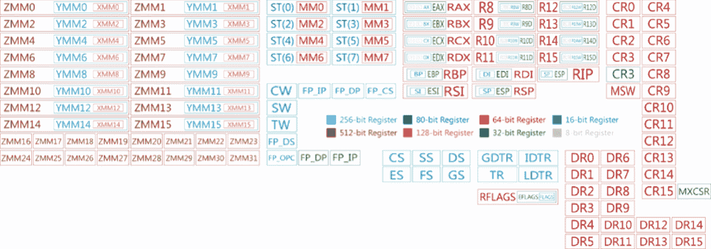

**Figure 2.5**: x86 registers ¶ Source: Liam McSherry/ wikimedia Commons /CC BY-SA 3.0.

#### *x86 General-Purpose Registers*

GPRs 承担应用的大部分工作，存储从内存中获取的值、进行数据操作、存储计算结果。以下是 x86 中最重要的 GPRs，每个都可存储 32 位数据。每个累加器寄存器都有其传统用途和命名来源；然而，GPRs 可用于任何目的，你可以在任何寄存器中存储计数器，而不仅仅是`ecx`寄存器。

##### `eax`

*`eax`*是“累加器”寄存器。其名称源于其常用于保存算术操作的结果。例如，程序可能执行`eax += ebx`。

##### `ebx`

*`ebx`*是“基”寄存器。它常用于保存变量所在内存块的基地址。例如，`[ebx + 5]`可用于访问数组的第五个元素。

##### `ecx`

*`ecx`*是“计数”寄存器，传统上用于计数。例如，*`ecx`*可能用于跟踪循环的当前迭代次数。在命令`(i=0; i<10; i++)`中，变量*i*很可能存储在`ecx`寄存器中。

##### `edx`

*`edx`*是“数据”寄存器。其名称源于其常用于保存数据。例如，应用可能包含指令`sub edx, 7`。

##### `esi`

*`esi`*是“源索引”寄存器。它传统上用于存储源数组的索引。例如，在命令`array[i] = array[k]`中，*`k`*的值可能存储在 esi 中。

##### `edi`

*`edi`*是“目的索引”寄存器。它用于存储目的数组的索引。例如，在命令`array[i] = array[k]`中，*`i`*的值可能存储在 edi 中。

##### `ebp`

*`ebp`*是“帧指针”寄存器。其用途是存储当前栈帧的基地址。程序栈和栈帧的概念将在后续章节中探讨。

##### `esp`

*`esp`*是“栈指针”寄存器。它存储当前栈帧的栈顶地址。

#### *Special-Purpose Registers*

SPRs 设计用于特定任务，且不能直接修改。例如，指令`mov eip, 1`（使用 SPR）将无法编译，而`mov eax, 1`（使用 GPR）则可以。

##### `eip`


`eip` 是“指令指针”寄存器。它存储下一个要执行的指令的地址。

`eflags` 是“标志”寄存器。它存储“标志”，这些标志的值为 true 或 false，用于保存系统状态以及已执行指令的结果。

## 工作寄存器

在汇编中，通用寄存器（GPRs）可以像变量一样被视待，并通过名称访问。例如，指令 `mov eax, 1` 将值 1 存储在 `eax` 中，而 `add eax, ebx` 将 `eax` 的内容加到 `ebx` 上。

请注意，所有这些寄存器名称都以字母 `e` 开头。这是因为这些 32 位寄存器是从原始 16 位寄存器“扩展”而来的。

寄存器的低半部分可以通过从名称中删除这个 `e` 来访问。例如，寄存器 `ax` 包含 `eax` 寄存器的低 16 位。

如果寄存器的名称以 `x` 结尾（`eax`、`ebx`、`ecx` 和 `edx`），则该 16 位寄存器可以进一步划分为两个 8 位寄存器，分别用 `l` 和 `h` 标识。`al` 包含寄存器 `ax` 的低 8 位，而 `ah` 包含高 8 位。如 Figure 2.6 所示，当 `eax=0x01234567`，`ax=0x4567`，`ah=0x45`，`al=0x67`。

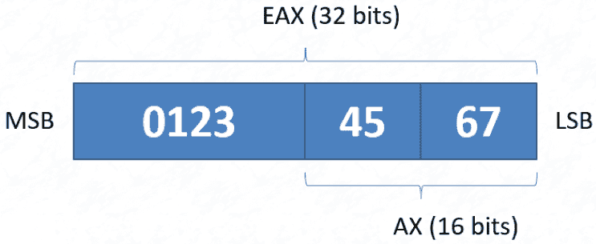

**Figure 2.6**: Pieces of the `eax` register

#### *64-Bit Registers*

在 64 位 x86 中，所有指令和行为与 32 位 x86 相同。然而，64 位架构拥有更多且更大的寄存器。

Figure 2.7 展示了 64 位 x86 中常用的寄存器。除了描述不同的 32 位寄存器外，64 位架构还额外包含八个标记为 r8‑r15 的寄存器。

所有 64 位寄存器的大小都大于它们 32 位 counterparts。对于 32 位 x86 中存在的寄存器（如 `eax`），其完整的 64 位 counterpart 将 `e` 替换为 `r`，从而得到 `rax`。该寄存器的低 32 位仍可通过 32 位名称访问，而 `ax`、`al` 和 `ah` 的使用方式保持不变。

对于诸如 `r8` 等新寄存器，64 位 x86 允许访问其低 32、16 和 8 位，分别标记为 `d`（`r8d`）、`w`（`r8w`）和 `b`（`r8b`），如 Figure 2.8 所示。

## 存储访问

32 位（或 64 位）系统只有有限数量的寄存器。在忽略用于栈指针跟踪的堆栈寄存器（`esp` 和 `ebp`）后，剩下的用于通用计算的寄存器只有六个（`eax`、`ebx`、`ecx`、`edx`、`esi` 和 `edi`）。这显然不足以完成大多数操作，因此程序还必须能够读取和写入内存。

在 Intel x86 汇编语法中，内存访问使用 `[]` 符号表示。例如，地址 `0x12345678` 上的数据可以通过 `[0x12345678]` 访问。地址也可以存储在寄存器中，例如指令 `[eax]`。

### 指定数据长度

访问内存时，必须知道数据所在的地址以及要访问的字节数。例如，指令 `[0x12345678]` 不说明程序是想读取字节、字、双字或更多。

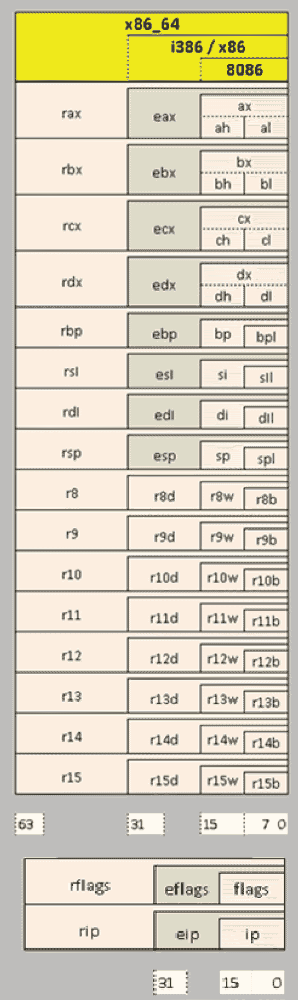

**Figure 2.7**: Common x64 registers ¶ Source: Bobmon / Wikimedia Commons / CC BY-SA 4.0.

在某些情况下，访问的数据长度可以从上下文中推断。例如，在指令 `mov eax, [0x12345678]` 中，数据会被存入 `eax`。由于 `eax` 是 32 位寄存器，程序必然请求 32 位的数据。

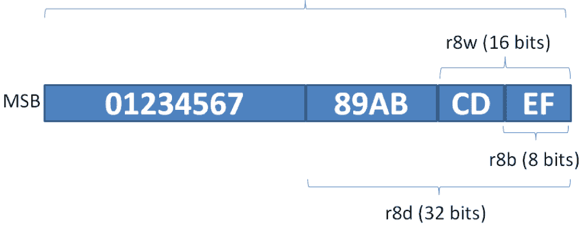

**Figure 2.8**: Pieces of the `r8` register

这种情况并非总是如此。例如，考虑指令 `mov [0x12345678], 1`，它将值 1 写入特定内存地址。但该指令没有指明要写入的值的长度。该 1 是字节（`0000 0001`）、字（`0000 0000 0000 0001`）还是双字（`0000 0000 0000 0000 0000 0000 0000 0001`）？为了保持简洁，数值的前导零通常会被省略，因此这三种解释均有可能。

当内存访问的大小不明确时，必须在指令中显式指定。例如，`byte [100]` 访问地址 100 处的字节，`word [ebx]` 访问由 `ebx` 指向的字，`dword [ax]` 访问由 `ax` 指向的双字。Figure 2.9 展示了以下三条指令的区别：

```
mov byte[100], 1 
mov word[100], 1
mov dword[100], 1 
```

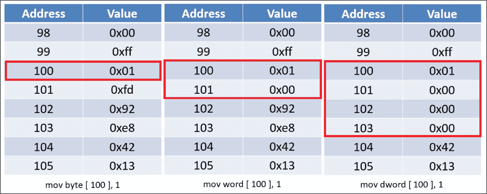

**Figure 2.9**: Comparing differently sized mov instructions

## 地址模式

在 Intel x86 语法中，内存地址使用方括号 `[]` 表示。例如，`[0x1234]` 表示程序应访问地址 `0x1234` 处的内存。

然而，内存地址的表示不限于使用立即值（如 `0x1234`）。x86 语言支持多种 *地址模式*，[]<unk><unk><unk><unk><unk><unk><unk><unk><unk><unk><unk><unk><unk><unk><unk><unk><unk><unk><unk><unk><unk><unk><unk><unk><unk><unk><unk><unk><unk><unk><unk><unk><unk><unk><unk><unk><unk><unk><unk><unk><unk><unk><unk><unk><unk><unk><unk><unk><unk><unk><unk><unk><unk><unk><unk><unk><unk><unk><unk><unk><unk><unk><unk><unk><unk><unk><unk><unk><unk><unk><unk><unk><unk><unk><unk><unk><unk><unk><unk><unk><unk><unk><unk><unk><unk><unk><unk><unk><unk><unk><unk><unk><unk><unk><unk><unk><unk><unk><unk><unk><unk><unk><unk><unk><unk><unk><unk><unk><unk><unk><unk><unk><unk><unk><unk><unk><unk><unk><unk><unk><unk><unk><unk><unk><unk><unk><unk><unk><unk><unk><unk><unk><unk><unk><unk><unk><unk><unk><unk><unk><unk><unk><unk><unk><unk><unk><unk><unk><unk><unk><unk><unk><unk><unk><unk><unk><unk><unk><unk><unk><unk><unk><unk><unk><unk><unk><unk><unk><unk><unk><unk><unk><unk><unk><unk><unk><unk><unk><unk><unk><unk><unk><unk><unk><unk><unk><unk><unk><unk><unk><unk><unk><unk><unk><unk><unk><unk><unk><unk><unk><unk><unk><unk><unk><unk><unk><unk><unk><unk><unk><unk><unk><unk><unk><unk><unk><unk><unk><unk><unk><unk><unk><unk><unk><unk><unk><unk><unk><unk><unk><unk><unk><unk><unk><unk><unk><unk><unk><unk><unk><unk><unk><unk><unk><unk><unk><unk><unk><unk><unk><unk><unk><unk><unk><unk><unk><unk><unk><unk><unk><unk><unk><unk><unk><unk><unk><unk><unk><unk><unk><unk><unk><unk><unk><unk><unk><unk><unk><unk><unk><unk><unk><unk><unk><unk><unk><unk><unk><unk><unk><unk><unk><unk><unk><unk><unk><unk><unk><unk><unk><unk><unk><unk><unk><unk><unk><unk><unk><unk><unk><unk><unk><unk><unk><unk><unk><unk><unk><unk><unk><unk><unk><unk><unk><unk><unk> 
 to[^.] 3ouS, being [2] ah., 1,, [ 学习 学 [Students]]] , [ the students have,, , [ 1 , [User...,]  - [ [to]]] being the [ [1]]]  [ [ [to]]] being the [ [1 (]] being, [ [1(]] being ** [ [1 (]] to! [ [1]]] being [ [ [1 (]]  [ [[1]]] [[[content]]] [[[ [1]]] [] [ [1]]] " [ [ [学]** [学 [nUH_" or not? ]" then you have to **_quit_** the [content]...


`Base + displacement addressing` 或 `based addressing` 使用寄存器值与偏移量的组合来指示地址。此模式常用于访问数组。因此，在一种语言中，如果你有 `*myList[8]`，你实际上是从 `*myList` 的基地址开始访问八个元素。在汇编中，例如，`[eax + 8]` 表示从寄存器 `*eax` 中存储的数组基地址开始的 8 个字节。

### Indexed Addressing

`Base + displacement addressing` 适用于数组元素始终为单字节长度的情况。对于包含更大元素的数组，必须手动计算偏移量，这既繁琐又易错。

在这些情况下，`indexed addressing` 可能是更好的选择。Indexed addressing 使用索引寄存器、比例因子和偏移量来指定地址。比例因子必须始终是 1、2、4 或 8。

#### *Example: Arrays*

让我们定义一个整数数组，`int x[100];`，它声明了一个包含 100 个 `int` 的数组。在内存中，数组中的每个值都存储在相对于基地址的特定偏移量处。这个偏移量由数组元素的大小决定，例如 32 位或 4 字节的 `int`。

假设该 `int` 数组的起始偏移量为 `0x1000`。下面的指令会将数组中的第 *`n`* 个元素移动到 `*eax*` 中，前提是 *`n`* 存储在 `*ebx*`：

```
mov eax, [ ebx * 4 + 0x1000]
```

### Based-Index Addressing

`Based-index addressing` 结合了 indexed addressing 和 `base + displacement addressing` 的元素。它使用基寄存器、索引寄存器、比例因子（1、2、4 或 8）以及偏移量来指定地址。

例如，考虑 `[ ebx + edi * 4 + 0x1000 ]`。该地址包含存储在 `*ebx*` 中的基值、存储在 `*edi*` 中的索引值，以及偏移量 `0x1000`。

#### *Example: Structs*

`Based-index addressing` 非常适合访问嵌套数据类型的元素。例如，考虑 C 语句 `struct { int i; short a[4]; } s;`。这创建了一个包含多个字段的结构体，其中包括一个数组。

每个结构体内的元素都存储在特定的偏移量处，这意味着数组 *`a`* 有一个特定的偏移量或基地址。然而，数组 *`a`* 中的元素也存储在相对于这个基地址的不同偏移量处。

假设结构体 `s` 的基地址存储在 `*ebx*` 中，而数组 `a` 距离该基地址 4 字节。下面的指令将在 *`n`* 存储在 `*ecx*` 时，访问数组 *`a`* 中的第 *`n`* 个元素：

```
mov eax, [ebx + 2 * ecx + 4]
```

不要因为高级寻址方式难以理解而灰心。你的操作系统一直在隐藏内存，因此在内存中查看数组的存储方式是新奇的。这些寻址方式首先需要作为理论介绍，但它们在实际汇编代码中使用之前可能难以理解。别担心，你会明白的。

## Summary

`x86` 是一种常用的汇编语言。理解它的工作原理对于成为成功的软件逆向工程师和黑客至关重要。

本章探讨了一些 x86 汇编的关键概念，包括数据表示、汇编语法以及用于数据访问和存储的寄存器和内存地址。

# CHAPTER 3  

x86 Assembly: Instructions

破解和逆向工程涉及阅读、编写和修改汇编代码。本书的重点是 x86 汇编语言。

不需要完全理解 x86 汇编的每一个细节才能成为逆向工程师，甚至可以用汇编语言编写程序。本章探讨 x86 的基础知识以及构成大多数汇编代码（超过 90%）的主要指令。

## x86 Instruction Format

Mnemonics 用于使 x86 汇编代码更易阅读。每个这些助记符指令都会被组装成控制处理器的机码。因此，处理器并不认识助记符，只有机码。例如，助记符 `add` 会组装成机码值 0x04。

x86 中，指令具有特定的格式。一个简单的 x86 指令示例是：

```
add eax, 1
```

在这条指令中，`add` 是用于指示处理器执行什么操作的助记符。该指令还包含一个或多个操作数，指示用于操作的数据。本例中，操作数是寄存器 `eax` 和立即数 1。在正常情况下，x86 指令最多可以有三个操作数（如果有的话）。虽然有 VEX 前缀的扩展允许最多四个操作数，但本文不涉及此部分。

x86 指令的操作数可以是寄存器、立即数或内存地址。寄存器通常指通用寄存器（GPRs），内存位置由地址指定。立即数是数字或常量，如 12345。

虽然指令可以包含这些任何操作数，但最多只能包含一个内存位置。例如，指令 `add eax, ebx` 和 `add eax, [0x12345678]` 是合法的，因为它们分别访问两个寄存器和一个寄存器与内存位置。但指令 `add [0x12345678], [0x87654321]` 是非法的，因为它同时使用了两个内存地址。这是因为处理器管线是一种精细的设计，每条指令只能执行一次内存读取。

## x86 Instructions

x86 汇编语言包含数百条不同的指令。以下是其中一些最常用的：

*   算术 

    *   `add`

    *   `sub`

    *   `mul`

    *   `inc`

    *   `dec`

*   位操作 

    *   `and`

    *   `or`

    *   `xor`

    *   `not`

*   栈 

    *   `call`

    *   `return`

    *   `push`

    *   `pop`

*   数据移动： 

    *   `mov`

*   执行流程 

    *   `jmp`

    *   条件跳转

*   比较 

    *   `test`

    *   `cmp`

*   其他 

    *   `lea`

    *   `nop`

虽然这看起来很多，但考虑编程语言中常用的操作符（`+`, `−`, `*`, `/`, `%`, `&&`, `||`, `&`, `|`, `^`, `!`, `~`, `<`, `>`, `>=`, `<=`, `==`, `.`, `->` 等）以及主要关键字（`if`, `else`, `switch`, `while`, `do`, `case`, `break`, `continue`, `for`, 等），在汇编中实现这些行为需要很强的能力。

事实上，没有人能记住所有的 x86 指令，也没人需要记住（除非想给朋友们一个惊喜）。完整的 x86 指令列表可在 `http://ref.x86asm.net/coder32.html` 找到，需要时可以查询任何指令的详细信息。

然而，要成为逆向工程师取得成功，对最常用的 x86 汇编指令有清晰的理解是至关重要的。如果你理解了这个重要的子集，你就能阅读并理解大多数 x86 程序。

### mov

顾名思义，`mov` 指令用于从一个位置移动数据到另一个位置。这包括在寄存器和内存位置之间复制数据，或将立即数放置到特定位置。注意，尽管名为 move，它实际上是复制数据；它不会从源位置移除数据，而是将数据从源复制到目的地。

`mov` 指令的语法是 `mov destination, source`。例如，命令 `mov eax, 5` 将值 5 放入寄存器 `eax`。同样，指令 `mov eax, [1]` 将地址 `0x1` 中的值移动到 `eax`。

在使用 `mov` 和类似指令时，需要记住变量名称会影响移动的数据大小。例如，指令 `mov eax, [0x100]` 会将 32 位值移动到 `eax`，而指令 `mov dx, [0x100]` 会将 16 位值移动到 `dx`。


`mov` 是一个极其通用的操作数，是记忆法（mnemonics）相对于机器代码（machine code）力量的一个很好的例子。`mov` 可以以多种不同的方式使用，如图 Figure 3.1 所示，每种方式对应不同的机器代码，具体取决于使用的两个操作数。然而，所有这些不同的变体在助记符（mnemonic）层面都表示为 `mov`。汇编器的任务是将助记符翻译成正确的机器代码。

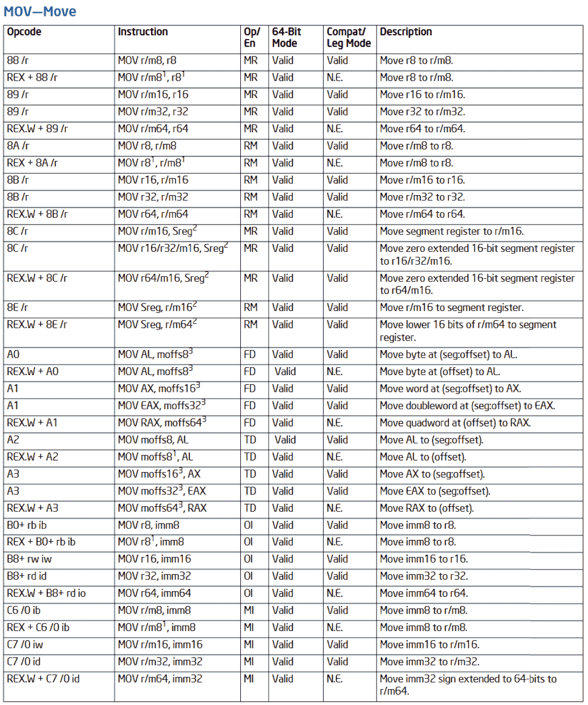

**Figure 3.1**: `mov` 指令

#### ************Hands-on Example************

下面的伪代码如何在汇编中编写？假设变量 *`i`* 位于地址 `100`，*`j`* 位于地址 `200`。

```
int i = 42, j = i;
```

这行伪代码可以被编译成三条 x86 指令。

```
mov [100], 42
mov eax, [100]
mov [200], eax
```

注意，寄存器 *`eax`* 用于暂存从内存地址 `100` 复制到内存地址 `200` 的值。原因是单条指令无法同时进行两次内存访问，必须使用寄存器（如 *`eax`*）进行临时存储。

从代码直观上看，直接用立即数 `42` 加载地址 `200` 似乎更合理，而不是分两步从地址 `100` 加载。但编译器不会也不能这么做。

原因是多线程环境的可能性。如果系统上有其他线程运行，值在 `100` 位置的内容可能在“赋值为 42”和“将其值写入 200”之间被修改。从 `100` 读取值而非使用立即数，可以确保变量 *`j`* 在 `200` 位置得到最新的 *`i`* 存储值。

### inc, dec

`inc` 和 `dec` 是 x86 指令，用于分别对指定值加 1 或减 1，等价于传统代码中的 `i++` 或 `i--`。

这两条指令只接受一个操作数，可以是寄存器或内存地址。例如，`inc eax` 使 *`eax`* 登记器中的值加 1，而 `dec [0x12345678]` 使内存地址 `0x12345678` 中的值减 1。

### add, sub

`add` 和 `sub` 指令分别对指定值进行加法或减法运算，它们接受两个操作数。例如，`add destination, value` 表示对 *`destination`* 加上 *`value`*，结果存回 *`destination`*。这意味着 *`destination`* 的原始值参与计算，但会被覆盖以保存结果。两个操作数的大小必须相同。例如，`add eax, ebx` 是合法的（32 位 + 32 位），而 `sub eax, bx` 不合法（32 位减 16 位）。

在使用 `add` 和 `sub` 时必须注意操作数的大小。例如，`sub ecx, [100]` 暗示 32 位值（因为使用 *`ecx`* 作为目的寄存器），但 `add dword [edx], 100` 必须加 `dword` 关键字，因为 *`edx`* 是 32 位指针，表明地址长度为 32 位，但并未说明要修改的数据大小。

### mul

`mul` 执行无符号整数乘法，但其行为略不寻常：只接受一个操作数，却隐式使用另外两个寄存器。语法为 `mul operand`，其中 *`operand`* 可以是寄存器或内存地址。该操作将 *`eax`* 的值与 *`operand`* 的值相乘。

乘法结果存放在 *`edx:eax`* 中，`edx` 保存高 32 位，`eax` 保存低 32 位。即使结果小于 32 位、`edx` 仍会被 `mul` 修改（通常为 0）。`mul` 的特点是可以在 32 位运算中得到 64 位的输出（`edx:eax`）。

`mul eax` 的示例会对 *`eax`* 中的 32 位值进行平方。若 *`operand`* 为内存地址，则乘数的长度可变。例如，`mul dword [0x555]` 乘以地址 `0x555` 中的 32 位值，而 `mul byte [0x123]` 则使用地址 `0x123` 中的 8 位值进行乘法。

### div

`div` 执行无符号除法，和 `mul` 类似，只接受一个操作数，并隐式修改 *`eax`* 与 *`edx`* 寄存器。商存放在 *`eax`*，余数存放在 *`edx`*。例如，5 除以 2 的商为 2，余数为 1。

`div` 与 `mul` 同样使用 *`eax`* 和 *`edx`* 作为输入，输出格式相同：高 32 位在 *`edx`*，低 32 位在 *`eax`*。即使余数为 0，`edx` 仍会被 `div` 修改。

`div eax` 的示例相当于 `eax, edx = edx:eax / eax`，操作数是 32 位寄存器，但也可以使用不同长度的内存地址作为除数。

#### ************Hands-on Example************

要计算 `123/4` 的余数，需要四条汇编指令：

```
mov eax, 123  ; 将被除数的低 32 位加载到 eax
mov edx, 0    ; 清空 edx，存放被除数的高 32 位
mov ecx, 4    ; 将除数加载到 ecx，因为 div 不能直接使用立即数
div ecx       ; 执行除法
```

执行完毕后，商保存在 *`eax`*，余数保存在 *`edx`*。

### and, or, xor

x86 标准提供了几种布尔运算指令：`and`、`or`、`xor`，它们均接受两个操作数。下面的表格展示了这三种运算的真值表。输入选项在表格的上方和左侧边缘。例如，要计算 1 AND 1，找到第 1 列与第 1 行的交点，结果为 1。因此，1 AND 1 等于 1。

| AND || 1 || 0 ||  || OR || 1 || 0 ||  || XOR || 1 || 0 |
| --- | --- | --- | --- | --- | --- | --- | --- | --- | --- | --- |
| **1** || 1 || 0 ||  || **1** || 1 || 1 ||  || **1** || 0 || 1 |
| **0** || 0 || 0 ||  || **0** || 1 || 0 ||  || **0** || 1 || 0 |

这三种运算的语法相同：`mnemonic destination, source`。例如，`and` 的语法是 `and destination, source`。和 `add` 类似，`destination` 必须是寄存器或内存地址，而 `source` 可以是寄存器、内存地址或立即数。同时，`destination` 参与运算并被覆盖以保存结果。

布尔运算可用于多种目的。例如，`or eax, 0xffffffff` 可快速将 *`eax`* 设为全 1；`and dword [0xdeadbeef], 0x1` 用于掩码，只保留低位；`xor eax, eax` 是常用的清零 *`eax`* 的方法。

### not


The `not` operation is a Boolean operation that computes the one's complement of a value. For those not familiar with the term `one's complement`, you can essentially think of it as taking all 0s and making them 1s and vice versa. It inverts the number. It takes a single operand with the syntax `not operand`.

The `not` operator can work on values of various lengths. For example, the operation `not ch` computes the one's complement of the 8-bit register `ch`. The command `not dword [2020]` computes the one's complement of a 32-bit value located at address `2020`.

### shr, shl

`shr` and `shl` are two of the shift operations available in x86, with `shr` being shift right, and `shl` being shift left. They take two operands: the location of the value to be shifted and the amount by which they should be shifted. An example shift operation is `shr register, immediate`.

`shr` and `shl` are logical shift operators. This means that when shifting the value by the indicated immediate value, they will zero-extend the value to the left or right. So, any new digits that appear as a result of the shift will be automatically 0.

For example, the operation `shr al, 3` will shift the value stored in `al` to the right by three bits. If `al` contains the value `00010000`, then the resulting value will be `00000010`.

### sar, sal

`sar` and `sal` are arithmetic shift operators. Their syntax is identical to that of the logical shifts, but they differ in implementation. `sar` does an arithmetic shift to the right and `sal` an arithmetic shift left.

When performing a left shift, `sal` operates the same as `shl`, zero-extending the value. For example, the instructions `shl al, 3` and `sal al, 3` with the value `00000100` stored in `al` will both produce the value `00100000`. All new positions that were opened in the number were filled with 0s.

However, a `sar` operation will sign-extend the value, while `shl` will zero-extend it. A sign-extend means it will replicate whatever bit was the most significant. For example, if `al` contains the value `10000000`, then the command `shr al, 3` will produce the value `00010000`, as shown here:

```
10000000     Initial value
01000000     1-bit shift
00100000     2-bit shift
00010000     3-bit shift
```

However, the instruction `sar al, 3` will result in `11110000`. Because the most significant bit is a 1, a 1 is replicated in all new positions.

### nop

The `nop` operator stands for “no operation.” It is a one-byte operator (`0x90`) that does nothing.

While `nop` technically does nothing, it is used for a variety of legitimate purposes, including the following:

*   Timing

*   Memory alignment

*   Hazard prevention

*   Branch delay slot (RISC architectures)

*   A placeholder to be replaced later by a future patch

And in the security world it is used for the following:

*   Hacking (`nop` sleds)

*   Cracking (`nop` outs)

### lea

The `lea` operator stands for *load effective address*. It takes two operators, including the *`destination`* (a register or memory address) and the *`source`*, which must be a memory address. The `lea` instruction computes the address of the indicated source operand and places it in the destination. For those familiar with pointers, it is similar to the `&` operator.

While `lea` is designed to work with addresses, it is also commonly used for simple mathematical operations. For example, the operation `lea eax, [ebx + ecx + 5]` asks what address `ebx+ecx+5` points to and then stores that into `eax`. This essentially computes `ebx + ecx + 5` and stores the result in `eax`. A more standard use of the `lea` operator, `lea eax, [100]`, would place the value 100 in `eax`.

While on the surface this can look a little silly or pointless, `lea` is a useful operator because it makes working with arrays in assembly more efficient. In arrays, values are stored at a particular offset from a base address. (Remember our base + displacement addressing modes?) With `lea`, it is possible to efficiently calculate the address of a particular element in an array. For example, assume that `eax` contains the base address of a character array. In that case, the instruction `lea ebx, [eax + 2]` would place the address of the second element in the array in `ebx`. This single instruction is more efficient than the series of instructions `mov ebx, eax` and `add ebx, 2`, which accomplishes the same result.

#### ************Hands-on Example************

How would the following pseudocode be written in assembly? Assume that *`i`* is at address `100`, *`j`* is at address `200`, and *`k`* is at address `300`.

```
int i = 7;
char j = 5;
int k = i * i + j * j; 
```

This pseudocode would be assembled into the following x86 instructions:

```
mov dword [ 100 ], 7  ; set i
mov byte [ 200 ], 5   ; set j
 
mov eax, [ 100 ]      ; load i into eax
xor ebx, ebx          ; zero ebx
mov bl, [ 200 ]       ; load j into ebx
 
add eax, ebx          ; add ebx to eax, store in eax
 
mov [ 300 ], eax      ; save result to k
```

In this example, note the use of both *`ebx`* and *`bl`*. The value that was to be stored in this register fits in `bl`. However, when performing the `add` operation, the entire *`ebx`* register is used. This is because of class promotion, if you add a 1 byte value to a 4 byte value the 1 byte values promoted to 4 bytes, and the additional bytes must be 0. So in this case what was 0x05 in bl, is promoted to 0x00000005 in ebx. The XOR operation to clear *`ebx`* was necessary to ensure that the previous value stored in the *`ebx`* register was completely purged and did not affect the result of the `add`.

### Common x86 Instruction Mistakes

x86 is a powerful assembly language, and most instructions follow a consistent set of rules. However, it does have its inconsistencies that can trip people up.

Here are some examples of common mistakes that people make when trying to write their own x86 that result in code that will not assemble:

*   `mov [bl], 0xf`: x86 supports indirect addressing using 16 and 32-bit GPRs. Since `bl` is only 8 bits long, it can't be used for addressing.

*   `mov [0xabcd], 1337`: This instruction doesn't specify the size of the value to be moved since 1337 may be recorded as `0x0539` or `0x00000539`.

*   `mov word [0xabcd], eax`: This instruction has an incorrect memory size specified since a `word` is 16 bits but `eax` holds 32 bits.

*   `mov byte [1], byte [2]`: Two memory locations can't be used in the same instruction.

*   `mov sl, al`: While `eax` has an `al` register, no `sl` register exists.

*   `mov 0x1234, eax`: The value `0x1234` is an immediate, not a memory address, and can't be the destination of a command.

*   `mov eax, dx`: This instruction has a size mismatch between the 16-bit source `dx` and the 32-bit destination `eax`.

### When In Doubt, Look It Up


记住，没有人（包括我，尽管这对我来说很难承认）能够把所有的 x86 指令记熟。无论你是在编写 x86 还是阅读它，如果你遇到不理解的内容，快速查找是关键。我们总是保持这个标签页打开以便快速查找：`http://ref.x86asm.net/coder32.html`。

## Summary

x86 是一种复杂而强大的汇编语言。然而，要成为有效的软件破解者和反汇编工程师，并不需要理解其中的每一位。

本章介绍了构成大多数汇编代码的 x86 指令。学习这些指令是必不可少的，并为反汇编提供了坚实的基础。

# CHAPTER 4  

构建和运行汇编程序

软件反汇编是指将已编译的可执行文件转换为可读的源代码。但反过来，构建并运行汇编程序也是理解这一过程的重要手段。

本章探讨了构建和运行汇编程序所需的关键概念，包括这些程序如何与外部环境交互、如何实际构建和运行它们，以及它们如何管理字符串。

## 输出

汇编和机器码虽然强大，但最终你的代码会希望与外部世界通信。为此我们需要一种输出信息的方式。

如果你曾观察过处理器，会发现它上面布满了小引脚。这些引脚使处理器能够与外部世界通信。通过汇编，你可以通过打开和关闭这些引脚来控制它们，从而实现如点亮和熄灭 LED 等效果。现代 x86 处理器拥有 400 到 1,000 个引脚，这使得你可以控制大量设备。

引脚被组织成称为 *ports* 的组。通过 ports，你可以一次性控制多个引脚，而不是逐个控制，这样可以避免冗长且低效的操作。向引脚写入值相当于向 port 写入，从 port 读取值则相当于从 port 读取。

下面是为 x86 定义的若干 port 示例，Table 4.1 展示了一小部分示例。

**Table 4.1**: x86 Ports

| PORT RANGE || SUMMARY |
| --- | --- |
| `0x0000-0x001F` || 第一个传统 DMA 控制器，常用于向软盘进行数据传输 |
| `0x0020-0x0021` || 第一个可编程中断控制器 |
| `0x0022-0x0023` || 访问赛扬处理器的特定寄存器 |
| `0x0040-0x0047` || 可编程定时器（PIT） |
| `0x0060-0x0064` || “8042” PS/2 控制器或其前代 |
| `0x0070-0x0071` || CMOS 与实时时钟寄存器 |
| `0x0080-0x008F` || DMA（页寄存器） |
| `0x0092` || 快速 A20 门寄存器的地址 |
| `0x00A0-0x00A1` || 第二个中断控制器 |
| `0x00C0-0x00DF` || 第二个 DMA 控制器，常用于音频卡 |
| `0x00E9` || Port E9 针的所在地 |
| `0x0170-0x0177` || 次级 ATA 硬盘控制器 |
| `0x01F0-0x01F7` || 主要 ATA 硬盘控制器 |
| `0x0278-0x027A` || 并行端口 |
| `0x02F8-0x02FF` || 第二个串行端口 |
| `0x03B0-0x03DF` || 用于 IBM VGA 及其前代的范围 |
| `0x03F0-0x03F7` || 软盘控制器 |
| `0x03F8-0x03FF` || 第一个串行端口 |

### 控制引脚

在 x86 中，引脚可以通过 `in` 和 `out` 指令控制，这两条指令分别接受寄存器和端口号作为参数。

`in` 指令的语法是 `in register, port`，例如 `in al, 0x64` 用于读取键盘状态。

`out` 指令的参数顺序相反，语法为 `out port, register`，例如 `out 0x3c0, eax` 用于设置像素值。

实际上，你通常并不是直接连接到目标或来源端口，而是通过总线和桥接芯片间接实现。引脚挂在共享总线上，`in` 与 `out` 访问总线上预定义的地址，由桥接芯片进行翻译。核心思想仍然相同。

### 冗长

回到输出的概念：通过 `in` 与 `out` 指令可以单独控制像素，但一块显示屏可能包含数千甚至数百万个像素。逐个设置它们会非常繁琐且低效。

因此，这些细节被抽象化处理。显示图像时，显卡负责设置每个像素的细节。但学习如何与显卡通信本身也很繁琐。

这时操作系统的作用就来了。它可以处理与显卡的复杂交互，完成像素设置并显示图像。与操作系统交互需要系统调用。如果你想在 x86 上玩“硬核模式”，可以直接操作显卡；但本书采用“硬核加帮助模式”，我们利用操作系统完成繁重工作。

## 系统调用

系统调用在 x86 中用于通过操作系统提供有限的 I/O 功能。系统调用的集合随操作系统而变化。

由于系统调用是操作系统的概念，它们是操作系统依赖的。我们将介绍一些在 Linux 上常用的系统调用。系统调用通过在 *`eax`* 寄存器中加载函数编号来调用。在 Linux 中，系统调用通过 `int 0x80` 指令触发。

### sys_write

在高级语言中，`sys_write` 的语法大致为 `ssize_t sys_write(unsigned int fd, const char * buf, size_t count)`，它返回写入的实际字节数。

`sys_write` 接受三个参数：第一个 *`fd`* 是文件描述符，指示数据写入的位置，值为 1 表示写入 Linux 控制台；*`buf`* 保存要输出的数据；*`count`* 指示要写入的字符数。

在 x86 汇编中，函数调用方式不同，参数需装入寄存器，如 Table 4.2 所示。装好寄存器后，使用 `int 0x80` 发起系统调用。

**Table 4.2**: `sys_write`

| REGISTER || VALUE || DESCRIPTION |
| --- | --- | --- |
| `eax` || 4 || `sys_write` 标识符 |
| `ebx` || 1 (console out) || 文件描述符 |
| `ecx` || `const char*` *`buf`* || 要写入的字符串 |
| `edx` || `size_t` *`count`* || 字符串长度 |

下面的示例展示了 `sys_write` 的使用方式：

```
mov   edx,len       ; 消息长度
mov   ecx,buff      ; 要写入的字符串
mov   ebx,1         ; 文件描述符（stdout）
mov   eax,4         ; 系统调用号(sys_write)
int   0x80          ; 调用内核
```

### sys_exit

`sys_exit` 系统调用相当于高级语言中 `main` 函数的 `return status;`，用于结束程序并返回状态码。它只接受一个参数，即状态码，存放在 *`ebx`* 中，如 Table 4.3 所示。

**Table 4.3**: `sys_exit`

| REGISTER || VALUE || DESCRIPTION |
| --- | --- | --- |
| `eax` || 1 || `sys_exit` 标识符 |
| `ebx` || int || 状态码 |

下面的示例展示了 `sys_exit` 的调用过程：


`mov` `eax`, `1`          ; `system` `function` (`sys_exit`)
`mov` `ebx`, `0`          ; `return` `0`;
`int` `0x80`            ; `call` `kernel`

### `Printing` `a` `String`

`Printing` `a` `string` `requires` `turning` `certain` `pins` `on` `and` `off` `on` `the` `processor`. `By` `making` `a` `system` `call`, `an` `assembly` `program` `can` `offload` `the` `work` `of` `determining` `which` `pins` `to` `turn` `on` `and` `off` `to` `the` `operating` `system`. `The` `OS` `informs` `the` `graphics` `card`, `which` `selects` `its` `bits` `to` `turn` `on` `and` `off`. `This` `sends` `information` `to` `the` `monitor` `microcontroller`, `causing` `it` `to` `turn` `its` `pins` `on` `and` `off`, `which` `draws` `on` `the` `screen`. `Along` `the` `way`, `dozens` `of` `other` `controllers` `may` `be` `involved` `in` `the` `process` `as` `well`.

`An` `assembly` `program` `that` `prints` `a` `string` `and` `then` `exits` would `use` `both` `the` `sys_write` `and` `sys_exit` `system` `calls`. `We'll` `get` `into` `the` `overall` `file` `syntax` `in` `the` `next` `section`. `For` `now`, `as` `a` `way` `to` `get` `you` `excited` `and` `on` `the` `edge` `of` `your` `seat` `as` `you` `read` `the` `next` `section`, `here's` `a` `sneak` `peek`. `The` `following` `example` `prints` `the` `message` “`Hello, world!`” `to` `the` `console`:

```
`global` `_start`

`section` `.text`
_start:
    `mov` `eax`, `4` `; write`
    `mov` `ebx`, `1` `; stdout`
    `mov` `ecx`, `msg`
    `mov` `edx`, `msg.len`
    `int` `0x80`

    `mov` `eax`, `1` `; exit`
    `mov` `ebx`, `0`
    `int` `0x80`

`section` `.data`
msg:    `db` `"Hello, world!",` `10`
.len:   `equ` `$` `-` `msg`
```


-   在处理字符串时，需要注意它们默认并不以空字符（null‑terminated）结尾。要显式地在字符串末尾加入空字符（0x0），如 `label: db “hello”, 0`。空字符用于几乎所有编程语言存储字符串，但编译器已经在帮你完成此工作。现在你掌握了汇编的力量，需要手动完成此操作，因此任何使用字符串的函数都能正确执行。若字符串末尾缺少空字符，字符串函数会继续读取其后的内存并尝试将其作为字符使用，结果不可预测——从打印不可打印字符，到因访问无权限的内存而导致程序崩溃。

#### *times*

`times` 前缀用于指定某条指令或前缀重复指定次数。这对于创建固定长度的缓冲区等场景很有帮助，示例如下：

```
```
times 100 db 0   ; 创建 100 字节，初始化为 0

times 64 db 0x55 ; 创建 64 字节，每个字节初始化为 0x55

; 为 "hello world" 填充到长度 64
buffer: db      'hello, world' times 64-$+buffer db ' '
```
```
#### *$*

`$` 是当前行地址的简写，可用于类似标签的方式，示例如下：

```
jmp $                ; 无限循环

string: db "hello"
length EQU $-string  ; 计算 string 上一行的长度
```
在此示例中，*`length`* 是变量名，其值等于当前地址（`$`）减去标签 *`string`* 的地址。因为 *`length`* 紧跟在字符串之后，等价于取字符串之后的地址并减去起始地址，从而得到 "hello" 的长度。

### objdump

像 `nasm` 和 `ld` 这样的工具用于从汇编代码生成可执行文件。Object Dump（`objdump`）是 Linux 工具，用于逆向此过程，把可执行文件的机器码还原为汇编代码。随着我们在书中的进展，会介绍更强大的工具，但我们先从 `objdump` 开始，因为它几乎在所有基于 Linux 的系统上都存在，并且提供了良好的基础。

`objdump` 能显示在 Linux 上运行的任何应用的汇编代码。因此，它拥有多种配置选项。但对初学者而言，最重要的两个选项是：

*   `-d`：指示 `objdump` 反汇编所有段的内容。

*   `-Mintel`：指定输出使用 Intel 语法（默认是 AT&T 语法）。

基于上述，反汇编名为 *`appname`* 的程序的命令是 `objdump -d -Mintel appname`。下面给出该命令的示例输出：

| `804a030` || `<test_key>:` ||  ||  |
| --- | --- | --- | --- |
| `804a030` || `55` || `push` || `ebp` |
| `804a031` || `89 5e` || `mov` || `ebp, esp` |
| `804a033` || `53` || `push` || `ebx` |
| `804a034` || `83 ec 14` || `sub` || `esp, 0x14` |

`objdump` 的输出分为三列。第一列是内存地址，即代码在运行时的虚拟地址；第二列是该地址的机器码（十六进制）；第三列是对应的 x86 汇编指令。

表格的主要例外是标签，如表格顶部所示。标签包含一个名字，其关联的地址与第一条指令的地址相同，标签本身不占用任何内存空间。

## Lab: Hello World

现在是第二个实验环节。请前往本书的 GitHub 页面 `https://github.com/DazzleCatDuo/X86-SOFTWARE-REVERSE-ENGINEERING-CRACKING-AND-COUNTER-MEASURES`，找到 “hello world” 实验。

### Skills

本实验提供了编写和构建 x86 代码应用的机会。将被测试的关键技能包括：

*   寄存器

*   内存

*   指令

*   系统调用

*   构建和链接 x86 汇编

本实验还让你亲手使用以下工具：

*   `nasm`

*   `ld`

*   Makefiles

*   `objdump`

### Takeaways

应用本质上由某种汇编指令组成。通常在个人电脑上是 x86，但也可能是 JIT 语言或中间语言（IL）。

在低级语言中编写程序，能够更深入地理解如何对其进行拆解。在逆向软件时，能够编写 x86 代码对于开发绕过保护机制的补丁非常有价值。

## ASCII

美国标准代码信息交换（ASCII）和 Unicode 变换格式（UTF）都是定义计算机如何表示文本的标准。事实上，ASCII 是 UTF‑8 的子集。

ASCII 于 1960 年制定，使用七位二进制表示每个字符。[Figure 4.2 展示了完整的 ASCII 表。

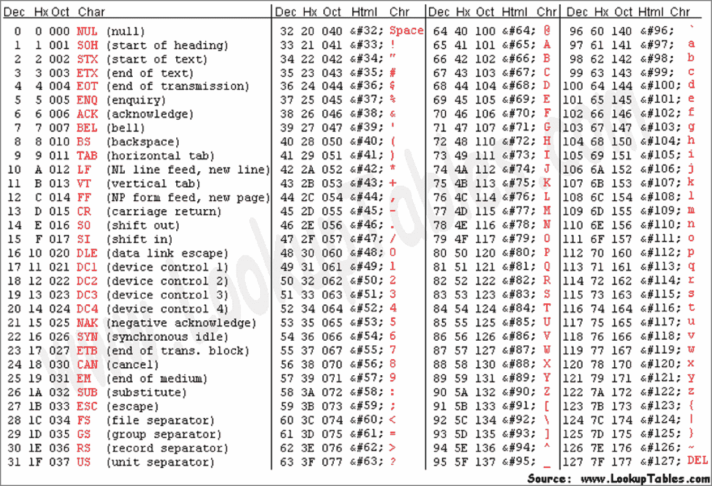

**Figure 4.2**: ASCII 表

ASCII 标准能够支持以下类型的字符：

*   数字（0–9）

*   小写字母（a–z）

*   大写字母（A–Z）

*   常见标点符号

了解 ASCII 对于逆向工程很有帮助，因为字符串在汇编代码和内存中通常是以这种形式表示。例如，字符串 `“Hello, world”` 在内存中的字节序列为 `0x48`, `0x65`, `0x6C`, `0x6C`, `0x6F`, `0x2C`, `0x20`, `0x77`, `0x6F`, `0x72`, `0x6C`, `0x64`。

### 识别 ASCII 字符串

在逆向工程中，判断一系列字节是 ASCII 字符串、数字还是其他数据的挑战很大。例如，字节序列 `0x48`, `0x65`, `0x6C`, `0x6C`, `0x6F`, `0x2C`, `0x20`, `0x77`, `0x6F`, `0x72`, `0x6C`, `0x64` 可能是字符串 `“Hello, world”`，也可能是数值 1,819,043,144，或是其他许多可能性。

唯一确定一组字节是字符串的方法是观察它们在程序中的用法。如果这些字节被传递给解释为字符串的函数，则它们极有可能是字符串。

在许多语言中，一个有价值的线索是一系列可打印字节后跟一个空（NULL）字符。因为处理器并不知道字符串的起止位置，如果字符串忘记加入空字符，程序会一直读取后续内存，直到出现问题。

例如，下面的程序会打印 “hello” 后跟 16 个 'B'，然后继续读取并打印内存内容，直到遇到空字符：

```
#include <stdio.h>
int main()
{
       char mybuffer[16];
       for (int i = 0; i < 16; i++)
       {
              mybuffer[i] = 'B';
       }
       Printf("hello %s\n", mybuffer);
}
```

Figure 4.3 展示了该代码的输出。


**Figure 4.3**: 程序输出

### ASCII 处理技巧

ASCII 设计使得大写字母和小写字母之间的差值恒为 `0x20`，如 Figure 4.4 所示。高级语言中的 `toUpper` 函数仅需向小写字母的值中加入 `0x20`，而 `toLower` 函数只需减去 `0x20`。

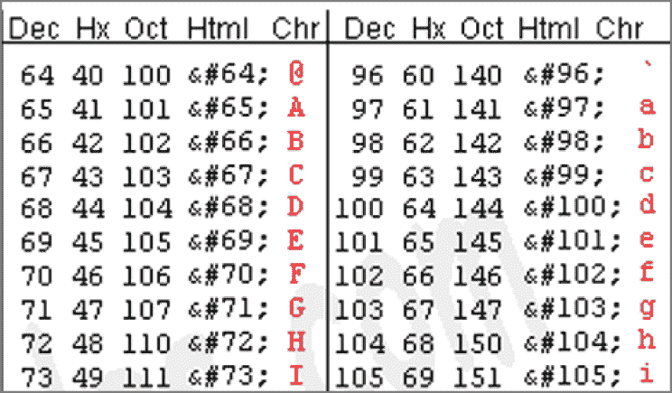

**Figure 4.4**: ASCII 大小写值示意

## Summary

本章从正向视角探讨了汇编程序是如何组合在一起的，包括它们与外部环境的交互、构建和链接过程，以及字符串的管理方式。


-   [理解这些过程的正向方向可以对理解其反向工作非常有价值。如果你知道汇编代码是如何从代码变为可执行文件的，你就更能理解如何将其拆解并再次组装。]

# CHAPTER 5  

## 理解条件码

汇编指令通常包含目标寄存器，用于存储操作的结果。然而，某些指令的效果超出了该目标寄存器所记录的范围。

x86 使用 *条件码* 来跟踪这些效果。本章探讨这些条件码，并描述你需要了解的主要条件码，以便有效逆向工程 x86 应用程序。

### 条件码

大多数架构（包括 x86）都需要一种手段来跟踪前一次操作的基本属性。例如，在评估 `if` 语句时，程序需要评估条件并据此采取行动。能够在指令之间跟踪状态信息对于执行此类操作至关重要。

为了存储这些状态信息，计算机有一个专用寄存器（SPR），称为 `flags`。在 32 位系统中，它被称为 `eflags` 寄存器；在 16 位和 64 位系统中，分别称为 `flags` 和 `rflags`。

#### eflags

`eflags` 寄存器由一组标志位组成，每个标志位由单个比特表示。每个比特可以设置为真（`1`）或假（`0`）。

`eflags` 寄存器分为三类标志：

*   **状态标志**：表示某些操作的状态，例如上一次操作是否为零。

*   **控制标志**：影响处理器的运行方式，例如开启和关闭中断。

*   **系统标志**：反映处理器的状态，例如系统是否被虚拟化。

由于 `eflags` 寄存器有 32 位，能够存储大量的状态信息。对于逆向工程而言，只有部分状态标志是重要的。

在这四个状态标志中，对逆向工程最重要的包括 **进位标志（carry flag）**、**零标志（zero flag）**、**符号标志（sign flag）** 和 **溢出标志（overflow flag）**。

#### *进位标志*

进位标志（CF）是 `eflags` 寄存器的第 0 位。它指示上一次算术操作是否产生进位。

进位表示加法在最高位产生了进位，或减法在最高位产生了借位。例如，下面的计算会导致进位标志被置位：

```
                     unsigned        signed
  0011 0000                48             48
+ 1110 0000            + 224          + -32
1 0001 0000                16             16
```

二进制表示本身并没有说明数值的正负，这取决于如何解释。有符号数可以是正也可以是负，而无符号数始终是正的。

在该示例中，追踪加法可以看到最左侧一列产生了进位。对无符号数而言，进位标志表示溢出，即结果超出了指定的位宽（这里以 1 字节为例）。这也是传统上用于检测无符号数的溢出/下溢。当满足进位条件时，CF 置 1。

#### *零标志*

零标志（ZF）是 `eflags` 寄存器的第 6 位，指示上一次算术操作的结果是否为零。例如，下面的计算会置位零标志：

```
  0100 0000           64
- 0100 0000        - 64
  0000 0000           00
```

零标志的判断非常直接：结果全为 0 则置 1，无需区分有符号还是无符号。

#### *符号标志*

符号标志（SF）是 `eflags` 寄存器的第 7 位，表示上一次算术操作的结果是否设置了符号位。在有符号数中，符号位是用于表示正负的最高位。

例如，在指令 `add ax, bx` 中，符号位是 `ax` 的第 15 位；在 `sub bl, dl` 中，符号位是 `bl` 的第 7 位。如果该位被置 1，则表示结果为负数，SF 也置 1；若为 0，则为正数。

当符号位被置 1 时，数值采用“两的补码”表示，需要额外的处理才能恢复其真实值。

#### *溢出标志*

溢出标志（OF）是 `eflags` 寄存器的第 11 位，指示上一次算术操作是否发生溢出。溢出发生在进位和出位不一致时。正如进位标志对无符号数有用，溢出标志用于有符号数的溢出检测。

常见的两种溢出情形：

*   **正数 + 正数 = 负数**
*   **负数 + 负数 = 正数**

第一种情况示例：

```
  0101 0000           80
+ 0101 0000        + 80
0 1010 0000          -96
```

两个正数相加，结果最高位为 1，表示负数，这与预期的正数结果不符。二进制列示中，左侧进位进入最高位，但最高位没有进出（即进位不匹配出位），导致结果错误。

第二种情况示例：

```
  1000 0000          -128
+ 1011 0000        + -80
1 0011 0000            48
```

两个负数相加，结果意外为正，同样是因为进位不匹配出位。二进制层面可以看到左侧没有进位，但最高位有进出，导致进位不匹配，进而产生错误的正数结果。

#### *其他状态标志*

虽然上述四个标志最为重要，但还有其他不太常用的标志值得了解：

*   **Adjust (AF):** 指示上一次算术运算在最低 4 位产生了进位（用于 BCD 算术）。

*   **Trap (TF):** 使 CPU 进入单步调试模式，常用于调试。

*   **Interrupt Enable (IF):** 使 CPU 能够处理系统中断。

*   **Direction (DF):** 控制字符串处理的方向，从右向左。

*   **Parity (PF):** 指示上一次逻辑/算术操作的低字节是否为偶数个 1（即奇偶性）。

### 影响状态标志的操作

状态标志可以由多种操作影响，常见的包括 `add`、`sub`、`cmp` 和 `test`。

#### *add*

`add` 指令可能会修改进位、零、符号和溢出标志。例如，`add al, bl` 根据 `al` 和 `bl` 的值可能触发不同组合的标志。图 5.1 展示了五种不同 `add` 操作的结果。

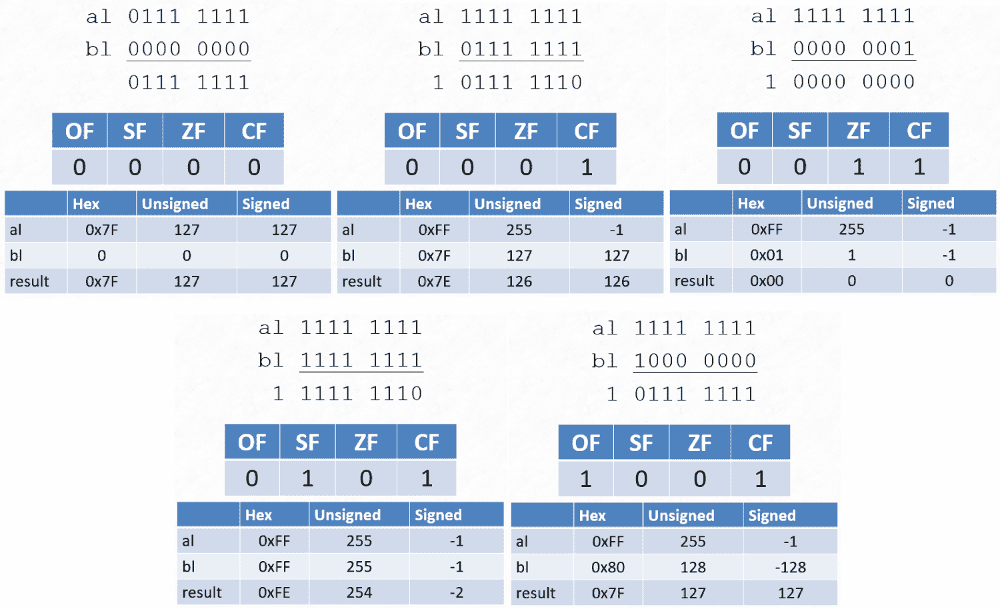

**Figure 5.1**: Effects of `add al,bl` with various inputs


注意使用有符号或无符号整数对值的解释及其正确性有影响。例如，第二个 `add` 操作在有符号值时结果正确，但在无符号值时结果错误。

#### *sub*

`sub` 指令也有可能修改与 `add` 相同的标志，即所有四个重要状态标志。图 5.2（`#c05.xhtml#c05-fig-0002`）展示了 `sub al, bl` 在不同 `al` 和 `bl` 值下的各种结果。

与 `add` 操作类似，`sub` 的结果正确性取决于 `al` 和 `bl` 中存储的值。例如，第一个例子的两种版本均正确，但只有有符号版本的第二个例子结果才正确。

#### *cmp*

`cmp` 指令用于比较两个值，这些值可以是内存、常量或寄存器。它通过减去第二个操作数来实现比较，但减法的结果被丢弃，仅调整标志位。

`cmp` 的目标是判断一个值是否大于、小于或等于另一个值。考虑以下示例，其中 `eax < ebx`：

```
mov eax, 0x100
mov ebx, 0x200
cmp eax, ebx  ; 计算 eax-ebx
```

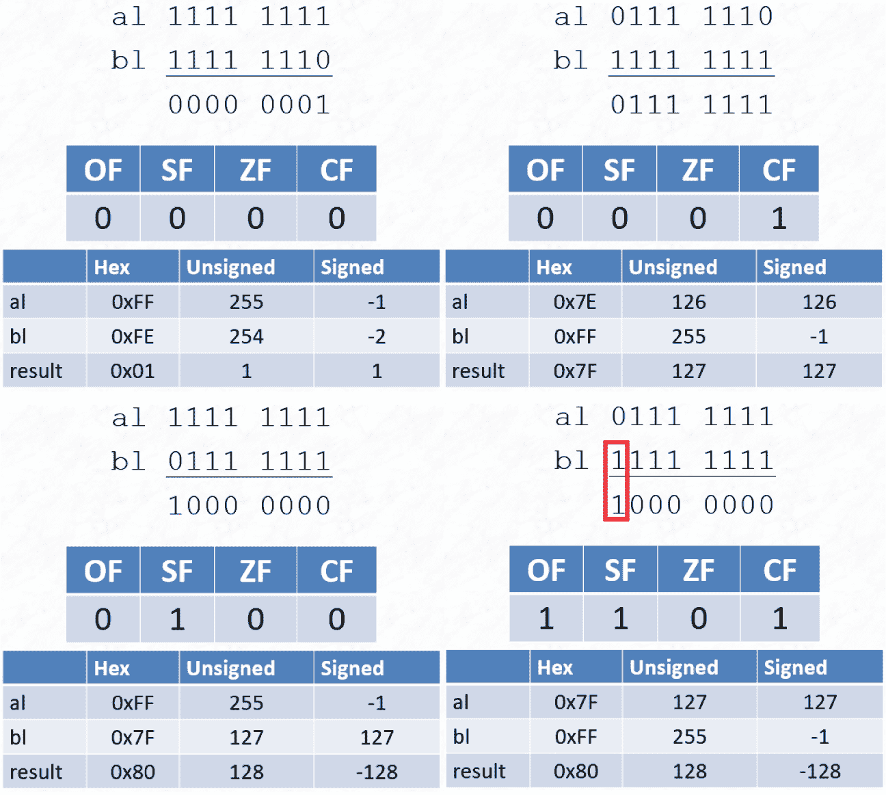

**Figure 5.2**: `sub al, bl` 的各种输入结果

最后一条指令是减法，由于 `ebx` 大于 `eax`，结果为负值。因此，符号标志位被设置为 1（表示负结果），而零标志位被设置为 0（即结果不为零）。

在另一个示例中，第一个操作数 `eax` 的值可能大于第二个操作数 `ebx`。

```
mov eax, 0x300
mov ebx, 0x200
cmp eax, ebx  ; 计算 eax-ebx
```

此时，减法结果为正值。因此，符号标志位和零标志位均为 0。

`cmp` 的最后一种可能情况是两个操作数相等，如下所示：

```
mov eax, 0x500
mov ebx, 0x500
cmp eax, ebx  ; 计算 eax-ebx
```

当操作数相等时，减法结果为零，这会设置零标志位但不设置符号标志位。图 5.3（`#c05.xhtml#c05-fig-0201`）展示了 `cmp` 操作对符号标志位和零标志位影响的真值表。

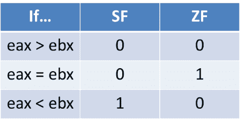

**Figure 5.3**: `cmp` 真值表

#### *test*

`test` 指令执行两个操作数之间的位运算 `and`，这些操作数可以是内存、常量或寄存器。与 `cmp` 类似，`test` 的结果被丢弃，但标志位会被调整。

`test` 指令常用于检查一个值中是否有特定位被设置，通过检查零标志位实现。例如，以下指令检查位 0 或位 2 是否被设置：

```
mov ax, 0x1450
test ax, 0x05 ; 检查位 0 或位 2 是否被设置（0x5 为二进制 0000 0101）
```

这些指令等价于执行以下数学运算：

```
  0001 0100 0101 0000      (0x1450)
& 0000 0000 0000 0101      (0x0005)
  0000 0000 0000 0000
```

`and` 操作的结果为零，因此零标志位被设置。这表示位 0 和位 2 均未被设置。

以下指令在 `ax` 中放入 `0x1451` 时执行相同的测试：

```
mov ax, 0x1451
test ax, 0x05 ; 检查位 0 或位 2 是否被设置
```

这些指令等价于以下计算：

```
  0001 0100 0101 0001      (0x1451)
& 0000 0000 0000 0101      (0x0005)
  0000 0000 0000 0001
```

在此情况下，`and` 操作的结果非零，因此零标志位未被设置。这表示至少有一个位被设置。

## Summary

条件码用于记录操作可能未体现在目的寄存器中的效果，例如操作结果为零或导致溢出。跟踪这些条件码对于理解逆向工程时应用程序的当前状态至关重要。

# CHAPTER 6  

Analyzing and Debugging Assembly Code

早期章节专注于逆向工程的理论和基础。了解 x86 如何工作以及常见指令格式对于成功至关重要。

本章采用动手式方法进行逆向工程和软件破解。它介绍了 `gdb`，一个强大的调试器，并探讨了软件逆向工程和破解中的重要技巧和技巧。

## Binary Analysis

分析现有可执行文件是逆向工程的主要部分。二进制分析可以通过多种方式实现，包括静态分析和动态分析。

### Static and Dynamic Analysis

程序的功能可以通过多种方式进行分析。两种主要技术是静态分析和动态分析。

*静态分析* 是在不运行程序的情况下分析源代码。静态分析的优势包括：

*   作为进一步分析的良好起点

*   对潜在恶意软件的风险-free 分析方法

*   无需访问专用架构的需求

静态分析的一个主要优势是它总是可用。但它可能耗时且无法捕获所有内容。在分析复杂代码时，若不运行代码，很难预知跳转会去向。此外，许多代码流程依赖于程序输入，因此静态分析不足以推断代码执行路径，使得分析变得困难。

动态分析是互补技术，通过运行程序并分析其运行时行为来实现。动态分析的优势包括：

*   更快速的分析

*   更广泛的潜在问题检测

动态分析形式多样。在逆向工程中，最常见的是调试。通过观察应用程序运行，许多静态分析的未知因素可以被澄清（例如代码最可能跳转到哪里）。然而，动态分析意味着运行代码，这在某些情况下可能不可行。代码可能是更大应用的一部分，可能需要独特的执行环境，或在处理恶意软件时可能带来安全风险。

### Debugging

记住，软件逆向工程和破解的目标是理解并修改现有软件。调试是实现这一目标的最快和最有效的方法。通过动态分析程序功能并实时修改其行为，可以收集破解所需信息并测试潜在补丁。

调试通常是多阶段过程。典型的调试流程包括以下步骤：

1.  在感兴趣的位置设置 *breakpoints*。

2.  运行代码。

3.  执行在断点处暂停（“break”）。

4.  检查程序状态。

5.  可选进行修改。

6.  重复。

## Breakpoints

Breakpoints 指示处理器在特定点停止程序执行。Breakpoints 有两种形式：

*   **Software:** 软件断点设置在字节码上，数量无限。

*   **Hardware:** 最多四个硬件断点（在 x86 中），可设置在字节码或内存访问上。


# 使用软件断点和硬件断点

在本书中，早期实验专注于使用**软件断点**，而硬件断点则在后续实验中出现。本书将展示多种调试器的使用，并且在每种调试器中配置断点的方法各不相同。

## Software Breakpoints

软件断点是大多数调试器的默认选项。设置软件断点时，实际发生的情况是调试器在后台修改指令，将其替换为断点指令。在 x86 架构中，这对应于 `int3` 指令（`0xcc`）。软件断点仅在执行时有效，这意味着 `int3` 指令必须被执行，断点才会生效。

当处理器到达断点指令时，它会暂停执行并将控制权交还给调试器。这使得反汇编者能够检查程序状态并可能进行修改。

软件断点的主要限制是它们可以被程序轻易检测到。通过**反调试**，程序可以在读取自身内存时检测到断点，并据此采取防御性操作，如删除断点等。

## Hardware Breakpoints

大多数调试器都支持硬件断点，但通常需要手动选择和配置。

硬件断点不像软件断点那样修改程序代码，而是将断点地址存储在硬件寄存器中。

在 x86 架构中，调试寄存器 `DR[0-7]` 用于实现硬件断点。`DR[0-4]` 保存断点地址，而 `DR[6,7]` 存储配置信息。

硬件断点可以配置为在**执行**、**读取**或**写入**特定地址时触发。当处理器检测到匹配断点寄存器的条件时，它会将控制权交给调试器。

硬件断点的优势在于它们能够检测到**内存访问**。例如，硬件断点可以用于定位代码中特定字节被修改或字符串被使用的位置。

硬件断点还能够规避程序对软件断点的防御。如果程序在扫描自身代码时寻找 `int3` 指令，它会忽略硬件断点，因为硬件断点不修改代码。它们并非完全防调试，但高级系统知识可以让应用程序更深入地观察硬件断点，从而大幅提升安全性。

## gdb

GNU Debugger（`gdb`）是 Linux 调试的事实标准。它在许多 Linux 发行版中预装，并且可以在任何发行版上安装。`gdb` 提供的关键功能包括：

*   命令行调试器（无 GUI）

*   可脚本化

*   支持远程调试

`gdb` 是极其普遍的调试器，以至于许多系统和处理器都包含一个 *`gdb` 命令行* 以支持 `gdb` 调试。虽然许多调试器受限于少数架构和平台，`gdb` 支持数百种。

本书将探索多种调试器，并在后续章节介绍基于 GUI 的调试器。但首先需要深入理解如何使用 **GDB**，这是基于命令行的。许多“更美观”的调试器在内部使用 GDB 及其协议；它们仅在外层包装了更友好的界面。

### Debugging with gdb

作为命令行程序，`gdb` 通过在提示符处输入命令来控制程序，提示符显示为 `(gdb)`。尽管 `gdb` 的界面看起来古老，但它是极其强大且广受欢迎的调试器。

`gdb` 的一个有用特性是命令可以使用最简洁的非歧义形式输入。例如，`run` 可以缩写为 `r`，`info registers` 可以缩写为 `info reg`，`disassemble` 可以缩写为 `disas`。你会在实践中逐步了解这些简写。

#### *Launching gdb*

`gdb` 可以通过 `gdb` 命令启动。例如，可执行文件 `printreg-shift.out` 可通过 `gdb printreg-shift.out` 启动，如图 6.1 所示。

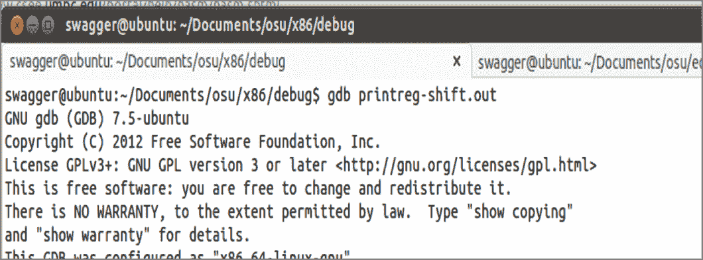

**Figure 6.1**: The `gdb` command

#### *Disassembly with gdb*

x86 架构支持多种语法，包括 Intel 和 AT&T 两种。在 `gdb` 中指定 Intel 语法的命令是 `(gdb) set disassembly-flavor intel`。

设置完语法后，可以选择多种启动调试的方式：

*   `disassemble` 从当前指针位置开始反汇编。
*   `disassemble address` 从指定地址开始反汇编。
*   `disassemble label` 从指定标签（如 *`loop`*、 *`main`*）开始反汇编。

图 6.2 展示了使用标签进行反汇编的示例，左侧为原始源代码，右侧为 `gdb` 中的对应反汇编。

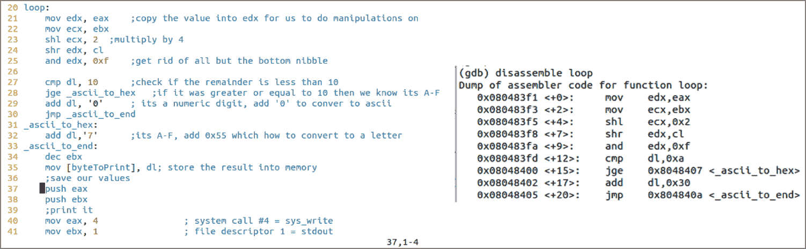

**Figure 6.2**: Disassembly in `gdb`

指定起始点后，还可以限定反汇编的指令数量。例如，命令 `disassemble main +50` 会从 *`main`* 标签开始，打印 50 条指令。

#### *Starting and Stopping Code in gdb*

`run` 命令用于从程序起始位置执行。此操作会丢弃之前的运行状态。

`continue` 命令用于恢复执行。例如，可以通过断点暂停查看程序栈，然后使用 `continue` 恢复运行。

程序执行可以通过 `quit` 和 `kill` 终止。`kill` 终止运行的进程，而 `quit` 则终止并退出 `gdb`。

#### *gdb Breakpoints*

断点用于暂停代码执行以便分析程序状态。`gdb` 中的 `break address` 命令在指定地址设置断点，而 `break label` 使用标签指定位置，如图 6.3 所示。

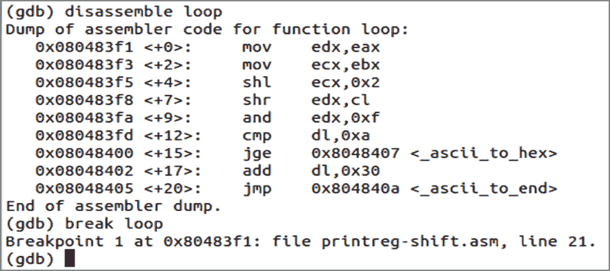

**Figure 6.3**: Setting a breakpoint in `gdb`

#### *gdb info Commands*

`info` 命令用于获取各种信息。常用 `info` 命令包括：

*   `info files`：显示已编译文件的各个部分。图 6.4 为简单可执行文件 `a.out` 提供了示例。

    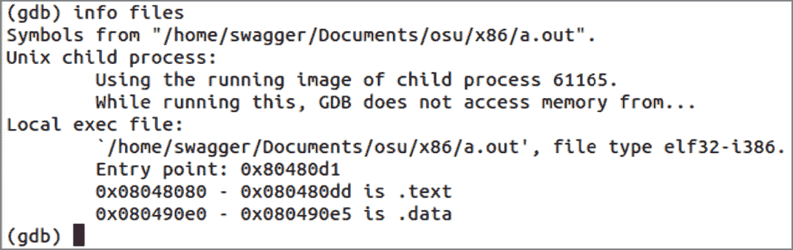

    **Figure 6.4**: `gdb info files` command

*   `info breakpoints`：列出当前定义的所有断点。

*   `info register`：显示当前 x86 寄存器的值，如图 6.5 所示。

*   `info variables`：列出应用程序中所有已定义的变量，如图 6.6 所示。

除了 `info register`，还可以使用 `print $reg` 单独打印寄存器值，示例如下：

```
(gdb) print $esp
$1 = (void *) 0xffffd260
(gdb)
```

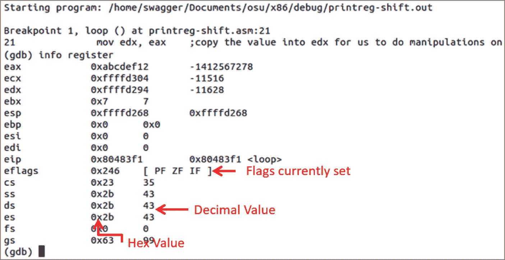

**Figure 6.5**: `gdb info register` command

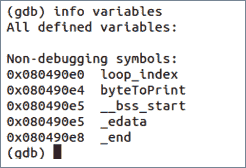

**Figure 6.6**: `gdb info variable` command

#### *Stepping Through Instructions*

`run` 和 `continue` 命令仅用于启动程序运行，直到出现断点等停止条件。这样使得难以实时观察程序行为或变量随时间的变化。


-   步进命令 `stepi` 按指令逐步执行，如图 6.7 所示，可实现更深入的分析。请注意，因为应用是在调试模式下构建的，所以会显示注释。

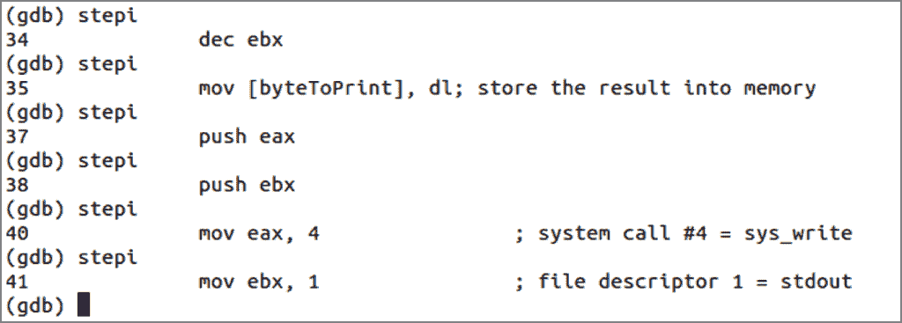

**Figure 6.7**: `gdb stepi` 命令

如果下一条要执行的指令是函数调用，`stepi` 会进入被调用的函数。在很多情况下这并不理想，尤其是当函数已经充分理解时。例如，知道指令会打印字符串即可，无需检查 `printf` 函数内部的每条指令。

`nexti` 命令允许跳过函数调用。它会执行函数调用并直接跳转到下一条可见指令。

#### *Examining Memory*

在 `gdb` 中，`x` 命令（意为“eXamine memory”）用于查看内存。命令语法为 `x/nfu addr`。

在该命令中，`n`、`f`、`u` 是可选参数，含义如下：

*   *`n`*：指定要显示的单元数量（`u`）。

*   *`f`*：指定显示格式  

    *   *`s`*：以空字符终止的字符串  

    *   *`i`*：机器指令  

    *   *`x`*：十六进制（默认）

*   *`u`*：指定单元大小  

    *   *`b`*：字节  

    *   *`h`*：半字（两字节）  

    *   *`w`*：字（默认）  

    *   *`g`*：双字（八字节）

Figure 6.6 展示了名为 *`byteToPrint`* 的变量，其地址为 `0x080490e4`。要显示该地址 16 字节的内容，命令为 `x/16x 0x80490e4`，如图 6.8 所示。命令输出表明，感兴趣的字节值为 `0x41`，在 ASCII 中对应 *A*。

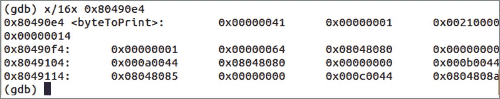

**Figure 6.8**: `gdb x` 命令

除了使用内存地址，`x` 命令还可以使用寄存器指定转储位置。例如，图 6.9 显示了使用 *`esp`* 寄存器转储 10 字节的十六进制内容。

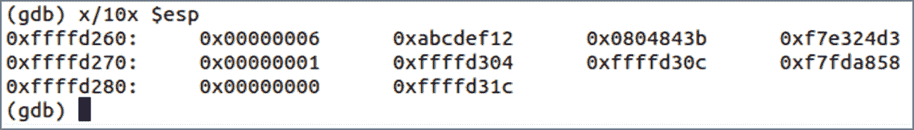

**Figure 6.9**: 使用 `gdb x` 命令打印 10 字节

## Segmentation Faults

段错误（segmentation faults），即 *segfaults*，当 CPU 尝试读取或写入不可访问的内存位置时发生。这可能是因为该位置不存在，或是 CPU 没有相应的读写权限。

例如，命令 `mov eax, [0x00000000]` 必然导致段错误。原因是地址 0x0 通常未被映射或对应的应用程序无法访问，导致从内存地址 `0x0` 进行读取。`gdb` 在触发段错误时也会出现此情况。

段错误的原因多种多样。在软件利用中，缓冲区溢出可能导致段错误。在逆向软件时，如果程序被错误补丁或在调试时修改执行流程出现错误，也会出现段错误。随着你深入编写和操作汇编代码，你会成为段错误的老朋友。每当出现段错误，随身携带一个压力球并每次看到段错误就使用它，会是一种治疗性的做法。值得欣慰的是，当通过 GDB 触发段错误时，`gdb` 会显示导致该错误的代码行，这有助于定位代码问题。

## Lab: Shark Sim 3000

本实验提供一个温和的逆向工程挑战。该应用的行为设计得并不显而易见，获取和分析这类程序的经验是软件逆向的基础。

前往本书的 GitHub 页面（`https://github.com/DazzleCatDuo/X86-SOFTWARE-REVERSE-ENGINEERING-CRACKING-AND-COUNTER-MEASURES`），找到 Shark Sim 3000 实验。

### Skills

本实验旨在测试逆向工程的基础技能，包括拆解和理解未知程序的能力。所测试的技能包括：

*   ASCII  

*   条件码  

*   调试编译后的程序  

*   解读未知的汇编指令和程序  

### Takeaways

调试是逆向工程中的重要工具。理解新指令的基本功能是逆向工程的关键——时间往往不足以完全掌握所有细节！

成功逆向工程的秘诀之一是不要在未知的汇编指令上耗费过多时间。尽快掌握其基本用途，以便继续前进。后续章节将继续使用 `gdb` 及其他更强大的调试器。现在你已经开始修改汇编代码，便可以在没有源代码的情况下进行汇编操作。

## Tuning Out the Noise

有效的逆向工程和软件破解需要掌握多种技能，但其中最重要的能力是“屏蔽噪声”，专注于关键内容。

即使是小程序，其代码量也远超需要分析的范围。大多数指令与核心功能无关，浪费时间。往往，**知道关注点**比**知道不关注点**更重要。

在确定关注与不关注点时，理解基础概念至关重要。以下是极常见、一眼即可辨认的代码模式：

*   控制流构造  

*   栈布局（局部变量、入口参数、出口参数）  

*   编译器模板（函数前置/后置、保护码、栈分配、寄存器管理）  

这些将在后续章节中详细探讨，帮助你快速识别它们。

在确定逆向工程的优先级时，执行顺序为：函数调用 ➪ 控制流 ➪ 单条指令 ➪ 模板代码。

*   **函数调用**：关注被调用的函数。知道某函数调用 `CreateDialog` 已足以理解其大致目的。

*   **控制流**：如有需要，分析控制流，例如确认 `CreateDialog` 是在循环中被调用的。

*   **单条指令**：若仍不足，检查单条指令。

*   **模板代码**：分析模板代码几乎对软件逆向或破解无实际帮助。但了解常见模板有助于快速识别并忽略它们。

## Summary

本章介绍了 `gdb`，这是一个在 Linux 系统中广泛使用的强大调试器。熟悉并动手使用 `gdb` 对有志成为逆向工程师或破解者至关重要，因为该工具可用于分析各种系统的软件。

# CHAPTER 7  

Functions and Control Flow

程序是一系列指令，应用程序不一定按顺序从一条指令跳转到下一条。在逆向和破解应用时，理解控制流以及影响它的因素（如高级语言中的 `if` 语句和循环）至关重要。

在 x86 或更高级语言中反向一个函数时，你会遇到函数本身。本章还探讨了 x86 中函数的工作原理及其对程序栈的影响。

## Control Flow

迄今为止，本书所探讨的汇编代码均采用顺序执行模式，即从上到下依次执行。但大多数应用并非完全顺序。考虑以下代码块：

```
if (x) {
       // Do something
}
```


当执行这段代码时，处理器会评估条件，`x`，并判断其是否为真。如果为真，则继续执行 `if` 块内的指令。

然而，如果条件，`x`，不为真，则 `if` 块内的指令将被跳过。这需要能够指示处理器执行某些指令和跳过其他指令，从而改变执行流程。

### 指令指针

*`eip`* 寄存器被称为指令指针，保存要执行的下一条指令的地址。处理器在执行一条指令后会自动增量 `eip` 中存储的值。

允许 `eip` 在每条指令之后递增，使得可以运行一系列顺序执行的指令。但在某些情况下，我们需要有条件地执行代码。这时需要对 `eip` 进行不同的更新。然而，`eip` 不能被直接操作（记得它是特殊用途寄存器 \[SPR\]）。相反，使用控制流指令来调整 `eip`。

### 控制流指令

最常见的、强制改变正常执行流并导致 `eip` 变化的偏离顺序的操作被称为 *jumps* 或 *branches*。例如，下面的代码块在 `if` 语句处有一个分支：

```
int x = 1;
int y = 2*x;
if (!y) { // branch!
    x = 2;
}
```

当将这种高级语言代码编译成机器码时，会使用跳转指令来指示 `eip` 寄存器应被设置到的位置。`jmp` 指令的语法为 `jmp op`，其中 *`op`* 可以是内存地址或标签。

`jmp` 指令是非条件跳转，始终执行（后面会介绍条件跳转）。

#### *jmp*

`jmp` 指令的语法为 `jmp op`。其作用是通过将 `eip` 设置为 *`op`* 所存储的值，将程序的控制流转移到内存位置 *`op`*。

`jmp` 指令的示例包括：

```
jmp eax       ; 将 eax 的值复制到 eip（跳转到 eax）
jmp label     ; 跳转到标签处的指令
jmp $         ; 在 nasm 中实现无限循环（有价值的调试工具）
 
```

`jmp` 指令可以用于实现各种功能。例如，下面的指令用于在无限循环中从零开始计数：

```
      mov eax, 0
loop: add eax, 1
      jmp loop
```

#### *条件跳转*

条件跳转是一种将跳转是否执行与条件是否为真或假关联起来的机制。跳转是否执行取决于状态标志寄存器中的值。例如，下面的指令：

```
cmp eax, ebx
jle done
```

`jle`（jump less than or equal to）指令会在之前的比较操作结果设置状态标志后，如果标志表明结果小于或等于零，则跳转到指定的地址或标签。这里的 `cmp` 指令用于比较 *`eax`* 和 *`ebx`*，并设置标志。`cmp` 实际上是用操作数 1 减去操作数 2 并丢弃结果。要使条件为“小于或等于”，*`eax`* 必须小于或等于 *`ebx`*。在这种情况下，处理器会跳转到标签 *`done`*。否则，跳转被跳过，执行继续到 `jle` 之后的下一条指令。

x86 语言中有大量的条件跳转指令。下表（表 7.1）列出了这些指令及其决定是否执行跳转的条件。

**Table 7.1**: x86 conditional jump instructions

| INSTRUCTION || MEANING || CONDITIONS |
| --- | --- | --- |
| `je` || Jump if equal. || ZF = 1 |
| `jz` || Jump if last result is zero. || ZF = 1 |
| `jne` || Jump if not equal. || ZF = 0 |
| `jge` || Jump if greater than or equal to. || SF = OF |
| `jl` || Jump if less than. || SF != OF |
| `jle` || Jump if less than or equal to. || ZF = 1 OR SF != OF |
| `jg` || Jump if greater than. || ZF = 0 AND SF == OF |

从表中可以看出，有些指令的条件是相同的。例如，`jz` 和 `je` 都在零标志（ZF）为 1 时跳转，这意味着它们跳转时指示的两个值相等。但从逻辑上看，它们的语义不同。“跳转如果上一结果为零”可能用于减法操作后的结果为零的情况，而“跳转相等”更多用于比较操作后的相等判断。

例如，当 *`eax`* = *`ebx`* = `0x10` 时，`cmp eax, ebx` 执行后会设置零标志，因为两者相等。`jz` 和 `je` 指令都会在它们紧随其后时进行跳转。

这些指令可以互换使用，但通常根据设置标志的指令选择。例如，如果使用 `sub eax, ebx` 来设置标志，则 `jz` 更可能被使用，因为它关注数学操作的结果是否为零。如果使用 `cmp eax, ebx`，则 `je` 更常用，因为它基于比较的等价性。

请记住，`cmp` 在内部执行减法，因此它对标志的影响与 `sub` 操作相同。`jz` 和 `je` 是为使代码更易读而设计的同义指令。

#### *条件跳转的陷阱*

条件跳转依赖于状态标志来决定是否跳转。但每条指令都是独立执行的，条件跳转并不关心你想要对哪个比较或数学表达式进行条件跳转。如果在条件指令和跳转之间修改了状态标志，这会导致问题。虽然编译器不会犯这种错误，但在编写汇编代码时，你必须考虑这一点。

例如，下面的指令组：

```
cmp eax, ebx
cmp edx, ecx
jle done
```

你的意图可能是让 `cmp eax, ebx` 的结果决定是否跳转。但 `cmp edx, ecx` 是最后一条设置标志的指令，它会覆盖之前的标志设置。因此，跳转是基于第二次比较的结果，而不是第一次。

当有多个连续的 `cmp` 指令时，很明显最后一次 `cmp` 为跳转设置标志。但当其他指令参与时，情况可能不那么明显，例如：

```
cmp eax, ebx
add ecx, 1
je done
 
```

在这组指令中，你的意图可能是使用 `cmp` 来设置跳转的标志。但 `add` 指令也会更新状态标志，覆盖之前的设置。于是，跳转不再是基于 *`eax`* = *`ebx`*，而是基于 `add` 指令设置的零标志（即 *`ecx`* + 1 = 0）。

#### *示例*

跳转指令常用于实现 `if` 语句和循环。下面的汇编代码演示了一个循环，用于累加 0–4 的数：

```
       mov   eax, 0    ; 初始化 eax（累加器）为 0
       mov   ecx, 0    ; 初始化 ecx（计数器）为 0
 
loop:
       add   eax, ecx  ; 将当前迭代的计数器值加到累加器
       add   ecx, 1    ; 增加计数器
       cmp   ecx, 5    ; 已经达到 5 次迭代了吗？
       jne   loop      ; 如果未达到 5 次，则继续循环
 
done:
```

循环中的计数器存储在 *`ecx`* 寄存器中，循环开始前初始化。累加器 *`eax`* 保存运行的求和结果。

循环开始时，先将当前计数器值加到累加器，然后递增计数器。这实现了将 0–4 的值累加的逻辑。


The branch occurs at the `jne` (jump not equal to) instruction in the second-to-last line. The previous instruction is a `cmp`, which checks if the loop counter is equal to 5 and sets the status flags accordingly. If the loop counter does not equal 5, the jump triggers, and the `eip` register is set to the address indicated by `loop` , beginning another iteration. If the loop counter does equal 5, the jump is not taken, and the processor continues on to the `done` label.

## Logic Constructs in x86

C/C++ and similar high-level languages have multiple logic constructs that cause nonsequential code execution. Some examples include the following:

```
if (…) { … }
if (…) { … } else { … }
if (…) { … } else if (…) { … } else { … }
while (…) { … }
do { … } while (…);
for (…; …; …) { … }
switch (…) { … }
```
In assembly, these logical constructs are written using a combination of comparison (`cmp`) and jump (`jmp`, `je`, `jne`, `jl`, `jle`, `jg`, and `jge`) instructions. When code is compiled, the compiler will automatically perform the translation to assembly code.

When writing assembly code, it is necessary to perform the conversion from high-level concepts to assembly manually. Or when reasoning about other people's code, it is essential to be able to understand how these structures look in assembly. To build up this recognition, focus on how you would take these higher-level language concepts and translate them to assembly. Accomplishing this is a two-step process:

1. **Remove code blocks:** Rewrite code replacing logical constructs with `goto` statements.

2. **Assemble:** Rewrite the program in assembly.

### if (…) {…}

An `if` statement is one of the simplest high-level logical constructs. With code blocks, it looks like the following:

```
if (condition)
{
       code_if_true;
}
```

The first step is to remove code blocks. Code blocks are code that is nested inside curly braces: {}. When removing these code blocks, use `goto` statements, which tell code where to jump for execution. Not all higher-level languages have a concept of a `goto`, but focus on this as pseudocode and leverage the `goto`. The following code is the same `if` statement written without code blocks:

```
if (!condition)
       goto skip_block;
 
code_if_true;
 
skip_block:
```

Note that, in this version, the condition is inverted. This is because the jump past the `if` block occurs only if the condition is false, while the `if` block of an `if` statement specifies what happens if the condition is true. Removing code blocks will always involve inverting the condition.

Converting this from pseudocode to a functional application requires replacing *`condition`* and *`code_if_true`* with actual code.

| WITH BLOCKS || WITHOUT BLOCKS |

| --- | --- |

| 

```
if (x==5)

{

   x++;
   y=x;

}
```

 || 

```
if (x!=5)

     goto skip_block;


x++;

y=x;


skip_block:
```

 |

| --- | --- |

| --- | --- |

After removing the code blocks, converting the code to assembly is much easier. Then, this can be directly mapped to their x86 equivalents.

| CODE || X86 ASSEMBLY |

| --- | --- |

| `if (x!=5)`  

`     goto skip_block;`  

`x++;`  

`y=x;`  

`skip_block:` || `cmp dword [x], 5`  

`jne skip_block`  

`inc dword [x]`  

`mov eax, [x]`  

`mov [y], eax`  

`skip_block:` |

| --- | --- |

### if (…) { … } else { … }

Adding an `else` statement to an `if` construct increases the complexity and the required number of jumps. In addition to skipping over the `if` block if the condition evaluates as false, an `if (…) { … } else { … }` construct jumps over the `else` block after executing the code in the if block.

The following samples show how this logical construct appears with and without blocks:

| WITH BLOCKS || WITHOUT BLOCKS |

| --- | --- |

| `if (condition)`  

`{`  

`    code_if_true;`  

`}`  

`else`  

`{`  

`    code_if_false;`  

`}` || `if (!condition)`  

`    goto false_block;`  

`code_if_true;`  

`goto skip_block;`  

`false_block:`  

`code_if_false;`  

`skip_block:` |

| --- | --- |

Note that the code uses two different labels in its `goto` statements. The label *`false_block`* is used to skip over the `if` block if the condition is false, while the label *`skip_block`* is used to jump past the `else` block after executing the `if` block. Just like before, invert the conditional statement when rewriting code without blocks.

Replacing the pseudocode with actual code yields the following with and without code blocks:

| WITH BLOCKS || WITHOUT BLOCKS |

| --- | --- |

| `if (x)`  

`{`  

`    x++;`  

`}`  

`else`  

`{`  

`    x--;`  

`}` || `if (!x)`  

`    goto false_block;`  

`x++;`  

`goto skip_block;`  

`false_block:`  

`x--;`  

`skip_block:` |

| --- | --- |

As before, removing the blocks makes it easier to convert the high-level code into assembly code.

| CODE || X86 ASSEMBLY |

| --- | --- |

| `if (!x)`  

`    goto false_block;`  

`x++;`  

`goto skip_block;`  

`false_block:`  

`x--;`  

`skip_block:` || `cmp dword [x], 0`  

`je false_block`  

`inc dword [x]`  

`jmp skip_block`  

`false_block:`  

`dec dword [x]`  

`skip_block:` |

| --- | --- |

#### *if (…) { … } else if { … } else { … }*

`if` statements can be made more complex and evaluate multiple different conditions. The following demonstrates an `if` statement with `else if` and `else` with and without blocks. But the process still stays the same. Invert the condition, and add `goto`s.

| WITH BLOCKS || WITHOUT BLOCKS |

| --- | --- |

| `if (condition_1)`  

`{`  

`    code_if_1;`  

`}`  

`else if (condition_2)`  

`{`  

`    code_if_2;`  

`}`  

`else`  

`{`  

`    code_if_false;`  

`}` || `if (!condition_1)`  

`    goto test_2;`  

`code_if_1;`  

`goto skip_block;`  

`test_2:`  

`if (!condition_2)`  

`    goto false_block;`  

`code_if_2;`  

`goto skip_block;`  

`false_block:`  

`code_if_false;`  

`skip_block:` |

| --- | --- |

Note that, once again, converting to a blockless version requires flipping the conditions. The strictly less than statements become greater than or equal to 1. The following example shows how this code is then easily translated to assembly:

| CODE || X86 ASSEMBLY |

| --- | --- |

| `if (score<=70)`  

`    goto test_2;`  

`grade='a';`  

`goto skip_block;`  

`test_2:`  

`if (score<=50)`  

`    goto false_block;` || `cmp dword [score], 70`  

`jle test_2`  

`mov byte [grade], 'a'`  

`jmp skip_block`  

`test_2:`  

`cmp dword [score], 50`  

`jle false_block` |

| --- | --- |

| `grade='b';`  

`goto skip_block;`  

`false_block:`  

`grade='c';`  

`skip_block:` || `mov byte [grade], 'b'`  

`jmp skip_block`  

`false_block:`  

`mov byte [grade], 'c'`  

`skip_block:` |

### do { ... } while (...);

Higher-level programming languages have a number of different loop structures, each of which works slightly differently. A `do…while` loop is guaranteed to perform at least one iteration before evaluating the condition that would terminate the loop. The following is an example of a `do…while` loop with blocks:

```
do
{
    code;
}
while (condition);
```


-   [与 `if` 语句不同，`do…while` 循环在循环的末尾评估其条件，因此要继续循环需要向后跳转。如前所述，此代码需要重写为不使用代码块的形式。下面展示了使用 `goto` 语句而非代码块的相同 `do…while` 循环：]

```
loop:
 
code;
 
if (condition)
    goto loop;
```

-   [与 `if` 语句不同，`do..while` 循环不会对其被测试的条件进行取反。这是因为向后跳转仅在条件为真且需要再次通过循环时执行。]

-   [现在，请查看使用真实条件和逻辑的代码版本。]

| WITH BLOCKS || WITHOUT BLOCKS |
| --- | --- |
| `do`  

`{`  

`    y*=x;`  

`    x--;`  

`}`  

`while (x);` || `loop:`  

`y*=x;`  

`x--;`  

`if (x)`  

`    goto loop;` |

| --- | --- |
| --- | --- |

-   [将此代码转换为不使用代码块相对简单，因为指令流基本保持不变。主要区别在于将 `while` 语句替换为 `if` 和 `goto`。]

-   [与前面的示例不同，将此转换为汇编代码的复杂性主要取决于示例代码的复杂性，而非分支结构。]

| CODE || X86 ASSEMBLY |
| --- | --- |
| `loop:`  

`y*=x;`  

`x--;`  

`if (x)`  

`    goto loop;` || `loop:`  

`mov eax, [y]`  

`mul dword [x]`  

`mov [y], eax`  

`sub dword [x], 1`  

`cmp dword [x], 0`  

`jne loop` |

| --- | --- |

-   [`do…while` 循环保证在条件被评估之前至少执行一次循环体。`while` 循环立即评估条件，因此循环体可能根本不执行。下面的表格展示了带代码块和不带代码块的 `while` 循环。`while` 循环可以分解为 `if` 语句，因此遵循常规的 `if` 语句转换模式。]

| WITH BLOCKS || WITHOUT BLOCKS |
| --- | --- |
| `while (condition)`  

`{`  

`    code;`  

`}` || `loop:`  

`if (!condition)`  

`    goto done;`  

`code;`  

`goto loop;`  

`done:` |

| --- | --- |

-   [由于条件在循环开始时评估，它的逻辑与 `if` 语句相同（需要取反）。下面的表格展示了从伪代码到实际代码的转换示例：]

| WITH BLOCKS || WITHOUT BLOCKS |
| --- | --- |
| `while (tired)`  

`{`  

`    sleep();`  

`}` || `loop:`  

`if (!tired)`  

`    goto done;`  

`sleep();`  

`goto loop;`  

`done:` |

| --- | --- |

-   [代码去除代码块后，可转换为 x86 汇编如下：]

| CODE || X86 ASSEMBLY |
| --- | --- |
| `loop:`  

`if (!tired)`  

`    goto done;`  

`sleep();`  

`goto loop;`  

`done:` || `loop:`  

`cmp dword [tired], 0`  

`je done`  

`call sleep`  

`jmp loop`  

`done:` |

-   [`for` 循环的运行方式不同于 `while` 或 `do…while` 循环。它包含三个表达式：初始化循环计数器、定义循环终止条件、以及在每次迭代中更新计数器的表达式。]

| WITH BLOCKS || WITHOUT BLOCKS |
| --- | --- |
| `for (expr_1; expr_2; expr_3)`  

`{`  

`    code;`  

`}` || ` expr_1;`  

` loop:`  

` if (!expr_2)`  

`    goto done;`  

` code;`  

` expr_3;`  

` goto loop;`  

` done:` |

| --- | --- |

-   [在去除代码块后，`for` 循环的三个表达式会被拆分：第一个表达式在循环开始前执行一次，第二个表达式开始循环，第三个表达式在每次迭代结束时执行以更新计数器。]

| WITH BLOCKS || WITHOUT BLOCKS |
| --- | --- |
| `for (i=0; i<100; i++)`  

`{`  

`    sum+=i;`  

`}` || ` i=0;`  

` loop:`  

` if (i>=100)` |

| --- | --- |
|  || `    goto done;`  

` sum+=i;`  

` i++;`  

` goto loop;`  

` done:` |

-   [与 `while` 或 `if` 语句一样，`for` 循环在条件评估时会取反条件，因为条件在循环开始时而非结束时评估。]

| CODE || X86 ASSEMBLY |
| --- | --- |
| ` i=0;`  

` loop:`  

` if (i>=100)`  

`    goto done;`  

` sum+=i;`  

` i++;`  

` goto loop;`  

` done:` || `mov dword [i], 0`  

`loop:`  

`cmp dword [i], 100`  

`jge done`  

`mov eax,[i]`  

`add [sum],eax`  

`inc dword [i]`  

`jmp loop`  

`done:` |

-   [`switch` 语句是某些编程语言中用于根据变量值选择执行不同操作的逻辑结构。下面的示例根据变量 `op` 的值打印对应的字符：]

```
 typedef enum {ADD, SUB, MUL, DIV, MOD} op_t;
 
switch (op) {
    case ADD:
        c='+'; break;
    case SUB:
        c='-'; break;
    case MUL:
        c='*'; break;
    case DIV:
        c='/'; break;
    case MOD:
        c='%'; break;
    default:
        c='?'; break;
}
```

-   [任何 `switch` 语句都可以用一系列 `if` 和 `else-if` 语句表示，但这样会导致代码复杂且执行效率低。例如，若要匹配最后一个案例，需要依次执行所有前面的比较。]

| WITH BLOCKS || WITHOUT BLOCKS |
| --- | --- |
| `while (condition)`  

`{`  

`    code;`  

`}` || `loop:`  

`if (!condition)`  

`    goto done;`  

`code;`  

`goto loop;`  

`done:` |

| --- | --- |

-   [下面的表格展示了 `switch` 语句的 `if`/`else-if` 等价形式：]

| WITH BLOCKS || WITHOUT BLOCKS |
| --- | --- |
| `while (tired)`  

`{`  

`    sleep();`  

`}` || `loop:`  

`if (!tired)`  

`    goto done;`  

`sleep();`  

`goto loop;`  

`done:` |

| --- | --- |

-   [下面的表格展示了 `for` 循环的 `if`/`else-if` 等价形式：]

| WITH BLOCKS || WITHOUT BLOCKS |
| --- | --- |
| `for (expr_1; expr_2; expr_3)`  

`{`  

`    code;`  

`}` || ` expr_1;`  

` loop:`  

` if (!expr_2)`  

`    goto done;`  

` code;`  

` expr_3;`  

` goto loop;`  

` done:` |

| --- | --- |

-   [下面的表格展示了 `for` 循环的 x86 汇编实现：]

| CODE || X86 ASSEMBLY |
| --- | --- |
| ` i=0;`  

` loop:`  

` if (i>=100)`  

`    goto done;`  

` sum+=i;`  

` i++;`  

` goto loop;`  

` done:` || `mov dword [i], 0`  

`loop:`  

`cmp dword [i], 100`  

`jge done`  

`mov eax,[i]`  

`add [sum],eax`  

`inc dword [i]`  

`jmp loop`  

`done:` |

-   [`switch` 语句通过枚举类型 `op_t` 根据变量 `op` 的值选择执行不同操作。下面的 `switch` 语句根据 `op` 的值打印对应的字符：]

```
 typedef enum {ADD, SUB, MUL, DIV, MOD} op_t;
 
switch (op) {
    case ADD:
        c='+'; break;
    case SUB:
        c='-'; break;
    case MUL:
        c='*'; break;
    case DIV:
        c='/'; break;
    case MOD:
        c='%'; break;
    default:
        c='?'; break;
}
```

-   [下面的代码展示了使用 `if` 和 `else-if` 语句实现的等价 `switch`：]

```
if (op==ADD)
    c='+';
else if (op==SUB)
    c='-';
else if (op==MUL)
    c='*';
else if (op==DIV)
    c='/';
else if (op==MOD)
    c='%';
else
    c='?';
```

-   [为了避免在执行大量 `if`/`else-if` 检查时的低效，编译器可以构建 **跳转表**（jump table）。跳转表是一种汇编数据结构，存储 `switch` 语句各分支的目标地址，使得根据 case 编号直接索引到对应代码块，实现直接跳转。]

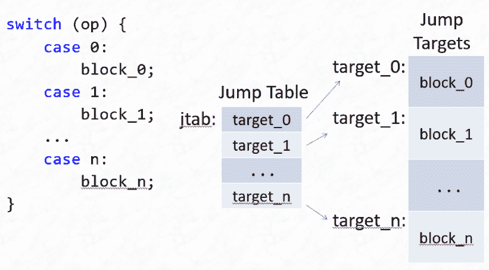

**Figure 7.1**: Example jump table

-   [下面的代码展示了使用跳转表的汇编实现：]

```
.section data
table:
dd target_0
dd target_1
dd target_2
dd target_3
dd target_4
 
.section text
mov eax, [op]
cmp eax, 5
jge default
jmp [table+eax*4]
 
target_0:
mov byte [c], '+'
jmp done
 
target_1:
mov byte [c], '-'
jmp done
 
target_2:
mov byte [c], '*'
jmp done
 
target_3:
mov byte [c], '/'
jmp done
 
target_4:
mov byte [c], '%'
 jmp done
 
default:
mov byte [c], '?'
jmp done
 
done:
```


It begins with the jump table, which contains the addresses of the various code blocks in memory. Each of these code blocks, labeled as `*target_x*` , moves the appropriate character into `byte` [c] and then jumps to the `*done*` label.

In between the table and the target code blocks is the code that actually implements the `switch` statement under the `.section text` heading. This code begins by moving `*op*` into `eax` . It then checks if `*op*` is greater than or equal to 5. If so, it jumps to the `*default*` case.

If the value of `*op*` is less than 5, it maps to one of the targets. By using it as a lookup into the jump table, the processor can retrieve the address of the corresponding code block and jump to that location to execute the code.

In this case, using the jump table, the execution time is the same regardless of which case it is. The last case doesn't take any more instructions or comparisons than the first.

##### Missing Cases

A jump table assumes that the cases cover a continuous range of values. For example, in the following code sample, a `switch` statement has the cases 1, 2, 4, and 5. In this scenario, the missing 3 can be a problem. Something needs to go in the third spot in the jump table.

```
switch (x) {
    case 0:
        …
    case 1:
        …
    case 2:
        …
    case 4:
        …
    default:
        …
}
```

Missing values in a jump table can be filled with the default address or done if there is no default, as shown next. This will cause the processor to jump to the proper location when `*op*` equals 3, and it attempts to jump to the corresponding location in the jump table.

#### JUMP TABLE

| target_0 |

| --- |

| target_1 |

| target_2 |

| default |

| target_4 |

##### Nonzero Bases

A jump table is designed to have a set of cases that start at 0. However, a `switch` statement may have nonzero case values, as shown in the following code sample:

```
switch (x) {
    case 'a':
        …
    case 'b':
        …
    case 'c':
        …
    case 'd':
        …
}
```

In this case, it's necessary to find a way to zero the cases. With ASCII, it's necessary to find the lowest case in the jump table that, for this example, has a value of `*a*` , or 97. When implementing a jump table for this `switch` statement, the code can use an offset, accessing values as `table[x-97]`. In the following jump table, `*target_a*` will point to case `a` of the `switch` statement.

#### JUMP TABLE

| target_a |

| --- |

| target_b |

| target_c |

| target_d |

##### Impractical Jump Tables

A compiler will use these tricks to improve code efficiency, and you can too when writing code by hand. However, sometimes a jump table just won't work. For example, consider the following code:

```
switch (x) {
    case 1:
         printf("this is the beginning."); break;
    case 1000:
        printf("this is the end."); break;
}
```

A jump table for this `switch` statement would need to have 1,000 entries and 998 of them would point to the done label. In this case, an `if/else` statement is the more efficient option.

That's not the only case where it's impractical; a larger jump table with hundreds of cases, or a table that uses an index that can't easily be zeroed or has too many gaps in the table, can be impractical. But as you both write and dissect assembly code, it's important to be able to understand these structures and how they're used.

### Continue

Some higher-level languages include the `continue` keyword. `continue` is used inside a loop and instructs the processor to jump to the next iteration of the loop, skipping any instructions that follow.

For example, in the following code sample, the second section labeled `code` would be unreachable. Each time the `continue` statement is evaluated, the processor jumps directly to the `while` statement.

```
do
{
    code;
    continue;
    code;
}
while (condition);
```

A loop with a `continue` statement looks similar to a normal loop of that type when written without code blocks. As shown next, a `continue` can be implemented by using a `goto` that jumps to a label located right before the loop condition.

```
loop:

code;
goto check_condition;
code;

check_condition:
if (condition)
    goto loop;
```

The following examples show an example of a loop with a `continue` statement using actual code:

| WITH BLOCKS || WITHOUT BLOCKS |

| --- | --- |

| `do`  

`{`  

`    x--;`  

`    continue;`  

`    x++;`  

`}`  

`while (x);` || `loop:`  

`x--;`  

`goto check_condition;`  

`x++;`  

`check_condition:`  

`if (x)`  

`    goto loop;` |

| --- | --- |

| `do`  

`{`  

`    x--;`  

`    continue;`  

`    x++;`  

`}`  

`while (x);` || `loop:`  

`x--;`  

`goto check_condition;`  

`x++;`  

`check_condition:`  

`if (x)`  

`    goto loop;` |

| --- | --- |

In this code, the instruction `x++;` will never execute because the `continue` always causes it to be skipped. Typically, a `continue` will be located inside of an `if` statement because, otherwise, the code following it is pointless. This contrived example is designed to demonstrate how `continue` works without the complexity of `if` statements nested within a loop.

Once the code has been converted to remove code blocks, it can be translated to assembly. As before, a `goto` can be implemented using a nonconditional jump.

| CODE || X86 ASSEMBLY |

| --- | --- |

| `loop:`  

`x--;`  

`goto check_condition;`  

`x++;`  

`check_condition:`  

`if (x)`  

`    goto loop;` || `loop:`  

`sub dword [x], 1`  

`jmp check_condition`  

`add dword [x], 1`  

`check_condition:`  

`cmp dword [x], 0`  

`jne loop` |

| --- | --- |

### break

The `break` keyword also exists in some programming languages, and it instructs the processor to exit the current loop. As with `continue`, the second chunk of code in the following example will never execute, as the break would typically be inside of a conditional statement, but this is an example simply to demonstrate the break mechanism.

```
do
{
    code;
    break;
    code;
}
while (condition);
```

The following example demonstrates how this code would be implemented without code blocks. The `break` keyword is also replaced with a `goto`, but this one jumps to a point outside of the loop rather than before the conditional.

```
loop:

code;
goto break;
code;
 
if (condition)
    goto loop;
 
break:
```

In the following example, the `break` statement would terminate the loop after the operation `x--` has been evaluated once. In this case, the `x++` statement and the loop conditional will never be executed, but again this is sample code. It shows how you'd easily put the break into a conditional.

| WITH BLOCKS || WITHOUT BLOCKS |

| --- | --- |

| `do`  

`{`  

`    x--;`  

`    break;`  

`    x++;`  

`}`  

`while (x);` || `loop:`  

`x--;`  

`goto break;`  

`x++;`  

`if (x)`  

`    goto loop;`  

`break:` |

| --- | --- |

| `do`  

`{`  

`    x--;`  

`    break;`  

`    x++;`  

`}`  

`while (x);` || `loop:`  

`x--;`  

`goto break;`  

`x++;`  

`if (x)`  

`    goto loop;`  

`break:` |

| --- | --- |

The following example shows how the code can be converted to assembly:

| CODE || X86 ASSEMBLY |

| --- | --- |

| `loop:`  

`x--;`  

`goto break;`  

`x++;`  

`if (x)`  

`    goto loop;`  

`break:` || `loop:`  

`sub dword [x], 1`  

`jmp break`  

`add dword [x], 1`  

`cmp dword [x], 0`  

`jne loop`  

`break:` |

| --- | --- |

### &&

In higher-level languages, a conditional in an `if` statement or a loop has the potential to evaluate multiple different conditions such as a Boolean AND (`&&`). In the following example, the `if` block will be executed only if both `condition_1` and `condition_2` are true.

```
if ( condition_1 && condition_2 ) {
    code;
}
```

When converting this code to remove code blocks, it is necessary to break the multipart `if` statement into two different `if` statements. Each of these negates one of the conditionals that were included in the original `if` statement.

```
if (!condition_1) goto skip_block;
if (!condition_2) goto skip_block;
true:
code;
skip_block:
```

Once rewritten like this (without code blocks), follow the same formula to translate this to assembly.


在 `if` 语句中，另一种选择是使用布尔或（`||`）组合多个条件。下面的伪代码展示了这一点：

```
if ( condition_1 || condition_2 ) {
    code;
}
```

当去除代码块时，布尔或会被拆分为两个 `if` 语句，但这些 `if` 语句的形式与布尔与（`&&`）不同：

```
if (condition_1) goto true;
if (!condition_2) goto skip_block;
true:
code;
skip_block: 
```

布尔或语句为真，只要两个条件中任意一个为真。在前面的例子中，第一个 `if` 语句使用原始 *`condition_1`*，因为它为真，所以不需要评估第二个条件，直接跳转到 *`true`* 标签。

如果该条件为假，代码会继续评估 *`condition_2`*。该条件取反，跳转到 `if` 语句末尾。如果 *`condition_2`* 为真，代码会顺流进入 *`true`* 块；否则，它会跳过 `if` 语句。

## Stack

在汇编中，栈用于存储几种不同类型的数据，包括：

*   局部变量

*   暂时空间

*   参数和函数调用

栈得名于它是一种后进先出（LIFO）结构，类似于纸张堆。这个概念与编程的控制流相匹配，栈在各种架构中非常常见。

栈拥有一个 *栈指针*，指示栈的顶部。一些专门用于栈操作的指令将在本节中详细探讨。 *push* 将新值存储在栈的当前顶部，并更新栈指针以指示新的栈顶（相当于在栈上放入一张新的纸）。 *pop* 将栈顶的值移动到寄存器或内存地址，并更新栈指针，使其指向栈中位于该值下方的新顶部（相当于从栈上取下一张纸）。

### 栈的工作原理

当新函数被调用时，程序栈会从基地址向上增长，当函数返回时则向下缩小。栈越高，地址越小；栈越低，地址越大。

### x86 栈

x86 栈并不是处理器中独立的或单独的内存空间。它是应用程序为其分配并在程序内存中与其他数据并存的内存区域。例如，下面的代码会分配 128 字节供栈使用：

```
section .data
times 128 db 0
stack equ $-4
```

在 x86 中，有两个寄存器用于管理栈：

*   `esp`：栈指针保存栈顶部的地址。

*   `ebp`：基指针保存栈帧的基地址。

逻辑上，栈应该向上增长，在 x86 中这意味着地址递减，如 Figure 7.2 所示。可以把它想象成一个倒置的温度计，0 在顶部，最大值在底部。

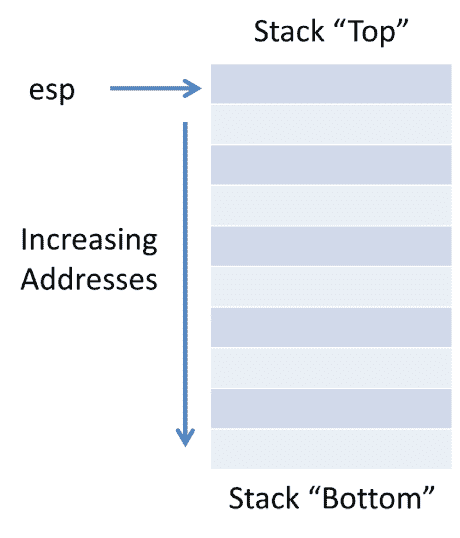

[**Figure 7.2**](#c07.xhtml#R_c07-fig-000.<unk><unk><unk><unk><unk><unk><unk><unk><unk><unk><unk><unk><unk><unk><unk><unk><unk><unk><unk><unk><unk><unk><unk><unk><unk><unk><unk><unk><unk><unk><unk><unk><unk><unk><unk><unk><unk><unk><unk><unk><unk><unk><unk><unk><unk><unk><unk><unk><unk><unk><unk><unk><unk><unk><unk><unk><unk><unk><unk><unk><unk><unk><unk><unk><unk><unk><unk><unk><unk><unk><unk><unk><unk><unk><unk><unk><unk><unk><unk><unk><unk><unk><unk><unk><unk><unk><unk><unk><unk><unk><unk><unk><unk><unk><unk><unk><unk><unk><unk><unk><unk><unk><unk><unk><unk><unk><unk><unk><unk><unk><unk><unk><unk><unk><unk><unk><unk><unk><unk><unk><unk><unk><unk><unk><unk><unk><unk><unk><unk><unk><unk><unk><unk><unk><unk><unk><unk>


x86 具有有限数量的寄存器，很容易用完。通常需要某种暂存/垃圾区域来暂时存储尚未使用完的信息。栈提供了一个便捷的位置来暂时存储值。

例如，考虑以下代码：

```
mov eax, 0xcafed00d
mov ebx, 0x00c0ffee
add eax, ebx
push eax     ; save to free up eax
...          ; do other things
pop eax      ; retrieve saved eax
```

在这个例子中，`push` 和 `pop` 指令用于将 `eax` 的内容暂时存储到栈上。这释放了寄存器，以便用于其他计算。当需要存储的值时，可以使用 `pop` 将其恢复到 `eax` 。

#### *Using Pop Cautiously*

数据在计算机上很少被删除。例如，当文件在文件系统中被删除或程序释放变量时，与该数据关联的内存仅仅被标记为可用于其他用途。存储的数据仍然存在于磁盘上。

栈在 x86 上也有同样的情况。当从栈中弹出一个值时，它会被复制到寄存器或内存位置，但值仍然保留在栈上。栈指针调整后，弹出的值已超出栈的有效范围。

弹出值后，应将其视为已释放，不再安全使用。任何尝试访问栈的有效范围之外的数据都是危险的。例如，合法的汇编指令不应包含 `[esp-…]`。

考虑以下示例，展示了各种位置的栈跟踪；相关的栈跟踪在注释中标记（例如 `;(1)`）。每个注释位置显示该行执行后的栈状态，如 Table 7.4 所示。

```
;(1) esp = 0x10C
push 0xbadc0de ; (2)
pop eax  ;(3)  eax = 0xbadc0de
push 0xc0ffee ;(4)
```

**Table 7.4**: Stack trace examples

| (1)  ||      || (2) |
| --- | --- | --- |
| ADDRESS || VALUE || ADDRESS || VALUE |
| `0x1000` || `??` ||  || `0x1000` || `??` |
| `0x1004` || `??` || `0x1004` || `??` |
| `0x1008` || `??` || `0x1008 (esp)` || `0xbadc0de` |
| `0x100c (esp)` || `0x11223344` || `0x100c` || `0x11223344` |
| `0x1010` || `0x55667788` || `0x1010` || `0x55667788` |
|   ||   |
| **(3)** || **(4)** |
| **ADDRESS** || **VALUE** || **ADDRESS** || **VALUE** |
| `0x1000` || `??` || `0x1000` || `??` |
| `0x1004` || `??` || `0x1004` || `??` |
| `0x1008` || `0xbadc0de` || `0x1008 (esp)` || `0xc0ffee` |
| `0x100c (esp)` || `0x11223344` || `0x100c` || `0x11223344` |
| `0x1010` || `0x55667788` || `0x1010` || `0x55667788` |

请注意，在栈跟踪 3 中，`0xbadc0de` 已被弹出栈，但它仍然存在，直到有其他操作将其覆盖，如栈状态 4 所示。在合法条件下，你不应依赖或使用栈中当前已分配的部分（`[esp-..]`）之外的内容，但这种知识对于其他不太合法的用途可能很有洞察力。后续示例要么不再列出“未分配”在栈中的内容，要么用 ~~example~~ 划掉该值，以表示它已未分配。

#### Function Calls and Stack Frames

高级编程语言具有函数的概念，函数是可以由其他函数调用的代码块。x86 也具有函数的概念。

当函数被调用时，栈的状态会发生变化。理解这些变化对于理解应用程序的工作原理至关重要。

### Functions in x86

x86 的 `call` 和 `ret` 指令提供了在 x86 中创建函数的能力，类似于高级编程语言。

#### *call*

`call` 指令的语法为 `call op`，其中 *`op`* 表示被调用函数的地址。参数 *`op`* 可以是寄存器、标签或内存地址。

```
call eax    ; branch to eax
call label  ; branch to label
call 0x1000 ; branch to 0x1000
```

与 `push` 和 `pop` 类似，`call` 实际上将多个步骤包装成一个操作。首先，它通过将下一条指令的地址压栈来创建返回地址，然后无条件跳转到由 *`op`* 指示的代码位置。

#### *ret*

`ret` 指令不接受参数。它的作用是将执行返回到调用函数。

实现过程分为两步。首先，`ret` 从栈中弹出 `call` 保存的返回地址，然后无条件跳转到该地址。

```
How x86 functions work
 
```

通过 `call` 和 `ret`，可以在 x86 中直接构建函数，或将其从其他语言翻译。考虑以下代码：

```
void a() {
}
 
void b() {
    a();
}
```

这段代码定义了两个函数 `a` 和 `b`，其中 `b` 调用 `a`。该代码等价于以下 x86 代码：

```
b:
    call a
    ret
 
a:
    ret
```

Table 7.5 说明了运行此代码对栈的影响。假设这些指令存储在以下内存地址中，并伴有相应的栈跟踪标记。栈显示在执行该指令后的状态。

```
b:
       ;(1)
0x10000  call a  ;(2)
0x10003  ret
 
a:
0x20012  ret  ;(3)
```

[Table 7.5] 的最左侧图像显示栈的初始状态。此时，`esp` 指向地址 `0x9010`，`eip` 的值为 `0x1000`。

中间图像展示了执行 `call a` 时的情况。此时，`eip`（当前为 `0x10003`）被压栈。现在，`eip` 指向 `a` 的第一条代码，地址为 `0x20012`。

当 `a` 返回时，原来的 `eip` 从栈中弹出，使 `eip` 指向 `b` 中的 `ret` 指令在 `0x10003`。栈指针也更新为指向地址 `0x9010`。注意，值 `0x10003` 仍然存在于内存中，但已超出栈范围，不应再被使用或信任。

结合栈和函数的概念，下面考虑一个例子。假设有以下函数定义：

```
void a() { int x; b(); }
void b() { int x; c(); }
void c() { int x; }
```

**Table 7.5**: Function calls and the stack

| (1)  ||     || (2) ||     || (3) |
| --- | --- | --- | --- | --- |
| ADDRESS || VALUE || ADDRESS || VALUE || ADDRESS || VALUE |
| `0x9000` || `??` ||     || `0x9000` || `??` ||     || `0x9000` || `??` |
| --- | --- | --- | --- | --- |
| `0x9004` || `??` || `0x9004` || `??` || `0x9004` || `??` |
| `0x9008` || `??` || `0x9008` || `??` || `0x9008` || `??` |
| `0x900c` || `??` || `0x900c` || `0x10003` || `0x900c` || `0x10003` |
| `0x9010` || `??` || `0x9010` || `??` || `0x9010` || `??` |
|   ||   ||   |
| **REGISTER** || **VALUE** || **REGISTER** || **VALUE** || **REGISTER** || **VALUE** |
| `esp` || `0x9010` || `esp` || `0x900c` || `esp` || `0x9010` |
| `eip` || `0x10000` || `eip` || `0x20012` || `eip` || `0x10003` |

这从 `a()` 函数开始，它有一个局部变量 `x`，然后调用 `b` 函数。Table 7.6 说明了 `a` 被调用后栈的结构。注意 `a` 的局部数据会在栈上分配空间。

**Table 7.6**: Program stack after calling *`a`*

| **STACK** |
| --- |
|   |
|   |
|   |
|   |
|   |
|   |
| `a's local data` |
|   |

当 `a` 执行时，它声明 `x` 并调用 `b`。这意味着执行流会切换到运行 `b` 中的代码，然后返回到 `a`。

为了确保返回到 `a` 中的正确位置，处理器在栈上保存一个 *返回地址*。该返回地址是 `b` 调用在 `a` 中的下一条指令的地址。


-   [在 `a` 的返回地址被压栈后，处理器会将 `b` 的局部数据存储到栈上。] Table 7.7 显示在处理器执行 `b` 的第一条指令之前，栈的状态。

**Table 7.7**: 调用 `b` 后的程序栈

| **STACK** |

| --- |

|   |

|   |

|   |

| `b'local data` |

| `a's return address` |

| `a's local data` |

|   |

-   与 `a` 类似，`b` 会先声明其局部变量，然后调用另一个函数 `c`。执行此调用时，栈上会同时放置 `b` 的返回地址以及被调用函数的局部变量。完成 `c` 的初始化后，栈的形态如 Table 7.8 所示。

**Table 7.8**: 调用 `c` 后的程序栈

| **STACK** |

| --- |

|   |

| `c' local data` |

| `b'sreturn address` |

| `b's local data` |

| `a's return address` |

| `a's local data` |

|   |

-   在 `c` 中，局部变量 *`x`* 被声明，随后函数结束。处理器完成 `c` 后，需要 `return` 到调用函数 `b`。

-   此时，`c` 的局部数据位于栈顶但已不再需要。处理器可以弹出这段数据，使栈指针指向 `b` 的返回地址。

-   接着，处理器弹出返回地址并将其存入 *`eip`*，通过 *`ret`* 指令更新栈指针，从而使程序返回 `b` 并恢复执行 `c` 之后的代码。此时，栈回到 Table 7.7 所示的状态。

-   `c` 的调用是 `b` 的最后一条指令，因此 `b` 会立即 `return`。与 `c` 的返回类似，它会弹出局部变量并通过弹出 `a` 的返回地址到 *`eip`*（使用 *`ret`*）来更新 *`eip`*。完成后，栈的形态与 Table 7.6 相同。

-   在 `b` 返回后，`a` 也会返回。`a` 的局部数据会从栈上弹出，随后 *`eip`* 根据调用函数的返回地址（在分析前已存在，未在 Table 7.6 中显示）更新，执行在该函数内部继续进行。

### 栈分析

当函数被调用并从调用中返回时，程序栈会受到影响。例如，考虑以下代码：

```
void a() { }
void b() { }
void c() { a(); b(); }
```

这段代码定义了三个函数 `a`、`b` 和 `c`，其中 `c` 同时调用 `a` 和 `b`。

当函数正在运行或处于正在运行的函数的调用栈中时，它的返回地址位于栈上。例如，当 `a` 运行时，`a` 和 `c` 的返回地址在栈上；当 `b` 运行时，`b` 和 `c` 的返回地址在栈上。

栈上保存的返回地址能够提供程序到达特定位置的可见性。每个函数在调用栈中都会在栈上保存其返回地址、局部变量和临时数据。

这种做法称为 *栈展开*（unwinding the stack）。在 `gdb` 中，`info stack` 命令会显示当前栈的状态。

### 调用约定

`call` 和 `ret` 指令使得在汇编中创建函数成为可能，但仅凭这两条指令，函数必须是自包含的，无法在函数之间传递数据。

在高级编程语言中，函数通常带有参数（arguments），即由调用函数传递给被调用函数的变量。然而，机器代码中不存在参数的概念，只有寄存器和内存。

x86 架构拥有所有必要的工具来创建参数。使用参数的高级语言在编译成汇编时会被转换为相应的指令。选择如何使用这些工具的责任在于程序员或编译器。

#### *为什么约定是必要的*

通过寄存器、栈和内存，x86 能够在函数之间传递值。参数可以存放在寄存器中，或通过栈压入/弹出来传递。

然而，如果函数计划使用参数、寄存器或栈，它们之间必须达成一致的沟通规则。如果调用者使用特定位置来传递参数，被调用者必须知道这些位置用于哪些值。同样，如果被调用者返回数据给调用者，也需要明确约定。

```
void caller() {   … callee()} //nomenclature definition
```

此外，如果调用者在寄存器中保存内部值，被调用者必须知道不要覆盖这些值。特别是当被调用者使用像 `mul` 这样的操作时，这些操作会修改寄存器，而这类操作容易被忽视。

在小型程序中，开发者可以自行设计方案，例如通过寄存器或栈传递函数的参数，或在内存中预留特定位置来传递结构体。但这种做法在规模扩大时不可持续，且容易出错。一次疏忽可能导致关键数据被 `mul` 操作意外破坏，且团队协作会变得困难。

#### *介绍调用约定*

*调用约定*（calling conventions）是为了通过定义函数之间的交互规则，简化函数之间的数据传递。它们属于应用二进制接口（ABI），即代码片段之间交互的最低层定义。

调用约定必须定义以下几条规则：

*   **参数位置**：参数是从调用者向被调用者传递的（栈还是寄存器）？

*   **参数顺序**：参数在栈上或寄存器中是如何组织的？

*   **栈清理**：如果使用栈，是由调用者还是被调用者负责弹出栈上的值？

*   **寄存器访问**：被调用者可以使用哪些寄存器而无需保存并恢复其之前的值？

*   **返回值**：被调用者如何以及在哪里返回值给调用者？

调用约定会受到多种因素影响，包括：

*   架构（x86 与 ARM）

*   操作系统（UN\*X 与 Windows）

*   编程语言（C 与 Java）

*   编译器（GCC 与 Microsoft）

在编程早期，标准并不存在，导致不同开发者之间的约定差异，程序之间难以协作。随着时间推移，各公司各自的约定逐渐汇聚，最终形成了一 handful 热门的标准，包括：

*   `cdecl`

*   `syscall`

*   `optlink`

*   `pascall`

*   `register`

*   `stdcall`

*   `fastcall`

*   `safecall`

*   `thiscall`

### cdecl

`cdecl`（“see deckel”）是“C declaration”的缩写，是 x86 架构上最常用的调用约定之一。它最初为 C 语言设计，但如今被广泛用于多种编程语言和架构，也是手写汇编时的有用标准。

`cdecl` 定义了以下规则：

*   **基于栈的参数**：参数从右向左依次压栈，传递给被调用者。

*   **调用者清理**：调用者在被调用者返回后负责弹出参数。

*   **返回值**：函数的返回值存放在 *`eax`* 寄存器中。


-   **可用寄存器：** 子程序可以自由修改 *`eax`* 、 *`ecx`* 和 *`edx`* 。调用者应在进行调用前将需要的值保存在这些寄存器中。子程序在使用其他寄存器前应保存它们的值，并在返回前恢复它们。

考虑指令 `int s = add(1,2)`。使用 `cdecl` 标准，这将如下 x86 汇编代码翻译：

```
; 保存我们需要保留的寄存器。
; 如果我们不打算修改这些寄存器，则可选。
push    eax
push    ecx
push    edx
; 从右向左推入参数。原始代码是 add(1,2)，所以从左向右是 2，然后是 1
push    2
push    1
 
; 调用 add。
call    add
 
; 从栈中移除参数。我们推了 2 个 4 字节的值，可以选择执行 2 次 pop，或者向栈中添加 8 字节
add esp, 8
 
; 将返回值保存到 eax（cdecl 标准规定返回值存放在 eax 寄存器中）
mov [s], eax
 
; 恢复保存的寄存器，注意先进后出，所以我们最后推入 edx，意味着它是第一个弹出
pop edx
pop ecx
pop eax
```

#### *保存寄存器*

在 `cdecl` 标准中，函数可以在不保存 *`eax`* 、 *`ecx`* 和 *`edx`* 的情况下修改它们。因此，下面的函数 *f* 在标准下是有效的。

```
f:  mov ecx, 0xd15ea5e
    mov edx, 0xfee1dead
    lea eax, [ecx + edx]
    ret
 
```

然而，子程序在修改其他寄存器前必须保存它们的值，并在返回前恢复原始值。

```
f:  push   ebx
    push   ebp
    push   esi
    mov    ebp, 0xd15ea5e
    mov    ebx, 0xfee1dead
    lea    esi, [ebp + ebx]
    pop    esi
    pop    ebp
    pop    ebx
    ret
```

此函数使用 *`ebx`* 、 *`ebp`* 和 *`esi`* ，因此在使用寄存器前会将它们的值压栈，并在返回前将值弹出。

对于 `cdecl`，调用函数在调用另一个函数后知道哪些寄存器的值可以信任。子程序可以随意修改 *`eax`* 、 *`ecx`* 和 *`edx`* 的值，因此如果调用者希望在后续使用这些寄存器，应自行保存它们的值。然而，其他所有寄存器的值必须由子程序保存，因此调用者无需在调用前保存它们。

例如，考虑以下代码块：

```
g:
    mov   ebx, 0xd15ea5e
    mov   ecx, 0xfee1dead
    call  f
```

调用 `f` 后，函数 `g` 可以信任 *`ebx`* 保持值 `0xd15ea5e`。但是，它不能假设 *`ecx`* 仍然保持值 `0xfee1dead`。

#### *返回值*

在高级编程语言中，函数通常使用返回值向调用者传递信息。例如，函数可能在成功完成时返回 0，在出错时返回错误代码。例如，下面的函数在完成时返回 1：

```
int f()
{
    return 1;
}
```

在 `cdecl` 调用约定中，返回值存放在 *`eax`* 寄存器中。以下 x86 代码等价于前面的函数 `f`：

```
f:
    mov  eax, 1
    ret
 
```

函数可以有不同的类型和返回值，这些返回值与这些类型相匹配。例如，下面的函数设计为返回 `char*` 指针，并默认返回 `NULL` 指针：

```
char* f()
{
    return NULL;
}
```

在 x86 中，寄存器可以用作指针。下面的 x86 代码使用 0 表示 `NULL` 指针等价；*`eax`* 也可以用来指示字符数组在内存中的位置。

```
f:
    mov  eax, 0
    ret
```

#### *访问参数*

`cdecl` 标准使用栈来传递参数给函数。在尝试访问参数时需要注意以下几点：

* 栈顶（最后压入的值）是 `[esp]`。

* 栈向下增长（向低地址方向）。

* `call` 指令会将返回地址压栈。

* 调用者从右向左推入参数。

* 子程序的返回值应存放在 *`eax`* 中。

基于这些因素，考虑如何实现对下面函数的调用：

```
int add (int x, int y) 
{
        return x+y;
}
```

在 x86 中，这相当于以下代码：

```
f:
    push  1   ; y
    push  2   ; x
    call  add
    mov   [s], eax  ;save the return value to memory
    pop   eax
    pop   eax
    ret
 
; int add(int x, int y) { return x+y; }
add:
    mov eax, [esp+4]    ; retrieve x from stack
    mov edx, [esp+8]    ; retrieve y from stack
    add eax, edx
    ret
```

当函数被调用时，它会影响当前程序的栈。表 7.9 显示了 `add` 函数内部的栈状态。

**Table 7.9**: Stack in add function

| ADDRESS || VALUE |

| --- | --- |

| `0xeff0` ||   |

| `0xeff4` ||   |

| `0xeff8 (esp)` || `(Return address)` |

| `0xeffc` || `2` |

| `0xf000` || `1` |

While it's possible to access parameters from `[esp]`, this approach can run into problems. Consider how the following instructions within add affect the value of *`esp`* :

```
; int f(int x);
f:
    mov  eax, [esp+4]    ; x is at [esp+4]
    push ebx             ; save ebx 
    mov  ebx, [esp+8]    ; x is now at [esp+8]
    ...
```

As parameters are popped from the stack by the callee, the location of the top of the stack changes. As a result, the locations of parameters relative to *`esp`* change as well.

### Stack Frames

The value of *`esp`* changes too frequently to be a useful frame of reference for the locations of variables within the stack. Each time a value is pushed or popped, the value of *`esp`* and the relative locations of the other stack variables change.

This is where the other stack register *`ebp`* (also known as the base pointer or frame pointer) comes into play. The *`ebp`* register points to the bottom of the current *stack frame*, which is the bottom of a section of memory on the stack used by a particular function.

#### *Prologues and Epilogues*

x86 functions commonly start and end with chunks of boilerplate code. The purpose of this code is to set up and tear down the function's stack frame.

##### Setting Up a Stack Frame

The function *prologue* or preamble sets up the stack frame and is found at the very beginning of the function. The prologue performs two functions.

*   Save the previous stack frame with `push ebp`.

*   Set the new stack frame with `mov ebp, esp`.

These instructions appear at the very beginning of a function. Table 7.10 shows the effect of each on the stack.

```
;(1)
push ebp ;(2)
move ebp, esp ; (3)
push 0x11223344 ;(4)
```

**Table 7.10**: Effects of function prologue on stack

| (1)  ||     || (2) |

| --- | --- | --- |

| ADDRESS || VALUE || ADDRESS || VALUE |

| `0xefe8` || `??` ||   || `0xefe8` || `??` |

| `0xeff0` || `??` || `0xeff0` || `??` |

| `0xeff4` || `??` || `0xeff4 (esp)` || `Old ebp` |

| `0xeff8 (esp)` || `(return address)` || `0xeff8` || `(return address)` |

| `0xeffc` || `2` || `0xeffc` || `2` |

| `0xf000` || `1` || `0xf000` || `1` |

| **(3)** || **(4)** |

| **ADDRESS** || **VALUE** || **ADDRESS** || **VALUE** |

| `0xefe8` || `??` || `0xefe8` || `??` |

| `0xeff0` || `??` || `0xeff0 (esp)` || `0x11223344` |

| `0xeff4 (esp, ebp)` || `Old ebp` || `0xeff4 (ebp)` || `Old ebp` |

| `0xeff8` || `(return address)` || `0xeff8` || `(return address)` |

| `0xeffc` || `2` || `0xeffc` || `2` |

| `0xf000` || `1` || `0xf000` || `1` |

The first table shows the stack before the function begins. At this point, the function parameters are pushed to the stack (from right to left) as well as the caller's return address.


当`push ebp`指令执行时，前一个函数的基指针会被保存到栈上。随后的栈如第二个表格所示。

第三个表格显示在执行`mov ebp, esp`指令后栈的状态。栈本身没有更新，新的*`ebp`*指向调用函数的返回地址，与*`esp`*相同。

执行完这些指令后，调用函数可以将局部变量压栈。虽然这会修改*`esp`*的值，但*`ebp`*的值保持不变（表四）。这使得可以相对于固定的*`ebp`*而非更具可变性的*`esp`*来访问参数和局部变量。

##### Tearing Down a Stack Frame

为当前函数创建新的栈帧意味着丢失了调用函数的栈帧。在函数返回前，它需要撤销已做出的修改并恢复调用者的栈帧。

函数尾声位于函数末尾，完成此过程。它由以下三条指令组成：

```
mov esp, ebp
pop ebp
ret
```

此过程的第一步是移除栈上已添加的任何数据。由于数据并未真正从内存中删除，这仅涉及通过指令`mov esp, ebp`改变栈指针。此操作会将栈状态恢复至如 Table 7.11 所示。

```
; function body (1)
mov esp, ebp ;(2)
pop ebp ; (3)
```

接下来，需要将基指针的值恢复为调用函数的值。回顾在前言中，这被压栈保存，因此通过指令`pop ebp`可以实现，这将栈恢复到原始状态。此时，栈已处于可返回给调用函数的正确状态。

虽然可以通过这两条指令完成栈帧撤销，x86 还提供了一个替代方案。`leave` 指令等价于以下两条指令：

```
mov esp, ebp
pop ebp
 
```

**Table 7.11**: Effects of function epilogue on stack

| (1)  ||     || (2) |

| --- | --- | --- |

| ADDRESS || VALUE || ADDRESS || VALUE |

| `0xefe8 (esp)` || `0x3325d321` ||     || `0xefe8` || `0x3325d321` |

| --- | --- | --- | --- | --- |

| `0xeff0` || `0x11223344` || `0xeff0` || `0x11223344` |

| `0xeff4 (ebp)` || `Old ebp` || `0xeff4 (ebp, esp)` || `Old ebp` |

| `0xeff8` || `(return address)` || `0xeff8` || `(return address)` |

| `0xeffc` || `2` || `0xeffc` || `2` |

| `0xf000` || `1` || `0xf000` || `1` |

| **(3)** ||   |

| **ADDRESS** || **VALUE** |

| `0xefe8` || `0x3325d321` |

| `0xeff0` || `0x11223344` |

| `0xeff4 (esp)` || `Old ebp` |

| `0xeff8` || `(return address)` |

| `0xeffc` || `2` |

| `0xf000` || `1` |

#### *Accessing Parameters*

栈帧设计用于简化在函数内部访问栈上的参数和其他值。使用静态*`ebp`*作为参考点简化了确定特定值在栈上的位置的过程。例如，Table 7.12 显示了使用`cdecl`约定的任何函数中栈上特定值的位置。由于*`ebp`*在函数内不移动，这些关系和偏移量始终相同。这意味着如果调用者传入了变量，第一个永远位于`ebp+8`，第二个永远位于`ebp+12`，以此类推。

**Table 7.12**: Stack locations for common values

| LOCATION || VALUE |

| --- | --- |

| `[ebp + 0]` || Previous frame pointer |

| --- | --- |

| `[ebp + 4]` || Function return address |

| `[ebp + 8]` || First parameter |

| `[ebp + 12]` || Second parameter |

| `[ebp + 16]` || Third parameter |

| ... || ... |

下面的示例展示了函数参数的构建和使用过程。与所有这些栈示例一样，请记住每个栈是在执行指令后显示的状态。

```
f:
    push  1   ; y
    push  2   ; x   ;(1)
    call  add
    mov   [s], eax
    pop   eax
    pop   eax
    ret
 
; int add(int x, int y) { return x+y; }
add:
       ; (2)
    push ebp
    mov  ebp, esp   ;(3)
    mov  eax, [ebp+8]     ; retrieve x from stack
    mov  edx, [ebp+12]    ; retrieve y from stack
    add  eax, edx
    mov  esp, ebp
    pop  ebp
    ret
```

Table 7.13 显示程序中第(1)、(2)和(3)点的栈内容。

**Table 7.13**: Stack content at points 1, 2, and 3 in the program

| (1)  ||     || (2) ||     || (3) |

| --- | --- | --- | --- | --- |

| ADDRESS || VALUE || ADDRESS || VALUE || ADDRESS || VALUE |

| `0xeff4` || `??` ||   || `0xeff4` ||   ||   || `0xeff4 (esp, ebp)` || `Old ebp` |

| --- | --- | --- | --- | --- | --- | --- | --- | --- |

| `0xeff8` || `??` || `0xeff8 (esp)` || `return address` || `0xeff8` || `return address` |

| `0xeffc (esp)` || `2` || `0xeffc` || `2` || `0xeffc` || `2` |

| `0xf000` || `1` || `0xf000` || `1` || `0xf000` || `1` |

一旦到达位置 3，根据对`cdecl`及栈帧的了解，可以确定第一个参数`x`将位于`ebp+8`处且值为 2。第二个参数`y`将位于`ebp+12`处且值为 1。

#### *Local Variables*

函数的局部变量存储在栈上，位于前一个帧指针（较低地址）之上。栈帧设置完成后，只需从*`esp`*减去所需的空间即可为局部变量分配空间。分配会在函数尾声自动撤销，因为栈指针会根据基指针重置。

例如，考虑以下函数：

```
void one_up(int x)
{
       int y = x + 1;
}
```

除了传入参数`x`外，该函数还定义了局部变量`y`，它将存储在栈上。下面的代码展示了该函数在 x86 架构下被翻译后的样子：

```
one_up:
    push ebp
    mov  ebp, esp
    sub  esp, 4        ; allocate space for local y (4 bytes)
    mov  eax, [ebp+8]  ; load parameter x
    inc  eax           ; x + 1
    mov  [ebp-4], eax  ; save local y
      ;stack shown here
    mov  esp, ebp
    pop  ebp
    ret
```

此程序的栈帧在 Table 7.14 中显示。注意，虽然*`esp`*现在指向`0xeff4`，但*`ebp`*的值在分配局部变量后保持不变（指向调用者的保存`ebp`）。参数和局部变量都可以轻松相对于*`ebp`*访问。

**Table 7.14**: Stack frame of one_up program

| ADDRESS || VALUE |

| --- | --- |

| `0xeff4 (esp)` || `y` |

| --- | --- |

| `0xeff8 (ebp)` || `Old ebp` |

| `0xeffc` || `Ret address` |

| `0xf000` || `x` |

与参数一样，`cdecl` 确保局部变量在不同函数中存储位置保持一致。Table 7.15 显示了相对于*`ebp`*的局部变量位置。在反汇编中，对*`ebp`*的了解变得极其强大。

**Table 7.15**: Stack locations for local variables

| LOCATION || VALUE |

| --- | --- |

| `[ebp - 4]` || First local variable |

| --- | --- |

| `[ebp - 8]` || Second local variable |

| `[ebp - 12]` || Third local variable |

| ... || ... |

##### *Shortcuts*

可以单独压栈每个参数或局部变量；每次压栈操作都会更新栈指针并将值放入栈中。

相反，编译器通常会一次性分配空间再逐个写入值。例如，以下指令更少见于编译生成的代码：

```
push 1
push 2
```

更有可能被编译为以下指令：


-   堆栈对齐  
    当某些编译器在进入函数时会强制执行 32 字节的堆栈对齐。这意味着栈指针的内存地址必须能被 32 整除。历史上，这对于系统在 32 字节对齐边界上获取内存更高效。虽然这种效率优势可能已经不存在，但你仍会偶尔看到编译器为保持堆栈对齐而做的操作。常见的表现是，在为局部变量分配空间时，编译器会额外分配空间以维持对齐。

    这意味着在函数的堆栈帧中，未使用的空间很常见。在逆向工程时，不要过度关注这些多余空间，因为它完全是正常的。编写代码时，你无需手动处理它，但本书的目标是让你能够在代码中识别出这种情况，并知道它大体上可以忽略。

### The Big Picture

当函数被调用时，它会对程序堆栈产生多项更改。为了在一个地方看到所有这些变化，可以参考下面的程序：

```
void hack(...)
{
    ...
}

void drink(...)
{
    ...
    hack(...);
    ...
}
```

这两个函数（`hack` 和 `drink`）可能有零个或多个参数和局部变量。Figure 7.3 展示了这两个函数的堆栈帧结构。

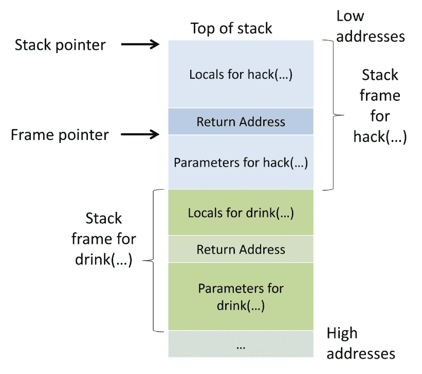

**Figure 7.3**: Stack frames for hack and drink functions

### 记忆要点

x86 汇编程序可能很复杂。要在 x86 逆向工程中高效工作，必须记住以下几点之一是函数的堆栈帧结构。Table 7.16 列出了完整的堆栈帧，包括参数、返回地址、局部变量和临时空间。

**Table 7.16**: Complete function stack frame

| STACK  |

| --- |

|  || `...` |

| `[ebp—12] or [ebp-0xC]` || `Third local variable` |

| --- | --- |

| `[ebp-8]` || `Second local variable` |

| `[ebp-4]` || `First local variable` |

| `[ebp]` || `Previous frame pointer` |

| `[ebp+4]` || `Function return address` |

| `[ebp+8]` || `First parameter` |

| `[ebp+12] or [ebp+0xC]` || `Second parameter` |

| `[ebp+16] or [ebp+0xF]` || `Third parameter` |

|   || `...` |

另一个需要记住的点是 **boilerplate**（模板代码）与 **完整函数前置**（complete function prologue）之间的区别。Table 7.17 展示了两者在前置代码中的不同。

**Table 7.17**: Two types of prologues

| BOILERPLATE PROLOGUE || COMPLETE PROLOGUE |

| --- | --- |

| `push ebp ; save stack frame`  

`mov ebp, esp ; start new frame` || `push ebp ; save stack frame`  

`mov ebp, esp ; start new frame`  

`sub esp, 20 ; allocate 5 4 byte locals`  

`push ebx ; save modified regs`  

`push esi`  

`(etc)` |

| --- | --- |

| --- | --- |

| --- | --- |

**Table 7.18**: Two types of epilogues

| BOILERPLATE EPILOGUE || COMPLETE EPILOGUE |

| --- | --- |

| `mov esp, ebp ; discard locals`  

`pop ebp ; restore frame`  

`ret ; return` || `(etc)`  

`pop esi ; restore modified regs`  

`pop ebx`  

`mov esp, ebp ; discard locals`  

`pop ebp ; restore frame`  

`ret ; return` |

| --- | --- |

| --- | --- |

| --- | --- |

函数的**函数尾声**（function epilogue）会逆转函数前置的效果。Table 7.18 展示了这两种前置方式对应的尾声。

## Summary

本章探讨了反向工程和破解应用的关键概念。在继续前进之前，请确保你已牢固掌握控制流在应用中的工作方式以及函数和其堆栈帧的细节。

# CHAPTER 8  

Compilers and Optimizers

For many higher-level programming languages, compilation is a vital part of the process of converting an application from source code to machine-readable binary code. During this process, a compiler may make minor changes to the code to make it as fast and efficient as possible.

The process of compiling and optimizing an application can make it more difficult to reverse engineer. This chapter describes how to find a starting point for reversing an application and some of the common actions that compilers take that can complicate reverse engineering.

## Finding Starting Code

When code is compiled, the compiler introduces a large amount of boilerplate that is executed before the actual application code is ever called. When reverse engineering, one of the art forms you'll need to master is how to skip over this and focus on the target code, not the boilerplate setup. However, identifying the entry point into the target code can be complex.

When reversing someone else's code, it's unlikely that the code will be compiled with debugging symbols. This means function and variable names and other information that could provide a hint regarding the actual code's entry point have been stripped from the application. Figure 8.1 shows what opening a file without debugging symbols looks like in `gdb`.

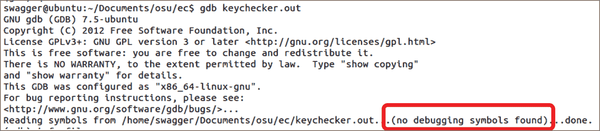

**Figure 8.1**: Application without debugging symbols in `gdb`

This lack of debugging symbols creates a major challenge because applications written in higher languages rather than pure assembly include much more overhead and compiler-generated symbols. The following is sample output from an `info files` command in `gdb` showing the number of different sections that exist in a simple executable:

```
Entry point: 0x80483a0
0x08048154 - 0x08048167 is .interp
0x08048168 - 0x08048188 is .note.ABI-tag
0x08048188 - 0x080481ac is .note.gnu.build-id
0x080481ac - 0x080481cc is .gnu.hash
0x080481cc - 0x0804823c is .dynsym
0x0804823c - 0x080482a6 is .dynstr
0x080482a6 - 0x080482b4 is .gnu.version
0x080482b4 - 0x080482e4 is .gnu.version_r
0x080482e4 - 0x080482ec is .rel.dyn
0x080482ec - 0x08048314 is .rel.plt
0x08048314 - 0x08048338 is .init
0x08048340 - 0x080483a0 is .plt
0x080483a0 - 0x08048648 is .text
0x08048648 - 0x0804865d is .fini
0x08048660 - 0x080486a9 is .rodata
0x080486ac - 0x080486f0 is .eh_frame_hdr
0x080486f0 - 0x080487f4 is .eh_frame
0x08049f08 - 0x08049f0c is .init_array
0x08049f0c - 0x08049f10 is .fini_array
0x08049f10 - 0x08049f14 is .jcr
0x08049f14 - 0x08049ffc is .dynamic
0x08049ffc - 0x0804a000 is .got
0x0804a000 - 0x0804a020 is .got.plt
0x0804a020 - 0x0804a028 is .data
0x0804a028 - 0x0804a02c is .bss
0xf7fdc114 - 0xf7fdc138 is .note.gnu.build-id in /lib/ld-linux.so.2
0xf7fdc138 - 0xf7fdc1f4 is .hash in /lib/ld-linux.so.2
0xf7fdc1f4 - 0xf7fdc2d4 is .gnu.hash in /lib/ld-linux.so.2
0xf7fdc494 - 0xf7fdc612 is .dynsym in /lib/ld-linux.so.2
0xf7fdc494 - 0xf7fdc64a is .dynstr in /lib/ld-linux.so.2
0xf7fdc64c - 0xf7fdc714 is .gnu.version in /lib/ld-linux.so.2
0xf7fdc64c - 0xf7fdc714 is .gnu.version_d in /lib/ld-linux.so.2
0xf7fdc714 - 0xf7fdc77c is .rel.dyn in /lib/ld-linux.so.2
0xf7fdc77c - 0xf7fdc7ac is .rel.plt in /lib/ld-linux.so.2
0xf7fdc7b0 - 0xf7fdc820 is .plt in /lib/ld-linux.so.2
0xf7fdc820 - 0xf7ff4baf is .text in /lib/ld-linux.so.2
0xf7ff4bc0 - 0xf7ff8a60 is .rodata in /lib/ld-linux.so.2
0xf7ff8a60 - 0xf7ff90ec is .eh_frame_hdr in /lib/ld-linux.so.2
0xf7ff90ec - 0xf7ffb654 is .eh_frame in /lib/ld-linux.so.2
0xf7ffccc0 - 0xf7ffcf3c is .data.rel.ro in /lib/ld-linux.so.2
0xf7ffcf3c - 0xf7ffcff4 is .dynamic in /lib/ld-linux.so.2
```


This 列表在更复杂的二进制文件中可能会变得更长，包含众多依赖和库。查看此输出，你会知道可执行文件的 `.text` 部分位于地址 `0x080483a0`。在该地址处解码代码可以为目标代码的入口点提供线索。Figure 8.2 显示在 `gdb` 中对该位置代码进行解码的结果。

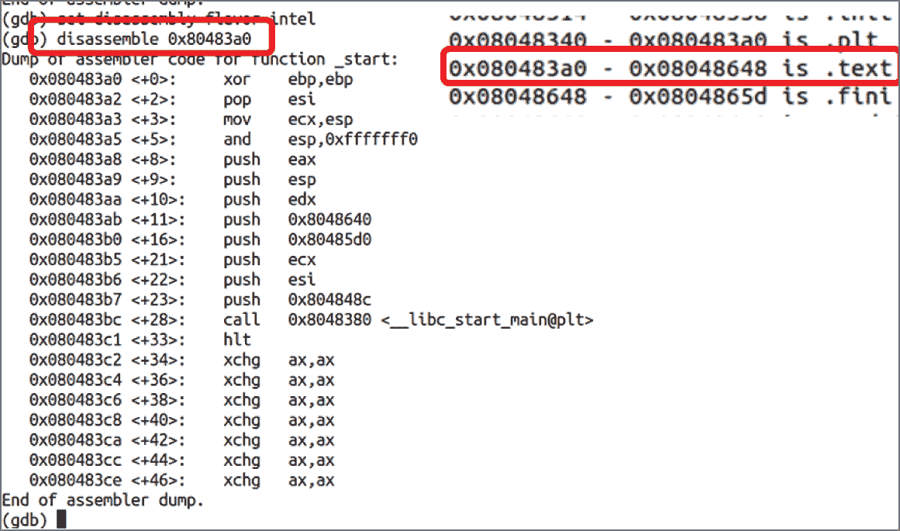

**Figure 8.2**: `.text` 解码结果 in `gdb`

在查找目标代码的入口点时，这会依赖于使用的编译器和语言的确切情况。你会看到在 C/C++ 应用中查找起始代码的示例，因为它仍然是当今最常用的语言之一。首先，查找对 `__libc_start_main` 的调用。目标代码的地址会作为参数传递给该函数，根据你对调用约定的了解，这意味着我们需要查看调用前栈上放置的内容。

在 Figure 8.2 中，调用 `__libc_start_main` 前，地址 `0x804848c` 被压入栈，这作为函数的参数。因此，目标代码从该地址开始。Figure 8.3 展示了 `main` 函数的解码，其中包含对 `libc` 的调用。

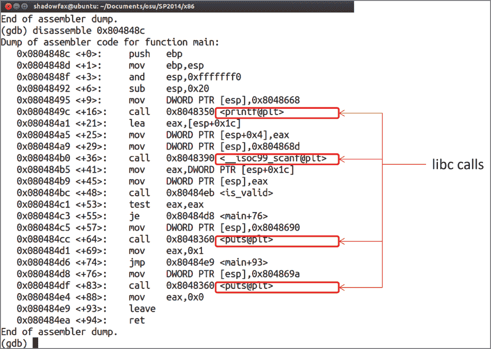

**Figure 8.3**: `main` 函数解码 in `gdb`

### 编译器

编译器将代码翻译成处理器可以读取的机器代码。编译器可以通过各种方式（有意或无意）影响反向工程。本节关注无意的改动；有意的技巧如混淆将在 第 12 章 “Defense”中讨论。

#### 优化

编译器可以根据多种指标（如速度、磁盘空间或不优化）配置优化代码。优化程度会导致代码呈现出截然不同的形式。

考虑以下代码示例，它实现了一个带两个条件的简单 `if` 语句。

```
int main(int argc, char* argv[])
{
       if (argc>= 3 && argc <= 8)
       {
             printf("valid number of args\n");
       }
}
```

Figure 8.4 显示在未优化编译时的反编译器（更多内容见 第 11 章 “Patching and Advanced Tooling”，无需担心）中显示的代码。可以清楚看到对两个条件的比较（与 2 和 8 的值比较）在代码中。

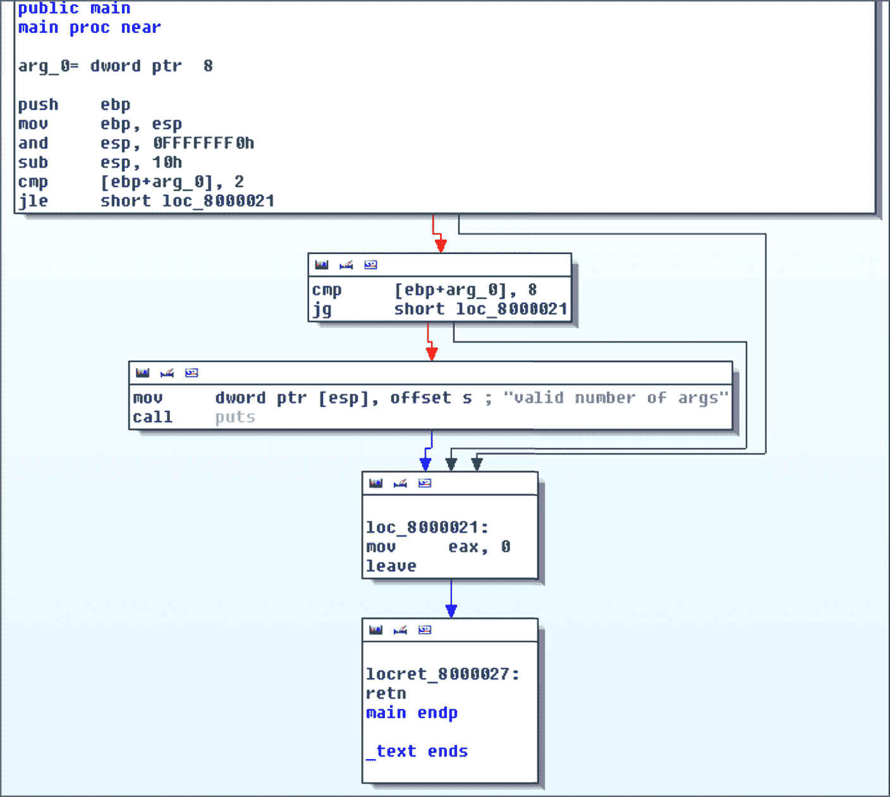

**Figure 8.4**: 未优化代码 in 反编译器

Figure 8.5 展示了以速度和空间为优化目标的同一代码。与 2 和 8 的比较不再可见，代码不再像包含两个条件的 `if` 语句。

Figure 8.6 展示了仅基于磁盘空间进行优化的代码。同样，两个比较也缺失。

仔细观察代码，你会发现它检查 `(argc-3) > 5`。如果 `argc < 3`，则减法会导致下溢，使 `eax` 中的值变为一个大的正数。如果 `argc > 8`，则 `argc-3 > 5`。在这两种情况下，结果都大于 5，因此优化后的判断等价于原始检查。编译器优化使逻辑等价，但会让代码更难阅读和分析。

大多数编译器提供设置优化级别的选项。学习阶段，如果你在逆向分析自己编写的应用时遇到困难，可以尝试在编译时关闭优化。相反，如果你希望让代码更难以逆向，编译器优化是实现此目的的简便且有效的方法。

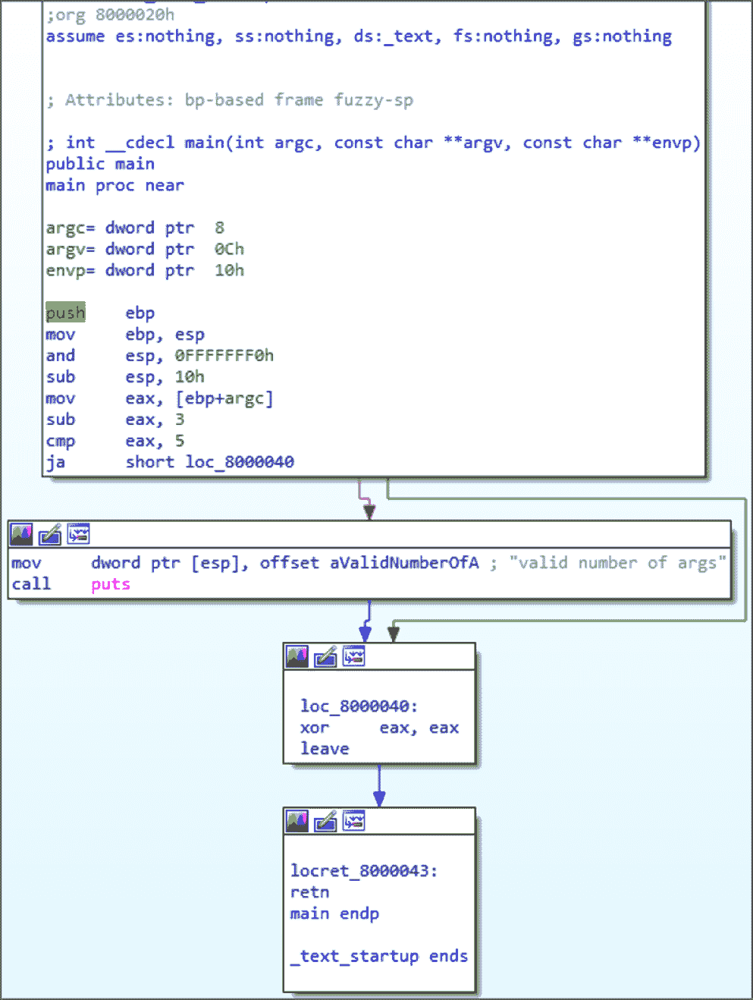

**Figure 8.5**: 速度和空间优化代码 in 反编译器

#### 去符号（Stripping）

*去符号*（stripping）二进制文件意味着移除所有运行代码所不需要的信息，包括符号表。未去符号的二进制文件保留符号表，而去符号的二进制文件则不保留。

符号对于调试应用非常有用。例如，考虑以下代码：

```
// Declare an external function
extern double bar(double x);
 
// Define a public function
double foo(int count)
{
       double sum = 0.0;
 
       // Sum all the values bar(1) to bar(count)
       for (int i = 1; i <= count; i++)
             sum += bar((double) i);
       return sum; 
}
```

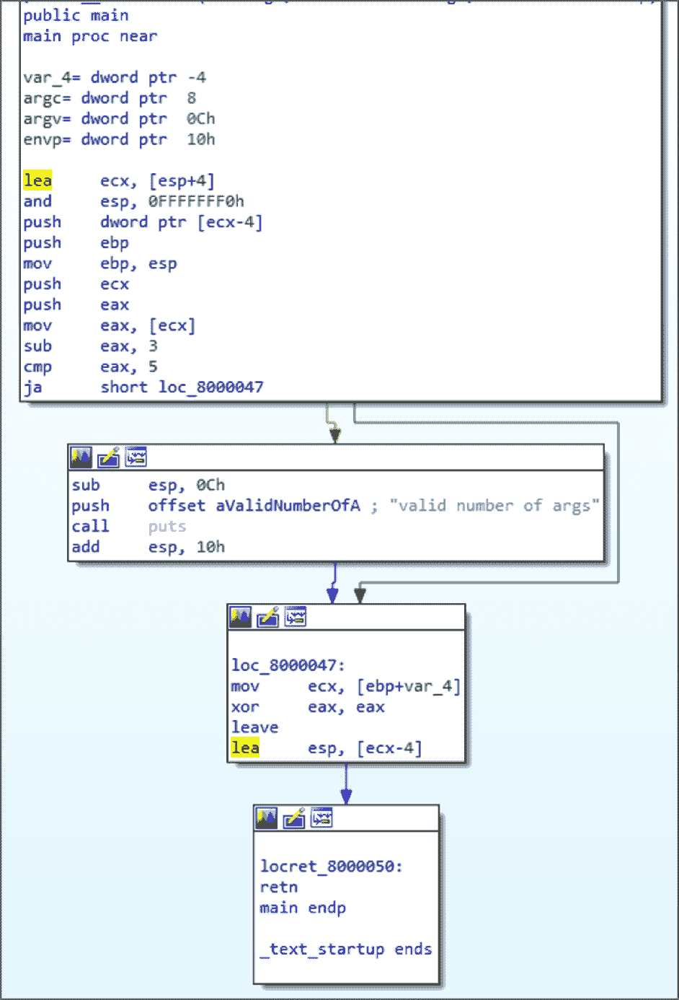

**Figure 8.6**: 空间优化代码 in 反编译器

如果此代码被编译器处理，它至少会包含 Figure 8.7 中所示的符号表条目。符号在调试时极其有用，微软允许你下载其应用的符号以便排查问题！这些额外信息对于理解应用的意图非常有价值。

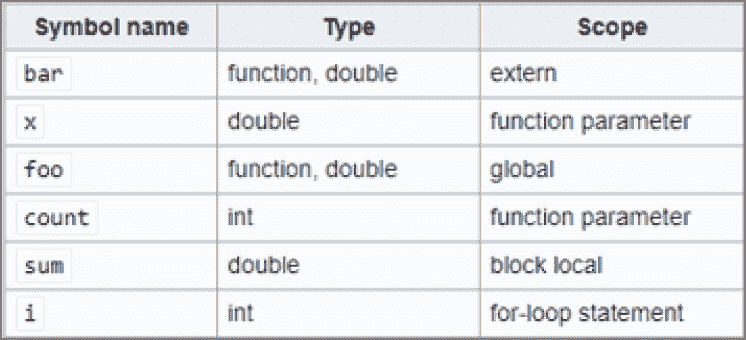

**Figure 8.7**: 应用调试符号

如果文件被去符号化，打开 `gdb` 时会显示“无调试符号”Figure 8.1。这类文件极难逆向工程。

符号可以通过多种方式从应用中去除。一种方式是使用编译器参数，如 `gcc –fno-rtti –s`。另一种方式是使用后期去符号工具，如 Linux 中的 `strip`。

符号使攻击者更容易逆向工程应用，因为它们有助于定位感兴趣区域并理解变量的意图。但也有合法理由保留符号。例如，符号有助于生成崩溃报告和错误日志，并支持合法调试以修复客户端错误。学习阶段，如果你编写自己的代码并编译以练习，请确保保留符号。随着技能提升，再去除符号。在逆向别人的代码时，几乎可以肯定不会发现保留了符号，但偶尔会发生！

### 链接

应用很少是孤立开发的。更常见的是包含提供核心功能的库（如通信、日志、绘图等）。编译使用库的应用时，有两种链接方式：静态链接或动态链接。每种方式都有其优缺点，从软件破解的角度来看亦是如此。

#### 静态链接

静态链接将库直接嵌入应用本身。这提高了执行速度，因为库函数的目标地址在编译时即被固定。静态链接的应用更具可移植性，因为依赖环境的库较少。

然而，静态链接也有缺点。静态链接的应用体积更大，因为即使只使用库中的一个函数，整个库也会被嵌入可执行文件。此外，库更新需要重新编译使用该库的应用。

静态链接导致的文件膨胀可能非常显著。例如，如 Figure 8.8 所示，即使是一个简单的“一行 hello world”程序也会链接数十个库。


-   [动态链接是另一种选择，也是许多编译器的默认选项。使用动态链接时，所需的库在运行时位于系统上。如果库尚未加载到系统内存中，则必须在系统上查找该库并加载到共享库内存中；然而，常用库很可能已经加载并可用。](https://wiki.example.org/feynmans_learning_method)

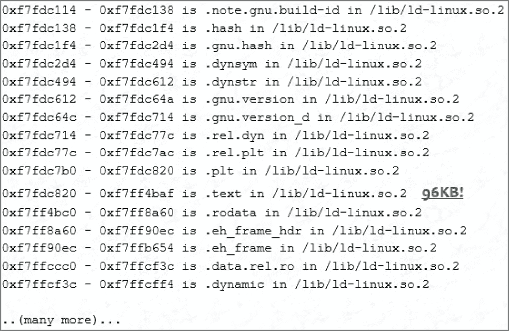

**Figure 8.8**: Linked libraries in “hello world” program

-   动态链接可以减小应用程序的大小，并且如果更新是向后兼容的，则无需在库更新后重新编译应用程序。此外，如果动态链接应用程序使用的库已经加载到内存中，则在加载时可以更快。

-   然而，动态链接应用程序依赖于系统上安装的所需库，并且如果依赖项未加载且需要查找和加载，则可能比静态链接的应用程序运行更慢。除了需要加载未加载到内存中的库外，动态链接应用程序还需要在运行时查找被调用函数的地址。这涉及在共享内存空间中搜索库，并且可能需要大量的内存分页。

#### *Security Impacts of Linking*

-   是否使用静态链接或动态链接取决于开发者或编译器。但如果把你的软件破解帽子戴上，这两种选择都有安全影响。

-   逆向工程师通常倾向于应用程序被静态链接。静态链接使得确定共享库函数的精确加载地址变得更容易，这在编写攻击时很有用。这意味着你可以利用共享库中的代码进行攻击，且这些代码在运行时会在二进制文件中处于可预测的位置。利用已动态链接的库也是可能的，但因为需要在共享库内存中搜索所需库并每次都要找到其地址，所以要困难得多，因为地址会移动且不可预测。

-   另一方面，黑客倾向于偏好动态链接库。动态链接大幅减少了需要分析的代码量，黑客只关注应用程序的自定义代码，而不关注共享库代码。

## Summary

-   编译和优化应用程序的过程，即使编译器没有有意地进行混淆，也会使逆向工程变得更加困难。然而，像任何反向工程保护措施一样，这只能减慢过程，因为没有任何软件是不可破解的。

# CHAPTER 9  

Reverse Engineering: Tools and Strategies

-   在这本书的前半部分，重点在于理解计算机的内部工作原理，这对于成为有效的软件破解者至关重要。

-   现在你已经有了基础，重点转向了软件破解的艺术。为了实验和练习破解，你将使用各种目标：

  * **真实软件**：从实际世界中获取的软件。分析真实软件时，必须考虑版权法，确保不侵犯版权。

  * **制造示例**：本书编写的应用程序，用于演示特定概念。

  * **crackmes**：由其他软件破解者编写的小型可破解程序，用于展示思想并挑战他人。

  *crackmes* 如本课程所使用的，是制造示例，提供了几个优势给有志的破解者。一般它们设计为可解决、合法可破解且安全可在调试器中运行。

  *crackmes* 通常会根据其关注点、专业水平等进行标记。因此，你可以有针对性地寻找符合你兴趣和技能水平的挑战问题（例如高级 C 破解者或初学者 Java 破解者）。

## Lab: RE Bingo

-   本实验提供了动手经验，让你能够逆向编译由编译器构建（并混淆）的代码。

-   实验及所有相关说明可在以下链接中找到：

  `https://github.com/DazzleCatDuo/X86-SOFTWARE-REVERSE-ENGINEERING-CRACKING-AND-COUNTER-MEASURES`

-   为此实验，请找到 Lab RE Bingo 并遵循提供的指示。

### Skills

-   本实验使用 `objdump` 来练习识别控制流构造和编译器设置。测试的关键技能包括：

  * 逆向工程 x86

  * 控制流构造

  * 编译器设置的影响

### Takeaways

-   快速识别控制流构造可以极大地加速逆向工程。它们提供了对应用逻辑的洞察，使其更易读和更易理解。

-   但是，编译器配置对逆向工程的速度影响显著。例如，去符号化和优化通常会减慢过程。

-   在更大型和更复杂的程序中，自动化逆向工程通常是必要的。常见的自动化任务包括编写针对特定目标的自定义工具、解包、去混淆以及绕过反调试检查。

## Basic REconnaissance

-   作为软件破解者，你最常见的情况是：

  * 你想破解一个程序。

  * 你没有源代码。

  * 你只有可执行文件。

-   在这种情况下，你需要一种快速评估目标可执行文件并找到分析起点的方法。一些最常用的初始工具包括 `objdump`、`strace`、`ltrace` 和 `strings`。随着你在本书的进展，你会看到更高级的工具，但这些是基础工具，是一个良好的起点。

### objdump

-   Object Dump (`objdump`) 是一种基于 Linux 的工具，用于 dump 任何程序的 disassembly。如图 9.1 所示，它具有众多选项。对于快速逆向工程，最重要的选项包括：

  * \-d：指示 `objdump` 对所有 section 的内容进行 disassembly

  * \-Mintel：告诉 `objdump` 使用 Intel 语法（而不是 AT&T 语法）显示组装代码

  例如，要 disassemble 名为 *`appname`* 的应用程序，使用命令 `objdump –d –Mintel appname`。

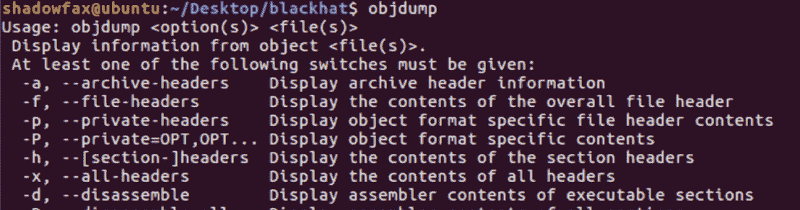

**Figure 9.1**: `objump` options

-   图 9.2 展示了对示例应用运行 `objdump` 的输出。注意 `objdump` 会显示内存地址、函数名称、x86 机器码以及 x86 组装代码。

  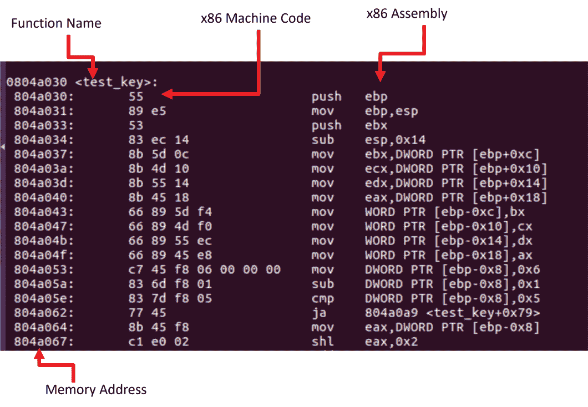

**Figure 9.2**: Sample `objdump` output

### strace and ltrace

-   `strace` 和 `ltrace` 可以监控系统调用（`strace`）和库调用（`ltrace`），从而跟踪程序的执行并了解其使用的库和外部功能。

-   如果任何程序想要做任何有用的事情，它都必须发出系统调用。对库和外部功能的特征化在系统侦察时非常有用。你会发现，使用这些工具不仅能看到程序使用了哪些库和功能，还能看到是哪个地址的代码调用了它们，这有助于你集中关注感兴趣的函数。例如，你可能看到频繁调用加密库的代码；这在破解时很有兴趣。

#### ************ltrace************

-   `ltrace`（库跟踪）是一个 Linux 命令行实用程序，用于跟踪库调用。库调用是应用程序向动态链接库发出的调用。命令的语法为 `ltrace <`*`command`*`>`。


-   例如，如果你 `#include <stdio.h>`，当程序加载时，该库会以动态链接的方式被加载。当你调用 `printf` 或 `fopen` 时，实际上是在调用标准 C 库。这种构造适用于所有编程语言，所有语言都包含包含外部库的概念。

#### `strace`

`strace`（system trace）是一个 Linux 命令行工具，用于跟踪系统调用。命令的语法是 `strace <`*`command`*`>`。

系统调用是应用程序向操作系统发起的调用，操作系统负责管理文件和控制台窗口等事务。`fopen` 和 `printf` 等函数在内部实现时，最终必须向操作系统发起调用。正如 `ltrace` 那样，这对于所有编程语言都适用；很少有应用程序不使用操作系统级别的功能。

#### `strace` 示例：`echo`

监控系统调用是一种粗糙的方法，用于跟踪程序的执行。假设你编写了 `echo` 实用程序，并想观察它的运行情况。

`echo` 是一个 Linux 命令，用于将输入回显到输出。例如，命令 `echo hello!` 会在终端中打印 `"hello!"`。

但它实际在做什么呢？运行 `strace echo hello!` 会产生类似 [Figure 9.3 的输出。

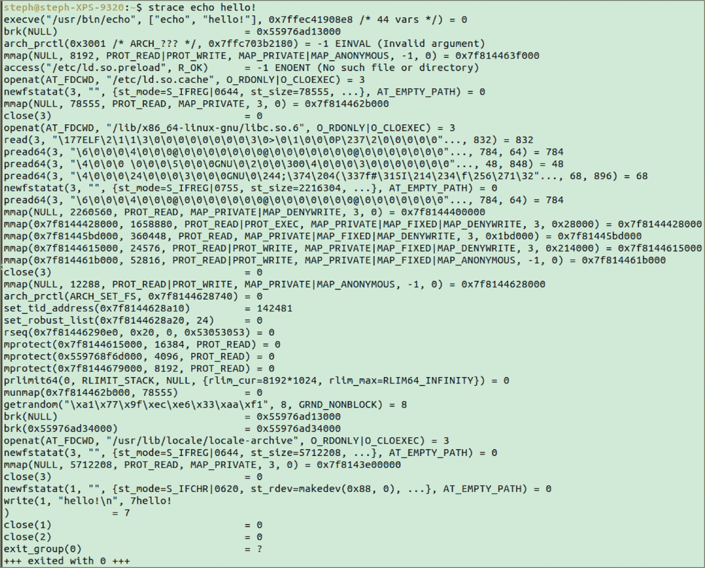

**Figure 9.3**: `strace` 输出 for `echo hello!`

这张图片复杂，可能难以解读。通过查看结果，你可以看到一些在 `echo` 程序启动初期使用的标准系统调用。

下面的几行是有趣的输出，位于结果的最末尾：

```
```
write(1, "hello!\n", 7hello!
)                 = 7
close(1)          = 0
```

这表明 `echo` 向流 1 写入了字符串，而流 1 是 *`stdout`*。`write` 命令返回值为 7，因为写入了七个字符。最后，`echo` 关闭了流 1，返回值为 0 表示成功。虽然这看起来很简单，但你可以将其用于跟踪应用程序写入配置数据的位置。例如，当你修改设置并想查看它是如何在系统上存储时。

#### `strace` 示例：恶意小猫

Comet Cursor 是 Windows 系统早期的一个间谍软件示例。它允许用户更改鼠标游标的外观，并使用自定义游标对网站进行定制。该应用程序在未经用户同意的情况下安装，并秘密跟踪用户。

如 Figure 9.4 所示，野外存在大量小猫游标应用。这个例子使用了一个示例游标应用，它秘密地向俄罗斯 IP 地址发起请求。

运行代码时，没有显示恶意功能的迹象，如下所示：

```
deltaop@deltaleph-ubuntu:~$ ./kittens 
Registering kitten cursor!
Done!  Enjoy the kitties!
deltaop@deltaleph-ubuntu:~$ 
```


**Figure 9.4**: 小猫游标应用

然而，通过 `strace` 分析代码会告诉另一个故事，如下所示：

```
deltaop@deltaleph-ubuntu:~$ strace ./kittens
...
poll([{fd=3, events=POLLOUT}], 1, 0)    = 1 ([{fd=3, revents=POLLOUT}])
send(3, "!$\1\0\0\1\0\0\0\0\0\0\7kremlin\2ru\0\0\34\0\1", 
      28, MSG_NOSIGNAL) = 28
poll([{fd=3, events=POLLIN}], 1, 5000)  = 1 ([{fd=3, revents=POLLIN}])
ioctl(3, FIONREAD, [28])                = 0 
recvfrom(3, "!$\201\200\0\1\0\0\0\0\0\0\7kremlin\2ru\0\0\34\0\1", 1024,
       0, {sa_family=AF_INET, sin_port=htons(53),sin_addr=inet_
          addr("192.168.1.1")}, [16]) = 28
close(3)                                = 0 
socket(PF_INET, SOCK_DGRAM|SOCK_NONBLOCK, IPPROTO_IP) = 3 
connect(3, {sa_family=AF_INET, sin_port=htons(53),
       sin_addr=inet_addr("192.168.1.1")}, 16) = 0 
...
```

这段 `strace` 输出显示了多个事件。为了关注感兴趣的事件，可以使用 `grep`（它会限制只显示包含搜索字符串的行，这里是 `connect`）。

```
deltaop@deltaleph-ubuntu:~$ strace -f ./kittens 2>&1 | grep connect
 
connect(3, {sa_family=AF_FILE, path="/var/run/nscd/socket"},
       110) = -1 ENOENT
connect(3, {sa_family=AF_FILE, path="/var/run/nscd/socket"},
       110) = -1 ENOENT
connect(3, {sa_family=AF_INET, sin_port=htons(53),
       sin_addr=inet_addr("192.168.1.1")}, 16) = 0
connect(3, {sa_family=AF_INET, sin_port=htons(53),
       sin_addr=inet_addr("192.168.1.1")}, 16) = 0
connect(3, {sa_family=AF_INET, sin_port=htons(53),
       sin_addr=inet_addr("192.168.1.1")}, 16) = 0
connect(3, {sa_family=AF_INET, sin_port=htons(80),
       sin_addr=inet_addr("195.208.24.91")}, 16) = 0
write(2, "connected.\n", 11) = 11
```

前一个示例查找包含单词 *connect* 的事件。这包括多个互联网连接，其中一个是到 195.208.24.91 的连接，这很可疑，因为它是外部 IP 地址，鼠标游标为什么需要这么做？

### `strings`

`strings` 是一个 Linux 工具，用于从应用程序中提取可打印的字符串。它会查找一系列 ASCII 可打印字符（长度可配置）并打印找到的所有字符串。

`strings` 在逆向工程中非常有用，因为它能提供程序可能执行的高层次行为的洞察。此外，一旦你找到感兴趣的字符串，你就可以在后续中轻松地使用这些字符串来定位相关的代码。例如，包含 `"incorrect password"` 的字符串可以快速定位密码处理代码。例如，以下字符串提供了有价值的提示：

*   `"Enter password:"`

*   `"open_socket"`

*   `"YOUR FILES HAVE BEEN ENCRYPTED!"`

命令的语法是 `strings program`。虽然通常不带选项使用，但下面的标志在逆向工程中有时很有用：

*   **`-a`**：显示文件中所有字符串，而不仅仅是加载的对象文件的加载部分中的字符串。这对于处理混淆、嵌套或其他异常二进制文件时非常有用。

*   `-n`：指定连续可打印字符的最小长度。默认值为 4。通常可以通过扩大或限制字符串的数量来调整工具的行为。

### 依赖分析器（Dependency Walker）

依赖分析是一种快速了解应用程序导入和导出函数的技术。Dependency Walker 是一个这样的工具。（参见我们仓库的“工具”部分，获取链接。）

依赖分析提供了对程序将执行的操作的高层次视图，通常是破解的第一步。大多数应用程序不会实现所有自己的函数；它们会使用操作系统或外部库的函数。每次应用程序调用操作系统或外部函数时，都会在工具中显示为导入函数。此外，应用程序经常与其他应用程序共享功能，每当一个函数是“可供共享”的，它会显示为应用程序的导出函数。

将程序加载到像 Dependency Walker 这样的工具中，会显示它使用的 DLL 以及预期调用的 API 调用。Figure 9.5 显示该程序会创建多个注册表键。

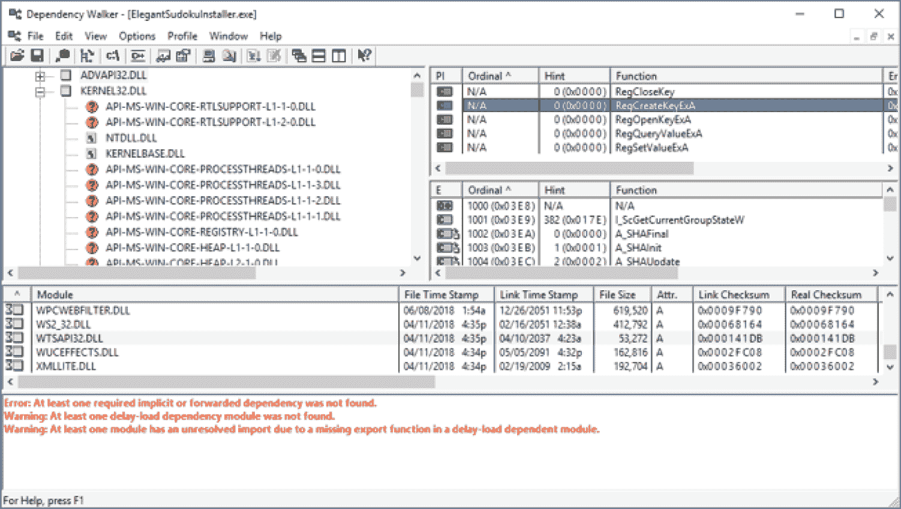

**Figure 9.5**: 在 Dependency Walker 中检查注册表修改

Reverse Engineering Strategy

逆向工程仍然更多是一门艺术，而非科学。虽然有大量优秀的工具和技术可供帮助，但有效的逆向工程最终仍然高度依赖于直觉和经验。


因此，无法给出一个规定的解决方案。但是，有一些通用的方法和最佳实践可以帮助。

### 寻找感兴趣的区域

应用程序包含大量的代码，其中大部分与反向工程无关或不必要。进行应用程序反向工程的重要第一步是找到你要寻找的程序区域。

你将继续学习许多有趣的技巧来缩小范围，但基于对之前工具的了解，现在已有几种可用的方法：

*   **有趣的字符串**：查找你感兴趣的程序字符串（例如“Incorrect Key”），并找到这些字符串的使用位置（例如，识别使用这些字符串的 `printf` 调用）。

*   **用户输入**：查找用户输入的接收位置（例如 `scanf`、对话框等），并找到这些输入的处理位置。

*   **系统输入**：查找从系统读取输入的位置，例如配置文件和注册表设置。

*   **身份验证代码**：如果可能，使用调试器在输入用户名/密钥后暂停程序。然后，在内存中扫描已输入的值，在该位置设置硬件断点，并重新运行应用程序，以找到这些值的读取或写入位置。

### 逐步注释代码

即使你已经识别出感兴趣的代码，理解它可能仍然很困难。理解复杂代码的一种方法是进行多次通过，在每次通过中添加信息（如注释）。

为此，使用以下过程注释目标区域，直到你理解它的工作原理：

*   **识别并标记局部变量**：使用调用约定规则识别局部变量（例如 `cdecl` 中的 `[ebp-4]`）。这些可以先用模糊的名称标记（例如 *`local1`*）。

*   **识别并标记函数参数**：使用调用约定规则识别参数（例如 `cdecl` 中的 `[ebp+12]`）。这些也可以先用模糊的名称标记（例如 *`arg1`*）。

*   **识别 API 调用（例如 `atoi`）**：利用 API 参数的知识进一步标记局部变量。例如，API 文档表明 `atoi` 接收一个字符串并将其转换为整数，因此可以将我们的参数重命名为 *`integer_string`*。

*   **为复杂的控制流添加注释**：例如，“这段代码用于对数字进行因式分解”。

*   **根据观察到的数据流细化描述**：例如，*`local1`* 如果在 `for` 循环中作为计数器使用，可以改为 *`loop_counter`*。

有效的反向工程很大程度上取决于速度。即使是小程序也有太多的代码需要逐一分析。

应用程序的绝大部分代码与你要寻找的内容无关。知道关注点往往不如知道不关注点重要。掌握何时可以跳过代码需要时间。

## Summary

本章介绍了一些作为软件反向工程师和破解者将使用的核心工具和技术。在继续之前，花一些时间进行实践并获得使用这些工具的实际经验是有价值的。这种练习时间在你以后处理更复杂的软件和更高级的反向工程和破解技术时将会非常有用。

# CHAPTER 10  

Cracking: Tools and Strategies

Cracking 是通过反向工程软件来绕过保护措施或其他不良功能的艺术。本章探讨了软件破解中使用的关键工具和策略，包括使用密钥生成器和修补来击败密钥检查器。

## 密钥检查器

许可证密钥是软件授权中最常见的做法之一。为了防止盗版，每次安装软件都需要一个唯一的密钥。在具有多层功能的软件中，某些功能可能始终免费提供，而其他功能则位于许可证墙后，或者如果没有许可证密钥，软件根本无法使用。

许可证密钥是常见的防盗方案，它们有其优势。以下是两个最重要的：

*   许可证密钥易于生成和验证。

*   有效密钥与无效密钥的比例非常小，随机猜测生成有效密钥的可能性极低（假设密钥长度合理）。

然而，与所有安全措施一样，如果实现不当，它们极易受到破解，而且并非完全不可靠。足够知识和动机的破解者最终可以击败或绕过它们。但它们仍然是较强有力的保护措施；这只是提醒你，不存在 100% 安全的软件。

在离线系统更为常见的过去，许可证检查和验证通常完全离线，即所有验证逻辑都在系统上本地。如今，由于普遍的连接性，我们常常看到包含在线和离线两部分的密钥检查，即向许可证服务器发送请求以进行额外验证。有几种实现密钥检查的方式，层次和有效性各不相同。

### 糟糕的方法

过去，非常流行的电脑游戏 *StarCraft* 和 *Half-life* 都使用了检查和验证的检查码作为许可证密钥。请记住，检查码通常是对二进制块执行的简单数学表达式，例如简单的将所有数字相加。在 *StarCraft* 和 *Half-life* 使用的检查码中，第 13 位验证前 12 位。

这意味着用户可以对前 12 位输入任何他们想要的内容，然后计算第 13 位以创建一个有效的检查码。这个安全漏洞导致了著名的 1234-56789-1234 密钥，它被广泛用于盗版这些游戏。

这些情况的最大问题是检查码的计算算法过于简单。

```
x = 3;
for(int i = 0; i < 12; i++)
{
    x += (2 * x) ^ digit[i];
}
lastDigit = x % 10;
```

针对这种情况有两种破解方法。第一种是运行算法并计算最后一位的有效值，如上文所示。

另一种是粗力攻击。由于最后一位只有一位数字，所以只有 10 种可能（0-9）。你可以随机选择一组 12 位数字，然后尝试这 10 种可能的最后一位，直到成功为止。著名的 1234-56789-1234 密钥之所以闻名遐迩，是因为它容易记住，但通过上述两种方法（计算或粗力），你可以生成任意数量的新密钥。

### 合理的方法

对许可证密钥的粗力攻击注定会成功……最终。密钥的最好功能是浪费足够多破解者的时间，使得粗力攻击变得不可行或不可能。

那么，如何防止粗力攻击呢？在其他上下文中，一个常见的选项是使用密码散列。例如，许可证密钥可以实现为以下选项之一：

*   **用户名**：SHA(username)

*   **随机值**：WXYZ-SHA(WXYZ)

使用散列函数使得粗力攻击变得困难得多。然而，破解者很容易通过查看代码来确定算法的工作方式。取决于你的思维方式，如果你是攻击者，这意味着利用你已学到的反向工程技能去找到算法并将其拆解；如果你是防御者，这意味着这是你需要保护的关键代码。


-   [使用自定义、复杂的哈希代替标准哈希。虽然在安全性方面这通常是个糟糕的想法，但在这种应用中它并非不被采用的选择。目标不是提供绝对的保护，仅仅是为了延缓反向工程。对于安全领域的同行，若对自行生成哈希的建议感到毛骨悚然，请记住该建议的前提是你能够生成一个相当优秀的哈希。作为防御方，请牢记市面上已有大量工具可执行常见的哈希算法，攻击者首先会尝试使用这些工具来破解你的密钥。

-   还应尝试加入独特的复杂度，使密钥只能在特定环境下使用，而不会被广泛复制。例如，在哈希值中拼接产品名称、版本号以及机器名称，可为密钥提供坚实的复杂度层。这样，针对某一安装生成的被破解密钥无法解锁其他发行版。

### 更好的做法

哈希算法更为可靠，若实现得当，它们同样可以做到满意。但仍有更优的方案。微软在为其软件生成许可证密钥时所采用的做法即为典型。

微软在生成许可证密钥时并不使用哈希算法，而是采用公钥加密技术。在公钥加密中，私钥可用于生成数字签名，公钥则用于验证签名。这意味着，经过数字签名的许可证密钥可以被应用程序通过公钥进行验证，而无需暴露私钥。

在生成微软许可证密钥时，会使用大量关于软件的信息，包括但不限于：

-   比特性（32 位、64 位）

-   版本类型（家庭版、专业版、企业版）

-   产品 ID

-   硬件特征

将这些信息全部纳入密钥中，可使产品密钥与特定的软件安装绑定。若想了解更多关于该协议的细节，网络上有大量资源详细剖析微软的密钥生成过程。

#### *数字签名密钥*

数字签名在许可证密钥中的作用，如同微软所使用的那样，使生成伪造且有效的密钥变得极为困难。有效的签名必须使用私钥生成，而验证则可使用公开的、非敏感的公钥完成。

数字签名阻止了密钥的直接生成，攻击者只能选择以下两种路径：第一是泄露合法密钥，这可能会追溯到特定用户；第二是修改程序以移除密钥校验代码，这会显著增加盗版的时间和复杂度。

### 最佳做法

前文所展示的案例主要集中在离线验证许可证密钥，即验证和解锁代码完全位于系统本地。然而，随着当今系统的高度互联性，引入在线元素可进一步增强安全性。

常见的做法包括：在软件分发时附带一个由大量随机数组成的许可证密钥，安装并注册时将该值发送至许可服务器，服务器负责验证密钥的有效性及是否已被使用。对于当代数字软件分发，密钥在购买前并不具效力——即使在购买前 10 分钟内猜到该密钥，也无法使用。

亦可采用混合方案：系统内部保留基于哈希或公钥加密的验证算法，同时在许可服务器上进行二次检查，确认密钥未被重复使用或已被撤销。

### 其他建议

前文所述的方法符合行业最佳实践及常见做法，但安全并无“一刀切”的解决方案，以下技术在 cracking 场景中可能出现，亦或在拥有独特约束的防御情境下对你有帮助。

#### *偏好离线激活*

虽然在线密钥服务器从安全角度看具备优势，但其管理与基础设施成本极高。维护密钥服务器并非易事，且极具攻击目标性。因此，许多企业倾向于坚持更强的离线验证，因为它消除了运营密钥服务器的复杂性，也更包容于无网络环境的用户。

#### *部分密钥验证*

在离线模式下，若不进行在线检查，便无法实现密钥撤销或让已泄露的密钥失效。为防止单个泄露密钥在所有后续版本中通用，可仅验证密钥的部分字符。例如，检查 `X4Z-951-B41-BR0` 中的 `X`、`9`、`B`、`B` 四个字符。若发现密钥生成器被公开，可在新版本中改为检查第二个字符（`4`、`5`、`4`、`R`），从而限制单个密钥生成器的潜在危害。

#### *在密钥中编码有用数据*

在密钥中嵌入有意义的数据，可进一步限制其适用范围。例如，密钥可指定其适用的最大应用版本，从而降低被破解后的影响范围。

### Key Generators

当软件使用密钥进行激活时，crackers 会希望构建密钥生成器（key generator），无论采用何种激活方式均然。密钥生成器随后会被分发，供用户生成“免费”密钥。

稍后我们会探讨如何补丁程序以直接移除密钥检查，但在此阶段请专注于构建密钥生成器，并假设无法直接绕过密钥检查。密钥生成器通常需要更深入的程序分析和对密钥算法的深入理解。

#### 为何构建密钥生成器？

如果密钥生成器难以制作，为何仍要建造它们？原因有几方面：

- 软件可能实现多种防护措施，使得补丁路径更为困难，例如：
  - 防篡改（Tamper proofing）
  - 动态检查
  - 防调试（Anti-debugging）
  - 软件守卫（Software guards）

- 补丁可能需要发布修改后的目标软件，而这些修改往往带有水印（Watermarking），用于追踪原始购买者。水印可用于追踪 cracked 版本的来源，这显然不利于 cracker。

- 部分软件会在线检查是否为已补丁或修改过的版本。也有软件会根据输入的密钥对自身进行解密（如自解包），若彻底移除密钥检查，则无法解密。

- 密钥生成器比补丁更具前瞻性。开发者难以撤销已发行的有效密钥。

- crackers 往往选择构建密钥生成器，因为这本身就是一种挑战，带来声望与成就感；而补丁在某些情况下则相对容易。

#### *密钥生成的哲学*

在破解密钥检查时，可将其视为 `f(u) == g(k)` 的形式，其中：

- *`u`* 为用户输入的用户名。
- *`f`* 为对用户名的转换函数。
- *`k`* 为用户输入的密钥。
- *`g`* 为对密钥的转换函数。


在该模型中，关键检查是一个验证 `f(u) == g(k)` 的过程。用非数学术语来说，这意味着对用户名进行某种转换或变异后，将其与对键进行某种转换后进行比较。在本例（以及后续示例）中，用户名是输入项，但请记住这可能是各种组合中的任何一种；它们可能使用版本号、计算机名称等。核心思想是某些内容会经过转换后得到结果，然后将该结果与经过某种转换的输入键进行比较，该转换可能是无操作（即结果就是键本身），也可能是哈希或变异处理。基于此模型，关键检查可能有以下几种变体。

回到最初的 *StarCraft* / *Half Life* 示例，`u` 实际上是键的前 12 位，而 `k` 是最后一位。在这种配置下，不需要输入用户名；而是使用键的一部分来检查另一部分。

另一种情况是 `u`（以及因此 `f(u)`）是一个常数（即硬编码键）。在这种配置下，也不需要输入用户名；而是对键进行转换并将其与固定值进行比较。例如，“键中所有数字之和等于 1337”。

### 破解不同类型的键检查

通过分析公式 `f(u) == g(k)` 中的键检查器，你可以开始构建针对不同变体的破解技术。

#### *键检查类型 I：仅转换用户名*

在此情况下，用户名通过某种函数进行转换，然后与用户输入的键进行比较。因此，在此情况下 `g()` 对键没有进行任何变异。这使我们可以将关键检查简化为 `f(u) == k`。在这种配置下，程序会转换用户名并验证转换后的值是否与用户输入的键相匹配。

要破解这种类型，请定位并提取键检查器中的转换函数 `f` 到生成密钥的应用程序中。例如，将用户名中的字符 ASCII 值相乘并与键进行比对。密钥生成器会提示用户输入想要使用的用户名，然后计算 `f(u)` 并输出有效的键。

#### *键检查类型 II：转换用户名和键*

对于类型 II，你仍然需要对用户名进行转换，但 `g` 也会对键进行变异。从数学角度来看，`g` 具有逆元，即存在 `g`^(\-`1`)，使得 `g`^(\-`1`)(`g(k)`) == `k`。简单来说，`g` 会对键进行变异，而每种变异都有逆向操作（即做相反的操作）。

在这种配置下，程序会转换用户名，转换用户输入的键，然后验证这两个结果是否相同。然而，函数 `g` 可以被逆转（“撤销”或“剥离”）。

要破解这种键检查类型，需要逆向工程 `g` 并推导出 `g`^(\-`1`)。通常，这仅仅是“逆转” `g` 对每个变异的操作顺序。然后，生成键时使用 `g-1(f(u))`。

例如，假设 `g(k) = k * 2 + 1000`。那么 `g`^(\-`1`)(h) = (h – 1000) / 2。

在此情况下，密钥生成器会提示用户输入想要的用户名（与类型 I 相同），并计算 `f(u)`，但此时结果是变异后的键，因此需要使用 `g`^(\-`1`)(h) 对结果进行逆变。最终得到的结果即为有效键。

#### *键检查类型 III：可暴力破解*

在类型 III 中，`f(u)` 的碰撞可以通过暴力尝试 `g(k)` 来破解。这种方法适用于密钥空间很小，或者你拥有大量计算资源的情况。

在此配置下，程序会转换用户名，转换输入键，并验证这两个结果是否相同（与类型 II 相同）。但你的目标是通过重复测试随机或伪随机 `k` 来寻找满足 `f(u) == g(k)` 的解。

要破解这种类型，请确定 `k` 的格式。然后，提取 `g` 到一个独立的密钥生成器中。最后，生成随机 `k` 直到找到满足 `f(u) == g(k)` 的解。

例如，考虑 `g(k) = CRC32(k)` 的情况。如果密钥变换使用非常小的 CRC32 算法，那么在普通电脑上进行暴力破解就变得非常简单。由于 CRC32 的可能值范围很小，你可以轻松进行暴力破解。

### 防御关键生成器

键检查可能是上述类型的组合。例如，键转换 `g` 可能既可暴力破解，也可逆转。

键检查通常必须属于以下类别之一，否则无法生成密钥。

键检查类型 I 是最弱的。破解者只需提取键检查器中的算法，无需实际逆向工程该算法。

键检查类型 III 较好。它要求攻击者提取两个算法，并找到一种方法来暴力破解键变换，这并不总是显而易见。

键检查类型 II 可能是最佳但也最难设计的类型。破解这种类型需要攻击者推导键变换函数的逆元。这可能需要对转换算法进行深入分析，从而减慢攻击速度。

如前所述，没有万能解法。每种键检查最终都可以被破解，防御者能做的最好是延缓攻击者的进程。

## 实验室：入门级关键生成器

本实验室提供了为简单程序创建关键生成器的经验。

实验室及相关说明可在以下链接中找到：

`https://github.com/DazzleCatDuo/X86-SOFTWARE-REVERSE-ENGINEERING-CRACKING-AND-COUNTER-MEASURES`

对于本实验室，请找到入门级关键生成器并遵循提供的说明。

### 技能

本实验室使用 `objdump` 和 `strings` 实用工具来生成关键生成器。它测试的关键技能包括以下几点：

*   初步侦察

*   反向工程 x86 架构

*   关键生成

### 收获

除了修改程序外，通过观察程序的工作方式，往往可以直接破解程序。正确的方法往往取决于程序的约束条件，选择合适的方法是一项重要技能。

## Procmon

在逆向工程中，你希望了解程序的工作情况。在使用高级调试工具之前，先通过观察软件行为来获取信息。

Procmon 是 Sysinternals 套件的一部分（可在 `http://technet.microsoft.com/en-us/sysinternals/bb842062` 获取）。该套件包含约 60 个由微软开发并免费分发的 Windows 工具。注意，这些工具仅在 Windows 操作系统上可用。

### 示例：notepad.exe

要观察 `notepad.exe` 在创建新文件、更改字体并保存内容时的行为，请执行以下步骤：

1.  打开 `Procmon.exe`。

2.  启动 Notepad。

3.  在 Notepad 文档中输入一些文本。

4.  点击“格式”菜单，然后选择“字体”菜单项。

5.  在字体窗口中，将字体更改为 Webdings。

6.  在字体窗口中，将字号更改为 20。

7.  点击“确定”按钮。

8.  将 Notepad 文档保存为 `Example1.txt`。

9.  关闭 Notepad。

通过点击捕获按钮（如图 10.1 所示）停止 Process Monitor 捕获活动。图标会在放大镜上出现一个叉号。此时，Process Monitor 已捕获所有文件、注册表和进程/线程事件。

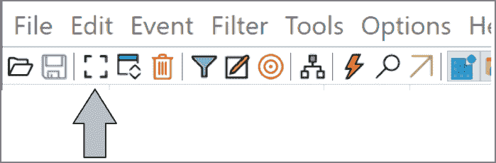

**Figure 10.1**: Halting Process Monitor

Process Monitor 每秒捕获数千条记录，手动审查太繁琐。因此，需要通过过滤结果来关注感兴趣的事件。要做到这一点，请点击漏斗图标打开“过滤”菜单（如图 10.2 所示）。

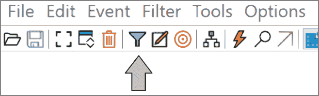


## Figure 10.2
`**Figure 10.2**: Filtering events in Procmon`

To see only events related to the process `Notepad.exe`, define a filter stating that the `Process Name is Notepad.exe`, as shown in `**Figure 10.3**`. You can accomplish this via the following steps:

1.  Select Process Name from the Column list box.
2.  Select is from the Relation list box.
3.  Type `Notepad.exe` in the Value text box.
4.  Select Include from the Action list box.
5.  Click the Add button.
6.  Click Apply and OK.

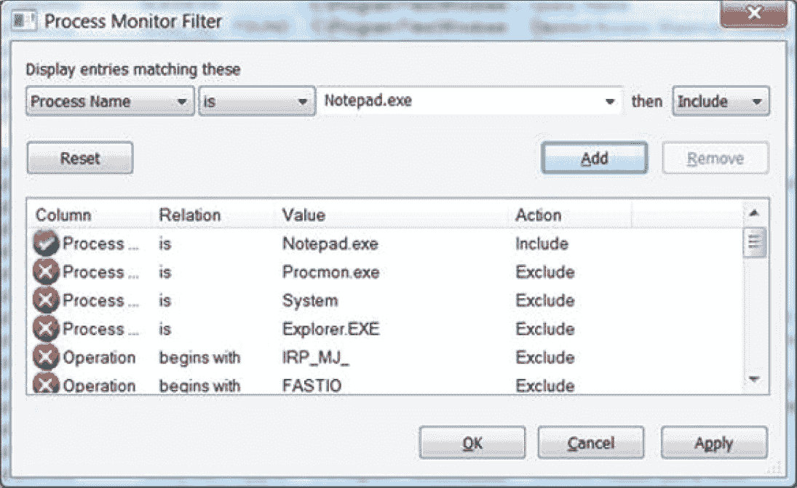

## Figure 10.3
`**Figure 10.3**: Defining a filter in Procmon`

Filtering based on the process name dramatically decreases the number of events. However, it's still not enough.

To find events of interest, you need to define additional filters. Procmon has several categories of events that you can filter on, including the following:

*   Registry
*   File
*   Network
*   Process thread

To start, try focusing on the Registry values that Notepad modifies. Process Monitor has a handy button for this, as shown in `**Figure 10.4**`.

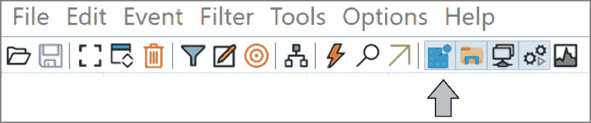

## Figure 10.4
`**Figure 10.4**: Filtering on Registry events in Procmon`

If Notepad has saved values to the Registry, it will create an event entry of type `'Operation' 'RegSetValue'`. By right-clicking entries in Procmon's log, you can choose to include or exclude certain types of events, as shown in `**Figure 10.5**`. This enables you to further refine your results and focus on events of interest.

**Figure 10.6** shows a Procmon entry that seems to be related to the changes to the font in Notepad. To see more information, right-click the entry and select Properties.

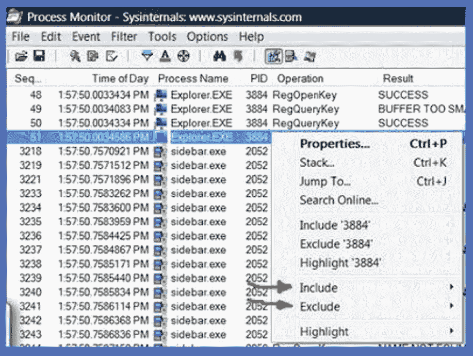

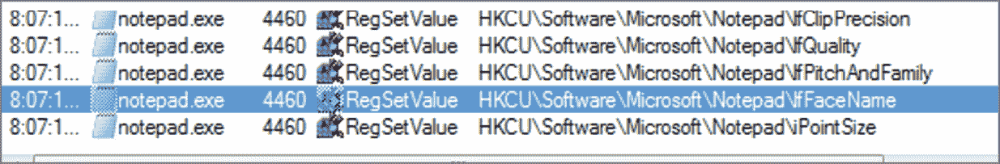

## Figure 10.6
`**Figure 10.6**: Notepad font change registry event`

## Figure 10.7
`**Figure 10.7**: Event properties in Procmon`

**Figure 10.7**: Event properties in Procmon

## How Procmon Aids RE and Cracking

Procmon made it possible to see the Registry changes made by Notepad. However, this isn't all that it can do. Further exploration of the tool reveals a great deal of useful information.

### Call Stacks

The Properties window for an event has a few different tabs. Clicking over to the Stack tab shows the sequence of calls used to reach this point, as shown in `**Figure 10.8**`.

Looking further down this stack trace, it's possible to see the point where the program left `notepad.exe`, as shown in `**Figure 10.9**`. This transition point from application to libraries might be a good starting point for reversing.

### File Operations

Procmon also records events for file operations, such as opening, closing, and editing files. `**Figure 10.10** shows an example of this.

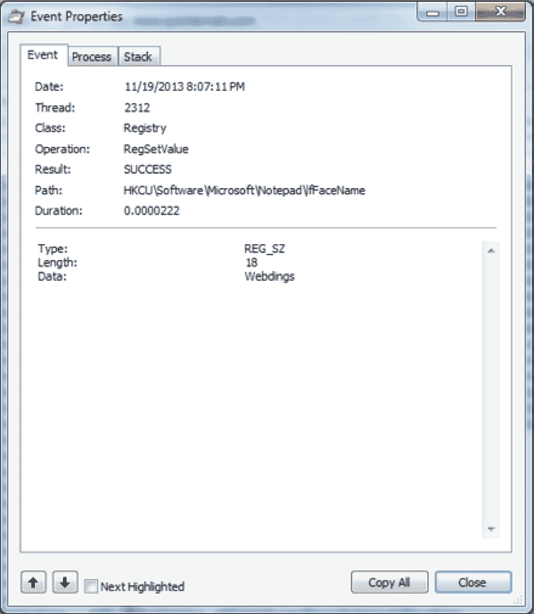

## Figure 10.8
`**Figure 10.8**: Stack view in Procmon's Properties window`

These file events can provide useful information for reversing. For example, they can help with identifying and analyzing configuration files, export functions, and proprietary file formats.

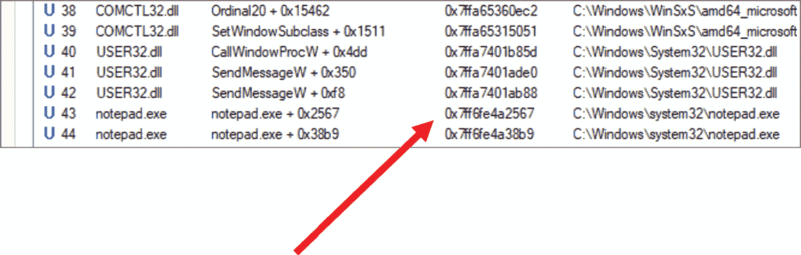

## Figure 10.9
`**Figure 10.9**: Stack trace for `notepad.exe``

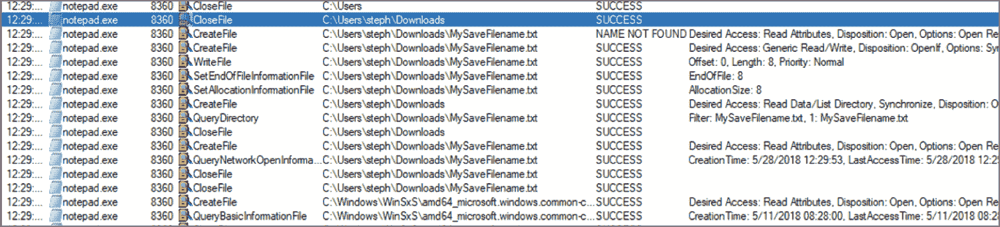

## Figure 10.10
`**Figure 10.10**: File operations in Procmon`

### Registry Queries

The `Notepad.exe` example showed how to find the Registry operation for changing the font in Notepad. However, this isn't the only possible use for registry queries.

For example, `**Figure 10.11** shows that Notepad looked for two keys with the word “Security” in them but couldn't find them. You could add these keys to your Registry and place custom values in them to change how Notepad operates.


## Resource Hacker

Resource Hacker (also known as ResHacker or ResHack) is a free extraction utility or resource compiler for Windows. Resource Hacker can be used to add, modify, or replace most resources within Windows binaries including strings, images, dialogs, menus, and VersionInfo and Manifest resources. (For tool links, visit the tools section of our GitHub site at `https://github.com/DazzleCatDuo/X86-SOFTWARE-REVERSE-ENGINEERING-CRACKING-AND-COUNTER-MEASURES`.)

Resource Hacker can be a useful tool for exploring the structure of a binary prior to the cracking process. It can be used to find and understand the structure of nag screens, key entry screens, help menus, and more.

Resource Hacker can also be used to add functionality to a program before or after cracking. For example, it's possible to add new icons, menus, and skins to an existing application.

To get started, open an `.exe` file in ResHack to explore its strings, images, dialogs, menus, etc., as shown in `**Figure 10.12**`. Then, click an item in ResHack (left) to show how that item would look in the application (right).

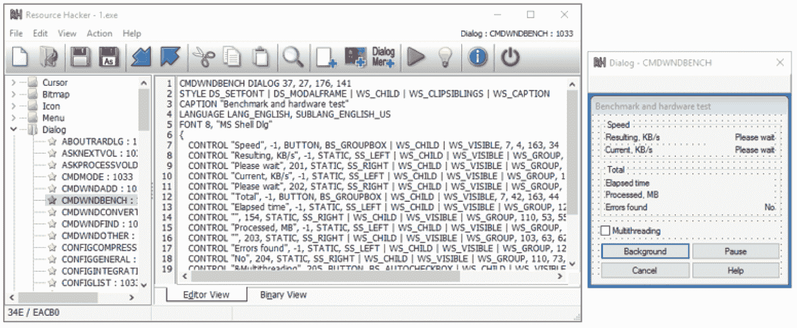

## Figure 10.12
`**Figure 10.12**: Sample application in Resource Hacker`

### Example

Suppose you see the window shown in `**Figure 10.13**` in a program. As a cracker, you want to understand how that window would be used by the program.

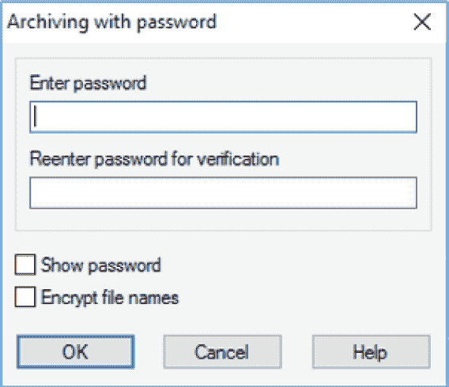

**Figure 10.13**: Password window

To find out, open the program in ResHack. Then, use Ctrl+F to search for one of the strings used in the dialog box, as shown in `**Figure 10.14**`.

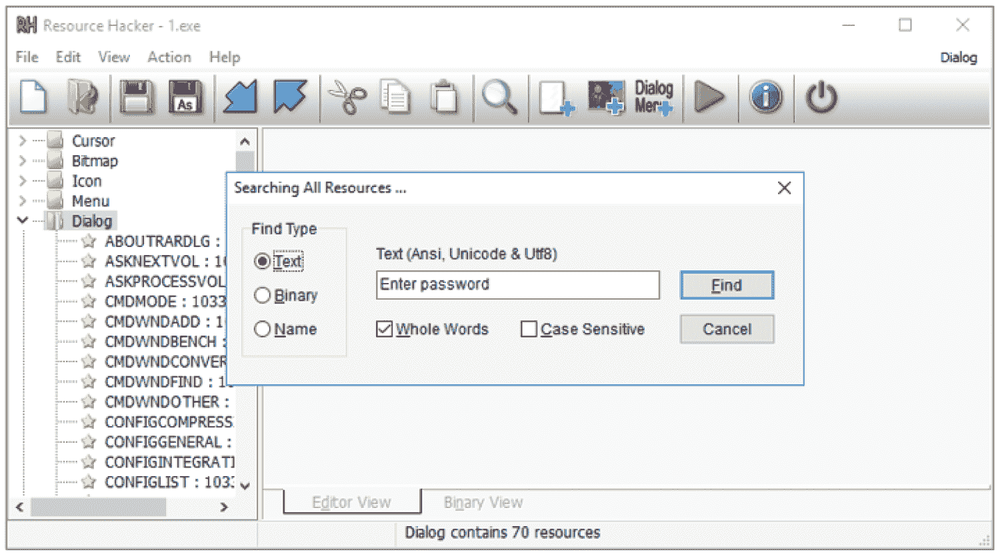

**Figure 10.14**: String search in Resource Hacker

Resource Hacker identifies this dialog box as the “GETPASSWORD2” dialog box, as shown in `**Figure 10.15**`. Knowing this can help to guide the process of reversing the program.


### Mini-Lab: Windows Calculator

To try your hand at using Resource Hacker, try rebranding the Microsoft Calculator. As shown in `**Figure 10.16**`, the Calculator window is titled Calculator. Try changing this value to something else.

To start, open the `calc.exe` executable in Resource Hacker. Then, search for the word `Calculator`, as shown in `**Figure 10.17**`.


**Figure 10.16**: Microsoft Calculator


**Figure 10.17**: Searching for `Calculator` in ResHack

The main Calculator window may not be the first result. Keep on searching until you find the code defining the Calculator dialog box, as shown in `**Figure 10.18**`.


在 Figure 10.18 中，CAPTION 字符串决定了应用程序窗口的标题。更改此字符串可将应用程序重新品牌化为您自己的。

更改 CAPTION 后，点击 Figure 10.19 中所示的绿色箭头按钮。这将编译已修改的计算器应用程序。

编译完成后，更新后的窗口应在窗口预览中显示。这应包括已修改的标题，如 Figure 10.20 所示。

编译应用程序不会自动保存修改后的版本。为此，请选择 File ➪ Save，如 Figure 10.21 所示。


**Figure 10.18**: Calculator window in Resource Hacker


**Figure 10.19**: Compiling the modified application


**Figure 10.20**: Modified window in Resource Hacker


**Figure 10.21**: Saving the modified application in ResHack

此时，您已成功重新品牌化 Windows 计算器。为了获得更大的挑战，请尝试以下操作：

*   使用 Resource Hacker 调整窗口大小，以容纳您新名称。

*   修改可用按钮。

*   修改计算器背景。

*   在虚拟机中打开并编辑其他程序。

## Patching

Patching 涉及修改已编译的二进制文件以修改其执行代码。根据具体情况，有时最简单的做法是对应用程序进行补丁，以绕过其安全机制。

### Patching vs. Key-Genning

在某些情况下，高级完整性检查或混淆可能使补丁变得困难。例如：

*   补丁磁盘上的加密/打包程序不可行。

*   补丁动态完整性检查（例如持续验证的校验和）可能过于繁琐。

*   分发已补丁可执行文件的物流可能不理想。

在这种情况下，您可以选择转而使用 key generators（keygen）。否则，如果可能，补丁程序以移除其 key 检查（或您想避免的其他逻辑）通常是更简便的方法。

### Where to Patch

补丁可以在两个位置进行：内存中或磁盘上。

内存中的补丁修改应用程序在内存中的机器代码。这在逆向工程尝试中很有用，因为您可能需要尝试数十（甚至上百…或者更…惊讶）种方法才能找到一种可行的方案。内存中的补丁仅影响当前执行的应用程序。每次重新启动应用程序时，内存中的补丁都会丢失。

磁盘上的补丁修改已编译的二进制文件中的机器代码。这在您确定哪种方法有效并希望其影响所有未来的应用程序执行时很有用。它使修改持久化，每次启动应用程序时都会存在。

### NOPs

回顾指令 `nop`。它是一个一字节指令（`0x90`），什么都不做。

在补丁应用程序时，关键是不要移动代码。事实上，修改大小或直接删除代码会导致应用程序崩溃。为了在保持相同大小的同时移除代码段，请用 `nop`s 填充空间。

对于那些好奇为何直接删除代码不工作的人，原因有很多，但最重要的一点是，某些 x86 代码是相对的，某些是绝对引用。先看相对情况：这意味着某些代码会翻译为相对操作，例如“向前跳转 40 字节”。如果您在跳转和其目的地之间移除 40 字节的代码，就会破坏跳转。它仍然会向前跳转 40 字节，但可能会落在中间的字节或跳过关键指令，导致崩溃。如果您移除的代码在跳转前 40 字节的范围之外，而跳转后仍然落在相同位置，则该操作不会产生影响。

现在考虑绝对引用。这些引用的形式类似于“使用地址 0x1234567 的数据值”。如果您在该地址之前的任何位置移除代码，所有引用都会发生偏移，导致它们获取的值或执行的绝对跳转错误。即使您只删除了 1 字节，绝对引用也会受到影响，因为所有位置都会变错。

这意味着相对引用仅在引用处和目标之间添加或删除字节时受影响。然而，所有绝对引用都会在应用程序即使移动 1 字节时被破坏。因此，在补丁时保持字节对齐至关重要（除非您故意导致崩溃，在这种情况下请随意破坏）。

回到 `nop`，如果您想移除一段代码（例如导致软件跳过关键检查），而不是直接删除，请将其全部替换为 `nop`s。这样保持应用程序的字节对齐，但当程序到达不需要的代码时，什么都不会发生。

## Other Debuggers

用于 Windows 动态分析的逆向工程有众多流行选择。以下是几个：

*   OllyDbg

*   Immunity

*   x64dbg

*   WinDbg

使用哪个取决于具体情况和用户偏好。它们的功能相似，在一个工具中的技能通常可以转移到其他工具。本书将让您接触多种软件，目标是让您了解各种工具在何时最有用。

### OllyDbg

OllyDbg 是一个极具人气且功能强大的调试器。虽然大多数调试器专注于调试，Olly 还提供了扩展功能，包括以下特性：

*   可扩展性、插件、脚本

*   执行跟踪系统

*   代码补丁功能

*   大多数 Windows 函数的自动参数描述

*   侧重于二进制代码分析（即不基于源代码调试）

*   小巧且便便

这些特性使 OllyDbg 非常适合以下用途：

*   编写漏洞利用

*   分析恶意软件

*   逆向工程

尽管 OllyDbg 功能强大且流行，它仍有局限性。其一是它仅支持 32 位可执行文件，这无疑是一个正在消亡的族群，但尚未消失。其二是 OllyDbg 的界面需要适应，初期并不显得稳健或直观。不过，您应该坚持使用它，因为它是强大的动态分析工具。

### Immunity

Immunity 是 OllyDbg 的分支（fork），因此拥有许多相同的功能。它还引入了许多额外功能，使其成为 exploit 开发者的热门选择，例如支持 Python 脚本。

然而，与 OllyDbg 一样，Immunity 只能用于调试 32 位可执行文件。它也继承了 OllyDbg 的不够直观的用户界面。

### x86dbg

x86dbg 是 OllyDbg 的替代品，支持 32 位（x86dbg）和 64 位（x64dbg）应用程序。这种更广泛的支持使其在逆向或调试 64 位应用程序时成为首选工具。

### WinDbg

WinDbg 是一个通用调试器，支持面广，具有强大的调试符号支持（但对逆向工程（RE）帮助不大）。不过，它侧重于调试，缺少某些面向 RE 的工具的特性。

## Debugging with Immunity


由于空间和时间限制，在本书中不可能探索所有这些调试器。选择 Immunity 是因为它在逆向工程和 exploit 开发中很受欢迎。但请记住，所有这些调试器都有相似的功能，在一个调试器中学到的技能通常可以转移到其他调试器中。

Figure 10.22 显示了 Immunity 在 Windows 上的外观。从左上角顺时针方向，四个窗口分别显示程序的汇编、寄存器、栈和内存。

### Immunity: Assembly

Figure 10.23 显示了 Immunity 中程序的汇编。注意它显示了内存地址、机器码和 x86 汇编。


**Figure 10.22**: Immunity debugger window


**Figure 10.23**: Assembly code in Immunity debugger

要选择一行代码，点击它。选中一行后，Immunity 会提供各种快捷键，包括以下：

*   **;**：为选中的行添加注释。这是逆向工程的最重要部分，它帮助你跟踪工作进度。

*   **ctrl-a**：自动分析程序。Immunity 可以很好地添加注释并猜测函数参数。

*   **<enter>**：跳转到选中的函数。例如，如果你看到汇编中的 `call 0x1234`，并想知道 0x1234 处的函数的作用。

*   **-**：返回到上一个位置。例如，分析完函数 0x1234 后，想要返回到之前的位置。

*   **+**：跳转到下一个位置（在按 **-** 之后）。例如，你已经用 **-** 返回到调用函数，然后想要返回到函数 0x1234。

*   **ctrl-r**：查找选中行的交叉引用。例如，在内存转储窗口中选中一个字符串，想知道谁使用这个字符串；或者在汇编中选中函数顶部，想知道谁调用该函数。

*   **双击地址**：在该地址设置调试断点。

### Immunity: Modules

在 Immunity 中，按 **e** 按钮可以加载可执行模块列表。这显示了你可以调试的所有代码，包括动态加载的库，如 Figure 10.24 所示。加载列表后，双击模块可以跳转到该代码。

启动 Immunity 时，查看正在查看的模块，通过检查 **`eip`** 寄存器。几乎总是希望先调试主可执行文件，而不是像 `ntdll` 这样的共享库。你可以使用模块窗口切换到主可执行文件。

### Immunity: Strings

要找出哪段代码使用了特定的字符串，通常很有用。要找出程序使用的所有字符串，右键单击并选择 **Search For ➪ All Referenced Text Strings**，如 Figure 10.25 所示。

在字符串窗口中，右键单击并选择 **Search For Text** 来查找特定字符串，如 Figure 10.26 所示。然后，右键单击并选择 **Search For Next** 来查找该字符串的下一个引用。你可以双击字符串的地址，跳转到它在汇编中使用的位置。


**Figure 10.24**: Executable modules in the Immunity debugger


**Figure 10.25**: Strings in Immunity debugger


**Figure 10.26**: String references in Immunity debugger

### Immunity: Running the Program

点击播放箭头，启动可执行文件（在调试器下），如 Figure 10.27 所示。执行可以通过点击播放箭头左侧的 **X** 停止，也可以通过其右侧的暂停按钮暂停。可以通过两个左箭头按钮重新启动执行。


**Figure 10.27**: Launching an executable in Immunity debugger

执行被断点或暂停按钮停止后，可以点击 **Step Into** 进一步执行程序一条指令，如 Figure 10.28 所示。或者，如果你正在函数调用处停止，但已经知道或不关心该函数的作用，可以点击 **Overstep Over**，继续在函数返回后进行调试，如 Figure 10.29 所示。


**Figure 10.28**: Single-stepping in Immunity debugger

### Immunity: Exceptions

许多应用程序在正常执行过程中会产生异常。例如，`try {} except {}` 块如果 `try` 块中出错，就会产生异常。作为调试器，像 Immunity 这样的动态分析工具通常会先拦截异常，看看你是否要对其做点什么。

但对于逆向工程，你通常不想干扰正常执行。相反，你希望让应用程序像往常一样处理异常。这意味着你几乎总是希望将异常从调试器传递给应用程序。

如 Figure 10.30 所示，异常在 Immunity 窗口的底部报告，但每个调试器略有不同。在 Immunity 中，按 **Shift+F9** 可以传递异常并继续执行。


**Figure 10.29**: Stepping over instructions in Immunity debugger


**Figure 10.30**: Exceptions in Immunity debugger

### Immunity: REwriting the Program

Immunity 具有许多特性，有助于开发软件补丁以修改程序行为。对于软件破解，这包括修改程序以移除关键检查、水印等。

在你的第一次破解中，你会使用“`nop`ing”代码的过程来移除它。这涉及将程序指令替换为 `nop` 指令。

在 Immunity 中，首先选择要移除的指令。然后，右键单击并选择 **Binary ➪ Fill With NOPs**，如 Figure 10.31 所示。

这将把选中的指令替换为一系列 `nop`，如 Figure 10.32 所示。


**Figure 10.31**: `nop`ing out code in Immunity debugger


**Figure 10.32**: `nop`ed code in Immunity debugger

修改程序后，通过重新运行程序来测试补丁。如果你正确补丁了代码部分，应该能发现水印（关键检查等）消失。

如果补丁导致崩溃或未能移除目标，你可以轻松回滚更改并再次尝试。为此，点击 **patch** 按钮打开补丁窗口。然后，右键单击你的补丁，选择 **Restore Original Code**，如 Figure 10.33 所示，恢复原始代码，再尝试。


一旦你找到了一个可行的补丁，保存你的更改到可执行文件以使其永久生效。如图 10.34（https://c10.xhtml#c10-fig-0034）所示，右键单击并选择“复制到可执行文件 ➪ 所有修改”。当出现确认窗口时，选择“复制全部”。

已修改的可执行窗口应显示你的更改。关闭窗口，选择“是”以保存你的文件。为你的文件起一个新名字，例如 `cracked.exe`。

如果你对你的修改充满信心，你可以直接运行 `cracked.exe`。如果你想继续使用这些新更改进行调试，则需要将 `cracked.exe` 重新加载到 Immunity 中。


**图 10.33**：在 Immunity 调试器中恢复修改后的代码


**图 10.34**：在 Immunity 调试器中保存已修改的文件

## 实验：使用 Immunity 进行破解

本实验提供了使用调试器对程序进行破解的实践经验。实验及所有相关说明可在对应文件夹中找到：

`https://github.com/DazzleCatDuo/X86-SOFTWARE-REVERSE-ENGINEERING-CRACKING-AND-COUNTER-MEASURES`

对于本实验，请找到使用 Immunity 的破解实验并遵循提供的说明。

### 技能

本实验实践逆向工程、补丁和使用 Immunity 及 Resource Hacker 绕过软件保护。测试的关键技能包括以下几点：

*   逆向工程 x86

*   补丁

*   静态分析与动态分析

### 收获

软件可以很容易地被修改以添加、修改或删除功能。这些相同的技术可以用于绕过从简单到高级的任何保护措施，只要你理解软件的工作原理。

### 总结

关键检查器旨在保护软件的非授权分发和使用，但没有一种防御是完美的。像 Procmon、Resource Hacker 和调试器这样的工具可以帮助你理解这些防御，并通过使用密钥生成器或补丁来击败它们。

# 第 11 章  

## 补丁与高级工具

前一章介绍了软件破解和补丁。本章将更深入地探讨补丁，并介绍一些更高级的工具，用于逆向和破解。

## 在 010 Editor 中进行补丁

通常，查看和编辑文件的十六进制是有用的。如果你曾经尝试在文本编辑器中打开二进制文件，你会看到很多奇怪的符号和空白区域。这是因为文本编辑器试图将文件中的所有内容解释为 ASCII，而实际上并不是。相反，我们需要一个能够显示十六进制而非 ASCII 的编辑器。市面上有许多不同的*十六进制编辑器*可以完成此任务。我们最喜欢的是 010 Editor。（在我们的 GitHub 站点的“工具”部分找到链接：`https://github.com/DazzleCatDuo/X86-SOFTWARE-REVERSE-ENGINEERING-CRACKING-AND-COUNTER-MEASURES`）。

打开任何文件（可执行文件、数据文件、图片、音乐等）来查看其十六进制。图 11.1（https://c11.xhtml#c11-fig-0001）展示了一个示例可执行文件在 010 Editor 中的视图。

图 11.2（https://c11.xhtml#c11-fig-0002）展示了“检查器”窗格。该窗格显示了在光标位置可能的数据解释方式。


**图 11.1**：在 010 Editor 中查看文件


**图 11.2**：010 Editor 中的检查器窗格

如果你知道你在寻找什么，你可以进行搜索，如图 11.3（https://c11.xhtml#c11-fig-0003）所示。你可以搜索许多种类型的数据，包括以下内容：

*   文本

*   十六进制字节

*   ASCII 字符串

*   Unicode 字符串

*   EBCDIC 字符串

*   有符号/无符号字节

*   有符号/无符号短整型

*   有符号/无符号整型

*   有符号/无符号整型 64 位

*   浮点数

*   双精度数

*   变量名

*   变量值


**图 11.3**：在 010 Editor 中搜索

如果你知道你需要去的位置，你可以跳转到特定地址，如图 11.4（https://c11.xhtml#c11-fig-0004）所示。该位置的“去向”可以指定为字节、行号、扇区或短地址。


**图 11.4**：在 010 Editor 中跳转到地址

在 010 Editor 中，你可以直接修改十六进制。只需将光标放置在目标位置并开始输入即可覆盖现有值。它不会插入值，这会导致文件变大。

## CodeFusion 补丁

当研究人员找到如何破解一个程序后，下一步通常是创建一个补丁/破解实用程序，以便其他人能够破解相同的程序。

CodeFusion 是一个流行的补丁生成器。它创建一个独立的可执行文件，可用于破解特定的应用程序。（在我们的 GitHub 站点的“工具”部分找到链接：`https://github.com/DazzleCatDuo/X86-SOFTWARE-REVERSE-ENGINEERING-CRACKING-AND-COUNTER-MEASURES`）。

要开始创建一个补丁，请启动 CodeFusion，并配置在启动补丁时显示的信息。这些信息如图 11.5（https://c11.xhtml#c11-fig-0005）所示，包括程序标题、程序名称、注释、图标等。这些内容可以是你想要的任何内容。


[**图 11.5**](#c11.xhtml#R_c11-fig-001<unk><unk><unk><unk><unk><unk><unk><unk><unk><unk><unk><unk><unk><unk><unk><unk><unk><unk><unk><unk><unk><unk><unk><unk><unk><unk><unk><unk><unk><unk><unk><unk><unk><unk><unk><unk><unk><unk><unk><unk><unk><unk><unk><unk><unk><unk><unk><unk><unk><unk><unk><unk><unk><unk><unk><unk><unk><unk><unk><unk><unk><unk><unk><unk><unk><unk><unk><unk><unk><unk><unk><unk><unk><unk><unk><unk><unk><unk><unk><unk><unk><unk><unk><unk><unk><unk><unk><unk><unk><unk><unk><unk><unk><unk><unk><unk><unk><unk><unk><unk><unk><unk><unk><unk><unk><unk><unk><unk><unk><unk><unk><unk><unk><unk><unk><unk><unk><unk><unk><unk><unk><unk><unk><unk><unk><unk><unk><unk><unk><unk><unk><unk><unk><unk><unk><unk><unk><unk><unk><unk><unk><unk><unk><unk><unk><unk><unk><unk><unk><unk><unk><unk><unk><unk><unk><unk><unk><unk><unk><unk><unk><unk><unk><unk><unk><unk><unk><unk><unk><unk><unk><unk><unk><unk><unk><unk><unk><unk><unk><unk><unk><unk><unk><unk><unk><unk><unk><unk><unk><unk><unk><unk><unk><unk><unk><unk><unk><unk><unk><unk><unk><unk><unk><unk><unk><unk><unk><unk><unk><unk><unk><unk><unk><unk><unk><unk><unk><unk><unk><unk><unk><unk><unk><unk><unk><unk><unk><unk><unk><unk><unk><unk><unk><unk><unk><unk><unk><unk><unk><unk><unk><unk><unk><unk><unk><unk><unk><unk><unk><unk><unk><unk><unk><unk><unk><unk><unk><unk><unk><unk><unk><unk><unk><unk><unk><unk><unk><unk><unk><unk><unk><unk><unk><unk><unk><unk><unk><unk><unk><unk><unk><unk><unk><unk><unk><unk><unk><unk><unk><unk><unk><unk><unk><unk><unk><unk><unk><unk><unk><unk><unk><unk><unk><unk><unk><unk><unk><unk><unk><unk><unk><unk><unk><unk><unk><unk><unk><unk><unk><unk><unk><unk><unk><unk><unk><unk><unk><unk><unk><unk><unk><unk><unk><unk><unk><unk><unk><unk><unk><unk><unk><unk><unk><unk><unk><unk><unk><unk><unk><unk><unk><unk><unk><unk><unk><unk><unk><unk><unk><unk><unk><unk><unk><unk><unk><unk><unk><unk><unk><unk><unk><unk><unk><unk><unk><unk><unk><unk><unk><unk><unk><unk><unk><unk><unk><unk><unk><unk><unk><unk><unk><unk><unk><unk><unk><unk><unk><unk><unk><unk><unk><unk><unk><unk><unk><unk><unk><unk><unk><unk><unk><unk><unk><unk><unk><unk><unk><unk><unk><unk><unk><unk><unk><unk><unk><unk><unk><unk><unk><unk><unk><unk><unk><unk><unk><unk><unk><unk><unk><unk><unk><unk><unk><unk><unk><unk><unk><unk><unk><unk><unk><unk><unk><unk><unk><unk><unk><unk><unk><unk><unk><unk><unk><unk><unk><unk><unk><unk><unk><unk><unk><unk><unk><unk><unk><unk><unk><unk><unk><unk><unk><unk><unk><unk><unk><unk><unk><unk><unk><unk><unk><unk><unk><unk><unk><unk><unk><unk><unk><unk><unk><unk><unk><unk><unk><unk><unk><unk><unk><unk><unk><unk><unk><unk><unk><unk><unk><unk><unk><unk><unk><unk><unk><unk><unk><unk><unk><unk><unk><unk><unk><unk><unk><unk><unk><unk><unk><unk><unk><unk><unk><unk><unk><unk><unk><unk><unk><unk><unk><unk><unk><unk><unk><unk><unk><unk><unk><unk><unk><unk><unk><unk><unk><unk><unk><unk><unk><unk><unk><unk><unk><unk><unk><unk><unk><unk><unk><unk><unk><unk><unk><unk><unk><unk><unk><unk><unk><unk><unk><unk><unk><unk><unk><unk><unk><unk><unk><unk><unk><unk><unk><unk><unk><unk><unk><unk><unk><unk><unk><unk><unk><unk><unk><unk><unk><unk><unk><unk><unk><unk><unk><unk><unk><unk><unk><unk><unk><unk><unk><unk><unk><unk><unk><unk><unk><unk><unk><unk><unk><unk><unk><unk><unk><unk><unk><unk><unk><unk><unk><unk><unk><unk><unk><unk><unk><unk><unk><unk><unk><unk><unk><unk><unk><unk><unk><unk><unk><unk><unk><unk><unk><unk><unk><unk><unk><unk><unk><unk><unk><unk><unk><unk><unk><unk><unk><unk><unk><unk><unk><unk><unk><unk><unk><unk><unk><unk><unk><unk><unk><unk><unk><unk><unk><unk><unk><unk><unk><unk><unk><unk><unk><unk><unk><unk><unk><unk><unk><unk><unk><unk><unk><unk><unk><unk><unk><unk><unk><unk><unk><unk><unk><unk><unk><unk><unk><unk><unk><unk><unk><unk><unk><unk><unk><unk><unk><unk><unk><unk><unk><unk><unk><unk><unk><unk><unk><unk><unk><unk><unk><unk><unk><unk><unk><unk><unk><unk><unk><unk><unk><unk><unk><unk><unk><unk><unk><unk><unk><unk><unk><unk><unk><unk><unk><unk><unk><unk><unk><unk><unk><unk><unk><unk><unk><unk><unk><unk><unk><unk><unk><unk><unk><unk><unk><unk><unk><unk><unk><unk><unk><unk><unk><unk><unk><unk><unk><unk><unk><unk><unk><unk><unk><unk><unk><unk><unk><unk><unk><unk><unk><unk><unk><unk><unk><unk><unk><unk><unk><unk><unk><unk><unk><unk><unk><unk><unk><unk><unk><unk><unk><unk><unk><unk><unk><unk><unk><unk><unk><unk><unk><unk><unk><unk><unk><unk><unk><unk><unk><unk><unk><unk><unk><unk><unk><unk><unk><unk><unk><unk><unk><unk><unk><unk><unk><unk><unk><unk><unk><unk><unk><unk><unk><unk><unk><unk><unk><unk><unk><unk><unk><unk><unk><unk><unk><unk><unk><unk><unk><unk><unk><unk><unk><unk><unk><unk><unk><unk><unk><unk><unk><unk><unk><unk><unk><unk><unk><unk><unk><unk><unk><unk><unk><unk><unk><unk><unk><unk><unk><unk><unk><unk><unk><unk><unk><unk><unk><unk><unk><unk><unk><unk><unk><unk><unk><unk><unk><unk><unk><unk><unk><unk><unk><unk><unk><unk><unk><unk><unk><unk><unk><unk><unk><unk><unk><unk><unk><unk><unk><unk><unk><unk><unk><unk><unk><unk><unk><unk><unk><unk><unk><unk><unk><unk><unk><unk><unk><unk><unk><unk><unk><unk><unk><unk><unk><unk><unk><unk><unk><unk><unk><unk><unk><unk><unk><unk><unk><unk><unk><unk><unk><unk><unk><unk><unk><unk><unk><unk><unk><unk><unk><unk><unk><unk><unk><unk><unk><unk><unk><unk><unk><unk><unk><unk><unk><unk><unk><unk><unk><unk><unk><unk><unk><unk><unk><unk><unk><unk><unk><unk><unk><unk><unk><unk><unk><unk><unk><unk><unk><unk><unk><unk><unk><unk><unk><unk><unk><unk><unk><unk><unk><unk><unk><unk><unk><unk><unk><unk><unk><unk><unk><unk><unk><unk><unk><unk><unk><unk><unk><unk><unk><unk><unk><unk><unk><unk><unk><unk><unk><unk><unk><unk><unk><unk><unk><unk><unk><unk><unk><unk><unk><unk><unk><unk><unk><unk><unk><unk><unk><unk><unk><unk><unk><unk><unk><unk><unk><unk><unk><unk><unk><unk><unk><unk><unk><unk><unk><unk><unk><unk><unk><unk><unk><unk><unk><unk> 


-   使用 Cheat Engine 反转不需要先打开可执行文件，而是直接选择正在运行的进程进行编辑。

  首先，运行你想要破解的程序。然后，启动 Cheat Engine 并点击 "Select A Process To Open"，如 [Figure 11.9 所示。"Process List" 窗口出现，你可以选择要破解的进程并点击 "Open"。

  

  Figure 11.9: 在 Cheat Engine 中打开进程

-   Cheat Engine: 查看内存

  Cheat Engine 以内存扫描为核心思想。

  主 Cheat Engine 窗口主要用于扫描内存。但现在，请专注于一些更简单的功能：内存视图。如 [Figure 11.10 所示，点击 "Memory View" 查看进程的内存。

  内存视图提供了一个易于使用且强大的方式来查看、扫描和修改进程的内存。如 Figure 11.11 所示，内存视图包括屏幕顶部的反汇编、中间的指令引用以及底部的十六进制转储。

  

  Figure 11.10: 在 Cheat Engine 中查看内存

  

  Figure 11.11: Cheat Engine 内存视图面板

-   Cheat Engine: 字符串引用

  如前所述，检查可执行文件中的字符串可以为理解其功能提供有价值的线索。要在 Cheat Engine 中查看字符串，请选择 "View ➪ Referenced Strings" 以获取程序使用的所有字符串列表。

  [Figure 11.12 显示会弹出的窗口，你可以点击字符串以查看其交叉引用。双击交叉引用地址，即可跳转到字符串在反汇编中的使用位置。

  

  Figure 11.12: Cheat Engine 中的字符串引用

-   Cheat Engine: 修改程序

  回想一下，"nop" 出一段代码是最安全、最简单的方式，在不影响程序其余部分的情况下将其删除。Cheat Engine 使这变得容易。要绕过一个指令（例如关键检查中的最终条件跳转），右键单击该指令并选择 "Replace With Code That Does Nothing"，如 [Figure 11.13 所示。

  Cheat Engine 高度交互。你可以立即在运行的程序中尝试你的修改！如果修改无效或想要撤销，右键单击修改后的代码并选择 "Restore With Original Code"，如 Figure 11.14 所示。

  

  Figure 11.13 `nop` 出指令在 Cheat Engine 中

-   Cheat Engine: 复制字节

  一旦你找到了一个有效的补丁，下一步是将该补丁复制到可执行文件中，而不是运行进程。如 [Figure 11.15 所示，你可以右键单击补丁位置并选择 "Copy To Clipboard ➪ Bytes Only" 以复制这些字节供其他工具使用。

-   Cheat Engine: 获取地址

  要制作一个补丁，你需要知道在文件中要修改的数据的位置。Cheat Engine 专注于运行时分析，因此它不知道数据在文件中的具体位置。

  要找到地址，使用 010 Editor 对要替换的机器代码进行搜索。该地址即为用于在 CodeFusion 或其他补丁工具中进行修改的文件偏移量。

  

  Figure 11.15: 在 Cheat Engine 中复制字节

-   [Lab: Cracking LaFarge

  这个实验室通过使用这些工具来修改程序，让你实践这些技能。实验室及其相关说明可在对应文件夹中找到：

  `https://github.com/DazzleCatDuo/X86-SOFTWARE-REVERSE-ENGINEERING-CRACKING-AND-COUNTER-MEASURES`

  对于本实验，请找到 Lab LaFarge 并遵循提供的说明。

-   [技能]

  本实验室提供使用 CodeFusion 和 Cheat Engine 的经验，让你练习以下技能：

  *   反汇编 x86
  *   修补和修补工具

-   [收获]

  为逆向工程和破解提供了各种工具；选择“正确”的工具取决于所面临的挑战以及个人偏好。Crackmes 是一种（通常）安全、合法且极具成瘾性的方式，让你练习破解技能。

-   [IDA 入门]

  如果你曾经在谷歌搜索逆向工程工具，IDA 肯定会出现。它是逆向工程工具的“凯迪拉克”。

  IDA，即交互式反汇编器，允许对二进制进行可视化的反汇编。它采用免费增值模式，免费版提供有限功能，而更强大的功能（或更不常见的架构）需要付费许可。

  Figure 11.16 显示了在 IDA 中加载新文件的过程。IDA 会自动识别许多常见文件格式，但如果识别错误，你可以选择 "Generic Binary File"。IDA 还提供了 "Processor Type" 下拉菜单，用于更改架构。

  IDA 的最大优势之一是其图形视图，该视图显示可执行文件的 x86 机器码和控制流的可视化表示。Figure 11.17 展示了该视图及其最有用的组件，包括可执行文件的内存映射、函数列表、逻辑块视图和图形窗口。

  

  Figure 11.16: 在 IDA 中加载文件

  

  Figure 11.17: IDA 图形视图

-   IDA: 字符串

  如前所述，字符串是分析新可执行文件的良好起点。但 IDA 默认不显示字符串。[Figure 11.18 展示了如何通过点击 "View ➪ Open Subviews ➪ Strings" bridge being being being to...11<unk><unk><unk><unk><unk><unk><unk><unk><unk><unk><unk><unk><unk><unk><unk><unk><unk><unk><unk><unk><unk><unk><unk><unk><unk><unk><unk><unk><unk><unk><unk><unk><unk><unk><unk><unk><unk><unk><unk><unk><unk><unk><unk><unk><unk><unk><unk><unk><unk><unk><unk><unk><unk><unk><unk><unk><unk><unk><unk><unk><unk><unk><unk><unk><unk><unk><unk><unk><unk><unk><unk><unk><unk><unk><unk><unk><unk><unk><unk><unk><unk><unk><unk><unk><unk><unk><unk><unk><unk><unk><unk><unk><unk><unk><unk><unk><unk><unk><unk><unk><unk><unk><unk><unk><unk><unk><unk><unk><unk><unk><unk><unk><unk><unk><unk><unk><unk><unk><unk><unk><unk><unk><unk><unk><unk><unk><unk><unk><unk><unk><unk><unk><unk><unk><unk><unk><unk><unk><unk><unk><unk><unk><unk><unk><unk><unk><unk><unk><unk><unk><unk><unk><unk><unk><unk><unk><unk><unk><unk><unk><unk><unk><unk><unk><unk><unk><unk><unk><unk><unk><unk><unk><unk><unk><unk><unk><unk><unk><unk><unk><unk><unk><unk><unk><unk><unk><unk><unk><unk><unk><unk><unk><unk><unk><unk><unk><unk><unk><unk><unk><unk><unk><unk><unk><unk><unk><unk><unk><unk><unk><unk><unk><unk><unk><unk><unk><unk><unk><unk><unk><unk><unk><unk><unk><unk><unk><unk><unk><unk><unk><unk><unk><unk><unk><unk><unk><unk><unk><unk><unk><unk><unk><unk><unk><unk><unk><unk><unk><unk><unk><unk><unk><unk><unk><unk><unk><unk><unk><unk><unk><unk><unk><unk><unk><unk><unk><unk><unk><unk><unk><unk><unk><unk><unk><unk><unk><unk><unk><unk><unk><unk><unk><unk><unk><unk><unk><unk><unk><unk><unk><unk><unk><unk><unk><unk><unk><unk><unk><unk><unk><unk><unk><unk><unk><unk><unk><unk><unk><unk><unk><unk><unk><unk><unk><unk><unk><unk><unk><unk><unk><unk><unk><unk><unk><unk><unk><unk><unk><unk><unk><unk><unk><unk><unk><unk><unk><unk><unk><unk><unk><unk><unk><unk><unk><unk><unk><unk><unk><unk><unk><unk><unk><unk><unk><unk><unk><unk><unk><unk><unk><unk><unk><unk><unk><unk><unk><unk><unk><unk><unk><unk><unk><unk><unk><unk><unk><unk><unk><unk><unk><unk><unk><unk><unk><unk><unk><unk><unk><unk><unk><unk><unk><unk><unk><unk><unk><unk><unk><unk><unk><unk><unk><unk><unk><unk><unk><unk><unk><unk><unk><unk><unk><unk><unk><unk><unk><unk><unk><unk><unk><unk><unk><unk><unk><unk><unk><unk><unk><unk><unk><unk><unk><unk><unk><unk><unk><unk><unk><unk><unk><unk><unk><unk><unk><unk><unk><unk><unk><unk><unk><unk><unk><unk><unk><unk><unk><unk><unk><unk><unk><unk><unk><unk><unk><unk><unk><unk><unk><unk><unk><unk><unk><unk><unk><unk><unk><unk><unk><unk><unk><unk><unk><unk><unk><unk><unk><unk><unk><unk><unk><unk><unk><unk><unk><unk><unk><unk><unk><unk><unk><unk><unk><unk><unk><unk><unk><unk><unk><unk><unk><unk><unk><unk><unk><unk><unk><unk><unk><unk><unk><unk><unk><unk><unk><unk><unk><unk><unk><unk><unk><unk><unk><unk><unk><unk><unk><unk><unk><unk><unk><unk><unk><unk><unk><unk><unk><unk><unk><unk><unk><unk><unk><unk><unk><unk><unk><unk><unk><unk><unk><unk><unk><unk><unk><unk><unk><unk><unk><unk><unk><unk><unk><unk><unk><unk><unk><unk><unk><unk><unk><unk><unk><unk><unk><unk><unk><unk><unk><unk><unk><unk><unk><unk><unk><unk><unk><unk><unk><unk><unk><unk><unk><unk><unk><unk><unk><unk><unk><unk><unk><unk><unk><unk><unk><unk><unk><unk><unk><unk><unk><unk><unk><unk><unk><unk><unk><unk><unk><unk><unk><unk><unk><unk><unk><unk><unk><unk><unk><unk><unk><unk><unk><unk><unk><unk><unk><unk><unk><unk><unk><unk><unk><unk><unk><unk><unk><unk><unk><unk><unk><unk><unk><unk><unk><unk><unk><unk><unk><unk><unk><unk><unk><unk><unk><unk><unk><unk><unk><unk><unk><unk><unk><unk><unk><unk><unk><unk><unk><unk><unk><unk><unk><unk><unk><unk><unk><unk><unk><unk><unk><unk><unk><unk><unk><unk><unk><unk><unk><unk><unk><unk><unk><unk><unk><unk><unk><unk><unk><unk><unk><unk><unk><unk><unk><unk><unk><unk><unk><unk><unk><unk><unk><unk><unk><unk><unk><unk><unk><unk><unk><unk><unk><unk><unk><unk><unk><unk><unk><unk><unk><unk><unk><unk><unk><unk><unk><unk><unk><unk><unk><unk><unk><unk><unk><unk><unk><unk><unk><unk><unk><unk><unk><unk><unk><unk><unk><unk><unk><unk><unk><unk><unk><unk><unk><unk><unk><unk><unk><unk><unk><unk><unk><unk><unk><unk><unk><unk><unk><unk><unk><unk><unk><unk><unk><unk><unk><unk><unk><unk><unk><unk><unk><unk><unk><unk><unk><unk><unk><unk><unk><unk><unk><unk><unk><unk><unk><unk><unk><unk><unk><unk><unk><unk><unk><unk><unk><unk><unk><unk><unk><unk><unk><unk><unk><unk><unk><unk><unk><unk><unk><unk><unk><unk><unk><unk><unk><unk><unk><unk><unk><unk><unk><unk><unk><unk><unk><unk><unk><unk><unk><unk><unk><unk><unk><unk><unk><unk><unk><unk><unk><unk><unk><unk><unk><unk><unk><unk><unk><unk><unk><unk><unk><unk><unk><unk><unk><unk> 11.11) and a hex dump at the bottom.


### IDA: 函数和变量

IDA 支持许多调用约定，包括 `cdecl`。它会识别 `cdecl` 并知道第一个参数始终从 `ebp+8` 开始。IDA 将该偏移量重命名为 *`arg_0`*，以便更易阅读。它会对所有输入变量（*`arg_X`*），如 Figure 11.23 所示，进行此重命名。IDA 还将这种理解扩展到栈上如何处理本地变量。例如，如 Figure 11.24 所示，IDA 会将本地变量重命名为 *`var_X`*。

了解 IDA 如何标记参数和变量，能极大地帮助函数分析。例如，在 Figure 11.25 所示的函数中，我们可以迅速判断它有一个本地变量和六个输入参数，因为我们认识到 IDA 的命名规则。

通常，IDA 对这些变量的意图或使用上下文缺乏信息，因此会按顺序标记它们。当你学习某个参数、变量或函数时，可以按下 N 键或右键单击变量标签并选择“重命名”。


**Figure 11.23**: IDA 中的函数参数


**Figure 11.24**: IDA 中的本地变量


**Figure 11.25**: IDA 中的本地变量和函数参数

### IDA: 注释

在逆向应用程序时，能够跟踪已发现和完成的内容至关重要。在 IDA 中，按 `;` 键可打开一个框，用于输入注释，如 Figure 11.26 所示。


**Figure 11.26**: IDA 注释窗口

一个技巧是，在所有注释中加入类似 “`_x`” 的标识符。这样可以搜索到所有已置于程序中的注释。

要开始查找注释，请选择“搜索 ➪ 文本”，如 Figure 11.27 所示。然后，搜索 “`_x`”，并选择“查找全部出现”以找到程序中所有已置于注释的位置。


**Figure 11.27**: 在 IDA 中查找注释

通过使用一致的注释风格并搜索注释，轻松找到已探索过的代码位置。例如，如 Figure 11.28 所示，可以快速识别标记为 “TODO” 供后续分析的位置。


**Figure 11.28**: IDA 中的搜索结果

### IDA: 路径

IDA 展示三种基本块之间的路径类型：

*   **红色**：当条件跳转未被取时的路径

*   **绿色**：当条件跳转被取时的路径

*   **蓝色**：无条件路径（不含条件）

例如，考虑以下包含简单 `if` 语句的代码示例：

```
int main(int argc, char* argv[])
{
       if (argc> 1)
              return 0;
 
       return argc;
}
```

Figure 11.29 展示了这段代码在 IDA 中的表现。条件块之后，路径分叉。虽然本书中不显示颜色，但左侧路径（在 IDA 中为红色）表示跳转未被取时的情况。右侧路径（在 IDA 中为绿色）在条件为假时被遵循。


**Figure 11.29**: IDA 中的代码路径

在此之后，若干箭头指示基本块之间的转换。由于这些转换均不涉及条件，它们在 IDA 中全部显示为蓝色。

## IDA 修补

IDA 也是一款可用于修补可执行文件的工具。以下是一个示例代码：

```
printf("please enter the password\n");
scanf("%s", user_entered_password);
if (strcmp(user_entered_password, correct_password) == 0)
{
       printf("SUCCESS\n");
}
else
{
       printf("Failure\n");
}
```

这段代码实现了一个简单的身份验证系统。它提示用户输入密码，并检查答案。如果答案正确，则打印 `SUCCESS`；否则，打印 `Failure`。虽然这是一个简化的例子，但请记住，检查密码并根据结果走不同路径的流程在实际中非常常见。在 IDA 中，你可以修补应用程序以绕过密码验证。

默认情况下，IDA 不会在图形视图中显示机器码。除非你在进行修补，否则它没有太大用处。但当你开始想要修补时，你会希望看到机器码。要显示机器码，请选择“选项 ➪ 一般”，打开如 Figure 11.30 所示的窗口。然后，指定在图形视图中显示的字节数（大多数指令不超过 8 字节，因此建议将其设置为 8）。

Figure 11.31 展示了 IDA 中密码检查逻辑的实现。如所示，左侧（红色）路径在密码匹配时被取，而右侧（绿色）路径在密码不匹配时被取。

决定哪条路径取决于指令 `jnz`。请记住，`jnz` 代表 “跳转如果不为零”。

绕过密码检查有几种方式。一种是弄清楚需要使其 “不为零” 的内容，即找出它比较的两个值，从而可能生成有效的密钥或破解工具。

更简单的替代方案是利用 x86 知识对应用程序进行修补。目前，应用程序在密码错误时执行 `jnz`（`0x75`），但如果你正好相反操作呢？将 `jnz` 改为 `jz`（`0x74`）会逆转逻辑，导致错误的密码被视为成功，正确的密码被视为失败。


**Figure 11.30**: 在 IDA 中显示字节


**Figure 11.31**: IDA 中的密码检查代码

要修改指令，请选中它，然后选择“编辑 ➪ 修补程序 ➪ 修改字节”。在如 Figure 11.32 所示的 “修补字节” 窗口中，将第一个值从 74 更改为 75。

Figure 11.33 展示修补应用后的效果。已更改的那一位在 IDA 中会被高亮显示，且跳转后的两条路径含义相反。现在，应用程序将对除正确密码以外的所有输入都视为成功。


**Figure 11.32**: IDA 修补字节窗口


**Figure 11.33**: 修补后 IDA 中的密码检查逻辑

## Lab: IDA 逻辑流

本实验提供了使用 IDA 进行逆向工程的入门。实验文件位于 Windows 虚拟机的桌面 `ida_logic` 文件夹中。该文件夹内包含若干二进制文件。请找出以下各项：

*   `if`

*   多段 `if`（即 `if(cont1 && cond2}`）

*   `while` 循环

*   `for` 循环

*   `do` while 循环

### 技能

本实验提供了使用 IDA 进行控制流图逆向工程的练习。目标是快速识别高层次代码构造，依据其控制流模式。

### 收获


分析程序的控制流可以让你更快地理解代码内部发生了什么。快速识别这些流可以极大地提升你的逆向工程能力。

Ghidra

Ghidra 是 2019 年由美国国家安全局（NSA）发布的静态分析工具。它与 IDA 有许多相似之处，但不同于 IDA，它是免费且开源的。在很多情况下，Ghidra 足以替代 IDA。

IDA 拥有更悠久的历史和声誉，但 Ghidra 同样强大，在许多情况下具有与 IDA 相同的功能。本例演示了 IDA，因为它在逆向工程领域有悠久的历史，但展示的内容同样可以在 Ghidra 中完成。两种工具足够相似，以至于一种工具的技能通常可以转移到另一种工具上。尝试在本书后续的开放性实验以及你自己的练习中使用 Ghidra。

Lab: Cracking with IDA

本实验将探讨 IDA 中更复杂的应用。实验及其对应的说明文件可在以下路径找到：

`/path.to.xxx`https://github.com/DazzleCatDuo/X86-SOFTWARE-REVERSE-ENGINEERING-CRACKING-AND-COUNTER-MEASURES

为此实验，请定位到“Cracking with IDA”实验并遵循提供的指示。

### Skills

本实验通过使用 IDA 对大型真实世界应用进行 cracking，旨在学习快速识别关键点并优先选择多种 cracking 思路。

### Takeaways

真实程序过于庞大，无法进行均匀、细粒度的分析。分流（triage）对于定位关键点至关重要。

通常会有多种 cracking 机会。选择性地追求其中一种可以节省大量时间，或者导致时间浪费。

## Summary

本章探讨了用于反向工程和 cracking 的一些最常用工具。花时间熟悉它们，长远来看会很有回报！

# CHAPTER 12  

Defense

如何防御 cracking？首先，必须设计良好的密钥检查（不要像 *Starcraft* 或 *Half-Life* 那样搞砸）。在此基础上，你可以实现额外的防御措施。

但请记住，不存在不可 cracking 的软件。作为防御者，你的任务是让攻击者在软件的关键部分花费更多时间，并让他们感到沮丧，从而转向其他目标。

正如许多网络安全事务一样，你不想成为“低挂果实”。“在鲨鱼充斥的水域里，你不必是最快的……只要比旁边的人快就行。”

## Obfuscation

*Obfuscation* 是通过有意让逻辑变得模糊、难以理解，从而隐藏代码原本含义的做法。它可以在以下方面帮助减缓逆向工程：

*   减缓 cracking

*   减缓 tampering（篡改）

*   保护知识产权

做得好，obfuscation 可以让代码几乎变得不可读。例如，下面的 C 语言代码（来源于 `www.ioccc.org/1988/phillipps.c`），编译运行后会输出整首《12 天的圣诞》歌词。它是 IOCCC（International Obfuscated C Code Contest）获奖作品，旨在展示手工 obfuscation（代码混淆）的极致。阅读它会让人头疼，也让人难以猜测需要花多长时间才能弄清它的功能。

```
#include <stdio.h>
main(t,_,a)
char
*
a;
{
       return!
 0<t?
t<3?
 main(-79,-13,a+
main(-87,1-_,
main(-86, 0, a+1 )
 +a)):
 1,
t<_?
main(t+1, _, a )
:3,
 main ( -94, -27+t, a )
&&t == 2 ?_
<13 ?
 main ( 2, _+1, "%s %d %d\n" )
 :9:16:
t<0?
t<-72?
main( _, t,
"@n'+,#'/*{}w+/w#cdnr/+,{}r/*de}+,/*{*+,/w{%+,/w#q#n+,/#{l,+,
       /n{n+,/+#n+,/#;\
#q#n+,/+k#;*+,/'r :'d*'3,}{w+K w'K:'+}e#';dq#'l q#'+d'K#!
      /+k#;\
q#'r}eKK#}w'r}eKK{nl]'/#;#q#n'){)#}w'){){nl]'/+#n';d}rw' 
      i;# ){nl]!/n{n#'; \
r{#w'r nc{nl]/#{l,+'K {rw' iK{;[{nl]'/w#q#\
\
n'wk nw' iwk{KK{nl]!/w{%'l##w#' i; :{nl]/*{q#'ld;r'}{nlwb!/*de}'c ;;\
{nl'-{}rw]'/+,}##'*}#nc,',#nw]'/+kd'+e}+;\
#'rdq#w! nr'/ ') }+}{rl#'{n' ')# }'+}##(!!/")
:
t<-50?
_==*a ?
putchar(31[a]):
 main(-65,_,a+1)
:
main((*a == '/') + t, _, a + 1 )
:
 0<t?
 main ( 2, 2, "%s")
:*a=='/'||
 main(0,
 main(-61,*a, "!ek;dc i@bK'(q)-[w]*%n+r3#l,{}:\nuwloca-O;m .vpbks,
       fxntdCeghiry") 
,a+1);}
```

The concept of obfuscation has also made its way into popular culture. The following quotes are from a scene in one of the James Bond movies, *Skyfall* when Q is attempting to get into Silva's laptop.

*   “There are algorithms and encryptions and asymmetrics!”

*   “Looks like obfuscated code to conceal its true purpose. Security through obscurity!”

Obfuscations can be applied by hand or automatically to a program at various stages of its life cycle, including the following:

*   Source code

*   Bytecode

*   Object code

*   Binary executable code

### Evaluating Obfuscation

When evaluating options for obfuscation, there are a few different factors to consider:

*   **Potency:** How much obfuscation is applied to the program

*   **Resilience:** How well-obfuscated code holds up to attack from reverse engineering tools

*   **Stealth:** How well-obfuscated code blends in with the rest of the program

*   **Cost:** Performance penalty of an obfuscated application

In general, these factors tend to work against each other. For example, the more potent the obfuscation is, the less stealthy it typically is.

In practice, performance cost is often the limiting factor. However, almost all obfuscations allow some degree of scaling/tuning based on requirements.

### Automated Obfuscation

Obfuscation can be performed manually. However, it's almost always better to use tools to obfuscate the code. Some of the common obfuscation techniques include the following:

*   Name mangling

*   String encryption

*   Control flow obfuscation 

    *   Control flow flattening

    *   Opaque predicates

*   Instruction substitution

#### ***Name Mangling***

*Name mangling* involves obfuscating function and variable names. This can be done a few different ways, including the following:

*   Replace with gibberish (`get_key` -> `aVJ230AM`)

*   Replace with misleading name (`get_key` -> `draw_screen`)

*   Replace with nondescriptive name (`get_key` -> `a`)

After mangling, the purpose of functions and variables is no longer immediately apparent. For example, consider the following code sample:

```
public static void SelectionSort <T> (T[] data, int size) 
       where T: IComparable
{
       for (int num1 = size – 1; num1>= 1; num1--)
       {
             T local1 = data[0];
             int num2 = 0;
             for (int num3 = 1; num3 <= num1; num3++)
             {
                    if (data[num3].CompareTo(local1)> 0)
                    {
                          local1 = data[num3];
                          num2 = num3;
                    }
             }
             T local2 = data[num2];
             data[num2] = data[num1];
             data[num1] = local2;
       }
} 
```

After mangling, this might look something like the following:

```
public static void a <a> (a[] A_0, int A_1) where a:IComparable
{
       int num1 = A_1 – 1;
Label_004D:
       if (num1 < 1)
       {
             return;
       }
       a local1 A_0[0];
       int num2 = 0;
       int num3 = 1;
       while(true)
       {
             if (num3 <= num1)
             {
                    if (A_0[num3].CompareTo(local1)> 0)
                    {
                          local1 = A_0[num3];
                          num2 = num3;
                    }
             }
             else
             {
                    a local2 = A_0[num2];
                    A_0[num2] = A_0[num1];
                    A_0[num1] = local2;
                    num1--;
                    goto Label_004D;
             }
             num3++;
       }
}
```

In the original, it is relatively easy to determine that the code is a sort algorithm even without the function name. However, doing so after mangling is much harder.


另一种混淆技术是混淆器在构建可执行文件时加密字符串。代码中的解密函数会在运行时按需解密单个 strings。这使得像 IDA 的字符串视图等工具无法使用。

字符串加密会对代码可读性产生巨大影响。考虑以下代码：

```
public a() {
       this.a = "Hi, my name is Paul."
}
public static void a() {
       a a1 = new a();
       Console.WriteLine("Enter password: ");
       string text1 = Console.ReadLine();
       if (!text1.Equals(a1.a))
       {
             Console.WriteLine("Incorrect password.");
       }
       else
       {
             Console.WriteLine("Correct password.");
       }
       Console.ReadLine();
}
```

加密字符串后，这段代码可能会变成：

```
pubic a() {
       int num1 = 5;
       this.a = 
a("\ue6ad\u9eb1\u94b3\uc1b7\u9ab9\ud2bb\uadbf\ua7c1\ue4c
      3\uafc5\ubbc7\ueac9\u9ccb\uafcd\ua5cf\ubed1\ufad3", num1;
}
 
public static void a()
{
       int num1 = 13;
       a a1 = new a();
       Console.WriteLine(a("\uf3b5\ud6b7\uceb9\uccbd\ue0bf\ub2c1\ua5c3\u
             b5c5\ubbc7\ubdc9\ua3cb\ubccd\ub4cf\ue8d1\uf4d3, num1));
       string text1 = Console.ReadLine();
       if (1text1.Equals(a1.a)) {
                Console.WriteLine(a(\uffb5\ud8b7\ud3bb\uccbd\ub2bf\ua7c1
                    \ua7c3\ub2c5\ue8c7\ubac9\uadcb\ubdcd\ua3cf\ua5d1\ubb
                    d3\ua4d5\ubcd7\uf4d9, num1));
       }
       else
       {
               Console.WriteLine(a("\uf5b5\ud7b7\uc8b9\ucebb\ua3bf\ub6c1
                    \ue4c3\ub6c5\ua9c7\ub9c9\ubfcb\ub9cd\ubfcf\ua0d1\ub0
                    d3\uf8d5", num1));
       }
       Console.ReadLine();
}
```

在原始代码中，字符串使得可以很容易判断这是认证代码（这通常是攻击者非常感兴趣的）。没有这些字符串，代码逻辑对分析者来说就显得非常难以理解。请记住，打击应用逆向工程的最大困难之一是找到相关代码。在包含数十万行代码的二进制文件中，可能只有五行与关键检查器相关，而像 strings 工具这样的方法是快速定位这五行代码的有力手段。去掉字符串会对反向工程师造成很大的痛苦。

#### ***Control Flow Flattening***

使用这种混淆技术，每个函数的控制流会被“扁平化”。具体步骤如下：

1.  将函数折叠成一个在无限循环中的 `switch` 语句。

2.  为原始流中的每个基本块分配一个状态编号。

3.  `switch` 语句在基本块之间选择，并按正确顺序派发它们。

Figure 12.1 展示了扁平化过程如何在 IDA 中转换应用程序。虽然逻辑相同，但控制流变得更难分析。


**Figure 12.1**: Control flow flattening in IDA

#### ***Opaque Predicates***

Opaque predicates 在真实代码与无用代码之间插入干扰代码。干扰代码永远不会执行，而真实代码总是执行。但对反向工程师来说，这会让他们在无关紧要的无用代码中浪费数小时，从而延缓分析。


**Figure 12.2**: Opaque predicates in IDA

考虑以下语句：

```
if ( (a<<1)%2 ) { b = a * b + a; } else { a = a + b; }
```

这里的无用代码在哪里？

#### ***Instruction Substitution***

Instruction substitution 是将易于识别的指令替换为执行相同操作的复杂指令。例如，考虑以下代码：

```
sub edx, 0x192A6C72
neg ecx
sub edx, ecx
add edx, 0x192A6C72
```

原来的操作是什么？

### Obfuscators

Obfuscators 通常提供“旋钮”，让开发者可以调整混淆程度。原因是更多的混淆不一定更好。通常，混淆程度越高，执行速度越慢，文件体积越大。此外，大幅增加混淆程度并不会显著提高逆向工程的难度。平衡可用性和安全性需要找到一个中间点。

如果你能做到这一点，混淆可以成为有价值的工具，尤其是对于那些容易反编译的代码（如前面提到的 JIT 语言，如 .NET 等）。但也要确保所使用的工具不提供易于获取的去混淆工具。

对于通用混淆，OLLVM 是一个不错的起点。该工具的优势包括：它基于 LLVM 中间表示 (IR)，并支持所有 LLVM 前端（gcc、clang）以及多种源语言（C、C++、C#、Lisp、Fortran、Haskell、Python、Ruby 等）。

OLLVM 不建议用于生产代码，但可以作为自定义混淆器的基础，或仅用于学习和玩耍混淆技术。

除了 OLLVM，还有大量语言特定的混淆器工具和技巧。例如，Dotfuscator 用于 C#，Proguard 用于 Java。

对于 JavaScript 程序，可以使用 YUICompressor 和 UglifyJS 进行混淆。总体而言，最小化器（minimizers）作为副产品，会引入一定程度的合理混淆。

Python 代码可以编译为字节码，去除部分变量名和注释。随后，字节码可以被混淆并配合定制解释器发布。一些 Python 混淆器包括 Tigress、BitBoost 和 Opy，但相比前面提到的工具，它们的知名度较低。

### Defeating Obfuscators

Obfuscators 设计用于通过增加逆向工程的难度和耗时来防止其分析。但混淆并不完美，正如前文多次强调的，有动机的 cracker 最终可以击败它。

反向工程师加速分析混淆二进制文件的方法包括：

*   运行 traces 以区分真实代码与伪代码

*   使用象征性分析（symbolic analysis）简化复杂度

*   编写定制脚本以移除混淆

## Lab: Obfuscation

本实验探讨混淆技术。T Labs 及相关说明可在对应文件夹中找到：

`https://github.com/DazzleCatDuo/X86-SOFTWARE-REVERSE-ENGINEERING-CRACKING-AND-COUNTER-MEASURES`

对于本实验，请找到 Lab Obfuscation 并遵循提供的说明。

### Skills

本实验提供使用 `objdump` 绕过混淆技术的经验。目标是理解常见代码防御技术的影响。

### Takeaways

混淆技术会减慢但不会彻底阻碍破解。但请记住，有时减慢本身就足够了。高级逆向工程师通常拥有自动绕过常见混淆的工具。

## Anti-Debugging

调试是动态分析可执行文件的最快方式。反调试是一系列技术，旨在阻止他人使用调试器动态分析你的应用。市面上有许多技术，但大多数是为了检测调试器的存在。常见的反调试检查包括：

*   内存检查

*   CPU 检查

*   时间检查

*   异常检查

*   环境检查


-   [反调试功能](https://wiki.example.org/anti-debugging)的灵感源于诺贝尔物理奖获得者**理查德·费曼**。

1.  运用费曼技巧，你只需花上`20 min`就能深入理解知识点，而且记忆深刻，*难以遗忘*。

```
if (condVar > someVal) {console.log("xxx")}
```


## 实验：反调试

本实验提供了在对抗反调试技术方面的实践机会。实验及其相关说明可在对应的文件夹中找到：

`https://github.com/DazzleCatDuo/X86-SOFTWARE-REVERSE-ENGINEERING-CRACKING-AND-COUNTER-MEASURES`

为此实验，请找到 **Lab Anti-Debugging** 并遵循提供的指示。

### 技能

本实验使用 x64dbg 来规避反调试技术。目标是理解常见防御性编码技术的影响。

### 收获

再次强调，让反向工程师变慢通常就足够了；防御不需要完美。不过，经验丰富的逆向工程师会拥有工具来克服常见的防御技术。

## 摘要

开发者希望防范自己和代码免受逆向工程师和黑客的攻击。本章探讨了一些常见的实现方法，包括混淆和反调试保护措施。

# CHAPTER 13  

## 高级防御技术

上一章介绍了一些基本的保护应用免受逆向工程和破解的技术。本章展示了一些更高级、更难以击败的技术，包括防篡改、打包、虚拟化以及使用加密工具。

### 防篡改

我们学过的一种强大的破解技术是补丁，它既可以用于长期破解，也可以在逆向工程中提供帮助。防篡改是一系列旨在让软件对攻击者更难修改的技术。常见的做法包括：

*   哈希

*   签名

*   水印

*   软件守卫

所有下面的技术都有被击败的方法，但（我要强调这一点）**仅仅因为它们能被击败并不意味着它们没有价值**。每种技术都提供了“深度防御”的层，即使其防御方法可以用几句话概括，这并不代表在实际操作中容易实施。

#### 哈希

应用可以通过以下步骤使用哈希函数实现防篡改：

1. 计算软件的哈希值。

2. 将哈希值嵌入软件中。

3. 在软件执行前检查自身的哈希值。

4. 任何对软件的修改都会导致哈希值变化。

防御的核心在于：对应用的修改会导致哈希检查失败。要想击败这种防护，攻击者必须在修改后重新计算哈希值，并相应地修改检查值或直接删除哈希检查。

#### 签名

数字签名可以提供强大的数据完整性和真实性保护。它们基于公钥密码学，使用一对公私钥生成。要在防篡改中使用它们，步骤如下：

1. 用私钥对软件进行签名，生成签名。

2. 将签名嵌入软件中。

3. 软件在执行前使用公钥验证签名。

4. 任何对软件的修改都会使签名失效。

数字签名的主要优势在于：若没有私钥知识，几乎不可能生成有效签名。要想击败此类防护，攻击者需要彻底删除签名检查或获取私钥以重新生成有效签名。

#### 水印

实现水印时，每位购买软件的用户都会收到一个唯一的可执行文件版本，对以下方面进行修改：

*   指令顺序

*   函数名称

*   参数顺序

*   指令替换

*   等等。

这些特定的改动“水印”于该实例，从而让你能够追溯到其所有者，并检测修改。此外，对软件的任何修改都会使水印失效，从而显而易见。

要想击败此防护，攻击者必须先找出被水印的区域，然后用替代的水印替换它们，以隐藏修改的来源。

#### 守卫

使用守卫时，程序内部的代码会检查关键区域是否被修改。例如，代码可能专门检查一个关键跳转是否仍然跳转到预期位置。常见的监控区域包括关键检查、跳转指令、其他守卫等。

任何对这些区域的修改都会被守卫捕获。守卫随后会改变软件的行为（退出、改变路径、撤销修改等）。

此防御依赖于守卫本身的存在以及能够在必要时修改软件的能力。若要击败此技术，攻击者需要移除软件的守卫代码。

### 打包

*打包*是一个广义术语，指在可执行文件上常用的压缩和混淆技术。常见的打包技术包括：

*   数据段的压缩/加密

*   代码段的混淆

*   代码段的压缩/加密

*   反向工程防护

打包的主要优势是使反向工程更加困难。例如，打包工具可能包含针对常见逆向工程威胁的多种功能，包括：

*   **反调试**：打包工具可以隐藏使用 `IsDebuggerPresent` 的实现，使其更难被检测。

*   **反虚拟化**：打包工具可以检测应用是否在 VMware 等虚拟化平台中运行，并隐藏检测代码。

*   **反转储**：打包工具可以擦除内存中的头部信息，使内存转储变得困难。

*   **反篡改**：通过校验和实现反篡改，包括常见的滚动校验和、CRC32、MD5、SHA-1，以及 Tiger、Whirlpool、MD4、Adler 等。

打包可以使用加密来隐藏代码。通常采用比特运算（XOR/ROL…）、线性合同生成（LCG）、RC4、Tea 等简单算法；也可以使用更高级的算法，如 DES、AES、Blowfish、Trivium、IDEA、ElGamal 等。若应用的代码和数据段均被加密，则在静态分析工具或十六进制编辑器中只会看到少量代码以及大量看似随机的垃圾数据。可运行的代码仅是解包器一小段，它需要在运行时把自己解包到内存中，这使得静态分析无法看到完整的代码。

打包还可以使用**混淆（obfuscation）**，即在保持相同指令集和架构的前提下，对代码进行变形。常见的混淆技术包括**回流（reflow）**和**多态化（oligomorphism）**，以及本章第 12 章 “防御”节中讨论的其他技术。

#### 打包工具的工作原理

打包工具（独立的工具）对可执行文件进行压缩、混淆等处理，然后在可执行文件开头加入一个解包器。可执行文件运行时，解包器是第一段代码，它会把原始的代码和数据解压到内存中。

Figure 13.1 展示了打包可执行文件在 IDA 中的外观。IDA 会看到指向解包器的初始跳转；其余代码则看起来像是数据。


**Figure 13.1**: Packed code in IDA

#### 这是否是一种强保护？


在下面的章节中，我们将讨论一些保护技术，并询问它们是否是强有力的保护。这些评估旨在从极高层次上，将每种保护在哪些方面具有最强影响力进行分类。我们的书籍主要侧重于攻击性，但我们觉得快速浏览一些防御措施很重要。在每个章节中，为了评估反破解防御的有效性，我们将使用所谓的 CIA 三元组（CIA 代表保密性、完整性和可用性）。对于不熟悉此概念的读者，它是思考安全控制的常见方式，因为并非所有安全控制都覆盖三元组的全部部分，因此了解哪些控制在每个支柱中有用是很重要的。*完整性* 是某事物的真实性。它是否与原始意图一致，或者是否被修改？*保密性* 是某事物只能被授权方访问的能力。*可用性* 是某事物执行其预定功能的程度。这三者合起来通常被称为 CIA 三元组。针对打包程序（packers）进行 CIA 三元组评估：

*   **保密性**：是的，除了解包代码的部分外，其余部分都是不可读格式。

*   **完整性**：是的，对二进制的修改会导致打包部分损坏，从而很可能导致应用程序失败。

*   **可用性**：打包程序可能会对性能产生负面影响，进而影响可用性。但是，如果配置得当，这种影响可以被最小化。

### 破解打包

那么，如何破解打包程序呢？调试程序并观察程序在内存中解包的过程。一旦它在内存中被解包，你就可以对其进行分析，但任何补丁只能在解包后的二进制文件上进行。补丁无法直接保存回打包后的二进制文件。

自然会有人想，一旦在内存中解包，能否直接内存转储出一个新的解包二进制文件？这在技术上是可行的，但操作困难。应用程序包含大量启动代码，而将其加载到正确的内存位置、设置栈等并不是简单地转储内存并直接将其视为 EXE 文件就能实现的。

另一种思路是看看是否可以直接解包程序。市面上一些常见的打包工具有专门的解包工具，例如 UPX、MEW 和 ASPack。

然而，可能并不存在独立的解包工具，解包代码仅存在于打包可执行文件中。但这并不意味着我们束手无策！专门为此目的开发的众多插件和工具非常有用，例如 OllyDumpEx 和 ImpRec，它们旨在重构导入表。这是一个复杂但可行的过程，不过本书并不以此为重点。如果你对此感兴趣，网上有不少关于导入表重构的优秀博客。

### PEiD

当我们面对文件时，往往很难判断它经历了哪些操作。如果你一开始就知道它是由某个特定工具打包的，那么就可以直接沿着这条思路去分析。但破解通常并没有现成的手册告诉你当前面临的防御措施。PEiD 是一款用于检测大多数常见打包、加密和编译工具的便携式可执行文件（如应用程序）的工具。它能够检测到超过 470 种伪装工具的签名。近年来，该领域还出现了另一款更近期的工具——Detect it Easy。

如前所述，许多防御工具（如打包和加密工具）都有对应的解包或解密工具。识别所使用的工具可以将分析时间缩短一个数量级，因为你可以剥离掉应用程序的许多保护措施。

Figure 13.2 展示了使用 PEiD 的示例。首先选择要检查的文件，PEiD 会随后显示其打包、加密和编译的详细信息。


**Figure 13.2**: 使用 PEiD 识别打包程序

## 实验室：检测与解包

本实验室探讨了如何检测和击败常见打包程序的使用。实验室及其相关指示可在对应的文件夹中找到：

`https://github.com/DazzleCatDuo/X86-SOFTWARE-REVERSE-ENGINEERING-CRACKING-AND-COUNTER-MEASURES`

为此实验室，请定位到“检测与解包”实验，并遵循提供的指示。

### 技能

打包程序是常见的反向工程保护手段。本实验室通过 IDA、Cheat Engine 和 PEiD 探索以下技能：

*   检测打包程序的存在

*   使用现有工具解包程序

*   使用高级调试工具解包程序

### 收获

市面上为许多打包程序提供现成的解包工具（不要自行 reinvent the wheel）。当解包工具不存在时，仍然可以从内存中手动恢复原始程序。


在该情况下，程序逻辑被翻译为自定义指令集。因此，逆向工具不再直接可用，因为它们无法恢复/分析程序逻辑。随后，VM 会编译为目标架构（即 x86）。

逆向应用需要以下两点：

*   逆向 VM 以解码自定义指令集

*   在新指令集中逆向应用逻辑

由于调试权限有限，此过程既繁琐又乏味。你无法直接调试目标程序逻辑，只能调试 VM。辅助完成此任务的工具包括 `Themida` 和 `VMProtect`。

### 层级虚拟化

虚拟化保护可以像下面的过程一样层层叠加：

*   虚拟机 VM0 实现自定义指令集 IS0。

*   IS0 运行虚拟机 VM1，该虚拟机实现自定义指令集 IS1。

*   IS1 运行原始应用。

层级虚拟化的示例可能包括：

1.  将 C 源代码编译为自定义语言，例如 `DazzleZ`。

2.  用自定义语言（如 `CatCat`）编写 `DazzleZ` 解释器。

3.  用 x86 编写 `CatCat` 解释器。

4.  在常规 x86 平台上运行程序。

5.  逆向需要撤回所有虚拟化层。

### 虚拟化的问题

虚拟化可以是有效的工具，用于减慢逆向和破解速度。但它也有缺点，包括：

*   **AV 检测**：恶意软件常使用虚拟化来隐藏自身，许多防病毒程序会自动标记使用虚拟化的应用。

*   **文件膨胀**：使用虚拟化的应用需要内置 VM，这会增加文件体积。

*   **执行变慢**：虚拟化应用需要同时运行 VM 和虚拟化代码，从而减慢执行速度。

叠加多个 VM 会使这些尺寸和速度问题呈指数级增长。

### 这是否是强有力的保护？

针对保密性、完整性和可用性的 CIA 三元组评估结果如下：

*   **保密性**：是，原始代码通过多层虚拟化被抽象化。

*   **完整性**：是，对任意层进行修改通常会导致连锁故障，使得补丁变得困难。

*   **可用性**：每增加一层就会影响性能。过多层会显著降低代码执行速度和数据读取的可用性。

### 逆转虚拟化

虚拟化是一种有效的防御手段，因为逆转它既耗时又困难。一般的逆转流程包括：

*   **逆转代码分发方案**：VM 通常遵循 CPU 的 fetch-decode-execute 循环，这使得可以理解代码的分发方式。

*   **简化复杂度**：使用模式匹配、符号分析等技术去除不必要的复杂性。

*   **“去虚拟化”程序**：尝试恢复原始代码的表示形式。对于复杂的 VM，这并非总是简单的“逆运算”，可能无法恢复原始代码，迫使你对虚拟化代码进行逆向工程。

*   **逆转恢复的代码**：使用传统工具对恢复的代码进行逆转。如果无法恢复可运行的程序，可能需要依赖静态分析。

虚拟化可以通过逆向其虚拟机，然后将应用恢复为 x86 机器码来实现逆转。辅助此过程的工具包括 `Themida`、`VMProtect` 和 `Tigress`。

### Cryptors/Decryptors（加密/解密工具）

Cryptors 会对应用的代码段（属于前文提到的打包技术子集）进行加密，通常用于规避恶意软件检测。许多反恶意软件工具在运行软件前会分析其 API 调用，并基于可疑的系统函数阻止软件。通过加密代码段，恶意软件使得在执行前无法检查应用内容。

一般来说，加密软件在执行前必须对自身进行解密。通常这意味着解密密钥在软件内部。因此，逆向工程应能够找到密钥并解密软件。

不过也有例外。例如，节点锁定软件可能从所在系统中派生密钥。或者恶意软件会在线向服务器请求解密密钥。

#### 这是否是有用的保护？

加密工具提供的好处包括：

*   **保密性**：是，加密始终增加保密层。只有在适当条件下才会解密。

*   **完整性**：大多数加密算法在此提供完整性保护，因为修改加密数据会导致损坏，而非修改最终代码。

*   **可用性**：无影响。

#### 逆转加密

大多数加密工具都有对应的解密工具，这些工具可以自动恢复原始软件。通常解密工具本身就是加密工具，只是使用了不同的输入标志。

如果你正在逆转加密应用，解密是让分析变得更简单的关键步骤。在开始逆向之前，先查找是否有可用的解密工具。常见的加密工具包括 `Yoda's Cryptor`、`Morphine` 和 `PGMP`。

### 总结

在评估防护选项时，没有万能解决方案。大多数反逆向技术都有其缺点。

混淆会导致性能影响并增加合法调试的复杂性。但在此基础上，适度的混淆可以有效减慢逆向工程，特别是针对可反编译语言。

反调试对逆向时间的影响相对较小（许多调试器都有插件可以绕过常见的反调试技巧），但会增加合法调试的难度。它可能足以阻碍新手黑客。打包再次提升了逆向难度，但要注意商用打包工具（COTS packers）通常已有公开的解包工具。

加密和解密显著增加逆向难度，因而对软件保护有用。但如果使用不当，它们也可能触发常见的防病毒检测，甚至在恶意使用时帮助保护恶意软件。

在决定何时使用反逆向工具时，需要权衡效力、韧性、隐蔽性和成本。考虑你的对手及其目标：

*   竞争公司（知识产权盗窃）

*   业余黑客（低挂果实）

*   专业黑客（高价值目标）

此外，还需考虑需要保护的内容：

*   密钥检查？整个程序？大多数防护措施都可以应用于特定函数。

要记住，添加防护措施可能会引起对目标的关注。

一个常见的错误是认为“一切都可以被黑客努力逆向，所以不必进行保护/混淆/加密等”。这是对防御目的的严重误解。往往，黑客因为不再觉得有趣而放弃对产品的黑客行为、逆向、破解或破坏。

如果你能够让逆向工程师花费足够的时间，你就完成了任务。通常，一个设计合理、使用适度的商用混淆工具的稳健方案是目前可获得的最佳选择。你需要根据项目需求权衡每种方法的利弊。

没有万能解决方案。不要让完美成为良好的敌人。一旦确定合理的方案，混淆、反调试、打包等工具即可在你的 DevOps 流程中集成。

# CHAPTER 14  

Detection and Prevention


# 应用程序开发人员使用各种机制来检测和防范反编译和破解。然而，这些方法中有些比其他方法更有效。本章探讨了一些最常见的技术，它们的相对优势和劣势，以及如何被击败。

## CRC

循环冗余检查 (CRC) 是对要保护的数据字节执行的数学计算。结果以 CRC 形式存储，通常会附加到数据后（即 `data data data data data data CRC`）。要验证数据，重新计算并比较。

CRC 算法具有以下优势：

*   快速且紧凑

*   可通过硬件加速

*   快速计算和比较

*   选项众多（IEEE802.3、CRC-32 等）

总体而言，CRC 非常适合检测意外错误或修改，例如传输错误。

然而，它们对故意错误或修改的防御能力很弱。CRC 可以被攻击者轻松重新计算和更新。例如，一个简化的 CRC 可能将所有字节相加并保存结果。如果文件在下载过程中某处损坏，新的和不会匹配，可以采取行动。如果损坏发生在 CRC 部分，那么和与损坏的 CRC 不匹配，也可以采取行动。这对于检测下载时偶然位翻转很有用。

但由于 CRC 太简单，攻击者可以轻松修改文件并更新 CRC 以包含新值。

### 这是否是强有力的保护？

将 CRC 与 CIA 三元组比较结果令人失望：

*   **保密性：** 无

*   **完整性：** 很少（攻击者可以轻松重新计算并将新 CRC 放入文件）

*   **可用性：** 无

这种防御可以通过生成新的有效 CRC 轻松被击败，或者直接删除 CRC 检查。CRC 对检测意外损坏非常有用，但对故意损坏并不实用。

## 代码签名

许多组织在发布代码前会对其进行数字签名。因为代码签名提供了两个主要好处：

*   **真实性：** 只有正确的私钥才能生成数字签名。这证明软件来自其 alleged 创建者。

*   **完整性：** 修改数字签名的数据会使其签名失效。代码签名证明软件在发布后未被修改。

代码签名可防范广泛的潜在攻击。但从破解者的角度来看，其最显著的影响是可以通过在程序在执行前检查签名来阻止补丁。

### 如何进行代码签名

代码签名使用公钥或非对称加密。这些算法使用一对公钥和私钥。要进行代码签名，首先需要生成公钥/私钥对。

数字签名使用公钥进行验证；但需要证明特定的公钥属于你。这就是公钥基础设施 (PKI) 的作用。使用生成的公钥，你可以向代码签名证书颁发机构 (CA) 申请证书。CA 会验证你的身份并发布数字证书，其中包含你的公钥并验证你的所有权。

有了这个证书，你可以生成数字签名。具体做法是生成可执行文件的哈希值，然后用私钥加密该哈希值。在分发可执行文件时，你会将生成的签名和数字证书与可执行文件一起打包。

虽然可以手动完成此过程，但许多构建工具会为你完成。你仍需购买证书并将其加载到构建工具中，但可以让构建工具为应用程序进行签名。如果你初次接触 PKI，请注意，这仅仅是表面的介绍；专门介绍这一概念的书籍很多。

### 如何验证已签名的应用程序

代码签名本质上是可执行文件的加密哈希值。在验证公钥的有效性（使用相关证书）后，你可以解密可执行文件的哈希值。然后，使用与开发者相同的哈希函数独立计算应用程序的哈希值。如果比较两个哈希值相同，应用程序是真实且未修改的；如果不同，应用程序是假的或被篡改了。

大多数操作系统会帮助你验证代码签名。操作系统还会在 Figure 14.1 所示，如果用于生成代码签名的公钥未被验证，则会生成警告。然而，大多数人仍会点击 "运行"。


**Figure 14.1**: Windows warning of unverified program

### 代码签名是否有效？

代码签名能阻止所有补丁攻击吗？不。

原因是必须有一段未签名的代码来执行签名检查。这包括执行以下操作：

1.  计算代码的哈希值。

2.  检查哈希值是否符合预期。

    1.  如果答案是正确，则运行代码。

    2.  如果答案是错误，则不运行代码。

这段签名验证代码不能包含在代码签名中，因为它需要包含（或访问）哈希值以进行比较。如果没有先对应用程序进行哈希，就无法预知这个值。如果在应用程序中包含哈希值，那么修改后的应用程序将拥有新的哈希值。

由于签名验证代码无法被签名，它可能被补丁到其他位置以绕过代码签名。然而，代码签名无疑是保护软件完整性（无论是意外还是故意修改）的最佳技术之一。

## CRC 与代码签名的比较

CRC 通常用于检测网络传输中的位错误。但它们只能防范意外变更，而不能防范故意变更。CRC 很容易被对手重新计算。

代码签名的强度取决于你保护私钥的能力。如果没有私钥，攻击者无法生成有效的签名哈希。

### 这是否是强有力的保护？

与 CRC 相比，代码签名在 CIA 三元组方面表现更好。

*   **保密性：** 无

*   **完整性：** 是！非常出色

*   **可用性：** 无

击败代码签名的更困难方法是窃取私钥并使用它们对修改后的应用程序进行数字签名。


### RASP 的风险

如果 RASP 检测到攻击，它可以停止执行。但是，这在软件的使用场景中可能不被接受。例如，在医院、制造业、关键基础设施、汽车等环境中，应用程序突然停止可能对健康和安全构成重大风险。

即使没有攻击，RASP 也可能有缺点。以下是一些影响：

*   **速度：** 由于函数钩子，RASP 对速度有非平凡的影响。

*   **大小：** 函数钩子和查找表有助于确保安全；然而，它们也会使二进制文件臃肿。

### 这是否是强有力的保护？

与 CIA 基准相比，RASP 的效果参差不齐：

*   **保密性：** 否

*   **完整性：** 是（对于 RASP 保护的部分，运行时上下文检查是一个非常强大的检查）

*   **可用性：** 否（事实上可能是负面的）

如果 RASP 配置正确，它可能很难被击败。如果启用了代码签名，你无法轻松补丁应用；如果启用了防调试，你也无法轻松逆向工程。

然而，RASP 也为针对可用性的攻击敞开了潜在途径。如果你能找到一个它认为是“攻击”的输入，你就可以让它自行关闭。

### 白名单

白名单，也称为白名单，是向执行环境提供一个“良好”事物的列表。例如，计算机可能只允许白名单上的应用程序运行。

有许多商业产品提供白名单功能。例如，Windows 操作系统内置了*软件限制策略*。

从反向工程的角度来看，白名单可以阻止使用反编译和逆向工程工具。例如，像 Procmon、调试器、Cheat Engine、ResourceHacker、Dependency Walker 以及其他逆向和反编译应用程序，很可能不会被包含在白名单中。

创建白名单很难做到准确。很难知道应用程序需要的所有库。生成白名单时，需要进行大量的测试，以确保所有必要的应用程序和库都已包含在白名单中。

### 白名单的工作原理

白名单有两种主要方法。列表可以基于进程的名称，也可以基于其哈希值。这些列表仅在应用程序首次启动时应用。

#### *破解基于名称的白名单*

白名单跟踪允许执行的进程或应用程序的名称。为了绕过这种列表，将恶意应用程序命名为白名单批准的名称。例如，你确定 `solitare.exe` 已被白名单批准，所以你将恶意应用命名为 `solitare.exe`。

#### *破解基于名称和哈希的白名单*

如果白名单同时使用应用程序名称和哈希，则无法通过重命名应用程序来绕过。恶意应用的哈希值将不匹配合法应用的哈希值。

然而，这些白名单可以通过进程注入来击败。一旦白名单应用程序正在运行，如果你能获得代码执行，就可以注入恶意库。虽然听起来很简单，但实际上获得白名单进程中的代码执行可能是一个全面的障碍。

如果你已经在白名单应用程序中获得了难以捉摸的代码执行，有很多技术可以加载到该进程中。在 Windows 中，你可以使用 `LoadLibrary()` 或 `SetWindowsHookEx()`。在 Linux 中，你可以使用 `ptrace()`/`PTRACE_POKEDATA`/用于 `uselib()` 系统调用的操作码。

应用程序的哈希在启动前被检查。启动后对应用程序的修改不会被白名单检测到。

#### *示例：Metasploit*

Metasploit 是一个流行的黑客工具。其主要目标是利用应用程序并注入 meterpreter，该工具为攻击者提供对受感染计算机的远程访问。（参见我们仓库的“工具”部分，获取相关链接。）

使用 Metasploit，不需要启动新的应用程序；meterpreter 注入到被攻击的进程中。从那时起，它可以“横向移动”到任何其他运行的应用程序。

### 这是否是强有力的保护？

白名单提供有限的保护：

*   **保密性：** 否

*   **完整性：** 是（如果与名称和哈希一起使用；然而，完整性检查通常仅在应用程序启动时进行）

*   **可用性：** 否

白名单可以通过几种方式被击败。恶意程序可以冒充合法应用以击败基于名称的白名单，或者使用代码注入来击败同时使用名称和哈希的白名单。

### 黑名单

黑名单，也称为黑名单，与白名单正好相反。它不是指定所有被允许的事物，而是指定所有不被允许的事物。黑名单可以基于名称、密钥或哈希值。

创建黑名单容易，但维护困难。例如，考虑一个包含恶意可执行文件 `virus1.exe` 的黑名单。下周 `virus2.exe` 出现时会发生什么？

从反向工程的角度来看，你可能会黑名单你认为是有问题的密钥（即被破解的密钥）。根据密钥生成方式，可能会黑名单整个密钥子集。

或者，程序也可以在检测到特定其他应用程序时拒绝运行。例如，应用程序可能在检测到调试器已安装时不运行。

许多防病毒软件使用这种方法识别和阻止已知恶意软件。它们包括已知应用程序的“签名”列表。如果某物匹配签名，则被标记为恶意。

### 黑名单是否提供强有力的保护？

黑名单的保护少于白名单：

*   **保密性：** 无

*   **完整性：** 部分（如果与哈希或密钥一起使用）

*   **可用性：** 无

击败黑名单的手段取决于它用来识别恶意应用的信息。如果是基于名称，更改名称即可。如果存储已知恶意程序的哈希，则通过对应用程序的代码或数据进行微小修改来改变其哈希值。

### 远程认证

大多数反向工程和反向破解策略的攻击者都拥有所有需要克服防御的碎片。只要有足够的时间，他们就可以逆向工程或修补应用程序。

远程认证要求应用程序从远程获取某些信息才能工作。例如，它可能从远程服务器获取一个密钥，用于解密某些关键代码。

大多数攻击者会在“离线”模式下逆向工程系统。他们不希望系统向你的服务器发送请求，因为他们不想透露自己的 IP 地址或表明他们正在运行你的软件。请记住，在尝试破解软件时，你很可能会频繁地启动和运行该软件。而合法用户可能一天只启动几次应用。这种行为很容易在远程认证服务器上被发现。一个一天认证 100 次的用户很可能在做恶意行为。

设计应用程序使其无法在没有服务器信息的情况下运行，有助于防止反向工程。攻击者将需要“在线”逆向工程，或者放弃。

#### 远程认证示例

实现远程认证的一种可能方法是加密除加载器外的所有部分。加载器会将系统信息、软件的哈希值和激活密钥发送到服务器。


数字千年版权法案（DMCA）是 1998 年由国会通过的法律，使美国符合国际版权协定。它设计用于保护知识产权，能够在内容到达市场后跟踪并控制受保护内容。

计算机欺诈与滥用法案（CFAA）于 1984 年制定，是一项联邦反黑客法，禁止未经授权访问计算机和网络。由于法律条文表述不清，检察官一直滥用该法。近年来，为保护安全研究人员免受其起诉，相关保护措施逐步出台。据《WIRED》2014 年文章所述：

> *2008 年一起高调案例中，三名麻省理工学院学生因发现马萨诸塞湾交通局电子车票系统的漏洞而被禁止在 DEF CON 黑客会议上发言。该系统漏洞可让任何人免费乘车。MBTA 申请并获得临时禁令，阻止学生发言。法官在颁布临时禁令时指出，学生计划展示的信息将为他人提供黑客系统的手段，即“谈论黑客行为等同于实际黑客行为”。该判决随后因被视为对言论的违宪事先限制而受到公开批评，且当 MBTA 试图将临时禁令转为永久时，另一位法官驳回，认为 CFAA 不适用于言论，与案件无关。*

> www.wired.com/2014/11/hacker-lexicon-computer-fraud-abuse-act

CFAA 的另一起悲剧性滥用导致了 Aaron Swartz 的自杀。该案件发生在一位美国检察官利用 CFAA 对互联网活动家 Aaron Swartz 展开强力起诉，指控他非法获取 MIT closet 中的数百万份学术论文。尽管 JSTOR 未提出投诉，司法部仍推进起诉。检察官 Carmen Ortiz 坚称“盗窃即盗窃”，并称仅仅是维护法律。Aaron Swartz 因即将面临的审判和被定罪的恐惧而于 2013 年自杀。此事后，两名议员提出了迟长的修正案——Aaron's law，旨在防止检察官滥用该法。该修正案由 Rep. Zoe Lofgren (D-Calif.) 和 Sen. Ron Wyden (D-Oregon) 引入，内容包括：排除违反服务条款和用户协议的行为；缩小“未经授权访问”的定义，明确区分严重的黑客活动与轻微的超出授权范围的行为；将“未经授权访问”定义为“绕过一种或多种技术措施，阻止未经授权的个人获取或修改受保护计算机上的信息”；并明确“绕过”不包括仅仅更改 MAC 地址或 IP 地址以获取系统访问。

版权法


Under the Copyright Act of 1976, a copyright for a computer program comes into being as the source code for the computer program is being written by the programmer. The program does not need to be complete or even functional for copyright protection to come into being. Copyright case law treats the copyright of the source code and object code as equivalent.

If you are not the copyright owner, it is typically not legal to perform any of the following actions without permission:

*   Copying a program, or parts of programs, to give or sell to someone else

*   Preloading a program onto the hard disk of a computer being sold

*   Distributing a program over the Internet

*   Circumventing controls that prevent access to copyrighted material

However, there are many exceptions and nuances to this. The first copyright for software was in 1964. The justification for why to begin granting protection of software was they now viewed a computer program like a “how-to book.” The Copyright Act of 1976 officially calls out software as copyrightable.

So, when a piece of software gets copyright protection, what exactly is copyrighted? The copyright protects the expression of an idea, not the idea itself. For example, if you develop the concept of a lemonade stand game, you can copyright your implementation of it but not the idea of a lemonade stand game. Second, the protection protects the object (executable) program, not the source code. Lastly, it protects the screen displays produced by the program while it executes.

The source code of software is generally kept as a trade secret and not released under a copyright to the public.

### Important Court Cases

In addition to laws, court precedent is important to determining what is and isn't legal in the United States. A couple of important court cases include the following:

*   **Apple Computer v. Franklin Computer:** Established that object programs are copyrightable. 

    *   In the early 1980s Franklin Computer corporation started to produce the Franklin Ace computer to compete with the Apple II. The Franklin ACE was compatible with Apple 2 programs. To do that, the Franklin Ace had copied some of the operating system functions directly from the ROM on an Apple II. Apple sued Franklin Computers for copyright infringement because they copied their object code. Apple won.

*   **Sega v. Accolate:** Established that disassembling object code to determine technical specifications is fair use. 

    *   A video game maker, Accolate, wanted to make some of its games for the Sega Genesis. However, Sega didn't share the technical specs for the system, so Accolade disassembled the object code of a Sega game to determine how it worked. Sega sued Accolade for infringing on their copyright. However, this time the court ruled in favor of Accolade, because Accolade's actions constituted fair use of the software.

What was gained from these two court cases was that reverse engineering was OK as long as you didn't infringe on the copyright. Recall Franklin Computer infringed on the copyright by copying some of Apple's code. Where Accolate did not infringe the copyright, they didn't copy any copywritten material; they just learned from it.

One way to make sure you fall in the OK use like Accolate and not in the copying situation like Franklin Computers is to use something known as a *clean room software strategy*. This consists of having two teams that are separated; each do different parts of the work. The first would research the competitor system or program and write technical specifications of how it performs. The second team would use that specification to develop the new system.

If Franklin Computer had taken this approach, it would have had some team members figure out how the Apple system worked and describe the functionality. Then, if a second team implemented it themselves, never having seen the Apple implementation, it potentially could have changed the outcome of the event. If they had approached the situation this way they likely would have been fine from lawsuits because they would not have used any of Apple's code.

The key is to avoid the unconscious copying of code. If the team that researched the Apple II had also been the team to implement the specification, they would likely have suffered from a predisposition to use code like that in Apple's system because that's what they had seen already.

### Fair Use

Sometimes it is legal to reproduce a copyrighted work without permission. In general, courts consider four factors when evaluating whether something falls under the fair use exceptions:

*   **Purpose and how it's used:** If the purpose is criticism, commentary, news reporting, teaching, or research, then it is likely permissible. However, commercial use likely isn't.

    How about for character of use? The most important consideration is how much the work has been transformed from the original. If the new author has added new expressions or meaning, then it's potentially a candidate for fair use.

*   **Nature of work:** Fair use is granted more favorably to works of nonfiction than of works of fiction.

*   **Amount of work being copied:** A brief excerpt is more likely to be OK than copying an entire book or an entire chapter.

*   **Effect on market for copyrighted work:** For example, copying out-of-print material doesn't have the same material effect as copying a newly written and printed work.

According to the Copyright Act, 17 U.S.C. § 107, reverse engineering falls under “fair use” when done for “…purposes such as criticism, comment, news reporting, teaching (including multiple copies for classroom use), scholarship, or research….” However, this is weighed against “the effect of the use upon the potential market for or value of the copyrighted work.”

### DMCA Research Exception

In October 2016, DMCA added a good-faith security research exception to the law. It states that “accessing a computer program solely for purposes of good-faith testing, …where such activity is carried out in a controlled environment designed to avoid any harm to individuals or the public, …and is not used or maintained in a manner that facilitates copyright infringement.”

This also can apply to reverse engineering and cracking. It states “…researchers can circumvent digital access controls, reverse engineer, access, copy, and manipulate digital content which is protected by copyright without fear of prosecution—within reason.”

This is not a get-out-of-jail-free card or a blank permission to go hack and crack everything. This represents an evolution in the industry to recognize that security research done for the right reasons is a good thing and that the law will now protect those who are doing good faith research.

### Legality

Copyright law in relation to reverse engineering and code modification heavily emphasizes intent and effects. When proceeding on your own, consult with a lawyer…or keep it to yourself. This isn't meant in a sneaky way, but recall that a part of fair use is the effect your work has on the market. If you're tinkering and cracking for education or for research and your outcomes stay with you, they don't really affect the potential market for the work. That's a key factor in fair use. The second you use your knowledge to make a keygen that you put online that causes a vendor to lose money, then it's no longer considered fair use. But if you're keeping it all to yourself in a way that doesn't affect the market or others, then you've gone a long way to fall under fair use.

# CHAPTER 16  

Advanced Techniques


-   [Up to this point, this book has covered the core tools and skills used for reverse engineering and cracking. However, this is an evolving field, and new methods are being developed to make it faster and easier. This section describes at a high level some advanced techniques and tools on the cutting edge of reverse engineering. Our goal with this chapter is that if at this point you're still loving software cracking and looking to take it even further to the next level, we want to present you with a plethora of rabbit holes to go down. Depending on what interests you, we hope the following will point you in the right directions to go deeper.]

### Timeless Debugging

-   [Timeless debugging is also known as reverse debugging. The core idea is: “what if we could go backwards when debugging?”]

-   [Consider the case where something went wrong while debugging. Maybe a patch failed, you missed an anti-debug check, you don't know how you got here, etc.]

-   [There are a few different tools designed for timeless debugging, including the following:]

-   [Visual Studio Ultimate (.NET)]

-   [rr]

-   [gdb]

-   [To get started, check out George Hotz @ Enigma in his 2016 USENIX Enigma talk at `www.youtube.com/watch?v=eGl6kpSajag`.]

### Binary Instrumentation

-   [Binary instrumentation is when you inject code to watch or modify a process as it executes. This can be useful for finding memory leaks, tracing key checks, performing anti-anti-debugging, etc.]

-   [Some tools for binary instrumentation include the following:]

-   [PIN]

-   [DynamoRIO]

-   [Frida]

-   [Valgrind]

-   [QBDI]

-   [For an introduction to binary instrumentation, check out the 2015 Blackhat USA talk “Augmenting Static Analysis Using Pintool: Ablation” at `www.youtube.com/watch?v=wHIlNRK_HiQ`.]

### Intermediate Representations

-   [Normally, for reversing and cracking, it's necessary to learn and write tools for each new architecture. The idea of intermediate representations is to translate all assembly code for all architectures to the same language. That way, you can learn and write tools for just that language.]

-   [There are a few different tools that can be used to work with intermediate representations, including the following:]

-   [Binary Ninja]

-   [REIL]

-   [VEX]

-   [BNIL]

-   [Ghidra PCode]

-   [IDA microcode]

-   [LLVM IR]

-   [To get started with intermediate representations, check out “Finding Bugs with Binary Ninja” by Jordan Wiens from LevelUp 0x03 at `www.youtube.com/watch?v=55gClG-sjWc`.]

### Decompiling

-   [The idea of decompiling is to recover original source code from advanced automated analysis of assembly code. Some tools that offer decompilation include the following:]

-   [IDA's Hex-Rays]

-   [Ghidra]

-   [Binary Ninja]

-   [Snowman Decompiler]

-   [To learn more about decompiling, check out “Decompiling a Virus using IDA Pro” at `www.youtube.com/watch?v=gYkDcUO9otQ`.]

### Automatic Structure Recovery

-   [Automatic structure recovery involves automatically finding patterns and links in memory to make inferences about the data types used. Some tools for this include the following:]

-   [dynStruct]

-   [Cheat Engine]

-   [To learn more about automatic structure recovery, check out the dynStruct idea and paper at `https://github.com/ampotos/dynStruct`.]

### Visualization

-   [Code listings and text can be difficult to think and reason about. Visualization can be used to deepen your understanding of file structure and execution.]

-   [Some reversing tools that offer useful visualizations include the following:]

-   [BinWalk]

-   [Hopper]

-   [IDA plugins]

-   [Veles]

-   [..cantor.dust..]

-   [Cheat Engine]

-   [A good starting point for understanding how visualization can be used for reversing includes the Derbycon talk “Dynamic Binary Visualization” from Christopher Domas at `www.youtube.com/watch?v=4bM3Gut1hIk`.]

### Deobfuscation

-   [Obfuscation is designed to slow down reversing in an attempt to get a cracker to give up. The idea is to use tools to automatically remove obfuscations from programs using tools like Tigress Protection.]

-   [Check out “Lets break modern binary code obfuscation” at `www.youtube.com/watch?v=TDnAkm6ZTYw`.]

### Theorem Provers

-   [Theorem provers use mathematics to analyze code, including reduction, deobfuscation, boundaries, inputs, etc. Some theorem proving tools for reversing include the following:]

-   [Z3]

-   [STP]

-   [Boolector]

-   [Yices]

-   [To see how theorem provers can be used, watch “Using z3 to find a password and reverse obfuscated JavaScript” at `www.youtube.com/watch?v=TpdDq56KH1I`.]

-   [Also check out the yearly SMT-COMP!, which has some really interesting benchmarks on many unique solvers at `https://smt-comp.github.io/2023`.]

### Symbolic Analysis

-   [The idea behind symbolic analysis is trying to find inputs that cause interesting results. For example, what inputs could cause a crash, pass a key check, unlock a secret, etc.]

-   [Symbolic analysis tools will trace user input through a program. At each branch, they ask a theorem prover which user input would go down the taken path. What user input would go down the not-taken path?]

-   [For example, consider the following code:]

-   [```
if (strlen(username)> 10)
       if (key_1^sum(username)==key_2)
              printf("key passed");
```]

-   [A symbolic analysis tool will automatically identify the combination of *`username`*, *`key_1`*, and *`key_2`* that will pass the checks and reach the “key passed” print statement.]

-   [Some symbolic analysis tools include the following:]

-   [Angr]

-   [Mayhem]

-   [KLEE]

-   [Triton]

-   [S2E]

-   [To see an example of symbolic analysis with Angr, check out the DEF CON 23 talk by Shoshitaishvili and Wang, “Angry Hacking: The next gen of binary analysis,” at `www.youtube.com/watch?v=oznsT-ptAbk`.]

## Summary

-   [At this point, the best way to improve your reversing and cracking skills is via more hands-on practice. On the Windows VM, the `allthethings` folder on the Desktop contains a variety of different crackmes to practice with sorted by difficulty level.]

## CHAPTER 17  

### Bonus Topics

-   [This last chapter of this book introduces software reversing and cracking. It is primarily focused on understanding how a program works and bypassing or modifying undesirable functionality (like key checkers).]

-   [This chapter takes this knowledge and applies it to real-world hacking. Stack smashing and shellcoding both use an understanding of how a program and the stack works to run malicious code within a program.]

### Stack Smashing

-   [Stack smashing, also known as stack-based buffer overflows, is one of the most classic attacks against software. It takes advantage of the fact that non-memory-safe languages such as C/C++ have no built-in protection that prevents an application from accessing or overwriting data in other parts of memory. For example, C/C++ doesn't automatically check that the data written to an array fits within the bounds of that array. If you don't know C, don't worry. As long as you know any programming language, you should be able to follow along.]

-   [Because stack smashing has been around for such a long time, there are numerous compilers that have built-in automatic guards that are put into compiled code to prevent this. While it's not as easy of an attack as it used to be, everyone should fully understand how the attack works, because:]

-   [*   Some facets of it still work.]
-   [*   It's the foundation of other types of attacks.]
-   [*   Not every application has stack protections.]

-   [For any of the following C code examples, if you build them with `gcc`, you must use the flag `-fno-stack-protector` to turn off these protections. Making the full command line for using `gcc` to build in Linux: `gcc myfile.c-fno-stack-protector`.]

-   [For example, consider the following simple C program:]

-   [```
void function(int a, int b, int c) {
   char buffer1[5];
   char buffer2[10];
}
 
void main() {
  function(1,2,3);
}
```]

-   [After this application has been compiled and the object has been dumped from memory, it results in the following assembly code:]


`push` `ebp`
`mov` `esp`, `ebp`
`sub` `ebp`, 20 `(*stack shown here)`
`leave`
`ret`

main:
`push` `ebp`
`mov` `ebp`, `esp`
`push` 3
`push` 2
`push` 1
`call` function
`add` `esp` 0xc
`leave`
`ret`


-   [对于不熟悉 C 的人来说，`&` 是“地址”，因此下面的代码将 `ret` 指向 `buffer+0x18` 在内存中的地址。通过绘制栈，你可以看到这正是保存的返回地址。此时返回地址没有被修改，但我们有一个指向它的指针。下一步是弄清楚要将它改为什么，以跳过 `x=1`。]

```c
#include <stdio.h>
void function(int a, int b, int c) {
       char buffer[16];
       int *ret;
 
       //now we have the return value, what do we do with it?
       ret = (unsigned int)&buffer+0x18;
       buffer[0] = 0x88; //this is here so buffer is not optimized out
} 
void main() {
     int x;
     x = 0;
     function(1,2,3);
     x = 1;
     printf("%d\n",x);
 }
```


```
jmp    ??
pop   esi
mov   [esi+0x8],esi
mov   [esi+0x7],0x0
mov   [esi+0xc],0x0
mov   eax, 0xb
mov   ebx, esi
lea   ecx, [esi+0x8]
lea   edx, [0xc+esi] 
int    0x80 
mov   eax, 0x1
mov   ebx, 0
int    0x80
call   ??
.string \"/bin/sh\"
```

This 代码样本在原始 shellcode 的基础上增加了前两条和末尾两条指令。接下来的步骤是确定字符串的地址，该地址位于代码块的末尾。理想情况下，最初的 `jmp` 指令应该跳转到底部的新 `call` 处。

然后，这个 `call` 应该调用新的 `pop esi` 行。为什么？当使用 `call`（而不是跳转）来返回到代码顶部时，返回地址（紧跟在 `call` 之后的地址）会被压栈。我们没有打算进行正常的 `cdecl` 栈清理；这是利用 x86 知识进行不正当操作。

在返回 `pop esi` 之后，栈顶部会有返回地址，这里返回地址正是指向字符串。该地址可以弹出栈并存入 `esi`，然后在之前的 shellcode 中使用。

听起来很酷，但目前 `jmp` 和 `call` 仍有占位符。要确定这些占位符指向的位置，我们需要计算字节数。下面是计算后的字节计数：

```
jmp    0x26                     # 2 bytes
pop   esi                       # 1 byte
mov   [esi+0x8],esi             # 3 bytes
mov   [esi+0x7],0x0             # 4 bytes
mov   [esi+0xc],0x0             # 7 bytes
mov   eax, 0xb                  # 5 bytes
mov   ebx, esi                  # 2 bytes
lea   ecx, [esi+0x8]            # 3 bytes
lea   edx, [0xc+esi]            # 3 bytes
int    0x80                     # 2 bytes
mov   eax, 0x1                  # 5 bytes
mov   ebx, 0                    # 5 bytes
int    0x80                     # 2 bytes
call   -0x2b                    # 5 bytes
.string \"/bin/sh\"
```

这段修改后的代码通过使所有操作相对（无硬编码地址）来解决在内存中定位字符串的问题，并利用 x86 基础原理。最终挑战是让代码运行，这需要通过缓冲区溢出在栈上放置代码的二进制表示。

### 栈溢出与栈保护

如前所述，默认情况下许多编译器会默认启用栈保护以防止基础栈攻击。例如，`gcc` 和 `g++` 在 gcc 4.1 之后都有内置栈保护。为了练习栈溢出，需要使用 `-fno-stack-protector` 标志来构建可执行文件。那么栈保护具体是什么样子呢？让我们构建一个示例来观察。

下面的代码示例展示了启用栈保护的程序：

```
0804845c <function>:
 804845c:    55                       push   ebp
 804845d:    89 e5                    mov    ebp,esp
 804845f:    83 ec 48                 sub    esp,0x48
 8048462:    8b 45 08                 mov    eax,DWORD PTR [ebp+0x8]
 8048465:    89 45 d4                 mov    DWORD PTR [ebp-0x2c],eax
 8048468:    65 a1 14 00 00 00        mov    eax,gs:0x14
 804846e:    89 45 f4                 mov    DWORD PTR [ebp-0xc],eax
 8048471:    31 c0                    xor    eax,eax
 8048473:    8b 45 d4                 mov    eax,DWORD PTR [ebp-0x2c]
 8048476:    89 44 24 04              mov    DWORD PTR [esp+0x4],eax
 804847a:    8d 45 e4                 lea    eax,[ebp-0x1c]
 804847d:    89 04 24                 mov    DWORD PTR [esp],eax
 8048480:    e8 bb fe ff ff           call   8048340 <strcpy@plt>
 8048485:    8b 45 f4                 mov    eax,DWORD PTR [ebp-0xc]
 8048488:    65 33 05 14 00 00 00     xor    eax,DWORD PTR gs:0x14
 804848f:    74 05                    je     8048496 <function+0x3a>
8048491:    e8 9a fe ff ff           call   8048330 <__stack_chk
_fail@plt>
 8048496:    c9                       leave
 8048497:    c3                       ret
```

粗体显示的行是编译器为栈保护添加的代码。编译器添加了在函数入口保存返回地址的代码，并在 `strcpy` 操作后验证返回地址未被修改。编译器知道像 `strcpy` 这样的调用可能危险，因此防止其覆盖返回地址。

保护免受栈溢出的选项包括 gcc 的内置栈保护、使用带有 bounds checking 的安全语言以及数据执行预防（DEP）。然而，缓冲区溢出仍然是一种威胁，因为并非所有编译器都支持栈保护或 DEP，并且保护机制并非为每个调用都添加栈守卫。保护机制主要针对特定操作（如 `strcpy`），而许多编译器会智能判断哪些调用最危险并需要保护。

### 连接 C 和 x86

任何可以用 C（或其他语言）编写的程序也可以用汇编编写。事实上，高级语言在运行前会先编译成汇编。但在某些情况下，混合使用 C 和汇编是有帮助的。如果你在编写自己的攻击/破解代码，这种组合会很有用。有些细节需要汇编级别的控制，而有些只是需要执行的代码，用 C 编写可能更快，所以可以自由混合使用两者！

要调用另一个语言编写的函数，需要知道该函数在内存中的位置。链接器可以自动提供此信息。

同时，还需要知道如何向该函数传递信息，即其调用约定。这里假设我们的 C 函数使用 `cdecl` 调用约定。请记住，在 `cdecl` 中：

*   参数从右向左依次压栈。

*   调用者在函数返回后负责清理栈。

*   函数的返回值存储在 `eax` 中。

*   `eax`、`ecx` 和 `edx` 寄存器在函数调用后对调用者可用。调用者应在需要时保存这些寄存器的值，而 callee 应保存并恢复其使用的其他寄存器的值。

如果遵循正确的调用约定，你就可以在汇编代码中调用 C 函数。

### 在 x86 代码中使用 C 函数

为了让 x86 代码调用 C 函数，汇编代码需要知道该 C 函数在内存中的位置。这通过在汇编文件顶部使用 `extern` 指令实现。例如，要在 x86 中调用 C 函数 `x()`，使用以下指令：

```
extern x
call x
```

使用 `extern` 指令的第一步是在汇编文件顶部添加 `extern function_name` 指令。这告诉汇编器你打算使用该函数，但目前不知道其地址。当你写 `call function_name` 时，它会初始化为 `call 0x????????`，但程序无法运行直到链接器填入正确的地址。

下一步是使用 `cdecl` 调用约定调用所需的函数。例如，调用 C 函数 `int add(int x, int y)` 时，需要以下汇编代码。记住，参数是从右向左压栈，并在函数返回后需要清理栈，并将返回值放入 `eax`。

```
push [y]
push [x]
call add
add esp, 8
mov [sum], eax
```

编写完汇编代码后，下一步是使用 `nasm` 进行汇编。例如：`nasm example.asm –o example.o`。


在此时，所有内容都是汇编代码，除了那些占位符。如果你没有外部函数，你的代码就可以直接运行，但由于有外部函数，你需要链接器的帮助。最后一步是将你的汇编代码链接到 C 函数。如果你使用 `gcc` 并调用 C 库中的函数，`gcc` 会自动处理这件事。例如，`gcc example.o -o example` 将使用链接器填充它知道的任何地址，将 `call 0x????????` 转换为 `call 0x08048320`。

例如，考虑下面这个示例，它运行 `printf hello world 42`：

```
extern printf
global main
 
section .text
main:
 
push 42
push world
push hello
call printf
add esp, 12
 
mov eax, 1
mov ebx, 0
int 0x80
 
section .data
hello: db "hello %s %d", 0xa, 0
world: db "world"
```

这段汇编代码可以使用 `nasm –f elf example.asm` 进行汇编，然后使用 `gcc –m32 example.o –o example` 进行链接。

在测试你的破解/补丁想法时，能够从汇编代码中直接调用简单的函数（如 `printf`）是非常有用且强大的。

### 在 C 代码中使用 x86 函数

你也可以从 C 代码中调用汇编函数。C 程序必须为它想要使用的 x86 函数提供原型。例如，在 C 中使用汇编函数 `f`，需要原型 `int f(void);`。原型是一种简洁的说法，表示如果将函数定义为高级语言（即它的名称、参数和返回值）会是什么样子。

要在 C 代码中使用 x86 函数，它们需要从你的汇编代码中导出，以便链接器能够找到它们。要在汇编文件中导出一个 x86 函数，使用 `global` 指令标记它，如下面的示例所示：

```
global f
f:
  mov eax, 0xdabbad00
  ret
```

然后使用 `nasm` 汇编你的汇编代码，并使用 `gcc` 编译和链接完整程序。

例如，考虑下面的 C 程序：

```
// x.c
 
#include <stdio.h>
 
int add(int,int);
 
int main(void) 
{
    int x=add(1,2);
    printf("%d\n",x);
    return 0;
}
```

这个程序使用 `add` 函数，该函数定义在下面的汇编代码中：

```
; y.asm
 
add:
  push ebp
  mov ebp, esp
 
  mov eax, [ebp+8]
  add eax, [ebp+12]
 
  leave
  ret
```

要链接和组装这个程序，运行以下命令：

```
nasm –f elf y.asm # produces y.o object
gcc –m32 –c x.c # produces x.o object
gcc x.o y.o –o adder # produces executable adder
# run with ./adder
```

### _start vs. main()

x86 程序通常以标签 `_start` 开头，而 C 程序则以 `main()` 函数开始。两者的区别是什么？

程序的执行（无论是用 C、汇编还是其他语言编写）实际上并不是从 `main` 开始的。例如，考虑最简单的 C 函数：

```
int main() 
{
return 0;
}
```

当使用 `gcc simple.c –o simple` 编译这个程序时，编译器会生成汇编代码。在编译过程中，编译器会添加一个名为 `_start` 的函数，而 `_start` 会调用 `main`。

编译后的 `main` 函数的汇编如下：

```
80483b4:     55                   push   ebp
 80483b5:    89 e5                mov    ebp,esp
 80483b7:    5d                   pop    ebp
 80483b8:    c3                   ret
```

而 `_start` 函数的汇编如下：

```
8048300:     31 ed                xor    ebp,ebp
 8048302:    5e                   pop    esi
 8048303:    89 e1                mov    ecx,esp
 8048305:    83 e4 f0             and    esp,0xfffffff0
 8048308:    50                   push   eax
 8048309:    54                   push   esp
 804830a:    52                   push   edx
 804830b:    68 30 84 04 08       push   0x8048430
 8048310:    68 c0 83 04 08       push   0x80483c0
 8048315:    51                   push   ecx
 8048316:    56                   push   esi
 8048317:    68 b4 83 04 08       push   0x80483b4
 804831c:    e8 cf ff ff ff       call   80482f0 <__libc_start_main@plt>
 8048321:    f4                   hlt
```

`_start` 函数负责以下几个任务：

*   初始化帧指针

*   配置栈

*   设置标准参数（即 `main()` 的参数）

*   调用 `libc_start_main`，它执行安全检查、线程子系统、初始化、调用你的 `main` 函数，最后调用 `exit()`

当编写纯汇编代码时，你需要自己完成所有这些任务，不需要 C 的所有设置，可以自定义 `_start` 函数。

当结合汇编和 C 代码时，通常需要 `gcc` 介入。通常，`gcc` 会提供自己的 `_start` 函数，并期望你提供 `main()` 函数。

当编写一个将链接到标准 C 库的汇编程序时，请遵循以下步骤：

1.  使用 `main` 而不是 `_start`（`libc_start_main` 会为你调用 `main`）。

2.  只设置栈帧，不需要设置整个栈（`_start` 已经配置了你的栈）。

3.  以 `ret` 结尾，而不是 `int 0x80`（`ret` 会返回到 `libc_start_main`，它会调用 C 的 `exit` 函数，然后调用 `int 0x80`）。

4.  在 `ret` 之前，将返回值设置在 `eax` 中（通常为 0）。

例如，考虑下面的独立汇编程序，它定义了自己的 `_start`：

```
global _start
 
section .text
_start:
    mov  esp, stack
    mov  ebp, esp
 
    …
 
    mov  esp, ebp
 
    mov  eax, 1
    mov  ebx, 0
    int  0x80
    
section .data
times 128 db 0
stack equ $-4
```

当链接到 `libc` 时，程序应该使用 `main` 而不是 `_start`。

```
global main
 
section .text
main:
    push ebp
    mov  ebp, esp
 
    …
 
    mov  eax, 0
    leave
    ret
```

### 标准参数

在 C 中，可以通过 `stdargs` 从命令行读取参数。例如，`main()` 通常定义为 `int main(int argc, char **argv)`，它提供了访问这些命令行参数的功能。请记住，`argc` 是传入的参数数量，而 `argv` 是一个数组，保存这些参数。

在编写 `main` 函数的汇编版本时，它也会自动以 `cdecl` 调用。请记住以下几点：

*   参数是从右到左在栈上压入的。

*   参数位于 `[ebp+8]`，`[ebp+12]` 等位置。

*   `argc` 是列表中的最后一个参数，位于栈顶，即 `[ebp+8]`。

*   `argv` 是第一个压入栈的参数，位于 `[ebp+12]`。

例如，下面的汇编程序会打印命令行的第一个参数：

```
extern printf
global main
 
main:
   push  ebp 
   mov   ebp, esp 
 
   mov   eax, [ebp+12]  ; load argv into eax
   push  dword [eax+4]  ; push argv[1]
   call  printf         ; print argv[1]
   add   esp, 4         ; clean up stack
   mov   eax, 0
   leave
   ret


# 变量

变量是您在内联汇编代码中希望在 C 代码中使用的值。

# 被破坏寄存器：

`gcc` 将 C 翻译成汇编，并确定要使用哪些寄存器。此列表确保 C 代码和汇编代码使用的寄存器不会冲突。

Extended assembly 可按以下方式指定：

``` 
__asm__(
             “assembly”
             : input constraints
             : output constraints
             : clobber list
             );
```

下面的代码示例展示了在 C 中使用 Extended Assembly 的示例：

``` 
#include <stdio.h> 
 
int main(void)
{
    // 获取当前函数的返回地址

    int x;

    __asm__("\
            movl 0x4(%%ebp), %%eax  \n\
            movl %%eax, %0          \n\
            "
            :"=r"(x)
            :
            :"%eax"
           );

 
    printf("%08x\n", x);

    return 0;
}
```

内联汇编在 C 中被广泛使用于：

*   操作系统内核（查看 Linux 内核源码）。

*   嵌入式系统。

*   需要与硬件交互的代码。

*   需要运行得非常快的代码。

*   你偶尔会在 C 开发中看到它，甚至可能需要自己使用。

请记住，使用内联汇编时，需要为 `gcc` 添加一个新标志。例如，命令 `gcc –masm=intel myFile.c` 告诉 `gcc` 你已在 C 文件中写入了一些 Intel 汇编。

## Summary

本章展示了如何利用 x86 和栈的知识进行黑客攻击。通过 smashing the stack（栈破坏）并插入 shellcode，逆向工程师可以欺骗程序运行攻击者的代码。

# Conclusion

哇，这段旅程真是一段！我们涵盖了从高级语言到汇编的攻防；寄存器、控制流、逆向工程；补丁、工具、技术和思维方式。如果你已经读到这里，你拥有了一个强大的知识基础，可以在此基础上继续深入。

而当你继续前进时，你会不断遇到新的事物。一开始，你会遇到不认识的汇编指令，然后是前所未见的防御，接着是你从未听说过的架构，当然还有最新的工具或最新的防御手段。但现在你已经掌握了基础，你会发现新事物变得越来越容易快速掌握。

现在你知道了 `mov`，你就能轻松理解 `movs`（字符串版本）。你已经掌握了位操作，如 `not`，所以 `neg`（取反）很快就能理解。你已经掌握了比较指令，如 `cmp`，所以 `cmps` 并不算什么难度，从而可以使用 `cmpxchg`、`cmpxchg16b` 或 `lock cmpxchg8b`。关键是：现在你掌握了基础，理解新指令（无论是 `ud`（未定义指令）还是 `gf2p8affineinvqb`（Galois field affine transformation inverse））变得越来越容易；基础原则对所有事物都大同小异。

当然，学习不止于此。新指令很棒，但如果你继续沿着这条道路前进，你很快就会遇到全新的架构。好消息是，它们也往往遵循相同的基本模式，现在你已经掌握了一种，很快就能理解新的架构。x64（64 位 x86）现在很容易，因为你已经掌握了 x86——只需将寄存器扩展为 64 位（`rax` 代替 `eax`，`rsp` 代替 `esp`），并遵循不同的调用约定（AMD64 ABI 以及 cdecl），你就可以将所有工具和技术应用于 64 位代码。从这里，Arm 架构也能轻松掌握——同样是新寄存器（`r0` 代替 `rax`），新指令（`b` 代替 `jmp`），以及调用约定（Arm 代替 cdecl）。底层模式大体相同，无论目标是 PowerPC、MIPS、RISC‑V、MIL‑STD‑1750A 等，你通常只需几小时即可掌握基础。扩展到新架构也能让你将技能应用于新设备，如手机、路由器、汽车或卫星。无论目标是什么，基础原则相当统一。

随着你不断前进，你不仅会遇到新架构，还会遇到新工具。好消息是，它们通常基于相同的核心概念。我们已经通过大量的反汇编器、十六进制编辑器、调试器和反编译器进行了探索。现在是时候开始探索新的选项，看看哪种最适合你。Ghidra、Binary Ninja 和 Cutter/radare2 是流行的下一步，它们在 IDA 的经验基础上提供了更多 dissect 和理解程序的方式。

随着工具库的不断壮大，你会逐渐构建自己的脚本、工作流和策略，从而提升对越来越复杂目标的处理能力。

当然，如果你坚持下去，你也会遇到新的防御机制。无论是最新的在线游戏防弊系统、学术界的新型模糊 predicate 混淆，还是创意十足的密码散列（如奇葩 keychecker），保持对最新趋势的关注，无论你的热情是进攻还是防御，都能帮助你保持敏锐。学术期刊和 cracking 论坛都是极好的资源。

但无论你的最终目标是什么，前进的唯一关键是实践。尝试自己编写 keychecker，然后看看能否破解它——一边攻击，一边防守，能让你对对手的挑战和局限有更深的理解。crackmes（破解挑战）是练习逆向工程和软件修改的绝佳、有趣且（大体上）安全的方式，涵盖多种语言和架构。只要你有几分钟，就挑一个符合你经验和技能水平的 crackme 看看能否击败它；如果有几小时，就找一个使用你不熟悉的语言或你未曾见过的防御的 crackme。除了破解，修改简单程序也能快速带来新的洞察，扩展你的技能集。把你最喜欢的 90 年代视频游戏导入 IDA，看看能否实现无限生命；用 Ghidra 对你喜欢的文本编辑器进行分析，看看能否添加一个秘密菜单。或者，参与 CTF（Capture The Flag）比赛是一种极具挑战性的方式，能够把你的逆向技能推向极限，同时也让你涉足二进制漏洞利用和计算机取证等新领域。

无论如何前进，保持坚持，持续练习，不断挑战自己的极限。我们希望这本书为你建立了广泛的技能基线，并期待你继续深入这个精彩的安全领域。

# Index

*   **A**

*   absolute addressing, 27

*   accumulator register, 22

*   `add` instruction, 35–36, 60–61, 116

*   addresses 

    *   about, 9

    *   getting in Cheat Engine, 188–189

*   addressing modes 

    *   about, 27

    *   absolute addressing, 27

    *   base + displacement addressing, 28

    *   based-index addressing, 28–29

    *   indexed addressing, 28

    *   indirect addressing, 27–28

*   adjust flag (AF), 60

*   advanced techniques 

    *   about, 227–228, 245, 249

    *   automatic structure recovery, 247

    *   binary instrumentation, 246

    *   cryptors/decryptors, 227

    *   decompiling, 247

    *   deobfuscation, 248

    *   intermediate representations, 246

    *   lab, 222–223


*   packing, 219–222
*   symbolic analysis, 248–249
*   tamper-proofing, 217–219
*   theorem provers, 248
*   timeless debugging, 245–246
*   virtualization, 223–226
*   visualization, 247
*   allowlisting, 234–235
*   AMD Omperon, 14
*   American Standard Code for Information Interchange (ASCII) 
    *   about, 54–55
    *   identifying strings, 55
    *   manipulating, 55–56
*   analyzing assembly code, 65–75
*   AND (`&&`), 99
*   `and` instruction, 37
*   anti-debugging 
    *   about, 212, 219
    *   debug registers, 213
    *   defeating, 215–216
    *   directory scanning, 215
    *   invalid `CloseHandle()`, 214
    *   `IsDebuggerPresent()`, 212–213
    *   lab, 216
    *   offensive, 215
    *   Read Timestamp Counter (RDTSC), 214
*   anti-dumping, 219
*   anti-tampering, 220
*   anti-virtualization, 219
*   API calls, 145
*   *Apple Computer v. Franklin Computer,* 242
*   application binary interface (ABI), 110
*   architectures 
    *   about, 12
    *   assembly, 7–12
    *   complex instruction set computing (CISC) architecture, 10–12
    *   computer, 5–7
    *   instruction set, 9–10
    *   microarchitectures, 9–10
    *   reduced instruction set computing (RISC) architecture, 10–12
    *   32-bit x86, 14
*   arguments, standard, 268
*   arithmetic logic unit (ALU), 6
*   arithmetic shift, 38
*   arrays, 28
*   assembly 
    *   machine code, 7–9
    *   mixing with C, 268–270
    *   syntax of, 14–15
*   assembly code 
    *   about, 8, 75
    *   analyzing and debugging, 65–75
    *   binary analysis, 65–66
    *   breakpoints, 66–67
    *   `gdb`, 68–73
    *   Immunity, 168–170
    *   lab: Shark Sim 3000, 73–74
    *   noise, 74–75
    *   segmentation faults, 73
*   assembly programs 
    *   about, 56
    *   American Standard Code for Information Interchange (ASCII), 54–56
    *   building and linking, 48–52
    *   building and running, 43–56
    *   lab: Hello World, 53–54
    *   `objdump`, 52–53
    *   output, 43–46
    *   system calls, 46–48
    *   writing, 49–52
*   Athlon 64, 14
*   AT&T syntax, 15
*   authentication, remote, 236–237
*   authentication code, 145
*   authenticity, code signing and, 230
*   automated obfuscation, 206–210
*   automatic structure recovery, 247
*   AV detection, 225
*   availability, in CIA triad, 221, 226, 227, 230, 232, 233, 235, 236, 237
*   available registers, 113
*   **B**
*   base address, 20
*   base + displacement addressing, 28
*   base pointer register, 22
*   base register, 22
*   based addressing, 28
*   based-index addressing, 28–29
*   bases 
    *   about, 16
    *   nonzero, 95
*   big-endian system, 20
*   binary analysis 
    *   debugging, 66
    *   dynamic analysis, 65–66
    *   static analysis, 65–66
*   binary instrumentation, 246
*   binary values, 19–20
*   bits, 17–18, 19
*   blocklisting, 235–236
*   blocks, in Interactive Disassembler (IDA), 193–194
*   branches, 78
*   `break` keyword, 97–99
*   breakpoints 
    *   about, 66–67
    *   `gdb`, 69–70
*   bridges, 6
*   building 
    *   jump tables, 92–94
    *   in Linux, 48–49
*   bytes 
    *   about, 17–18, 19
    *   copying in Cheat Engine, 188
*   **C**
*   C 
    *   connecting with x86, 262–270
    *   functions, 263–264
    *   mixing with assembly, 268–270
*   `call` instruction, 106, 110
*   call stacks, in Procmon, 158
*   caller cleanup, 112
*   calling conventions, 110–116
*   carry flag (CF), 58
*   `cdecl`, 112–116
*   central processing unit (CPU), 6
*   Cheat Engine 
    *   about, 184, 247
    *   allowlisting and, 234
    *   copying bytes, 188
    *   getting addresses, 188–189
    *   opening processes, 184–185
    *   rewriting programs, 187–188
    *   string references, 187
    *   viewing memory, 185–186
*   CIA triad, 221
*   clobbered registers, 269
*   `CloseHandle()`, 214
*   `cmp` instruction, 61–63, 80–81
*   code 
    *   iteratively annotating, 145–146
    *   signing, 230–232
*   code blocks, removing, 82
*   code-dispatch scheme, 226
*   CodeFusion, patching with, 182–184
*   Comet Cursor, 141
*   comments, in Interactive Disassembler (IDA), 196–197
*   commercial off-the-shelf (COTS) packers, 228
*   compiler boilerplate, 75
*   compilers and optimizers 
    *   about, 127, 130
    *   finding starting code, 127–130
    *   linking, 134–136
    *   optimization, 130–132
    *   stripping, 132–134


# 复杂指令集计算 (CISC) 架构 (CISC) architecture, 10–12

### 计算机架构

## 关于, 5, 9–10

## 桥梁, 6

## 中央处理器 (CPU), 6

## 内存, 6–7

## 外设, 6

## 寄存器, 6–7

# 计算机欺诈与滥用法案 (CFAA), 240–241

# 计算机支持, 为 x86, 13

### 条件码

## 关于, 57, 64

## `add` 指令, 60–61

## 进位标志 (CF), 58

## `cmp` 指令, 61–63

## `eflags` 寄存器, 58

## 影响状态标志的操作, 60–63

## 其他状态标志, 60

## 溢出标志 (OF), 59–60

## 符号标志 (SF), 59

## `sub` 指令, 61

## `test` 指令, 63

## 零标志 (ZF), 59

# 条件跳转, 79–81

# 保密性, 在 CIA 三元组中, 221, 226, 227, 230, 232, 233, 235, 236, 237

# 常量, 50

# `continue` 命令, 71–72, 96–97

# 控制标志, 58

# 控制流

## 关于, 75, 77–78

## 在复杂指令中添加注释, 145

## 条件跳转, 79–81

## 平整化, 209

## 程序计数器, 78

## 指令, 78–81

## `jmp` 指令, 78–79

# 控制单元, 6

# 约定, 调用, 110–116

# 版权法 (1976), 241, 243

# 成本, 混淆和, 205

# 计数寄存器, 22

# 破解

## 关于, 147, 177

## 使用免疫调试, 168–176

## 密钥检查器, 147–151

## 密钥生成器, 151–154

## 实验室, 155, 176–177

## 其他调试器, 167–168

## 补丁, 165–167

## Procmon 为, 155–160

## Resource Hacker, 160–165

# crackmes, 137

# CRC32 算法, 154

# 加密/解密程序, 227

# 大括号 ({}), 82

# 循环冗余校验 (CRC), 229–230

# D

# Dalvik, 2

# 数据

## 全局, 50–51

## 指定长度, 23–26

# Data Execution Prevention (DEP), 262

# 数据流, 145

# 数据格式

## 关于, 9

## 全局, 50–51

# 数据寄存器, 22

# 数据表示

## 二进制值, 19–20

## 位, 17–18

## 字节, 17–18

## 数字系统基数, 16–17

## 字, 17–18

# `.data` 段, 49

# 调试寄存器, 213

# 调试器

## 允许列表和, 234

## 其他, 167–168

# 调试

## 组装代码, 65–75

## 使用 Immunity, 168–176

## 永恒, 245–246

## 使用 GNU 调试器 (`gdb`), 68–73

# `dec` 指令, 35

## 反编译

## 关于, 1–2, 12

## JIT 编程语言的反编译, 2–4

## 实验室为, 4–5

## 用途, 2

# decompiling, 247

# decryptors/cryptors, 227

# 防御

## 关于, 203, 216

## 反调试, 212–216

## 混淆, 203–212

# Demand Progress, 240

# deobfuscation, 248

# Dependency Walker

## 关于, 143–144

## 允许列表和, 234

# 目的索引寄存器, 22

# 检测与防范

## 关于, 229, 238

## 允许列表, 234–235

## 阻止列表, 235–236

## 代码签名, 230–232

## 循环冗余校验 (CRC), 229–230

## 实验室, 238

## 远程身份验证, 236–237

## 运行时应用自我保护 (RASP), 232–234

# Digital Millennium Copyright Act (DMCA), 239

# 数字权益管理 (DRM), 239

# 数字签名, 150, 231

# 数字签名密钥, 150

# 方向标志 (DF), 60

# 目录扫描, 215

# 反汇编, 使用 `gdb`, 69

# `div` 指令, 36

# DMCA 研究例外, 243

# Domas, Christopher, 247

# 双字节, 18

# 双字 (DWORD), 18

# `do…while` 循环, 87–88

# 动态链接, 134–135

# dynStruct, 247

# E

# `eax` 寄存器, 22, 81

# `ebp` 寄存器, 22, 116, 118, 119–121, 122

# `ebx` 寄存器, 22

# `echo` 命令, 140–141

# `ecx` 寄存器, 22, 81

# `edi` 寄存器, 22

# `edx` 寄存器, 22

# `eflags` 寄存器, 23, 58

# `eip` 寄存器, 23, 78

# ELF, 48–49

# `else if` 语句, 85–87

# 编码数据在密钥中, 151

# 加密, 字符串, 207–209

# 端 ianness, 20

# Enigma, 246

# 尾声, 117

# `esi`, 22

# `esp`, 23

# 评估混淆, 205

# 示例, 示例 x86 组装指令, 35, 37, 40

# 异常, 在 Immunity 中, 173–174

# F

# fair use, 243

# 文件膨胀, 226


# 文件操作
*   文件操作，在 Procmon 中，158–160

*   标志寄存器，23

*   `for` 循环，90–91

*   格式，x86 汇编指令格式，31–32

*   函数调用 

    *   关于，75, 106, 123–125

    *   约定，110–116

    *   x86 中的函数，106–110

*   函数挂钩，233

*   函数参数，145

*   函数 

    *   C，263–264

    *   交互反汇编器 (IDA)，194–195

    *   x86，264–265

*   **G**

*   通用寄存器 (GPRs)，21–22

*   `GetThreadContext()`，213

*   Ghidra，5, 201

*   全局数据，50–51

*   全局变量，27

*   GNU 调试器 (`gdb`) 

    *   关于，68

    *   使用 gdb 调试，68–73

*   GNU 链接器，49

*   `goto` 语句，82, 84

*   guards，219

*   **H**

*   halfword，18

*   硬件断点，67

*   基于哈希的白名单，234–235

*   哈希，218

*   十六进制编辑器，179

*   十六进制，16–17

*   Hotz, George，246

*   **I**

*   IDA's Hex-Rays 反编译器，5

*   `if` 语句，82–83, 85–87

*   `if…else` 语句，83–87

*   Immunity 

    *   关于，168

    *   汇编，168–170

    *   异常，173–174

    *   实验室，176–177

    *   模块，170

    *   重写程序，174–176

    *   运行程序，172–173

    *   字符串，170–172

*   `inc` 指令，35

*   索引寻址，28

*   间接寻址，27–28

*   `info breakpoints` 命令，70

*   `info` 命令，70–71

*   `info files` 命令，70

*   `info register` 命令，70

*   `info variables` 命令，70

*   内联汇编，268

*   输入变量，269

*   指令指针，78

*   指令指针寄存器，23

*   指令集架构 (ISA)，9–10, 14–15

*   指令替换，210

*   完整性 

    *   在 CIA 三元组中，221, 226, 227, 230, 232, 233, 235, 236, 237

    *   代码签名和，230

*   Intel Prescott，14

*   Intel 软件开发人员手册，14

*   Intel 语法，15

*   Interactive Disassembler (IDA) 

    *   关于，190–191

    *   基本块，193–194

    *   注释，196–197

    *   函数，194–195

    *   实验室，200–202

    *   修补，198–200

    *   路径，197–198

    *   字符串，192–193

    *   变量，194–195

*   中间语言 (IL)，2

*   中间表示，246

*   中断使能标志 (IF)，60

*   I/O 总线，6

*   `IsDebuggerPresent`，212–213

*   **J**

*   Java，2

*   Java 虚拟机 (JVM)，2

*   JetBrains dotPeek，2

*   `jle` 指令，79–80

*   `jmp` 指令，78–79

*   JSTOR，240

*   跳表 

    *   构建，92–94

    *   不实用，95–96

*   跳转 

    *   关于，78

    *   条件，79–81

*   实时编译 (JIT) 语言 

    *   关于，2

    *   反编译，2–4

    *   防御，3–4

*   **K**

*   关键检查器 

    *   关于，147–151

    *   破解不同类型的，153–154

*   关键生成器 

    *   关于，151

    *   破解不同类型的关键检查，153–154

    *   哲学，152–153

    *   建立原因，152

*   键盘快捷键，用于 Immunity，170

*   关键生成与补丁比较，165–166

*   关键生成器，154–155

*   **L**

*   标签，49–50

*   实验室 

    *   反调试，216

    *   反编译，4–5

    *   检测与防范，238

    *   Hello World，53–54

    *   Immunity，176–177

    *   Interactive Disassembler (IDA)，200–202

    *   关键生成器，155

    *   LaFarge，190

    *   混淆，211–212

    *   打包，222–223

    *   ProcMon，238

    *   反向工程，138

    *   Shark Sim 3000，73–74

    *   Windows 计算器，162–165

*   LaFarge，190

*   最后入先出 (LIFO) 结构，100

*   启动 gdb，68

*   层级虚拟化，225

*   `lea` 指令，39

*   法律 

    *   关于，239, 244

    *   DMCA 研究例外，243

    *   公平使用，243

    *   影响反向工程的美国法律，239–242

*   链接 

    *   关于，134

    *   动态，134–135

    *   在 Linux 中，48–49

    *   安全影响，135–136

    *   静态，134

*   Linux，构建和链接，48–49

*   小端系统，20

*   加载有效地址，39

*   局部变量，121–122, 145

*   Lofgren, Zoe，241

*   逻辑构造 

    *   AND (`&&`)，99

    *   关于，81–82

    *   `break` 关键字，97–99

    *   `continue` 关键字，96–97

    *   `do…while` 循环，87–88

    *   `else` 语句，85–87

    *   `if` 语句，82–83, 85–87

    *   `if…else` 语句，83–87

    *   `for` 循环，90–91


-   OR (`||`), 100

-   `switch` 语句, 91–96

-   `while` 循环, 88–89

-   逻辑移位, 38

-   `ltrace`, 140–143

-   M

-   机器代码, 7–9

-   机器指令, 9

-   `main` 函数, 255, 265–267

-   市场份额, 于 x86, 13

-   内存

    *   关于, 6–7, 72–73

    *   在 Cheat Engine 中查看, 185–186

-   内存访问

    *   关于, 24

    *   指定数据长度, 24–26

-   Metasploit, 235

-   微架构, 9–10

-   缺失情况, 94–95

-   模块, 在 Immunity 中, 170

-   `mov` 指令, 33–34, 41

-   `mul` 指令, 36

-   N

-   名称混淆, 206–207

-   基于名称的白名单, 234–235

-   .NET, 2–3

-   Netwide Assembler, 48

-   `nexti` 命令, 72

-   字节 (nibble), 18

-   无操作, 39

-   噪声, 74–75

-   非零基址, 95

-   `nop` 指令, 39, 166–167

-   `not` 指令, 37–38

-   `notepad.exe`, 155–158

-   数字系统基数, 16–17

-   O

-   混淆

    *   关于, 203–205

    *   自动化, 206–210

    *   评估, 205

    *   实验室, 211–212

    *   混淆器, 210–211

-   混淆器, 210–211

-   `objdump`, 52–53, 139

-   Object Dump (`objdump`), 52–53, 139

-   octoword, 双字 (DQWORD), 18

-   攻击性调试反调试, 215

-   离线激活, 151

-   OLLVM, 211

-   OllyDbg, 167–168

-   1 的补码, 37–38

-   透明的谓词, 209–210

-   操作系统 (OS), 46

-   优化器。 *See* 编译器和优化器

-   OR (`||`), 100

-   `or` 指令, 37

-   Ortiz, Carmen, 240

-   输出

    *   关于, 43–46

    *   控制引脚, 45

-   输出变量, 269

-   溢出标志 (OF), 59–60

-   P

-   包装

    *   关于, 219–220

    *   破解, 221

    *   包装器的工作原理, 220

    *   实验室, 222–223

    *   PEiD, 221–222

    *   保护与, 220–221

-   参数

    *   访问, 115–116, 119–121

    *   位置, 110

    *   排序, 110

-   奇偶标志 (PF), 60

-   部分密钥验证, 151

-   修补及高级工具

    *   关于, 179, 202

    *   Cheat Engine, 184–189

    *   CodeFusion 修补, 182–184

    *   Ghidra, 201

    *   交互反汇编器 (IDA), 190–200

    *   与密钥生成相比, 165–166

    *   实验室: 破解 LaFarge, 190

    *   实验室: 使用 IDA 破解, 201–202

    *   实验室: IDA 逻辑流, 200–201

    *   `nop`, 166–167

    *   在 010 Editor 中修补, 179–182

    *   使用位置, 166

-   路径, 在交互反汇编器 (IDA) 中, 197–198

-   PEiD, 221–222

-   外设, 6

-   控制引脚, 45

-   指针, 27–28

-   `pop` 指令, 103–106

-   端口, 于 x86, 44–45

-   潜力, 混淆和, 205

-   预防。 *See* 检测和预防

-   `printf` 函数, 72

-   打印字符串, 47–48

-   进程, 在 Cheat Engine 中打开, 184–185

-   ProcMon

    *   关于, 155–160

    *   白名单和, 234

    *   实验室, 238

-   程序, 在 Cheat Engine 中重写, 187–188

-   Prologues, 117

-   公钥基础设施 (PKI), 231

-   `push` 指令, 102–103

-   Q

-   四字节, 18

-   四字 (QWORD), 18

-   R

-   读取时间戳计数器 (RDTSC), 214

-   可读性, 19

-   精简指令集计算 (RISC) 架构, 10–12

-   寄存器访问, 110

-   寄存器

    *   关于, 6–7, 9, 20–21

    *   保存, 113–114

    *   使用, 23–24

    *   在 x86 中, 21–23

-   登录查询, 在 Procmon 中, 160

-   远程认证, 236–237

-   弹性, 混淆和, 205

-   Resource Hacker (ResHacker/ResHack)

    *   关于, 160–165

    *   白名单和, 234

-   `ret` 指令, 106–110

-   返回地址, 108

-   返回值, 111, 113, 114–115

-   逆向工程

    *   关于, 137, 138–139

    *   依赖项遍历, 143–144

    *   实验室, 138

    *   `ltrace`, 140–143

    *   Object Dump (`objdump`), 139

    *   `strace`, 140–143

    *   策略, 144–146

    *   `strings`, 143

    *   影响美国法律, 239–242

-   `run` 命令, 71–72

-   运行时应用自我保护 (RASP), 232–234

-   S

-   `sal` 指令, 38

-   `sar` 指令, 38

-   保存寄存器, 113–114

-   部分, 49

-   安全, 链接和, 135–136

-   *Sega v. Accolate,* 242

-   栈溢出错误 (segfaults), 73

-   shellcode, 258–261

-   `shl` 指令, 38

-   `shr` 指令, 38

-   标志位 (SF), 59

-   签名, 218

-   64 位寄存器, 23

-   软件断点, 67


# 软件限制策略
234

# 来源索引寄存器
22

# 专用寄存器（SPRs）
21, 23, 57

# 栈帧
106, 116

## 关于
106, 116

## 访问参数
119–121

## 尾声
117

## 局部变量
121–122

## 前置
117

## 设置
117–118

## 捷径
122

## 栈对齐
122–123

### 栈分析
110

## 拆解
118–119

# 栈指针寄存器
23

# 栈保护
261–262

# 栈破坏
251–258, 261–262

# 基于栈的缓冲区溢出
251

# 基于栈的参数
112

# 栈
100–101

## 对齐
122–123

## 清理
110

## 工作原理
101

## x86
101–106

### 标准参数
268

# _start
265–267

## 查找
127–130

## 在 `gdb`
69

# stat
49

#### 静态链接
134

# 状态标志
58

## 关于
58

## 影响操作
60–63

# 隐蔽、混淆和
205

# `stepi` 命令
71–72

## 在 `gdb` 中停止代码
69

#### `strace`
140–143

# 逆向工程策略
144–146

# 字符串加密
207–209

# 字符串引用，在 Cheat Engine 中
187

# 字符串
51

## 关于
51

## ASCII
53

## 免疫
170–172

## 交互式反汇编器（IDA）
192–193

## 打印
47–48

## 逆向工程和
143

# 删除
132–134

# 结构体
29

# `sub` 指令
35–36, 61

# Swartz, Aaron
240–241

# `switch` 语句
91–92

# 象征性分析
248–249

# 语法，汇编
14–15

# `sys_exit` 函数
47

## 系统调用
46

## 关于
46

## 打印字符串
47–48

## `sys_exit`
47

## `sys_write`
46–47

# 系统标志
58

# 系统输入
145

# `sys_write` 函数
46–47

# T

### 防篡改
217

## 关于
217

#### 守卫
219

#### 哈希
218

#### 签名
218

#### 水印
218–219

# `test` 指令
63

# `.text` 段
49

# 定理证明器
248

# 32 位 x86 架构
14, 18, 20, 23

# 永恒调试
245–246

# `times` 前缀
51–52

# 陷阱标志（TF）
60

# U

# 通用性，x86
13

# Unicode 转换格式（UTF）
52

# USENIX Enigma
246

# 用户输入
145

# V

# 变量
194–195

## 交互式反汇编器（IDA）
194–195

## 局部
121–122, 145

# 虚拟化
223–225

## 关于
223–225

## 破坏
226

## 工作原理
225

## 与问题
225–226

## 层叠
225

## 保护和
226

# 可视化
247

# W

#### 水印
218–219

# `while` 循环
88–89

# Wiens, Jordan
246

### WinDbg
168

# Windows 计算器
162–165

# 词
17–18

# `write` 命令
141

# Wyden, Ron
241

# X

# `x` 命令
72–73

# x86
13–14, 29

## 关于
13–14, 29

## 地址模式
27–29

## 汇编语法
14–15

## 与 C 连接
262–270

## 数据表示
16–20

## 逻辑构造在
81–100

## 内存访问
24–26

## 里程碑
14

## 寄存器在
20–24

# x86 汇编指令
31, 32–33, 40–41, 42

## `add` 指令
35–36

## 常见错误
41

## `dec` 指令
35

## `div` 指令
36

## 示例
35, 37, 40

## 格式
31–32

## `inc` 指令
35

## `and` 指令
37

## `lea` 指令
39

## `mov` 指令
33–34, 41

## `mul` 指令
36

## `nop` 指令
39

## `not` 指令
37–38

## `or` 指令
37

## `sal` 指令
38

## `sar` 指令
38

## `shl` 指令
38

## `shr` 指令
38

## `sub` 指令
35–36

## `xor` 指令
37

# x86 函数
264–265

### x86 栈
101–106

### x86dbg
168

# `xor` 指令
37

# Z

# 零标志（ZF）
59, 80

# 010 编辑器，在其中修补
179–182

# 零扩展
19, 38

# 零填充
19

Copyright © 2024 by John Wiley & Sons Inc. All rights reserved.

Published by John Wiley & Sons, Inc., Hoboken, New Jersey.

Published simultaneously in Canada and the United Kingdom.

ISBNs: 9781394199884 (Paperback), 9781394199907 (ePDF), 9781394199891 (ePUB)


不得复制、存储在检索系统中或以任何形式或任何方式（电子、机械、影印、录音、扫描或其他方式）传播本出版物，除非获得出版商事先书面许可，或通过向版权许可中心缴纳适当的每份副本费用，或在 1976 年美国版权法第 107 或 108 条允许的范围内，除此以外均不得复制、存储或传播。

**商标：** Wiley 和 Wiley 标志是 John Wiley & Sons, Inc. 及其关联公司在美国及其他国家的商标或注册商标，未经书面许可不得使用。其他所有商标均归其各自所有者所有。John Wiley & Sons, Inc. 与本书中提及的任何产品或供应商均不关联。

**责任限制/免责声明：** 虽然出版商和作者在编写本书时尽力确保内容的准确性和完整性，但他们并不作出任何关于内容准确性或完整性的声明或保证，并明确否认任何隐含的商品适销性或针对特定目的的适用性保证。任何保证均不得由销售代表或书面销售材料创建或扩展。本书所含的建议和策略可能不适合您的情况，如有需要请咨询专业人士。此外，读者应注意，本书中列出的网站在本书撰写时与阅读时可能已发生变更或消失。出版商与作者均不对因本书内容导致的任何利润损失或其他商业损失（包括但不限于特殊、间接、后果性或其他损失）承担责任。

如需了解我们其他产品和服务或技术支持的一般信息，请在美国境内致电 (800) 762-2974，美国境外致电 (317) 572-3993，或传真至 (317) 572-4002。

如果您发现本书存在错误，请通过电子邮件将问题告知我们的读者支持团队，邮件地址为 `wileysupport@wiley.com`，邮件主题请写“Possible Book Errata Submission”。

Wiley 还以多种电子格式出版其书籍。部分印刷内容可能在电子格式中不可用。关于 Wiley 产品的更多信息，请访问我们的网站 `www.wiley.com`。

Library of Congress 控制号：2023951083

封面图片：© CSA-Printstock/Getty Images  

封面设计：Wiley

# 关于作者

凭借 10 年以上的伦理黑客、逆向工程和高级漏洞分析经验，作为一名防务承包商，`Stephanie Domas` 深谙黑客思维并热衷于此。她将攻击技能转向防守，建立并领导了两家专注于嵌入式系统、医疗设备以及医疗行业防御的网络安全企业。她目前是行业知名顾问和顾问，为从新创业公司到行业巨头的众多技术公司和设备制造商提供广泛技术支持，并担任 Canonical 的首席信息安全官 (CISO)，致力于使 Canonical 成为开源领域最受信赖的计算合作伙伴。她曾在 Intel 担任首席安全技术战略师，负责跨 Intel 安全技术战略的制定与实施，以加速 Intel 在安全领域的实力、竞争力和收入增长。

`Christopher Domas` 是一名专注于固件、硬件以及低级处理器利用的安全研究员。他因发布“不切实际的解决不存在的问题”而闻名，包括世界上第一个单指令 C 编译器 (M/o/Vfuscator)、用于生成程序控制流图像的工具链 (REpsych) 以及在 vi 文本编辑器中实现的图灵机。其更具重要意义的工作包括 sandsifter 处理器模糊测试工具、rosenbridge 后门、二进制可视化工具 ..cantor.dust.. 以及记忆坑特权提升漏洞利用。

# 关于技术编写人

`Howard Poston` 是一名文案撰写者、作者和课程开发人员，拥有网络安全、区块链安全、密码学和恶意软件分析经验。他拥有网络操作硕士学位，在网络安全领域拥有十年经验，并担任自由职业顾问已有五年，为网络安全和区块链安全提供培训与内容创作服务。他创建了十余门网络安全课程，撰写了两本著作，并在众多网络安全会议上演讲。

# 关于技术编辑

`John Toterhi` 是一名高级安全研究员，专注于嵌入式系统逆向工程、漏洞研究和能力建设。John 于 2010 年以文职恶意软件分析员的身份加入美国空军，负责逆向分析针对美国空中及太空资产的恶意软件威胁。此后，他为多家政府和私营组织参与大规模软件漏洞发现和 CNO 工具开发。John 同时是俄亥俄州立大学的客座讲师，教授逆向工程和恶意软件分析，并联合主持一门私人高级安全训练营，帮助培养下一代网络工程师解决未来的网络挑战。

# **WILEY END USER LICENSE AGREEMENT**

访问 [www.wiley.com/go/eula](http://www.wiley.com/go/eula) 以查看 Wiley 电子书的 EULA。

