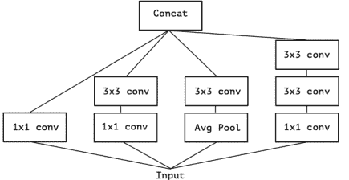
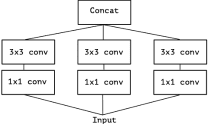
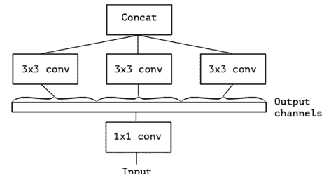
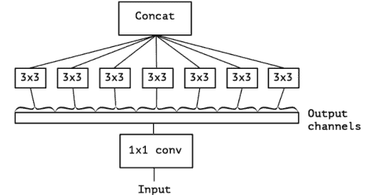
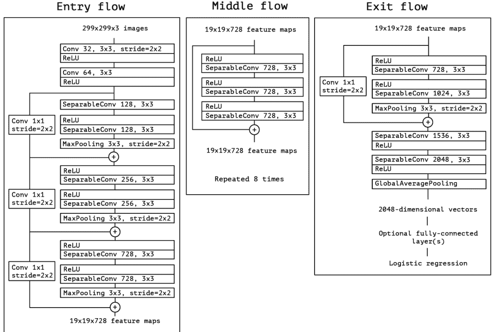
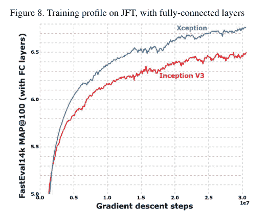
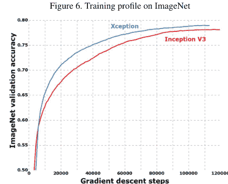
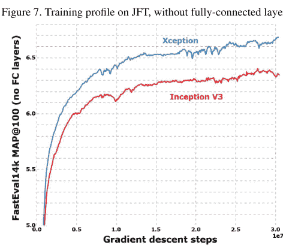
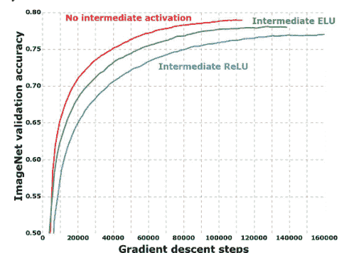

# Xception：深度可分离卷积深度学习

## 1. 引言

卷积神经网络近年来已成为计算机视觉领域的主导算法，设计它们的方法备受关注。卷积神经网络设计的历史始于 LeNet 风格的模型 [10]，这些模型是用于特征提取的简单卷积堆栈和用于空间下采样的最大池化操作。2012 年，这些想法被细化为 AlexNet 架构 [9]，其中卷积操作在最大池化操作之间重复多次，使网络能够在每个空间尺度上学习更丰富的特征。随后出现了一种趋势，即使这种网络风格越来越深，主要由每年的 ILSVRC 竞赛推动；首先是 Zeiler 和 Fergus 在 2013 年 [25]，随后是 2014 年的 VGG 架构 [18]。此时，一种新的网络风格出现了，即 Inception 架构，由 Szegedy 等人在 2014 年 [20] 作为 GoogLeNet (Inception V1) 引入，后来被改进为 Inception V2 [7]、Inception V3 [21]，最近则是 Inception-ResNet [19]。Inception 本身受早期的 Network-In-Network 架构 [11] 启发。自首次推出以来，Inception 一直是 ImageNet 数据集 [14] 以及 Google 内部使用的数据集（特别是 JFT [5]）上表现最好的模型家族之一。

Inception 风格模块的基本构建块是 Inception 模块，存在多个不同版本。在图 1 中，我们展示了 Inception 模块的经典形式，如在 Inception V3 架构中所示。Inception 模型可以理解为此类模块的堆栈。这与早期的 VGG 风格网络（即简单卷积层的堆栈）有所不同。

虽然 Inception 模块在概念上类似卷积（它们是卷积特征提取器），但实证上它们似乎能够用更少的参数学习更丰富的表示。它们如何工作，又与常规卷积有何不同？Inception 之后的设计策略是什么？

### 1.1. Inception 假设

卷积层试图在 3D 空间中学习滤波器，包含 2 个空间维度（宽度和高度）和一个通道维度；因此，单个卷积核的任务是同时映射跨通道相关性和空间相关性。Inception 模块背后的想法是，通过将此过程明确分解为一系列独立查看跨通道相关性和空间相关性的操作，使该过程更容易、更高效。更准确地说，典型的 Inception 模块首先通过一组 1x1 卷积查看跨通道相关性，将输入数据映射到 3 个或 4 个小于原始输入空间的独立空间，然后通过常规 3x3 或 5x5 卷积映射这些较小 3D 空间中的所有相关性。这在图 1 中有所说明。实际上，Inception 背后的根本假设是，跨通道相关性和空间相关性足够解耦，因此最好不要将它们联合映射。

1 该过程的一个变体是独立查看宽度方向相关性和高度方向相关性。这是由 Inception V3 中发现的一些模块实现的，这些模块交替使用 7x1 和 1x7 卷积。

考虑一个仅使用一种卷积大小（例如 3x3）且不包含平均池化塔的简化版 Inception 模块（图 2）。该 Inception 模块可以重新表述为先进行一个大的 1x1 卷积，然后进行在输出通道非重叠段上运行的空间卷积（图 3）。这一观察自然引发了一个问题：分区中的段数（及其大小）有什么影响？是否合理做出比 Inception 假设更强的假设，并假设跨通道相关性和空间相关性可以完全分开映射？

图 1. 标准的 Inception 模块 (Inception V3)。

图 2. 简化的 Inception 模块。

### 1.2. 卷积与可分离卷积之间的连续谱

基于这一更强假设的 Inception 模块“极端”版本，将首先使用 1x1 卷积映射跨通道相关性，然后分别映射每个输出通道的空间相关性。这在图 4 中所示。我们指出，Inception 模块的这种极端形式几乎与深度可分离卷积相同，该操作早在 2014 年 [15] 就已用于神经网络设计，并且自 2016 年被包含在 TensorFlow 框架 [1] 以来变得更加流行。这种空间可分离卷积在图像处理中有着悠久的历史，并且自 2012 年（可能更早）以来已被用于一些卷积神经网络实现。

图 3. 简化 Inception 模块的严格等价重构。

图 4. 我们 Inception 模块的“极端”版本，1x1 卷积的每个输出通道对应一个空间卷积。

深度可分离卷积，通常在 TensorFlow 和 Keras 等深度学习框架中称为“可分离卷积”，由深度卷积（即对输入的每个通道独立执行的空间卷积）组成，随后是点wise 卷积（即 1x1 卷积），将深度卷积输出的通道投影到新的通道空间。这不应与空间可分离卷积混淆，后者在图像处理社区中也通常被称为“可分离卷积”。

Inception 模块的“极端”版本与深度可分离卷积之间存在两点微小差异：

- 操作顺序：通常实现的深度可分离卷积（例如在 TensorFlow 中）先执行通道方向空间卷积，再执行 1x1 卷积，而 Inception 先执行 1x1 卷积。
- 第一次操作后是否存在非线性。在 Inception 中，两个操作后都跟有 ReLU 非线性，而深度可分离卷积通常实现为没有非线性。

我们认为第一点差异不重要，特别是因为这些操作旨在堆叠设置中使用。第二点差异可能很重要，我们将在实验部分进行研究（特别是参见图 10）。

我们还指出，介于常规 Inception 模块和深度可分离卷积之间的其他中间 Inception 模块公式也是可能的：实际上，常规卷积和深度可分离卷积之间存在一个离散光谱，由用于执行空间卷积的独立通道空间段数量参数化。常规卷积（由 1x1 卷积前置）是此光谱的一端，对应于单段情况；深度可分离卷积对应于另一端，其中每个通道对应一个段；Inception 模块介于两者之间，将几百个通道划分为 3 个或 4 个段。这种中间模块的属性似乎尚未被探索。

基于这些观察，我们建议可以通过用深度可分离卷积替换 Inception 模块来改进 Inception 架构家族，即构建由深度可分离卷积堆叠而成的模型。这得益于 TensorFlow 中可用的高效深度卷积实现，变得可行。在接下来的内容中，我们将介绍基于这一想法的卷积神经网络架构，其参数数量与 Inception V3 相似，并评估其在两个大规模图像分类任务上的性能，以 Inception V3 为对比。

## 2. 相关工作

本工作在很大程度上依赖于以下领域的先前工作：

- 卷积神经网络 [10, 9, 25]，特别是 VGG-16 架构 [18]，该架构在几个方面在示意图上与我们提出的架构相似。
- 卷积神经网络的 Inception 架构家族 [20, 7, 21, 19]，它首次证明了将卷积分解为多个分支的优势，这些分支依次对通道和空间进行操作。
- 深度可分离卷积，我们提出的架构完全基于此。虽然在神经网络中使用空间可分离卷积有着悠久的历史，可以追溯到至少 2012 年 [12]（但可能更早），但深度版本较新。Laurent Sifre 在 2013 年于 Google Brain 实习期间开发了深度可分离卷积，并将其用于 AlexNet 以获得准确率的小幅提升和收敛速度的大幅提升，以及模型大小的显著降低。他的工作概况首次在 ICLR 2014 [23] 的演示中公开。详细的实验结果在 Sifre 的论文第 6.2 节 [15] 中报告。关于深度可分离卷积的这项初步工作受到 Sifre 和 Mallat 关于变换不变散射 [16, 15] 的早期研究启发。后来，深度可分离卷积被用作 Inception V1 和 Inception V2 [20, 7] 的第一层。在 Google 内部，Andrew Howard [6] 引入了使用深度可分离卷积的高效移动模型 MobileNets。Jin 等人在 2014 年 [8] 和 Wang 等人在 2016 年 [24] 也进行了相关工作，旨在使用可分离卷积减少卷积神经网络的大小和计算成本。此外，我们的工作只有由于 TensorFlow 框架 [1] 中包含高效的深度可分离卷积实现才成为可能。
- 残差连接，由 He 等人在 [4] 中引入，我们提出的架构广泛使用了残差连接。

## 3. Xception 架构

我们提出了一种完全基于深度可分离卷积层的卷积神经网络架构。实际上，我们做出以下假设：卷积神经网络特征图中的跨通道相关性和空间相关性的映射可以完全解耦。由于此假设是 Inception 架构背后假设的更强版本，我们将我们提出的架构命名为 Xception，代表“极端 Inception”。

网络规格的完整描述在图 5 中给出。Xception 架构有 36 个卷积层，构成了网络的特征提取基础。在我们的实验评估中，我们将专门研究图像分类，因此我们的卷积基础之后将跟随一个逻辑回归层。可选地，可以在逻辑回归层之前插入全连接层，这将在实验评估部分中探讨（特别是，参见图 7 和图 8）。36 个卷积层结构化为 14 个模块，所有模块都围绕它们具有线性残差连接，除了第一个和最后一个模块。

简而言之，Xception 架构是带有残差连接的深度可分离卷积层的线性堆叠。这使得架构非常易于定义和修改；使用 Keras [2] 或 TensorFlow-Slim [17] 等高级库只需 30 到 40 行代码，与 VGG-16 [18] 等架构不相上下，但却不

像 Inception V2 或 V3 这样定义起来远为复杂的架构。Xception 使用 Keras 和 TensorFlow 的开源实现作为 Keras Applications 模块²的一部分提供，采用 MIT 许可证。

## 4. 实验评估

我们选择将 Xception 与 Inception V3 架构进行比较，因为它们的规模相似：Xception 和 Inception V3 拥有几乎相同数量的参数（表 3），因此任何性能差距都不能归因于网络容量的差异。我们在两个图像分类任务上进行比较：一项是在 ImageNet 数据集 [14] 上广为人知的 1000 类单标签分类任务，另一项是在大规模 JFT 数据集上的 17,000 类多标签分类任务。

### 4.1. JFT 数据集

JFT 是 Google 的一个内部大规模图像分类数据集，最初由 Hinton 等人在 [5] 中介绍，包含超过 3.5 亿张带有来自 17,000 个类别标签集的高分辨率图像。为评估在 JFT 上训练的模型性能，我们使用了一个辅助数据集 FastEval14k。

FastEval14k 是一个包含 14,000 张图像的数据集，来自约 6,000 个类别的密集标注（平均每张图像 36.5 个标签）。在此数据集上，我们使用前 100 预测的平均平均精度（MAP@100）来评估性能，并用一个估计该类别在社交媒体图像中出现频率（因此重要性）的分数来加权每个类别对 MAP@100 的贡献。此评估流程旨在捕捉社交媒体中频繁出现标签的性能，这对于 Google 的生产模型至关重要。

### 4.2. 优化配置

ImageNet 和 JFT 使用了不同的优化配置：

- 在 ImageNet 上：
  - 优化器：SGD
  - 动量：0.9
  - 初始学习率：0.045
  - 学习率衰减：每 2 个 epoch 衰减率为 0.94

- 在 JFT 上：
  - 优化器：RMSprop [22]
  - 动量：0.9
  - 初始学习率：0.001
  - 学习率衰减：每 3,000,000 个样本衰减率为 0.9

对于两个数据集，Xception 和 Inception V3 都使用了完全相同的优化配置。请注意，此配置是为 Inception V3 的最佳性能调优的；我们未尝试为 Xception 调优优化超参数。由于两个网络具有不同的训练特征（图 6），这可能是次优的，尤其是在 ImageNet 数据集上，因为使用的优化配置已为 Inception V3 进行了精心调优。

此外，所有模型在推理时都使用了 Polyak 平均值 [13] 进行评估。

### 4.3. 正则化配置

- 权重衰减：Inception V3 模型使用 4e-5 的权重衰减（L2 正则化）率，该率已为 ImageNet 上的性能进行了精心调优。我们发现该率对 Xception 来说远非最优，因此改用 1e-5。我们未对最佳权重衰减率进行广泛搜索。ImageNet 实验和 JFT 实验都使用了相同的权重衰减率。

- Dropout：在 ImageNet 实验中，两个模型都在逻辑回归层之前包含一个速率为 0.5 的 Dropout 层。在 JFT 实验中，由于数据集规模很大，在任何合理的时间内过拟合都不太可能，因此未包含 Dropout。

- 辅助损失塔：Inception V3 架构可选包含一个辅助塔，用于在网络更早的位置反向传播分类损失，作为额外的正则化机制。为简单起见，我们选择在任何模型中都不包含此辅助塔。

### 4.4. 训练基础设施

所有网络均使用 TensorFlow 框架 [1] 实现，并在每台设备上使用 60 块 NVIDIA K80 GPU 进行训练。对于 ImageNet 实验，我们使用了带同步梯度下降的数据并行性以获得最佳分类性能，而对于 JFT，我们使用了异步梯度下降以加快训练。ImageNet 实验每个约需 3 天，而 JFT 实验每个超过一个月。JFT 模型未训练至完全收敛，否则每个实验将超过三个月。

图 5. Xception 架构：数据首先经过入口流，然后经过重复八次的中间流，最后经过出口流。请注意，所有 Convolution 和 SeparableConvolution 层之后都接有批量归一化 [7]（未包含在图中）。所有 SeparableConvolution 层都使用深度倍数为 1（无深度扩展）。

### 4.5. 与 Inception V3 的比较

#### 4.5.1 分类性能

所有评估均使用输入图像的单个裁剪和单个模型进行。ImageNet 结果在验证集而非测试集上报告（即 ILSVRC 2012 验证集中未列入黑名单的图像）。JFT 结果在 3000 万次迭代后（一个月的训练）报告，而非在完全收敛后。结果载于表 1 和表 2，以及图 6、图 7、图 8。在 JFT 上，我们测试了不包含任何全连接层的网络版本，以及在逻辑回归层之前包含两个各具 4096 个单元的全连接层的版本。

在 ImageNet 上，Xception 的结果略优于 Inception V3。在 JFT 上，Xception 在 FastEval14k MAP@100 指标上实现了 4.3% 的相对改进。我们还注意到，Xception 超越了 He 等人报告的 ImageNet 上的 ResNet-50、ResNet-101 和 ResNet-

表 1. ImageNet 上的分类性能比较（单裁剪，单模型）。VGG-16 和 ResNet-152 的数字仅作为提示包含在内。所测试的 Inception V3 版本不包含辅助塔。

| | Top-1 准确率 | Top-5 准确率 |
|---|---|---|
| VGG-16 | 0.715 | 0.901 |
| ResNet-152 | 0.770 | 0.933 |
| Inception V3 | 0.782 | 0.941 |
| Xception | **0.790** | **0.945** |

与 ImageNet 数据集相比，Xception 架构在 JFT 数据集上显示出更大的性能提升。我们认为这可能是因为 Inception V3 以 ImageNet 为重点开发，因此在设计上可能过度拟合于此特定任务。另一方面，两个架构都未针对 JFT 进行调优。很可能，为 Xception 在 ImageNet 上搜索更好的超参数（特别是优化参数和 reg-

| 模型 | FastEval14k MAP@100 |
|---|---|
| Inception V3 - 无全连接层 | 6.36 |
| Xception - 无全连接层 | 6.70 |
| Inception V3 - 带全连接层 | 6.50 |
| Xception - 带全连接层 | 6.78 |

V3 和 Xception。参数数量在 ImageNet 上报告（1000 个类，无全连接层），每秒训练步数（梯度更新）在使用 60 块 K80 GPU 运行同步梯度下降的 ImageNet 上报告。两个架构大小大约相同（相差 3.5% 以内），Xception 略慢。我们预计，在深度可分卷积操作层面的工程优化将在不久的将来使 Xception 比 Inception V3 更快。两个架构拥有几乎相同数量的参数这一事实表明，在 ImageNet 和 JFT 上观察到的改进并非来自增加容量，而是来自对模型参数更高效的利用。

正则化参数) 将带来显著的额外改进。

#### 4.5.2 大小和速度

| | 参数数量 | 每秒步数 |
|---|---|---|
| Inception V3 | 23,626,728 | 31 |
| Xception | 22,855,952 | 28 |

在表 3 中，我们比较了 Inception

连接。结果如图9所示。残差连接对于帮助收敛显然至关重要，无论是在速度还是最终分类性能方面。但是我们将指出，使用与残差模型相同的优化配置来对非残差模型进行基准测试可能过于苛刻，而且更好的优化配置可能会产生更具竞争力的结果。

此外，请注意，此结果仅表明残差连接 *对于此特定架构* 的重要性，而且残差连接绝非 *必需*，用于构建由深度可分离卷积堆叠而成的模型。我们还通过将所有卷积层替换为深度可分离卷积（深度倍数为1）的非残差VGG风格模型，获得了出色的结果，在等参数量下优于JFT上的Inception V3。

在Inception模块中发现），非线性是有帮助的，但对于浅层模块（例如，深度可分离卷积的1通道深度特征空间）而言，它变得有害，可能是由于信息丢失。

## 5. 未来方向

### 4.7. 点向卷积后中间激活的影响

我们之前指出，常规卷积和深度可分离卷积之间存在一个离散谱，其参数由用于执行空间卷积的独立通道-空间段的数量确定。Inception模块是该谱上的一点。我们在经验评估中表明，Inception模块的极端表述，即深度可分离卷积，可能优于常规Inception模块。然而，没有理由相信深度可分离卷积是最优的。谱中介于常规Inception模块和深度可分离卷积之间的中间点可能具有更多优势。这个问题留待今后调查。

图10. 可分离卷积层中深度卷积和逐点卷积操作之间不同激活的训练概况。

## 6. 结论

我们展示了卷积和深度可分离卷积处于离散谱的两个极端，而Inception模块是介于两者之间的中间点。这一观察促使我们提出在神经计算机视觉架构中用深度可分离卷积替换Inception模块。我们基于这一想法提出了一种新架构，名为Xception，其参数量与Inception V3相似。与Inception V3相比，Xception在ImageNet数据集上的分类性能有小幅提升，在JFT数据集上则有大幅提升。我们预期深度可分离卷积将在未来成为卷积神经网络架构设计的基石，因为它们与Inception模块具有相似特性，但使用起来像常规卷积层一样简单。

我们之前提到，深度可分离卷积与Inception模块之间的类比表明，深度可分离卷积可能应该在深度卷积和逐点卷积操作之间包含非线性。在迄今报告的实验中，未包含此类非线性。然而，我们还实验性地测试了将ReLU或ELU [3]作为中间非线性的加入。图10在ImageNet上报告了结果，并表明没有任何非线性会导致更快的收敛和更好的最终性能。

## 参考文献

- [1] M. Abadi, A. Agarwal, P. Barham, E. Brevdo, Z. Chen, C. Citro, G. S. Corrado, A. Davis, J. Dean, M. Devin, S. Ghemawat, I. Goodfellow, A. Harp, G. Irving, M. Isard, Y. Jia, R. Jozefowicz, L. Kaiser, M. Kudlur, J. Levenberg, D. Mané, R. Monga, S. Moore, D. Murray, C. Olah, M. Schuster, J. Shlens, B. Steiner, I. Sutskever, K. Talwar, P. Tucker, V. Vanhoucke, V. Vasudevan, F. Viégas, O. Vinyals, P. Warden, M. Wattenberg, M. Wicke, Y. Yu, and X. Zheng. TensorFlow: 异构系统上的大规模机器学习, 2015. Software available from tensorflow.org.
- [2] F. Chollet. Keras. https://github.com/fchollet/keras, 2015.
- [3] D.-A. Clevert, T. Unterthiner, and S. Hochreiter. 基于指数线性单元（ELUs）的快速准确深度网络学习. arXiv preprint arXiv:1511.07289, 2015.
- [4] K. He, X. Zhang, S. Ren, and J. Sun. 面向图像识别的深度残差学习. arXiv preprint arXiv:1512.03385, 2015.
- [5] G. Hinton, O. Vinyals, and J. Dean. 在神经网络中蒸馏知识. 2015.
- [6] A. Howard. MobileNets：面向移动视觉应用的高效卷积神经网络. Forthcoming.
- [7] S. Ioffe and C. Szegedy. 批量归一化：通过减少内部协变量偏移加速深度网络训练. 在第32届国际机器学习会议论文集中，第448–456页, 2015.
- [8] J. Jin, A. Dundar, and E. Culurciello. 用于前馈加速的扁平化卷积神经网络. arXiv preprint arXiv:1412.5474, 2014.
- [9] A. Krizhevsky, I. Sutskever, and G. E. Hinton. 使用深度卷积神经网络进行ImageNet分类. 在神经信息处理系统进展中，第1097–1105页, 2012.
- [10] Y. LeCun, L. Jackel, L. Bottou, C. Cortes, J. S. Denker, H. Drucker, I. Guyon, U. Muller, E. Sackinger, P. Simard, et al. 分类学习算法：手写数字识别的比较. 神经网络：统计力学视角, 261:276, 1995.
- [11] M. Lin, Q. Chen, and S. Yan. 网络中的网络. arXiv preprint arXiv:1312.4400, 2013.
- [12] F. Mamalet and C. Garcia. 简化ConvNets以实现快速学习. 在人工神经网络国际会议（ICANN 2012）中，第58–65页. Springer, 2012.
- [13] B. T. Polyak and A. B. Juditsky. 通过平均值加速随机逼近. SIAM控制与优化期刊, 30(4):838–855, July 1992.
- [14] O. Russakovsky, J. Deng, H. Su, J. Krause, S. Satheesh, S. Ma, Z. Huang, A. Karpathy, A. Khosla, M. Bernstein, et al. ImageNet大规模视觉识别挑战. 2014.
- [15] L. Sifre. 面向图像分类的刚性运动散射, 2014. 博士论文.
- [16] L. Sifre and S. Mallat. 用于纹理判别的旋转、缩放和变形不变散射. 在2013年IEEE计算机视觉与模式识别会议，美国俄勒冈州波特兰，2013年6月23-28日，第1233–1240页, 2013.
- [17] N. Silberman and S. Guadarrama. Tf-slim, 2016.
- [18] K. Simonyan and A. Zisserman. 用于大规模图像识别的非常深的卷积网络. arXiv preprint arXiv:1409.1556, 2014.
- [19] C. Szegedy, S. Ioffe, and V. Vanhoucke. Inception-v4、Inception-ResNet及残差连接对学习的影响. arXiv preprint arXiv:1602.07261, 2016.
- [20] C. Szegedy, W. Liu, Y. Jia, P. Sermanet, S. Reed, D. Anguelov, D. Erhan, V. Vanhoucke, and A. Rabinovich. 更深层的卷积. 在IEEE计算机视觉与模式识别会议论文集中，第1–9页, 2015.
- [21] C. Szegedy, V. Vanhoucke, S. Ioffe, J. Shlens, and Z. Wojna. 重新思考计算机视觉的Inception架构. arXiv preprint arXiv:1512.00567, 2015.
- [22] T. Tieleman and G. Hinton. 通过最近幅度的运行平均值除以梯度. COURSERA：机器学习神经网络, 4, 2012. Accessed: 2015-11-05.
- [23] V. Vanhoucke. 大规模学习视觉表示. ICLR, 2014.
- [24] M. Wang, B. Liu, and H. Foroosh. 分解卷积神经网络. arXiv preprint arXiv:1608.04337, 2016.
- [25] M. D. Zeiler and R. Fergus. 可视化和理解卷积网络. 在计算机视觉–ECCV 2014中，第818–833页. Springer, 2014.

